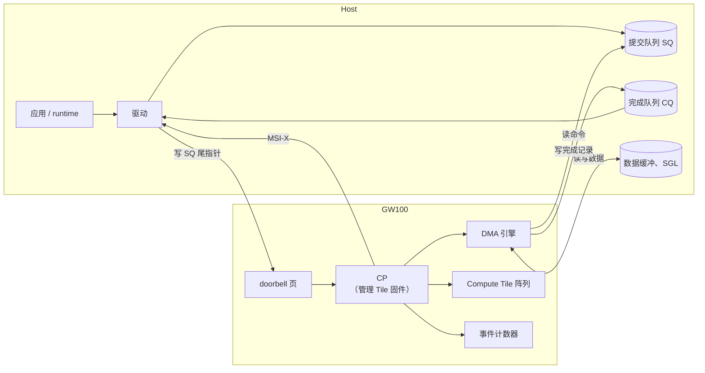
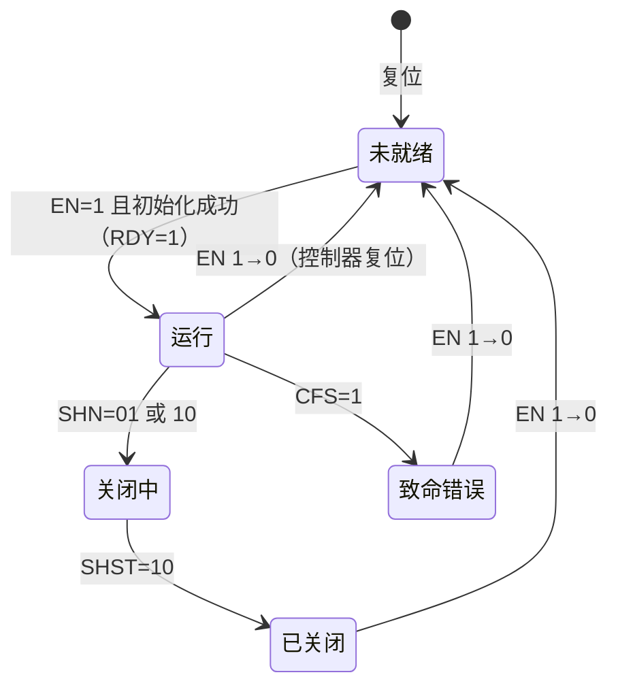
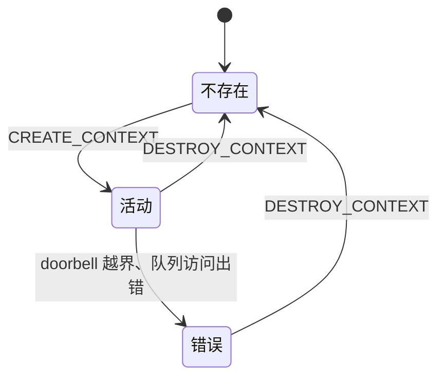
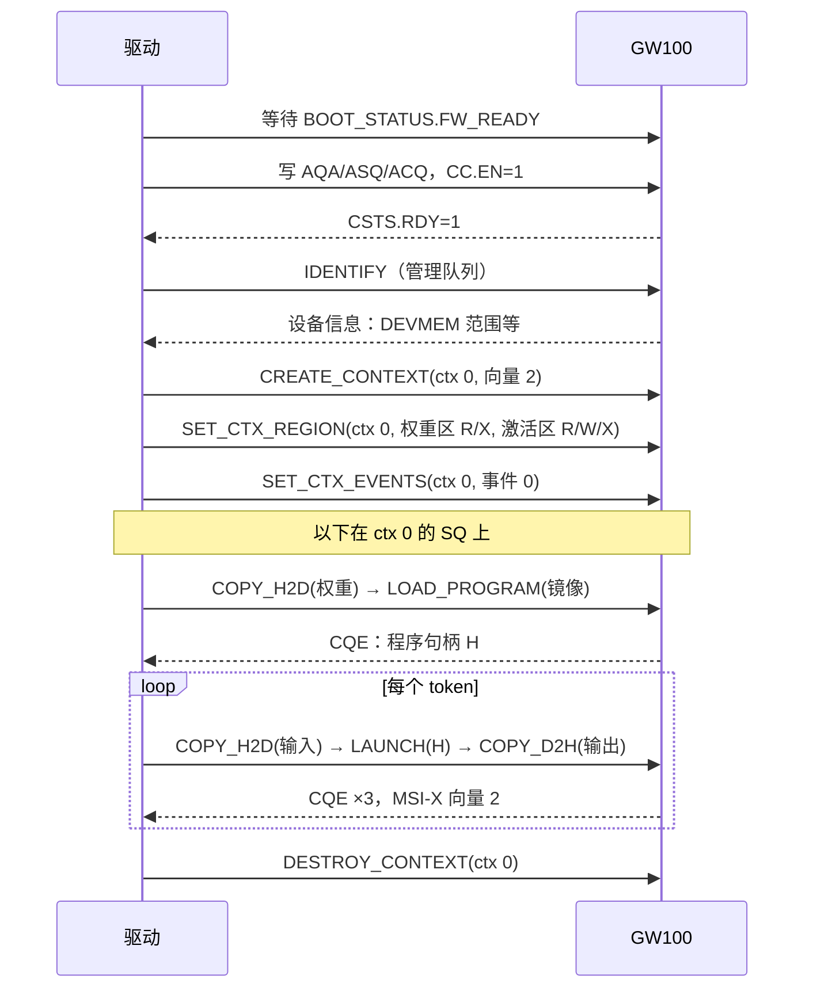

# Host-Device 接口规格（spec-hdi）

| 项 | 内容 |
|---|---|
| 版本 | v0.1 |
| 状态 | 草稿（Draft），与驱动团队联合编写 |
| 负责 | 架构线（驱动团队参与） |
| 读者 | 驱动团队（必读）、gem5 线（必读）、固件开发者（必读）、编译器团队（参考：命令语义与执行顺序）、将来的 RTL 团队（参考） |

---

## 1. 概述

### 1.1 范围

Host-Device 接口（下称 HDI）是 host 软件（驱动和 runtime）使用 GW100 的唯一协议。本文档定义：

- HDI 控制器的寄存器和 doorbell；
- 初始化、关闭和复位流程；
- 命令队列和完成队列的格式与规则；
- 命令和完成记录的格式、全部命令及其语义；
- 命令的执行顺序、上下文之间的同步；
- 上下文、设备内存隔离、中断、错误处理；
- 性能要求和验收标准。

下列内容不在本文档范围内：PCIe 链路、配置空间、BAR0 的全局寄存器和 MSI-X 机制本身（`spec-pcie`）；DMA 引擎的内部结构（`spec-host-dma`）；可执行镜像的格式（将由 `spec-exe-format`（待写） 定义）；固件的内部实现。本文档只在需要时说明它们对 host 可见的部分。

### 1.2 模型

- 命令队列和完成队列都在 **host 内存**中，由驱动分配。
- 驱动把命令写入提交队列（SQ），再写 doorbell 通知设备；设备用 DMA 读取命令、执行，然后把完成记录写入完成队列（CQ），按需发中断。
- 设备内部由 CP（运行在管理 Tile 上的固件，见 `spec-mgmt-tile`）实现 HDI。

### 1.3 术语

| 术语 | 全称 | 含义 |
|---|---|---|
| HDI | Host-Device Interface | host 与设备之间的命令协议，即本文档 |
| HDI 控制器 | HDI controller | HDI 在设备一侧的实现，分两部分：BAR0 0x5000 起的控制器寄存器和 doorbell 页由 HIF 的硬件在本地响应 host（§4，`spec-pcie` §5.3）；命令的处理由 CP 完成，CP 经影子寄存器更新寄存器的只读字段（`spec-mgmt-tile` §6.1） |
| CP | Command Processor | 运行在管理 Tile 上、实现 HDI 的固件（`spec-mgmt-tile`） |
| 上下文 | context | 隔离与调度的单位，通常对应一个使用设备的进程，绑定关系由驱动管理。每个上下文有一对 SQ/CQ、一个 doorbell 页、一张设备内存区间表和一组事件权限 |
| 管理队列 | admin queue | 一对专用的 SQ/CQ，只供内核驱动使用，用于创建上下文、配置等特权操作 |
| SQ / CQ | Submission Queue / Completion Queue | 提交队列 / 完成队列，host 内存中的环形缓冲。正文中的"命令队列"即 SQ |
| SQE / CQE | SQ Entry / CQ Entry | 提交队列条目（64 B）/ 完成队列条目（16 B）。正文中的"命令记录"即 SQE，"完成记录"即 CQE |
| CID | Command Identifier | 命令标识，由驱动分配，在完成记录中返回；同一队列中尚未完成的命令之间必须互不相同（§7.1） |
| 相位位 | phase tag | CQE 中的一位，每绕环一圈翻转一次，驱动据此判断条目是否是新的 |
| doorbell | — | host 写入后通知设备队列指针发生变化的寄存器（§4.2） |
| doorbell 页 | doorbell page | 每个队列对各一个的 4 KiB 地址页，包含其 doorbell（§4.2）；与设备内部的 doorbell 信箱（`spec-mgmt-tile` §1.3）不同 |
| 事件计数器 / 事件权限 | — | 上下文之间同步用的计数器（§10.8、§10.9）/ 上下文可以使用的事件编号（§9.6）；与 Compute Tile 内部的同步计数器不同 |
| SGL、H2D / D2H | — | 见 `spec-host-dma` §1.3 |
| DPA | — | 见 `spec-address-map` §1.3 |
| 总线地址 | — | 见 `spec-pcie` §1.4 |

### 1.4 约定

**规范用语**

| 用语 | 含义 |
|---|---|
| 必须 | MUST：不满足即不符合本规格 |
| 应 | SHOULD：除非有充分理由并记录在案，否则要满足 |
| 可 | MAY：可选 |
| TBD | 尚未确定；文中给出当前默认值，并列入 §18 待决事项 |

**单位与数值**

- 容量用二进制前缀：1 KiB = 1024 B；带宽用十进制：1 GB/s = 10⁹ B/s。
- 十六进制写作 `0x1F`；位域写作 `[高:低]`，第 0 位是最低位。
- 多字节数据一律小端序。
- 标"推算"的数字是本文作者计算所得。

**寄存器访问类型**

| 类型 | 含义 |
|---|---|
| RO | 只读，写入被忽略 |
| RW | 可读写 |
| WO | 只写；读回 0 |
| RsvdZ | 保留；读回 0，软件必须写 0 |

**参数**

带点号的名字（如 `hdi.max_contexts`）是架构参数，最终以单一真源 `arch_params.yaml` 为准；重建之前以 §16 参数表的当前值为准。

---

## 2. 设计要点

| 要点 | 做法 | 理由 |
|---|---|---|
| 队列放在 host 内存 | 驱动用一致性 DMA 内存分配 SQ/CQ | 驱动写命令只是普通内存写，不经过慢速的 MMIO；与 NVMe 等成熟协议一致，驱动实现简单 |
| 每个上下文一个 doorbell 页 | doorbell 页 4 KiB 对齐、互不共享 | 各上下文的寄存器互不干扰；为以后支持用户态直接提交预留条件（v0.1 不支持，见 §11.4） |
| 默认按序执行 | 命令默认等前面的命令全部完成才开始；明确标记 CONCURRENT 的命令才可以提前开始 | 默认行为安全，不会因为漏写依赖而算错；需要重叠时由 runtime 显式打开 |
| 设备侧隔离 | 设备检查每条命令涉及的设备地址和事件是否属于该上下文 | 多个进程共用设备时，一个进程不能读写别人的设备内存 |
| 每个上下文一个中断向量 | 创建上下文时指定 MSI-X 向量，支持中断合并 | 各上下文的完成处理互不干扰；高频完成时减少中断次数 |
| 设备内存由驱动分配 | 设备只报告可用的设备内存范围，并执行区间检查 | 分配策略留给软件，设备实现保持简单 |

---

## 3. 与 PCIe 的接口

本节汇总 HDI 用到的 PCIe 资源。

### 3.1 BAR0 中的位置

BAR0 的地址分配见 `spec-pcie` §5.1，访问规则（宽度、64 位寄存器的拆分访问、写入的可见性）见 `spec-pcie` §5.2。HDI 用到的资源：

| 资源 | 定义 |
|---|---|
| HDI 控制器寄存器（BAR0 0x0_5000 起） | 本文档 §4 |
| 管理队列和各上下文的 doorbell 页（BAR0 0x8_0000 起） | 本文档 §4.2 |
| `INT_STATUS`、`INT_MASK` | `spec-pcie` §6.1、§8.4；HDI 使用的位见本文档 §12.1 |
| `ERR_STATUS.DB_INVALID` | `spec-pcie` §6.3 |
| `BOOT_STATUS.FW_READY` | `spec-pcie` §6.4 |

HDI 控制器寄存器和 doorbell 页同样满足 `spec-pcie` §5.3：host 的读不等待固件，写不被固件反压。

### 3.2 中断向量

MSI-X 向量的分配、共用和退回 INTx 的规则见 `spec-pcie` §8.3。各 HDI 中断源使用哪个向量见 §12.1。

---

## 4. HDI 控制器寄存器

偏移相对于 BAR0 的 0x5000。这些寄存器由 HIF 在本地响应 host 的访问，固件经影子寄存器更新只读字段（`spec-mgmt-tile` §6.1）。

| 偏移 | 名称 | 类型 | 复位值 | 说明 |
|---|---|---|---|---|
| 0x000 | `HDI_CAP_LO` | RO | 见下 | 能力 |
| 0x004 | `HDI_CAP_HI` | RO | 见下 | 能力 |
| 0x008 | `HDI_VS` | RO | 0x0000_0100 | 版本 |
| 0x010 | `HDI_CC` | RW | 0 | 控制器配置 |
| 0x014 | `HDI_CSTS` | RO | 0 | 控制器状态 |
| 0x018 | `HDI_AQA` | RW | 0 | 管理队列大小 |
| 0x020 | `HDI_ASQ_LO` | RW | 0 | 管理 SQ 基地址低 32 位 |
| 0x024 | `HDI_ASQ_HI` | RW | 0 | 管理 SQ 基地址高 32 位 |
| 0x028 | `HDI_ACQ_LO` | RW | 0 | 管理 CQ 基地址低 32 位 |
| 0x02C | `HDI_ACQ_HI` | RW | 0 | 管理 CQ 基地址高 32 位 |
| 0x030 | `HDI_FATAL` | RO | 0 | 控制器致命错误的原因 |
| 0x034 | `HDI_CTX_ERR` | RO | 0 | 处于错误状态的上下文 |
| 其余 | — | RsvdZ | 0 | |

### 4.1 字段

**HDI_CAP_LO**（0x000）

| 位 | 名称 | 说明 |
|---|---|---|
| [15:0] | MQES | 支持的最大队列条目数减 1；当前为 4095（`hdi.max_queue_entries` = 4096） |
| [23:16] | MAX_CTX | 上下文个数，`hdi.max_contexts` = 16 |
| [31:24] | TO | `HDI_CC.EN` 改变后 `HDI_CSTS.RDY` 跟随变化的最长时间，单位 500 ms；当前为 4（2 s） |

**HDI_CAP_HI**（0x004）

| 位 | 名称 | 说明 |
|---|---|---|
| [7:0] | NUM_EVENTS | 事件计数器个数，`hdi.num_events` = 64 |
| [11:8] | CTX_REGIONS | 每个上下文的设备内存区间数，`hdi.ctx_regions` = 8 |
| [31:12] | — | RsvdZ |

**HDI_VS**（0x008）：[31:16] 主版本，[15:8] 次版本，[7:0] RsvdZ。本文档对应 0.1，即 0x0000_0100。主版本为 0 期间，驱动必须要求主、次版本都与自己相符。

**HDI_CC**（0x010）

| 位 | 名称 | 说明 |
|---|---|---|
| [0] | EN | 1 使能控制器；由 1 写为 0 即控制器复位（§5.4） |
| [13:1] | — | RsvdZ |
| [15:14] | SHN | 关闭通知：00 无；01 正常关闭；10 立即关闭（§5.3） |
| [31:16] | — | RsvdZ |

**HDI_CSTS**（0x014）

| 位 | 名称 | 说明 |
|---|---|---|
| [0] | RDY | 1 表示控制器可以接受命令 |
| [1] | CFS | 控制器致命错误；置位后必须复位控制器才能恢复 |
| [3:2] | SHST | 关闭状态：00 正常运行；01 关闭进行中；10 关闭完成 |
| [31:4] | — | RsvdZ |

**HDI_AQA**（0x018）：[11:0] ASQS，管理 SQ 条目数减 1；[27:16] ACQS，管理 CQ 条目数减 1；其余 RsvdZ。两者取值 1 – MQES，即 2 – 4096 个条目。

**HDI_ASQ / HDI_ACQ**：管理 SQ、CQ 的总线地址，必须 4 KiB 对齐，[11:0] RsvdZ。

`HDI_AQA`、`HDI_ASQ`、`HDI_ACQ` 只能在 `HDI_CC.EN` = 0 时写入；EN = 1 时写入被忽略。

**HDI_FATAL**（0x030）：`HDI_CSTS.CFS` = 1 时的原因码。0 无；1 管理队列 doorbell 越界；2 管理队列的 DMA 访问出错；3 固件内部错误；4 设备内部不可恢复的硬件错误；其余保留。

**HDI_CTX_ERR**（0x034）：[15:0] 第 n 位为 1 表示上下文 n 处于错误状态（§11.2）；销毁该上下文后清零。

### 4.2 doorbell 页

管理队列和每个上下文各有一个 4 KiB 的 doorbell 页，布局相同：

| 页内偏移 | 名称 | 类型 | 说明 |
|---|---|---|---|
| 0x000 | `SQ_TAIL` | WO | [15:0] SQ 新的尾指针；[31:16] RsvdZ |
| 0x004 | `CQ_HEAD` | WO | [15:0] CQ 新的头指针；[31:16] RsvdZ |
| 其余 | — | RsvdZ | 读回 0，写入被忽略 |

doorbell 必须按 32 位写入。

---

## 5. 初始化、关闭与复位

### 5.1 控制器状态

### 5.2 初始化

驱动按以下顺序初始化：

1. 在 PCI 配置空间使能 Memory Space 和 Bus Master，配置 MSI-X（至少 2 个向量，失败时退回 INTx）。
2. 等待 `BOOT_STATUS.FW_READY` = 1（BAR0 0x4000 的 bit 8）。固件尚未运行时，先按 `spec-pcie` §6.4 加载固件。
3. 读 `HDI_VS`，确认版本相符；读 `HDI_CAP_LO`、`HDI_CAP_HI`。
4. 若 `HDI_CC.EN` = 1，写 0 并等待 `HDI_CSTS.RDY` = 0。
5. 用一致性 DMA 内存分配管理 SQ 和 CQ，CQ 清零；写 `HDI_AQA`、`HDI_ASQ`、`HDI_ACQ`。
6. 写 `HDI_CC.EN` = 1，在 `HDI_CAP_LO.TO` × 500 ms 内等待 `HDI_CSTS.RDY` = 1。若 `HDI_CSTS.CFS` = 1 或超时，初始化失败。
7. 使用 INTx 时，写 `INT_MASK` 解除 ADMIN（bit 0）和 ERROR（bit 1）的屏蔽。
8. 发 IDENTIFY 命令，读取设备能力和可用的设备内存范围。
9. 按需创建上下文、配置区间和事件权限。使用 INTx 时，每创建一个使能了完成中断的上下文 n，解除 `INT_MASK` 中 bit 16 + n 的屏蔽；销毁上下文和关闭控制器之前重新屏蔽。

控制器进入运行状态时，设备必须：

- 把管理 SQ 的头、尾指针和管理 CQ 的头、尾指针置 0，CQ 的相位位从 1 开始；
- 把全部事件计数器清零；
- 不存在任何上下文。

### 5.3 关闭

1. 驱动应先销毁所有上下文（可省略，关闭会隐式销毁）。
2. 写 `HDI_CC.SHN`：
   - 01 正常关闭：设备不再读取新命令；已读取但尚未开始的命令，以及正在等待的 WAIT_EVENT，以 ABORTED_SHUTDOWN 完成；其余正在执行的命令执行完毕（成功或失败均可），写回它们的完成记录；
   - 10 立即关闭：设备中止所有命令，不写回它们的完成记录。
3. 等待 `HDI_CSTS.SHST` = 10，最长 `hdi.shutdown_timeout`（TBD，默认 5 s）。等待期间，驱动必须继续处理管理 CQ 和各上下文的 CQ 并推进 `CQ_HEAD`，否则设备可能因 CQ 满而写不出完成记录，关闭无法完成。正常关闭超时时（例如某个 LAUNCH 迟迟不结束），驱动改写 SHN = 10，或直接写 `HDI_CC.EN` = 0。
4. 驱动可以写 `HDI_CC.EN` = 0，或直接让设备进入 D3hot。

设备必须在所有发往 host 的写请求都已离开设备之后，才置 SHST = 10。根据 PCIe 顺序规则，设备为 host 的 MMIO 读返回的完成（Relaxed Ordering 为 0）不会越过它此前发出的写，因此驱动读到 SHST = 10 时，这些写都已到达 host。此后设备不再访问 host 内存，也不再发中断。

### 5.4 控制器复位

`HDI_CC.EN` 由 1 写为 0 时，设备必须：

1. 停止读取所有 SQ；
2. 中止所有正在执行的命令，不写回完成记录；
3. 停止发出与 HDI 相关的 host 请求：尚未发出的丢弃；已发出的读请求等其完成或超时；已发出的写请求必须都已离开设备；
4. 销毁所有上下文，卸载所有程序，清零事件计数器；
5. 在 `HDI_CAP_LO.TO` × 500 ms 内把 `HDI_CSTS.RDY` 清零，同时清零 `CFS` 和 `SHST`。

RDY 清零后，设备不再访问任何 HDI 相关的 host 内存。与 §5.3 同理，驱动读到 RDY = 0 时，设备此前发出的写都已到达 host，驱动可以释放队列和缓冲。控制器复位不重启固件。FLR 同样不重启固件（`spec-pcie` §13.2），但会复位 HDI 的全部状态和配置空间的 Command 寄存器，驱动必须从 §5.2 第 1 步重新开始；第 2 步只需等待 `FW_READY`，不需要重新加载固件。热复位等会重启固件的复位之后，驱动也从第 1 步重新开始，并在第 2 步重新加载固件。

---

## 6. 队列

### 6.1 格式与大小

| 项 | SQ | CQ |
|---|---|---|
| 条目大小 | 64 B | 16 B |
| 条目数 | 2 – `hdi.max_queue_entries`（4096），不要求 2 的幂 | 同左 |
| 位置 | host 内存，总线地址连续 | 同左 |
| 对齐 | 基地址 4 KiB 对齐 | 同左 |
| 分配方式 | 驱动应使用一致性 DMA 内存 | 同左 |

### 6.2 指针

| 指针 | 谁推进 | 谁知道 |
|---|---|---|
| SQ 尾 | 驱动写入 SQE 后推进，经 `SQ_TAIL` doorbell 告知设备 | 驱动、设备 |
| SQ 头 | 设备读取 SQE 后推进，经 CQE 的 SQHD 字段告知驱动 | 设备、驱动 |
| CQ 尾 | 设备写入 CQE 后推进 | 设备；驱动通过相位位推知 |
| CQ 头 | 驱动消费 CQE 后推进，经 `CQ_HEAD` doorbell 告知设备 | 驱动、设备 |

- 头 = 尾表示队列空；(尾 + 1) mod 条目数 = 头表示队列满。一个队列最多同时容纳 条目数 − 1 个条目。
- 驱动不得在 SQ 满时写入新的 SQE。

### 6.3 驱动的提交规则

1. 把 SQE 写到 SQ 尾指针处，推进尾指针（可以一次写多条）。
2. 保证 SQE 的写入对设备可见之后，再写 `SQ_TAIL` doorbell。在 Linux 上，`writel` 自带所需屏障；使用 `writel_relaxed` 时必须先执行 `dma_wmb()`。
3. SQE 引用的数据缓冲和 SGL，必须在写 doorbell 之前按 DMA API 完成 sync，并在对应的完成记录到达之前保持不变。

### 6.4 设备的读取规则

- 设备收到 `SQ_TAIL` 后，按顺序读取头、尾之间的 SQE。
- 设备读取 SQE 后才推进 SQ 头，并在之后写出的 CQE 的 SQHD 字段中报告。驱动据此回收 SQ 空间。
- 设备可以一次读取多条 SQE，但每个上下文预取的 SQE 不得超过 `hdi.sq_prefetch`（TBD，默认 8）条。

### 6.5 完成队列与相位位

- 控制器使能或上下文创建后，CQ 的相位位从 1 开始。驱动必须把 CQ 清零后再交给设备。
- 设备每写一条 CQE，把当前相位位写入其 P 字段；CQ 尾指针回绕到 0 时相位位翻转。
- **CQE 的发布顺序**：PCIe 不保证一个 16 B 写请求的各字节对 CPU 同时可见。因此设备必须分两次写出一条 CQE：先写 DW0 – DW2（12 B），再单独写 DW3（4 B，含 P、CID 和状态）。两次写的 Relaxed Ordering 均为 0，根据 PCIe 顺序规则，DW3 不会早于 DW0 – DW2 到达。本规格假设 host 平台对 4 B 对齐的单个 DW 写入是原子可见的（TBD：需要在目标平台上确认）。
- 驱动从 CQ 头开始，逐条读取 DW3，检查 P 是否等于当前期望的相位，相等即为新条目。读到新条目后，驱动必须先执行读屏障（Linux 的 `dma_rmb()`），再读 DW0 – DW2。处理后推进头指针，回绕时翻转期望的相位。处理完一批后写 `CQ_HEAD` doorbell。
- 在 DMA 不一致的 host 上，驱动读取 CQE 之前，必须按 DMA API 使对应的 cache 失效（使用一致性 DMA 内存时由操作系统保证）。
- **设备不得覆盖尚未被消费的 CQE**：CQ 满时，设备暂停写出新的完成记录，相应的命令保持未完成状态，直到驱动推进 CQ 头。
- 为避免阻塞，驱动必须保证“已提交、但完成记录尚未被消费”的命令数不超过 CQ 条目数 − 1，并持续消费 CQ。只让 CQ 不小于 SQ 是不够的：设备读取 SQE 后 SQ 头就会前进，驱动可以继续提交，而 CQ 中的完成记录可能还没有被消费。

### 6.6 doorbell 的合法性

| 情形 | 判定 |
|---|---|
| `SQ_TAIL` ≥ SQ 条目数 | 越界 |
| `CQ_HEAD` ≥ CQ 条目数 | 越界 |
| `CQ_HEAD` 越过了设备已写出的 CQE（即释放了尚未写出的条目） | 越界 |
| 写入尚未创建的上下文的 doorbell 页 | 忽略，置 `ERR_STATUS.DB_INVALID` |

越界时，设备忽略这次写入，置 `ERR_STATUS.DB_INVALID`，并且：

- 管理队列越界：控制器进入致命错误状态（`HDI_CSTS.CFS` = 1，`HDI_FATAL` = 1）；
- 上下文的队列越界：该上下文进入错误状态（§11.2）。

设备只能发现上表中的情形。驱动越过 SQ 头覆盖尚未被读取的 SQE，或一次把尾指针推进超过一圈，设备都无法发现，后果是设备读到被覆盖的命令。这类错误只影响该上下文自身，因为设备仍会检查命令中的设备地址和事件权限（§11.3）。驱动必须按完成记录中的 SQHD 维护 SQ 的可用空间，保证不发生这种情况。

---

## 7. 命令与完成记录

### 7.1 提交队列条目（SQE，64 B）

| 字 | 位 | 名称 | 说明 |
|---|---|---|---|
| DW0 | [7:0] | OPC | 操作码，见 §9、§10 |
| | [8] | CONCURRENT | 允许本命令在之前的命令完成前开始（§10.1）；管理队列忽略此位 |
| | [9] | NO_SNOOP_OK | 允许对本命令的数据传输设置 PCIe No Snoop 属性 |
| | [10] | RELAXED_OK | 允许对本命令的数据传输设置 PCIe Relaxed Ordering 属性 |
| | [15:11] | — | RsvdZ |
| | [31:16] | CID | 命令标识 |
| DW1 – DW5 | | — | RsvdZ |
| DW6 – DW9 | | DPTR | 数据指针：一个 SGL 条目（§8）。命令不涉及 host 数据时 RsvdZ |
| DW10 – DW15 | | CDW10 – CDW15 | 命令相关字段 |

- 同一个队列中所有尚未完成的命令，CID 必须互不相同。设备不检查 CID 是否重复；重复时完成记录无法区分，后果由驱动承担。
- 设备必须检查所有 RsvdZ 字段为 0，不为 0 时命令以 INVALID_FIELD 失败。这样以后扩展字段时，旧设备能够明确拒绝而不是误解。
- NO_SNOOP_OK、RELAXED_OK 只是允许，设备只在 host 也在 PCIe 配置空间中使能了对应属性时才使用；队列、SGL 和完成记录的访问永不设置这两个属性。

### 7.2 完成队列条目（CQE，16 B）

| 字 | 位 | 名称 | 说明 |
|---|---|---|---|
| DW0 | [31:0] | RESULT_LO | 命令结果，含义随命令而定 |
| DW1 | [31:0] | RESULT_HI | 命令结果，含义随命令而定 |
| DW2 | [15:0] | SQHD | 写出本条目时 SQ 的头指针 |
| | [31:16] | — | RsvdZ |
| DW3 | [15:0] | CID | 对应命令的 CID |
| | [16] | P | 相位位 |
| | [24:17] | SC | 状态码 |
| | [27:25] | SCT | 状态类型 |
| | [30:28] | — | RsvdZ |
| | [31] | DNR | 1 表示原样重试也不会成功 |

SCT = 0 且 SC = 0 表示成功。

### 7.3 状态码

**SCT = 0：通用**

| SC | 名称 | 含义 | DNR |
|---|---|---|---|
| 0x00 | SUCCESS | 成功 | — |
| 0x01 | INVALID_OPCODE | 操作码不支持，或不能在该队列上使用 | 1 |
| 0x02 | INVALID_FIELD | 字段非法，包括 RsvdZ 字段不为 0 | 1 |
| 0x03 | INVALID_CONTEXT | 上下文编号越界、不存在或已存在 | 1 |
| 0x04 | ACCESS_VIOLATION | 设备地址不在本上下文的区间内，或权限不足；或事件不在本上下文的权限内 | 1 |
| 0x05 | SGL_INVALID | SGL 违反 §8.2 的规则，或总长度与命令不符 | 1 |
| 0x06 | DATA_TRANSFER_ERROR | 访问 host 内存出错。RESULT_LO：1 = 收到 UR 完成，2 = 收到 CA 完成，3 = 完成超时，4 = 收到 poisoned 完成 | 0 |
| 0x07 | DEVICE_MEMORY_ERROR | 设备内存发生不可纠正的错误 | 0 |
| 0x08 | ABORTED_BY_REQUEST | 被 ABORT 命令中止 | 1 |
| 0x09 | ABORTED_CTX_ERROR | 上下文进入错误状态，命令被中止 | 1 |
| 0x0A | INTERNAL_ERROR | 设备内部错误 | 0 |
| 0x0B | RESOURCE_EXHAUSTED | 资源不足，例如程序槽位已满 | 0 |
| 0x0C | TIMEOUT | 等待超时（WAIT_EVENT） | 0 |
| 0x0D | ABORTED_SHUTDOWN | 控制器正常关闭，命令被中止（§5.3） | 1 |

**SCT = 1：命令相关**

| SC | 名称 | 含义 | DNR |
|---|---|---|---|
| 0x00 | QUEUE_INVALID | CREATE_CONTEXT 的队列参数非法：大小越界、地址未对齐 | 1 |
| 0x01 | VECTOR_INVALID | CREATE_CONTEXT 指定的中断向量非法 | 1 |
| 0x02 | PROGRAM_INVALID | LOAD_PROGRAM 的镜像格式非法或校验失败 | 1 |
| 0x03 | PROGRAM_NOT_FOUND | 程序句柄不存在，或不属于本上下文 | 1 |
| 0x04 | PROGRAM_BUSY | 程序正在执行，不能卸载 | 0 |
| 0x05 | PROGRAM_FAULT | 程序执行出错；v0.1 不定义 RESULT 的内容 | 1 |

**SCT = 7**：实现自定义，驱动应把它当作 INTERNAL_ERROR 处理。

---

## 8. 数据指针与 SGL

### 8.1 SGL 条目格式

SGL 的条目格式（16 B 的 DATA 条目与 SEGMENT 条目）见 `spec-host-dma` §4.1。SQE 的 DPTR 是一个 SGL 条目，host 内存中的 SGL 段也由同样的条目组成：

- DPTR 为 DATA 条目时，host 数据是一段连续的缓冲。
- DPTR 为 SEGMENT 条目时，它指向 SGL 的第一段。

### 8.2 规则

SGL 必须满足 `spec-host-dma` §4.2 的规则 S1 – S9，其中"描述符的 LENGTH"对应命令给出的传输长度，"DEV_ADDR"对应命令给出的设备地址。

违反任一规则时，命令以 SGL_INVALID 失败，不传输或只传输了部分数据（目标区域内容不确定）。

---

## 9. 管理命令

管理命令只能在管理队列上提交；在上下文队列上提交时以 INVALID_OPCODE 失败。管理队列上的命令严格逐条执行：前一条完成之后，后一条才开始。

| OPC | 名称 | 用途 |
|---|---|---|
| 0x00 | NOP | 空操作 |
| 0x01 | IDENTIFY | 读取设备或上下文信息 |
| 0x02 | CREATE_CONTEXT | 创建上下文 |
| 0x03 | DESTROY_CONTEXT | 销毁上下文 |
| 0x04 | SET_CTX_REGION | 设置上下文的设备内存区间 |
| 0x05 | SET_CTX_EVENTS | 设置上下文可使用的事件 |
| 0x06 | GET_FEATURE | 读取特性 |
| 0x07 | SET_FEATURE | 设置特性 |
| 0x08 | GET_LOG | 读取日志 |
| 0x09 | ABORT | 中止命令 |

### 9.1 NOP（0x00）

无字段，直接成功。用于测试和测量命令往返延迟。

### 9.2 IDENTIFY（0x01）

| 字段 | 说明 |
|---|---|
| DPTR | 一个 DATA 条目，指向 4096 B 的 host 缓冲 |
| CDW10 [7:0] | CNS：0 = 设备信息；1 = 上下文信息 |
| CDW10 [15:8] | CNS = 1 时为上下文编号 |

设备把 4096 B 的数据结构写入缓冲。未列出的字节为 0。

**设备信息（CNS = 0）**

| 偏移 | 字节数 | 名称 | 说明 |
|---|---|---|---|
| 0 | 2 | VID | PCI Vendor ID |
| 2 | 2 | DID | PCI Device ID |
| 4 | 4 | VS | 与 `HDI_VS` 相同 |
| 8 | 32 | FW_VERSION | 固件版本，ASCII，以 0 补足 |
| 40 | 4 | HW_VERSION | 硬件版本 |
| 44 | 4 | TIMESTAMP_HZ | 设备时间戳的频率，Hz |
| 48 | 8 | DEVMEM_BASE | 可分配给上下文的设备内存起始地址（DPA） |
| 56 | 8 | DEVMEM_SIZE | 可分配的设备内存字节数 |
| 64 | 2 | MAX_CTX | 上下文个数 |
| 66 | 2 | MQES | 最大队列条目数减 1 |
| 68 | 2 | NUM_EVENTS | 事件计数器个数 |
| 70 | 1 | CTX_REGIONS | 每个上下文的区间数 |
| 71 | 1 | MAX_PROGRAMS | 每个上下文可同时装载的程序数 |
| 72 | 4 | MAX_TRANSFER | 一条传输命令的最大字节数 |
| 76 | 4 | MAX_ARG_BYTES | LAUNCH 参数的最大字节数 |
| 80 | 2 | SGL_SEG_MAX | SGL 段的最大字节数 |
| 82 | 2 | NUM_TILES | Compute Tile 个数 |
| 84 | 4 | FEATURES | [0] 支持 CONCURRENT；[1] 程序执行期间的设备内存访问受区间表约束（§11.3）；其余保留 |
| 88 | 8 | ADMIN_OPS | 第 n 位为 1 表示支持管理操作码 n（n < 64） |
| 96 | 8 | CTX_OPS | 第 n 位为 1 表示支持上下文操作码 0x40 + n |

**上下文信息（CNS = 1）**

| 偏移 | 字节数 | 名称 | 说明 |
|---|---|---|---|
| 0 | 1 | CTX_ID | |
| 1 | 1 | STATE | 0 不存在；1 活动；2 错误 |
| 2 | 1 | VECTOR | 中断向量 |
| 3 | 1 | PRIORITY | 优先级 |
| 4 | 2 | SQ_SIZE | SQ 条目数减 1 |
| 6 | 2 | CQ_SIZE | CQ 条目数减 1 |
| 8 | 8 | EVENTS | 可使用的事件位图 |
| 16 | 1 | PROGRAMS | 已装载的程序数 |
| 32 + 24 × r | 24 | REGION[r] | 区间 r：8 B 基地址、8 B 大小、4 B 权限（[0] R、[1] W、[2] X）、4 B 保留；r = 0 … 7 |

### 9.3 CREATE_CONTEXT（0x02）

| 字段 | 说明 |
|---|---|
| CDW10 [7:0] | CTX_ID：0 – `hdi.max_contexts` − 1 |
| CDW10 [12:8] | VECTOR：MSI-X 向量，0 – 31，必须是驱动已经配置好的向量；不小于 MSI-X 表项数时以 VECTOR_INVALID 失败；INTx 模式下忽略 |
| CDW10 [17:16] | PRIORITY：0 – 3，3 最高 |
| CDW10 [24] | INT_EN：1 使能完成中断；0 表示驱动轮询 CQ |
| CDW11 [15:0] | SQ_SIZE：SQ 条目数减 1，1 – MQES |
| CDW11 [31:16] | CQ_SIZE：CQ 条目数减 1，1 – MQES |
| CDW12 – CDW13 | SQ 基地址，4 KiB 对齐 |
| CDW14 – CDW15 | CQ 基地址，4 KiB 对齐 |

成功后，上下文进入活动状态：SQ、CQ 的指针为 0，CQ 相位位从 1 开始；区间表为空、事件权限为空，因此在 SET_CTX_REGION 之前，该上下文的命令无法访问任何设备内存。中断合并取默认值（每条完成记录立即中断）。

上下文已存在时以 INVALID_CONTEXT 失败。

### 9.4 DESTROY_CONTEXT（0x03）

| 字段 | 说明 |
|---|---|
| CDW10 [7:0] | CTX_ID |

设备必须：

1. 停止读取该上下文的 SQ；
2. 中止该上下文正在执行和尚未执行的命令，不写回它们的完成记录；
3. 等待该上下文所有 host 访问结束或中止；
4. 卸载该上下文的程序，清空区间表和事件权限，清除 `HDI_CTX_ERR` 的对应位；
5. 然后才写回本命令的完成记录。

本命令完成后，设备不再访问该上下文的队列和缓冲，驱动可以释放它们。处于错误状态的上下文也用本命令销毁。

### 9.5 SET_CTX_REGION（0x04）

| 字段 | 说明 |
|---|---|
| CDW10 [7:0] | CTX_ID |
| CDW10 [11:8] | REGION：区间编号，0 – `hdi.ctx_regions` − 1 |
| CDW10 [16] | R：允许读（COPY_D2H 的源、LOAD_PROGRAM 的镜像、LAUNCH 的参数） |
| CDW10 [17] | W：允许写（COPY_H2D、FILL 的目标） |
| CDW10 [18] | X：允许作为程序执行期间可访问的内存（§11.3） |
| CDW12 – CDW13 | BASE：DPA，4 KiB 对齐，必须落在 DEVMEM 范围内 |
| CDW14 – CDW15 | SIZE：字节数，4 KiB 的倍数；0 表示删除该区间 |

- 驱动负责分配设备内存。不同上下文的区间可以重叠，用于共享缓冲；是否共享由驱动决定，设备不阻止。
- 新的区间配置只对之后开始执行的命令生效；已经开始的命令按开始时的配置检查。

### 9.6 SET_CTX_EVENTS（0x05）

| 字段 | 说明 |
|---|---|
| CDW10 [7:0] | CTX_ID |
| CDW12 – CDW13 | 事件位图：第 e 位为 1 表示该上下文可以使用事件 e |

不同上下文可以被授予同一个事件，用于跨上下文同步。

### 9.7 GET_FEATURE（0x06）与 SET_FEATURE（0x07）

| 字段 | 说明 |
|---|---|
| CDW10 [7:0] | FID：特性编号 |
| CDW10 [15:8] | 特性属于某个上下文时为上下文编号 |
| CDW11 | SET_FEATURE 的值；GET_FEATURE 时 RsvdZ |

GET_FEATURE 的结果放在 CQE 的 RESULT_LO。

| FID | 名称 | 值的格式 | 默认值 |
|---|---|---|---|
| 0x01 | INT_COALESCE（按上下文） | [7:0] THR：累积多少条完成记录后中断，0 视为 1；[15:8] TIME：第一条未通知的完成记录写出后最多等多久就中断，单位 10 µs，0 表示不等待 | THR = 1，TIME = 0 |
| 0x02 | ARB_WEIGHT（按上下文） | [3:0] 同一优先级内的调度权重 1 – 15，0 视为 1 | 1 |
| 0x03 | DEBUG_WINDOW（全局，CDW10 [15:8] 忽略） | [0] EN：开启 BAR2 调试窗口（`spec-pcie` §7.3）。[31:1] RsvdZ | 0 |

DEBUG_WINDOW 的规则：

- 只能经管理队列设置（管理队列只供内核驱动使用，§1.3）。开启后 host 可以读写任意设备内存，绕过上下文隔离，驱动不得把它开放给不可信的用户。
- SET_FEATURE 完成时，新状态已经生效：`DEV_STATUS.DEBUG_WIN` 已等于 EN。关闭时，完成之前到达的 BAR2 访问按开启状态处理，之后到达的按关闭处理。
- GET_FEATURE 返回实际状态。熔丝禁止调试时，SET_FEATURE 写 EN = 1 以 ACCESS_VIOLATION 失败，GET_FEATURE 返回 0。保留位不为 0 时以 INVALID_FIELD 失败。
- 设备复位、热复位、FLR 后为 0。

### 9.8 GET_LOG（0x08）

| 字段 | 说明 |
|---|---|
| DPTR | host 缓冲 |
| CDW10 [7:0] | LID：日志编号 |
| CDW11 | 读取的字节数，4 的倍数，不超过 4096 |

| LID | 名称 | 内容 |
|---|---|---|
| 0x01 | 错误日志 | 最近 `hdi.error_log_entries`（64）条错误，每条 64 B，从新到旧：8 B 时间戳、1 B 上下文编号（0xFF 表示管理队列或全局）、1 B SCT、1 B SC、1 B OPC、2 B CID、2 B 保留、48 B 附加信息（v0.1 全为 0） |
| 0x02 | 统计 | v0.1 不支持，以 INVALID_FIELD 失败；格式待定 |

### 9.9 ABORT（0x09）

| 字段 | 说明 |
|---|---|
| CDW10 [7:0] | CTX_ID |
| CDW10 [31:16] | 要中止的命令的 CID |

尽力而为：

- 目标命令尚未开始：设备把它以 ABORTED_BY_REQUEST 完成。
- 目标命令正在执行：设备可以中止它（以 ABORTED_BY_REQUEST 完成），也可以让它执行完毕。
- 目标命令已完成或不存在：本命令仍然成功。

RESULT_LO 的 [0] 为 1 表示目标命令确实被中止。

---

## 10. 上下文命令

上下文命令在上下文的 SQ 上提交；在管理队列上提交时以 INVALID_OPCODE 失败。

| OPC | 名称 | 用途 |
|---|---|---|
| 0x40 | NOP | 空操作 |
| 0x41 | COPY_H2D | host 内存 → 设备内存 |
| 0x42 | COPY_D2H | 设备内存 → host 内存 |
| 0x43 | FILL | 用 32 位图样填充设备内存 |
| 0x48 | LOAD_PROGRAM | 装载可执行镜像，得到程序句柄 |
| 0x49 | UNLOAD_PROGRAM | 卸载程序 |
| 0x4A | LAUNCH | 运行程序 |
| 0x50 | SIGNAL_EVENT | 设置或增加事件计数器 |
| 0x51 | WAIT_EVENT | 等待事件计数器达到某个值 |
| 0x52 | TIMESTAMP | 把设备时间戳写入 host 内存 |

### 10.1 执行顺序

| 规则 | 内容 |
|---|---|
| E1 | 设备按 SQ 中的顺序读取和开始命令 |
| E2 | CONCURRENT = 0 的命令，必须等本队列中之前的所有命令完成之后才开始 |
| E3 | CONCURRENT = 1 的命令，可以在之前的命令完成之前开始。设备可以让它与之前的命令并发执行，也可以仍然按顺序执行，两者都符合本规格 |
| E4 | 完成记录按完成的先后写入 CQ，不一定按提交顺序；驱动用 CID 对应命令 |
| E5 | 写出完成记录时，命令的效果必须已经可见：H2D、FILL 的数据已写入设备内存；D2H 的数据已发往 host，并且根据 PCIe 顺序规则不会晚于这条完成记录到达；LAUNCH 的程序已结束，它对设备内存的写入已可见；SIGNAL_EVENT 的计数器已更新 |
| E6 | 不同上下文之间不保证任何顺序，只能用事件同步 |
| E7 | WAIT_EVENT 对之后的命令起屏障作用：之后的命令，不论 CONCURRENT 是否为 1，都要等 WAIT_EVENT 完成后才开始 |

需要重叠的常见场景：上一批计算进行时，用 CONCURRENT = 1 的 COPY_H2D 预先传入下一批输入；依赖于这批输入的 LAUNCH 用 CONCURRENT = 0，自然等前面的命令全部完成。

### 10.2 调度

- 多个上下文都有可执行的命令时，设备先调度优先级高的上下文；同一优先级内按 ARB_WEIGHT 加权轮询，以命令为单位。
- 正在执行的 LAUNCH 不会被抢占（v0.1）。
- 任一上下文都不得被无限期饿死：同一优先级内，每个有待执行命令的上下文在有限的调度轮次内必定得到调度。

### 10.3 COPY_H2D（0x41）与 COPY_D2H（0x42）

| 字段 | 说明 |
|---|---|
| DPTR | host 侧数据：DATA 条目（连续缓冲）或 SEGMENT 条目（SGL） |
| CDW12 – CDW13 | DEV_ADDR：DPA，4 B 对齐 |
| CDW14 | LENGTH：字节数，4 的倍数，1 – `hdi.max_transfer`（256 MiB） |

- COPY_H2D 要求 [DEV_ADDR, DEV_ADDR + LENGTH) 完全落在本上下文一个带 W 权限的区间内；COPY_D2H 要求落在一个带 R 权限的区间内。否则以 ACCESS_VIOLATION 失败，且不传输任何数据。
- 一次传输不能跨越两个区间，即使两者相邻。

### 10.4 FILL（0x43）

| 字段 | 说明 |
|---|---|
| CDW12 – CDW13 | DEV_ADDR，4 B 对齐 |
| CDW14 | LENGTH，4 的倍数，1 – `hdi.max_transfer` |
| CDW15 | PATTERN：32 位图样，按小端序重复写入 |

要求目标范围落在一个带 W 权限的区间内。

### 10.5 LOAD_PROGRAM（0x48）

| 字段 | 说明 |
|---|---|
| CDW12 – CDW13 | IMAGE_ADDR：可执行镜像在设备内存中的地址 |
| CDW14 | IMAGE_SIZE：字节数 |

- 驱动先用 COPY_H2D 把镜像传到设备内存，再发本命令。镜像范围必须落在一个带 R 权限的区间内。
- 设备解析并校验镜像；镜像格式不在本文档范围内。格式非法时以 PROGRAM_INVALID 失败；程序槽位已满（每个上下文 `hdi.max_programs` = 16 个）时以 RESOURCE_EXHAUSTED 失败。
- 成功时 RESULT_LO 为程序句柄，非 0，只在本上下文内有效。
- 本命令完成后，镜像所在的设备内存可以被覆盖或释放，除非镜像格式另有规定。

### 10.6 UNLOAD_PROGRAM（0x49）

| 字段 | 说明 |
|---|---|
| CDW10 | 程序句柄 |

句柄不存在或不属于本上下文时以 PROGRAM_NOT_FOUND 失败；程序正在执行时以 PROGRAM_BUSY 失败。

### 10.7 LAUNCH（0x4A）

| 字段 | 说明 |
|---|---|
| CDW10 | 程序句柄 |
| CDW11 | ENTRY：入口编号（一个镜像可以有多个入口），含义由镜像格式定义 |
| CDW12 – CDW13 | ARG_ADDR：参数缓冲的 DPA；ARG_SIZE 为 0 时 RsvdZ |
| CDW14 | ARG_SIZE：参数字节数，0 – `hdi.max_arg_bytes`（4096） |

- 参数缓冲必须落在一个带 R 权限的区间内。
- 程序正常结束时命令成功，RESULT_LO 为程序的退出码。
- 程序执行出错（非法指令、访问越界等）时以 PROGRAM_FAULT 失败。v0.1 不定义 RESULT_LO、RESULT_HI 的内容，驱动不得解析；错误日志只记录该命令的上下文、OPC、CID 和状态码。更详细的诊断信息待定。
- 程序执行期间的设备内存访问约束见 §11.3。

### 10.8 SIGNAL_EVENT（0x50）

| 字段 | 说明 |
|---|---|
| CDW10 [7:0] | EVENT：事件编号，0 – `hdi.num_events` − 1 |
| CDW10 [9:8] | OP：0 = 置为 VALUE；1 = 加上 VALUE（模 2³²）；其他值非法 |
| CDW11 | VALUE |

事件不在本上下文的权限内时以 ACCESS_VIOLATION 失败。

### 10.9 WAIT_EVENT（0x51）

| 字段 | 说明 |
|---|---|
| CDW10 [7:0] | EVENT |
| CDW11 | VALUE |
| CDW12 | TIMEOUT：微秒，0 表示无限等待 |

- 当事件计数器 C 满足"C 不小于 VALUE"时，命令成功完成。比较采用模 2³² 的序列号比较：把 (C − VALUE) mod 2³² 解释为有符号 32 位整数，不小于 0 即满足。这样计数器回绕后比较仍然正确，前提是两者的差小于 2³¹。
- 超时时以 TIMEOUT 失败；事件不在本上下文的权限内时以 ACCESS_VIOLATION 失败。
- 等待期间，本队列之后的命令不开始（§10.1 E7），其他上下文不受影响。

**事件计数器**：共 `hdi.num_events` = 64 个，每个 32 位无符号；控制器使能时清零，之后只由 SIGNAL_EVENT 改变。设备内部的程序是否也能更新事件计数器，取决于镜像格式和设备内部的同步机制，TBD。

### 10.10 TIMESTAMP（0x52）

| 字段 | 说明 |
|---|---|
| DPTR | 一个 DATA 条目，指向 8 B 的 host 缓冲，8 B 对齐 |

设备在本命令开始执行时读取 64 位设备时间戳，写入缓冲。时间戳的频率见 IDENTIFY 的 TIMESTAMP_HZ。用于测量命令之间的时间间隔。

---

## 11. 上下文与隔离

### 11.1 上下文的生命周期

### 11.2 错误状态

上下文进入错误状态的条件：

- 该上下文的 doorbell 越界（§6.6）；
- 读取该上下文的 SQ 或写入其 CQ 时 host 访问出错（无法可靠地写回完成记录）。

进入错误状态时，设备必须：

1. 停止读取该上下文的 SQ；
2. 中止该上下文正在执行的命令；若 CQ 仍可写，以 ABORTED_CTX_ERROR 写回它们的完成记录，否则不写回；
3. 置 `HDI_CTX_ERR` 的对应位，在错误日志中记录原因，并发错误中断（向量 1）。

处于错误状态的上下文只能被销毁。其他上下文和管理队列不受影响。

### 11.3 设备侧的检查

| 对象 | 检查 | 失败时 |
|---|---|---|
| COPY、FILL、LOAD_PROGRAM、LAUNCH 中的设备地址 | 整个范围落在本上下文一个区间内，且权限满足要求 | ACCESS_VIOLATION，不执行 |
| SIGNAL_EVENT、WAIT_EVENT 的事件编号 | 在本上下文的事件权限内 | ACCESS_VIOLATION |
| 程序句柄 | 属于本上下文 | PROGRAM_NOT_FOUND |
| 程序执行期间的设备内存访问 | 限制在本上下文带 X 权限的区间内，越界时 LAUNCH 以 PROGRAM_FAULT 结束。由 Compute Tile NI 的执行期区间检查实现（`spec-address-map` §5.2），IDENTIFY 的 FEATURES[1] 为 1。v0.1 中不同上下文的 LAUNCH 按顺序执行，信任边界见 `spec-address-map` §5.1 | PROGRAM_FAULT |
| SQE 的保留字段 | 必须为 0 | INVALID_FIELD |

设备**不检查** host 侧的地址：DPTR、SGL、队列地址都由驱动负责。host 内存的隔离依赖 host 的 IOMMU。

### 11.4 用户态直接提交

v0.1 不支持用户态直接提交：所有命令都必须由内核驱动写入 SQ，doorbell 页不得映射给用户进程。

理由：设备只有一个 PCIe 功能，且不支持 PASID，设备代表所有上下文发出的 DMA，在 host 的 IOMMU 看来属于同一个地址空间。如果允许进程直接写 SQE，进程可以在 DPTR 或 SGL 中填入其他进程的 DMA 地址，IOMMU 无法拦截。因此驱动必须在内核中提交命令，并保证命令中的 host 地址都来自该进程自己的缓冲。

以后若要支持用户态直接提交，需要能按进程区分 DMA 的硬件机制（例如 PASID，或每个上下文一个虚拟功能），届时另行定义。

---

## 12. 中断

### 12.1 中断源

| 中断源 | MSI-X 向量 | `INT_STATUS` 位（BAR0 0x020） |
|---|---|---|
| 管理 CQ 有新的完成记录 | 0 | [0] ADMIN |
| 控制器致命错误、上下文进入错误状态、doorbell 越界，以及 BAR0 0x030 的 `ERR_STATUS` 任一位置位 | 1 | [1] ERROR |
| 固件事件（例如启动完成） | 0 | [2] FW_EVENT |
| 上下文 n 的 CQ 满足中断合并条件（仅 INT_EN = 1 时） | 创建时指定的向量（0 – 31） | [16 + n] |

MSI-X 和 INTx 两种模式下 `INT_STATUS` 的置位、清零和中断的发送规则见 `spec-pcie` §8.4。INTx 模式下，驱动处理完对应的 CQ 后再写 1 清零相应位。

### 12.2 完成中断与合并

- 上下文的 INT_EN = 0 时，设备不为它发完成中断，也不置 `INT_STATUS` 的对应位，驱动轮询 CQ。管理 CQ 总是发中断，不做合并。
- 对每个 INT_EN = 1 的上下文，设备维护"已写出但尚未通知的 CQE 个数" N，以及第一条未通知 CQE 写出的时刻 t₀。满足以下任一条件时发中断，然后把 N 清零：
  - N ≥ THR；
  - N ≥ 1，且距 t₀ 已过 TIME × 10 µs。
- 状态不是 SUCCESS 的完成记录不受合并限制，写出后立即中断。
- 中断消息必须在对应的 CQE 写出之后发送；根据 PCIe 顺序规则，驱动收到中断时 CQE 已经到达 host。

---

## 13. 错误处理汇总

| 错误 | 影响范围 | 设备行为 | 驱动的处理 |
|---|---|---|---|
| 命令字段非法、越权、SGL 非法 | 单条命令 | 以相应状态码完成，不执行 | 修正后重新提交 |
| 访问 host 内存出错（数据传输中） | 单条命令 | DATA_TRANSFER_ERROR，RESULT_LO 给出原因（§7.3） | UR、CA、poisoned：检查缓冲映射后可重试。完成超时：视为 host 或链路故障，应关闭控制器并对设备执行 FLR |
| 设备内存不可纠正错误 | 单条命令 | DEVICE_MEMORY_ERROR，记入错误日志 | 视情况重试或复位设备 |
| 程序执行出错 | 单条命令 | PROGRAM_FAULT | 交给 runtime 处理 |
| 上下文 doorbell 越界、队列访问出错 | 上下文 | 上下文进入错误状态（§11.2） | 销毁并按需重建上下文 |
| 管理队列 doorbell 越界、管理队列访问出错、固件错误 | 整个控制器 | `HDI_CSTS.CFS` = 1，`HDI_FATAL` 给出原因，发错误中断 | 控制器复位（§5.4）后重新初始化 |
| 命令长时间不完成 | — | 设备不设命令级超时（WAIT_EVENT 除外） | 驱动自行设置超时，先尝试 ABORT，再销毁上下文，最后复位控制器 |

设备内部的 DMA 通道由多个命令、多个上下文共用。一条命令的数据传输出错，不得导致其他命令或其他上下文失败；完成超时（RESULT_LO = 3）除外，它表示 host 或链路故障，驱动应关闭控制器并复位设备，其他命令随之终止。

---

## 14. 性能要求

| 编号 | 要求 |
|---|---|
| P1 | 从 `SQ_TAIL` doorbell 写入到设备发出读取 SQE 的请求，应不超过 1 µs（TBD） |
| P2 | NOP 命令的设备侧往返时间（从收到 doorbell 到写出 CQE）应不超过 5 µs（TBD） |
| P3 | 设备每秒至少处理 200,000 条 NOP 命令（所有上下文合计，TBD） |
| P4 | 1 MiB 以上的 COPY_H2D、COPY_D2H，应达到 PCIe 链路可用带宽的 90% 以上（Gen4 x4、MPS 256 B 时可用带宽约 7 GB/s，推算） |
| P5 | 合并关闭时，从写出 CQE 到发出 MSI-X 消息应不超过 1 µs（TBD） |
| P6 | 多个上下文并发时，各上下文获得的命令处理份额与 ARB_WEIGHT 成比例（同一优先级内） |

P2、P3 的依据：LLM decode 每秒约 40 个 token（推算），每个 token 若需 10 条左右命令，每秒只需数百条，远低于 P3；P3 的余量用于小算子密集的负载和多上下文并发。命令处理由固件完成，这两项目标要随固件实现复核。

---

## 15. 示例流程

### 15.1 初始化与一次推理

### 15.2 跨上下文同步

上下文 A 产出数据，上下文 B 消费，两者都被授予事件 5：

| 上下文 A | 上下文 B |
|---|---|
| LAUNCH(生产者) | WAIT_EVENT(5, VALUE = k) |
| SIGNAL_EVENT(5, OP = 加 1) | LAUNCH(消费者) |

A 的 SIGNAL_EVENT 在 LAUNCH 之后，且 CONCURRENT = 0，因此计数器增加时生产者的写入已可见（E2、E5）。B 的 LAUNCH 在 WAIT_EVENT 满足之后才开始（E7）。

---

## 16. 参数

| 参数 | 当前值 | 说明 |
|---|---|---|
| `hdi.max_contexts` | 16 | 上下文个数 |
| `hdi.max_queue_entries` | 4096 | 队列最大条目数 |
| `hdi.num_events` | 64 | 事件计数器个数 |
| `hdi.ctx_regions` | 8 | 每个上下文的设备内存区间数 |
| `hdi.max_transfer` | 256 MiB | 一条传输命令的最大字节数 |
| `hdi.max_programs` | 16 | 每个上下文同时装载的程序数 |
| `hdi.max_arg_bytes` | 4096 B | LAUNCH 参数的最大字节数 |
| `hdma.sgl_segment_max_bytes` | 见 `spec-host-dma` §12 | SGL 段的最大字节数 |
| `hdma.sgl_max_segments` | 见 `spec-host-dma` §12 | 一条命令遍历的 SGL 段数上限 |
| `hdi.shutdown_timeout` | 5 s（TBD） | 正常关闭的最长等待时间 |
| `hdi.sq_prefetch` | 8（TBD） | 每个上下文预取的 SQE 上限 |
| `hdi.error_log_entries` | 64 | 错误日志条目数 |
| `hdi.ready_timeout` | 2 s（`HDI_CAP_LO.TO` = 4） | 控制器使能、复位的最长时间 |
| `addr.device_pa_bits` | 见 `spec-address-map` §10 | DPA 宽度 |

---

## 17. 验收标准

**功能**

| 编号 | 检查 |
|---|---|
| F1 | 初始化流程（§5.2）；版本不符、超时、CFS 时的失败路径 |
| F2 | 正常关闭、立即关闭、控制器复位后不再有 host 访问和中断 |
| F3 | 队列在条目数为 2、非 2 的幂、4096 时的回绕和相位位翻转 |
| F4 | CQ 满时设备暂停写出完成记录，驱动推进 CQ 头后恢复，没有覆盖 |
| F5 | §6.6 列出的四种 doorbell 非法写入及其后果 |
| F6 | 每条命令的正常路径和每个状态码的触发路径 |
| F7 | RsvdZ 字段不为 0 时以 INVALID_FIELD 失败 |
| F8 | SGL：单条 DATA、多段链表、段内 256 个条目、违反 S1 – S6 各条 |
| F9 | 执行顺序 E1 – E7，特别是 CONCURRENT 与 WAIT_EVENT 的组合 |
| F10 | 区间检查：越界、跨区间、权限不足、删除区间后的访问 |
| F11 | 事件：权限检查、计数器回绕后的比较、超时 |
| F12 | 中断：向量分配、合并的两个条件、错误完成立即中断、INTx 模式 |
| F13 | 上下文错误状态：触发、对其他上下文无影响、销毁后恢复 |
| F14 | ABORT 对未开始、执行中、已完成命令的行为 |
| F15 | 在每个目标 host 平台上验证 4 B 对齐 DW 写入的原子可见性（§6.5 的假设）；不成立时必须修订 CQE 的发布方式 |

**性能**

| 编号 | 检查 |
|---|---|
| T1 | P1、P2、P5 的延迟 |
| T2 | P3 的命令吞吐 |
| T3 | P4 的传输带宽 |
| T4 | P6 的调度份额 |

---

## 18. 待决事项

| 事项 | 当前默认 | 影响 |
|---|---|---|
| 设备内部程序能否更新事件计数器 | 未定 | §10.9 |
| PROGRAM_FAULT 的出错信息格式 | v0.1 不定义 | §10.7 |
| 统计日志（LID 0x02）的格式 | v0.1 不支持 | §9.8 |
| 正常关闭的超时时间 | 5 s | §5.3 |
| host 对 4 B 对齐 DW 写入的原子可见性 | 假设满足 | §6.5，需要在目标平台上确认 |
| 用户态直接提交 | 不支持 | §11.4，需要 PASID 等硬件机制 |
| LAUNCH 是否可被抢占 | 不可抢占 | §10.2，影响多上下文的响应时间 |
| 一个上下文是否支持多个队列 | 只支持一对 SQ/CQ | 需要更多并行时再扩展 |
| P1 – P3、P5 的数值 | 见 §14 | 随固件实现复核 |
| SQE 预取上限 | 8 | §6.4 |
