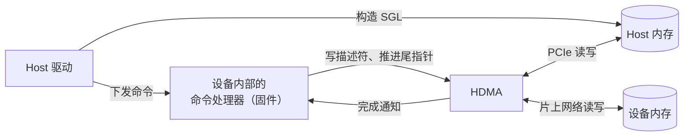
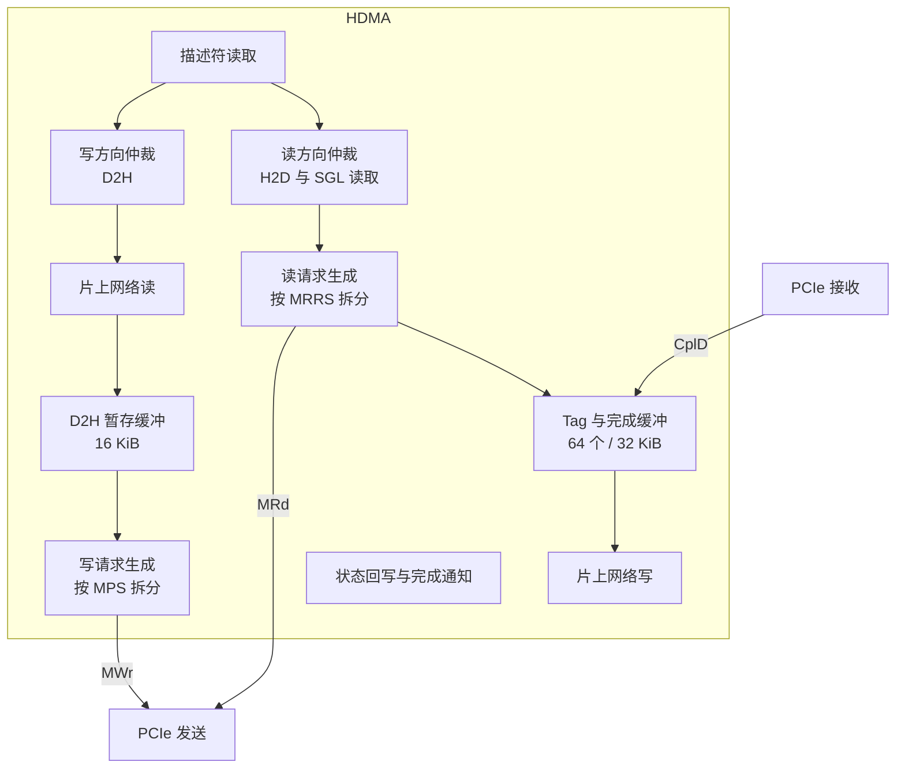

# Host DMA 引擎规格（spec-host-dma）

| 项 | 内容 |
|---|---|
| 版本 | v0.1 |
| 状态 | 草稿（Draft） |
| 负责 | 架构线 |
| 读者 | 驱动团队（必读：SGL 格式、错误语义）、gem5 线（必读）、将来的 RTL 团队（必读）、固件开发者（必读：描述符与寄存器）、编译器团队（参考） |

---

## 1. 概述

### 1.1 范围

Host DMA 引擎（下称 HDMA）负责在 host 内存和设备内存之间搬运数据。它位于设备的 PCIe 控制器与片上网络之间，经 PCIe 读写 host 内存，经片上网络读写设备内存（LPDDR5X、各 Tile 的 SRAM）。

本文档定义：

- HDMA 的结构、通道和仲裁；
- 描述符和描述符环的格式；
- host 内存中 scatter-gather 列表（SGL）的格式，由驱动构造；
- 传输、完成和顺序的语义；
- 寄存器；
- 错误处理、复位、性能要求和验收标准。

下列内容不在本文档范围内：PCIe 链路和配置空间；命令协议（命令队列、命令格式、上下文）；设备内部的同步机制和片上网络的协议。本文档只在需要时说明 HDMA 与它们的接口。

### 1.2 使用模型

- **只有设备内部的命令处理器（运行在管理 Tile 上的固件）直接编程 HDMA**：写描述符、推进描述符环的尾指针、处理完成和错误。host 不直接写 HDMA 的寄存器和描述符。
- host 驱动通过命令协议提交传输请求，请求里携带 host 侧的地址（连续缓冲或 SGL）；固件把请求翻译成 HDMA 描述符。
- host 可以经 BAR0 只读地访问 HDMA 寄存器的镜像，用于诊断（§7.4）。

这样划分的理由：

- 多个上下文共享 HDMA 时，由固件统一校验设备地址、仲裁和隔离，不必信任 host 提交的描述符。
- 驱动只需要构造 SGL，与具体的 HDMA 实现解耦，HDMA 以后改版不影响驱动。

### 1.3 约定

**规范用语**

| 用语 | 含义 |
|---|---|
| 必须 | MUST：不满足即不符合本规格 |
| 应 | SHOULD：除非有充分理由并记录在案，否则要满足 |
| 可 | MAY：可选 |
| TBD | 尚未确定；文中给出当前默认值，并列入 §11 待决事项 |

**单位与数值**

- 容量用二进制前缀：1 KiB = 1024 B；带宽用十进制：1 GB/s = 10⁹ B/s。
- 十六进制写作 `0x1F`；位域写作 `[高:低]`，第 0 位是最低位。
- 多字节数据一律小端序。
- 标"推算"的数字是本文作者计算所得；引用资料写"代号 p.N"。

**寄存器访问类型**

| 类型 | 含义 |
|---|---|
| RO | 只读，写入被忽略 |
| RW | 可读写 |
| W1S | 写 1 触发动作，写 0 无效；读回 0 |
| RsvdZ | 保留；读回 0，软件必须写 0 |

**术语**

| 术语 | 含义 |
|---|---|
| H2D | host 到设备：从 host 内存读，写入设备内存 |
| D2H | 设备到 host：从设备内存读，写入 host 内存 |
| 设备物理地址 | 设备内部地址空间中的地址，宽度 `addr.device_pa_bits`（TBD，默认 40 位） |
| 总线地址 | host 侧的 PCIe 地址，即驱动交给设备的 DMA 地址，64 位 |
| MPS / MRRS | PCIe 的最大载荷 / 最大读请求长度，由 host 在设备的 Device Control 寄存器中设置 |

**参数**

带点号的名字（如 `hdma.channels`）是架构参数，最终以单一真源 `arch_params.yaml` 为准；重建之前以 §12 参数表的当前值为准。

---

## 2. 结构

### 2.1 通道

| 项 | 要求 |
|---|---|
| 通道数 | `hdma.channels` = 8，编号 0 – 7 |
| 通道 0 | 保留给命令协议自身的流量：读取 host 内存中的命令记录、写回完成记录。严格优先于其他通道 |
| 通道 1 – 7 | 数据传输，由固件按上下文或优先级分配 |
| 每个通道 | 一个描述符环，独立的使能、暂停、中止和错误状态 |

通道 0 承载的流量小而频繁，延迟直接影响命令下发和完成通知；用严格优先保证它不被大块数据传输阻塞。

### 2.2 两个方向独立

H2D 和 D2H 使用 PCIe 的两个方向，互不占用带宽。HDMA 必须让两个方向的传输同时进行：一个方向的传输不得因另一个方向繁忙而停顿，除非两者属于同一通道且受 §5.2 的顺序约束。

### 2.3 仲裁

每个方向独立仲裁，以 PCIe 请求（一个 MRd 或一个 MWr）为粒度：

1. 通道 0 有待发请求时，先发通道 0 的。
2. 否则在通道 1 – 7 之间按加权轮询：通道 c 每轮最多发 `CH_CTRL.WEIGHT` 个请求，权重 1 – 15，写 0 视为 1。

SGL 段的读取与 H2D 数据读取同属读方向，算在所属通道的配额内。

---

## 3. 描述符环

### 3.1 结构

- 每个通道一个描述符环，位于设备内存中，由固件分配。
- 环的基地址必须 64 B 对齐；条目数是 2 的幂，范围 2 – `hdma.max_ring_entries`（1024）。
- 头指针（HEAD）由 HDMA 推进，指向下一个要处理的描述符；尾指针（TAIL）由固件推进，指向下一个空闲位置。
- HEAD = TAIL 表示环空；(TAIL + 1) mod 条目数 = HEAD 表示环满，固件不得再写入。
- 固件写好描述符后，必须保证描述符写入对 HDMA 可见，再写 `CH_TAIL`。

### 3.2 描述符格式

每个描述符 32 B，按 8 个 32 位字（DW0 – DW7）排列：

| 字 | 位 | 名称 | 说明 |
|---|---|---|---|
| DW0 | [7:0] | TYPE | 1 = H2D，2 = D2H；其他值非法 |
| | [8] | HOST_SGL | 0：HOST_ADDR 是一段连续 host 缓冲的起始地址；1：HOST_ADDR 是第一个 SGL 段的地址 |
| | [9] | NO_SNOOP | 允许对本传输的数据 TLP 设置 No Snoop，见 §5.4 |
| | [10] | RELAXED | 允许对本传输的数据 TLP 设置 Relaxed Ordering，见 §5.4 |
| | [11] | NOTIFY | 完成时向设备内部发出完成通知，见 §5.3 |
| | [12] | FENCE | 本描述符必须等本通道之前的所有描述符完成后才开始，见 §5.2 |
| | [15:13] | — | RsvdZ |
| | [31:16] | TAG | 固件自定义，HDMA 不解释，随完成通知返回 |
| DW1 | [31:0] | LENGTH | 传输的字节数；1 – `hdma.max_desc_bytes`；必须是 4 的倍数 |
| DW2 | [31:0] | HOST_ADDR_LO | host 总线地址低 32 位 |
| DW3 | [31:0] | HOST_ADDR_HI | host 总线地址高 32 位 |
| DW4 | [31:0] | DEV_ADDR_LO | 设备物理地址低 32 位 |
| DW5 | [31:0] | DEV_ADDR_HI | 设备物理地址高 32 位；超出 `addr.device_pa_bits` 的位 RsvdZ |
| DW6 | [15:0] | SGL_SEG_BYTES | HOST_SGL = 1 时为第一个 SGL 段的字节数，16 的倍数，不超过 4096；HOST_SGL = 0 时 RsvdZ |
| | [31:16] | NOTIFY_ID | NOTIFY = 1 时，完成通知的目标编号，含义由设备内部的同步机制定义 |
| DW7 | [0] | DONE | 由 HDMA 回写：1 表示处理结束（成功或失败） |
| | [7:1] | — | RsvdZ |
| | [15:8] | ERR_CODE | 由 HDMA 回写：0 表示成功，否则见 §8.1 |
| | [31:16] | — | RsvdZ |

固件写描述符时必须把 DW7 清零。

### 3.3 对齐要求

| 地址或长度 | 必须 | 应（达到满带宽） |
|---|---|---|
| HOST_ADDR（连续缓冲） | 4 B 对齐 | 64 B 对齐 |
| DEV_ADDR | 4 B 对齐 | 64 B 对齐 |
| LENGTH | 4 的倍数 | 64 的倍数 |

不满足"必须"一栏的描述符按 DESC_INVALID 处理（§8.1）。

---

## 4. Scatter-Gather 列表

host 内存通常由分散的页组成，驱动用 SGL 描述一次传输在 host 侧涉及的全部内存块。SGL 由驱动构造，放在 host 内存中，HDMA 按需读取。

### 4.1 条目格式

SGL 由若干段（segment）组成，每段是连续存放的若干条目。每个条目 16 B：

| 字节 | 位 | 名称 | 说明 |
|---|---|---|---|
| 0 – 7 | [63:0] | ADDR | DATA 条目：数据块的 host 总线地址；SEGMENT 条目：下一段的地址 |
| 8 – 11 | [31:0] | LENGTH | DATA 条目：数据块字节数；SEGMENT 条目：下一段的字节数 |
| 12 | [7:0] | TYPE | 0 = DATA，1 = SEGMENT；其他值非法 |
| 13 – 15 | — | — | RsvdZ |

### 4.2 规则

| 编号 | 规则 |
|---|---|
| S1 | 段的地址必须 16 B 对齐，段的字节数必须是 16 的倍数，且不超过 `hdma.sgl_segment_max_bytes`（4096 B，即 256 个条目） |
| S2 | SEGMENT 条目只能是所在段的最后一个条目；它指向下一段，形成链表 |
| S3 | DATA 条目的 ADDR 必须 4 B 对齐，LENGTH 必须是 4 的倍数且不为 0；应 64 B 对齐以达到满带宽 |
| S4 | 一个 DATA 条目描述一段连续的总线地址；它可以跨越 4 KiB 边界，HDMA 会自行把请求拆开 |
| S5 | 所有 DATA 条目的 LENGTH 之和必须等于描述符的 LENGTH |
| S6 | 段内 DATA 条目按地址顺序依次对应设备侧从 DEV_ADDR 开始的连续区域 |
| S7 | HDMA 在用完全部数据之后不再读取后续段；SGL 末尾不需要终止标记 |
| S8 | 每一段至少包含一个 DATA 条目 |
| S9 | 一次传输遍历的段数不超过 `hdma.sgl_max_segments`（TBD，默认 512） |

违反任一规则时，传输按 SGL_INVALID 失败（§8.1）。某个 DATA 条目的 LENGTH 超出剩余的传输长度，也按违反 S5 处理。

S8、S9 保证 SGL 的遍历一定会结束：即使 SGL 被错误地连成环，每段至少消耗 4 B 数据，遍历在数据总量达到 LENGTH 或段数达到上限时停止。

### 4.3 示例

把设备地址 D 开始的 12 KiB 传到 host 上三个不连续的 4 KiB 页 P0、P1、P2，只用一段：

| 条目 | ADDR | LENGTH | TYPE |
|---|---|---|---|
| 0 | P0 | 4096 | DATA |
| 1 | P1 | 4096 | DATA |
| 2 | P2 | 4096 | DATA |

描述符：TYPE = D2H，HOST_SGL = 1，HOST_ADDR = 这一段的地址，SGL_SEG_BYTES = 48，DEV_ADDR = D，LENGTH = 12288。

### 4.4 SGL 的读取

- HDMA 按需读取 SGL 段，每次读取不超过 MRRS，读请求与数据读请求共用 tag 和完成缓冲。
- 每个通道最多预取一段 SGL（不超过 4096 B）；预取缓冲有限，用完才读下一段。
- 驱动交给设备的 SGL 内存，在对应传输完成之前不得修改。

---

## 5. 传输语义

### 5.1 一次传输的过程

**H2D**

1. 按 SGL 或连续缓冲生成 host 读请求，每个请求不超过 min(MRRS, `hdma.max_read_request`)，且不跨 4 KiB 边界。
2. 在发出读请求之前，为其完成数据在完成缓冲中预留空间；预留不到时暂停发请求。
3. 完成数据到达后，按设备物理地址写入设备内存。完成可能乱序到达，HDMA 必须按地址正确放置。
4. 全部数据写入设备内存、并收到片上网络的写确认后，传输完成。

**D2H**

1. 从设备内存读取数据到 D2H 暂存缓冲；暂存缓冲满时暂停读取。
2. 按 SGL 或连续缓冲生成 host 写请求，每个请求不超过 MPS，且不跨 4 KiB 边界。
3. 全部写请求都已交给 PCIe 发送通路后，传输完成。

### 5.2 通道内的顺序

- 同一通道的描述符按环中的顺序开始处理。
- 不带 FENCE 的描述符，可以在前一个描述符的全部请求发出之后、完成之前开始，以便流水；带 FENCE 的描述符必须等前面所有描述符完成后才开始。
- 同一通道的完成状态按环中的顺序回写：描述符 k 的 DONE 置位时，描述符 0 … k−1 的 DONE 都已置位。
- 不同通道之间不保证顺序。

### 5.3 完成判定与通知

描述符完成时，HDMA 依次：

1. 回写描述符的 DW7（DONE、ERR_CODE）；
2. 推进 `CH_HEAD`，更新统计计数；
3. 若 NOTIFY = 1，向设备内部发出完成通知，携带通道号、TAG 和 NOTIFY_ID；
4. 若出错，按 §8 停止该通道并通知固件。

**完成判定对 host 可见性的保证**：

| 方向 | 完成时已保证的事 |
|---|---|
| H2D | 数据已写入设备内存，设备内的任何读者随后都能读到 |
| D2H | 全部写请求已按顺序进入 PCIe 发送通路。之后设备发出的任何 Relaxed Ordering 为 0 的 posted 写（例如完成记录、MSI-X 消息），根据 PCIe 顺序规则都不会越过这些数据 |

为使 D2H 的保证成立，HDMA 必须满足：

- 所有通道的出站 posted 写共用同一条有序的发送通路（VC0），先判定完成的传输的写请求，一定先于之后发出的任何写请求进入链路；
- 通道 0 的严格优先只作用于尚未发出的请求，不得让通道 0 的请求越过已经判定完成的传输的写请求。

固件据此实现命令协议的约定：数据传输完成后，再通过通道 0 写完成记录，host 看到完成记录就意味着数据已到达。

### 5.4 事务属性

| 属性 | 规则 |
|---|---|
| No Snoop | 只有描述符 NO_SNOOP = 1，且 host 在 Device Control 中使能了 No Snoop 时，才对该传输的数据 TLP 设置。SGL 读取永不设置 |
| Relaxed Ordering | 只有描述符 RELAXED = 1，且 host 在 Device Control 中使能了 Relaxed Ordering 时，才对该传输的数据 TLP 设置。SGL 读取永不设置 |
| 通道 0 | 通道 0 的描述符必须把 NO_SNOOP 和 RELAXED 置 0；否则按 DESC_INVALID 处理 |

### 5.5 对 host 一致性的假设

HDMA 不假设 host 的 DMA 与 CPU cache 一致。驱动必须用操作系统的 DMA API 管理交给设备的数据缓冲和 SGL：传输开始前把 CPU 写入的数据刷到内存，D2H 传输完成后、CPU 读取前使对应 cache 失效。

---

## 6. 缓冲与流控

所有缓冲都是有限的，满时 HDMA 必须停顿，不得丢弃数据，也不得无限增长。

| 缓冲 | 大小 | 依据 |
|---|---|---|
| 未完成读请求 | `hdma.max_outstanding_reads` = 64 个，同时受 PCIe 可用 tag 数限制 | 满带宽下 host 读延迟可达 2.5 µs（Hailo-DS p.38）；Gen4 x4 下需在途约 19.7 KB，按每请求 512 B 约 39 个，取 64（推算） |
| 完成缓冲 | 64 × 512 B = 32 KiB（推算） | PCIe 要求端点为全部未完成读请求预留完成空间 |
| D2H 暂存缓冲 | `hdma.d2h_buffer` = 16 KiB | 覆盖设备内存读延迟并留余量；TBD，待片上网络和 DRAM 延迟确定后复核 |
| SGL 预取缓冲 | 每通道一段，最多 4096 B | §4.4 |
| 描述符预取 | 每通道最多 2 个描述符 | 支持 §5.2 的流水 |

**tag 的隔离**：完成超时或因设备复位而作废的读请求，其 tag 由 PCIe 控制器隔离一段时间（当前 250 ms，不小于最长完成超时）后才能复用；一个读请求拆成多条完成时，最后一条到达后才释放 tag。HDMA 可用的 tag 数因此会暂时减少，此时按"tag 用尽"停顿。隔离只能降低迟到完成被误收的风险，不能完全排除，因此完成超时（HOST_TIMEOUT）应被当作需要复位设备的故障。PCIe 的 Extended Tag Field Enable 为 0 时，可用 tag 只有 32 个。

停顿条件：

- 完成缓冲预留不到空间，或 tag 用尽：读方向停顿。
- D2H 暂存缓冲满：停止读取设备内存。
- 片上网络反压：停止写入或读取设备内存，进而反压上述缓冲。
- PCIe 发送信用不足：写方向停顿。

---

## 7. 寄存器

### 7.1 位置

HDMA 寄存器文件位于设备物理地址空间中的 `HDMA_BASE`（TBD），由固件读写。下表偏移都相对于 `HDMA_BASE`。

### 7.2 全局寄存器

| 偏移 | 名称 | 类型 | 复位值 | 说明 |
|---|---|---|---|---|
| 0x000 | `HDMA_VERSION` | RO | 实现定义 | [15:8] 主版本，[7:0] 次版本 |
| 0x004 | `HDMA_CAPS` | RO | 见说明 | [7:0] 通道数；[11:8] log2(最大环条目数)；其余 RsvdZ |
| 0x008 | `HDMA_STATUS` | RO | 0 | [7:0] 各通道忙；[15:8] 各通道处于错误停止状态 |
| 0x00C | `HDMA_CTRL` | RW | 0 | [0] EN：全局使能。[1] ABORT_ALL（W1S）：中止所有通道 |
| 0x010 | `HDMA_BYTES_H2D_LO` | RO | 0 | H2D 累计字节数，读低位时锁存高位 |
| 0x014 | `HDMA_BYTES_H2D_HI` | RO | 0 | |
| 0x018 | `HDMA_BYTES_D2H_LO` | RO | 0 | D2H 累计字节数，读低位时锁存高位 |
| 0x01C | `HDMA_BYTES_D2H_HI` | RO | 0 | |
| 0x020 | `HDMA_STALL_TAG` | RO | 0 | 因 tag 或完成缓冲不足而停顿的周期数 |
| 0x024 | `HDMA_STALL_D2H` | RO | 0 | 因 D2H 暂存缓冲满而停顿的周期数 |
| 0x028 | `HDMA_STALL_NOC` | RO | 0 | 因片上网络反压而停顿的周期数 |
| 0x02C | `HDMA_STALL_TX` | RO | 0 | 因 PCIe 发送信用不足而停顿的周期数 |

停顿计数以 HDMA 时钟周期计，饱和不回绕，写 `HDMA_CTRL` 不清零；只在复位时清零。

### 7.3 通道寄存器

通道 c 的寄存器位于 `0x100 + 0x40 × c`。

| 偏移 | 名称 | 类型 | 复位值 | 说明 |
|---|---|---|---|---|
| +0x00 | `CH_CTRL` | RW | 0 | [0] EN：通道使能。[1] PAUSE：1 表示处理完当前描述符后暂停。[2] ABORT（W1S）：中止，见 §8.3。[3] RESUME（W1S）：从错误停止状态恢复，见 §8.2。[11:8] WEIGHT：仲裁权重 1 – 15，通道 0 忽略 |
| +0x04 | `CH_STATUS` | RO | 0 | [1:0] STATE：0 空闲，1 运行，2 暂停，3 错误停止。[8] RING_EMPTY |
| +0x08 | `CH_RING_BASE_LO` | RW | 0 | 环基地址低 32 位；[5:0] RsvdZ |
| +0x0C | `CH_RING_BASE_HI` | RW | 0 | 环基地址高 32 位 |
| +0x10 | `CH_RING_SIZE` | RW | 0 | [3:0] LOG2_ENTRIES：1 – 10 |
| +0x14 | `CH_TAIL` | RW | 0 | 尾指针；固件写入新值即提交描述符 |
| +0x18 | `CH_HEAD` | RO | 0 | 头指针 |
| +0x1C | `CH_ERR` | RO | 0 | [7:0] ERR_CODE；[31:16] 出错描述符在环中的下标 |
| +0x20 | `CH_ERR_ADDR_LO` | RO | 0 | 出错的地址（host 总线地址或设备物理地址）低 32 位 |
| +0x24 | `CH_ERR_ADDR_HI` | RO | 0 | 高 32 位 |
| +0x28 | `CH_DESC_DONE` | RO | 0 | 累计完成的描述符数（含失败），回绕 |
| +0x30 | `CH_BYTES_LO` | RO | 0 | 本通道累计字节数，读低位时锁存高位 |
| +0x34 | `CH_BYTES_HI` | RO | 0 | |

- 通道使能（EN = 1）期间，固件不得修改 `CH_RING_BASE`、`CH_RING_SIZE`。
- 写入的 `CH_TAIL` 超出环的范围时，HDMA 忽略这次写入，通道进入错误停止状态，ERR_CODE = DESC_INVALID。

### 7.4 host 可见的只读镜像

HDMA 寄存器文件的前 4 KiB（覆盖全局寄存器和全部通道寄存器）映射到 PCIe BAR0 偏移 0x6000 – 0x6FFF，偏移一一对应。host 经该镜像只能读：

- 读取返回与固件看到的相同的值；读低位锁存高位的寄存器，经镜像读取同样锁存，但与固件的锁存互相独立。
- 写入被忽略。

驱动可以用它诊断传输停顿、读取错误码和统计带宽，不得依赖它实现正常功能。

---

## 8. 错误处理

### 8.1 错误码

| 码 | 名称 | 含义 |
|---|---|---|
| 0 | OK | 成功 |
| 1 | HOST_UR | host 读请求收到 Unsupported Request 完成 |
| 2 | HOST_CA | host 读请求收到 Completer Abort 完成 |
| 3 | HOST_TIMEOUT | host 读请求完成超时 |
| 4 | HOST_POISONED | 收到 poisoned 完成 |
| 5 | DEV_ADDR | 设备物理地址无效（越界或未映射） |
| 6 | DEV_ECC | 读设备内存时发生不可纠正的 ECC 错误 |
| 7 | DESC_INVALID | 描述符字段非法：TYPE、LENGTH、对齐、保留位，或通道 0 的属性位 |
| 8 | SGL_INVALID | SGL 违反 §4.2 的规则 |
| 9 | ABORTED | 被中止（§8.3） |
| 10 | BUS_MASTER_OFF | host 清除了 Bus Master Enable |

D2H 方向的写请求是 posted 事务，host 侧的错误不会返回给 HDMA；这类错误只能由 host 自己发现。

### 8.2 出错时的行为

1. 出错的描述符停止发出新请求；已发出的读请求，等其完成到达或超时后再结束，到达的数据丢弃。
2. 回写该描述符的 DW7：DONE = 1，ERR_CODE 为错误码。目标区域中已写入的部分数据内容不确定。
3. 通道不再开始新的描述符。按 §5.2 已经开始流水的后续描述符照常执行完毕，按顺序回写各自的结果、发出各自的完成通知，不受这次错误影响。
4. 已开始的描述符都结束后，通道进入错误停止状态，记录 `CH_ERR`、`CH_ERR_ADDR`，并通知固件。此时 HEAD 指向第一个尚未开始的描述符。
5. 尚未开始的描述符保持不动，直到固件处理：
   - 写 `CH_CTRL.RESUME`：从 HEAD 所指的描述符继续；
   - 写 `CH_CTRL.ABORT`：放弃所有剩余描述符（§8.3）。
6. 其他通道不受影响，除非错误码是 BUS_MASTER_OFF，此时所有通道一起停止。

一个通道上的描述符可能来自多个不相关的传输请求。固件应尽快处理错误停止：把错误归到出错描述符所属的请求，然后写 RESUME，让通道上其他请求的描述符继续处理。一个请求出错不得导致其他请求失败，以下两种情况除外：HOST_TIMEOUT 表示 host 或链路故障，按 §6 应复位设备；BUS_MASTER_OFF 使所有通道一起停止。

### 8.3 中止

写 `CH_CTRL.ABORT`（或 `HDMA_CTRL.ABORT_ALL`）后：

1. 通道立即停止发出新请求；
2. 已发出的读请求等其完成到达或超时，数据丢弃；
3. 尚未发出的写请求被丢弃；已交给 PCIe 发送通路的写请求不能撤回，会照常到达 host；
4. 正在处理和尚未处理的描述符都回写 DONE = 1、ERR_CODE = ABORTED；
5. HEAD 追上 TAIL，通道回到空闲状态，`CH_CTRL.EN` 保持不变。

通道回到空闲时，该通道不再有写请求滞留在设备内部。此后设备发出的任何 Relaxed Ordering 为 0 的 posted 写，以及设备返回的任何 Relaxed Ordering 为 0 的读完成，根据 PCIe 顺序规则都不会越过这些写；设备的发送通路必须保持这一先后顺序。固件据此在中止完成之后再向 host 报告，host 收到报告时，被中止的传输已经发出的写都已到达。

中止所需时间受 host 读完成超时的上限约束（完成超时不可关闭），固件应以此设置等待时间。

### 8.4 复位

| 事件 | HDMA 的行为 |
|---|---|
| 设备复位（冷复位、热复位、FLR） | 立即停止发出 host 请求，丢弃尚未发出的请求，在途读请求的 tag 进入隔离；不等待在途读请求完成或超时。复位进行中到达的旧完成静默丢弃，复位完成后才到达的按 Unexpected Completion 处理，数据都丢弃。寄存器恢复复位值 |
| host 清除 Bus Master Enable | 所有通道立即停止发出新请求，丢弃尚未发出的写请求，进行中的描述符按 BUS_MASTER_OFF 失败 |
| 命令协议的控制器复位 | 固件负责中止相关通道；HDMA 本身不感知 |

---

## 9. 性能要求

### 9.1 可用带宽（推算）

每个 TLP 除载荷外有约 24 B 开销（4DW 头 16 B、帧标记 4 B、LCRC 4 B），3DW 头时约 20 B；再扣除 DLLP 约 2 – 5%。Gen4 x4 的理论数据带宽为 16 GT/s × 4 × 128/130 ÷ 8 ≈ 7.877 GB/s。由此得到下表的可用带宽：

| 方向 | 条件 | Gen4 x4 可用带宽 |
|---|---|---|
| D2H | MPS 256 B | 约 6.9 – 7.1 GB/s |
| D2H | MPS 128 B | 约 6.3 – 6.5 GB/s |
| H2D | host 按 64 B 返回读完成 | 约 5.7 – 5.9 GB/s |
| H2D | host 按 128 B 返回读完成（MPS ≥ 128 B） | 约 6.5 – 6.7 GB/s |
| H2D | host 按 256 B 返回读完成（MPS 256 B） | 约 7.0 – 7.2 GB/s |

H2D 带宽取决于 host 根复合体把读完成拆成多大，设备无法控制；读完成的长度不超过 MPS。链路降级时按比例缩小。

### 9.2 要求

| 编号 | 要求 |
|---|---|
| P1 | 单个通道传输 64 KiB 以上的连续缓冲时，两个方向都必须达到 §9.1 可用带宽的 95% 以上（host 读延迟不超过 2.5 µs） |
| P2 | 使用每条目 4 KiB 的 SGL 时，应达到 §9.1 可用带宽的 90% 以上 |
| P3 | H2D 与 D2H 同时满负荷时，各自仍须满足 P1 |
| P4 | 多个通道并发时，总带宽满足 P1；各通道获得的带宽与权重成比例，偏差不超过 10%（TBD） |
| P5 | 从 `CH_TAIL` 写入到发出第一个 PCIe 请求，应不超过 200 ns（TBD） |
| P6 | 通道 0 有待发请求时，等待时间不超过一个最大 TLP 的发送时间加仲裁开销 |

---

## 10. 验收标准

**功能**

| 编号 | 检查 |
|---|---|
| F1 | H2D、D2H 在连续缓冲和 SGL 两种方式下数据正确，包括跨 4 KiB 边界、非 64 B 对齐（但 4 B 对齐）的情形 |
| F2 | 读请求不超过 min(MRRS, 512 B)，写请求不超过 MPS，均不跨 4 KiB 边界；在 MPS 128 B、256 B，MRRS 128 B – 4096 B 的组合下都正确 |
| F3 | 完成乱序到达时数据放置正确 |
| F4 | 通道内顺序与 FENCE 符合 §5.2；完成状态按顺序回写 |
| F5 | §5.3 的 D2H 可见性保证：数据传输完成后经通道 0 写出的记录，在 host 侧不早于数据可见 |
| F6 | 事务属性符合 §5.4；SGL 读取和通道 0 从不设置 No Snoop 和 Relaxed Ordering |
| F7 | 每种错误码都能被触发，行为符合 §8.2；RESUME、ABORT 符合 §8.2、§8.3 |
| F8 | 复位、Bus Master Enable 清零时符合 §8.4；复位后不再有 host 访问 |
| F9 | BAR0 镜像只读，值与寄存器文件一致 |
| F10 | 各缓冲满时停顿而不丢数据；未完成读请求数从不超过 64 |

**性能**

| 编号 | 检查 |
|---|---|
| T1 | P1 – P3 在 §9.1 列出的各条件下成立，与推算值的偏差在 ±5% 以内 |
| T2 | 加权轮询的带宽分配符合 P4 |
| T3 | 停顿计数器与人为制造的停顿条件相符 |

---

## 11. 待决事项

| 事项 | 当前默认 | 影响 |
|---|---|---|
| `HDMA_BASE` 在设备地址空间中的位置 | TBD | §7.1 |
| D2H 暂存缓冲大小 | 16 KiB | §6，面积 |
| 描述符预取深度 | 每通道 2 个 | §6 |
| P4、P5 的数值 | 10%、200 ns | §9.2 |
| 完成通知的形式（NOTIFY_ID 的含义） | 由设备内部的同步机制定义 | §3.2、§5.3 |
| 是否支持设备内存到设备内存的传输 | 不支持 | TYPE 编码预留 |
| SGL 段数上限 | 512 | §4.2 |

---

## 12. 参数

| 参数 | 当前值 | 说明 |
|---|---|---|
| `hdma.channels` | 8 | §2.1 |
| `hdma.max_ring_entries` | 1024 | §3.1 |
| `hdma.max_desc_bytes` | 256 MiB | §3.2，一个描述符的最大传输量 |
| `hdma.sgl_segment_max_bytes` | 4096 B | §4.2 |
| `hdma.sgl_max_segments` | 512（TBD） | §4.2；256 MiB 按 4 KiB 页拆分约需 258 段（推算），留出余量 |
| `hdma.max_read_request` | 512 B | §5.1，HDMA 自身的读请求上限 |
| `hdma.max_outstanding_reads` | 64 | §6 |
| `hdma.completion_buffer` | 32 KiB（推算） | §6 |
| `hdma.d2h_buffer` | 16 KiB（TBD） | §6 |
| `addr.device_pa_bits` | TBD，默认 40 | §1.3 |

