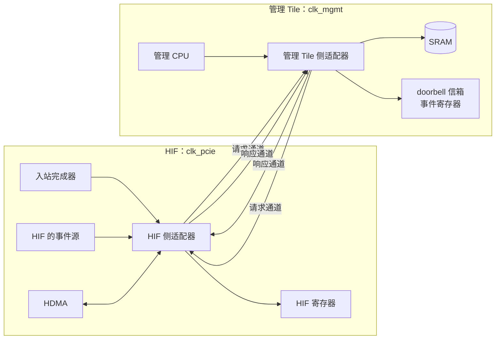
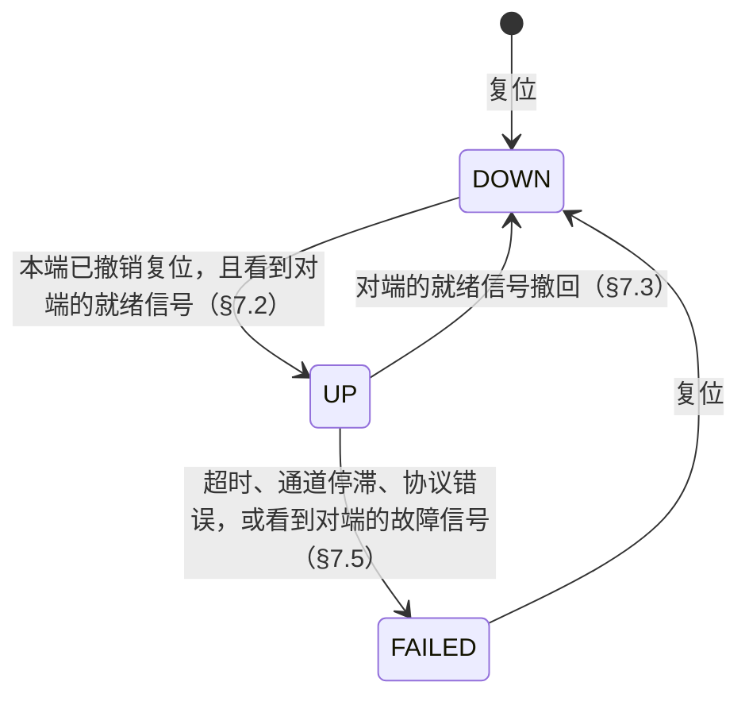

# 管理链路规格（spec-mgmt-link）

| 项 | 内容 |
|---|---|
| 版本 | v0.1 |
| 状态 | 草稿（Draft） |
| 负责 | 架构线 |
| 读者 | gem5 线（必读）、将来的 RTL 团队（必读）、固件开发者（参考：§7 链路状态与故障、§8 寄存器）、驱动团队（不需要）、编译器团队（不需要） |

---

## 1. 概述

### 1.1 范围

ML（Management Link）是 HIF 与管理 Tile 之间的点对点链路，全芯片只有一条，不经过 NoC，也不连接其他 Tile。它是一条可靠、有序、缓冲有限的传输通道：把一端客户端发出的请求送到另一端的目标，再把响应送回来。ML 不理解它传输的内容。

本文档定义：

- ML 的组成、两端的接口、时钟与位宽；
- 事务的类型、字段、长度与响应状态；
- 顺序保证、流控、仲裁和 tag；
- 链路状态：建立、对端复位、客户端复位、超时与故障；
- ML 的寄存器；
- 性能要求和验收标准。

下列内容不在本文档范围内，由客户端或目标所在的规格定义：

- 启动窗口的写入怎样拆成 `BOOT_WR`、`FW_START` 怎样等待之前的启动写入提交、启动通路故障的锁存、doorbell 和事件在链路未建立时怎样保持、FLR 时 HIF 的步骤，见 `spec-pcie` §5.3、§7.2、§13.2；
- HDMA 读取和回写描述符、发出完成通知的规则，见 `spec-host-dma` §3.1、§5.3；
- 管理 Tile 一侧把事务译码到 SRAM、doorbell 信箱、事件寄存器，以及管理 CPU 怎样经 ML 访问 HIF 的寄存器，见 `spec-mgmt-tile` §5；
- 两端适配器的复位怎样产生，见 `spec-clock-reset-power` §4.6；
- 事务携带的值是什么意思：doorbell 的值、事件的含义、HIF 寄存器的布局。

### 1.2 在设备中的位置

- 图中箭头表示请求的方向。两个方向各有一个请求通道和一个响应通道，共四个通道，每个通道是一个异步 FIFO（§3.3）。
- 左边的客户端经 HIF 侧适配器发出请求，右边的目标在管理 Tile 一侧接收；管理 CPU 的请求方向相反（§3.2）。

### 1.3 约定

**规范用语**

| 用语 | 含义 |
|---|---|
| 必须 | MUST：不满足即不符合本规格 |
| 应 | SHOULD：除非有充分理由并记录在案，否则要满足 |
| 可 | MAY：可选 |
| TBD | 尚未确定；文中给出当前默认值，并列入 §11 待决事项 |

**单位与数值**

- 容量用二进制前缀：1 KiB = 1024 B；带宽用十进制：1 GB/s = 10⁹ B/s。
- 十六进制写作 `0x1F`；位域写作 `[高:低]`，第 0 位是最低位。
- 多字节数据一律小端序。
- 标"推算"的数字是本文作者计算所得；引用资料写"代号 p.N"。

**寄存器访问类型**

| 类型 | 含义 |
|---|---|
| RO | 只读，写入被忽略 |
| RW1C | 读出状态；写 1 清零对应位，写 0 无效。同一周期内硬件置位与软件清零冲突时，置位优先 |
| RsvdZ | 保留；读回 0，软件必须写 0 |

**术语**

| 术语 | 全称 | 含义 |
|---|---|---|
| ML | Management Link | 管理链路：HIF 与管理 Tile 之间点对点、不经过 NoC 的链路（本文档） |
| HIF | Host Interface | 见 `spec-arch` §1.4 |
| 适配器 | adapter | ML 在一端的端点：接受本端客户端的请求并发出，把收到的请求交给本端的目标，把响应送回请求方（§3.1） |
| 客户端 / 目标 | client / target | 经适配器发出请求的部件 / 接收请求并返回结果的部件（§3.2） |
| 拍 | beat | 通道上一个周期传输的单位：128 位数据加上事务头等边带信号（§4.2） |
| FIFO | First In, First Out | 先进先出队列。ML 的每个通道是一个两端时钟不同的异步 FIFO |
| posted / non-posted | — | posted 事务没有响应；non-posted 事务必须由目标返回响应。本文档中读、`BOOT_WR`、`DESC_WR` 和屏障事件 `BARRIER` 是 non-posted（§4.1） |
| tag | — | 请求方适配器为每个在途 non-posted 请求分配的编号，响应按 tag 与请求对应（§6.3） |
| 接受 / 发出 / 在途 | accept / issue / outstanding | 请求进入适配器中该客户端的队列，称为被接受；请求的第一拍写入请求通道，称为发出，non-posted 请求在发出时分配 tag；non-posted 请求已发出、尚未结束（收到响应或以 FAULT 结束），称为在途 |
| 处理 | — | 写在目标处生效，或被目标拒绝而没有效果；读在目标处完成 |
| 生效 | take effect | 写的结果已在目标处可见：之后任何 initiator 读该地址都得到新值。被拒绝的写没有效果 |
| OK、REJECT、FAULT | — | 请求的三类结果，含义与 NoC 相同（`spec-address-map` §6.3 规则 0）：已执行完毕 / 没有任何效果 / 效果未知。ML 上只传输 OK 和 REJECT，FAULT 由请求方的适配器在本地产生（§4.4） |
| 反压 | backpressure | 接收方暂时不接收，发送方等待，数据不丢失 |
| DOWN / UP / FAILED | — | 适配器的三种链路状态：未建立 / 已建立 / 故障态（§7.1） |
| 就绪信号、故障信号 | ready / failed | 每端送给对端、表示本端已撤销复位 / 本端处于故障态的电平信号，经两级同步器（§3.1） |
| 撤销 | withdraw | 客户端复位时，适配器放弃把该客户端已接受请求的结果交还给它（§7.4） |
| 屏障事件 | barrier event | 事务 `BARRIER`：non-posted 的事件，适配器保证它在此前被接受的全部请求发出之后才发出，事件写入目标后返回 OK（§5 规则 6） |
| 通道停滞 | stall | 有拍等待写入请求通道，但通道连续 `ml.timeout` 没有空位（§7.5） |
| `BOOT_WR` 等事务名 | — | 见 §4.1 |
| STAGE | — | 启动阶段，见 `spec-pcie` §6.4 |
| XTAL | — | 板载晶振，见 `spec-clock-reset-power` §3.1 |
| 管理 CPU、本地地址、doorbell 信箱、事件寄存器 | — | 见 `spec-mgmt-tile` §1.3 |
| CDC | Clock Domain Crossing | 跨时钟域传输 |

**参数**

带点号的名字（如 `ml.timeout`）是架构参数，最终以单一真源 `arch_params.yaml` 为准；重建之前以 §12 参数表的当前值为准。

---

## 2. 设计决策

### 2.1 专用链路，不经过 NoC

- **决定**：管理 Tile 与 HIF 之间设一条点对点的 ML，承载启动写入、doorbell、事件、寄存器访问和 HDMA 的描述符访问。
- **理由**：
  - 启动时 NoC 尚未由固件配置。如果启动写入要经过 NoC，就会出现"要用固件配置 NoC，而固件本身要经过 NoC 才能装入"的循环依赖。
  - 控制流量小、对延迟敏感。与 NoC 上的大块数据分开，延迟可以预测，也不会因数据流量拥塞而推迟 doorbell 和中断的处理。
  - ML 只有两个端点，顺序保证、故障处理和复位都比在 NoC 上容易实现。

### 2.2 只做传输，不理解事务的语义

- **决定**：ML 只负责把事务可靠、有序地送到对端，并把结果送回。窗口何时打开、`FW_START` 何时发出、doorbell 的值是否合法，都由两端的客户端和目标决定。
- **理由**：
  - 启动流程、命令协议和 HDMA 以后还会变化，链路不应随之修改。
  - 边界清楚，ML 可以单独建模和验证；gem5 模型中 ML 是独立的组件，不含启动逻辑。

### 2.3 目标在有限时间内完成服务，响应通道永不阻塞

- **决定**：
  - ML 两端的目标都是硬件：SRAM、doorbell 信箱、事件寄存器、HIF 的寄存器。任何事务的完成都不等待固件，服务时间有下表的上界。这些上界由目标所在的规格保证，§7.5 据此推算 `ml.timeout`。

    | 目标 | 服务时间上界 | 保证 |
    |---|---|---|
    | SRAM | 每次 64 位访问等待不超过 `mgmt.sram_max_wait`，再加 1 个周期完成；不足 64 位的写做 RMW，计两次访问 | `spec-mgmt-tile` §4.2、§4.3 |
    | doorbell 信箱、事件寄存器 | 每个 `clk_mgmt` 周期接收一个事务 | `spec-mgmt-tile` §5.1 |
    | HIF 寄存器 | 16 个 `clk_pcie` 周期 | `spec-pcie` §5.3、`spec-host-dma` §7.1 |

  - 请求方在发出 non-posted 请求之前，必须预留好接收其响应的空间（§6.3）。因此响应通道在任何时候都能被接收。
- **理由**：
  - host 对设备的写入必须被立即接收，否则固件卡死会反压 PCIe 的整个入站方向。
  - 响应从不等待请求，两个方向的事务也都不依赖对方的软件，所以 ML 不会因为双方互相等待而死锁。每个方向只需要一个请求通道，不需要按事务类别再分虚拟通道。

### 2.4 需要知道写入结果的写是 non-posted

- **决定**：客户端需要知道写入是否生效时，使用 non-posted 写（`BOOT_WR`、`DESC_WR`），目标在写入生效或被拒绝后返回 OK 或 REJECT。只有不需要结果的写（`DB_WR`、`EVENT`、`REG_WR`）是 posted。
- **理由**：
  - PCIe 子系统要等启动写入全部生效才发出 `FW_START`；HDMA 回写描述符失败时要停止通道并记录地址（`spec-host-dma` §3.1），要在回写成功之后才发完成通知。这些都需要逐个事务的结果。
  - posted 写被拒绝时只能由接收方记录（§4.4），请求方不知道是哪个事务失败；这只适合"失败即编程错误"的写。

### 2.5 超时视为硬件故障，链路进入故障态

- **决定**：non-posted 请求超时、请求通道停滞、收到格式错误的事务，都按硬件故障处理：链路进入故障态（§7.5），在途和之后的请求一律以 FAULT 结束，直到复位。
- **理由**：
  - `ml.timeout` 按推算的最坏服务时间留出余量（§7.5），只要实现满足 §2.3 的目标服务时间上界（由 T4 验证），正常运行中就不会触发。超时因此只可能是硬件故障。
  - 超时的请求之后仍可能生效，效果未知，与 NoC 的 FAULT 相同。这时继续使用链路，迟到的结果可能被误用。进入故障态最简单，也最安全。
  - 故障态下适配器不再反压客户端，host 的入站写入不会因 ML 故障而阻塞，host 仍能读到设备状态并复位设备（`spec-pcie` §5.3）。

### 2.6 两端总是同时复位，不使用链路纪元

- **决定**：凡是复位 ML 任一端的事件，都同时复位两端（§7.6），两端的复位区间必然重叠（`spec-clock-reset-power` §4.6）。链路重新建立时，四个通道都处于空状态，因此不需要用链路纪元（epoch）区分复位前后的事务。
- **理由**：
  - v0.1 中会复位 ML 的事件只有冷复位、热复位和设备完全复位，三者都同时复位 HIF 侧适配器和管理 Tile（`spec-clock-reset-power` §4.2）；FLR、D3hot 和看门狗第二级超时都不复位 ML。
  - 复位区间重叠，任何一端撤销复位时，对端要么仍在复位中，要么已经撤销了同一次复位。因此不会把对端复位前的状态误认为新的状态（§7.2）。
  - 以后如果引入只复位一端的事件，必须重新加入纪元或等价的机制。

---

## 3. 结构

### 3.1 组成

| 部件 | 时钟 | 说明 |
|---|---|---|
| HIF 侧适配器 | `clk_pcie` | 位于 PCIe Tile，属于 HIF（`spec-arch` §1.4） |
| 管理 Tile 侧适配器 | `clk_mgmt` | 位于管理 Tile，挂在本地互连上（`spec-mgmt-tile` §3.1） |
| HIF → 管理 Tile 请求通道 | 异步 | 深度 `ml.req_fifo_beats` = 8 拍 |
| 管理 Tile → HIF 响应通道 | 异步 | 深度 `ml.rsp_fifo_beats` = 8 拍 |
| 管理 Tile → HIF 请求通道 | 异步 | 深度 `ml.req_fifo_beats` |
| HIF → 管理 Tile 响应通道 | 异步 | 深度 `ml.rsp_fifo_beats` |
| 状态信号 | 电平 | 每端向对端送出就绪信号和故障信号；HIF 侧另送出"`ML_HIF_ERR` 非零"（§8.1）。都经两级同步器，同步器的触发器随接收端的复位清零 |

- 复位后不需要任何软件配置即可建立链路。
- 管理 Tile 应与 HIF 相邻放置，使 ML 的连线最短。不相邻时可以用流水寄存器或中继实现，代价是面积和延迟增加；这属于物理设计的优化目标，不是架构约束。

### 3.2 客户端与目标

**HIF 侧**

| 客户端或目标 | 角色 | 事务 | 定义 |
|---|---|---|---|
| 入站完成器 | 客户端 | `BOOT_WR`、`DB_WR`、`EVENT` | `spec-pcie` §5.3、§7.2 |
| HIF 的事件源（FLR、Bus Master Enable、电源状态、HDI 寄存器写入、其他 host 侧错误） | 客户端 | `EVENT` | `spec-mgmt-tile` §6.3 |
| HDMA | 客户端 | `DESC_RD`、`DESC_WR`、`EVENT` | `spec-host-dma` §3.1、§5.3。`EVENT` 只能置位事件位（`spec-mgmt-tile` §6.3）；完成通知携带的信息怎样保存和读取，由 `spec-host-dma` 定义（其 §11 待决） |
| HIF 寄存器（包括影子寄存器和 HDMA 的寄存器） | 目标 | `REG_RD`、`REG_WR` | `spec-mgmt-tile` §6.1、`spec-host-dma` §7 |

**管理 Tile 侧**

| 客户端或目标 | 角色 | 事务 | 定义 |
|---|---|---|---|
| SRAM | 目标 | `BOOT_WR`、`DESC_RD`、`DESC_WR` | `spec-mgmt-tile` §4、§5.1 |
| doorbell 信箱 | 目标 | `DB_WR` | `spec-mgmt-tile` §6.2 |
| 事件寄存器 | 目标 | `EVENT` | `spec-mgmt-tile` §6.3 |
| 管理 CPU | 客户端 | `REG_RD`、`REG_WR` | `spec-mgmt-tile` §5.2 |

### 3.3 时钟与位宽

- 每拍 128 位数据，`ml.data_bits` = 128。
- 每个通道是一个异步 FIFO，写端和读端各在发送方和接收方的时钟下工作。FIFO 的两个指针各随所在一端的复位清零（§7.2）。
- HIF 一侧以 `clk_pcie`（250 MHz）收发，单方向带宽上限为 16 B × 250 MHz = 4 GB/s（推算）。
- 管理 Tile 一侧以 `clk_mgmt` 收发。复位后 `clk_mgmt` 为 `XTAL`（25 MHz），由固件切换到 `mgmt.cpu_freq`（500 MHz）（`spec-clock-reset-power` §3.2）。启动 ROM 运行期间，包括整个 STAGE 2，管理 Tile 一侧每秒最多接收 16 B × 25 MHz = 400 MB/s 的数据拍（推算），启动写入的带宽受它限制（§9 P4）。
- `clk_mgmt` 切换期间时钟可能暂停，暂停时间的上限见 `spec-clock-reset-power` §3.4。暂停只造成反压，不丢失数据；它远小于 `ml.timeout`，不会触发超时或通道停滞（§7.5）。

---

## 4. 事务

### 4.1 事务类型

**HIF → 管理 Tile**

| 事务 | 编码 | 类型 | 地址字段的含义 | 数据 |
|---|---|---|---|---|
| `BOOT_WR` | 0x0 | non-posted 写 | 装载区内的字节偏移 | 8 B 的整数倍 |
| `DB_WR` | 0x1 | posted 写 | doorbell 槽位号 i（`spec-mgmt-tile` §6.2） | 4 B，[15:0] 为 doorbell 的值 |
| `EVENT` | 0x2 | posted 写 | 不使用，为 0 | 4 B，事件位的掩码及附带的值，含义见 `spec-mgmt-tile` §5.1、§6.3 |
| `DESC_RD` | 0x3 | 读 | 管理 Tile 本地地址 | 响应携带 |
| `DESC_WR` | 0x4 | non-posted 写 | 管理 Tile 本地地址 | 4 B 的整数倍，带字节使能 |
| `BARRIER` | 0x5 | non-posted 事件 | 不使用，为 0 | 4 B，含义同 `EVENT`；排序规则见 §5 规则 6 |

**管理 Tile → HIF**

| 事务 | 编码 | 类型 | 地址字段的含义 | 数据 |
|---|---|---|---|---|
| `REG_RD` | 0x8 | 读 | HIF 寄存器区内的偏移（本地地址减去 0x3000_0000，`spec-mgmt-tile` §3.3） | 响应携带 |
| `REG_WR` | 0x9 | posted 写 | 同上 | 4 B 或 8 B |

- 编码用于 §8 的错误记录。链路上的物理编码由实现决定，两端适配器一致即可。
- non-posted 写的响应在写入生效之后才返回 OK；写被目标拒绝时返回 REJECT，没有任何效果。`BARRIER` 的 OK 在事件写入事件寄存器之后返回。

### 4.2 字段

**请求**

| 字段 | 最小位宽 | 说明 |
|---|---|---|
| TYPE | 4 | §4.1 的编码 |
| TAG | 5 | non-posted 请求的 tag（§6.3）；posted 写不使用 |
| ADDR | 32 | 按 §4.1 解释 |
| LEN | 7 | 字节数，1 – 64 |
| BE | 每拍 16 | 字节使能，只对写有效 |
| DATA | 每拍 128 | 写数据 |

**响应**

| 字段 | 最小位宽 | 说明 |
|---|---|---|
| TAG | 5 | 对应请求的 tag |
| STATUS | 1 | OK 或 REJECT（§4.4） |
| DATA | 每拍 128 | 读数据；写的响应和 REJECT 的响应不带数据 |

- 事务头（请求的 TYPE、TAG、ADDR、LEN，响应的 TAG、STATUS）作为边带信号，与第一拍数据同时传输，不单独占一拍。不带数据的事务（读请求、写的响应、REJECT 的响应）占一拍。
- 一个事务的各拍不与其他事务的拍交错；FIFO 满时可以在拍之间暂停。

### 4.3 长度与对齐

| 事务 | 规则 |
|---|---|
| 全部 | 长度不超过 `ml.max_payload` = 64 B；不跨 64 B 对齐边界 |
| `BOOT_WR` | 地址 8 B 对齐，长度是 8 B 的整数倍，字节使能全为 1 |
| `DB_WR`、`EVENT`、`BARRIER` | 4 B |
| `DESC_RD` | 地址 4 B 对齐，长度是 4 B 的整数倍；可以一次读取一个或两个 32 B 的描述符 |
| `DESC_WR` | 地址 4 B 对齐，长度 4 B 或 8 B，不跨 8 B 对齐边界，即只写一个 64 位字。HDMA 只回写 4 B 的 DW7（`spec-host-dma` §3.2） |
| `REG_RD`、`REG_WR` | 4 B 或 8 B，按长度自然对齐 |

- 客户端提交不满足以上规则的请求，属于客户端的实现错误。适配器不发出它：non-posted 请求立即以 REJECT 结束，posted 写丢弃；记录 `BAD_REQ`（§8），链路保持 UP。
- 接收方从通道上收到不满足规则的事务时，按协议错误处理（§7.5）。

### 4.4 响应状态

| 结果 | 产生者 | 含义 | 举例 |
|---|---|---|---|
| OK | 目标 | 已执行完毕；写已生效 | |
| REJECT | 目标，或本端适配器（§4.3） | 没有任何效果，之后也不会产生 | 地址处没有目标、访问控制拒绝（`spec-mgmt-tile` §4.4）、读到不可纠正的 ECC 错误、请求不合规则 |
| FAULT | 请求方的适配器，在本地产生 | 效果未知，之后仍可能生效 | 超时、对端复位、链路处于故障态（§7） |

- REJECT 不影响链路，链路保持 UP。
- **REJECT 的原子性**：目标必须在产生任何效果之前完成决定是否拒绝的全部检查（地址范围、访问控制，以及 RMW 需要读出的字是否有不可纠正的 ECC 错误），只有这些检查失败才返回 REJECT。§4.3 的规则保证这可以做到：`BOOT_WR` 只写完整的 64 位字，不需要 RMW；`DESC_WR` 只写一个 64 位字，最多一次 RMW。目标在产生部分效果之后才发现的故障不能用 REJECT 表达，属于硬件故障，目标不返回响应，由请求方按超时处理（§7.5）。
- posted 写被目标拒绝时没有响应可以返回，由接收方的适配器记录 `WR_REJECT`（§8）。
- 客户端收到 REJECT 或 FAULT 后怎样处理，由客户端所在的规格定义：
  - 管理 CPU：访问错误异常（`spec-mgmt-tile` §5.2）；
  - HDMA：通道进入错误停止（`spec-host-dma` §3.1）；
  - 入站完成器的 `BOOT_WR`：启动通路故障（`spec-pcie` §7.2）。

---

## 5. 顺序

1. 同一方向上的写（posted 和 non-posted），按发出顺序在目标处处理：生效，或被拒绝而没有效果。目标不同时也是如此。
2. 同一方向上的读，在该方向此前发出的写都处理完毕之后，才交给目标。读到的值由目标按自己的规则决定；对同一地址，它反映此前已生效的写。
3. `EVENT` 和 `BARRIER` 在同一方向此前发出的写都处理完毕之后，才交给事件寄存器。因此固件收到某个事件时，此前经 ML 发出的写都已处理完毕。
4. 不同方向之间没有顺序保证。
5. 响应可以按任意顺序返回，请求方按 tag 匹配。
6. **屏障事件**：客户端用 `BARRIER` 代替 `EVENT` 发出屏障事件。适配器保证：此前被接受的全部请求（不论来自哪个客户端，包括已撤销的请求）都已发出之后，屏障事件才发出；屏障事件发出之前，之后被接受的请求不得越过它。与屏障事件在同一周期被接受的其他请求，算作在它之前；多个屏障事件按被接受的顺序发出。屏障事件是 non-posted 的，发出时分配 tag。结合规则 3，对端看到屏障事件时，此前被接受的全部写都已处理完毕；请求方收到它的 OK 时，事件已经写入对端的事件寄存器，因此请求方可以确定对端已经能看到它。等待时间有上限：此前的请求在有限时间内获得 tag 并发出（§6.2）。链路进入 FAILED 时，屏障事件和其他请求一样立即结束。

- 规则 1 – 3 要求接收方的适配器一次只把一个事务交给目标：前一个事务处理完毕，才交出下一个。§7.5 的最坏服务时间依赖这一点。

- "发出顺序"指请求进入请求通道的顺序。同一客户端的请求按被接受的顺序发出；不同客户端之间按适配器的仲裁顺序（§6.2），屏障事件除外（规则 6）。
- 客户端在适配器之前的通路上怎样保证顺序，由客户端所在的规格负责。例如入站 BAR0 和 BAR2 通路之间的顺序，见 `spec-pcie` §7.2。
- 规则 1 只保证写按顺序被处理，不保证每个写都生效。客户端需要"前一个写生效后才做下一件事"时，应使用 non-posted 写并等待 OK。例如 HDMA 在回写描述符的 `DESC_WR` 收到 OK 之后才发出完成通知（`spec-host-dma` §5.3）。

---

## 6. 流控、仲裁与 tag

### 6.1 流控

- 发送方只在通道的 FIFO 有空位时写入，等价于按信用流控，信用数等于 FIFO 的深度。
- 按 §2.3，请求通道的空位总会在有限时间内出现，响应通道总能被接收。
- FIFO 深度的依据（同步器按两级计，推算）：发送方写入一拍后，空位要经"指针同步到接收方、接收方读出、指针同步回发送方"才能再次使用。
  - HIF → 管理 Tile，`clk_mgmt` = 500 MHz：这一循环约 4 ns + 6 ns + 8 ns = 18 ns，约 5 个发送周期；
  - HIF → 管理 Tile，`clk_mgmt` = 25 MHz：约 4 ns + 120 ns + 8 ns = 132 ns，约 3.3 个接收周期；
  - 管理 Tile → HIF，`clk_mgmt` = 500 MHz：约 2 ns + 12 ns + 4 ns = 18 ns，约 4.5 个接收周期；
  - 管理 Tile → HIF，`clk_mgmt` = 25 MHz：约 40 ns + 12 ns + 80 ns = 132 ns，约 3.3 个发送周期。

  四种情况都不超过 8 拍，因此 8 拍的深度能让通道在无竞争时，按两端时钟中较慢一端的每个周期传输一拍（§9 P5）。

### 6.2 仲裁

- 适配器为每个客户端各保留一个请求队列。同一客户端的请求按提交顺序发出。
- 适配器在各客户端之间按事务轮询。一个客户端队首的 non-posted 请求还没有空闲的 tag 或响应空间时，本轮跳过该客户端，不阻塞其他客户端。
- 一个事务一旦开始写入通道，就连续写完它的各拍，不让其他事务插入；FIFO 满时等待。
- 等待时间有上限：tag 在有限时间内释放（§6.3），每轮每个客户端最多发出一个事务。

### 6.3 tag

| 请求方 | tag 数 | 用途 | 依据 |
|---|---|---|---|
| HIF 侧适配器 | `ml.hif_tags` = 32 | `DESC_RD`、`DESC_WR`、`BOOT_WR`、`BARRIER` | HDMA 8 个通道各预取 2 个描述符，最多 16 个在途读（`spec-host-dma` §6）；另留 16 个给描述符回写。`BOOT_WR` 只在 STAGE 2 期间出现，那时 HDMA 尚未使用，与它们共用 |
| 管理 Tile 侧适配器 | `ml.mgmt_tags` = 4 | `REG_RD` | 管理 CPU 是单发射、按序执行的核，不经缓存的访问一次一个；留出余量 |

- non-posted 请求在发出时分配 tag，同时预留该请求的全部响应空间：读按请求的长度，写只需要状态。按数据计，HIF 侧最多预留 32 × 64 B = 2 KiB，管理 Tile 侧最多 4 × 8 B = 32 B（推算）；每个 tag 另需保存 TYPE、长度和所属客户端。
- tag 用完时，non-posted 请求留在该客户端的队列中，不发出（§6.2）。
- tag 在以下时刻释放：完整的响应被请求方接收；或请求以 FAULT 结束。请求以 FAULT 结束意味着链路已进入故障态或对端正在复位（§7.3、§7.5），此后适配器丢弃收到的全部事务、不再分配 tag，直到复位，因此迟到的响应不会被当作新请求的结果。

---

## 7. 链路状态、复位与故障

### 7.1 状态

每端的适配器各自维护链路状态：

| 状态 | 含义 | 适配器对本端客户端的行为 |
|---|---|---|
| DOWN | 复位中或尚未建立 | 不接受新请求（反压） |
| UP | 已建立 | 正常收发 |
| FAILED | 发现硬件故障（§7.5） | 接受新请求并立即结束：non-posted 请求以 FAULT 结束，posted 写丢弃。不反压客户端 |

客户端在 DOWN 状态下不能发出请求，怎样处理由客户端所在的规格规定：

- 管理 CPU 的访问以访问错误异常结束（`spec-mgmt-tile` §5.2）；
- 入站完成器保留 doorbell 和事件，链路建立后再发出（`spec-pcie` §5.3）；
- 启动窗口在 STAGE 2 才打开，STAGE 2 由启动 ROM 经 ML 写入，因此链路建立之前不会出现 `BOOT_WR`；
- HDMA 只在固件运行后使用。

### 7.2 建立

1. 两端的复位同时置位，复位区间必然重叠（`spec-clock-reset-power` §4.6）。复位期间，适配器清除自己的全部状态；与本端相连的 FIFO 指针、对端状态信号的同步器都清零；本端的就绪信号为 0。
2. 本端撤销复位后，送出就绪信号。
3. 本端已撤销复位、且同步后看到对端的就绪信号为 1 时，进入 UP。
4. 两端的复位由共同的源异步置位，就绪信号随本端复位异步清零；复位保持的时间足够长，使对端的就绪信号为 0 在本端撤销复位之前已到达本端同步器的输入（`spec-clock-reset-power` §4.6）。因此一端撤销复位时，看到的对端就绪信号要么是 0（对端仍在复位中），要么是对端撤销同一次复位之后送出的 1，不会是对端复位前的值。
5. 两端都撤销本次复位、任何一端进入 UP 之前，四个通道都是空的：FIFO 的两个指针都已在本次复位中清零，期间没有写入。两端都只在进入 UP 之后才向通道写入，因此通道中只会有本次建立之后写入的事务。先进入 UP 的一端可以立即发出请求，它们留在 FIFO 中，等对端进入 UP 后处理。
6. ML 要在 `clk_pcie` 运行之后才能建立（`spec-clock-reset-power` §3.2）。在此之前启动 ROM 读 `ML_STATUS.UP` 等待（`spec-mgmt-tile` §8.1）。

### 7.3 对端复位

一端处于 UP、看到对端的就绪信号变为 0 时：

1. 本端在途的 non-posted 请求立即以 FAULT 结束，记录 `PEER_RESET`（§8）；
2. 丢弃尚未发出的请求，以及已收到、尚未交给目标的事务；
3. 回到 DOWN。

按 §2.6，对端进入复位时本端也会在很短时间内进入复位，回到 DOWN 之后由 §7.2 重新建立。本节只处理两端复位置位时间不同造成的窗口，避免请求方在这段时间里等待永远不会到来的响应。

### 7.4 客户端复位

客户端被复位而链路不复位时（例如 FLR 复位 HDMA，`spec-host-dma` §8.4），适配器按以下规则撤销该客户端的请求，客户端不必等待它们完成：

1. **撤销点**是客户端复位置位的时刻。客户端在复位期间不提交请求；尚未被适配器接受的请求由客户端自己丢弃。
2. 撤销点之前被接受的请求都标为已撤销，分两种情况：
   - 尚未发出的：照常排队、发出；non-posted 请求发出时照常分配 tag 和响应空间。
   - 已发出的：保留已分配的 tag、响应空间和超时计时。
3. 已撤销的写照常被目标处理。已撤销的 non-posted 请求的完整响应到达后丢弃，然后释放 tag；超时仍按 §7.5 处理。撤销与响应在同一周期发生时，以撤销为准，响应丢弃。
4. 客户端复位撤销后可以立即提交新请求，新请求排在已撤销请求之后，只使用空闲的 tag。已撤销请求的 tag 在释放之前不会重新分配，因此新旧请求的响应不会混淆。

需要"复位前的请求都已处理完毕"的一方，在客户端停止提交请求之后发出一个屏障事件（§5 规则 6）：对端看到它时，撤销点之前被接受的写都已处理完毕；请求方收到它的 OK 时，知道对端已经能看到它。FLR 就是这样做的（`spec-pcie` §13.2）。

### 7.5 超时与故障

**超时**：每个 non-posted 请求从进入请求通道起计时，`ml.timeout` = 100 µs 内没有收到响应即为超时。超时由请求方的适配器检测。计时的基准频率固定，不随 `clk_mgmt` 的切换改变，也不依赖 `PLL_TS`：HIF 侧以 `clk_pcie` 的周期计时；管理 Tile 侧以 `XTAL` 的周期计时，`XTAL` 计数器以格雷码经同步器送入 `clk_mgmt` 域（`spec-clock-reset-power` §3.3）。

**`ml.timeout` 的依据**（推算）。最坏服务时间依赖三点：接收方一次只把一个事务交给目标（§5）；各目标的服务时间上界（§2.3）；HDMA 只在固件把 `clk_mgmt` 切换到 500 MHz 之后使用（`spec-mgmt-tile` §8.5 第 1、7 步）。

- 一个 non-posted 请求发出时，前面最多有 FIFO 中的 8 拍和接收方正在处理的一个事务（最多 4 拍），自身最多 4 拍，共 16 拍。
- `clk_mgmt` = 25 MHz（40 ns）时，HIF → 管理 Tile 方向只有 `BOOT_WR`、`DB_WR`、`EVENT`。`BOOT_WR` 是完整的 64 位写，每拍最多两次 SRAM 访问，每次最多 17 个周期，每拍不超过 34 个周期。16 拍合计 544 个周期，约 21.8 µs。
- `clk_mgmt` = 500 MHz（2 ns）时，`DESC_WR` 可能做 RMW，每拍最多 4 次 SRAM 访问，不超过 68 个周期。16 拍合计 1088 个周期，约 2.2 µs。
- 管理 Tile → HIF 方向：每拍不超过 16 个 `clk_pcie` 周期，16 拍合计约 1 µs。
- 响应：接收方一次只交出一个事务，响应也逐个产生；请求方总能接收响应（§2.3），响应通道按较慢一端每周期一拍排出。FIFO 中的 8 拍若都是读请求，各自的响应最多 4 拍，共 32 拍：`clk_mgmt` = 500 MHz 时约 0.2 µs；25 MHz 时没有读请求经过这一方向。加上 CDC 和 `clk_mgmt` 切换的暂停（`clock.clk_switch_pause` = 1 µs），合计不超过 2 µs。
- `clk_mgmt` 切换到 500 MHz 之后不再切回（`spec-clock-reset-power` §3.4），上面按时钟区分的流量假设因此成立。

最坏不超过约 24 µs，100 µs 留出 4 倍的余量。这一推算要由 T4 验证；实现若不能满足 §2.3 的上界，必须重新确定 `ml.timeout`。

以下任一情况发生时，发现它的一端进入 FAILED：

| 情况 | 记录（§8） |
|---|---|
| non-posted 请求超时 | `TIMEOUT` |
| 通道停滞：有拍等待写入请求通道，但通道连续 `ml.timeout` 没有空位。按上面的分析，正常运行中一拍最多等待约 1.4 µs（25 MHz 下 34 个周期，推算） | `STALL` |
| 收到格式错误的事务（§4.3），或 tag 不对应任何在途请求的响应 | `PROTOCOL` |
| 看到对端的故障信号 | `PEER_FAILED` |

进入 FAILED 时：

1. 本端已接受的请求全部结束，不论是否已发出：未撤销的 non-posted 请求（包括屏障事件）以 FAULT 结束，释放 tag；已撤销的请求和 posted 写丢弃。之后新接受的请求按 §7.1 立即结束，与队列的清理不冲突，每个请求只结束一次；
2. 送出故障信号，对端随之进入 FAILED；
3. 停止向通道写入，此后收到的事务全部丢弃；
4. 管理 Tile 一侧：`ML_STATUS.FAILED` 置位，`ML_ERR` 非零，向管理 CPU 发中断（`spec-mgmt-tile` §7.2）；
5. HIF 一侧：置位 `DEV_STATUS.DEV_FATAL`（`spec-pcie` §6.2），由 host 使用设备完全复位恢复。HIF 在启动期间对故障的处理见 `spec-pcie` §7.2。

FAILED 只能由复位退出（§7.6）。

### 7.6 各复位事件下的 ML

| 事件 | HIF 侧适配器 | 管理 Tile 侧适配器 | ML |
|---|---|---|---|
| 冷复位、热复位 | 复位 | 复位 | 重新建立 |
| 设备完全复位 | 复位（PCIe 控制器、配置空间和链路保留，`spec-pcie` §13.1） | 复位 | 重新建立 |
| FLR | 不复位；HDMA 的请求按 §7.4 撤销 | 不复位 | 保持 |
| D3hot ↔ D0 | 不复位 | 不复位 | 保持 |
| 看门狗第二级超时 | 不复位 | 不复位；管理 CPU 停住，其在途的 `REG_RD` 照常完成 | 保持 |

- 每种复位下各部件的完整行为见 `spec-clock-reset-power` §4.2。
- FLR、D3hot 和看门狗第二级超时本身不改变链路状态；在它们进行期间发生的独立故障，仍按 §7.5 处理。

---

## 8. 寄存器

### 8.1 管理 Tile 侧

位于管理 Tile 本地寄存器区，起始地址 `ML_BASE` 由 `spec-mgmt-tile` §3.5 分配。偏移相对于 `ML_BASE`，均为 32 位寄存器。

| 偏移 | 名称 | 类型 | 复位值 | 说明 |
|---|---|---|---|---|
| 0x00 | `ML_STATUS` | RO | 0 | [0] UP：链路已建立（状态为 UP）。[1] FAILED：链路处于故障态。其余 RsvdZ |
| 0x04 | `ML_ERR` | RW1C | 0 | 见下表 |
| 0x08 | `ML_ERR_INFO` | RO | 0 | 第一个错误：[3:0] 事务编码（§4.1）；[8:4] tag；[13:9] 对应 `ML_ERR` 的位号。没有对应事务的错误（例如 `PEER_FAILED`）事务编码和 tag 为 0。其余 RsvdZ |
| 0x0C | `ML_ERR_ADDR` | RO | 0 | 第一个错误的事务地址（§4.1 的地址字段）；没有对应事务时为 0 |

**ML_ERR**

| 位 | 名称 | 说明 |
|---|---|---|
| [0] | TIMEOUT | 本端发出的 non-posted 请求超时（§7.5） |
| [1] | STALL | 本端的请求通道停滞（§7.5） |
| [2] | PROTOCOL | 收到格式错误的事务或无对应请求的响应（§7.5） |
| [3] | PEER_RESET | 在途请求因对端复位以 FAULT 结束（§7.3） |
| [4] | NP_REJECT | 本端发出的 non-posted 请求收到 REJECT |
| [5] | WR_REJECT | 对端发来的 posted 写被本端的目标拒绝 |
| [6] | BAD_REQ | 本端的客户端提交了不合规则的请求（§4.3） |
| [7] | PEER_FAILED | 因看到对端的故障信号而进入 FAILED（§7.5） |
| [8] | HIF_ERR | 只在管理 Tile 侧：HIF 侧的 `ML_HIF_ERR` 非零。这一位是 HIF 侧经同步器送来的电平的镜像，不经过 ML 事务，链路故障时也能看到；随 `ML_HIF_ERR` 清零而清零，写入无效 |
| [31:9] | — | RsvdZ |

- [7:0] 是粘滞位：由本端硬件置位，保持到固件清零。进入 FAILED 时，本地原因（TIMEOUT、STALL、PROTOCOL）和 PEER_FAILED 只置其一，由先发生的一个决定；FAILED 状态本身由 `ML_STATUS.FAILED` 表示，与 `ML_ERR` 的清零无关。
- `ML_ERR` 的 [7:0] 全为 0 时发生的第一个本地错误，记录在 `ML_ERR_INFO` 和 `ML_ERR_ADDR` 中；固件清零 [7:0] 后重新开始记录。HIF_ERR 不参与这一判断，也不记录。同一周期发生多个错误时，记录位号最小的一个。
- `ML_ERR` 非零时向管理 CPU 发中断（`spec-mgmt-tile` §7.2）。链路故障时 HIF_ERR 可能无法清除（固件无法经 ML 写 `ML_HIF_ERR`），固件处理后应屏蔽该中断源。

### 8.2 HIF 侧

位于 HIF 寄存器区，由固件经 `REG_RD`、`REG_WR` 访问；偏移见 `spec-pcie` §6.5。

| 名称 | 类型 | 说明 |
|---|---|---|
| `ML_HIF_ERR` | RW1C | [7:0] 的定义同 `ML_ERR`，记录 HIF 侧发现的错误。例如 TIMEOUT 包括 `DESC_RD`、`DESC_WR` 和 `BOOT_WR` 的超时，WR_REJECT 指固件的 `REG_WR` 被 HIF 寄存器拒绝 |
| `ML_HIF_ERR_INFO` | RO | 同 `ML_ERR_INFO` |
| `ML_HIF_ERR_ADDR` | RO | 同 `ML_ERR_ADDR` |

`ML_HIF_ERR` 是粘滞位，"非零"电平在固件清零之前保持不变，用于通知固件：固件看到 `ML_ERR.HIF_ERR` 后经 `REG_RD` 读取 `ML_HIF_ERR`，再写 1 清零。只有固件能清零 `ML_HIF_ERR`，并且必须在读到它之后、只对读到的位写 1 清零。读与清零之间新发生的其他位不受影响；同一位再次发生时与前一次合并，`ML_HIF_ERR_INFO` 只保留第一次。错误内容以 `ML_HIF_ERR` 为准，因此镜像电平的长短不影响错误是否被发现。链路处于故障态时，固件无法经 ML 读取这些寄存器，只能从 `ML_ERR.HIF_ERR` 知道 HIF 侧有错误；host 从 `DEV_STATUS.DEV_FATAL` 知道设备需要复位（§7.5）。

---

## 9. 性能要求

| 编号 | 要求 |
|---|---|
| P1 | 单程延迟：从发送方的适配器接受请求，到接收方的适配器把它交给目标，无竞争时应不超过 40 ns（`clk_mgmt` = 500 MHz 时，TBD）。其中 CDC 不超过接收方 3 个周期 |
| P2 | 固件经 ML 的 `REG_RD`，从发出到数据返回，应不超过 200 ns（`clk_mgmt` = 500 MHz 时，TBD）：两次单程延迟加上 HIF 寄存器的访问时间 |
| P3 | HDMA 的 `DESC_RD`（32 B），从发出到数据返回，应不超过 200 ns（`clk_mgmt` = 500 MHz 时，TBD），使每通道预取 2 个描述符就能掩盖读取延迟 |
| P4 | 启动写入：`clk_mgmt` = 25 MHz，管理 CPU 不访问装载区所在的 bank，host 以 64 B 对齐、长度为 64 B 整数倍的 TLP 连续写入启动窗口，PCIe 子系统把它们拆成连续的 64 B `BOOT_WR`。以 HIF 侧适配器接受的有效字节计，在任意连续 64 KiB 的写入上，持续带宽应不低于 200 MB/s；1 MiB 的镜像约需 5.2 ms（推算）。超过时 PCIe 入站方向被反压，这是允许的：启动阶段没有其他入站流量需要保证（`spec-pcie` §7.2） |
| P5 | 无竞争、目标不阻塞时，每个请求通道在两端时钟中较慢一端的每个周期能传输一拍（§6.1） |

- P3 的依据：一次 4 KiB 的传输在 8 GB/s 下约需 512 ns（推算），只要读取一个描述符的延迟明显短于此，预取深度 2 就足以让描述符读取不成为瓶颈。
- P4 的依据：管理 Tile 一侧在 25 MHz 下接收数据拍的上限是 400 MB/s（§3.3）；SRAM 无冲突时为 ML 持续写入至少 8 B/周期（`spec-mgmt-tile` §5.3），即 200 MB/s，取它作为要求。`BOOT_WR` 的响应不占请求通道。按 §7.5，一个 `BOOT_WR` 从发出到收到响应不超过约 24 µs；即使按这个最坏值，32 个 tag 也能维持 32 × 64 B ÷ 24 µs ≈ 85 MB/s。无竞争时往返约 1 µs，32 个 tag 足以维持 P4，由 T2 验证。

---

## 10. 验收标准

**功能**

| 编号 | 检查 |
|---|---|
| F1 | 每种事务都能按 §4 的字段、长度和对齐规则传输，数据和字节使能正确；客户端提交的非法请求和通道上收到的非法事务分别按 §4.3 处理 |
| F2 | 顺序：§5 规则 1 – 3 在两个方向上都成立，包括目标不同的写之间、写被拒绝之后的读和事件 |
| F3 | 流控：FIFO 从不溢出；接收方暂停读取不超过 `clock.clk_switch_pause` 时，发送方只被反压，不丢失数据，也不触发超时或通道停滞 |
| F4 | 仲裁与 tag：在途 non-posted 请求不超过 `ml.hif_tags`、`ml.mgmt_tags`；响应乱序返回时都能正确匹配；某客户端 tag 用完时，其他客户端的请求（包括 posted 写）仍能发出；双向同时以最大事务传输时不死锁 |
| F5 | 建立：两端以任意先后撤销复位、复位时长取允许的最小值、`clk_mgmt` 处于任意相位时，都只在两端撤销本次复位之后进入 UP；任何一端进入 UP 之前四个通道为空，之后通道中只有本次建立后写入的事务。§7.2 第 4 条的时序条件由 RDC 检查确认 |
| F6 | 对端复位：在途请求以 FAULT 结束并记录 `PEER_RESET`，链路回到 DOWN |
| F7 | 客户端复位与屏障：撤销点前后的请求按 §7.4 处理；撤销与响应同周期、多拍响应接收途中撤销、tag 用完时撤销，都不会把旧响应交给新请求；旧请求在队首且没有 tag 时，屏障事件仍在它之后发出；FLR 事件之后不再有复位前 HDMA 的写或事件被处理 |
| F8 | 故障：超时、通道停滞、协议错误各自使两端都进入 FAILED，`ML_ERR` 的位按 §8.1 记录；已接受未发出的请求、已撤销的请求和屏障事件按 §7.5 结束；之后的请求立即结束，不反压客户端；HIF 的 `DEV_FATAL` 保持为 1，FLR 不能清除；只有复位能退出 |
| F9 | REJECT：non-posted 请求收到 REJECT 时客户端得到错误、链路保持 UP，目标的状态不变（包括多字 `BOOT_WR` 的后半部分越界或无权限时前半部分不变，`DESC_WR` 的 RMW 读到不可纠正 ECC 错误时该字不变）；目标在部分生效后才发现的故障不返回 REJECT，请求方以超时得到 FAULT；posted 写被拒绝时由接收方记录 `WR_REJECT` |
| F10 | 寄存器：`ML_ERR` 各位的置位条件、置位与清零同周期时置位优先、第一个错误的记录与清零，`HIF_ERR` 在链路故障时仍能反映 HIF 侧的错误 |
| F11 | FLR、D3hot、看门狗第二级超时本身都不改变链路状态 |

**性能**

| 编号 | 检查 |
|---|---|
| T1 | P1 – P3 的延迟在无竞争条件下满足要求 |
| T2 | 在 P4 规定的条件下，`BOOT_WR` 的持续带宽满足 P4，反压期间不丢失数据 |
| T3 | 在 §6.1 的四种方向和时钟组合下，以随机的时钟相位连续传输，请求通道满足 P5 |
| T4 | 按 §7.5 构造各方向、各时钟下最坏的竞争（SRAM bank 冲突、RMW、HIF 寄存器访问、响应竞争、`clk_mgmt` 切换），non-posted 请求从发出到收到响应不超过 24 µs，不触发超时 |

---

## 11. 待决事项

| 事项 | 当前默认 | 影响 |
|---|---|---|
| P1 – P3 的数值 | 40 ns、200 ns、200 ns | §9；随实现复核 |
| 最坏服务时间 | 约 24 µs（推算） | §7.5；由 T4 验证，不满足时重新确定 `ml.timeout` |
| HIF 侧错误对 host 的可见性 | 只经 `DEV_FATAL` 报告，细节不可见 | §8.2；将来可随 `spec-interrupt-ras`（待写） 或调试接口补充 |

---

## 12. 参数

| 参数 | 当前值 | 说明 |
|---|---|---|
| `ml.data_bits` | 128 | §3.3 |
| `ml.max_payload` | 64 B | §4.3 |
| `ml.req_fifo_beats` | 8 | §3.1、§6.1，每个方向的请求通道 |
| `ml.rsp_fifo_beats` | 8 | §3.1、§6.1，每个方向的响应通道 |
| `ml.hif_tags` | 32 | §6.3 |
| `ml.mgmt_tags` | 4 | §6.3 |
| `ml.timeout` | 100 µs | §7.5 |
| `mgmt.cpu_freq`、`mgmt.sram_max_wait` | 见 `spec-mgmt-tile` §13 | §3.3、§7.5 |
| `clock.pcie_freq`、`clock.xtal_freq`、`clock.clk_switch_pause` | 见 `spec-clock-reset-power` §10 | §3.3、§7.5 |
