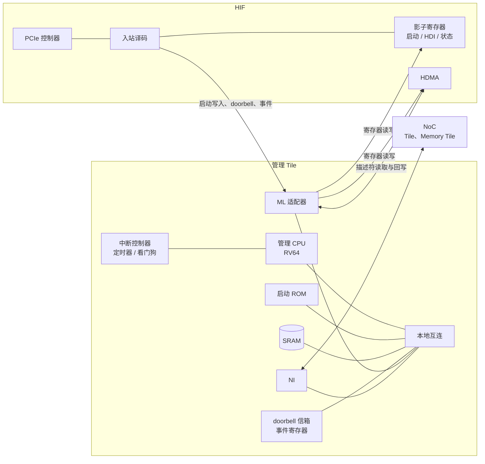

# 管理 Tile 规格（spec-mgmt-tile）

| 项 | 内容 |
|---|---|
| 版本 | v0.1 |
| 状态 | 草稿（Draft） |
| 负责 | 架构线 |
| 读者 | 固件开发者（必读）、gem5 线（必读）、将来的 RTL 团队（必读）、驱动团队（参考：启动与复位）、编译器团队（不需要） |

---

## 1. 概述

### 1.1 范围

管理 Tile 是设备内部唯一运行通用软件的地方。它包含一个 RISC-V 管理 CPU、启动 ROM、片上 SRAM，以及连接主机接口（HIF：PCIe 控制器、HDMA 及其寄存器，见 `spec-arch` §1.4）的管理链路（ML，`spec-mgmt-link`）在管理 Tile 一侧的适配器。启动 ROM 把固件装入 SRAM 并启动它；固件负责初始化设备、实现命令协议、编程 HDMA、调度各 Tile。

本文档定义：

- 管理 Tile 的结构、管理 CPU 和本地地址空间；
- 启动 ROM 的行为、固件镜像的最小格式和交接约定；
- SRAM 的划分、端口、ECC 和访问控制；
- ML 在管理 Tile 一侧的接入：目标译码和管理 CPU 经 ML 的访问；
- 管理 Tile 与 HIF 之间的分工，包括 doorbell 信箱和 host 可见状态的影子寄存器；
- 中断、定时器、看门狗；
- 复位、性能要求和验收标准。

下列内容不在本文档范围内：

- HIF 对 host 呈现的行为（BAR、寄存器偏移、启动握手的 host 侧流程），见 `spec-pcie`；本文档只说明管理 Tile 一侧如何配合；
- ML 本身：事务、顺序、流控、链路状态与故障、ML 的寄存器，见 `spec-mgmt-link`；
- 命令协议的语义（`spec-hdi`）、HDMA 的描述符格式（`spec-host-dma`）；
- 固件的软件结构（是否使用 RTOS、任务划分）；
- 设备内存的训练算法、NoC 和各 Tile 的编程接口（将由 `spec-dram`（待写）、`spec-noc`（待写）、`spec-compute-tile`（待写） 定义）；
- 镜像签名与安全启动；
- 调试模块和 trace 的细节。

### 1.2 在设备中的位置

- **ML**：管理 Tile 与 HIF 之间的点对点链路，不经过 NoC，复位后不需要软件配置即可使用（`spec-mgmt-link`）。管理 Tile 一侧的接入见 §5。
- **NI**：固件经此访问各 Tile、Memory Tile 和设备内存；其他 Tile 经此向管理 Tile 发送事件。只在固件运行之后使用。

### 1.3 约定

**规范用语**

| 用语 | 含义 |
|---|---|
| 必须 | MUST：不满足即不符合本规格 |
| 应 | SHOULD：除非有充分理由并记录在案，否则要满足 |
| 可 | MAY：可选 |
| TBD | 尚未确定；文中给出当前默认值，并列入 §12 待决事项 |

**单位与数值**

- 容量用二进制前缀：1 KiB = 1024 B；带宽用十进制：1 GB/s = 10⁹ B/s。
- 十六进制写作 `0x1F`；位域写作 `[高:低]`，第 0 位是最低位。
- 多字节数据一律小端序。
- 标"推算"的数字是本文作者计算所得；引用资料写"代号 p.N"。

**寄存器访问类型**

| 类型 | 含义 |
|---|---|
| RO | 只读，写入被忽略 |
| RW | 可读写 |
| RW1C | 读出状态；写 1 清零对应位，写 0 无效。同一周期内硬件置位与软件清零冲突时，置位优先 |
| W1S | 写 1 触发动作或置位，写 0 无效；读回 0 |
| RsvdZ | 保留；读回 0，软件必须写 0 |

**术语**

| 术语 | 全称 | 含义 |
|---|---|---|
| HIF | Host Interface | 见 `spec-arch` §1.4 |
| 管理 CPU | — | 管理 Tile 中的 RV64 处理器（§3.2） |
| RV64IMAC | — | RISC-V 64 位基本整数指令集，加乘除（M）、原子（A）、压缩（C）扩展 |
| M 模式 / U 模式 | machine mode / user mode | RISC-V 的机器模式 / 用户模式 |
| PMP | Physical Memory Protection | RISC-V 按物理地址区域检查访问权限的机制，不做地址翻译 |
| ECC | Error-Correcting Code | SRAM 的纠错码（§4.3） |
| ML | Management Link | 见 `spec-mgmt-link` §1.3 |
| doorbell 信箱 | doorbell mailbox | 管理 Tile 中接收 doorbell 写入值的覆盖式槽位（§6.2）；与 host 可见的 doorbell 页（`spec-hdi` §1.3）不同 |
| 影子寄存器 | shadow register | 放在 HIF 中、由固件经 ML 更新的 host 可见寄存器（§6.1） |
| 启动阶段（STAGE） | — | 见 `spec-pcie` §6.4 |
| 启动窗口 | boot window | 见 `spec-pcie` §1.4；写入经 ML 落入 SRAM 装载区（§5.1） |
| 本地地址 | local address | 管理 CPU 本地地址空间中的地址（§3.3）。DPA 按固定偏移映射在其中；与 DPA 空间中的 Tile 本地窗口不同 |
| DPA、initiator、请求、RMW | — | 见 `spec-address-map` §1.3。本文档 §4 中 SRAM 的 initiator 指访问 SRAM 的各方：管理 CPU、ML、NoC 的 target 端口 |
| FLR | — | 见 `spec-pcie` §1.4 |

**参数**

带点号的名字（如 `mgmt.sram_size`）是架构参数，最终以单一真源 `arch_params.yaml` 为准；重建之前以 §13 参数表的当前值为准。

---

## 2. 设计决策

### 2.1 管理 CPU：单核 RV64，不带 MMU

- **决定**：一个 RISC-V 64 位核（RV64IMAC，含 Zicsr、Zifencei），支持 M 模式和 U 模式，带 PMP，不带 MMU，不带浮点单元。
- **理由**：
  - 固件要直接访问 40 位的 DPA（设备内存 32 GiB）。32 位核需要额外的地址窗口，固件每次访问设备内存都要先切换窗口。
  - 设备内的隔离采用区域保护（initiator 按区间检查、Memory Tile 按受保护区域检查），不需要页表。固件是单一的可信程序，PMP 足以把 ROM、装载区代码和数据区分开。
  - 固件做的是控制和调度，不做数值计算；浮点运算由各 Tile 完成。
  - RISC-V 有成熟的开源工具链和 RTOS 支持，指令集没有授权费用。

### 2.2 固件在 SRAM 中运行，启动 ROM 只做最少的事

- **决定**：固件镜像装入管理 Tile 的 SRAM，并在 SRAM 中执行。启动 ROM 只初始化管理 CPU 和 SRAM、等待 host 写入镜像、校验镜像并跳转。设备内存（LPDDR5X）的训练由固件完成。
- **理由**：
  - 启动 ROM 流片后不可修改，ROM 中的代码越少，出错把芯片变砖的风险越小。DDR 训练是启动中最复杂、最依赖硅片特性的一步，放在可升级的固件里。
  - 镜像经启动窗口直接写入 SRAM，ROM 不需要驱动 HDMA，也不依赖设备内存。
  - 固件在片上 SRAM 中执行，取指和访问数据的延迟固定，不受设备内存带宽和 NoC 负载影响。

### 2.3 与 HIF 之间用专用 ML，不经过 NoC

决定与理由见 `spec-mgmt-link` §2.1。

### 2.4 管理 Tile 一侧的 ML 目标不依赖固件完成

- **决定**：管理 Tile 一侧作为 ML 目标的 SRAM、doorbell 信箱、事件寄存器都是硬件，在有限时间内完成服务，任何事务的完成都不等待固件。
- **理由**：
  - 这是 ML 不反压 host、不会死锁的前提（`spec-mgmt-link` §2.3）。
  - doorbell 写入落入信箱的覆盖式槽位（§6.2），事件只置位 pending 位（§6.3），两者任何时候都能接收。

### 2.5 host 可见的状态放在 HIF，固件更新影子寄存器

- **决定**：host 会读取的启动状态、命令协议控制器的状态等寄存器，都放在 HIF 一侧；固件经 ML 写入影子寄存器。host 写入的、需要固件处理的寄存器，由 HIF 记录写入值并向管理 Tile 发送事件。
- **理由**：host 的读如果要转发给管理 CPU 才能完成，管理 CPU 卡死、正在复位或尚未启动时，host 就读不到设备状态，也无法发起恢复。

### 2.6 看门狗超时不自动复位

- **决定**：看门狗第一次超时向固件发中断；第二次超时由硬件停住管理 CPU，并直接置位 HIF 的致命错误状态，由 host 决定何时复位设备。
- **理由**：
  - 自动复位会让 host 以为仍在运行的命令协议状态突然消失，与 host 侧的状态不一致。
  - 停住 CPU 保留故障现场，host 可以在复位之前经调试手段读取。

---

## 3. 结构

### 3.1 组成

| 部件 | 说明 |
|---|---|
| 管理 CPU | §2.1；单个 hart，hart ID 为 0 |
| 启动 ROM | `mgmt.rom_size` = 64 KiB，复位向量所在 |
| SRAM | `mgmt.sram_size` = 2 MiB，分为多个 bank，带 ECC（§4） |
| 本地互连 | 连接 CPU、ROM、SRAM、本地寄存器、ML 适配器、NI |
| ML 适配器 | ML 在管理 Tile 一侧的端点（§5、`spec-mgmt-link` §3） |
| doorbell 信箱与事件寄存器 | 接收 HIF 转来的 doorbell 和事件（§6.2、§6.3） |
| 中断控制器 | RISC-V 标准的 CLINT（定时器和软件中断）加 PLIC（外部中断）（§7） |
| 看门狗 | 两级超时（§7.4） |
| NI | 一个发起端口（固件访问设备内部）和一个目标端口（其他 Tile 访问管理 Tile）（§3.4） |

### 3.2 管理 CPU

| 项 | 要求 |
|---|---|
| 指令集 | RV64IMAC，含 Zicsr、Zifencei |
| 特权模式 | M、U |
| PMP | 至少 16 项 |
| MMU | 无 |
| 缓存 | ROM 和 SRAM 是紧耦合存储，不经缓存。经 NoC 访问设备内存和其他 Tile 时，v0.1 一律不缓存 |
| 频率 | `mgmt.cpu_freq` = 500 MHz（`PLL_CORE` 二分频，`spec-clock-reset-power` §3.2）。复位后先以参考时钟运行，由固件切换到工作频率 |
| 调试 | 必须支持 RISC-V 外部调试规范的调试模块，可经 JTAG 访问；细节不在本文档范围 |

访问设备内存不经缓存，因此固件和其他 Tile、HDMA 共享的数据结构不需要缓存维护。以后加入数据缓存时，必须同时定义缓存维护的约定。

### 3.3 本地地址空间

管理 CPU 看到的地址空间如下。其中 DPA 部分的划分见 `spec-address-map` §3。

| 本地地址 | 大小 | 内容 | 访问 |
|---|---|---|---|
| 0x0000_0000 | `mgmt.rom_size` | 启动 ROM | 只读、可执行 |
| 0x1000_0000 | `mgmt.sram_size` | SRAM | 读写、可执行 |
| 0x2000_0000 | 64 KiB | 管理 Tile 本地寄存器：CLINT、看门狗、ML 寄存器（起始 `ML_BASE`，TBD；定义见 `spec-mgmt-link` §8.1）、SRAM 控制、访问控制 | 读写 |
| 0x2001_0000 | 64 KiB | doorbell 信箱与事件寄存器 | 读写 |
| 0x2002_0000 | 4 KiB | CRC（`spec-clock-reset-power` §6） | 读写，只限 M 模式 |
| 0x2C00_0000 | 64 MiB | PLIC | 读写 |
| 0x3000_0000 | 256 MiB | HIF 的寄存器，经 ML 访问（§5.2、§6.1） | 读写，32 位或 64 位 |
| 0x100_0000_0000 | 2^`addr.device_pa_bits` | DPA 空间，经 NoC 访问：本地地址 = 0x100_0000_0000 + DPA | 读写 |
| 其余 | | 保留：访问产生访问错误异常 | |

- SRAM 在 DPA 空间中的位置 `mgmt.sram_device_pa`，即管理 Tile 窗口的 SRAM 区，见 `spec-address-map` §4.2：其他 Tile 经 NoC 访问 SRAM 时使用。HDMA 访问描述符环时，使用 SRAM 的本地地址，经 ML 访问（§5.1）。
- 访问保留地址、目标返回错误、经 ML 的访问以 REJECT 或 FAULT 结束（`spec-mgmt-link` §4.4），都以同步的访问错误异常报告给管理 CPU（load/store access fault 或 instruction access fault），不得让 CPU 无限等待。

### 3.4 NI

- **发起端口**：固件经此访问各 Tile 的寄存器、Memory Tile 的配置（包括受保护区域）和设备内存。同一个发起端口发出的、目标地址相同的访问按程序顺序完成；目标不同的访问之间不保证顺序，固件需要顺序时必须使用 `fence`，`fence` 必须等此前的所有访问完成。
- **目标端口**：其他 Tile 经此写管理 Tile 的事件寄存器（§6.3），或访问 SRAM 中由固件开放的区间（§4.4）。目标端口复位后关闭，由固件开放。
- NoC 在固件运行之前不使用；启动 ROM 不访问 NoC。

---

## 4. SRAM

### 4.1 划分

| 区域 | 位置 | 大小 | 用途 |
|---|---|---|---|
| 装载区 | SRAM 起始处 | `mgmt.fw_load_max` = 1 MiB | 固件镜像（含镜像头）；固件运行后为代码和已初始化的数据 |
| 运行区 | 装载区之后 | 其余部分 | 固件的 BSS、堆、栈，HDMA 的描述符环，日志缓冲 |
| ROM 保留区 | SRAM 末尾 | `mgmt.rom_reserved` = 4 KiB | 启动 ROM 的栈和启动信息（§8.4）；固件读取启动信息之后可以回收 |

- 启动窗口的大小等于装载区的大小 `mgmt.fw_load_max`；HIF 向 host 报告的镜像大小上限就是这个值。
- HDMA 的描述符环放在运行区，按上限配置时所占的空间见 `spec-host-dma` §3.1。
- 容量的分配：装载区 1 MiB、描述符环 64 KiB（`spec-host-dma` §3.1）、ROM 保留区 4 KiB，其余约 956 KiB 用于固件的 BSS、堆、栈和日志（推算）。固件超过 1 MiB 时，可按 §2.2 把大块数据放到设备内存。

### 4.2 端口与仲裁

SRAM 有三个 initiator：

| initiator | 访问内容 |
|---|---|
| 管理 CPU | 取指、读写数据 |
| ML | 启动写入；HDMA 读取描述符、回写描述符状态 |
| NoC 目标端口 | 其他 Tile 访问固件开放的区间 |

- SRAM 由单口 bank 组成，不要求双口宏单元。不同 initiator 访问不同 bank 时并行进行；访问同一 bank 时仲裁。
- 仲裁必须保证每个 initiator 的等待时间有上限 `mgmt.sram_max_wait` = 16 个 SRAM 周期：ML 的访问要服务 host 写入和 HDMA，不能被 CPU 的连续访问饿死。
- 固件应把描述符环放在与代码不同的 bank 中，减少 HDMA 读取描述符对取指的干扰。

### 4.3 ECC

- 每 64 位数据带 8 位 SECDED 校验。
- 复位后 SRAM 由硬件清零并写入正确的校验位，完成后置 `SRAM_INIT_DONE`。启动 ROM 必须等它置位后才使用 SRAM。
- 小于 64 位的写入由 SRAM 控制器做 RMW，对 initiator 透明。ML 上的启动写入总是完整的 64 位，不需要 RMW。
- 可纠正错误：纠正后返回数据，计数并可产生中断（§7.2）。
- 不可纠正错误：
  - CPU 取指或读数据：访问错误异常；
  - ML 的读：以 REJECT 返回，由 HDMA 按设备地址错误处理；
  - ML 的写需要 RMW、而读出的字有不可纠正错误：不写入，以 REJECT 返回，该字保持不变（`spec-mgmt-link` §4.4）；
  - NoC 目标端口的读：以错误响应返回；
  - 同时记录出错地址，产生中断。

### 4.4 访问控制

除 PMP 对管理 CPU 自身的限制外，SRAM 控制器按 initiator 检查：

| initiator | 允许访问的区间 | 违反时 |
|---|---|---|
| ML 的启动写入 | 只能写装载区。是否允许启动写入（STAGE、窗口是否打开）由 HIF 在入口处接受原始写时判定（`spec-pcie` §7.2），SRAM 控制器不按 STAGE 检查：`FW_START` 或 FLR 之后排空的旧写照常写入 | 越出装载区：以 REJECT 结束，记录 |
| ML 的 HDMA 访问 | `DESC_BASE` – `DESC_LIMIT`，由固件设置 | 以 REJECT 结束 |
| NoC 目标端口 | 最多 `mgmt.noc_windows` = 4 个由固件设置的区间，各自可设为只读或读写；复位后全部关闭 | 以错误响应返回，记录 |
| 管理 CPU | 全部；由 PMP 进一步限制 | — |

访问控制寄存器只能由管理 CPU 在 M 模式下写入。固件可以写 `ACL_LOCK` 锁定它们，锁定后直到复位都不能修改。

---

## 5. ML 的接入

ML 本身（事务、顺序、流控、链路状态与故障、ML 的寄存器）见 `spec-mgmt-link`。本节只规定管理 Tile 一侧怎样接入：ML 适配器把收到的事务交给哪个目标，管理 CPU 怎样经 ML 访问 HIF。

### 5.1 目标译码

| 事务 | 目标 | 不满足时 |
|---|---|---|
| `BOOT_WR` | SRAM 装载区：本地地址 = 0x1000_0000 + 偏移 | 偏移加长度超过 `mgmt.fw_load_max`：以 REJECT 结束（§4.4） |
| `DB_WR` | doorbell 信箱的 `DB_SLOT[i]`，i 为地址字段（§6.2） | i ≥ `mgmt.db_slots`：拒绝，由适配器记录 `WR_REJECT` |
| `EVENT`、`BARRIER` | 事件寄存器：数据的 [7:0] 按位或入 `EVT_PENDING` 的 [7:0]（§6.3）。`BARRIER` 在写入之后返回 OK | [31:8] 不为 0：`EVENT` 拒绝并记录 `WR_REJECT`，`BARRIER` 以 REJECT 结束。`EVT_PENDING` 的 Tile 事件位只能经 NoC 目标端口写入 |
| `DESC_RD`、`DESC_WR` | SRAM，按本地地址 | 不在 SRAM 范围内或违反 §4.4 的访问控制：以 REJECT 结束 |

- `BOOT_WR` 和 `DESC_WR` 的 OK 响应在数据写入 SRAM、之后 CPU 的读能读到新值时才返回（`spec-mgmt-link` §4.1）。
- doorbell 信箱和事件寄存器每个 `clk_mgmt` 周期都能接收一个事务；SRAM 的等待时间上限见 §4.2。

### 5.2 管理 CPU 的访问

- 管理 CPU 访问本地地址 0x3000_0000 起的 HIF 寄存器区时，load 转为 `REG_RD`，store 转为 `REG_WR`。只允许按长度自然对齐的 32 位或 64 位访问，其他访问产生访问错误异常。
- `REG_WR` 是 posted 写：store 进入 ML 后即完成。固件需要确认写入已经生效时，随后读一次 HIF 寄存器区中的任意寄存器（`spec-mgmt-link` §5 规则 2）。
- `ML_STATUS.UP` = 0（链路尚未建立或处于故障态）时，load 和 store 都立即产生访问错误异常，不发出事务。
- `REG_RD` 以 REJECT 或 FAULT 结束时，产生 load 访问错误异常（§3.3）。

### 5.3 启动写入的带宽

- STAGE 2 期间 `clk_mgmt` 为 `XTAL`，SRAM 接收 `BOOT_WR` 的带宽必须满足 `spec-mgmt-link` §9 P4：无 bank 冲突时，SRAM 必须能为 ML 持续写入至少 8 B/周期。
- 启动 ROM 在 ROM 中执行，栈在 ROM 保留区。ROM 保留区应与装载区位于不同的 bank，使启动 ROM 的访问不与启动写入竞争。

---

## 6. 与 HIF 的分工

### 6.1 host 可见的状态

| 状态 | 存放位置 | host 的访问 | 固件的访问 |
|---|---|---|---|
| 启动阶段 STAGE | HIF | 读 | 写：0 → 1、→ 2、3 → 2（加载失败）、3 → 4、→ 0xF。2 → 3 由 HIF 在接受 `FW_START` 时自动完成；启动通路故障时由 HIF 强制为 0xF 并锁存，锁存期间固件的写入无效（`spec-pcie` §7.2） |
| `FW_READY`、启动错误码 | HIF | 读 | 写。FLR 时由 HIF 自动清零 `FW_READY` |
| 镜像大小 | HIF | STAGE = 2 时读写 | 读；加载失败时清零 |
| 固件版本 | HIF | 读 | 写 |
| 调试窗口开启位 | HIF | 读 | 写；熔丝禁止时写入无效 |
| 致命错误位 | HIF | 读 | 写；看门狗第二级超时时由硬件直接置位 |
| 命令协议控制器的寄存器 | HIF | 读；写可写字段 | 读写，包括 host 只读的字段（例如状态、能力、错误原因）。host 写入可写字段时，HIF 发出"HDI 寄存器被写入"事件，并在 `HDI_WR_MAP` 中记录被写的寄存器 |
| doorbell | 值转发到管理 Tile 的信箱 | 写 | 读信箱（§6.2） |
| HDMA 的寄存器 | HIF | 只读镜像 | 读写 |
| host 中断 | HIF 发出 | 收到 MSI-X 或 INTx | 写 HIF 的中断请求寄存器；HIF 保证该中断不越过此前已进入发送通路的 DMA 写 |

- 各寄存器对 host 的定义见 `spec-pcie` §6、§7 和 `spec-hdi` §4；本表只规定由谁存放、谁来写。
- 固件经 ML 访问这些状态时使用 HIF 的内部寄存器地址（本地地址 0x3000_0000 起），具体布局由 HIF 的实现定义，TBD。
- host 的读从不经过 ML：读到的是影子寄存器中最近一次写入的值。

### 6.2 doorbell 信箱

管理队列和每个上下文各有一个 doorbell 页（`spec-hdi` §4.2），每页有 SQ 尾指针和 CQ 头指针两个 doorbell，共 `mgmt.db_slots` = 2 × (1 + 16) = 34 个。

| 寄存器 | 类型 | 说明 |
|---|---|---|
| `DB_SLOT[i]` | RO | 第 i 个 doorbell 最近一次写入的值，[15:0] 有效。i = 2p 是第 p 页的 SQ 尾指针，i = 2p + 1 是 CQ 头指针；p = 0 是管理队列，p = 1 + n 是上下文 n |
| `DB_PENDING[1:0]` | RW1C | 第 i 位为 1 表示 `DB_SLOT[i]` 自上次清零后被写过 |
| `DB_MASK[1:0]` | RW | 1 表示屏蔽该位的中断 |

- `DB_WR` 覆盖对应槽位并置位 pending 位，不排队，因此信箱任何时候都能接收，也不会溢出。host 在固件处理之前多次写同一个 doorbell 时，固件只看到最后一次的值；对尾指针和头指针来说，最后一次的值就是全部所需信息。
- `DB_PENDING & ~DB_MASK` 非零时向管理 CPU 发中断（§7.2）。
- 固件必须**先清零 pending 位，再读槽位**。这样在读之后到达的写会重新置位 pending，不会丢失。
- doorbell 值是否越界、对应的上下文是否存在，由固件检查。

### 6.3 事件寄存器

| 寄存器 | 类型 | 说明 |
|---|---|---|
| `EVT_PENDING` | RW1C | 各位对应一个事件，见下表；事件到达时置位 |
| `EVT_MASK` | RW | 1 表示屏蔽该位的中断 |

| 位 | 事件 | 来源 |
|---|---|---|
| [0] | `FW_START` | HIF：host 写入 `FW_START`，且之前的启动写入均已提交（`spec-pcie` §7.2） |
| [1] | `FLR` | HIF：FLR 已开始，host 可见的状态已复位 |
| [2] | `HDI_WR` | HIF：host 写了命令协议控制器的可写寄存器 |
| [3] | `BME_OFF` | HIF：host 清除了 Bus Master Enable |
| [4] | `PM` | HIF：电源状态改变（D0 ↔ D3hot） |
| [5] | `HDMA_NOTIFY` | HDMA：带通知标志的描述符完成；通知携带的信息怎样保存和读取见 `spec-host-dma` §11（待决） |
| [6] | `HDMA_ERR` | HDMA：通道进入错误停止 |
| [7] | `HOST_ERR` | HIF：其他 host 侧错误 |
| [15:8] | — | RsvdZ |
| [31:16] | `TILE_EVT[k]` | 其他 Tile 经 NoC 目标端口写入的事件，k = 0 … 15，含义由固件与 Tile 的约定决定 |

事件和 doorbell 一样只置位、不排队，同一事件多次发生只保留一次 pending，详细原因由来源处的状态寄存器给出。

---

## 7. 中断、定时器与看门狗

### 7.1 中断控制器

采用 RISC-V 标准的 CLINT 和 PLIC，以便直接使用现成的工具链和 RTOS 支持。

| 中断 | 控制器 | 来源 |
|---|---|---|
| 机器定时器中断 | CLINT | `mtime` ≥ `mtimecmp` |
| 机器软件中断 | CLINT | `msip`（单核下用于自中断） |
| 机器外部中断 | PLIC | §7.2 的各个来源 |

### 7.2 外部中断源

| PLIC 源 | 来源 |
|---|---|
| 1 | doorbell 信箱：`DB_PENDING & ~DB_MASK` 非零 |
| 2 | 事件寄存器：`EVT_PENDING & ~EVT_MASK` 非零 |
| 3 | ML 错误（`ML_ERR` 非零，`spec-mgmt-link` §8.1） |
| 4 | SRAM 可纠正 ECC 错误（计数达到阈值） |
| 5 | SRAM 不可纠正 ECC 错误 |
| 6 | SRAM 访问控制违例 |
| 7 | 看门狗第一级超时 |
| 8 | NI 错误 |
| 9 – 31 | 保留，TBD |

### 7.3 定时器

- `mtime` 与 HIF 向 host 报告的设备时间戳（`spec-pcie` §6.2）是同一个计数器，频率相同。这样固件记录的时间与 host 读到的时间戳可以直接比较。
- `mtime` 复位后从 0 开始，只在冷复位和热复位时清零；设备完全复位和 FLR 不清零。

### 7.4 看门狗

| 寄存器 | 类型 | 说明 |
|---|---|---|
| `WDT_CTRL` | RW | [0] EN：使能。[1] LOCK：写 1 后 EN 和 `WDT_LOAD` 不能再修改，直到设备复位 |
| `WDT_LOAD` | RW | 超时周期，以 `mtime` 计 |
| `WDT_KICK` | WO | 写入 0x5A5A_A5A5 重新开始计时；写入其他值视为第一级超时 |
| `WDT_STATUS` | RO | [0] STAGE1：第一级已超时。[1] STAGE2：第二级已超时 |

- 复位后看门狗关闭，启动 ROM 不使用它。固件应在初始化早期使能并锁定。
- **第一级超时**：计时器到达 `WDT_LOAD` 时置 STAGE1，产生中断（PLIC 源 7），并重新开始计时。
- **第二级超时**：STAGE1 置位后计时器再次到达 `WDT_LOAD` 时，硬件：
  1. 停住管理 CPU（进入调试暂停状态，可经调试模块访问）；
  2. 经 ML 以外的专用信号置位 HIF 的致命错误位，并向 host 发错误中断。这条信号不经过固件，也不依赖 ML 的状态。
- 第二级超时后由 host 决定复位（设备完全复位或热复位）。看门狗本身不复位任何部件。

---

## 8. 启动

### 8.1 启动 ROM 的步骤

| 步骤 | 启动 ROM 的动作 | STAGE |
|---|---|---|
| 1 | 从复位向量（本地地址 0）开始执行，以参考时钟运行 | 0 |
| 2 | 初始化必要的 CSR；等待 `SRAM_INIT_DONE`；在 ROM 保留区建立栈；等待 `ML_STATUS.UP`（`spec-mgmt-link` §7.2），不设超时 | 0 |
| 3 | 写 STAGE = 1。不配置 PCIe 控制器：控制器和 PHY 的参数由硬件的默认值和熔丝决定；链路训练和配置空间由硬件在复位后自动开始，不等待启动 ROM | 1 |
| 4 | 写 STAGE = 2，启动窗口打开 | 2 |
| 5 | 等待 `EVT_PENDING` 中的 `FW_START` 或 `FLR`（轮询或中断）。`FLR` 置位时按 §9 处理（包括写 STAGE = 2 和确认），然后回到本步。`FW_START` 置位时，HIF 已把 STAGE 置为 3 并关闭启动窗口 | 3 |
| 6 | 读取镜像大小，检查本次加载是否有非法写入；检查镜像头（§8.2）；计算并比对镜像的摘要 | 3 |
| 7 | 失败：先检查 `EVT_PENDING.FLR`，置位则按 §9 处理并回到第 5 步；否则写启动错误码，清零镜像大小，写 STAGE = 2，回到第 5 步 | 2 |
| 8 | 成功：按 §8.3 设置 PMP，清零 ROM 保留区以外的运行区；跳转前最后检查一次 `EVT_PENDING.FLR`，置位则按 §9 处理并回到第 5 步；否则跳转到固件入口 | 3 |

- STAGE 和启动错误码的编码见 `spec-pcie` §6.4，启动 ROM 和固件按该编码写入。
- 第 8 步最后一次检查之后才到达管理 Tile 的 FLR 事件（不论 FLR 本身何时开始），由固件处理：固件初始化时检查 `EVT_PENDING.FLR`，置位则按 STAGE = 4 的规则处理（§9）。镜像已经完整校验，固件照常运行；在固件确认之前，窗口、`FW_READY`、HDMA 和中断都受 HIF 的门控（`spec-pcie` §13.2）。
- STAGE 0 期间（链路建立之前）发生的 FLR：没有启动写入需要排空，HIF 保持"FLR 进行中"，FLR 事件在链路建立后发出（`spec-mgmt-link` §7.1）；启动 ROM 在第 5 步之前不检查事件，进入第 5 步后看到它，按 §9 处理并确认，此前写入的 STAGE = 2 在确认之前不会打开窗口。
- 启动 ROM 不访问 NoC、设备内存和 HDMA。
- 启动 ROM 不使能看门狗。等待 host 加载期间没有超时，host 不加载时设备一直停在 STAGE 2。

### 8.2 镜像格式

镜像以 64 B 的镜像头开始，紧接着是固件内容，整个镜像装入装载区起始处。

| 偏移 | 长度 | 字段 | 说明 |
|---|---|---|---|
| 0x00 | 4 | `MAGIC` | ASCII "GWFW"（0x5746_5747） |
| 0x04 | 2 | `HDR_VERSION` | 镜像头格式版本，当前为 1 |
| 0x06 | 2 | `HDR_SIZE` | 镜像头长度，当前为 64 |
| 0x08 | 4 | `IMAGE_SIZE` | 镜像总长度（含镜像头），字节；必须等于 host 写入的镜像大小 |
| 0x0C | 4 | `ENTRY_OFFSET` | 固件入口相对装载区起始处的偏移；必须 4 B 对齐，落在固件内容之内 |
| 0x10 | 4 | `FW_VERSION` | 固件版本号，固件运行后写入 HIF |
| 0x14 | 12 | — | 保留，必须为 0 |
| 0x20 | 32 | `DIGEST` | 对偏移 0x40 起的固件内容计算的 SHA-256 摘要 |

- 启动 ROM 检查：`MAGIC`、`HDR_VERSION`、`HDR_SIZE`、`IMAGE_SIZE`、`ENTRY_OFFSET`、保留字段，以及 `DIGEST`。任何一项不符都按镜像校验失败处理。
- SHA-256 只检测传输错误和误写，不提供安全性。签名验证属于安全启动，v0.1 不支持。

### 8.3 交接约定

启动 ROM 跳转到固件入口时：

| 项 | 状态 |
|---|---|
| 特权模式 | M 模式 |
| `a0` | hart ID，0 |
| `a1` | 启动信息结构的本地地址（位于 ROM 保留区，§8.4） |
| PMP | 启动 ROM 只读可执行；装载区可读写可执行；运行区可读写不可执行；固件可以重新设置 |
| 中断 | 全部关闭，`EVT_PENDING` 中 `FW_START` 已清零 |
| 时钟 | 仍为参考时钟 |
| ML | 已建立；启动窗口已关闭 |
| NI、设备内存 | 尚未初始化 |

### 8.4 启动信息

| 偏移 | 长度 | 字段 | 说明 |
|---|---|---|---|
| 0x00 | 4 | `ROM_VERSION` | 启动 ROM 的版本 |
| 0x04 | 4 | `BOOT_REASON` | 0 冷复位，1 热复位，2 设备完全复位；由复位原因寄存器得出（`spec-clock-reset-power` §4.4） |
| 0x08 | 4 | `LOAD_ATTEMPTS` | 本次启动中失败的加载次数 |
| 0x0C | 4 | — | 保留 |
| 0x10 | 8 | `SRAM_SIZE` | SRAM 容量，字节 |
| 0x18 | 8 | `LOAD_MAX` | 装载区大小，字节 |

### 8.5 固件初始化的职责

固件开始运行后，到置位 `FW_READY` 之前，必须完成：

1. 按 `spec-clock-reset-power` §3.4 切换到工作时钟；使能并锁定看门狗。
2. 检查 `PLL_TS` 已锁定（`spec-clock-reset-power` §6），释放 NoC 的复位（`spec-clock-reset-power` §4.3）。NoC 复位后的默认配置已足以访问全部 Memory Tile；性能相关的配置放在第 5 步。
3. 释放 Memory Tile 的复位，初始化设备内存，包括 LPDDR5X 训练。失败时写启动错误码（固件初始化失败）和 STAGE = 0xF，然后停止。
4. 在 Memory Tile 中设置固件需要的受保护区域（如有，`spec-address-map` §5.3）。
5. 打开 Compute Tile 的时钟并释放复位，配置 NoC 和各 Tile。
6. 设置 SRAM 的访问控制（§4.4），包括 HDMA 的描述符区间，然后锁定。
7. 初始化 HDMA 的通道和描述符环。
8. 写入命令协议控制器的只读字段（版本、能力）和固件版本。
9. 写 STAGE = 4、置位 `FW_READY`。

---

## 9. 复位

| 复位 | 管理 Tile 的行为 |
|---|---|
| 冷复位、热复位 | 管理 Tile 全部复位，从启动 ROM 重新开始，`BOOT_REASON` 为 0 或 1；SRAM 内容不保留 |
| 设备完全复位 | 同上，`BOOT_REASON` 为 2。`mtime` 不清零 |
| FLR | 管理 Tile 不复位，固件继续运行。HIF 自动清零 `FW_READY`（`spec-pcie` §13.2）并发出 FLR 事件；固件中止 HDMA 上属于本功能的传输，清理命令协议的全部上下文和各 Tile 中的相关状态，完成后重新置位 `FW_READY` |
| 看门狗第二级超时 | 管理 CPU 停住；其余部件不复位，等待 host 复位 |

**FLR 期间的约束**

- 固件收到 FLR 事件之前，HIF 已经复位了 host 可见的状态和 HDMA；固件不得假设任何复位前的命令协议状态仍然有效。
- 固件看到 FLR 事件时，复位前已被 ML 接受的描述符回写、HDMA 事件和 doorbell 都已处理完毕（`spec-pcie` §13.2）。固件应先清零 `EVT_PENDING` 中的 `HDMA_NOTIFY`、`HDMA_ERR` 和全部 `DB_PENDING`，它们属于复位前；然后再重新初始化描述符环和命令协议。HDMA 在固件重新初始化之前不会产生新事件，host 在 `FW_READY` = 1 之前不会写 doorbell，因此不会误清新的事件。
- 固件清理期间，host 可能已经开始读取状态。由于 `FW_READY` 为 0，host 不会使能命令协议。
- **FLR 的处理与确认**（启动 ROM 和固件相同）。寄存器和 HIF 一侧的规则见 `spec-pcie` §13.2：
  1. 清零 `EVT_PENDING.FLR`，写 `FLR_CTRL.TAKE`，再读 `FLR_STATUS`：
     - FAIL = 1：HIF 已判定 FLR 处理故障并置位致命错误，停止，等待 host 复位设备；
     - IN_PROGRESS = 0：这是已经确认过的 FLR 留下的事件，忽略它，回到原来的工作，不做清理，也不重新初始化；
  2. 清理。HDMA 在确认之前由 HIF 保持复位，清理不需要也不能访问 HDMA：
     - 启动 ROM：放弃本次加载，见下一条；
     - 固件：清除命令协议的全部上下文和各 Tile 中属于本功能的状态，清零属于复位前的事件和 doorbell（见上文）；
  3. 确认循环：
     - `EVT_PENDING.FLR` 置位：回到第 1 步；
     - 否则写 `FLR_CTRL.DONE`，再读 `FLR_STATUS`，按以下顺序判断：FAIL = 1，按第 1 步的 FAIL 处理；IN_PROGRESS = 0，确认成功，进入第 5 步；DELIVERED = 1，有 FLR 事件在 TAKE 之后送达，回到第 1 步；其他（某个 FLR 仍处于"处理中"），重复本步；
     - 本步不另设超时：HIF 以 `pcie.flr_proc_timeout` 监视"处理中"，超时时置位 FAIL；
  4. 第 1、3 步的 `REG_RD` 失败时（访问错误异常）：链路已处于故障态或固件访问了错误的地址，设备不能继续使用，置位致命错误（若仍可写）并停止，不得把这次 FLR 当作已确认；
  5. 恢复：HDMA 退出复位，固件重新初始化 HDMA 的通道、描述符环和命令协议，最后置位 `FW_READY`。恢复期间随时可能发生新的 FLR：新 FLR 发生后 HIF 立即恢复门控，此后被 HIF 处理的写都不生效，此前已经生效的由 FLR 复位；同一方向的写按顺序处理，所以恢复期间的写不会越过下一次 DONE。固件在恢复的每一步之间以及置位 `FW_READY` 之后检查 `EVT_PENDING.FLR`，置位就放弃恢复，回到第 1 步。

  HIF 在确认之前对 host 屏蔽窗口和 `FW_READY`、丢弃 doorbell、忽略固件对 `FW_READY` 写 1、保持 HDMA 复位，因此清理期间写 STAGE、`FW_READY` 或 HDMA 寄存器不会过早生效。固件和启动 ROM 都不需要保存任何状态来区分新旧 FLR。
- STAGE 不是 4 时发生 FLR（启动尚未完成）：HIF 关闭启动窗口，等旧的启动写入都已提交，再以屏障事件发出 FLR 事件（`spec-pcie` §7.2）。启动 ROM 在 §8.1 的检查点看到 FLR 后放弃本次加载：清零 `EVT_PENDING.FW_START`，清零镜像大小和错误码，写 STAGE = 2，最后按上一条确认，确认成功后启动窗口打开。
- 启动通路故障已锁存时（`spec-pcie` §7.2），FLR 不清除锁存：STAGE 保持 0xF、ERROR 保持 LINK，启动窗口保持关闭，启动 ROM 对 STAGE 的写入无效。

---

## 10. 性能要求

| 编号 | 要求 |
|---|---|
| P1 | host 写 doorbell，从 HIF 接收到该写，到管理 Tile 的 `DB_PENDING` 置位并向 CPU 发出中断，应不超过 100 ns（TBD） |
| P2 | CPU 访问 SRAM（无 bank 冲突）应为单周期 |

经 ML 的 `REG_RD`、HDMA 的 `DESC_RD` 的延迟和启动写入的带宽见 `spec-mgmt-link` §9。

---

## 11. 验收标准

**功能**

| 编号 | 检查 |
|---|---|
| F1 | 启动：ROM 按 §8.1 推进 STAGE；合法镜像被校验通过并跳转到入口，交接状态符合 §8.3 |
| F2 | 镜像检查：镜像头各字段、摘要的每一种错误都按校验失败处理并回到 STAGE 2；随后可重新加载成功 |
| F3 | 启动写入的提交保证：`FW_START` 事件到达时，之前的启动写入在 SRAM 中全部可见；`FW_START` 之后的写入不改变装载区（HIF 一侧的机制见 `spec-pcie` §7.2） |
| F4 | doorbell 信箱：多次写同一 doorbell 只保留最后一个值；"先清 pending 再读值"的流程不丢失更新；固件停止处理时 host 的 doorbell 写入不被反压 |
| F5 | 事件：每种事件都能置位 `EVT_PENDING` 并产生中断；事件不越过引起它的写入 |
| F6 | ML 的接入：各事务按 §5.1 译码到目标，越界和非法掩码按 §5.1 处理；`ML_STATUS.UP` = 0 或 `REG_RD` 失败时 CPU 得到访问错误异常，不会无限等待 |
| F7 | SRAM：ECC 可纠正和不可纠正错误按 §4.3 处理；访问控制按 §4.4 处理，锁定后不可修改 |
| F8 | 看门狗：第一级产生中断；第二级停住 CPU、置位 HIF 的致命错误，且不依赖固件和 ML |
| F9 | FLR：管理 Tile 不复位；固件收到 FLR 事件、清理后重新置位 `FW_READY`；启动未完成时回到 STAGE 2；启动通路故障已锁存时保持 STAGE 0xF、启动窗口关闭 |
| F10 | 设备完全复位：从启动 ROM 重新开始，`BOOT_REASON` = 2，`mtime` 不清零 |

**性能**

| 编号 | 检查 |
|---|---|
| T1 | P1 的延迟在无竞争和 SRAM bank 冲突两种条件下测量，均满足要求 |
| T2 | CPU 连续访问同一 bank 时，ML 的等待时间不超过 `mgmt.sram_max_wait` |

---

## 12. 待决事项

| 事项 | 当前默认 | 影响 |
|---|---|---|
| HIF 内部寄存器的布局 | 实现定义 | §6.1；固件与 HIF 的实现一起确定 |
| 外部中断源 9 – 31 | 保留 | §7.2 |
| P1 的数值 | 100 ns | §10；随实现复核 |

以下各项 v0.1 不支持、留待后续版本：签名验证与安全启动（§8.2）、设备内存访问的数据缓存（§3.2）。PCIe 控制器入站 posted 写保持顺序，是启动写入提交保证的前提（`spec-pcie` §7.2），选定 IP 时作为验收项确认（`spec-pcie` §16）。

---

## 13. 参数

| 参数 | 当前值 | 说明 |
|---|---|---|
| `mgmt.rom_size` | 64 KiB | §3.1 |
| `mgmt.sram_size` | 2 MiB | §4.1 |
| `mgmt.fw_load_max` | 1 MiB | §4.1；8 的整数倍 |
| `mgmt.rom_reserved` | 4 KiB | §4.1 |
| `mgmt.sram_max_wait` | 16 个 SRAM 周期 | §4.2 |
| `mgmt.noc_windows` | 4 | §4.4 |
| `mgmt.cpu_freq` | 500 MHz | §3.2 |
| `mgmt.db_slots` | 34 | §6.2；2 × (1 + 上下文数 16) |
| `mgmt.sram_device_pa` | 见 `spec-address-map` §10 | |
| `addr.device_pa_bits` | 见 `spec-address-map` §10 | |
