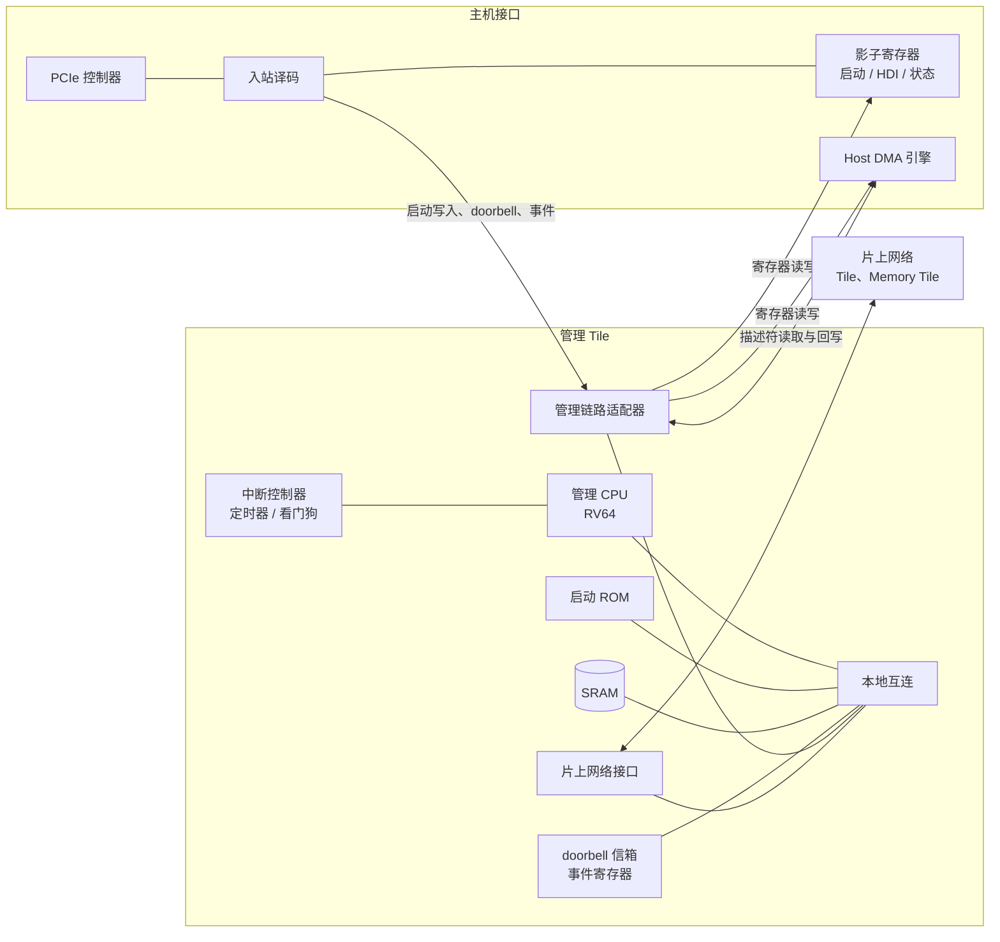

# 管理 Tile 规格（spec-mgmt-tile）

| 项 | 内容 |
|---|---|
| 版本 | v0.1 |
| 状态 | 草稿（Draft） |
| 负责 | 架构线 |
| 读者 | 固件开发者（必读）、gem5 线（必读）、将来的 RTL 团队（必读）、驱动团队（参考：启动与复位）、编译器团队（不需要） |

---

## 1. 概述

### 1.1 范围

管理 Tile 是设备内部唯一运行通用软件的地方。它包含一个 RISC-V 管理 CPU、启动 ROM、片上 SRAM，以及连接主机接口（PCIe 控制器、Host DMA 引擎及其寄存器，下称"主机接口"）的专用管理链路。启动 ROM 把固件装入 SRAM 并启动它；固件负责初始化设备、实现命令协议、编程 Host DMA 引擎、调度各 Tile。

本文档定义：

- 管理 Tile 的结构、管理 CPU 和本地地址空间；
- 启动 ROM 的行为、固件镜像的最小格式和交接约定；
- SRAM 的划分、端口、ECC 和访问控制；
- 管理链路：事务、顺序、流控、复位与排空；
- 管理 Tile 与主机接口之间的分工，包括 doorbell 信箱和 host 可见状态的影子寄存器；
- 中断、定时器、看门狗；
- 复位、性能要求和验收标准。

下列内容不在本文档范围内：

- 主机接口对 host 呈现的行为（BAR、寄存器偏移、启动握手的 host 侧流程），见 `spec-pcie`；本文档只说明管理 Tile 一侧如何配合；
- 命令协议的语义（`spec-hdi`）、Host DMA 引擎的描述符格式（`spec-host-dma`）；
- 固件的软件结构（是否使用 RTOS、任务划分）；
- 设备内存的训练算法、片上网络和各 Tile 的编程接口（将由 `spec-dram`、`spec-noc`、`spec-compute-tile` 定义）；
- 镜像签名与安全启动；
- 调试模块和 trace 的细节。

### 1.2 在设备中的位置

- **管理链路**：管理 Tile 与主机接口之间的点对点链路，不经过片上网络，复位后不需要软件配置即可使用（§5）。
- **片上网络接口**：固件经此访问各 Tile、Memory Tile 和设备内存；其他 Tile 经此向管理 Tile 发送事件。只在固件运行之后使用。

### 1.3 约定

**规范用语**

| 用语 | 含义 |
|---|---|
| 必须 | MUST：不满足即不符合本规格 |
| 应 | SHOULD：除非有充分理由并记录在案，否则要满足 |
| 可 | MAY：可选 |
| TBD | 尚未确定；文中给出当前默认值，并列入 §12 待决事项 |

**单位与数值**

- 容量用二进制前缀：1 KiB = 1024 B；带宽用十进制：1 GB/s = 10⁹ B/s。
- 十六进制写作 `0x1F`；位域写作 `[高:低]`，第 0 位是最低位。
- 多字节数据一律小端序。
- 标"推算"的数字是本文作者计算所得；引用资料写"代号 p.N"。

**寄存器访问类型**

| 类型 | 含义 |
|---|---|
| RO | 只读，写入被忽略 |
| RW | 可读写 |
| RW1C | 读出状态；写 1 清零对应位，写 0 无效 |
| W1S | 写 1 触发动作或置位，写 0 无效；读回 0 |
| RsvdZ | 保留；读回 0，软件必须写 0 |

**术语**

| 术语 | 含义 |
|---|---|
| 主机接口 | 设备中直接面向 host 的部分：PCIe 控制器、入站译码、host 可见的寄存器（`spec-pcie`）、Host DMA 引擎（`spec-host-dma`） |
| 启动阶段（STAGE） | 主机接口向 host 报告的启动进度，编码与各阶段的含义见 `spec-pcie` §6.4 |
| 启动窗口 | STAGE = 2 时，host 写入固件镜像所用的地址范围；写入经管理链路直接落入 SRAM 的装载区 |
| 设备物理地址 | 设备内部地址空间中的地址，宽度 `addr.device_pa_bits`（TBD，默认 40 位） |
| 本地地址 | 管理 CPU 看到的地址（§3.3） |

**参数**

带点号的名字（如 `mgmt.sram_size`）是架构参数，最终以单一真源 `arch_params.yaml` 为准；重建之前以 §13 参数表的当前值为准。

---

## 2. 设计决策

### 2.1 管理 CPU：单核 RV64，不带 MMU

- **决定**：一个 RISC-V 64 位核（RV64IMAC，含 Zicsr、Zifencei），支持 M 模式和 U 模式，带 PMP，不带 MMU，不带浮点单元。
- **理由**：
  - 固件要直接访问 40 位的设备物理地址（设备内存 8 GiB 以上）。32 位核需要额外的地址窗口，固件每次访问设备内存都要先切换窗口。
  - 设备内的隔离采用区域保护（访问源按区间检查、Memory Tile 按受保护区域检查），不需要页表。固件是单一的可信程序，PMP 足以把 ROM、装载区代码和数据区分开。
  - 固件做的是控制和调度，不做数值计算；浮点运算由各 Tile 完成。
  - RISC-V 有成熟的开源工具链和 RTOS 支持，指令集没有授权费用。

### 2.2 固件在 SRAM 中运行，启动 ROM 只做最少的事

- **决定**：固件镜像装入管理 Tile 的 SRAM，并在 SRAM 中执行。启动 ROM 只初始化管理 CPU 和 SRAM、等待 host 写入镜像、校验镜像并跳转。设备内存（LPDDR5X）的训练由固件完成。
- **理由**：
  - 启动 ROM 流片后不可修改，ROM 中的代码越少，出错把芯片变砖的风险越小。DDR 训练是启动中最复杂、最依赖硅片特性的一步，放在可升级的固件里。
  - 镜像经启动窗口直接写入 SRAM，ROM 不需要驱动 Host DMA 引擎，也不依赖设备内存。
  - 固件在片上 SRAM 中执行，取指和访问数据的延迟固定，不受设备内存带宽和片上网络负载影响。

### 2.3 与主机接口之间用专用管理链路，不经过片上网络

- **决定**：管理 Tile 与主机接口之间设一条点对点的管理链路，承载启动写入、doorbell、事件、寄存器访问和 Host DMA 引擎的描述符访问。
- **理由**：
  - 启动时片上网络尚未由固件配置；如果启动写入要经过片上网络，就会出现"要用固件配置片上网络，而固件本身要经过片上网络才能装入"的循环依赖。
  - 控制流量小、对延迟敏感。与片上网络上的大块数据分开，延迟可以预测，也不会因数据流量拥塞而推迟 doorbell 和中断的处理。
  - 管理链路只有两个端点，顺序保证和排空都比在片上网络上容易实现（§5.4）。

### 2.4 管理链路上的任何事务都不依赖固件完成

- **决定**：管理链路两端的目标都是硬件：SRAM、doorbell 信箱、事件寄存器、主机接口的寄存器。它们在有限时间内完成服务，任何事务的完成都不等待固件。
- **理由**：
  - host 对设备的写入必须被立即接收，否则固件卡死会反压 PCIe 的整个入站方向。doorbell 写入落入信箱的覆盖式槽位（§6.2），信箱任何时候都能接收。
  - 两个方向的事务都不依赖对方的软件，管理链路就不会因为双方互相等待而死锁。

### 2.5 host 可见的状态放在主机接口，固件更新影子寄存器

- **决定**：host 会读取的启动状态、命令协议控制器的状态等寄存器，都放在主机接口一侧；固件经管理链路写入影子寄存器。host 写入的、需要固件处理的寄存器，由主机接口记录写入值并向管理 Tile 发送事件。
- **理由**：host 的读如果要转发给管理 CPU 才能完成，管理 CPU 卡死、正在复位或尚未启动时，host 就读不到设备状态，也无法发起恢复。

### 2.6 看门狗超时不自动复位

- **决定**：看门狗第一次超时向固件发中断；第二次超时由硬件停住管理 CPU，并直接置位主机接口的致命错误状态，由 host 决定何时复位设备。
- **理由**：
  - 自动复位会让 host 以为仍在运行的命令协议状态突然消失，与 host 侧的状态不一致。
  - 停住 CPU 保留故障现场，host 可以在复位之前经调试手段读取。

---

## 3. 结构

### 3.1 组成

| 部件 | 说明 |
|---|---|
| 管理 CPU | §2.1；单个 hart，hart ID 为 0 |
| 启动 ROM | `mgmt.rom_size`（TBD，默认 64 KiB），复位向量所在 |
| SRAM | `mgmt.sram_size`（TBD），分为多个 bank，带 ECC（§4） |
| 本地互连 | 连接 CPU、ROM、SRAM、本地寄存器、管理链路适配器、片上网络接口 |
| 管理链路适配器 | 管理链路在管理 Tile 一侧的端点（§5） |
| doorbell 信箱与事件寄存器 | 接收主机接口转来的 doorbell 和事件（§6.2、§6.3） |
| 中断控制器 | RISC-V 标准的 CLINT（定时器和软件中断）加 PLIC（外部中断）（§7） |
| 看门狗 | 两级超时（§7.4） |
| 片上网络接口 | 一个发起端口（固件访问设备内部）和一个目标端口（其他 Tile 访问管理 Tile）（§3.4） |

### 3.2 管理 CPU

| 项 | 要求 |
|---|---|
| 指令集 | RV64IMAC，含 Zicsr、Zifencei |
| 特权模式 | M、U |
| PMP | 至少 16 项 |
| MMU | 无 |
| 缓存 | ROM 和 SRAM 是紧耦合存储，不经缓存。经片上网络访问设备内存和其他 Tile 时，v0.1 一律不缓存 |
| 频率 | `mgmt.cpu_freq`，TBD。复位后先以参考时钟运行，由固件切换到工作频率 |
| 调试 | 必须支持 RISC-V 外部调试规范的调试模块，可经 JTAG 访问；细节不在本文档范围 |

访问设备内存不经缓存，因此固件和其他 Tile、Host DMA 引擎共享的数据结构不需要缓存维护。以后加入数据缓存时，必须同时定义缓存维护的约定。

### 3.3 本地地址空间

管理 CPU 看到的地址空间如下。各区域的基址为暂定值，以设备地址空间的最终划分为准（TBD）。

| 本地地址 | 大小 | 内容 | 访问 |
|---|---|---|---|
| 0x0000_0000 | `mgmt.rom_size` | 启动 ROM | 只读、可执行 |
| 0x1000_0000 | `mgmt.sram_size` | SRAM | 读写、可执行 |
| 0x2000_0000 | 64 KiB | 管理 Tile 本地寄存器：CLINT、看门狗、管理链路状态、SRAM 控制、访问控制 | 读写 |
| 0x2001_0000 | 64 KiB | doorbell 信箱与事件寄存器 | 读写 |
| 0x2C00_0000 | 64 MiB | PLIC | 读写 |
| 0x3000_0000 | 256 MiB | 主机接口的寄存器，经管理链路访问（§6.1） | 读写，32 位或 64 位 |
| 0x100_0000_0000 | 2^`addr.device_pa_bits` | 设备物理地址空间，经片上网络访问：本地地址 = 0x100_0000_0000 + 设备物理地址 | 读写 |
| 其余 | | 保留：访问产生访问错误异常 | |

- SRAM 在设备物理地址空间中的位置 `mgmt.sram_device_pa`（TBD）：其他 Tile 经片上网络访问 SRAM 时使用。Host DMA 引擎访问描述符环时，使用 SRAM 的本地地址，经管理链路访问（§5.2）。
- 访问保留地址、目标返回错误、访问超时（§5.5），都以同步的访问错误异常报告给管理 CPU（load/store access fault 或 instruction access fault），不得让 CPU 无限等待。

### 3.4 片上网络接口

- **发起端口**：固件经此访问各 Tile 的寄存器、Memory Tile 的配置（包括受保护区域）和设备内存。同一个发起端口发出的、目标地址相同的访问按程序顺序完成；目标不同的访问之间不保证顺序，固件需要顺序时必须使用 `fence`，`fence` 必须等此前的所有访问完成。
- **目标端口**：其他 Tile 经此写管理 Tile 的事件寄存器（§6.3），或访问 SRAM 中由固件开放的区间（§4.4）。目标端口复位后关闭，由固件开放。
- 片上网络在固件运行之前不使用；启动 ROM 不访问片上网络。

---

## 4. SRAM

### 4.1 划分

| 区域 | 位置 | 大小 | 用途 |
|---|---|---|---|
| 装载区 | SRAM 起始处 | `mgmt.fw_load_max`（TBD） | 固件镜像（含镜像头）；固件运行后为代码和已初始化的数据 |
| 运行区 | 装载区之后 | 其余部分 | 固件的 BSS、堆、栈，Host DMA 引擎的描述符环，日志缓冲 |
| ROM 保留区 | SRAM 末尾 | `mgmt.rom_reserved`（TBD，默认 4 KiB） | 启动 ROM 的栈和启动信息（§8.4）；固件读取启动信息之后可以回收 |

- 启动窗口的大小等于装载区的大小 `mgmt.fw_load_max`；主机接口向 host 报告的镜像大小上限就是这个值。
- Host DMA 引擎的描述符环放在运行区，按上限配置时所占的空间见 `spec-host-dma` §3.1。
- `mgmt.sram_size` 必须不小于 `mgmt.fw_load_max` + `mgmt.rom_reserved` + 描述符环 + 固件运行所需的数据，具体容量待固件规模估计后确定（TBD）。

### 4.2 端口与仲裁

SRAM 有三个访问源：

| 访问源 | 访问内容 |
|---|---|
| 管理 CPU | 取指、读写数据 |
| 管理链路 | 启动写入；Host DMA 引擎读取描述符、回写描述符状态 |
| 片上网络目标端口 | 其他 Tile 访问固件开放的区间 |

- SRAM 由单口 bank 组成，不要求双口宏单元。不同访问源访问不同 bank 时并行进行；访问同一 bank 时仲裁。
- 仲裁必须保证每个访问源的等待时间有上限 `mgmt.sram_max_wait`（TBD，默认 16 个 SRAM 周期）：管理链路的访问要服务 host 写入和 Host DMA 引擎，不能被 CPU 的连续访问饿死。
- 固件应把描述符环放在与代码不同的 bank 中，减少 Host DMA 引擎读取描述符对取指的干扰。

### 4.3 ECC

- 每 64 位数据带 8 位 SECDED 校验。
- 复位后 SRAM 由硬件清零并写入正确的校验位，完成后置 `SRAM_INIT_DONE`。启动 ROM 必须等它置位后才使用 SRAM。
- 小于 64 位的写入由 SRAM 控制器做读-改-写，对访问源透明。管理链路上的启动写入总是完整的 64 位，不需要读-改-写。
- 可纠正错误：纠正后返回数据，计数并可产生中断（§7.2）。
- 不可纠正错误：
  - CPU 取指或读数据：访问错误异常；
  - 管理链路的读：以错误响应返回，由 Host DMA 引擎按设备地址错误处理；
  - 片上网络目标端口的读：以错误响应返回；
  - 同时记录出错地址，产生中断。

### 4.4 访问控制

除 PMP 对管理 CPU 自身的限制外，SRAM 控制器按访问源检查：

| 访问源 | 允许访问的区间 | 违反时 |
|---|---|---|
| 管理链路的启动写入 | 只在 STAGE = 2 期间，且只能写装载区；由主机接口和 SRAM 控制器共同保证（§5.3） | 丢弃，记录 |
| 管理链路的 Host DMA 引擎访问 | `DESC_BASE` – `DESC_LIMIT`，由固件设置 | 以错误响应返回 |
| 片上网络目标端口 | 最多 `mgmt.noc_windows`（TBD，默认 4）个由固件设置的区间，各自可设为只读或读写；复位后全部关闭 | 以错误响应返回，记录 |
| 管理 CPU | 全部；由 PMP 进一步限制 | — |

访问控制寄存器只能由管理 CPU 在 M 模式下写入。固件可以写 `ACL_LOCK` 锁定它们，锁定后直到复位都不能修改。

---

## 5. 管理链路

### 5.1 物理组织

- 管理链路两端各有一个适配器：主机接口侧和管理 Tile 侧。适配器把各自内部的访问转换为链路事务，并负责跨时钟域、超时、复位与排空。
- 两个方向各有独立的**请求通道**和**响应通道**，每个通道经异步 FIFO 跨时钟域。
- 位宽、频率由实现决定，但带宽必须满足 §10 的要求。
- 复位后不需要任何软件配置即可传输。
- 管理 Tile 应与主机接口相邻放置，使管理链路的连线最短。不相邻时可以用流水寄存器或中继实现，代价是面积和延迟增加；这属于物理设计的优化目标，不是架构约束。

### 5.2 事务

**主机接口 → 管理 Tile**

| 事务 | 类型 | 目标 | 说明 |
|---|---|---|---|
| `BOOT_WR` | 写，需要提交确认 | SRAM 装载区 | host 经启动窗口写入的镜像数据；只在 STAGE = 2 期间出现；每笔 64 位的整数倍 |
| `DB_WR` | posted 写 | doorbell 信箱 | host 写 doorbell 后转来的值（§6.2） |
| `EVENT` | posted 写 | 事件寄存器 | 置位事件（§6.3），例如 `FW_START`、FLR、HDI 寄存器被写入 |
| `DESC_RD` | 读 | SRAM 描述符环 | Host DMA 引擎读取描述符 |
| `DESC_WR` | posted 写 | SRAM 描述符环 | Host DMA 引擎回写描述符状态 |

**管理 Tile → 主机接口**

| 事务 | 类型 | 目标 | 说明 |
|---|---|---|---|
| `REG_RD` | 读 | 主机接口寄存器 | 固件读主机接口和 Host DMA 引擎的寄存器 |
| `REG_WR` | posted 写 | 主机接口寄存器 | 固件写寄存器，包括更新影子寄存器（§6.1） |

每笔读请求带一个 tag，响应按 tag 返回。发起方在发出读请求之前必须预留好接收响应的空间，因此**响应通道在任何时候都能被接收**，不会因为对方的请求通道堵塞而停顿。

### 5.3 顺序

1. 同一方向上的写（posted 写和 `BOOT_WR`）按发出顺序在目标处生效。
2. 同一方向上的读，不越过该方向此前发出的写：读到的结果反映此前所有写的效果。
3. `EVENT` 不越过同一方向此前发出的写。因此固件收到某个事件时，引起该事件的写都已生效。
4. **启动写入的提交保证**：
   - 主机接口在入站译码的入口处（BAR 分流之前、入站事务唯一的有序点）对 `BOOT_WR` 计数：接受一笔时加 1，收到管理 Tile 侧的提交确认时减 1。提交确认表示数据已写入 SRAM 并可被 CPU 读到。
   - 主机接口接受 host 对 `FW_START` 的写入时，立即关闭启动窗口，然后等计数归零，才经管理链路发出 `FW_START` 事件。
   - 因此启动 ROM 收到 `FW_START` 事件时，host 在 `FW_START` 之前写入的镜像都已在 SRAM 中，且之后不会再有启动写入。
   - 这一保证依赖 PCIe 控制器在入站方向保持 posted 写的顺序；不满足时需要另加排空机制（§12）。
   - host 能观察到的效果见 `spec-pcie` §6.4。

### 5.4 流控

- 每个通道按信用流控：发送方只在持有对方的信用时发送。
- 主机接口 → 管理 Tile 方向的 posted 写和事件，其目标（信箱、事件寄存器、SRAM）都在有限时间内接收（§2.4），因此信用总会在有限时间内归还，host 的入站写不会被固件反压。
- `DESC_RD` 与 `BOOT_WR` 不会同时出现：Host DMA 引擎只在固件运行后使用，启动写入只在 STAGE = 2 期间出现。

### 5.5 超时与错误

- 每笔读请求和 `BOOT_WR` 都有超时 `mgmt.link_timeout`（TBD，默认 10 µs）。超时的请求以错误结束：
  - 固件的 `REG_RD`：访问错误异常（§3.3），并记录在 `ML_ERR`；
  - Host DMA 引擎的 `DESC_RD`：返回错误，由 Host DMA 引擎按设备地址错误处理；
  - `BOOT_WR`：本次加载记为非法写入，随后的 `FW_START` 失败，host 可重新加载。
- 目标不存在的地址：以错误响应返回，处理同上。
- 链路层错误（例如 FIFO 溢出、未知 tag 的响应）：丢弃并记录在 `ML_ERR`，产生中断；属于硬件故障，不应在正常运行中出现。

### 5.6 复位与排空

管理链路两端可能经历不同的复位：

| 事件 | 主机接口侧 | 管理 Tile 侧 | 管理链路 |
|---|---|---|---|
| 冷复位、热复位 | 复位 | 复位 | 两端同时复位，之后重新建立 |
| 设备完全复位 | PCIe 控制器、配置空间和链路保留；其余（包括 Host DMA 引擎和影子寄存器）复位 | 复位 | 重新建立 |
| FLR | host 可见的状态复位，Host DMA 引擎复位 | 不复位 | 保持；主机接口发 FLR 事件 |
| 看门狗第二级超时 | 不复位 | CPU 停住，本地硬件继续工作 | 保持 |

当任一侧复位时，管理链路按以下规则排空：

1. 复位一侧的适配器丢弃自己的全部状态；另一侧通过跨时钟域同步的复位信号得知对方正在复位。
2. 另一侧对发往复位一侧、尚未收到响应的读请求，以"对端复位"错误结束；尚未发出的写请求丢弃。
3. 两侧都退出复位后，适配器握手重新建立链路，并把**链路纪元**（epoch）加 1。每笔请求和响应都带纪元号，纪元不符的响应被丢弃，因此复位前发出的请求不会在复位后得到响应。
4. 链路重新建立之前，主机接口不接受启动写入（启动窗口保持关闭），doorbell 写入由主机接口暂存最新值，链路建立后再转发。

FLR 只复位主机接口侧的部分状态，不复位管理链路：主机接口在复位 Host DMA 引擎之前，先让其在途的 `DESC_RD` 完成或以错误结束，然后发出 FLR 事件。

---

## 6. 与主机接口的分工

### 6.1 host 可见的状态

| 状态 | 存放位置 | host 的访问 | 固件的访问 |
|---|---|---|---|
| 启动阶段 STAGE | 主机接口 | 读 | 写：0 → 1、→ 2、3 → 2（加载失败）、3 → 4、→ 0xF。2 → 3 由主机接口在接受 `FW_START` 时自动完成 |
| `FW_READY`、启动错误码 | 主机接口 | 读 | 写。FLR 时由主机接口自动清零 `FW_READY` |
| 镜像大小 | 主机接口 | STAGE = 2 时读写 | 读；加载失败时清零 |
| 固件版本 | 主机接口 | 读 | 写 |
| 调试窗口开启位 | 主机接口 | 读 | 写；熔丝禁止时写入无效 |
| 致命错误位 | 主机接口 | 读 | 写；看门狗第二级超时时由硬件直接置位 |
| 命令协议控制器的寄存器 | 主机接口 | 读；写可写字段 | 读写，包括 host 只读的字段（例如状态、能力、错误原因）。host 写入可写字段时，主机接口发出"HDI 寄存器被写入"事件，并在 `HDI_WR_MAP` 中记录被写的寄存器 |
| doorbell | 值转发到管理 Tile 的信箱 | 写 | 读信箱（§6.2） |
| Host DMA 引擎的寄存器 | 主机接口 | 只读镜像 | 读写 |
| host 中断 | 主机接口发出 | 收到 MSI-X 或 INTx | 写主机接口的中断请求寄存器；主机接口保证该中断不越过此前已进入发送通路的 DMA 写 |

- 各寄存器对 host 的定义见 `spec-pcie` §6、§7 和 `spec-hdi` §4；本表只规定由谁存放、谁来写。
- 固件经管理链路访问这些状态时使用主机接口的内部寄存器地址（本地地址 0x3000_0000 起），具体布局由主机接口的实现定义，TBD。
- host 的读从不经过管理链路：读到的是影子寄存器中最近一次写入的值。

### 6.2 doorbell 信箱

管理队列和每个上下文各有一个 doorbell 页（`spec-hdi` §4.2），每页有 SQ 尾指针和 CQ 头指针两个 doorbell，共 `mgmt.db_slots` = 2 × (1 + 16) = 34 个。

| 寄存器 | 类型 | 说明 |
|---|---|---|
| `DB_SLOT[i]` | RO | 第 i 个 doorbell 最近一次写入的值，[15:0] 有效。i = 2p 是第 p 页的 SQ 尾指针，i = 2p + 1 是 CQ 头指针；p = 0 是管理队列，p = 1 + n 是上下文 n |
| `DB_PENDING[1:0]` | RW1C | 第 i 位为 1 表示 `DB_SLOT[i]` 自上次清零后被写过 |
| `DB_MASK[1:0]` | RW | 1 表示屏蔽该位的中断 |

- `DB_WR` 覆盖对应槽位并置位 pending 位，不排队，因此信箱任何时候都能接收，也不会溢出。host 在固件处理之前多次写同一个 doorbell 时，固件只看到最后一次的值；对尾指针和头指针来说，最后一次的值就是全部所需信息。
- `DB_PENDING & ~DB_MASK` 非零时向管理 CPU 发中断（§7.2）。
- 固件必须**先清零 pending 位，再读槽位**。这样在读之后到达的写会重新置位 pending，不会丢失。
- doorbell 值是否越界、对应的上下文是否存在，由固件检查。

### 6.3 事件寄存器

| 寄存器 | 类型 | 说明 |
|---|---|---|
| `EVT_PENDING` | RW1C | 各位对应一个事件，见下表；事件到达时置位 |
| `EVT_MASK` | RW | 1 表示屏蔽该位的中断 |

| 位 | 事件 | 来源 |
|---|---|---|
| [0] | `FW_START` | 主机接口：host 写入 `FW_START`，且之前的启动写入均已提交（§5.3） |
| [1] | `FLR` | 主机接口：FLR 已开始，host 可见的状态已复位 |
| [2] | `HDI_WR` | 主机接口：host 写了命令协议控制器的可写寄存器 |
| [3] | `BME_OFF` | 主机接口：host 清除了 Bus Master Enable |
| [4] | `PM` | 主机接口：电源状态改变（D0 ↔ D3hot） |
| [5] | `HDMA_NOTIFY` | Host DMA 引擎：带通知标志的描述符完成；细节由 Host DMA 引擎的状态寄存器给出 |
| [6] | `HDMA_ERR` | Host DMA 引擎：通道进入错误停止 |
| [7] | `HOST_ERR` | 主机接口：其他 host 侧错误 |
| [15:8] | — | RsvdZ |
| [31:16] | `TILE_EVT[k]` | 其他 Tile 经片上网络目标端口写入的事件，k = 0 … 15，含义由固件与 Tile 的约定决定 |

事件和 doorbell 一样只置位、不排队，同一事件多次发生只保留一次 pending，详细原因由来源处的状态寄存器给出。

---

## 7. 中断、定时器与看门狗

### 7.1 中断控制器

采用 RISC-V 标准的 CLINT 和 PLIC，以便直接使用现成的工具链和 RTOS 支持。

| 中断 | 控制器 | 来源 |
|---|---|---|
| 机器定时器中断 | CLINT | `mtime` ≥ `mtimecmp` |
| 机器软件中断 | CLINT | `msip`（单核下用于自中断） |
| 机器外部中断 | PLIC | §7.2 的各个来源 |

### 7.2 外部中断源

| PLIC 源 | 来源 |
|---|---|
| 1 | doorbell 信箱：`DB_PENDING & ~DB_MASK` 非零 |
| 2 | 事件寄存器：`EVT_PENDING & ~EVT_MASK` 非零 |
| 3 | 管理链路错误（`ML_ERR` 非零） |
| 4 | SRAM 可纠正 ECC 错误（计数达到阈值） |
| 5 | SRAM 不可纠正 ECC 错误 |
| 6 | SRAM 访问控制违例 |
| 7 | 看门狗第一级超时 |
| 8 | 片上网络接口错误 |
| 9 – 31 | 保留，TBD |

### 7.3 定时器

- `mtime` 与主机接口向 host 报告的设备时间戳（`spec-pcie` §6.2）是同一个计数器，频率相同。这样固件记录的时间与 host 读到的时间戳可以直接比较。
- `mtime` 复位后从 0 开始，只在冷复位和热复位时清零；设备完全复位和 FLR 不清零。

### 7.4 看门狗

| 寄存器 | 类型 | 说明 |
|---|---|---|
| `WDT_CTRL` | RW | [0] EN：使能。[1] LOCK：写 1 后 EN 和 `WDT_LOAD` 不能再修改，直到设备复位 |
| `WDT_LOAD` | RW | 超时周期，以 `mtime` 计 |
| `WDT_KICK` | WO | 写入 0x5A5A_A5A5 重新开始计时；写入其他值视为第一级超时 |
| `WDT_STATUS` | RO | [0] STAGE1：第一级已超时。[1] STAGE2：第二级已超时 |

- 复位后看门狗关闭，启动 ROM 不使用它。固件应在初始化早期使能并锁定。
- **第一级超时**：计时器到达 `WDT_LOAD` 时置 STAGE1，产生中断（PLIC 源 7），并重新开始计时。
- **第二级超时**：STAGE1 置位后计时器再次到达 `WDT_LOAD` 时，硬件：
  1. 停住管理 CPU（进入调试暂停状态，可经调试模块访问）；
  2. 经管理链路以外的专用信号置位主机接口的致命错误位，并向 host 发错误中断。这条信号不经过固件，也不依赖管理链路的状态。
- 第二级超时后由 host 决定复位（设备完全复位或热复位）。看门狗本身不复位任何部件。

---

## 8. 启动

### 8.1 启动 ROM 的步骤

| 步骤 | 启动 ROM 的动作 | STAGE |
|---|---|---|
| 1 | 从复位向量（本地地址 0）开始执行，以参考时钟运行 | 0 |
| 2 | 初始化必要的 CSR；等待 `SRAM_INIT_DONE`；在 ROM 保留区建立栈 | 0 |
| 3 | 写 STAGE = 1。对 PCIe 控制器只做必要的少量配置（例如 PHY 参数修正，TBD）；链路训练和配置空间由硬件在复位后自动开始，不等待启动 ROM | 1 |
| 4 | 写 STAGE = 2，启动窗口打开 | 2 |
| 5 | 等待 `EVT_PENDING.FW_START`（轮询或中断）。此时主机接口已把 STAGE 置为 3 并关闭启动窗口 | 3 |
| 6 | 读取镜像大小，检查本次加载是否有非法写入；检查镜像头（§8.2）；计算并比对镜像的摘要 | 3 |
| 7 | 失败：写启动错误码，清零镜像大小，写 STAGE = 2，回到第 5 步 | 2 |
| 8 | 成功：按 §8.3 设置 PMP，清零 ROM 保留区以外的运行区，跳转到固件入口 | 3 |

- STAGE 和启动错误码的编码见 `spec-pcie` §6.4，启动 ROM 和固件按该编码写入。
- 启动 ROM 不访问片上网络、设备内存和 Host DMA 引擎。
- 启动 ROM 不使能看门狗。等待 host 加载期间没有超时，host 不加载时设备一直停在 STAGE 2。

### 8.2 镜像格式

镜像以 64 B 的镜像头开始，紧接着是固件内容，整个镜像装入装载区起始处。

| 偏移 | 长度 | 字段 | 说明 |
|---|---|---|---|
| 0x00 | 4 | `MAGIC` | ASCII "GWFW"（0x5746_5747） |
| 0x04 | 2 | `HDR_VERSION` | 镜像头格式版本，当前为 1 |
| 0x06 | 2 | `HDR_SIZE` | 镜像头长度，当前为 64 |
| 0x08 | 4 | `IMAGE_SIZE` | 镜像总长度（含镜像头），字节；必须等于 host 写入的镜像大小 |
| 0x0C | 4 | `ENTRY_OFFSET` | 固件入口相对装载区起始处的偏移；必须 4 B 对齐，落在固件内容之内 |
| 0x10 | 4 | `FW_VERSION` | 固件版本号，固件运行后写入主机接口 |
| 0x14 | 12 | — | 保留，必须为 0 |
| 0x20 | 32 | `DIGEST` | 对偏移 0x40 起的固件内容计算的 SHA-256 摘要 |

- 启动 ROM 检查：`MAGIC`、`HDR_VERSION`、`HDR_SIZE`、`IMAGE_SIZE`、`ENTRY_OFFSET`、保留字段，以及 `DIGEST`。任何一项不符都按镜像校验失败处理。
- SHA-256 只检测传输错误和误写，不提供安全性。签名验证属于安全启动，TBD。

### 8.3 交接约定

启动 ROM 跳转到固件入口时：

| 项 | 状态 |
|---|---|
| 特权模式 | M 模式 |
| `a0` | hart ID，0 |
| `a1` | 启动信息结构的本地地址（位于 ROM 保留区，§8.4） |
| PMP | 启动 ROM 只读可执行；装载区可读写可执行；运行区可读写不可执行；固件可以重新设置 |
| 中断 | 全部关闭，`EVT_PENDING` 中 `FW_START` 已清零 |
| 时钟 | 仍为参考时钟 |
| 管理链路 | 已建立；启动窗口已关闭 |
| 片上网络接口、设备内存 | 尚未初始化 |

### 8.4 启动信息

| 偏移 | 长度 | 字段 | 说明 |
|---|---|---|---|
| 0x00 | 4 | `ROM_VERSION` | 启动 ROM 的版本 |
| 0x04 | 4 | `BOOT_REASON` | 0 冷复位，1 热复位，2 设备完全复位 |
| 0x08 | 4 | `LOAD_ATTEMPTS` | 本次启动中失败的加载次数 |
| 0x0C | 4 | — | 保留 |
| 0x10 | 8 | `SRAM_SIZE` | SRAM 容量，字节 |
| 0x18 | 8 | `LOAD_MAX` | 装载区大小，字节 |

### 8.5 固件初始化的职责

固件开始运行后，到置位 `FW_READY` 之前，必须完成：

1. 切换到工作时钟；使能并锁定看门狗。
2. 初始化设备内存，包括 LPDDR5X 训练。失败时写启动错误码（固件初始化失败）和 STAGE = 0xF，然后停止。
3. 在 Memory Tile 中设置固件需要的受保护区域（如有）。
4. 配置片上网络和各 Tile。
5. 设置 SRAM 的访问控制（§4.4），包括 Host DMA 引擎的描述符区间，然后锁定。
6. 初始化 Host DMA 引擎的通道和描述符环。
7. 写入命令协议控制器的只读字段（版本、能力）和固件版本。
8. 写 STAGE = 4、置位 `FW_READY`。

---

## 9. 复位

| 复位 | 管理 Tile 的行为 |
|---|---|
| 冷复位、热复位 | 管理 Tile 全部复位，从启动 ROM 重新开始，`BOOT_REASON` 为 0 或 1；SRAM 内容不保留 |
| 设备完全复位 | 同上，`BOOT_REASON` 为 2。`mtime` 不清零 |
| FLR | 管理 Tile 不复位，固件继续运行。主机接口自动清零 `FW_READY`（`spec-pcie` §13.2）并发出 FLR 事件；固件中止 Host DMA 引擎上属于本功能的传输，清理命令协议的全部上下文和各 Tile 中的相关状态，完成后重新置位 `FW_READY` |
| 看门狗第二级超时 | 管理 CPU 停住；其余部件不复位，等待 host 复位 |

**FLR 期间的约束**

- 固件收到 FLR 事件之前，主机接口已经复位了 host 可见的状态和 Host DMA 引擎；固件不得假设任何复位前的命令协议状态仍然有效。
- 固件清理期间，host 可能已经开始读取状态。由于 `FW_READY` 为 0，host 不会使能命令协议。
- STAGE 不是 4 时发生 FLR（启动尚未完成）：主机接口关闭启动窗口并发出 FLR 事件；启动 ROM 放弃本次加载，清零镜像大小和错误码，写 STAGE = 2 重新打开启动窗口。

---

## 10. 性能要求

| 编号 | 要求 |
|---|---|
| P1 | host 写 doorbell，从主机接口接收到该写，到管理 Tile 的 `DB_PENDING` 置位并向 CPU 发出中断，应不超过 100 ns（TBD） |
| P2 | 固件经管理链路的 `REG_RD`，从发出到数据返回，应不超过 200 ns（TBD） |
| P3 | Host DMA 引擎的 `DESC_RD`（32 B），从发出到数据返回，应不超过 200 ns（TBD），使每通道预取 2 个描述符就能掩盖读取延迟 |
| P4 | 管理链路接收启动写入的带宽，必须不低于 PCIe 链路以最大载荷写入启动窗口的速率，使启动窗口的写入不因管理链路而反压；具体数值随 PCIe 控制器的实现确定（TBD） |
| P5 | CPU 访问 SRAM（无 bank 冲突）应为单周期 |

P3 的依据：一次 4 KiB 的传输在 8 GB/s 下约需 512 ns（推算），只要读取一个描述符的延迟明显短于此，预取深度 2 就足以让描述符读取不成为瓶颈。

---

## 11. 验收标准

**功能**

| 编号 | 检查 |
|---|---|
| F1 | 启动：ROM 按 §8.1 推进 STAGE；合法镜像被校验通过并跳转到入口，交接状态符合 §8.3 |
| F2 | 镜像检查：镜像头各字段、摘要的每一种错误都按校验失败处理并回到 STAGE 2；随后可重新加载成功 |
| F3 | 启动写入的提交保证：`FW_START` 事件到达时，之前的启动写入在 SRAM 中全部可见；`FW_START` 之后的写入不改变装载区 |
| F4 | doorbell 信箱：多次写同一 doorbell 只保留最后一个值；"先清 pending 再读值"的流程不丢失更新；固件停止处理时 host 的 doorbell 写入不被反压 |
| F5 | 事件：每种事件都能置位 `EVT_PENDING` 并产生中断；事件不越过引起它的写入 |
| F6 | 管理链路的复位与排空：任一侧复位时，另一侧的在途读以错误结束；复位后旧纪元的响应被丢弃 |
| F7 | 超时：`REG_RD`、`DESC_RD`、`BOOT_WR` 超时时按 §5.5 处理，CPU 不会无限等待 |
| F8 | SRAM：ECC 可纠正和不可纠正错误按 §4.3 处理；访问控制按 §4.4 处理，锁定后不可修改 |
| F9 | 看门狗：第一级产生中断；第二级停住 CPU、置位主机接口的致命错误，且不依赖固件和管理链路 |
| F10 | FLR：管理 Tile 不复位；固件收到 FLR 事件、清理后重新置位 `FW_READY`；启动未完成时回到 STAGE 2 |
| F11 | 设备完全复位：从启动 ROM 重新开始，`BOOT_REASON` = 2，`mtime` 不清零 |

**性能**

| 编号 | 检查 |
|---|---|
| T1 | P1 – P3 的延迟在无竞争和 SRAM bank 冲突两种条件下测量，均满足要求 |
| T2 | 启动窗口以最大载荷连续写入时，主机接口不因管理链路而停止接收（P4） |
| T3 | CPU 连续访问同一 bank 时，管理链路的等待时间不超过 `mgmt.sram_max_wait` |

---

## 12. 待决事项

| 事项 | 当前默认 | 影响 |
|---|---|---|
| SRAM 容量 `mgmt.sram_size` | TBD | §4.1；取决于固件规模和 DDR 训练代码大小 |
| 装载区大小 `mgmt.fw_load_max` | TBD | §4.1；host 可见的镜像大小上限 |
| 启动 ROM 大小 | 64 KiB | §3.1 |
| 管理 CPU 频率 | TBD | §3.2、§10 |
| 本地地址空间各区域的基址、SRAM 的设备物理地址 | §3.3 的暂定值 | 随设备地址空间的划分确定 |
| 主机接口内部寄存器的布局 | TBD | §6.1 |
| 启动 ROM 对 PCIe 控制器的配置内容 | 尽量为空 | §8.1；取决于所选的 PCIe 控制器和 PHY |
| 签名验证与安全启动 | 不支持，只做 SHA-256 | §8.2 |
| 管理链路的位宽、频率、超时 | 超时 10 µs | §5；随实现确定 |
| PCIe 控制器入站 posted 写的顺序 | 选型时必须验证不乱序 | §5.3 的提交保证依赖它；不满足时需要另加排空机制 |
| SRAM 仲裁等待上限 | 16 个周期 | §4.2 |
| 片上网络目标端口的开放区间数 | 4 | §4.4 |
| 是否为设备内存访问加入数据缓存 | 不加 | §3.2 |
| 外部中断源 9 – 31 | 保留 | §7.2 |
| P1 – P3 的数值 | 100 ns、200 ns、200 ns | §10 |

---

## 13. 参数

| 参数 | 当前值 | 说明 |
|---|---|---|
| `mgmt.rom_size` | 64 KiB（TBD） | §3.1 |
| `mgmt.sram_size` | TBD | §4.1 |
| `mgmt.fw_load_max` | TBD | §4.1；8 的整数倍 |
| `mgmt.rom_reserved` | 4 KiB（TBD） | §4.1 |
| `mgmt.sram_max_wait` | 16 个 SRAM 周期（TBD） | §4.2 |
| `mgmt.noc_windows` | 4（TBD） | §4.4 |
| `mgmt.cpu_freq` | TBD | §3.2 |
| `mgmt.link_timeout` | 10 µs（TBD） | §5.5 |
| `mgmt.db_slots` | 34 | §6.2；2 × (1 + 上下文数 16) |
| `addr.device_pa_bits` | TBD，默认 40 | §1.3、§3.3 |
