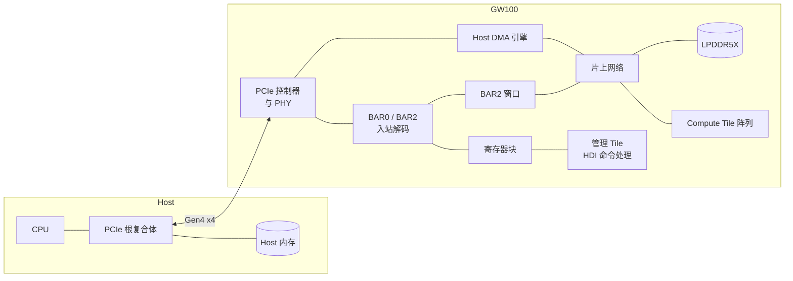

# PCIe 子系统规格（spec-pcie）

| 项 | 内容 |
|---|---|
| 版本 | v0.1 |
| 状态 | 草稿（Draft） |
| 负责 | 架构线 |
| 读者 | 驱动团队（必读）、gem5 线（必读）、将来的 RTL 团队（必读）、编译器团队（不需要） |

---

## 1. 概述

### 1.1 范围

本文档定义 GW100 作为 PCIe 端点（Endpoint）对 host 呈现的全部行为：链路、配置空间、BAR 布局、BAR0 中由本文档定义的寄存器、中断、事务参数、顺序与一致性、复位与电源、错误处理和性能要求。

下列内容**不在**本文档范围内。本文档只在需要时说明它们与 PCIe 的接口，不定义其内部：

- Host DMA 引擎的通道、描述符和 scatter-gather 列表；
- 命令协议：命令队列、doorbell 的语义、命令与完成记录、上下文；
- 设备内部地址空间的划分（BAR2 窗口指向的地址）；
- 启动流程、固件格式、安全启动的完整定义；
- 全芯片的错误分级与汇聚。

### 1.2 设备在系统中的位置



- **入站**（host → 设备）：host 的 MMIO 读写经 BAR0 访问寄存器，经 BAR2 窗口访问设备内存。
- **出站**（设备 → host）：Host DMA 引擎读写 host 内存，包括命令队列、数据缓冲和完成记录；MSI-X 消息也从这里发出。

### 1.3 约定

本文档使用以下约定。

**规范用语**

| 用语 | 含义 |
|---|---|
| 必须 | MUST：不满足即不符合本规格 |
| 应 | SHOULD：除非有充分理由并记录在案，否则要满足 |
| 可 | MAY：可选 |
| TBD | 尚未确定；文中给出当前默认值，并列入 §16 待决事项 |

**单位与数值**

- 容量用二进制前缀：1 KiB = 1024 B，1 MiB = 1024 KiB。
- 带宽用十进制：1 GB/s = 10⁹ B/s。
- 十六进制写作 `0x1F`；位域写作 `[高:低]`，第 0 位是最低位。
- 多字节数据一律小端序（little-endian），与 PCIe 和 host 一致。
- 标"推算"的数字是本文作者计算所得，不是资料原文；引用资料写"代号 p.N"。

**寄存器访问类型**

| 类型 | 含义 |
|---|---|
| RO | 只读，写入被忽略 |
| RW | 可读写 |
| RW1C | 读出状态；写 1 清零对应位，写 0 无效 |
| W1S | 写 1 触发动作或置位，写 0 无效；读回 0 |
| WO | 只写；读回 0 |
| RsvdZ | 保留；读回 0，软件必须写 0 |

**参数**

本文档中带点号的名字（如 `pcie.bar0_size`）是架构参数，最终以单一真源 `arch_params.yaml` 为准。单一真源重建之前，以本文档 §14 参数表中的当前值为准。

---

## 2. 设计决策

本节记录四项基础决策及理由，后续各节据此展开。

### 2.1 链路：Gen4 x4，可降级

- **决定**：最高 Gen4（16 GT/s）x4；必须能以 Gen1–Gen3 速率和 x1、x2 宽度正常工作。
- **理由**：
  - 端侧 M.2 Key M 插槽最多 4 条通道。同类端侧加速器 Hailo-8 为 Gen3 x4，可降为 x1、x2（Hailo-DS p.38）。
  - LLM 推理稳定运行时，PCIe 不是瓶颈：KV cache 留在设备上，decode 每个 token 只需传 token ID 和少量结果。吃带宽的是模型加载和模型切换：3.5 GB 的 INT4 权重在 Gen3 x4 上约 0.9 s，在 Gen4 x4 上约 0.45 s（推算）。
  - Gen5 会显著增加 PHY 的功耗和成本，对端侧收益小。
  - 常见的端侧高配主机（如 RK3588 类 SoC）只有 Gen3 x4，因此降级能力是硬性要求。

### 2.2 BAR：控制 BAR 加可重映射窗口，不开放整块设备内存

- **决定**：BAR0 放寄存器，BAR2 是可重映射的窗口；不提供映射全部设备内存的大 BAR；大块数据一律走 DMA。
- **理由**：
  - 嵌入式 ARM 主机分给 PCIe 的 MMIO 地址空间往往很小，也很少支持 Resizable BAR。把 8–16 GB 设备内存映射成一个 BAR，在这类主机上很可能分配不出来，设备将无法使用。
  - 固件加载、调试和小块访问只需要一个能指向任意设备地址的窗口。这种做法与 Hailo-8 的小 BAR 划分（BAR0 配置、BAR2 DMA 寄存器、BAR4 固件窗口）和 Tenstorrent 的 BAR 加可配置 TLB 一致（见附录 A）。
  - 每个上下文的 doorbell 各占一个 4 KiB 页，互不共享。v0.1 中 doorbell 只由内核驱动访问；按页隔离为以后支持用户态直接提交预留条件（届时还需要 PASID 等能按进程区分 DMA 的机制）。

### 2.3 中断：MSI-X 必须支持，INTx 作为退路

- **决定**：必须支持 MSI-X；必须支持 INTx（INTA）作为退路；不支持 MSI。
- **理由**：
  - MSI-X 可以为每个上下文分配独立向量，是新一代加速器的通行做法。
  - 支持 MSI-X 的主机都支持 MSI，再实现 MSI 收益小；INTx 则用于启动阶段和不支持消息中断的环境。Linux 驱动按 MSI-X、INTx 的顺序尝试即可。

### 2.4 DMA 一致性：设备不依赖 host 的硬件一致性

- **决定**：设备对 host 内存的访问不依赖硬件缓存一致性；驱动必须按"DMA 不一致"的系统编写。设备默认不设置 No Snoop；用于通知完成的写不使用 Relaxed Ordering。
- **理由**：
  - DMA 是否与 CPU cache 一致取决于 host 的根复合体：x86 默认一致，许多嵌入式 ARM SoC 不一致。按不一致的系统编写的驱动在两类主机上都正确，反过来不成立。
  - PCIe 端点本身不参与 host 的缓存一致性；设备能决定的只是 No Snoop、Relaxed Ordering 这些事务属性怎么用，见 §9。

---

## 3. 链路

| 项 | 要求 |
|---|---|
| 最高速率 | Gen4，16 GT/s（`pcie.max_link_speed`） |
| 最大宽度 | x4（`pcie.max_link_width`） |
| 降级 | 必须能在 Gen1、Gen2、Gen3、Gen4 任一速率，以及 x1、x2、x4 任一宽度下训练成功并正常工作 |
| 通道反转、极性反转 | 必须支持 |
| 虚通道 | 只有 VC0 |
| 物理功能 | 单个物理功能（Function 0），不支持 SR-IOV |
| 参考时钟 | 必须支持 host 提供的公共参考时钟；是否支持独立参考时钟（SRIS）TBD |

各配置下的理论带宽（每个方向，推算）：

| 配置 | 原始速率 | 编码 | 理论数据带宽 |
|---|---|---|---|
| Gen4 x4 | 16 GT/s × 4 | 128b/130b | 7.877 GB/s |
| Gen3 x4 | 8 GT/s × 4 | 128b/130b | 3.938 GB/s |
| Gen4 x1 | 16 GT/s × 1 | 128b/130b | 1.969 GB/s |

算法：速率 × 通道数 × 128/130 ÷ 8。实际可用带宽还要扣除 TLP 开销，见 §11。

---

## 4. 配置空间

### 4.1 头部

| 字段 | 值 | 说明 |
|---|---|---|
| Vendor ID | `pcie.vendor_id`，TBD | 正式 ID 申请下来之前使用占位值；不得使用他人已注册的 ID（如 QEMU 使用的 0x1234） |
| Device ID | `pcie.device_id`，TBD | |
| Revision ID | 芯片步进号 | 每次改版加一 |
| Class Code | 0x12 / 0x00 / 0x00 | Processing Accelerator，无子类，无编程接口 |
| Header Type | 0x00 | Type 0，单功能 |
| Subsystem Vendor ID / Subsystem ID | TBD | 由板卡厂商通过板级配置提供 |
| Interrupt Pin | 0x01 | INTA |
| Capabilities Pointer | 指向 §4.2 的第一个 capability | |

Command 寄存器中，设备必须实现 Memory Space Enable、Bus Master Enable、SERR# Enable、Parity Error Response、Interrupt Disable；I/O Space Enable 固定为 0（设备没有 I/O BAR）。Memory Space Enable 为 0 时，设备不得响应 BAR0、BAR2 的访问；Bus Master Enable 为 0 时，设备不得发起任何 DMA 或 MSI-X 消息。

### 4.2 Capability

| Capability | 要求 | 说明 |
|---|---|---|
| PCI Power Management | 必须 | D0、D3hot；`No_Soft_Reset` 为 0，见 §13.3 |
| PCI Express（Endpoint，版本 2） | 必须 | 见下文 |
| MSI-X | 必须 | 表大小 `pcie.msix_table_size`，见 §8 |
| MSI | 不支持 | 理由见 §2.3 |
| Advanced Error Reporting（AER） | 必须 | 见 §12 |
| Device Serial Number | 应 | 每颗芯片唯一，用于板卡追溯 |
| Latency Tolerance Reporting（LTR） | 应 | 配合 host 的电源管理 |
| L1 PM Substates | 可 | TBD，取决于产品形态 |
| Secondary PCIe（均衡控制） | 必须 | Gen3 及以上速率要求 |
| Physical Layer 16.0 GT/s 等 Gen4 相关 capability | 必须 | Gen4 速率要求 |
| Resizable BAR、ATS、PRI、PASID、SR-IOV、ACS | 不支持 | |
| AtomicOps | 不支持 | 作为请求方和完成方都不支持 |

PCI Express Capability 的关键字段：

| 字段 | 值 |
|---|---|
| Device/Port Type | PCI Express Endpoint |
| Max_Payload_Size Supported | 256 B（`pcie.max_payload_supported`） |
| Extended Tag Field Supported | 1（支持 8 位 tag） |
| 10-Bit Tag Requester Supported | 0（不使用 10 位 tag，§10.3） |
| Function Level Reset Capability | 1 |
| Completion Timeout Ranges Supported | 至少范围 A、B |
| Completion Timeout Disable Supported | 0（完成超时不可关闭，见 §10.3） |
| ASPM Support | L1 必须；L0s 可不支持 |

---

## 5. BAR 布局

| BAR | 类型 | 大小 | 用途 |
|---|---|---|---|
| BAR0 | 32 位，不可预取，内存 | `pcie.bar0_size` = 1 MiB | 寄存器：全局控制、BAR2 窗口配置、MSI-X 表、启动、HDI 控制器、DMA 状态、doorbell 页 |
| BAR1 | — | — | 不实现（BAR0 为 32 位） |
| BAR2/3 | 64 位，可预取，内存 | `pcie.bar2_size` = 64 MiB | 可重映射窗口，指向设备内存，见 §7 |
| BAR4/5 | — | — | 不实现 |
| Expansion ROM | — | — | 不实现 |

- BAR0 的寄存器读取可能有副作用（例如读低半部锁存高半部），因此不可预取。
- BAR2 映射的是内存，读取没有副作用，因此标为可预取，允许 host 使用写合并（write-combining）提高写吞吐。

### 5.1 BAR0 地址分配

| 偏移 | 大小 | 内容 | 定义 |
|---|---|---|---|
| 0x0_0000 – 0x0_0FFF | 4 KiB | 设备标识与全局控制 | §6 |
| 0x0_1000 – 0x0_1FFF | 4 KiB | BAR2 窗口配置 | §7 |
| 0x0_2000 – 0x0_2FFF | 4 KiB | MSI-X 表 | §8 |
| 0x0_3000 – 0x0_3FFF | 4 KiB | MSI-X PBA | §8 |
| 0x0_4000 – 0x0_4FFF | 4 KiB | 启动与固件 | §6.4（暂定的最小集合） |
| 0x0_5000 – 0x0_5FFF | 4 KiB | HDI 控制器寄存器 | 属于命令协议，本文档不定义 |
| 0x0_6000 – 0x0_6FFF | 4 KiB | Host DMA 寄存器的只读镜像 | 属于 DMA 引擎，本文档不定义 |
| 0x0_7000 – 0x7_FFFF | | 保留 | |
| 0x8_0000 – 0x8_0FFF | 4 KiB | 管理队列 doorbell 页 | 属于命令协议，本文档不定义 |
| 0x8_1000 + 0x1000 × n | 每个 4 KiB | 上下文 n 的 doorbell 页，n = 0 … 15 | 属于命令协议，本文档不定义 |
| 0x9_1000 – 0xF_FFFF | | 保留，供以后扩展上下文数 | |

每个块各占至少一个 4 KiB 页，互不共享页，便于驱动按页映射和保护。MSI-X 表和 PBA 各占一页，便于虚拟化环境截获。

### 5.2 BAR0 的访问规则

| 规则 | 要求 |
|---|---|
| 访问宽度 | 寄存器按 32 位访问；64 位寄存器还可以按 64 位访问。设备必须支持 4 字节对齐的 32 位访问和 8 字节对齐的 64 位访问 |
| 非法宽度 | 对寄存器的 1 字节、2 字节写入必须被忽略，并置 `ERR_STATUS.BAD_WIDTH`；1 字节、2 字节读取返回对应字节的值，不报错 |
| 保留偏移 | 读返回 0，写被忽略，并置 `ERR_STATUS.RSVD_ACCESS`、记录 `ERR_ADDR` |
| 完成状态 | BAR0 范围内的任何访问都必须以成功完成（Successful Completion）结束，不得返回 UR 或 CA。理由：许多 ARM 主机在 MMIO 读收到错误完成时会触发 SError，导致整个系统崩溃 |
| 64 位寄存器的拆分访问 | 按 32 位访问 64 位寄存器时，软件必须先写低 32 位、再写高 32 位。带副作用的 64 位寄存器在写入高 32 位时生效；读取低 32 位时设备锁存高 32 位，随后读高 32 位得到同一时刻的值 |
| 写入的可见性 | MMIO 写是 posted 事务。软件需要确认写入已生效时，必须随后读一次同一个块内的任意寄存器 |

MSI-X 表和 PBA 的访问规则以 PCIe 规范为准（DWORD 和 QWORD 访问）。

---

## 6. 全局寄存器

本节定义 BAR0 中 0x0_0000 – 0x0_0FFF 的设备标识与全局控制寄存器，以及 0x0_4000 起的启动与固件寄存器。

### 6.1 寄存器总表

| 偏移 | 名称 | 类型 | 复位值 | 说明 |
|---|---|---|---|---|
| 0x000 | `DEV_VERSION` | RO | 实现定义 | 硬件版本 |
| 0x004 | `DEV_CAPS` | RO | 见 §6.2 | 硬件能力 |
| 0x008 | `DEV_STATUS` | RO | 见 §6.2 | 链路与设备状态 |
| 0x00C | `SCRATCH` | RW | 0x0000_0000 | 软件自测用，无副作用 |
| 0x010 | `TIMESTAMP_LO` | RO | — | 设备时间戳低 32 位；读取时锁存高 32 位 |
| 0x014 | `TIMESTAMP_HI` | RO | — | 设备时间戳高 32 位（锁存值） |
| 0x018 | `TIMESTAMP_FREQ` | RO | 实现定义 | 时间戳频率，单位 Hz（`dev.timestamp_hz`） |
| 0x020 | `INT_STATUS` | RW1C | 0 | 中断源状态，见 §8.4 |
| 0x024 | `INT_MASK` | RW | 0xFFFF_FFFF | INTx 模式下的中断屏蔽，1 为屏蔽 |
| 0x028 | `INT_SET` | W1S | — | 置位 `INT_STATUS` 的对应位，用于驱动自测 |
| 0x030 | `ERR_STATUS` | RW1C | 0 | 主机接口错误状态，见 §6.3 |
| 0x034 | `ERR_ADDR` | RO | 0 | 第一次出错访问的 BAR 偏移 |
| 0x038 | `ERR_INFO` | RO | 0 | 第一次出错访问的附加信息 |
| 其余 | — | RsvdZ | 0 | |

### 6.2 字段定义

**DEV_VERSION**（0x000）

| 位 | 名称 | 说明 |
|---|---|---|
| [7:0] | STEPPING | 步进号 |
| [15:8] | MINOR | 次版本 |
| [23:16] | MAJOR | 主版本 |
| [31:24] | — | RsvdZ |

**DEV_CAPS**（0x004）

| 位 | 名称 | 说明 |
|---|---|---|
| [7:0] | BAR2_WIN_COUNT | BAR2 窗口个数，等于 `pcie.bar2_window_count` |
| [15:8] | MSIX_VECTORS | MSI-X 表项个数，等于 `pcie.msix_table_size` |
| [23:16] | HDI_MAX_CTX | 命令协议支持的上下文个数（当前为 16） |
| [31:24] | HDMA_CHANNELS | Host DMA 引擎的通道个数（当前为 8） |

**DEV_STATUS**（0x008）

| 位 | 名称 | 说明 |
|---|---|---|
| [3:0] | LINK_SPEED | 当前链路速率：1 = Gen1 … 4 = Gen4 |
| [8:4] | LINK_WIDTH | 当前链路宽度：1、2、4 |
| [15:9] | — | RsvdZ |
| [16] | DEV_FATAL | 设备发生致命错误，必须复位才能恢复 |
| [31:17] | — | RsvdZ |

**时间戳**：64 位自由运行计数器，复位后从 0 开始，频率由 `TIMESTAMP_FREQ` 给出，不回绕（以 1 GHz 计约 584 年，推算）。设备内部所有对外报告的时间戳都取自这个计数器。

### 6.3 错误状态

**ERR_STATUS**（0x030），各位写 1 清零。

| 位 | 名称 | 置位条件 |
|---|---|---|
| [0] | RSVD_ACCESS | 访问了 BAR0 的保留偏移 |
| [1] | BAD_WIDTH | 以非法宽度写寄存器 |
| [2] | WIN_DISABLED | 访问了未使能的 BAR2 窗口 |
| [3] | WIN_TARGET | BAR2 窗口指向的设备地址无效（越界或未映射） |
| [4] | DB_INVALID | 写入 doorbell 的值越界，或写入了尚未创建的上下文的 doorbell 页 |
| [5] | DMA_HOST_ERR | DMA 访问 host 内存出错（UR、CA、完成超时、poisoned） |
| [6] | RX_POISONED | 收到 poisoned TLP |
| [31:7] | — | RsvdZ |

- `ERR_ADDR` 和 `ERR_INFO` 只记录 `ERR_STATUS` 从全 0 变为非 0 时的那一次错误；`ERR_STATUS` 清零后重新开始记录。
- `ERR_INFO` 的格式：[1:0] 访问类型（0 读、1 写），[5:2] 访问字节数，[7:6] BAR（0 = BAR0，2 = BAR2），其余 RsvdZ。
- `ERR_STATUS` 任一位置位时，设备置 `INT_STATUS.ERROR` 并按 §8 发中断。

### 6.4 启动与固件（暂定）

本节只定义驱动完成启动握手所需的最小集合。固件格式、安全启动和启动阶段的内部细节不在本文档范围内。

| 偏移 | 名称 | 类型 | 说明 |
|---|---|---|---|
| 0x4000 | `BOOT_STATUS` | RO | [3:0] STAGE：0 复位中，1 ROM 运行，2 等待 host 加载固件，3 校验固件，4 固件运行；0xF 启动失败。[8] FW_READY：固件已就绪，HDI 可以使能。[23:16] ERROR：启动失败原因，0 表示无错误 |
| 0x4004 | `BOOT_CTRL` | W1S | [0] FW_START：host 已把固件写入设备内存，请 ROM 校验并启动 |
| 0x4008 | `FW_LOAD_ADDR_LO` | RO | ROM 指定的固件装载地址（设备物理地址）低 32 位 |
| 0x400C | `FW_LOAD_ADDR_HI` | RO | 高 32 位 |
| 0x4010 | `FW_LOAD_MAX` | RO | 允许的最大固件大小，字节 |
| 0x4014 | `FW_SIZE` | RW | host 写入的固件实际大小，字节 |
| 0x4018 | `FW_VERSION` | RO | 固件运行后填写的版本号；固件未运行时为 0 |

由 host 加载固件的流程：

1. 等待 `BOOT_STATUS.STAGE` = 2。
2. 配置一个 BAR2 窗口指向 `FW_LOAD_ADDR`，把固件镜像写入设备内存；超过一个窗口大小时逐段移动窗口。
3. 写 `FW_SIZE`，再写 `BOOT_CTRL.FW_START`。
4. 等待 `BOOT_STATUS.FW_READY` = 1，或 STAGE = 0xF（失败）。超时时间 TBD，默认 1 s。

设备从板载 SPI Flash 启动时，上电后直接进入 STAGE 3，驱动只需等待 FW_READY。启动方式由板级引脚决定，Hailo-8 也采用 PCIe 启动和 SPI Flash 启动两种方式。

---

## 7. BAR2 窗口

### 7.1 结构

BAR2 等分为 `pcie.bar2_window_count` = 16 个窗口，每个窗口 `pcie.bar2_window_size` = 4 MiB。窗口 i 占据 BAR2 偏移 `i × 4 MiB` 到 `(i+1) × 4 MiB − 1`。BAR2 偏移 `o` 落在窗口 `i = o / 4 MiB` 内，访问的设备物理地址为：

```
设备物理地址 = WIN_BASE[i] + (o mod 4 MiB)
```

设备物理地址的宽度为 `addr.device_pa_bits`（TBD，默认 40 位）。设备地址空间如何划分不在本文档范围内；本文档只要求窗口能指向其中任意 4 MiB 对齐的位置。

### 7.2 窗口配置寄存器

窗口 i 的寄存器位于 BAR0 偏移 `0x1000 + 0x10 × i`。

| 偏移 | 名称 | 类型 | 复位值 | 说明 |
|---|---|---|---|---|
| +0x0 | `WIN_CTRL` | RW | 0 | [0] EN：窗口使能。[1] RD_ONLY：1 表示写入被丢弃并置 `ERR_STATUS.WIN_TARGET`。其余 RsvdZ |
| +0x4 | — | RsvdZ | 0 | |
| +0x8 | `WIN_BASE_LO` | RW | 0 | 目标设备物理地址低 32 位；[21:0] RsvdZ（必须 4 MiB 对齐） |
| +0xC | `WIN_BASE_HI` | RW | 0 | 目标设备物理地址高 32 位；超出 `addr.device_pa_bits` 的位 RsvdZ |

### 7.3 行为

| 情形 | 行为 |
|---|---|
| 访问已使能且目标有效的窗口 | 按普通内存读写；读无副作用 |
| 访问未使能的窗口 | 读返回 0xFFFF_FFFF，写被丢弃；置 `ERR_STATUS.WIN_DISABLED`；以成功完成结束 |
| 目标地址无效（越界、未映射） | 读返回 0xFFFF_FFFF，写被丢弃；置 `ERR_STATUS.WIN_TARGET`；以成功完成结束 |
| 访问宽度 | 必须支持 1、2、4、8 字节及不超过 MPS 的突发写；读请求不超过 64 B 时延迟最低 |
| 跨窗口的访问 | 一个 TLP 不会跨窗口（窗口边界 4 MiB 对齐，PCIe 请求不跨 4 KiB 边界） |

- 修改 `WIN_BASE` 时，软件必须保证该窗口上没有正在进行的访问。修改后读一次 `WIN_CTRL`，确认新配置已生效，再访问窗口。
- 经窗口的访问与设备内部的 DMA、Tile 访问之间不保证顺序。软件需要顺序时，必须通过命令协议同步。
- 窗口只用于固件加载、调试和小块访问。窗口带宽受 host 的 MMIO 能力限制，大块数据必须用 DMA。

---

## 8. 中断

### 8.1 支持的方式

| 方式 | 要求 | 使用条件 |
|---|---|---|
| MSI-X | 必须 | MSI-X Capability 的 MSI-X Enable 为 1 |
| INTx（INTA） | 必须 | MSI-X 未使能，且 Command 寄存器的 Interrupt Disable 为 0 |
| MSI | 不支持 | |

### 8.2 MSI-X 表

- 表大小 `pcie.msix_table_size` = 32，位于 BAR0 偏移 0x2000，每项 16 B，共 512 B。
- PBA 位于 BAR0 偏移 0x3000，32 位有效。
- 表项、Function Mask、per-vector Mask 和 Pending 的行为以 PCIe 规范为准。

### 8.3 向量分配

| 向量 | 用途 |
|---|---|
| 0 | 管理队列完成、固件事件 |
| 1 | 错误（`INT_STATUS.ERROR`） |
| 2 – 31 | 默认分配给上下文完成队列：上下文 n 使用向量 2 + n。创建上下文时可以改为 0 – 31 中的任一向量 |

多个上下文可以共用一个向量，也可以与向量 0、1 共用；驱动在中断处理中检查各完成队列。MSI-X 模式至少需要 host 分配向量 0 和 1，分配不到时使用 INTx。

### 8.4 中断源与 INT_STATUS

`INT_STATUS`（BAR0 0x020）汇总所有中断源，无论使用 MSI-X 还是 INTx 都会更新。

| 位 | 名称 | 来源 |
|---|---|---|
| [0] | ADMIN | 管理完成队列有新的完成记录（不做中断合并） |
| [1] | ERROR | `ERR_STATUS` 非零、HDI 控制器发生致命错误，或某个上下文进入错误状态 |
| [2] | FW_EVENT | 固件事件，例如启动完成 |
| [15:3] | — | RsvdZ |
| [31:16] | CTX[n] | 上下文 n 使能了完成中断，且其完成队列满足中断合并条件（n = 0 … 15）。未使能完成中断的上下文不置此位 |

**MSI-X 模式**：中断源置位时，设备向其对应向量发送一次消息；向量被屏蔽时置对应的 Pending 位，解除屏蔽后发送。消息发送后，`INT_STATUS` 的对应位保持置位，直到软件写 1 清零；软件可以不清零，设备不依赖它决定下一次是否发送。

**INTx 模式**：当 `INT_STATUS & ~INT_MASK` 非零时，设备置位 INTA（发 Assert_INTA 消息）；变为零时撤销（发 Deassert_INTA）。软件必须先处理中断源（例如消费完成队列），再写 1 清零 `INT_STATUS` 的对应位。如果清零时中断源条件仍然成立，设备必须立即重新置位该位。

### 8.5 中断与数据的顺序

MSI-X 消息是 posted 写，且设备发出时 Relaxed Ordering 位为 0。根据 PCIe 的顺序规则，它不会越过设备此前发出的任何 posted 写。因此软件收到中断时，此前写入 host 内存的数据和完成记录已经到达根复合体。在 DMA 不一致的 host 上，软件读取前仍必须按 DMA API 做 sync（§9.2）。

---

## 9. 顺序与一致性

### 9.1 设备遵守的顺序规则

设备必须遵守 PCIe 规范的事务顺序规则。驱动和命令协议依赖以下几条：

1. 设备发出的 Relaxed Ordering 位为 0 的 posted 写，不会越过设备此前发出的 posted 写。
2. host 发往设备的 posted 写（MMIO 写）按到达顺序生效。
3. host 对 BAR0 的读请求，不会越过 host 此前对 BAR0 的写入。也就是说，"写后读"可以用来确认写入已生效（§5.2）。
4. 设备返回给 host 的、Relaxed Ordering 为 0 的读完成，不会越过设备此前发出的 posted 写。host CPU 发起的 MMIO 读和配置读，其完成都满足这一条件。因此 host 读到某个寄存器状态时，设备在此之前发出的写都已到达根复合体。设备内部必须保证：读完成进入发送通路的顺序，排在此前已发出的所有 posted 写之后。

由此得出命令协议使用的关键保证：设备先写数据、再写完成记录、最后发 MSI-X 时，软件看到完成记录或中断，就意味着数据已经到达根复合体。

### 9.2 对 host 一致性的假设

- 设备不假设 host 的 DMA 与 CPU cache 一致。
- 驱动必须使用操作系统的 DMA API 管理所有交给设备的 host 内存：
  - 命令队列和完成队列应使用一致性 DMA 内存（Linux 的 `dma_alloc_coherent`）。
  - 数据缓冲使用流式映射（Linux 的 `dma_map_*`），在把缓冲交给设备之前、以及从设备收回之后做相应的 sync。
- 软件写好命令记录后，必须保证这些写入对设备可见之后才写 doorbell。在 Linux 上，`writel` 自带所需的屏障；使用 `writel_relaxed` 时必须先执行 `dma_wmb()`。

### 9.3 事务属性

| 属性 | 设备行为 |
|---|---|
| No Snoop | 默认不设置。只有 Device Control 的 Enable No Snoop 为 1，且命令明确允许时，设备才可以对该命令的数据传输设置 No Snoop。队列、SGL、完成记录的访问永不设置 |
| Relaxed Ordering | 只有 Device Control 的 Enable Relaxed Ordering 为 1 时才可使用，且只能用于数据写入和数据读请求。完成记录、MSI-X 消息、队列访问、SGL 读取永不设置 |
| ID-Based Ordering | 不使用 |
| TLP Processing Hints | 不使用 |

---

## 10. 地址转换与事务参数

### 10.1 入站

| BAR | 转换 |
|---|---|
| BAR0 | 偏移直接解码为寄存器块，见 §5.1 |
| BAR2 | 按窗口转换为设备物理地址，见 §7 |

### 10.2 出站

- 设备发出的地址就是命令、队列和 SGL 中给出的总线地址，设备不做任何转换。host 侧是否有 IOMMU 由驱动处理，对设备透明。
- 设备必须支持完整的 64 位地址。地址低于 4 GiB 时必须使用 3DW 头，否则使用 4DW 头（PCIe 规范要求）。
- 设备只能访问驱动通过命令协议交给它的 host 地址：队列、SGL、数据缓冲、时间戳缓冲。设备不得自行访问其他 host 地址。

### 10.3 作为请求方的事务参数

| 参数 | 值 | 说明 |
|---|---|---|
| 写请求的最大载荷 | min(Device Control 的 Max_Payload_Size，256 B) | 设备必须在 host 设置的 128 B 或 256 B 下正常工作 |
| 读请求的最大长度 | min(Device Control 的 Max_Read_Request_Size，`pcie.dma_max_read_request` = 512 B) | |
| 4 KiB 边界 | 任何请求都不跨 4 KiB 地址边界 | PCIe 规范要求 |
| 未完成读请求上限 | `pcie.max_outstanding_reads` = 64 | 使用 8 位 tag |
| 完成缓冲 | 至少 `pcie.max_outstanding_reads` × `pcie.dma_max_read_request` = 32 KiB（推算） | 见下文 |
| 完成超时 | 必须实现，且不可关闭；按 Device Control 2 的设置，默认 50 µs – 50 ms | 超时按 §12.2 处理。不可关闭保证任何读请求都会在有限时间内结束 |

**未完成读请求数的依据**：满带宽下 host 内存读延迟可达 2.5 µs（Hailo-DS p.38）。Gen4 x4 下要覆盖这段延迟，在途数据需要 7.877 GB/s × 2.5 µs ≈ 19.7 KB，按每个读请求 512 B 计约 39 个（推算）。取 64 留出余量；Hailo-8 为 32（Hailo-DS p.38），但它是 Gen3。

**完成缓冲**：PCIe 规范要求端点通告无限的完成信用（Completion Credits），即设备必须在发出读请求之前，就为它的全部完成数据预留好空间。因此完成缓冲必须能容纳所有未完成读请求的数据；缓冲不足时，设备必须减少在途读请求，而不是丢弃完成。

**可用的 tag 数**：Device Control 的 Extended Tag Field Enable 为 1 时，设备可以使用 256 个 8 位 tag；为 0 时只能使用 32 个。设备必须按当前设置动态限制在途读请求数：上限为 min(`pcie.max_outstanding_reads`, 可用 tag 数 − 隔离中的 tag 数)。

**tag 的生命周期**：

| 事件 | tag 的去向 |
|---|---|
| 一个读请求的全部完成数据都已到达（拆成多条完成时，以最后一条为准） | 释放，可以复用 |
| 读请求完成超时 | 进入隔离 |
| FLR 时仍在途 | 进入隔离（§13.2） |
| 隔离中的 tag 收到匹配的完成 | 丢弃数据；若是该请求的最后一条完成，释放 tag |
| 隔离满 `pcie.stale_tag_quarantine`（250 ms，不小于设备支持的最长完成超时） | 释放 |

**迟到完成的风险与处理**：PCIe 规范不保证超时之后完成不再到达，因此任何有限的隔离期都不能完全排除"迟到的完成被当作复用了同一 tag 的新请求的数据"。设备用以下措施降低风险，并把剩余风险交给复位处理：

1. **隔离**：按上表隔离超时和作废的 tag。
2. **tag 分配**：按最久未用的顺序分配 tag，使同一个 tag 两次使用之间的间隔尽量长。
3. **完成校验**：设备必须检查每条完成的 Byte Count 和 Lower Address 是否与该 tag 当前请求的剩余长度和地址一致，不一致时按 Unexpected Completion 处理并丢弃数据。
4. **故障处理**：完成超时被视为 host 或链路故障，按 §12.2 上报。驱动收到后应对设备执行 FLR 来恢复，而不是继续使用设备。

这些措施只能降低风险：FLR 也无法收回链路中已经发出的旧完成，隔离期满后复用的 tag 如果恰好遇到 Byte Count、Lower Address 都相符的迟到完成，校验也识别不出来。这是 PCIe 本身的局限，本规格把它作为已知限制（§16），在系统验证中评估其实际影响。

### 10.4 作为完成方的接收能力

| 参数 | 值 | 说明 |
|---|---|---|
| Posted 头信用 | TBD，默认 32 | host 的 MMIO 写和 BAR2 窗口写 |
| Posted 数据信用 | TBD，默认 2 KiB | Hailo-8 的接收缓冲为 2 KB（Hailo-DS p.38） |
| Non-posted 头信用 | TBD，默认 16 | host 的 MMIO 读 |
| 重传缓冲 | TBD，默认 2 KiB | Hailo-8 为 2 KB（Hailo-DS p.38） |

---

## 11. 性能要求

### 11.1 有效带宽

每个 TLP 除载荷外还有固定开销：4DW 头 16 B、帧标记 4 B、LCRC 4 B，共 24 B；3DW 头为 20 B（推算）。再扣除 DLLP（ACK、流控更新）约 2 – 5% 的开销，可得（推算）：

| 方向 | 条件 | 单 TLP 效率 | Gen4 x4 可用带宽 |
|---|---|---|---|
| 设备 → host（DMA 写） | MPS 256 B | 256 / 280 ≈ 91% | 约 6.9 – 7.1 GB/s |
| 设备 → host（DMA 写） | MPS 128 B | 128 / 152 ≈ 84% | 约 6.3 – 6.5 GB/s |
| host → 设备（DMA 读，完成按 64 B 返回） | RCB 64 B | 64 / 84 ≈ 76% | 约 5.7 – 5.9 GB/s |
| host → 设备（DMA 读，完成按 128 B 返回） | MPS ≥ 128 B | 128 / 148 ≈ 86% | 约 6.5 – 6.7 GB/s |
| host → 设备（DMA 读，完成按 256 B 返回） | MPS 256 B | 256 / 276 ≈ 93% | 约 7.0 – 7.2 GB/s |

host → 设备方向的带宽取决于 host 根复合体把读完成拆成多大，这由 host 决定，设备无法控制。读完成的长度不超过 MPS，所以 MPS 为 128 B 时不会出现 256 B 的完成。

### 11.2 设备侧的要求

| 编号 | 要求 |
|---|---|
| P1 | 设备侧的缓冲、tag 数和处理能力不得成为瓶颈：在 host 读延迟不超过 2.5 µs 时，DMA 在两个方向上都必须达到 §11.1 所列可用带宽的 95% 以上 |
| P2 | 两个方向同时满负荷传输时，各自仍须满足 P1（全双工） |
| P3 | BAR0 寄存器读的设备侧响应时间（从收到请求到发出完成）应不超过 500 ns（TBD） |
| P4 | BAR2 窗口读的设备侧响应时间取决于目标；指向 DRAM 时应不超过 1 µs（TBD） |

---

## 12. 错误处理

### 12.1 作为完成方

| 情形 | 行为 |
|---|---|
| 访问 BAR0、BAR2 范围内的任何地址 | 以成功完成结束；错误情形按 §5.2、§7.3 记录在 `ERR_STATUS` |
| 收到 poisoned TLP（写） | 丢弃数据，置 `ERR_STATUS.RX_POISONED`，按 AER 记录 |
| Memory Space Enable 为 0 时收到访问 | 按 PCIe 规范返回 UR |
| 收到格式错误的 TLP、ECRC 错误等 | 按 PCIe 规范和 AER 处理 |

### 12.2 作为请求方

| 情形 | 行为 |
|---|---|
| 读请求收到 UR 或 CA 完成 | 对应的 DMA 传输失败，DMA 引擎停止该通道并上报；置 `ERR_STATUS.DMA_HOST_ERR`；按 AER 记录 |
| 读请求完成超时 | 同上。完成超时视为 host 或链路故障，驱动应在处理完错误后对设备执行 FLR（§10.3 迟到完成的风险与处理） |
| 收到 poisoned 完成 | 丢弃数据，同上 |
| Bus Master Enable 被清零 | 设备不得再发起新请求；进行中的传输按失败处理 |

### 12.3 AER

- 必须实现 AER 的可纠正错误和不可纠正错误状态、屏蔽和严重程度寄存器，以及头日志。
- 设备内部的错误（例如 DRAM 不可纠正的 ECC 错误）不通过 AER 上报，而是通过命令的完成状态和错误中断（向量 1）上报。

---

## 13. 复位与电源

### 13.1 复位类型

| 复位 | 触发 | 范围 |
|---|---|---|
| 冷复位 | 上电、PERST# | 整颗芯片，包括 PCIe 控制器和配置空间 |
| 热复位 | host 发起的 Hot Reset、链路断开（Link Down） | 除粘滞（sticky）位以外的全部状态，包括设备内部；固件重新启动 |
| FLR | 写 Device Control 的 Initiate Function Level Reset | 本功能的全部状态，包括 HDI、DMA、Tile；配置空间按 PCIe 规范保留或复位的部分除外 |
| HDI 控制器复位 | 命令协议的控制器使能位由 1 变 0 | 只复位命令协议的状态 |

### 13.2 FLR 的要求

- 必须在 100 ms 内完成（PCIe 规范要求）。
- FLR 开始后，设备必须立即停止发起新的出站请求：
  - 尚未进入数据链路层的请求（读和写）全部丢弃；已经进入的照常发送，不能撤回。
  - 全部在途读请求的 tag 进入隔离（§10.3 的 tag 生命周期）。FLR 进行中到达的、匹配这些 tag 的完成被静默丢弃；FLR 完成之后才到达的，按 PCIe 规范作为 Unexpected Completion 处理（按 AER 记录），数据同样丢弃。
- FLR 不等待在途读请求完成或超时，因此能在 100 ms 内结束。
- 隔离和 §10.3 的完成校验降低了这些迟到的完成被当作 FLR 之后新请求数据的风险。启用 8 位 tag 时，256 个 tag 中同时在途的读请求最多 64 个，隔离期间仍有足够的 tag 可用；可用 tag 不足时，新的读请求等待。
- 设备必须正确报告 Device Status 的 Transactions Pending 位。驱动发起 FLR 之前，应先停用 HDI 并等待该位清零；但设备不得依赖驱动这样做，上面的隔离规则在驱动未等待时同样保证正确。
- **写请求的收尾**：FLR 完成后，驱动按 PCIe 规范等待之后，读取设备的任意配置寄存器。根据 §9.1 规则 4，这次读的完成不会越过 FLR 之前已经发出的写，因此读到之后，驱动可以安全地释放交给设备的 DMA 缓冲。
- FLR 完成后，设备不得再访问 host 内存，也不得发出 MSI-X 消息。
- FLR 完成后，`BOOT_STATUS` 回到启动初始阶段。由 host 加载固件的板卡，驱动需要重新加载固件。

### 13.3 电源状态

| 状态 | 要求 |
|---|---|
| D0 | 正常工作 |
| D3hot | 必须支持。进入前驱动必须先停用 HDI；进入后设备不得发起 DMA 或中断。`No_Soft_Reset` = 0：从 D3hot 回到 D0 时设备内部复位，驱动需要重新初始化 |
| D3cold | 由 PERST# 和板级电源控制，回到 D0 等同冷复位 |
| ASPM L1 | 必须支持 |
| ASPM L0s | 可不支持 |
| L1 PM Substates | 可，TBD |

---

## 14. 参数

| 参数 | 当前值 | 说明 |
|---|---|---|
| `pcie.max_link_speed` | Gen4（16 GT/s） | §3 |
| `pcie.max_link_width` | x4 | §3 |
| `pcie.vendor_id` | TBD | §4.1 |
| `pcie.device_id` | TBD | §4.1 |
| `pcie.class_code` | 0x120000 | §4.1 |
| `pcie.max_payload_supported` | 256 B | §4.2 |
| `pcie.bar0_size` | 1 MiB | §5 |
| `pcie.bar2_size` | 64 MiB | §5 |
| `pcie.bar2_window_count` | 16 | §7 |
| `pcie.bar2_window_size` | 4 MiB（= `bar2_size` / `bar2_window_count`） | §7 |
| `pcie.msix_table_size` | 32 | §8 |
| `pcie.dma_max_read_request` | 512 B | §10.3 |
| `pcie.max_outstanding_reads` | 64 | §10.3 |
| `pcie.completion_buffer` | 32 KiB（推算） | §10.3 |
| `pcie.stale_tag_quarantine` | 250 ms | §10.3、§13.2，不小于设备支持的最长完成超时（范围 B 的上限） |
| `addr.device_pa_bits` | TBD，默认 40 | §7 |
| `dev.timestamp_hz` | TBD | §6 |

---

## 15. 验收标准

模型和将来的 RTL 必须通过以下检查，才算符合本规格。

**功能**

| 编号 | 检查 |
|---|---|
| F1 | 枚举：Vendor ID、Device ID、Class Code、Header Type、Capability 链与 §4 一致 |
| F2 | BAR 大小探测：BAR0 为 1 MiB 32 位不可预取，BAR2 为 64 MiB 64 位可预取 |
| F3 | Memory Space Enable 为 0 时不响应 BAR 访问；Bus Master Enable 为 0 时不发起 DMA |
| F4 | `SCRATCH` 读写；`DEV_CAPS` 与参数一致 |
| F5 | 保留偏移、非法宽度的访问按 §5.2 处理，并正确记录 `ERR_STATUS`、`ERR_ADDR` |
| F6 | 64 位寄存器按两次 32 位访问时，行为符合 §5.2 |
| F7 | BAR2 窗口：配置、读写、移动窗口、未使能和无效目标的行为符合 §7 |
| F8 | MSI-X：表读写、屏蔽与 Pending、各中断源发到正确的向量 |
| F9 | INTx：MSI-X 未使能时按 §8.4 置位和撤销；Interrupt Disable 生效 |
| F10 | 由 host 加载固件的启动流程（§6.4） |
| F11 | FLR：100 ms 内完成；完成后不再访问 host 内存；状态复位 |
| F12 | D3hot 往返后设备复位，驱动可重新初始化 |
| F13 | DMA 读收到 UR、CA 或超时时按 §12.2 处理 |

**性能**

| 编号 | 检查 |
|---|---|
| T1 | 在 §11.1 列出的各条件下（MPS 128 B 时读完成取 64 B、128 B；MPS 256 B 时取 64 B、256 B），DMA 带宽与推算值的偏差在 ±5% 以内 |
| T2 | host 读延迟设为 2.5 µs 时仍满足 P1 |
| T3 | 未完成读请求数不超过 `pcie.max_outstanding_reads`；完成缓冲从不溢出 |
| T4 | 全双工下满足 P2 |

---

## 16. 待决事项

| 事项 | 当前默认 | 影响 |
|---|---|---|
| Vendor ID、Device ID | 占位值 | §4.1 |
| 是否支持独立参考时钟（SRIS） | 不支持 | §3，板卡设计 |
| L1 PM Substates | 不要求 | §13.3，功耗 |
| 设备物理地址宽度 | 40 位 | §7 |
| 接收信用与重传缓冲大小 | §10.4 的默认值 | 面积 |
| P3、P4 的响应时间目标 | 500 ns、1 µs | §11.2 |
| 由 host 加载固件的超时时间 | 1 s | §6.4 |
| 迟到完成与复用 tag 冲突的残留风险 | 作为已知限制接受，靠隔离、完成校验和复位降低 | §10.3；需在系统验证中评估是否需要更强的恢复条件 |

---

## 附录 A. 同类产品参考

| 产品 | 链路 | BAR | 中断 | 其他 | 出处 |
|---|---|---|---|---|---|
| Hailo-8 | Gen3 x4，可降为 x1、x2 | BAR0 配置，BAR2 DMA 寄存器，BAR4 固件访问窗口 | MSI（最多 32）和 INTx | MPS 256 B；最多 32 个未完成读请求；满带宽下 host 读延迟最高 2.5 µs；重传和接收缓冲各 2 KB；AER、ECRC；D0、D3；LTR、L1 PM Substates | Hailo-DS p.38；BAR 划分见 `reference/SURVEY.md` 的 Hailo 一节（据开源驱动，未回原文核对） |
| Tenstorrent Wormhole | Gen4 x16 | BAR0 512 MiB，BAR2 1 MiB，BAR4 32 MiB；可配置 TLB 把 BAR 访问映射到 NoC 坐标 | — | 入站、出站 iATU；控制器内置 DMA | `reference/SURVEY.md` 的 Tenstorrent 一节（未回原文核对） |
| AMD XDNA | SoC 内部集成 | — | 每个上下文独立的 MSI-X 和 mailbox | 按列分区，分区绑定 PASID，由 IOMMU 隔离 | `reference/LESSONS.md` 的 AMD 一节 |
