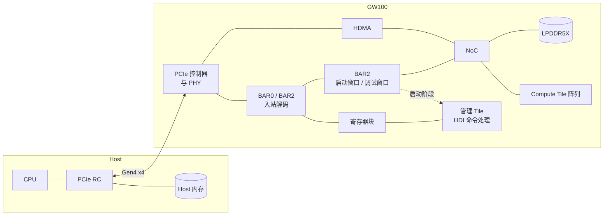

# PCIe 子系统规格（spec-pcie）

| 项 | 内容 |
|---|---|
| 版本 | v0.1 |
| 状态 | 草稿（Draft） |
| 负责 | 架构线 |
| 读者 | 驱动团队（必读）、gem5 线（必读）、将来的 RTL 团队（必读）、编译器团队（不需要） |

---

## 1. 概述

### 1.1 范围

本文档定义 GW100 作为 PCIe EP（Endpoint）对 host 呈现的全部行为：链路、配置空间、BAR 布局、BAR0 中由本文档定义的寄存器、中断、事务参数、顺序与一致性、复位与电源、错误处理和性能要求。

下列内容**不在**本文档范围内。本文档只在需要时说明它们与 PCIe 的接口，不定义其内部：

- HDMA 的通道、描述符和 scatter-gather 列表，见 `spec-host-dma`；
- 命令协议：命令队列、doorbell 的语义、命令与完成记录、上下文，见 `spec-hdi`；
- 设备内部地址空间的划分（BAR2 调试窗口指向的地址），见 `spec-address-map`；
- 启动过程中设备内部的步骤、固件格式和校验算法，见 `spec-mgmt-tile` §8；安全启动尚未定义；
- PCIe 子系统与管理 Tile 之间的 ML 本身，见 `spec-mgmt-link`；本文档只规定 PCIe 子系统怎样使用它（§5.3、§7.2、§13.2）；
- 全芯片的错误分级与汇聚，将由 `spec-interrupt-ras`（待写） 定义。

### 1.2 设备在系统中的位置



- **入站**（host → 设备）：host 的 MMIO 读写经 BAR0 访问寄存器；BAR2 只在启动阶段用于写入固件，或在固件开启调试窗口后访问设备内存。
- **出站**（设备 → host）：HDMA 读写 host 内存，包括命令队列、数据缓冲和完成记录；MSI-X 消息也从这里发出。

### 1.3 约定

本文档使用以下约定。

**规范用语**

| 用语 | 含义 |
|---|---|
| 必须 | MUST：不满足即不符合本规格 |
| 应 | SHOULD：除非有充分理由并记录在案，否则要满足 |
| 可 | MAY：可选 |
| TBD | 尚未确定；文中给出当前默认值，并列入 §16 待决事项 |

**单位与数值**

- 容量用二进制前缀：1 KiB = 1024 B，1 MiB = 1024 KiB。
- 带宽用十进制：1 GB/s = 10⁹ B/s。
- 十六进制写作 `0x1F`；位域写作 `[高:低]`，第 0 位是最低位。
- 多字节数据一律小端序（little-endian），与 PCIe 和 host 一致。
- 标"推算"的数字是本文作者计算所得，不是资料原文；引用资料写"代号 p.N"。

**寄存器访问类型**

| 类型 | 含义 |
|---|---|
| RO | 只读，写入被忽略 |
| RW | 可读写 |
| RW1C | 读出状态；写 1 清零对应位，写 0 无效。同一周期内硬件置位与软件清零冲突时，置位优先 |
| W1S | 写 1 触发动作或置位，写 0 无效；读回 0 |
| WO | 只写；读回 0 |
| RsvdZ | 保留；读回 0，软件必须写 0 |

**参数**

本文档中带点号的名字（如 `pcie.bar0_size`）是架构参数，最终以单一真源 `arch_params.yaml` 为准。单一真源重建之前，以本文档 §14 参数表中的当前值为准。

### 1.4 术语

| 术语 | 全称 | 含义 |
|---|---|---|
| RC | Root Complex | host 中连接 CPU、内存与 PCIe 链路的部件 |
| EP | Endpoint | PCIe 链路末端的设备；GW100 是一个 EP |
| PCIe 子系统 | — | 设备中实现本文档所定义行为的部分：PCIe 控制器与 PHY、入站译码、本文档定义的寄存器。它是 HIF 的一部分，HIF 的组成见 `spec-arch` §1.4 |
| TLP | Transaction Layer Packet | 事务层包，PCIe 上读、写、完成和消息的基本单位 |
| posted / non-posted | — | posted 事务（内存写、消息）没有完成；non-posted 事务（内存读、配置读写）必须由完成方返回完成 |
| 完成 | Completion | 对 non-posted 请求的应答；读的完成携带数据（CplD） |
| requester / completer | — | 发出请求的一方 / 接收请求、并对 non-posted 请求返回完成的一方 |
| BAR | Base Address Register | 基址寄存器：配置空间中描述设备一段地址范围的寄存器，host 在枚举时为它分配地址（§5） |
| 总线地址 | bus address | PCIe 上使用的地址。host 访问 BAR 使用总线地址；设备发起 DMA 时使用驱动交给它的 DMA 地址，它也是总线地址，可能经 host 的 IOMMU 转换后才对应到 host 物理内存。本设备支持 64 位总线地址 |
| IOMMU | I/O Memory Management Unit | host 中把设备的 DMA 地址转换为 host 物理地址、并按设备隔离的部件，对设备透明（§10.2） |
| MPS / MRRS | Max Payload Size / Max Read Request Size | 最大载荷长度 / 最大读请求长度，由 host 在设备的 Device Control 寄存器中设置（§10.3） |
| RCB | Read Completion Boundary | 完成方把一个读请求拆成多个完成时，中间的拆分点必须落在 RCB（64 B 或 128 B）的整数倍地址上；第一个完成从请求的起始地址开始，最后一个完成在请求的结束地址结束。本条即定义；RCB 对 host → 设备带宽的影响见 §11.1 |
| tag | — | requester 为每个未完成的 non-posted 请求分配的编号，完成按 tag 与请求对应。本设备只在自己发起的 non-posted 读请求中使用，包括 HDMA 的数据读和 SGL 读取（§10.3） |
| 完成超时 | Completion Timeout | requester 在规定时间内没有收到完成，按错误处理（§10.3） |
| credit | flow control credit | 接收方通告的接收缓冲额度，发送方只在持有 credit 时发送。PH、PD、NPH 分别是 posted 头、posted 数据、non-posted 头的 credit（§10.4） |
| replay buffer | — | 发送方保存已发出、尚未被确认的 TLP，链路出错时据此重传（§10.4） |
| FLR | Function Level Reset | 功能级复位：只复位一个 PCIe 功能的状态，不影响链路（§13.2） |
| INTx | — | 以带内消息模拟传统中断线的中断方式（§8） |
| MSI-X | — | 设备以内存写的形式向 host 发送中断，每个向量有独立的地址和数据（§8） |
| AER | Advanced Error Reporting | PCIe 的高级错误报告机制（§12.3） |
| ASPM | Active State Power Management | 链路空闲时自动进入低功耗状态 L0s、L1（§13.3） |
| D0 / D3hot / D3cold | — | PCI 电源状态：正常工作 / 软件关断但保持供电 / 断电（§13.3） |
| LTSSM | Link Training and Status State Machine | 链路训练与状态机 |
| CRS | Configuration Request Retry Status | 设备尚未就绪时对配置请求的回复，要求 host 重试 |
| 启动窗口 / 调试窗口 | boot window / debug window | BAR2 的两种用途（§7.2、§7.3） |
| HIF、HDMA | — | 见 `spec-arch` §1.4 |

---

## 2. 设计决策

本节记录五项基础决策及理由，后续各节据此展开。

### 2.1 链路：Gen4 x4，可降级

- **决定**：最高 Gen4（16 GT/s）x4；必须能以 Gen1–Gen3 速率和 x1、x2 宽度正常工作。
- **理由**：
  - 端侧 M.2 Key M 插槽最多 4 条通道。同类端侧加速器 Hailo-8 为 Gen3 x4，可降为 x1、x2（Hailo-DS p.38）。
  - LLM 推理稳定运行时，PCIe 不是瓶颈：KV cache 留在设备上，decode 每个 token 只需传 token ID 和少量结果。吃带宽的是模型加载和模型切换：3.5 GB 的 INT4 权重在 Gen3 x4 上约 0.9 s，在 Gen4 x4 上约 0.45 s（推算）。
  - Gen5 会显著增加 PHY 的功耗和成本，对端侧收益小。
  - 常见的端侧高配主机（如 RK3588 类 SoC）只有 Gen3 x4，因此降级能力是硬性要求。

### 2.2 BAR：控制 BAR 加启动/调试窗口，正常运行时 host 不直接访问设备内存

- **决定**：BAR0 放寄存器。BAR2 在启动阶段是固件装载窗口，正常运行时关闭，只在固件开启调试模式后作为可重映射的调试窗口。不提供映射全部设备内存的大 BAR；设备内存的数据一律经 DMA 搬运。
- **理由**：
  - 嵌入式 ARM 主机分给 PCIe 的 MMIO 地址空间往往很小，也很少支持 Resizable BAR。把 32 GB 设备内存映射成一个 BAR，在这类主机上很可能分配不出来，设备将无法使用。
  - 设备内存的访问只由固件编程的 DMA 完成，固件能统一校验每一次访问的设备地址。如果 host 在正常运行时也能经 BAR 直接读写设备内存，就绕过了这道校验，还要另外保护固件放在设备内存中的数据。
  - 固件装载经 BAR2 直接写入片上 SRAM，启动 ROM 只需校验和跳转，不需要驱动 DMA 引擎，也不需要先训练设备内存。启动 ROM 流片后不可修改，其中的代码越少，变砖的风险越小。
  - 小 BAR 的划分与 Hailo-8（BAR0 配置、BAR2 DMA 寄存器、BAR4 固件窗口）和 Tenstorrent 的 BAR 加可配置 TLB 类似（见附录 A）。
  - 每个上下文的 doorbell 各占一个 4 KiB 页，互不共享。v0.1 中 doorbell 只由内核驱动访问；按页隔离为以后支持用户态直接提交预留条件（届时还需要 PASID 等能按进程区分 DMA 的机制）。

### 2.3 中断：MSI-X 必须支持，INTx 作为退路

- **决定**：必须支持 MSI-X；必须支持 INTx（INTA）作为退路；不支持 MSI。
- **理由**：
  - MSI-X 可以为每个上下文分配独立向量，是新一代加速器的通行做法。
  - 支持 MSI-X 的主机都支持 MSI，再实现 MSI 收益小；INTx 则用于启动阶段和不支持消息中断的环境。Linux 驱动按 MSI-X、INTx 的顺序尝试即可。

### 2.4 DMA 一致性：设备不依赖 host 的硬件一致性

- **决定**：设备对 host 内存的访问不依赖硬件缓存一致性；驱动必须按"DMA 不一致"的系统编写。设备默认不设置 No Snoop；用于通知完成的写不使用 Relaxed Ordering。
- **理由**：
  - DMA 是否与 CPU cache 一致取决于 host 的 RC：x86 默认一致，许多嵌入式 ARM SoC 不一致。按不一致的系统编写的驱动在两类主机上都正确，反过来不成立。
  - PCIe EP 本身不参与 host 的缓存一致性；设备能决定的只是 No Snoop、Relaxed Ordering 这些事务属性怎么用，见 §9。

### 2.5 BAR 访问不依赖固件

- **决定**：host 对 BAR0、BAR2 的任何读写都由设备的 PCIe 子系统在本地完成，不等待固件；需要固件提供的状态由固件预先写入影子寄存器，需要固件处理的写由 PCIe 子系统记录后再通知固件。详见 §5.3。
- **理由**：
  - 如果某个寄存器读要转发给管理 CPU 才能完成，管理 CPU 一旦卡死、正在复位或尚未启动，host 的 MMIO 读就得不到完成。许多 ARM 主机在 MMIO 读超时或收到错误完成时会触发 SError，导致整个系统崩溃。
  - 如果 doorbell 等写要等固件接收，固件卡死会反压 PCIe 的整个入站方向，连配置请求也会受影响。
  - 启动、故障检测和恢复所需的寄存器，不能依赖正在被启动或需要恢复的固件。

---

## 3. 链路

| 项 | 要求 |
|---|---|
| 最高速率 | Gen4，16 GT/s（`pcie.max_link_speed`） |
| 最大宽度 | x4（`pcie.max_link_width`） |
| 降级 | 必须能在 Gen1、Gen2、Gen3、Gen4 任一速率，以及 x1、x2、x4 任一宽度下训练成功并正常工作 |
| 通道反转、极性反转 | 必须支持 |
| 虚通道 | 只有 VC0 |
| 物理功能 | 单个物理功能（Function 0），不支持 SR-IOV |
| 参考时钟 | 使用 host 经插槽提供的公共参考时钟（100 MHz，允许带扩频）；不支持独立参考时钟（SRIS）。板卡在 D0、D3hot 期间必须持续提供参考时钟（`spec-clock-reset-power` §3.2） |

各配置下的理论带宽（每个方向，推算）：

| 配置 | 原始速率 | 编码 | 理论数据带宽 |
|---|---|---|---|
| Gen4 x4 | 16 GT/s × 4 | 128b/130b | 7.877 GB/s |
| Gen3 x4 | 8 GT/s × 4 | 128b/130b | 3.938 GB/s |
| Gen4 x1 | 16 GT/s × 1 | 128b/130b | 1.969 GB/s |

算法：速率 × 通道数 × 128/130 ÷ 8。实际可用带宽还要扣除 TLP 开销，见 §11。

---

## 4. 配置空间

### 4.1 头部

| 字段 | 值 | 说明 |
|---|---|---|
| Vendor ID | `pcie.vendor_id`，TBD | 正式 ID 申请下来之前，仿真中暂用占位值 0x1234（Device ID 0x1000）。该值与 QEMU 使用的 ID 相同，仅限仿真使用，驱动不得依赖它识别设备 |
| Device ID | `pcie.device_id`，TBD | |
| Revision ID | 芯片步进号 | 每次改版加一 |
| Class Code | 0x12 / 0x00 / 0x00 | Processing Accelerator，无子类，无编程接口 |
| Header Type | 0x00 | Type 0，单功能 |
| Subsystem Vendor ID / Subsystem ID | 熔丝提供 | 由板卡厂商烧写熔丝；未烧写时分别等于 Vendor ID 和 Device ID。复位后由硬件从熔丝载入，不经启动 ROM |
| Interrupt Pin | 0x01 | INTA |
| Capabilities Pointer | 指向 §4.2 的第一个 capability | |

Command 寄存器中，设备必须实现 Memory Space Enable、Bus Master Enable、SERR# Enable、Parity Error Response、Interrupt Disable；I/O Space Enable 固定为 0（设备没有 I/O BAR）。Memory Space Enable 为 0 时，设备不得响应 BAR0、BAR2 的访问；Bus Master Enable 为 0 时，设备不得发起任何 DMA 或 MSI-X 消息。

### 4.2 Capability

| Capability | 要求 | 说明 |
|---|---|---|
| PCI Power Management | 必须 | D0、D3hot；`No_Soft_Reset` 为 0，见 §13.3 |
| PCI Express（Endpoint，版本 2） | 必须 | 见下文 |
| MSI-X | 必须 | 表大小 `pcie.msix_table_size`，见 §8 |
| MSI | 不支持 | 理由见 §2.3 |
| Advanced Error Reporting（AER） | 必须 | 见 §12 |
| Device Serial Number | 应 | 每颗芯片唯一，用于板卡追溯 |
| Latency Tolerance Reporting（LTR） | 应 | 配合 host 的电源管理 |
| L1 PM Substates | 不支持 | L1.2 允许 host 关闭参考时钟，会使设备内部依赖它的时钟停止（`spec-clock-reset-power` §3.2） |
| Secondary PCIe（均衡控制） | 必须 | Gen3 及以上速率要求 |
| Physical Layer 16.0 GT/s 等 Gen4 相关 capability | 必须 | Gen4 速率要求 |
| Resizable BAR、ATS、PRI、PASID、SR-IOV、ACS | 不支持 | |
| AtomicOps | 不支持 | 作为请求方和完成方都不支持 |

PCI Express Capability 的关键字段：

| 字段 | 值 |
|---|---|
| Device/Port Type | PCI Express Endpoint |
| Max_Payload_Size Supported | 256 B（`pcie.max_payload_supported`） |
| Extended Tag Field Supported | 1（支持 8 位 tag） |
| 10-Bit Tag Requester Supported | 0（不使用 10 位 tag，§10.3） |
| Function Level Reset Capability | 1 |
| Completion Timeout Ranges Supported | 至少范围 A、B |
| Completion Timeout Disable Supported | 0（完成超时不可关闭，见 §10.3） |
| ASPM Support | L1 必须；L0s 可不支持 |
| Clock Power Management（Link Capabilities） | 0：不支持经 CLKREQ# 关闭参考时钟 |

---

## 5. BAR 布局

| BAR | 类型 | 大小 | 用途 |
|---|---|---|---|
| BAR0 | 32 位，不可预取，内存 | `pcie.bar0_size` = 1 MiB | 寄存器：全局控制、BAR2 窗口配置、MSI-X 表、启动、HDI 控制器、DMA 状态、doorbell 页 |
| BAR1 | — | — | 不实现（BAR0 为 32 位） |
| BAR2/3 | 64 位，可预取，内存 | `pcie.bar2_size` = 64 MiB | 启动阶段的固件装载窗口；调试模式下指向设备内存的可重映射窗口；其余时间关闭。见 §7 |
| BAR4/5 | — | — | 不实现 |
| Expansion ROM | — | — | 不实现 |

- BAR0 的寄存器读取可能有副作用（例如读低半部锁存高半部），因此不可预取。
- BAR2 映射的是内存，读取没有副作用，因此标为可预取，允许 host 使用写合并（write-combining）提高写吞吐，加快固件装载。

### 5.1 BAR0 地址分配

| 偏移 | 大小 | 内容 | 定义 |
|---|---|---|---|
| 0x0_0000 – 0x0_0FFF | 4 KiB | 设备标识与全局控制 | §6 |
| 0x0_1000 – 0x0_1FFF | 4 KiB | BAR2 窗口配置 | §7 |
| 0x0_2000 – 0x0_2FFF | 4 KiB | MSI-X 表 | §8 |
| 0x0_3000 – 0x0_3FFF | 4 KiB | MSI-X PBA | §8 |
| 0x0_4000 – 0x0_4FFF | 4 KiB | 启动与固件 | §6.4 |
| 0x0_5000 – 0x0_5FFF | 4 KiB | HDI 控制器寄存器 | `spec-hdi` §4 |
| 0x0_6000 – 0x0_6FFF | 4 KiB | Host DMA 寄存器的只读镜像 | `spec-host-dma` §7.4 |
| 0x0_7000 – 0x7_FFFF | | 保留 | |
| 0x8_0000 – 0x8_0FFF | 4 KiB | 管理队列 doorbell 页 | `spec-hdi` §4.2 |
| 0x8_1000 + 0x1000 × n | 每个 4 KiB | 上下文 n 的 doorbell 页，n = 0 … 15 | `spec-hdi` §4.2 |
| 0x9_1000 – 0xF_FFFF | | 保留，供以后扩展上下文数 | |

每个块各占至少一个 4 KiB 页，互不共享页，便于驱动按页映射和保护。MSI-X 表和 PBA 各占一页，便于虚拟化环境截获。

### 5.2 BAR0 的访问规则

| 规则 | 要求 |
|---|---|
| 访问宽度 | 寄存器按 32 位访问；64 位寄存器还可以按 64 位访问。设备必须支持 4 字节对齐的 32 位访问和 8 字节对齐的 64 位访问 |
| 非法宽度 | 对寄存器的 1 字节、2 字节写入必须被忽略，并置 `ERR_STATUS.BAD_WIDTH`；1 字节、2 字节读取返回对应字节的值，不报错 |
| 保留偏移 | 读返回 0，写被忽略，并置 `ERR_STATUS.RSVD_ACCESS`、记录 `ERR_ADDR` |
| 完成状态 | BAR0 范围内的任何访问都必须以成功完成（Successful Completion）结束，不得返回 UR 或 CA。理由：许多 ARM 主机在 MMIO 读收到错误完成时会触发 SError，导致整个系统崩溃 |
| 64 位寄存器的拆分访问 | 按 32 位访问 64 位寄存器时，软件必须先写低 32 位、再写高 32 位。带副作用的 64 位寄存器在写入高 32 位时生效；读取低 32 位时设备锁存高 32 位，随后读高 32 位得到同一时刻的值 |
| 写入的可见性 | MMIO 写是 posted 事务。软件需要确认写入已生效时，必须随后读一次同一个块内的任意寄存器 |

MSI-X 表和 PBA 的访问规则以 PCIe 规范为准（DWORD 和 QWORD 访问）。

### 5.3 BAR 访问不依赖固件

设备内部的固件可能尚未运行、正在启动、正在被复位，或者已经停止响应。为了让 host 在这些情况下仍能观察设备状态并发起恢复，设备必须满足：

1. **host 对 BAR0、BAR2 的读，都由设备的 PCIe 子系统在本地完成，不得等待固件或管理 CPU。** 需要固件提供的值（例如 `FW_VERSION`、命令协议控制器的状态），由固件预先写入 PCIe 子系统中的影子寄存器，host 读到的是最近一次写入的值。
2. **host 对 BAR0、BAR2 的写（包括 doorbell）必须被 PCIe 子系统立即接收，不得因固件未处理而反压 PCIe 的入站方向。** 需要固件处理的写，由 PCIe 子系统记录写入值，再通知固件。
3. 因此，固件停止响应时，host 仍能读取 `BOOT_STATUS`、`DEV_STATUS`、`ERR_STATUS`、`INT_STATUS`，发现故障并按 §13.1 复位设备。

需要固件处理的写经 ML 转给管理 Tile：doorbell 的写入以 `DB_WR` 发出，需要通知固件的寄存器写入以 `EVENT` 发出（`spec-mgmt-link` §4.1）。

- **待发槽**：每个 doorbell 有一个待发槽（值和有效位），每个事件有一个待发位。host 写 doorbell 时覆盖槽中的值并置有效位；事件发生时置待发位。PCIe 子系统从待发槽中取当时的值发出 `DB_WR`、清有效位；发出与新的写入在同一周期时，新的写入优先，有效位保持为 1。事件同理，多次发生合并为一个 `EVENT`。因此每个 doorbell 只保证固件最终收到最后一次写入的值，这正是命令协议所需的（`spec-mgmt-tile` §6.2）。
- ML 尚未建立时（`spec-mgmt-link` §7.1），适配器不接受请求，doorbell 和事件留在待发槽中，PCIe 子系统照常接收 host 的写入；链路建立后再发出。
- ML 处于故障态时，适配器接受并丢弃这些写；此时 `DEV_STATUS.DEV_FATAL` 已置位（`spec-mgmt-link` §7.5），host 应复位设备。
- 待发槽随 PCIe 子系统的复位清除；FLR 也清除 doorbell 的待发槽，FLR 之前的 doorbell 不再发出，FLR 进行中的 doorbell 被丢弃（§13.2）。

HIF 的寄存器（包括影子寄存器和 HDMA 的寄存器）是 ML 的目标，必须在 16 个 `clk_pcie` 周期内完成一次访问，不等待固件（`spec-mgmt-link` §2.3）。

§5.1 中由 `spec-hdi`、`spec-host-dma` 定义的寄存器块同样必须满足这三条。管理 Tile 一侧如何配合（影子寄存器、doorbell 信箱）见 `spec-mgmt-tile` §6。

---

## 6. 全局寄存器

本节定义 BAR0 中 0x0_0000 – 0x0_0FFF 的设备标识与全局控制寄存器，以及 0x0_4000 起的启动与固件寄存器。

### 6.1 寄存器总表

| 偏移 | 名称 | 类型 | 复位值 | 说明 |
|---|---|---|---|---|
| 0x000 | `DEV_VERSION` | RO | 实现定义 | 硬件版本 |
| 0x004 | `DEV_CAPS` | RO | 见 §6.2 | 硬件能力 |
| 0x008 | `DEV_STATUS` | RO | 见 §6.2 | 链路与设备状态 |
| 0x00C | `SCRATCH` | RW | 0x0000_0000 | 软件自测用，无副作用 |
| 0x010 | `TIMESTAMP_LO` | RO | — | 设备时间戳低 32 位；读取时锁存高 32 位 |
| 0x014 | `TIMESTAMP_HI` | RO | — | 设备时间戳高 32 位（锁存值） |
| 0x018 | `TIMESTAMP_FREQ` | RO | 实现定义 | 时间戳频率，单位 Hz（`dev.timestamp_hz`） |
| 0x020 | `INT_STATUS` | RW1C | 0 | 中断源状态，见 §8.4 |
| 0x024 | `INT_MASK` | RW | 0xFFFF_FFFF | INTx 模式下的中断屏蔽，1 为屏蔽 |
| 0x028 | `INT_SET` | W1S | — | 置位 `INT_STATUS` 的对应位，用于驱动自测 |
| 0x030 | `ERR_STATUS` | RW1C | 0 | HIF 错误状态，见 §6.3 |
| 0x034 | `ERR_ADDR` | RO | 0 | 第一次出错访问的 BAR 偏移 |
| 0x038 | `ERR_INFO` | RO | 0 | 第一次出错访问的附加信息 |
| 其余 | — | RsvdZ | 0 | |

### 6.2 字段定义

**DEV_VERSION**（0x000）

| 位 | 名称 | 说明 |
|---|---|---|
| [7:0] | STEPPING | 步进号 |
| [15:8] | MINOR | 次版本 |
| [23:16] | MAJOR | 主版本 |
| [31:24] | — | RsvdZ |

**DEV_CAPS**（0x004）

| 位 | 名称 | 说明 |
|---|---|---|
| [7:0] | BAR2_WIN_COUNT | BAR2 窗口个数，等于 `pcie.bar2_window_count` |
| [15:8] | MSIX_VECTORS | MSI-X 表项个数，等于 `pcie.msix_table_size` |
| [23:16] | HDI_MAX_CTX | 命令协议支持的上下文个数（当前为 16） |
| [31:24] | HDMA_CHANNELS | HDMA 的通道个数（当前为 8） |

**DEV_STATUS**（0x008）

| 位 | 名称 | 说明 |
|---|---|---|
| [3:0] | LINK_SPEED | 当前链路速率：1 = Gen1 … 4 = Gen4 |
| [8:4] | LINK_WIDTH | 当前链路宽度：1、2、4 |
| [15:9] | — | RsvdZ |
| [16] | DEV_FATAL | 设备发生致命错误，必须复位才能恢复。由硬件或固件置位，只有设备完全复位、热复位、冷复位能清除；FLR 不清除。ML 处于故障态时恒为 1（`spec-mgmt-link` §7.5） |
| [17] | DEBUG_WIN | 1 表示固件已开启 BAR2 调试窗口（§7.3）；只有固件能改变 |
| [31:18] | — | RsvdZ |

**时间戳**：64 位自由运行计数器，冷复位和热复位后从 0 开始，FLR 和设备完全复位不清零，频率由 `TIMESTAMP_FREQ` 给出（`dev.timestamp_hz` = 100 MHz，`spec-clock-reset-power` §3.2），不回绕（以 100 MHz 计约 5849 年，推算）。设备内部所有对外报告的时间戳都取自这个计数器。

### 6.3 错误状态

**ERR_STATUS**（0x030），各位写 1 清零。

| 位 | 名称 | 置位条件 |
|---|---|---|
| [0] | RSVD_ACCESS | 访问了 BAR0 的保留偏移 |
| [1] | BAD_WIDTH | 以非法宽度写寄存器 |
| [2] | WIN_DISABLED | 访问了未使能的 BAR2 调试窗口，或在 BAR2 关闭时访问 BAR2（§7.1） |
| [3] | WIN_TARGET | BAR2 调试窗口指向的设备地址无效（越界或未映射），或写入只读窗口 |
| [4] | DB_INVALID | 写入 doorbell 的值越界，或写入了尚未创建的上下文的 doorbell 页 |
| [5] | DMA_HOST_ERR | DMA 访问 host 内存出错（UR、CA、完成超时、poisoned） |
| [6] | RX_POISONED | 收到 poisoned TLP |
| [7] | BOOT_WIN | 启动窗口收到非法写入（§7.2） |
| [31:8] | — | RsvdZ |

- `ERR_ADDR` 和 `ERR_INFO` 只记录 `ERR_STATUS` 从全 0 变为非 0 时的那一次错误；`ERR_STATUS` 清零后重新开始记录。
- `ERR_INFO` 的格式：[1:0] 访问类型（0 读、1 写），[5:2] 访问字节数，[7:6] BAR（0 = BAR0，2 = BAR2），其余 RsvdZ。
- `ERR_STATUS` 任一位置位时，设备置 `INT_STATUS.ERROR` 并按 §8 发中断。

### 6.4 启动与固件

v0.1 只支持由 host 加载固件（PCIe 启动）。本节定义 host 能观察到的启动过程和驱动完成启动握手所需的寄存器；固件格式、校验算法、安全启动和设备内部的启动步骤不在本文档范围内。

**启动阶段**

| STAGE | 名称 | 设备在做什么 | BAR2 |
|---|---|---|---|
| 0 | 复位中 | 硬件复位 | 关闭 |
| 1 | ROM 初始化 | 启动 ROM 初始化管理 CPU、固件装载区所在的片上 SRAM 和 PCIe 控制器；不初始化设备内存 | 关闭 |
| 2 | 等待加载 | 等待 host 经启动窗口写入固件镜像 | 启动窗口（§7.2） |
| 3 | 校验 | 设备接受 `FW_START` 后立即进入；ROM 校验镜像，通过后跳转到固件 | 关闭 |
| 4 | 固件运行 | 固件初始化设备内存（包括 LPDDR5X 训练）、DMA 引擎和各 Tile，完成后置 `FW_READY` | 关闭，或由固件开启调试窗口（§7.3） |
| 0xF | 启动失败 | 固件初始化失败，见 `ERROR` | 关闭 |

**寄存器**

| 偏移 | 名称 | 类型 | 复位值 | 说明 |
|---|---|---|---|---|
| 0x4000 | `BOOT_STATUS` | RO | 0 | [3:0] STAGE，见上表。[8] FW_READY：固件已完成初始化，命令协议可以使能。[23:16] ERROR：最近一次失败的原因，见下表。其余 RsvdZ |
| 0x4004 | `BOOT_CTRL` | W1S | — | [0] FW_START：镜像已写完，请设备校验并启动；只在 STAGE = 2 时有效，其他阶段写入被忽略。[1] DEV_RESET：设备完全复位，见 §13.1。其余 RsvdZ |
| 0x4008 | — | RsvdZ | 0 | |
| 0x400C | — | RsvdZ | 0 | |
| 0x4010 | `FW_LOAD_MAX` | RO | `mgmt.fw_load_max` | 启动窗口的大小，也是镜像大小的上限，字节；8 的整数倍 |
| 0x4014 | `FW_SIZE` | RW | 0 | 镜像的实际大小，字节；只在 STAGE = 2 时可写，其他阶段写入被忽略 |
| 0x4018 | `FW_VERSION` | RO | 0 | 固件运行后填写的版本号；固件未运行时为 0 |

**ERROR 编码**

| 值 | 名称 | 含义 | 失败后的阶段 |
|---|---|---|---|
| 0 | — | 无错误 | — |
| 1 | SIZE | `FW_SIZE` 为 0、超过 `FW_LOAD_MAX` 或不是 8 的整数倍 | 回到 2，可重新加载 |
| 2 | WIN_WRITE | 本次加载期间启动窗口收到过非法写入（§7.2） | 回到 2，可重新加载 |
| 3 | VERIFY | 镜像校验失败 | 回到 2，可重新加载 |
| 4 | INIT | 固件初始化失败，例如设备内存训练失败 | 0xF |
| 5 | LINK | 设备内部的启动通路故障，由硬件直接锁存（§7.2）；FLR 不清除，只能由设备完全复位、热复位或冷复位清除 | 0xF |
| 6 – 0x7F | — | 保留 | |
| 0x80 – 0xFF | — | 由固件定义，表示 INIT 的细分原因 | 0xF |

设备接受 `FW_START` 时，立即把 STAGE 置为 3、把 ERROR 清零，并关闭启动窗口。根据 §9.1 规则 3，驱动在写 `FW_START` 之后读到的 `BOOT_STATUS` 已经反映这一变化，不会读到上一次加载遗留的 ERROR。ROM 在加载失败、回到 STAGE 2 时清零 `FW_SIZE` 并重新打开启动窗口；装载区的旧内容作废。

**驱动的加载流程**

1. 使能 Memory Space（不需要 Bus Master），等待 `BOOT_STATUS.STAGE` = 2，超时 1 s。STAGE = 4 且 `FW_READY` = 1 表示固件已在运行，跳过加载。
2. 检查镜像不超过 `FW_LOAD_MAX`，在末尾补 0，使长度为 8 的整数倍。
3. 从 BAR2 偏移 0 开始顺序写入镜像。写入必须满足 §7.2 的访问规则：只用 8 字节对齐的 64 位写。Linux 上应使用保证 64 位访问宽度的 `__iowrite64_copy`；`memcpy_toio` 在头尾不对齐时可能产生更窄的写，各平台的实现也不一致，不得使用。BAR2 可以按写合并方式映射。
4. 执行写屏障（Linux 的 `wmb()`），确保写合并缓冲中的镜像数据都已发出；然后写 `FW_SIZE`，再写 `BOOT_CTRL.FW_START`。
5. 轮询 `BOOT_STATUS`，超时 5 s（包括设备内存训练的时间）：
   - `FW_READY` = 1：启动成功；
   - STAGE = 2 且 ERROR ≠ 0：加载失败，可以从第 2 步重新加载；
   - STAGE = 0xF：固件初始化失败或启动通路故障，只能通过复位恢复（§13.1）。

**设备对 `FW_START` 的保证**：ROM 看到 `FW_START` 时，设备在 `FW_START` 之前接受的全部启动窗口写入都已写入装载区。这是 §9.1 规则 2 在启动窗口上的具体要求："生效"指数据已写入装载区，而不只是被 PCIe 子系统接收。设备内部的实现见 §7.2。

设备一侧的启动步骤、镜像格式和校验见 `spec-mgmt-tile` §8。

### 6.5 固件可见的 HIF 寄存器

管理 CPU 经 ML 访问 HIF 寄存器区（本地地址 0x3000_0000 起，`spec-mgmt-tile` §3.3、§5.2）。这些寄存器 host 看不到；它们是 host 可见状态的写入端（影子寄存器）和固件需要的控制入口。下表偏移相对于 0x3000_0000。

访问规则：

- 只支持自然对齐的 32 位访问；HDMA 的 `_LO`、`_HI` 寄存器是两个独立的 32 位寄存器。
- 表中未分配的偏移、以及各块内未实现的寄存器：读以 REJECT 结束，写被拒绝并由 ML 记录 `WR_REJECT`（`spec-mgmt-link` §4.4）。例外：HDI 视角的 0x000 – 0x0FF 按 `spec-hdi` §4 的定义，其中的保留偏移读回 0、写入被忽略。
- 已实现寄存器中的保留位为 RsvdZ；写只读寄存器被忽略，读 W1S 寄存器返回 0。
- 复位：本节的寄存器随 HIF 的复位（冷复位、热复位、设备完全复位）恢复复位值；FLR 清零 `HDI_WR_MAP`、`INT_LEVEL` 和 `BOOT_LOAD_STATUS`，`CTX_VECTOR` 恢复复位值，其余按各自说明。

| 偏移 | 大小 | 内容 | 定义 |
|---|---|---|---|
| 0x0_0000 | 4 KiB | HDMA 寄存器，`HDMA_BASE` 即此处 | `spec-host-dma` §7 |
| 0x1_0000 | 4 KiB | 启动与设备状态 | 本节 |
| 0x1_1000 | 4 KiB | HDI 控制器寄存器的固件视角 | 本节 |
| 0x1_2000 | 4 KiB | 中断请求与 FLR | 本节、§13.2 |
| 0x1_3000 | 4 KiB | ML 的 HIF 侧错误寄存器：`ML_HIF_ERR` 在 0x00，`ML_HIF_ERR_INFO` 在 0x04，`ML_HIF_ERR_ADDR` 在 0x08 | `spec-mgmt-link` §8.2 |
| 其余 | | 保留 | |

**启动与设备状态（0x1_0000 起）**

| 偏移 | 名称 | 类型 | 复位值 | 说明 |
|---|---|---|---|---|
| 0x00 | `FW_BOOT_STATUS` | RW | 0 | 写入 host 可见的 `BOOT_STATUS`（§6.4）：[3:0] STAGE，[8] FW_READY，[23:16] ERROR，位置相同。一次写入同时设置三个字段，固件应写入完整的目标值。HIF 不检查 STAGE 的转换是否合法（由启动 ROM 和固件保证，`spec-mgmt-tile` §6.1）。硬件的更新与固件的写入在同一周期时硬件优先：接受 `FW_START` 时置 STAGE = 3、ERROR = 0；启动通路故障锁存（§7.2）；FLR 清零 FW_READY 及门控（§13.2）。读回 HIF 中的实际值 |
| 0x04 | `FW_SIZE_FW` | RW | 0 | 读：host 写入的 `FW_SIZE`。写：只能写 0，用于加载失败时清零（`spec-mgmt-tile` §8.1） |
| 0x08 | `FW_VERSION_FW` | RW | 0 | 写入 host 可见的 `FW_VERSION` |
| 0x0C | `DEV_CTRL_FW` | RW | 0 | [0] DEBUG_WIN：写入 host 可见的 `DEV_STATUS.DEBUG_WIN`，熔丝禁止时写入无效。[1] DEV_FATAL：写 1 置位 `DEV_STATUS.DEV_FATAL`，写 0 无效（清除规则见 §6.2）。其余 RsvdZ |
| 0x10 | `PCI_STATE` | RO | 0 | 配置空间中固件需要的状态：[0] MSE（Memory Space Enable），[1] BME（Bus Master Enable），[3:2] 电源状态（0 = D0，3 = D3hot），[4] MSI-X Enable，[5] INTx Disable。其余 RsvdZ |
| 0x14 | `BOOT_LOAD_STATUS` | RO | 0 | [0] WIN_WRITE：本次加载期间启动窗口收到过非法写入（§7.2）。新的一轮加载从启动窗口**实际由关闭变为打开**的那个周期开始（STAGE = 2、不在 FLR 进行中、未锁存启动通路故障，三者同时成立的第一个周期），HIF 在这个周期清零 WIN_WRITE；窗口已经打开时再写 STAGE = 2 不清零。窗口收到非法写入时置位，与清零在同一周期时置位优先。启动 ROM 在第 6 步读取它，置位时以 ERROR = WIN_WRITE 判定加载失败（`spec-mgmt-tile` §8.1）。它是每次加载的状态，与 host 可见的粘滞位 `ERR_STATUS.BOOT_WIN` 不同 |

**HDI 控制器寄存器的固件视角（0x1_1000 起）**

- 偏移 0x000 – 0x0FF 与 BAR0 0x5000 起的 HDI 控制器寄存器一一对应（`spec-hdi` §4）。固件可以读写全部字段，包括 host 只读的字段（例如 `HDI_CAP_LO`、`HDI_CSTS`、`HDI_FATAL`、`HDI_CTX_ERR`）；固件的写入就是更新影子寄存器。
- 0x100 `HDI_WR_MAP`（RW1C）：第 k 位为 1 表示 host 写过偏移为 4k 的 HDI 寄存器（k = 0 … 31）。host 可写的 HDI 寄存器必须位于 0x000 – 0x07C，以便都能被记录。host 写入可写字段时，HIF 置位对应位并发出 `HDI_WR` 事件（`spec-mgmt-tile` §6.3）。
- 固件的处理顺序：先清零 `EVT_PENDING.HDI_WR`，再读 `HDI_WR_MAP`，对读到的位写 1 清零，再读对应的寄存器。清零之后 host 的新写入会重新置位 map 和事件，不会丢失通知。

**中断请求与 FLR（0x1_2000 起）**

| 偏移 | 名称 | 类型 | 说明 |
|---|---|---|---|
| 0x00 | `INT_REQ` | W1S | 每次写入是一次中断请求：置位 host 可见的 `INT_STATUS` 中写 1 的位（§8.4）；MSI-X 模式下，每个写 1 的位向其向量发送一次消息（屏蔽时置 Pending 位）。[1] ERROR 也可由固件请求（例如 HDI 控制器的致命错误）。HIF 保证这次中断不越过此前已进入发送通路的 DMA 写（§8.5）。FLR 进行中被忽略（§13.2） |
| 0x04 | `INT_LEVEL` | RW | 固件对中断源条件的贡献，位置与 `INT_STATUS` 相同（例如某个完成队列中还有 host 未消费的记录）；各位的有效源条件见 §8.4。写入本身不置位 `INT_STATUS`。固件发布一个中断时，先置位 `INT_LEVEL` 的对应位，再写 `INT_REQ`；两次都是同方向的 posted 写，按顺序生效（`spec-mgmt-link` §5 规则 1）。源条件消失（例如 host 消费完记录）时，固件清零对应位。FLR 进行中写入被忽略。复位值 0 |
| 0x10 | `FLR_CTRL` | W1S | [0] TAKE，[1] DONE，语义见 §13.2。其余 RsvdZ |
| 0x14 | `FLR_STATUS` | RO | [0] IN_PROGRESS：FLR 进行中。[1] DELIVERED。[2] FAIL。语义见 §13.2。复位值 0，FLR 不清零（由 §13.2 的规则更新）。其余 RsvdZ |
| 0x100 + 4 × n | `CTX_VECTOR[n]` | RW | 上下文 n 的 MSI-X 向量（n = 0 … `hdi.max_contexts` − 1）：[4:0] 向量号。复位值 2 + n（§8.3 的默认分配）。固件在 CREATE_CONTEXT 成功之前写入驱动指定的向量（`spec-hdi` §9.3），DESTROY_CONTEXT 后可不修改；FLR 时恢复复位值，FLR 进行中写入被忽略。固件必须先写映射，再为该上下文写 `INT_REQ`，两次同方向 posted 写按顺序生效。`INT_REQ.CTX[n]` 的消息发往 `CTX_VECTOR[n]` 指定的向量；多个上下文映射到同一向量时，各自的请求各发一次消息，屏蔽与 Pending 按向量计 |

---

## 7. BAR2

### 7.1 按阶段切换的用途

BAR2 不在设备的正常数据通路上。正常运行时，host 不能直接访问设备内存，设备内存的内容只能经由固件编程的 DMA 搬运，固件因此能统一校验每一次访问。BAR2 只在两种情形下响应：

| 设备状态 | BAR2 的行为 |
|---|---|
| `BOOT_STATUS.STAGE` = 2 | **启动窗口**（§7.2）：偏移 0 起的 `FW_LOAD_MAX` 字节固定映射到固件装载区，只能写；窗口配置寄存器不起作用 |
| STAGE ≠ 2，且 `DEV_STATUS.DEBUG_WIN` = 1 | **调试窗口**（§7.3）：按窗口配置寄存器访问设备内存 |
| 其他 | **关闭**：读返回 0xFFFF_FFFF，写被丢弃；置 `ERR_STATUS.WIN_DISABLED`；以成功完成结束 |

两种情形下的访问都由设备的 PCIe 子系统在本地完成，不依赖固件响应（§5.3）。

### 7.2 启动窗口

固件装载区位于管理 Tile 的片上 SRAM 中（`spec-mgmt-tile` §4.1），不在设备内存中，它的设备内部地址对 host 不可见。启动窗口的偏移 `o` 直接对应装载区的第 `o` 字节，不经过窗口配置寄存器。

| 情形 | 行为 |
|---|---|
| 合法写入：TLP 起始地址 8 字节对齐，长度是 8 B 的整数倍，字节使能全为 1，且整个 TLP 落在 [0, `FW_LOAD_MAX`) 内 | 写入装载区 |
| 不满足上一行任一条件的写入 | 整个 TLP 丢弃；置 `ERR_STATUS.BOOT_WIN`，记录 `ERR_ADDR`；本次加载随后的 `FW_START` 以 ERROR = WIN_WRITE 失败 |
| 读 | 返回 0xFFFF_FFFF，不报错。镜像的正确性由 ROM 校验，host 不需要回读 |
| Relaxed Ordering | 忽略。启动窗口的写入一律按到达顺序生效 |
| 设备接受 `FW_START` 之后的访问 | 窗口已关闭，按 §7.1 的"关闭"处理 |

- 设备必须能以写合并产生的最大 TLP（不超过 MPS）接收启动窗口写入。持续写入的带宽受设备内部 ML 和管理 Tile 的限制（`spec-mgmt-link` §9 P4），超过时 PCIe 入站方向被反压，写入只会延缓，不会丢失。
- 装载区内的数据在 ROM 校验之后不会再被 host 改写：设备接受 `FW_START` 时立即关闭窗口，ROM 在此之后才开始校验。

**启动写入的提交与启动通路故障**

本段是 PCIe 子系统内部的要求，host 观察到的效果见 §6.4。

- 合法的启动窗口写入由 PCIe 子系统按 64 B 边界拆成 `BOOT_WR`，经 ML 写入装载区（`spec-mgmt-link` §4）。`BOOT_WR` 是 non-posted 写，数据写入 SRAM 后才返回响应。
- 启动写入是否合法（STAGE = 2、窗口打开、§7.2 表中的地址和格式规则），只在入口处接受原始写时判定。入口处已接受的合法写，即使在 STAGE 变为 3 或 FLR 门控生效之后才到达管理 Tile，也照常提交；管理 Tile 只检查地址是否在装载区内（`spec-mgmt-tile` §4.4）。
- **提交计数**：PCIe 子系统在入站译码的入口处（BAR 分流之前，入站事务唯一的有序点）对启动写入计数：在这里接受一个合法的启动窗口写入时，立即按它将拆出的 `BOOT_WR` 个数增加；每收到一个 `BOOT_WR` 的 OK 响应，减 1。同一周期的增加和减少都计入。计数器的宽度必须覆盖入口之后能容纳的、已接受而尚未确认的全部启动写入。
- **`FW_START` 的门控**：PCIe 子系统在入口处接受 host 对 `FW_START` 的写入时，立即按 §6.4 把 STAGE 置为 3、关闭启动窗口；此前在入口处接受的启动写入都已计入。然后等计数归零，才经 ML 发出 `FW_START` 事件。因此启动 ROM 收到该事件时，host 在 `FW_START` 之前写入的镜像都已在 SRAM 中，且之后不会再有启动写入。
- 这一保证依赖 PCIe 控制器在入站方向保持 posted 写的顺序；选定 IP 时作为验收项确认（§16）。
- **启动通路故障**：以下任一情况说明设备内部的启动通路出现了硬件故障：
  - `BOOT_WR` 以 REJECT 或 FAULT 结束（`spec-mgmt-link` §4.4）；
  - STAGE ≠ 4 期间，HIF 侧的 ML 进入故障态（`spec-mgmt-link` §7.5）。这一条覆盖了启动写入都已提交、但 `FW_START` 事件或启动 ROM 对 STAGE 的写入因链路故障而丢失的情况。

  超时的写之后仍可能写入 SRAM，不能让 host 原地重新加载。PCIe 子系统的硬件直接处理，不经过 ML，不依赖启动 ROM。以下动作与 `DEV_STATUS.DEV_FATAL` 的置位在同一周期生效，host 读到的状态是一致的：
  - 锁存启动通路故障：`BOOT_STATUS` 被强制为 STAGE = 0xF、ERROR = LINK，`FW_READY` = 0；锁存期间固件对这些字段的写入无效；
  - 立即关闭启动窗口，之后不再接受 `FW_START`；若 `FW_START` 已被接受、其事件尚未被 ML 适配器接受，则取消该事件。已被适配器接受的事件，尚未交给对端的按故障规则丢弃（`spec-mgmt-link` §7.5），已交给对端的可能已生效，启动 ROM 可能已开始校验；host 可见的状态由本条的锁存保护；
  - 锁存只能由设备完全复位、热复位或冷复位清除，FLR 不清除它（§13.2）。这些复位会清除管理 Tile 的 SRAM 和 ML 的全部状态（`spec-clock-reset-power` §4.2）；
  - 锁存时启动 ROM 可能仍在等待 `FW_START` 事件，也可能已在校验甚至已跳转到固件。PCIe 子系统无法阻止后两种情况，但链路已处于故障态，管理 CPU 经 ML 的访问都以访问错误异常结束，不会改变 host 可见的状态；host 只看到 STAGE 0xF，按 §13.1 复位设备。
- **启动期间的 FLR**（STAGE 为 1 – 3）：FLR 的通用步骤见 §13.2，本条只补充启动写入的部分，在 §13.2 第 3 步执行：
  1. 启动窗口随 FLR 进行中而关闭，不再接受启动写入和 `FW_START`；
  2. `FW_START` 已被 PCIe 子系统接受、但其事件尚未被 ML 适配器接受时，取消该事件。已被适配器接受的 `FW_START` 事件不能取消，照常发出；
  3. 等提交计数归零：此前在入口处接受的全部启动写入，包括尚在 PCIe 子系统内部、未交给 ML 的，都已拆成 `BOOT_WR` 并收到 OK。任何一个以 REJECT 或 FAULT 结束时，按上一条锁存启动通路故障，不再继续。之后才发出 FLR 事件，因此启动 ROM 看到它时，旧的启动写入都已写入 SRAM，已发出的 `FW_START` 事件也已到达；
  4. FLR 期间发生启动通路故障时，锁存优先：host 看到 STAGE = 0xF，启动 ROM 对 STAGE 的写入无效。

### 7.3 调试窗口

调试窗口用于诊断，例如固件故障时读取设备内存中的日志和数据。驱动的正常功能不得依赖它。

- **开启**：只有固件能开启调试窗口；`DEV_STATUS.DEBUG_WIN` 向 host 报告当前状态。host 经管理命令 SET_FEATURE 的 DEBUG_WINDOW 特性请求开启或关闭（`spec-hdi` §9.7）。量产芯片可以由熔丝永久禁止开启。
- 复位后调试窗口关闭；设备复位、热复位和 FLR 都会把它关闭。
- 窗口配置寄存器（§7.5）在任何阶段都可读写，但只在调试窗口开启时起作用。

### 7.4 调试窗口的结构

BAR2 等分为 `pcie.bar2_window_count` = 16 个窗口，每个窗口 `pcie.bar2_window_size` = 4 MiB。窗口 i 占据 BAR2 偏移 `i × 4 MiB` 到 `(i+1) × 4 MiB − 1`。BAR2 偏移 `o` 落在窗口 `i = o / 4 MiB` 内，访问的 DPA 为：

```
DPA = WIN_BASE[i] + (o mod 4 MiB)
```

DPA 的宽度为 `addr.device_pa_bits` = 40 位，地址空间的划分见 `spec-address-map` §3。

**窗口只能指向设备内存**：目标范围必须完全落在设备内存（LPDDR5X）之内，指向设备内部的控制寄存器（例如 DMA 引擎、CP）、片上 SRAM 或其他区域都按"目标地址无效"处理。这样即使调试窗口开启，host 也无法经 BAR2 改写固件和 DMA 描述符，或绕过固件直接操作设备内部的控制逻辑。

### 7.5 窗口配置寄存器

窗口 i 的寄存器位于 BAR0 偏移 `0x1000 + 0x10 × i`。

| 偏移 | 名称 | 类型 | 复位值 | 说明 |
|---|---|---|---|---|
| +0x0 | `WIN_CTRL` | RW | 0 | [0] EN：窗口使能。[1] RD_ONLY：1 表示写入被丢弃并置 `ERR_STATUS.WIN_TARGET`。其余 RsvdZ |
| +0x4 | — | RsvdZ | 0 | |
| +0x8 | `WIN_BASE_LO` | RW | 0 | 目标 DPA 低 32 位；[21:0] RsvdZ（必须 4 MiB 对齐） |
| +0xC | `WIN_BASE_HI` | RW | 0 | 目标 DPA 高 32 位；超出 `addr.device_pa_bits` 的位 RsvdZ |

### 7.6 调试窗口的行为

| 情形 | 行为 |
|---|---|
| 访问已使能且目标有效的窗口 | 按普通内存读写；读无副作用 |
| 访问未使能的窗口 | 读返回 0xFFFF_FFFF，写被丢弃；置 `ERR_STATUS.WIN_DISABLED`；以成功完成结束 |
| 目标地址无效（不在设备内存范围内） | 读返回 0xFFFF_FFFF，写被丢弃；置 `ERR_STATUS.WIN_TARGET`；以成功完成结束 |
| 访问宽度 | 必须支持 1、2、4、8 字节及不超过 MPS 的突发写；读请求不超过 64 B 时延迟最低 |
| 跨窗口的访问 | 一个 TLP 不会跨窗口（窗口边界 4 MiB 对齐，PCIe 请求不跨 4 KiB 边界） |

- 修改 `WIN_BASE` 时，软件必须保证该窗口上没有正在进行的访问。修改后读一次 `WIN_CTRL`，确认新配置已生效，再访问窗口。
- 经窗口的访问与设备内部的 DMA、Tile 访问之间不保证顺序。
- 窗口带宽受 host 的 MMIO 能力限制。

---

## 8. 中断

### 8.1 支持的方式

| 方式 | 要求 | 使用条件 |
|---|---|---|
| MSI-X | 必须 | MSI-X Capability 的 MSI-X Enable 为 1 |
| INTx（INTA） | 必须 | MSI-X 未使能，且 Command 寄存器的 Interrupt Disable 为 0 |
| MSI | 不支持 | |

### 8.2 MSI-X 表

- 表大小 `pcie.msix_table_size` = 32，位于 BAR0 偏移 0x2000，每项 16 B，共 512 B。
- PBA 位于 BAR0 偏移 0x3000，32 位有效。
- 表项、Function Mask、per-vector Mask 和 Pending 的行为以 PCIe 规范为准。

### 8.3 向量分配

| 向量 | 用途 |
|---|---|
| 0 | 管理队列完成、固件事件 |
| 1 | 错误（`INT_STATUS.ERROR`） |
| 2 – 31 | 默认分配给上下文完成队列：上下文 n 使用向量 2 + n。创建上下文时可以改为 0 – 31 中的任一向量，由固件写入 `CTX_VECTOR[n]`（§6.5） |

多个上下文可以共用一个向量，也可以与向量 0、1 共用；驱动在中断处理中检查各完成队列。MSI-X 模式至少需要 host 分配向量 0 和 1，分配不到时使用 INTx。

### 8.4 中断源与 INT_STATUS

`INT_STATUS`（BAR0 0x020）汇总所有中断源，无论使用 MSI-X 还是 INTx 都会更新。

| 位 | 名称 | 来源 |
|---|---|---|
| [0] | ADMIN | 管理完成队列有新的完成记录（不做中断合并），见 `spec-hdi` §12.1 |
| [1] | ERROR | `ERR_STATUS` 非零、HDI 控制器发生致命错误，或某个上下文进入错误状态 |
| [2] | FW_EVENT | 固件事件，例如启动完成 |
| [15:3] | — | RsvdZ |
| [31:16] | CTX[n] | 上下文 n 使能了完成中断，且其完成队列满足中断合并条件（n = 0 … 15，合并条件见 `spec-hdi` §12.2）。未使能完成中断的上下文不置此位 |

**MSI-X 模式**：中断源置位时，设备向其对应向量发送一次消息；向量被屏蔽时置对应的 Pending 位，解除屏蔽后发送。消息发送后，`INT_STATUS` 的对应位保持置位，直到软件写 1 清零；软件可以不清零，设备不依赖它决定下一次是否发送。

**INTx 模式**：当 `INT_STATUS & ~INT_MASK` 非零时，设备置位 INTA（发 Assert_INTA 消息）；变为零时撤销（发 Deassert_INTA）。软件必须先处理中断源（例如消费完成队列），再写 1 清零 `INT_STATUS` 的对应位。如果清零时中断源条件仍然成立，设备必须立即重新置位该位。

**各位的源条件**（INTx 模式下决定清零后是否立即重新置位）：

| 位 | 源条件 |
|---|---|
| ADMIN、CTX[n]、FW_EVENT | `INT_LEVEL` 的对应位（§6.5），由固件维护 |
| ERROR | 由硬件判定：`ERR_STATUS` ≠ 0，`DEV_STATUS.DEV_FATAL` = 1（例如看门狗第二级超时，`spec-mgmt-tile` §7.4），或 HDI 影子寄存器中 `HDI_FATAL` ≠ 0、`HDI_CTX_ERR` ≠ 0；再或上 `INT_LEVEL.ERROR`。管理 CPU 或 ML 故障时，硬件部分仍然有效 |

源条件为 1 时，host 写 1 清零的那一位在同一周期重新置位。

### 8.5 中断与数据的顺序

MSI-X 消息是 posted 写，且设备发出时 Relaxed Ordering 位为 0。根据 PCIe 的顺序规则，它不会越过设备此前发出的任何 posted 写。因此软件收到中断时，此前写入 host 内存的数据和完成记录已经到达 RC。在 DMA 不一致的 host 上，软件读取前仍必须按 DMA API 做 sync（§9.2）。

---

## 9. 顺序与一致性

### 9.1 设备遵守的顺序规则

设备必须遵守 PCIe 规范的事务顺序规则。驱动和命令协议依赖以下几条：

1. 设备发出的 Relaxed Ordering 位为 0 的 posted 写，不会越过设备此前发出的 posted 写。
2. host 发往设备的 posted 写（MMIO 写）按到达顺序生效。
3. host 对 BAR0 的读请求，不会越过 host 此前对 BAR0 的写入。也就是说，"写后读"可以用来确认写入已生效（§5.2）。
4. 设备返回给 host 的、Relaxed Ordering 为 0 的读完成，不会越过设备此前发出的 posted 写。host CPU 发起的 MMIO 读和配置读，其完成都满足这一条件。因此 host 读到某个寄存器状态时，设备在此之前发出的写都已到达 RC。设备内部必须保证：读完成进入发送通路的顺序，排在此前已发出的所有 posted 写之后。

由此得出命令协议使用的关键保证：设备先写数据、再写完成记录、最后发 MSI-X 时，软件看到完成记录或中断，就意味着数据已经到达 RC。

### 9.2 对 host 一致性的假设

- 设备不假设 host 的 DMA 与 CPU cache 一致。
- 驱动必须使用操作系统的 DMA API 管理所有交给设备的 host 内存：
  - 命令队列和完成队列应使用一致性 DMA 内存（Linux 的 `dma_alloc_coherent`）。
  - 数据缓冲使用流式映射（Linux 的 `dma_map_*`），在把缓冲交给设备之前、以及从设备收回之后做相应的 sync。
- 软件写好命令记录后，必须保证这些写入对设备可见之后才写 doorbell。在 Linux 上，`writel` 自带所需的屏障；使用 `writel_relaxed` 时必须先执行 `dma_wmb()`。

### 9.3 事务属性

| 属性 | 设备行为 |
|---|---|
| No Snoop | 默认不设置。只有 Device Control 的 Enable No Snoop 为 1，且命令明确允许时，设备才可以对该命令的数据传输设置 No Snoop。队列、SGL、完成记录的访问永不设置 |
| Relaxed Ordering | 只有 Device Control 的 Enable Relaxed Ordering 为 1 时才可使用，且只能用于数据写入和数据读请求。完成记录、MSI-X 消息、队列访问、SGL 读取永不设置 |
| ID-Based Ordering | 不使用 |
| TLP Processing Hints | 不使用 |

---

## 10. 地址转换与事务参数

### 10.1 入站

| BAR | 转换 |
|---|---|
| BAR0 | 偏移直接解码为寄存器块，见 §5.1 |
| BAR2 | 启动阶段固定映射到固件装载区；调试窗口开启时按窗口转换为 DPA。见 §7 |

### 10.2 出站

- 设备发出的地址就是命令、队列和 SGL 中给出的总线地址，设备不做任何转换。host 侧是否有 IOMMU 由驱动处理，对设备透明。
- 设备必须支持完整的 64 位地址。地址低于 4 GiB 时必须使用 3DW 头，否则使用 4DW 头（PCIe 规范要求）。
- 设备只能访问驱动通过命令协议交给它的 host 地址：队列、SGL、数据缓冲、时间戳缓冲。设备不得自行访问其他 host 地址。

### 10.3 作为请求方的事务参数

| 参数 | 值 | 说明 |
|---|---|---|
| 写请求的最大载荷 | min(Device Control 的 Max_Payload_Size，256 B) | 设备必须在 host 设置的 128 B 或 256 B 下正常工作 |
| 读请求的最大长度 | min(Device Control 的 Max_Read_Request_Size，`pcie.dma_max_read_request` = 512 B) | |
| 4 KiB 边界 | 任何请求都不跨 4 KiB 地址边界 | PCIe 规范要求 |
| 未完成读请求上限 | `pcie.max_outstanding_reads` = 64 | 使用 8 位 tag |
| 完成缓冲 | 至少 `pcie.max_outstanding_reads` × `pcie.dma_max_read_request` = 32 KiB（推算） | 见下文 |
| 完成超时 | 必须实现，且不可关闭；按 Device Control 2 的设置，默认 50 µs – 50 ms | 超时按 §12.2 处理。不可关闭保证任何读请求都会在有限时间内结束 |

**未完成读请求数的依据**：满带宽下 host 内存读延迟可达 2.5 µs（Hailo-DS p.38）。Gen4 x4 下要覆盖这段延迟，在途数据需要 7.877 GB/s × 2.5 µs ≈ 19.7 KB，按每个读请求 512 B 计约 39 个（推算）。取 64 留出余量；Hailo-8 为 32（Hailo-DS p.38），但它是 Gen3。

**完成缓冲**：PCIe 规范要求 EP 通告无限的完成信用（Completion Credits），即设备必须在发出读请求之前，就为它的全部完成数据预留好空间。因此完成缓冲必须能容纳所有未完成读请求的数据；缓冲不足时，设备必须减少在途读请求，而不是丢弃完成。

**可用的 tag 数**：Device Control 的 Extended Tag Field Enable 为 1 时，设备可以使用 256 个 8 位 tag；为 0 时只能使用 32 个。设备必须按当前设置动态限制在途读请求数：上限为 min(`pcie.max_outstanding_reads`, 可用 tag 数 − 隔离中的 tag 数)。

**tag 的生命周期**：

| 事件 | tag 的去向 |
|---|---|
| 一个读请求的全部完成数据都已到达（拆成多条完成时，以最后一条为准） | 释放，可以复用 |
| 读请求完成超时 | 进入隔离 |
| FLR 时仍在途 | 进入隔离（§13.2） |
| 隔离中的 tag 收到匹配的完成 | 丢弃数据；若是该请求的最后一条完成，释放 tag |
| 隔离满 `pcie.stale_tag_quarantine`（250 ms，不小于设备支持的最长完成超时） | 释放 |

**迟到完成的风险与处理**：PCIe 规范不保证超时之后完成不再到达，因此任何有限的隔离期都不能完全排除"迟到的完成被当作复用了同一 tag 的新请求的数据"。设备用以下措施降低风险，并把剩余风险交给复位处理：

1. **隔离**：按上表隔离超时和作废的 tag。
2. **tag 分配**：按最久未用的顺序分配 tag，使同一个 tag 两次使用之间的间隔尽量长。
3. **完成校验**：设备必须检查每条完成的 Byte Count 和 Lower Address 是否与该 tag 当前请求的剩余长度和地址一致，不一致时按 Unexpected Completion 处理并丢弃数据。
4. **故障处理**：完成超时被视为 host 或链路故障，按 §12.2 上报。驱动收到后应对设备执行 FLR 来恢复，而不是继续使用设备。

这些措施只能降低风险：FLR 也无法收回链路中已经发出的旧完成，隔离期满后复用的 tag 如果恰好遇到 Byte Count、Lower Address 都相符的迟到完成，校验也识别不出来。这是 PCIe 本身的局限，本规格把它作为已知限制（§16），在系统验证中评估其实际影响。

### 10.4 作为完成方的接收能力

| 参数 | 值 | 说明 |
|---|---|---|
| Posted 头信用 | 32 | host 的 MMIO 写和 BAR2 写（包括固件装载） |
| Posted 数据信用 | 2 KiB | 覆盖约 250 ns 的信用返还延迟：7.877 GB/s × 250 ns ≈ 2 KB（推算）；Hailo-8 的接收缓冲也为 2 KB（Hailo-DS p.38） |
| Non-posted 头信用 | 16 | host 的 MMIO 读 |
| replay buffer | 4 KiB（初始预算） | 必须容纳 ACK 往返期间发出的全部 TLP：Gen4 x4 下按约 500 ns 计为 7.877 GB/s × 500 ns ≈ 3.9 KB（推算）；Hailo-8 在 Gen3 下为 2 KB（Hailo-DS p.38）。所需容量取决于 IP 的 ACK 策略，以满足 §11.2 的吞吐为验收标准 |

---

## 11. 性能要求

### 11.1 有效带宽

每个 TLP 除载荷外还有固定开销：4DW 头 16 B、帧标记 4 B、LCRC 4 B，共 24 B；3DW 头为 20 B（推算）。再扣除 DLLP（ACK、流控更新）约 2 – 5% 的开销，可得（推算）：

| 方向 | 条件 | 单 TLP 效率 | Gen4 x4 可用带宽 |
|---|---|---|---|
| 设备 → host（DMA 写） | MPS 256 B | 256 / 280 ≈ 91% | 约 6.9 – 7.1 GB/s |
| 设备 → host（DMA 写） | MPS 128 B | 128 / 152 ≈ 84% | 约 6.3 – 6.5 GB/s |
| host → 设备（DMA 读，完成按 64 B 返回） | RCB 64 B | 64 / 84 ≈ 76% | 约 5.7 – 5.9 GB/s |
| host → 设备（DMA 读，完成按 128 B 返回） | MPS ≥ 128 B | 128 / 148 ≈ 86% | 约 6.5 – 6.7 GB/s |
| host → 设备（DMA 读，完成按 256 B 返回） | MPS 256 B | 256 / 276 ≈ 93% | 约 7.0 – 7.2 GB/s |

host → 设备方向的带宽取决于 host RC 把读完成拆成多大，这由 host 决定，设备无法控制。读完成的长度不超过 MPS，所以 MPS 为 128 B 时不会出现 256 B 的完成。

### 11.2 设备侧的要求

| 编号 | 要求 |
|---|---|
| P1 | 设备侧的缓冲、tag 数和处理能力不得成为瓶颈：在 host 读延迟不超过 2.5 µs 时，DMA 在两个方向上都必须达到 §11.1 所列可用带宽的 95% 以上 |
| P2 | 两个方向同时满负荷传输时，各自仍须满足 P1（全双工） |
| P3 | BAR0 寄存器读的设备侧响应时间（从收到请求到发出完成）应不超过 500 ns；复位开始时已在处理中的读除外（`spec-clock-reset-power` §4.3 复位排空） |
| P4 | BAR2 调试窗口读的设备侧响应时间取决于目标；指向 DRAM 时应不超过 1 µs |

---

## 12. 错误处理

### 12.1 作为完成方

| 情形 | 行为 |
|---|---|
| 访问 BAR0、BAR2 范围内的任何地址 | 以成功完成结束；错误情形按 §5.2、§7 记录在 `ERR_STATUS` |
| 收到 poisoned TLP（写） | 丢弃数据，置 `ERR_STATUS.RX_POISONED`，按 AER 记录 |
| Memory Space Enable 为 0 时收到访问 | 按 PCIe 规范返回 UR |
| 收到格式错误的 TLP、ECRC 错误等 | 按 PCIe 规范和 AER 处理 |

### 12.2 作为请求方

| 情形 | 行为 |
|---|---|
| 读请求收到 UR 或 CA 完成 | 对应的 DMA 传输失败，DMA 引擎停止该通道并上报；置 `ERR_STATUS.DMA_HOST_ERR`；按 AER 记录 |
| 读请求完成超时 | 同上。完成超时视为 host 或链路故障，驱动应在处理完错误后对设备执行 FLR（§10.3 迟到完成的风险与处理） |
| 收到 poisoned 完成 | 丢弃数据，同上 |
| Bus Master Enable 被清零 | 设备不得再发起新请求；进行中的传输按失败处理 |

### 12.3 AER

- 必须实现 AER 的可纠正错误和不可纠正错误状态、屏蔽和严重程度寄存器，以及头日志。
- 设备内部的错误（例如 DRAM 不可纠正的 ECC 错误）不通过 AER 上报，而是通过命令的完成状态和错误中断（向量 1）上报。

---

## 13. 复位与电源

### 13.1 复位类型

本节定义各种复位对 host 可见的范围。设备内部各部件的行为见 `spec-clock-reset-power` §4.2。

| 复位 | 触发 | 范围 |
|---|---|---|
| 冷复位 | 上电、PERST# | 整颗芯片，包括 PCIe 控制器和配置空间 |
| 热复位 | host 发起的 Hot Reset、链路断开（Link Down） | 除粘滞（sticky）位以外的全部状态，包括设备内部和管理 CPU；回到 STAGE 1，驱动需要重新加载固件 |
| 设备完全复位 | 写 `BOOT_CTRL.DEV_RESET` | 除 PCIe 控制器、配置空间和链路以外的全部设备状态，包括管理 CPU；回到 STAGE 1，驱动需要重新加载固件。用于固件停止响应或初始化失败（STAGE = 0xF）时恢复，不必让链路断开 |
| FLR | 写 Device Control 的 Initiate Function Level Reset | 本功能对 host 可见的状态：本文档定义的 BAR0 寄存器、BAR2 窗口、MSI-X，以及命令协议和 DMA 的状态；配置空间按 PCIe 规范保留或复位的部分除外。**管理 CPU 和固件不重启**，见 §13.2 |
| HDI 控制器复位 | 命令协议的控制器使能位由 1 变 0 | 只复位命令协议的状态 |

### 13.2 FLR 的要求

- 必须在 100 ms 内完成（PCIe 规范要求）。
- FLR 开始后，设备必须立即停止发起新的出站请求：
  - 尚未进入数据链路层的请求（读和写）全部丢弃；已经进入的照常发送，不能撤回。
  - 全部在途读请求的 tag 进入隔离（§10.3 的 tag 生命周期）。FLR 进行中到达的、匹配这些 tag 的完成被静默丢弃；FLR 完成之后才到达的，按 PCIe 规范作为 Unexpected Completion 处理（按 AER 记录），数据同样丢弃。
- FLR 不等待在途读请求完成或超时，因此能在 100 ms 内结束。
- 隔离和 §10.3 的完成校验降低了这些迟到的完成被当作 FLR 之后新请求数据的风险。启用 8 位 tag 时，256 个 tag 中同时在途的读请求最多 64 个，隔离期间仍有足够的 tag 可用；可用 tag 不足时，新的读请求等待。
- 设备必须正确报告 Device Status 的 Transactions Pending 位。驱动发起 FLR 之前，应先停用 HDI 并等待该位清零；但设备不得依赖驱动这样做，上面的隔离规则在驱动未等待时同样保证正确。
- **写请求的收尾**：FLR 完成后，驱动按 PCIe 规范等待之后，读取设备的任意配置寄存器。根据 §9.1 规则 4，这次读的完成不会越过 FLR 之前已经发出的写，因此读到之后，驱动可以安全地释放交给设备的 DMA 缓冲。
- FLR 完成后，设备不得再访问 host 内存，也不得发出 MSI-X 消息。
- **FLR 与 ML**：FLR 不复位 ML（`spec-mgmt-link` §7.6）。PCIe 子系统按以下顺序通知固件：
  1. 复位 HDMA，并在"FLR 进行中"期间一直保持复位：寄存器写入被忽略，不读取描述符，不访问 host 内存。它在途的描述符读写按 `spec-mgmt-link` §7.4 撤销，不等待；
  2. 复位本功能对 host 可见的状态，清除 doorbell 的待发槽（§5.3）；置位内部状态"FLR 进行中"（已经置位时保持）；
  3. STAGE 为 1 – 3 时，按 §7.2 的"启动期间的 FLR"排空启动写入；
  4. 经 ML 以屏障事件 `BARRIER` 发出 FLR 事件（`spec-mgmt-link` §5 规则 6、`spec-mgmt-tile` §6.3）。固件或启动 ROM 看到它时，复位前已被 ML 接受的描述符回写、HDMA 事件、doorbell 和启动写入都已处理完毕，之后不会再有。上一次 FLR 的事件尚未被 ML 接受时又发生 FLR，两者合并为一个事件，在本次的第 1 – 3 步之后发出；已被 ML 接受的事件不能撤回，照常送达。从 FLR 开始，到它的事件的 OK 返回 HIF 为止，称为该 FLR 的"处理中"。收到 OK 时，事件已经写入管理 Tile 的事件寄存器。屏障事件以 REJECT 或 FAULT 结束时，视为硬件故障：HIF 立即置位 FAIL（第 7 步）和 `DEV_FATAL`，STAGE ≠ 4 时同时锁存启动通路故障（§7.2）。REJECT 本身不使 ML 进入故障态，但这次 FLR 已无法完成；
  5. **送达与取走**：某个 FLR 的 `BARRIER` 的 OK 返回时，HIF 置位 `FLR_STATUS.DELIVERED`。固件或启动 ROM 开始处理 FLR 时，先写 `FLR_CTRL.TAKE`（W1S）清除 DELIVERED，再读 `FLR_STATUS`。OK 返回与 TAKE 在同一周期时，置位优先。DELIVERED = 0 说明此后送达的 FLR 事件都已被固件"取走"：固件在 TAKE 之后才开始清理，此时这些 FLR 的屏障都已排空；
  6. **确认**：固件清理完毕后写 `FLR_CTRL.DONE`（W1S），再读 `FLR_STATUS`。HIF 只在以下条件**同时**成立时接受 DONE，清除"FLR 进行中"，否则忽略：没有任何 FLR 处于"处理中"；DELIVERED = 0；FAIL = 0。按 `spec-mgmt-link` §5 规则 2，写 DONE 之后的读反映这次写。判定使用包含本周期事件的状态：同一周期到达的新 FLR、BARRIER 的 OK、FAIL 都先生效，再判定 DONE；因此新的 FLR 与 DONE 同周期时 DONE 被忽略，"FLR 进行中"不会出现短暂清除。固件的处理见 `spec-mgmt-tile` §9；
  7. **处理超时**：HIF 为"处理中"计时，超过 `pcie.flr_proc_timeout` = 10 ms（TBD）时视为硬件故障：置位 FAIL 和 `DEV_FATAL`，STAGE ≠ 4 时同时锁存启动通路故障（§7.2），此后的 DONE 一律忽略，只有设备完全复位、热复位、冷复位能清除。计时规则：
     - 只在 ML 处于 UP 时计时。ML 尚未建立时（例如 STAGE 0 发生的 FLR），事件只能等待链路建立，计时暂停；ML 长期不建立属于启动问题，由 host 的启动超时处理（§6.4），不在这里判定。
     - 多个 FLR 合并为一个事件时，计时从最近一次 FLR 重新开始。host 持续发起 FLR 时设备可以一直不完成，这由 host 自己造成，不视为故障。
     - 依据：排空和屏障中的每个 ML 请求都在 `ml.timeout` 内结束或使链路进入故障态；正常情况下"处理中"远短于 1 ms（推算）。按入站缓冲深度推导的最坏值列为待决。

  `FLR_CTRL` 和 `FLR_STATUS` 的位置与字段见 §6.5。

- **为什么不需要序号**：
  - 每次 FLR 最多发出一个事件。DONE 被接受时，没有 FLR 处于"处理中"，所以链路上没有尚未送达的 FLR 事件；又因为 DELIVERED = 0，所有已经送达的事件都在固件最近一次 TAKE 之前送达，固件的清理在 TAKE 之后，因此晚于这些 FLR 的屏障排空。事件寄存器中残留的 FLR 位不会导致清理早于排空：若它对应的 FLR 尚未送达屏障，DELIVERED 之后会被置位，DONE 被拒绝，固件重做。
  - 从第 2 步起到确认为止，门控一直有效：启动窗口关闭、`FW_READY` 读为 0、doorbell 被丢弃、HDMA 保持复位，host 无法在设备中制造新的状态。所以在一次清理尚未确认时又发生的 FLR，不会带来新的需要清理的东西，可以与前一次合并，由同一次 DONE 确认。
  - 管理 CPU 恢复期间按程序顺序、经 ML 写入 HIF 寄存器的 posted 写（HDMA 寄存器、`FW_READY`），与之后的 DONE 同方向，按顺序处理（`spec-mgmt-link` §5 规则 1）：新 FLR 之后才被 HIF 处理的写受门控而不生效，下一次 DONE 排在它们之后，所以它们不会在下一次确认之后才生效。这一论证不覆盖本地 SRAM、其他 Tile 和其他发起方的恢复操作，固件在新 FLR 后要重新清理这些状态。
- **FLR 进行中的门控**：从第 2 步起到 HIF 清除"FLR 进行中"为止：
  - 启动窗口关闭，不接受 `FW_START`；
  - host 读到的 `FW_READY` 为 0；固件对 `FW_READY` 写 1 被忽略，确认之后仍为 0，由固件重新置位；
  - 固件写入的 STAGE 为 1 – 3 时，host 读到 STAGE = 1；为 4 或 0xF 时照实读到；
  - host 写 doorbell 被接收后丢弃，不进入待发槽；
  - HDMA 保持复位（第 1 步）；设备不发出 MSI-X 和 INTx，固件写中断请求寄存器被忽略。

  因此即使启动 ROM 在看到 FLR 事件之前按普通路径写了 STAGE = 2，或者固件在看到 FLR 事件之前写了 `FW_READY` = 1 或配置了 HDMA，这些都不会在本次 FLR 确认之后生效，host 也不会在确认之前看到窗口打开或固件就绪。
- **两个完成点**：PCIe 意义上的 FLR 在 100 ms 内完成，不依赖固件：此后 host 可以访问配置空间，设备不访问 host 内存、不发中断。固件的清理在确认时完成：此后 HDMA 退出复位，固件重新初始化 HDMA 和命令协议，再置位 `FW_READY`。
- **FLR 与固件**：FLR 不重启管理 CPU，也不需要重新加载固件。
  - STAGE = 4 时发生 FLR：设备清零 `FW_READY`，固件清理命令协议、DMA 和各 Tile 中属于本功能的状态（`spec-mgmt-tile` §9），完成后重新置 `FW_READY`。STAGE 保持 4。驱动在 FLR 之后等待 `FW_READY` = 1，再重新初始化命令协议。固件的清理不计入 FLR 的 100 ms。
  - STAGE 为 1 – 3 时发生 FLR：ROM 放弃本次加载，装载区内容作废，`FW_SIZE` 和 ERROR 清零，回到（或继续进入）STAGE 2。若 ROM 在看到 FLR 之前已经完成校验并跳转，固件继续运行，按 STAGE = 4 的规则处理这次 FLR。驱动在 FLR 之后按 §6.4 的加载流程第 1 步等待 STAGE = 2，或 STAGE = 4 且 `FW_READY` = 1；按上面的门控，这两种状态都只在本次 FLR 处理完毕之后出现。
  - 启动通路故障已锁存时（ERROR = LINK，§6.4），FLR 不清除它：STAGE 保持 0xF，启动窗口保持关闭，驱动必须使用设备完全复位。
  - 固件停止响应时，FLR 无法让 `FW_READY` 恢复，驱动应改用设备完全复位或热复位（§13.1）。

### 13.3 电源状态

| 状态 | 要求 |
|---|---|
| D0 | 正常工作 |
| D3hot | 必须支持。进入前驱动必须先停用 HDI；进入后设备不得发起新的 DMA 或中断，生效点和对已排队请求、MSI-X 的处理见 `spec-clock-reset-power` §5.2。`No_Soft_Reset` = 0：从 D3hot 回到 D0 时按 FLR 的范围复位（§13.2），固件不重启，驱动需要重新初始化 |
| D3cold | 由 PERST# 和板级电源控制，回到 D0 等同冷复位，驱动需要重新加载固件 |
| ASPM L1 | 必须支持 |
| ASPM L0s | 可不支持 |
| L1 PM Substates | 不支持（§4.2） |

---

## 14. 参数

| 参数 | 当前值 | 说明 |
|---|---|---|
| `pcie.max_link_speed` | Gen4（16 GT/s） | §3 |
| `pcie.max_link_width` | x4 | §3 |
| `pcie.vendor_id` | TBD | §4.1 |
| `pcie.device_id` | TBD | §4.1 |
| `pcie.class_code` | 0x120000 | §4.1 |
| `pcie.max_payload_supported` | 256 B | §4.2 |
| `pcie.bar0_size` | 1 MiB | §5 |
| `pcie.bar2_size` | 64 MiB | §5 |
| `pcie.bar2_window_count` | 16 | §7 |
| `pcie.bar2_window_size` | 4 MiB（= `bar2_size` / `bar2_window_count`） | §7 |
| `pcie.msix_table_size` | 32 | §8 |
| `mgmt.fw_load_max` | 见 `spec-mgmt-tile` §13 | §6.4、§7.2 |
| `pcie.dma_max_read_request` | 512 B | §10.3 |
| `pcie.max_outstanding_reads` | 64 | §10.3 |
| `pcie.completion_buffer` | 32 KiB（推算） | §10.3 |
| `pcie.stale_tag_quarantine` | 250 ms | §10.3、§13.2，不小于设备支持的最长完成超时（范围 B 的上限） |
| `pcie.flr_proc_timeout` | 10 ms（TBD） | §13.2，一个 FLR 处于"处理中"的上限 |
| `addr.device_pa_bits` | 见 `spec-address-map` §10 | §7 |
| `dev.timestamp_hz` | 见 `spec-clock-reset-power` §10 | §6 |

---

## 15. 验收标准

模型和将来的 RTL 必须通过以下检查，才算符合本规格。

**功能**

| 编号 | 检查 |
|---|---|
| F1 | 枚举：Vendor ID、Device ID、Class Code、Header Type、Capability 链与 §4 一致 |
| F2 | BAR 大小探测：BAR0 为 1 MiB 32 位不可预取，BAR2 为 64 MiB 64 位可预取 |
| F3 | Memory Space Enable 为 0 时不响应 BAR 访问；Bus Master Enable 为 0 时不发起 DMA |
| F4 | `SCRATCH` 读写；`DEV_CAPS` 与参数一致 |
| F5 | 保留偏移、非法宽度的访问按 §5.2 处理，并正确记录 `ERR_STATUS`、`ERR_ADDR` |
| F6 | 64 位寄存器按两次 32 位访问时，行为符合 §5.2 |
| F7 | BAR2：各阶段的打开与关闭符合 §7.1；调试窗口的配置、读写、移动窗口、未使能和无效目标的行为符合 §7.4 – §7.6 |
| F8 | MSI-X：表读写、屏蔽与 Pending、各中断源发到正确的向量 |
| F9 | INTx：MSI-X 未使能时按 §8.4 置位和撤销；Interrupt Disable 生效 |
| F10 | 由 host 加载固件的启动流程（§6.4）：启动窗口的合法与非法写入、`FW_START` 之前的写入全部可见、`FW_START` 之后窗口关闭、各 ERROR 编码及失败后重新加载；启动通路故障（ERROR = LINK）锁存后 FLR 不清除，只能设备完全复位恢复；ML 故障态下 `DEV_FATAL` 保持为 1，FLR 后仍为 1 |
| F11 | FLR：100 ms 内完成；完成后不再访问 host 内存；状态复位；固件不重启，`FW_READY` 按 §13.2 清零后重新置位。启动期间的 FLR：入口已计数、尚未交给 ML 的启动写入在 FLR 事件之前写入 SRAM；FLR 事件在 ROM 的各检查点之前、之后、跳转前后到达，以及固件写 `FW_READY` 的同一周期到达时，host 都不会在确认之前看到窗口打开或 `FW_READY` = 1。确认：DONE 在某个 FLR 处于"处理中"（包括事件已被 ML 接受、OK 尚未返回）或与新 FLR 同周期到达时被忽略，门控不出现短暂清除；清理期间又发生的 FLR 与前一次合并；确认之后运行中送达的旧事件被固件忽略且不触发重新初始化；新 FLR 发生在读回、初始化、置位 `FW_READY` 的各个边界时，固件按新 FLR 重做清理。FLR 进行中 doorbell 被丢弃，固件写 `FW_READY`、HDMA 寄存器和中断请求都不生效；事件寄存器中残留旧 FLR 位、新 FLR 的屏障尚未送达时开始的清理，其 DONE 因 DELIVERED 被拒绝；FLR 处于"处理中"超过 `pcie.flr_proc_timeout` 时置位 FAIL 和 `DEV_FATAL`；ML 长时间处于 DOWN 时不计时，刚 UP 时开始计时；连续 FLR 合并时计时重新开始；BARRIER 的 OK 与 TAKE、DONE 同周期，以及事件已写入 pending 而 OK 尚未返回时固件先 TAKE，DONE 都按包含本周期 OK 的状态判定 |
| F12 | D3hot 往返后设备复位，驱动可重新初始化 |
| F13 | DMA 读收到 UR、CA 或超时时按 §12.2 处理 |
| F14 | 固件停止响应时，BAR0、BAR2 的读写仍以成功完成结束，入站方向不被反压（§5.3） |

**性能**

| 编号 | 检查 |
|---|---|
| T1 | 在 §11.1 列出的各条件下（MPS 128 B 时读完成取 64 B、128 B；MPS 256 B 时取 64 B、256 B），DMA 带宽与推算值的偏差在 ±5% 以内 |
| T2 | host 读延迟设为 2.5 µs 时仍满足 P1 |
| T3 | 未完成读请求数不超过 `pcie.max_outstanding_reads`；完成缓冲从不溢出 |
| T4 | 全双工下满足 P2 |

---

## 16. 待决事项

| 事项 | 当前默认 | 影响 |
|---|---|---|
| Vendor ID、Device ID | 仿真中暂用 0x1234 / 0x1000，仅限仿真 | §4.1，需申请正式 ID |
| 迟到完成与复用 tag 冲突的残留风险 | 作为已知限制接受，靠隔离、完成校验和复位降低 | §10.3；需在系统验证中评估是否需要更强的恢复条件 |
| PCIe 规范中引用的数值（FLR 100 ms 等） | 按本文档执行 | 待回 PCIe Base Spec 原文核对 |
| Subsystem Vendor ID、Subsystem ID 的取值 | 熔丝未烧写时等于 Vendor ID、Device ID | §4.1；由板卡厂商决定 |
| `pcie.flr_proc_timeout` | 10 ms | §13.2；待入站缓冲深度确定后按最坏排空时间复核 |

以下各项已按主流做法确定，选定 PCIe 控制器 IP 时作为验收项确认：入站 posted 写在控制器内部保持顺序（PCIe 顺序规则的要求，§7.2 对 `FW_START` 的保证依赖它）；控制器的核心时钟不依赖链路状态（`spec-clock-reset-power` §3.2）；§10.4 的接收信用与 replay buffer。

v0.1 不支持、留待后续版本：独立参考时钟（SRIS）、L1 PM Substates、从板载 SPI Flash 启动、签名验证与安全启动（镜像只做 SHA-256 校验，`spec-mgmt-tile` §8.2）。

---

## 附录 A. 同类产品参考

| 产品 | 链路 | BAR | 中断 | 其他 | 出处 |
|---|---|---|---|---|---|
| Hailo-8 | Gen3 x4，可降为 x1、x2 | BAR0 配置，BAR2 DMA 寄存器，BAR4 固件访问窗口 | MSI（最多 32）和 INTx | MPS 256 B；最多 32 个未完成读请求；满带宽下 host 读延迟最高 2.5 µs；重传和接收缓冲各 2 KB；AER、ECRC；D0、D3；LTR、L1 PM Substates | Hailo-DS p.38；BAR 划分见 `reference/SURVEY.md` 的 Hailo 一节（据开源驱动，未回原文核对） |
| Tenstorrent Wormhole | Gen4 x16 | BAR0 512 MiB，BAR2 1 MiB，BAR4 32 MiB；可配置 TLB 把 BAR 访问映射到 NoC 坐标 | — | 入站、出站 iATU；控制器内置 DMA | `reference/SURVEY.md` 的 Tenstorrent 一节（未回原文核对） |
| AMD XDNA | SoC 内部集成 | — | 每个上下文独立的 MSI-X 和 mailbox | 按列分区，分区绑定 PASID，由 IOMMU 隔离 | `reference/LESSONS.md` 的 AMD 一节 |
