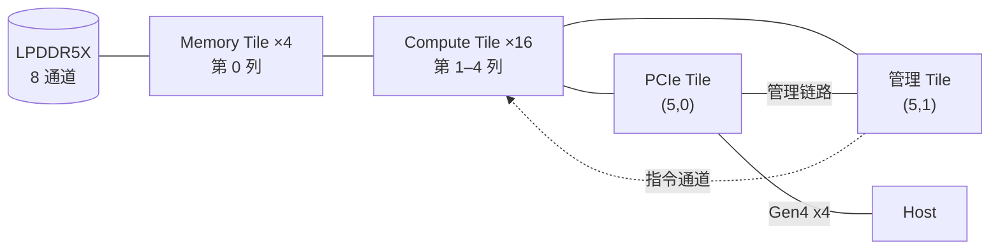

# 总体架构规格（spec-arch）

| 项 | 内容 |
|---|---|
| 版本 | v0.1 |
| 状态 | 草稿（Draft） |
| 负责 | 架构线 |
| 读者 | 所有团队（必读）：驱动、编译器、固件、gem5 线、将来的 RTL 团队 |

---

## 1. 概述

### 1.1 范围

本文档是 GW100 的顶层规格：产品定位、芯片由哪些部件组成、部件之间怎样连接、数据和控制怎样流动，以及顶层参数。它是阅读其他规格的入口。

本文档只给出结构和职责划分，各部件的行为由各自的规格定义（§7 文档地图）；本文档不复述那些定义。

### 1.2 产品定位

- GW100 是面向端侧大模型推理的数据流架构 ASIC，以 PCIe 设备的形态接入 host（例如 M.2 Key M 插槽）。
- 主要负载：LLaMA2-7B；次要负载：Llama-3.2-1B（`workload.primary`、`workload.secondary`）。
- 典型 host（设计假设）：端侧高配 ARM SoC 或 x86 PC，PCIe 最多 Gen4 x4；依据和链路要求见 `spec-pcie` §2.1、§3。

### 1.3 约定

- 规范用语"必须""应""可"和"TBD"的含义与其他规格相同：TBD 表示尚未确定，文中给出当前默认值，并列入 §9。
- 容量用二进制前缀（1 MiB = 1024 KiB），带宽用十进制（1 GB/s = 10⁹ B/s）。
- 标"推算"的数字是本文作者计算所得；引用资料写"代号 p.N"。
- 带点号的名字（如 `mesh.cols`）是架构参数，最终以单一真源 `arch_params.yaml` 为准；重建之前以各参数所属规格的参数表为准，§8 只给出本文档拥有的参数的取值。
- §7 文档地图中标"未写"的规格尚不存在，本文档引用它们只表示职责的归属，相关行为还没有规范性定义。

---

## 2. 设计决策

### 2.1 数据流架构：Tile 本地 SRAM 加显式搬运，没有缓存一致性

- **决定**：计算部件只读写本 Tile 的 SRAM；数据在设备内存、各 Tile 的 SRAM 之间由 DMA 显式搬运；设备内部没有硬件缓存一致性。
- **理由**：
  - LLM decode 受内存带宽限制。由编译器安排数据的搬运和复用，可以让权重从设备内存流过一次就用完，不依赖缓存命中率。
  - 去掉缓存一致性协议，片上网络只需传递普通读写和同步消息，面积和功耗都更低，延迟也可以预测。
  - 代价是编译器必须显式安排每一次搬运和同步（`spec-tile-sync`（待写）、`spec-isa`（待写））。

### 2.2 2D Mesh：6 列 × 4 行

- **决定**：所有 Tile 排成 `mesh.cols` × `mesh.rows` = 6 × 4 的二维网格，由片上网络连接（§3.2）。
- **理由**：
  - Mesh 的布线规则、可扩展性好，每个 Tile 只连接相邻路由器。
  - Memory Tile 放在一侧、主机接口放在另一侧，Compute Tile 夹在中间：权重从左侧流入，结果从右侧流出，两类流量在大部分链路上不冲突。

### 2.3 管理 Tile 集中派发张量级指令

- **决定**：管理 Tile 上的固件把程序展开成张量级指令，经指令通道发往各 Compute Tile 的功能单元；同一条指令可以多播给多个 Tile。
- **理由**：
  - 张量级指令一条就是成千上万次运算，集中派发的指令带宽足够，Compute Tile 内不需要通用处理器。
  - 多播让多个 Tile 以 SPMD 方式执行同一段程序，管理 Tile 注入的指令流量不随目标 Tile 数增长（复制后经过各段链路的流量仍随目标增加，将由 `spec-noc`（待写） 评估）。
  - 集中派发也让命令协议、上下文隔离和错误处理集中在一处（`spec-mgmt-tile`）。

### 2.4 主机接口：PCIe 端点，设备内存只经 DMA 访问

- **决定**：host 只能经 BAR0 访问寄存器，设备内存的数据一律由 Host DMA 引擎搬运；BAR2 只用于启动和调试（`spec-pcie` §2.2）。

### 2.5 区域保护，不使用 MMU

- **决定**：设备内部不做地址翻译；隔离靠两级区域检查：访问源按允许的区间检查，设备内存按受保护区域检查（`spec-address-map` §5）。
- **理由**：
  - v0.1 只有单一的可信固件管理多个上下文，上下文之间的隔离用区间表就能表达（`spec-hdi` §9.5），不需要页表和 TLB。
  - 不做地址翻译，Data Mover 的大块连续访问没有 TLB 缺失带来的延迟抖动。

---

## 3. 芯片组成

### 3.1 布局

坐标 (x, y)：x 为列号（0–5，从左到右），y 为行号（0–3，从上到下）。

| y \ x | 0 | 1 | 2 | 3 | 4 | 5 |
|---|---|---|---|---|---|---|
| 0 | Memory Tile M0 | Compute | Compute | Compute | Compute | PCIe Tile |
| 1 | Memory Tile M1 | Compute | Compute | Compute | Compute | 管理 Tile |
| 2 | Memory Tile M2 | Compute | Compute | Compute | Compute | 预留 |
| 3 | Memory Tile M3 | Compute | Compute | Compute | Compute | 预留 |

- 上图是逻辑示意：实际上每个 Tile 只与上下左右相邻的路由器相连，数据逐跳经过 Mesh。
- "预留"位置只有路由器，没有功能部件，保证 Mesh 完整，以后可以放置其他 Tile。
- 管理 Tile 与 PCIe Tile 相邻，使两者之间的管理链路最短（`spec-mgmt-tile` §5.1）。
- Memory Tile 位于芯片一侧，便于连接 LPDDR5X 的 PHY 和焊盘。

### 3.2 部件与职责

| 部件 | 数量 | 职责 | 定义 |
|---|---|---|---|
| Compute Tile | 16 | 本地 SRAM（`ct.sram_size` = 2 MiB）、矩阵引擎、向量引擎、Data Mover、同步计数器；执行张量级指令 | `spec-compute-tile`（待写）、`spec-matrix-engine`（待写）、`spec-vector-engine`（待写） |
| Memory Tile | 4 | 每个连接 2 条 LPDDR5X 通道；DRAM 控制器、受保护区域检查 | `spec-dram`（待写） |
| PCIe Tile | 1 | PCIe 端点、BAR、MSI-X、Host DMA 引擎 | `spec-pcie`、`spec-host-dma` |
| 管理 Tile | 1 | RISC-V 管理 CPU、启动 ROM、SRAM；运行固件：启动、命令协议、指令派发、错误处理 | `spec-mgmt-tile` |
| 片上网络 | 24 个路由器（6 × 4） | 连接所有 Tile 的数据网络 | `spec-noc`（待写） |
| 时钟复位控制器 | 1 | 时钟、复位和电源域的控制 | `spec-clock-reset-power` |

### 3.3 设备内存

- LPDDR5X-8533（`dram.type`），`dram.channels` = 8 条 x16 通道，由 4 个 Memory Tile 各连接 2 条。
- 理论峰值带宽：8 × 16 bit × 8533 MT/s ÷ 8 ≈ 136.5 GB/s（推算，引脚上的理想值，不是可用带宽）。具体器件的颗粒密度、rank 组织和信号完整性将由 `spec-dram`（待写） 确认。
- 容量 `dram.size` = 32 GiB（即通常所说的 32 GB 内存；每条通道 4 GiB，推算）。LLaMA2-7B 的 INT4 权重约 3.5 GB（`spec-pcie` §2.1），其余容量用于 KV cache、激活和多个模型同时驻留。
- 设备内存的地址在 8 条通道之间交织（`spec-address-map` §3.2）。

---

## 4. 互连

| 互连 | 连接 | 承载 | 定义 |
|---|---|---|---|
| 数据片上网络 | 所有 Tile 的路由器，2D Mesh，XY 路由 | 设备内存与 Tile SRAM 之间的数据、Tile 之间的数据、寄存器访问、同步消息、事件 | `spec-noc`（待写） |
| 指令通道 | 管理 Tile → 各 Compute Tile 的功能单元 | 张量级指令，可多播。复用数据片上网络的物理链路，使用独立的报文类别和逻辑队列；与数据请求共享链路带宽、允许暂时的竞争和反压，但不会因数据拥塞而死锁或无限期等待 | `spec-noc`（待写）、`spec-isa`（待写） |
| 管理链路 | PCIe Tile ↔ 管理 Tile，点对点 | 启动写入、doorbell、事件、寄存器访问、描述符读取 | `spec-mgmt-tile` §5 |
| PCIe 链路 | PCIe Tile ↔ host | Gen4 x4 | `spec-pcie` |

片上网络的链路宽度 `noc.link_bytes_per_cycle` = 64 B/周期。依据：Memory Tile 出口的一跳平均要承载约 34 GB/s（136.5 GB/s ÷ 4，推算），64 B × 1 GHz = 64 GB/s（推算）。这只是按平均带宽的估算；各段链路在实际路由和多种流量叠加下的最坏负载，将由 `spec-noc`（待写） 评估。

---

## 5. 数据与控制的流动

### 5.1 一次推理涉及的通路

| # | 通路 | 经过 | 说明 |
|---|---|---|---|
| 1 | 加载权重 | host 内存 → PCIe → Host DMA 引擎 → 片上网络 → Memory Tile → LPDDR5X | 模型切换时发生；3.5 GB 的 INT4 权重在 Gen4 x4 上约 0.5 s（推算） |
| 2 | 提交命令 | 驱动写 doorbell → 管理链路 → 管理 Tile 固件 → Host DMA 引擎读取 host 内存中的命令 | 命令协议见 `spec-hdi` |
| 3 | 派发指令 | 管理 Tile 固件 → 指令通道 → 各 Compute Tile 的功能单元 | 可多播 |
| 4 | 计算 | LPDDR5X → Memory Tile → 片上网络 → Compute Tile SRAM → 矩阵引擎、向量引擎 → SRAM；相邻 Tile 之间以生产者-消费者方式传递中间结果 | 同步见 `spec-tile-sync`（待写） |
| 5 | 返回结果与完成 | Compute Tile SRAM 或设备内存 → Host DMA 引擎 → host 内存；随后写完成记录、发 MSI-X | 顺序保证见 `spec-pcie` §9 |
| 6 | 启动 | host 经 BAR2 把固件写入管理 Tile 的 SRAM → 启动 ROM 校验并跳转 → 固件初始化设备内存、片上网络和各 Tile | `spec-pcie` §6.4、`spec-mgmt-tile` §8 |

### 5.2 性能上限（推算）

| 指标 | 数值 | 算法 |
|---|---|---|
| 矩阵引擎的峰值乘加 | 每个 Compute Tile 2048 次乘加/周期，16 个 Tile 共 32 768 次/周期；1 GHz 下约 32.8 T 次乘加/s | 8 × 64 阵列、每个单元 4 元素点积（`spec-matrix-engine`（待写），参数待重建） |
| LLaMA2-7B（INT4 权重约 3.5 GB）decode 的上限 | 约 39 token/s | 每个 token 要读一遍全部权重：136.5 GB/s ÷ 3.5 GB；未计 KV cache 和激活的流量 |
| PCIe 有效带宽 | 约 6–7 GB/s | `spec-pcie` §11.1 |

decode 阶段受设备内存带宽限制，矩阵引擎的算力远未用满；prefill 阶段受算力限制。这一判断决定了设计的优先级：先保证设备内存带宽能被用满，再提高算力利用率。

---

## 6. 软件与硬件的分工

| 角色 | 运行在 | 职责 |
|---|---|---|
| 驱动 | host 内核 | 枚举、加载固件、初始化命令协议、管理 DMA 缓冲、处理中断和错误恢复 |
| 运行时 | host 用户态 | 创建上下文、申请设备内存、加载模型、提交推理 |
| 编译器 | host（离线） | 把模型编译成张量级指令程序，安排数据搬运、多播和同步 |
| 固件 | 管理 Tile | 启动与初始化、命令协议、上下文隔离、指令派发、错误处理 |
| 硬件 | 各 Tile | 执行张量级指令和数据搬运 |

驱动与设备之间的接口由 `spec-pcie` 和 `spec-hdi` 定义；编译器产出的程序格式由 `spec-exe-format`（待写） 定义；固件与硬件之间的接口由 `spec-mgmt-tile` 和各部件的规格定义。

---

## 7. 文档地图

| 领域 | 规格 | 内容 | 状态 |
|---|---|---|---|
| 系统 | `spec-arch` | 本文档 | v0.1 |
| | `spec-address-map` | 设备物理地址空间、各访问源的权限、内存模型 | v0.1 |
| | `spec-clock-reset-power` | 时钟域、复位矩阵、电源域 | v0.1 |
| | `spec-interrupt-ras` | 全芯片的错误分级与汇聚 | 未写 |
| | `spec-debug-perf` | 调试、trace、性能计数器 | 未写 |
| 计算 | `spec-compute-tile`、`spec-matrix-engine`、`spec-vector-engine`、`spec-isa`、`spec-numerics` | Compute Tile 与指令 | 未写 |
| 互连 | `spec-noc`、`spec-tile-sync` | 片上网络、Tile 间同步 | 未写 |
| 存储 | `spec-dram` | Memory Tile 与 LPDDR5X | 未写 |
| 主机接口 | `spec-pcie`、`spec-host-dma`、`spec-mgmt-tile`、`spec-hdi` | 链路、DMA、管理 Tile、命令协议 | v0.1 |
| | `spec-exe-format` | 可执行文件格式 | 未写 |

---

## 8. 顶层参数

| 参数 | 当前值 | 说明 |
|---|---|---|
| `mesh.cols` | 6 | §2.2 |
| `mesh.rows` | 4 | §2.2 |
| `mesh.layout` | 见 §3.1 | |
| `clock.core_freq` | 见 `spec-clock-reset-power` §10 | Compute Tile、片上网络的工作频率；§5.2 的推算按 1 GHz |
| `ct.count` | 16 | |
| `ct.sram_size` | 2 MiB | 每个 Compute Tile |
| `dram.type` | LPDDR5X-8533 | |
| `dram.channels` | 8 | 每个 Memory Tile 2 条，每条 x16 |
| `dram.size` | 32 GiB | §3.3 |
| `noc.link_bytes_per_cycle` | 64 | §4；`spec-noc`（待写） 写成后移交 |
| `addr.device_pa_bits` | 见 `spec-address-map` §10 | |
| `workload.primary` | LLaMA2-7B | |
| `workload.secondary` | Llama-3.2-1B | |

---

## 9. 待决事项

| 事项 | 当前默认 | 影响 |
|---|---|---|
| 片上网络链路宽度 | v0.1 已定为 64 B/周期 | §4；`spec-noc`（待写） 按最坏链路负载验证不通过时修改本规格 |
| 矩阵引擎与向量引擎的参数 | 沿用旧参数草案 | §5.2；单一真源重建时确认 |
