> 本文件由 `HC35-AMD-Ryzen7040-Phoenix.pdf` 自动转换（docling 2.140.0，2026-10-17）。每页的整页图在 `images/` 目录；表格与数字请以 PDF 原文为准；`<!-- p.N -->` 标记对应 PDF 第 N 页。

<!-- p.1 -->

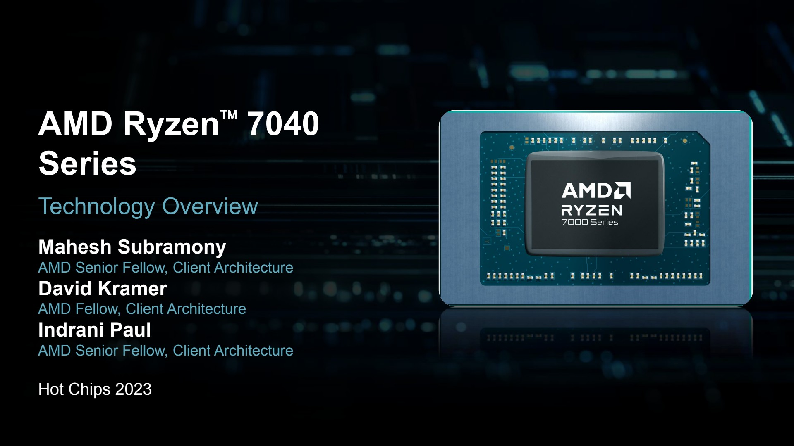

## AMD Ryzen 7040 Series

Technology Overview

Mahesh Subramony

AMD Senior Fellow, Client Architecture

David Kramer

AMD Fellow, Client Architecture

Indrani Paul

AMD Senior Fellow, Client Architecture

Hot Chips 2023

<!-- p.2 -->

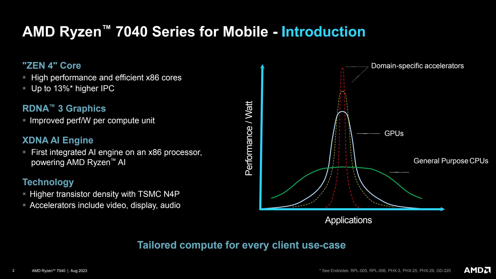

## AMD Ryzen ™ 7040 Series for Mobile - Introduction

## "ZEN 4" Core

- High performance and efficient x86 cores
- Up to 13%* higher IPC

## RDNA ™ 3 Graphics

- Improved perf/W per compute unit

## XDNA AI Engine

- First integrated AI engine on an x86 processor, powering AMD Ryzen ™ AI

## Technology

- Higher transistor density with TSMC N4P
- Accelerators include video, display, audio

Applications

Tailored compute for every client use-case

Performance / Watt

<!-- p.3 -->

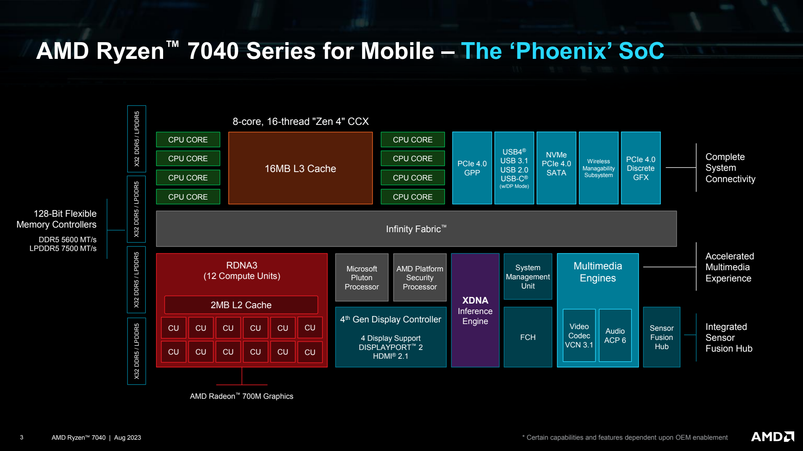

## AMD Ryzen ™ 7040 Series for Mobile - The 'Phoenix' SoC

<!-- p.4 -->

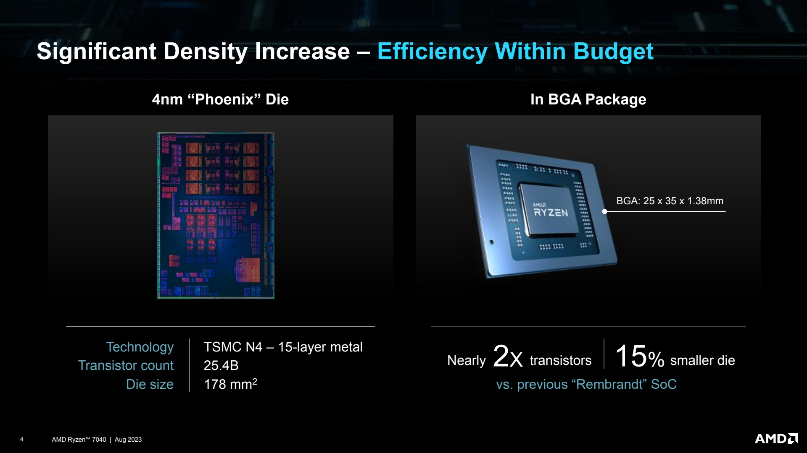

## Significant Density Increase - Efficiency Within Budget

4nm "Phoenix" Die

In BGA Package

Technology Transistor count Die size TSMC N4 - 15-layer metal 25.4B 178 mm 2

Nearly 2X

transistors smaller die 15%

vs. previous "Rembrandt" SoC

<!-- p.5 -->

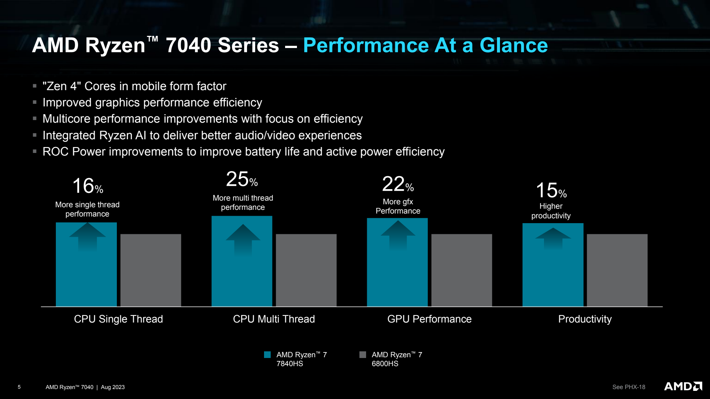

## AMD Ryzen ™ 7040 Series - Performance At a Glance

- "Zen 4" Cores in mobile form factor
- Improved graphics performance efficiency
- Multicore performance improvements with focus on efficiency
- Integrated Ryzen AI to deliver better audio/video experiences
- ROC Power improvements to improve battery life and active power efficiency

<!-- p.6 -->

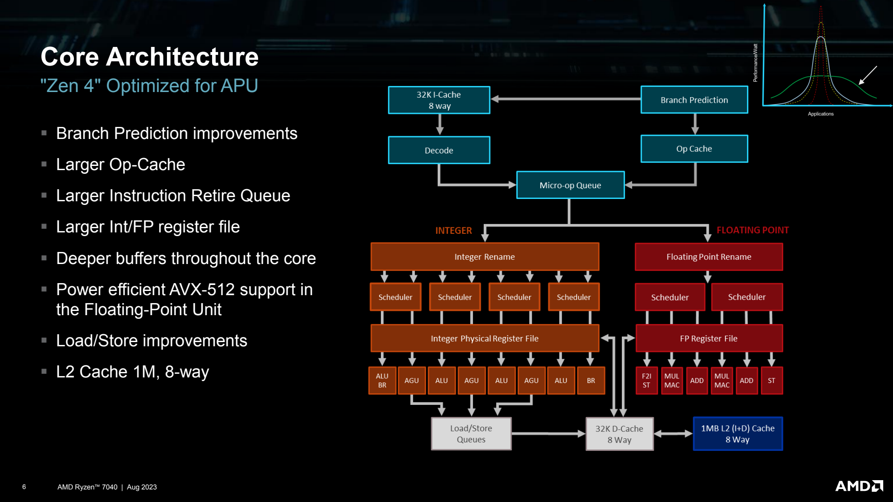

## Core Architecture

"Zen 4" Optimized for APU

- Branch Prediction improvements
- Larger Op-Cache
- Larger Instruction Retire Queue
- Larger Int/FP register file
- Deeper buffers throughout the core
- Power efficient AVX-512 support in the Floating-Point Unit
- Load/Store improvements
- L2 Cache 1M, 8-way

<!-- p.7 -->

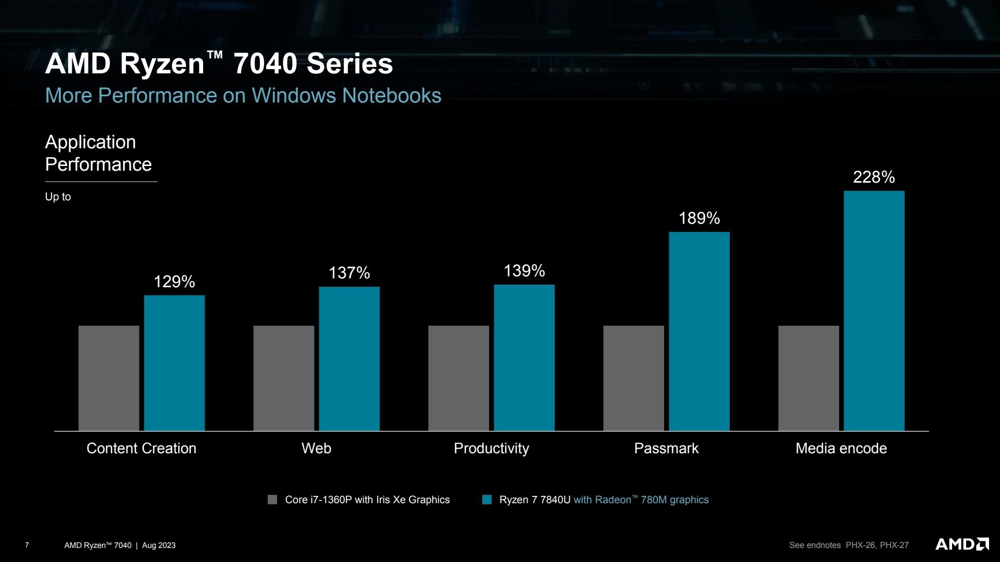

## AMD Ryzen ™ 7040 Series

More Performance on Windows Notebooks

<!-- p.8 -->

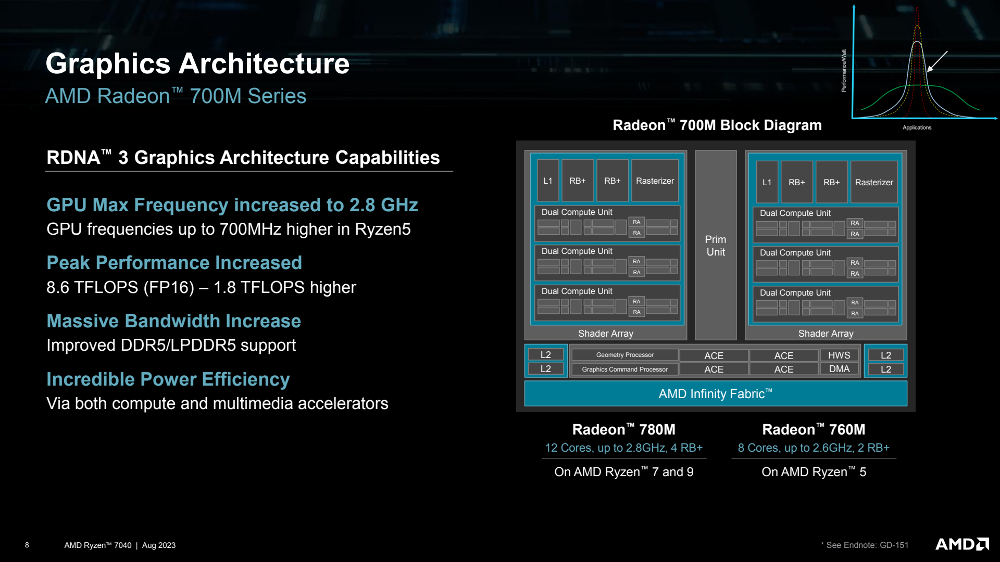

## Graphics Architecture

AMD Radeon ™ 700M Series

## RDNA ™ 3 Graphics Architecture Capabilities

GPU Max Frequency increased to 2.8 GHz GPU frequencies up to 700MHz higher in Ryzen5

Peak Performance Increased 8.6 TFLOPS (FP16) - 1.8 TFLOPS higher

Massive Bandwidth Increase Improved DDR5/LPDDR5 support

## Incredible Power Efficiency

Via both compute and multimedia accelerators

## Radeon ™ 700M Block Diagram

## Radeon ™ 780M

12 Cores, up to 2.8GHz, 4 RB+

On AMD Ryzen ™ 7 and 9

## Radeon ™ 760M

8 Cores, up to 2.6GHz, 2 RB+

On AMD Ryzen ™ 5

<!-- p.9 -->

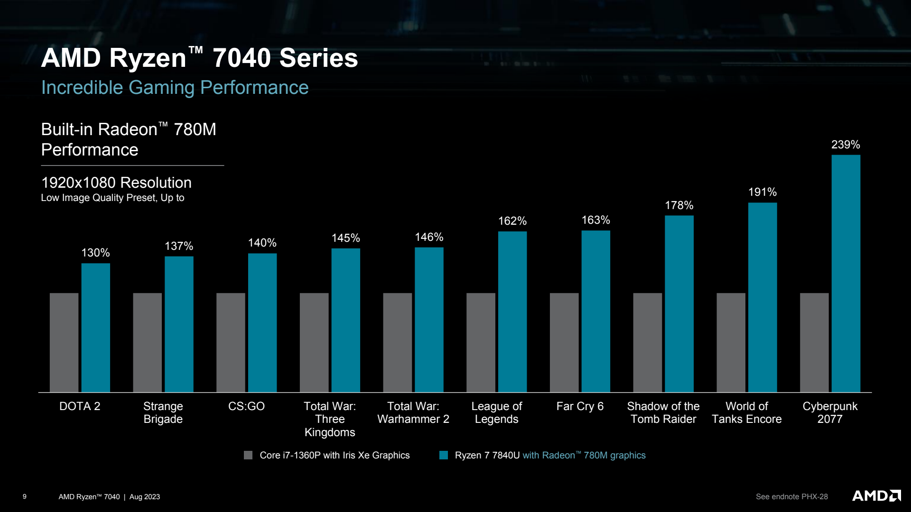

9

## AMD Ryzen ™ 7040 Series

Incredible Gaming Performance

<!-- p.10 -->

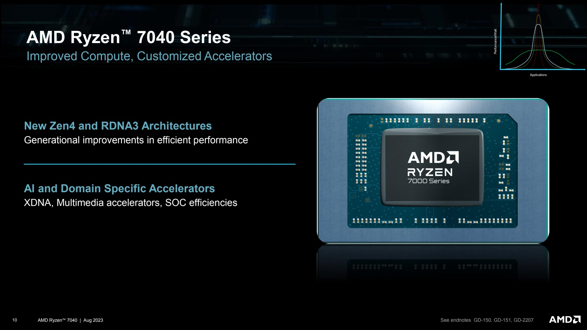

## AMD Ryzen ™ 7040 Series

Improved Compute, Customized Accelerators

## New Zen4 and RDNA3 Architectures

Generational improvements in efficient performance

\_\_\_\_\_\_\_\_\_\_\_\_\_\_\_\_\_\_\_\_\_\_\_\_\_\_\_\_\_\_\_\_\_\_\_\_\_\_\_\_\_\_\_\_\_\_\_\_\_\_

## AI and Domain Specific Accelerators

XDNA, Multimedia accelerators, SOC efficiencies

<!-- p.11 -->

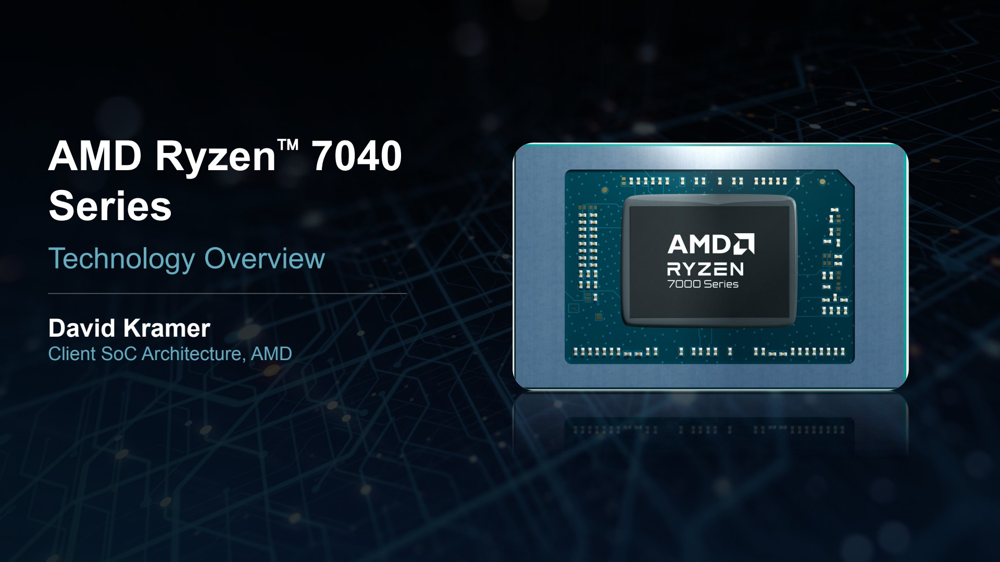

11

## AMD Ryzen 7040 Series

Technology Overview

## David Kramer

Client SoC Architecture, AMD

AMD Ryzen™ 7040 | Aug 2023

<!-- p.12 -->

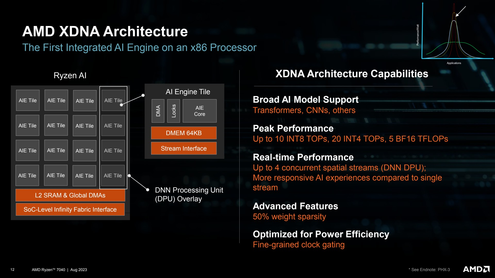

## AMD XDNA Architecture

The First Integrated AI Engine on an x86 Processor

## XDNA Architecture Capabilities

## Broad AI Model Support

Transformers, CNNs, others

## Peak Performance

Up to 10 INT8 TOPs, 20 INT4 TOPs, 5 BF16 TFLOPs

## Real-time Performance

Up to 4 concurrent spatial streams (DNN DPU); More responsive AI experiences compared to single

stream

## Advanced Features

50% weight sparsity

Optimized for Power Efficiency Fine-grained clock gating

<!-- p.13 -->

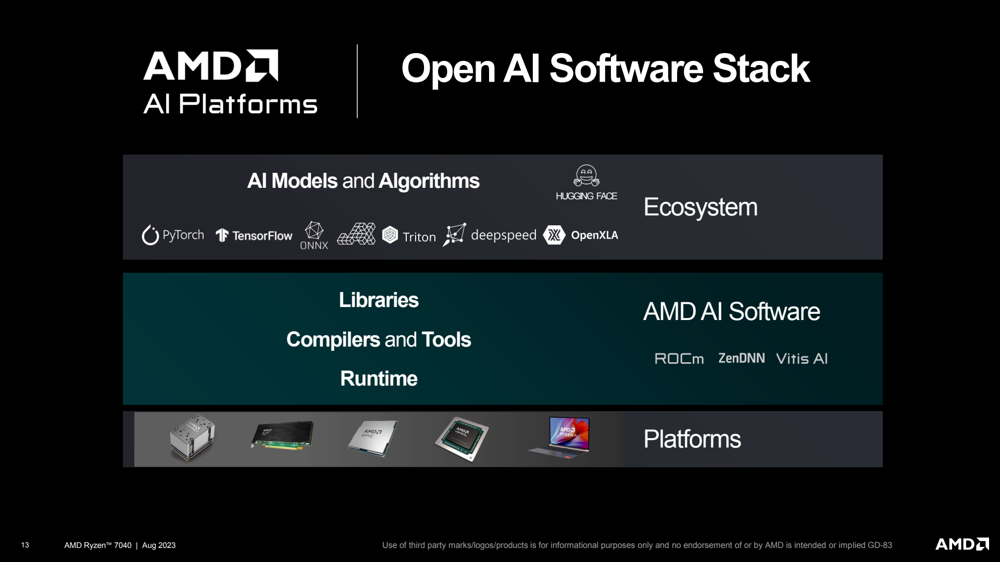

## Open AI Software Stack

AI Models and Algorithms

Libraries Compilers and Tools Runtime AMD AI Software Platforms

<!-- p.14 -->

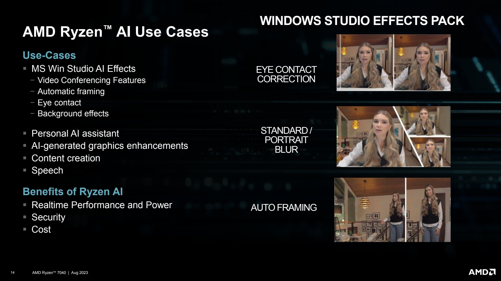

## AMD Ryzen ™ AI Use Cases

## Use-Cases

- MS Win Studio AI Effects
- Video Conferencing Features
- Automatic framing
- Eye contact
- Background effects
- Personal AI assistant
- AI-generated graphics enhancements
- Content creation
- Speech

## Benefits of Ryzen AI

- Realtime Performance and Power
- Security
- Cost

## WINDOWS STUDIO EFFECTS PACK

EYE CONTACT CORRECTION

STANDARD / PORTRAIT BLUR STANDARD / PORTRAIT BLUR

AUTO FRAMING

<!-- p.15 -->

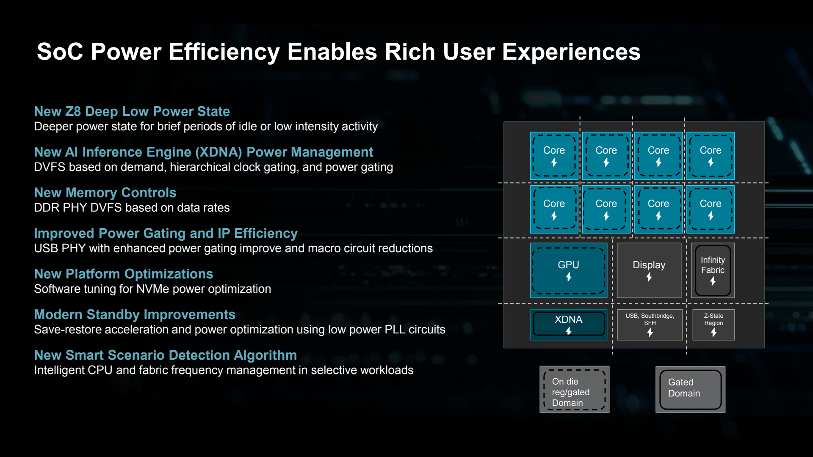

15

## SoC Power Efficiency Enables Rich User Experiences

## New Z8 Deep Low Power State

Deeper power state for brief periods of idle or low intensity activity

## New AI Inference Engine (XDNA) Power Management

DVFS based on demand, hierarchical clock gating, and power gating

## New Memory Controls

DDR PHY DVFS based on data rates

## Improved Power Gating and IP Efficiency

USB PHY with enhanced power gating improve and macro circuit reductions

## New Platform Optimizations

Software tuning for NVMe power optimization

## Modern Standby Improvements

Save-restore acceleration and power optimization using low power PLL circuits

## New Smart Scenario Detection Algorithm

Intelligent CPU and fabric frequency management in selective workloads

AMD Ryzen™ 7040 | Aug 2023

<!-- p.16 -->

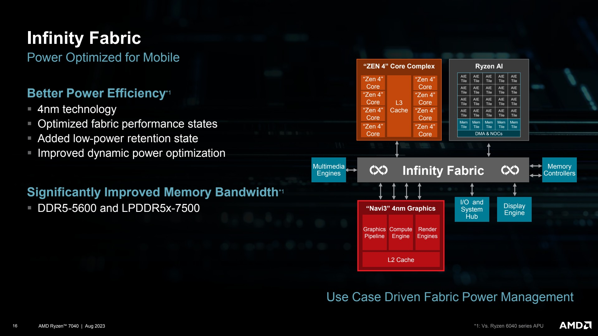

## Infinity Fabric

Power Optimized for Mobile

## Better Power Efficiency *1

- 4nm technology
- Optimized fabric performance states
- Added low-power retention state
- Improved dynamic power optimization

## Significantly Improved Memory Bandwidth *1

- DDR5-5600 and LPDDR5x-7500

Use Case Driven Fabric Power Management

<!-- p.17 -->

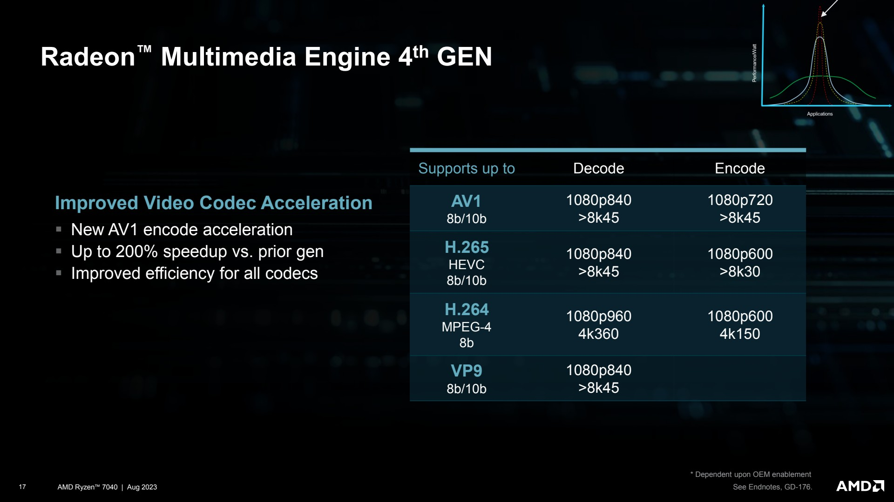

## Radeon ™ Multimedia Engine 4 th GEN

| Supports up to    | Decode         | Encode         |
|-------------------|----------------|----------------|
| AV1 8b/10b        | 1080p840 >8k45 | 1080p720 >8k45 |
| H.265 HEVC 8b/10b | 1080p840 >8k45 | 1080p600 >8k30 |
| H.264 MPEG-4 8b   | 1080p960 4k360 | 1080p600 4k150 |
| VP9 8b/10b        | 1080p840 >8k45 |                |

## Improved Video Codec Acceleration

- New AV1 encode acceleration
- Up to 200% speedup vs. prior gen
- Improved efficiency for all codecs

<!-- p.18 -->

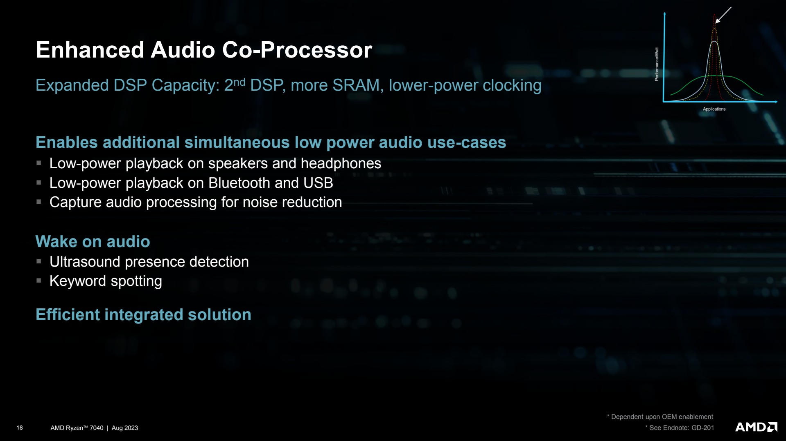

## Enhanced Audio Co-Processor

Expanded DSP Capacity: 2 nd DSP, more SRAM, lower-power clocking

## Enables additional simultaneous low power audio use-cases

- Low-power playback on speakers and headphones
- Low-power playback on Bluetooth and USB
- Capture audio processing for noise reduction

## Wake on audio

- Ultrasound presence detection
- Keyword spotting

## Efficient integrated solution

<!-- p.19 -->

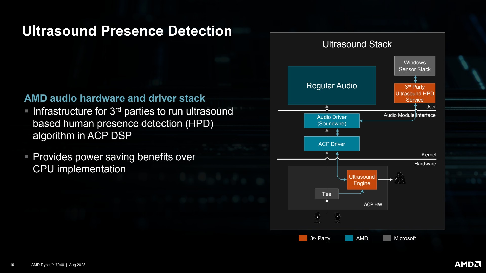

## Ultrasound Presence Detection

## AMD audio hardware and driver stack

- Infrastructure for 3 rd parties to run ultrasound based human presence detection (HPD) algorithm in ACP DSP
- Provides power saving benefits over CPU implementation

<!-- p.20 -->

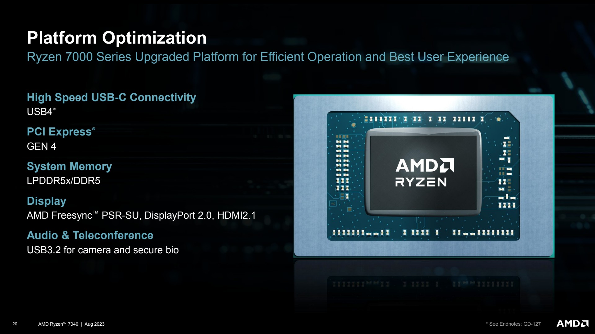

## Platform Optimization

Ryzen 7000 Series Upgraded Platform for Efficient Operation and Best User Experience

High Speed USB-C Connectivity USB4 ®

PCI Express ® GEN 4

System Memory LPDDR5x/DDR5

## Display

AMD Freesync ™ PSR-SU, DisplayPort 2.0, HDMI2.1

Audio &amp; Teleconference USB3.2 for camera and secure bio

<!-- p.21 -->

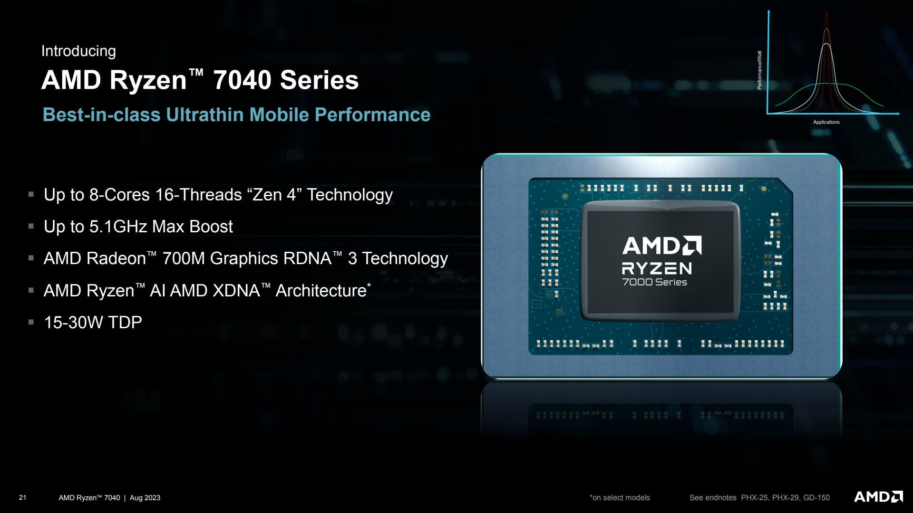

## Introducing

## AMD Ryzen ™ 7040 Series

Best-in-class Ultrathin Mobile Performance

- Up to 8-Cores 16-Threads "Zen 4" Technology
- Up to 5.1GHz Max Boost
- AMD Radeon ™ 700M Graphics RDNA ™ 3 Technology
- AMD Ryzen ™ AI AMD XDNA ™ Architecture *
- 15-30W TDP

<!-- p.22 -->

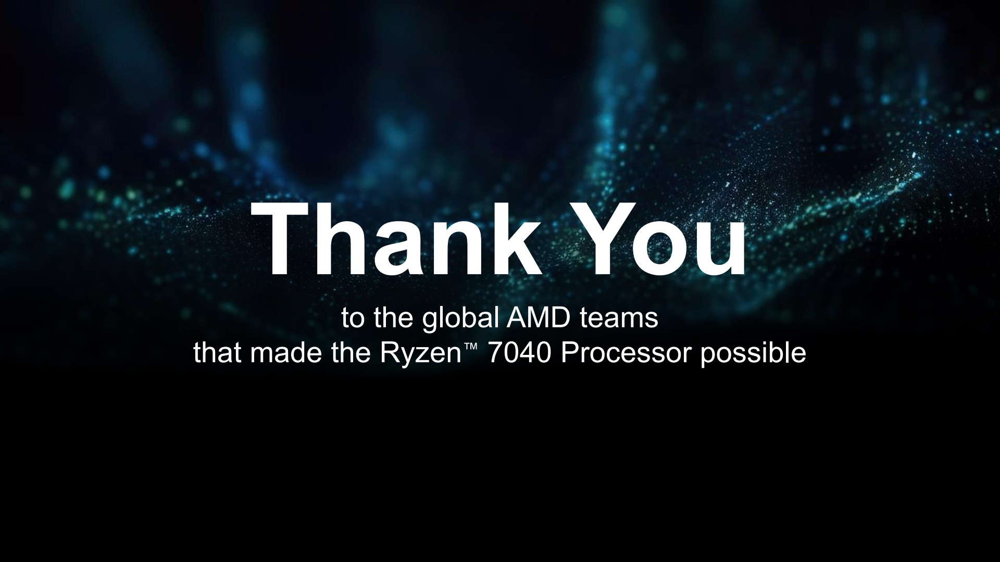

## Thank You

to the global AMD teams

that made the Ryzen ™ 7040 Processor possible

<!-- p.23 -->

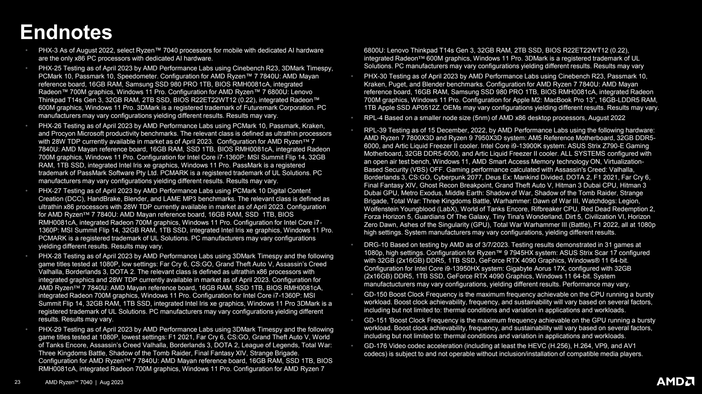

## Endnotes

- PHX-3 As of August 2022, select Ryzen™ 7040 processors for mobile with dedicated AI hardware are the only x86 PC processors with dedicated AI hardware.
- PHX-25 Testing as of April 2023 by AMD Performance Labs using Cinebench R23, 3DMark Timespy, PCMark 10, Passmark 10, Speedometer. Configuration for AMD Ryzen™ 7 7840U: AMD Mayan reference board, 16GB RAM, Samsung SSD 980 PRO 1TB, BIOS RMH0081cA, integrated Radeon™ 700M graphics, Windows 11 Pro. Configuration for AMD Ryzen™ 7 6800U: Lenovo Thinkpad T14s Gen 3, 32GB RAM, 2TB SSD, BIOS R22ET22WT12 (0.22), integrated Radeon™ 600M graphics, Windows 11 Pro. 3DMark is a registered trademark of Futuremark Corporation. PC manufacturers may vary configurations yielding different results. Results may vary.
- PHX-26 Testing as of April 2023 by AMD Performance Labs using PCMark 10, Passmark, Kraken, and Procyon Microsoft productivity benchmarks. The relevant class is defined as ultrathin processors with 28W TDP currently available in market as of April 2023. Configuration for AMD Ryzen™ 7 7840U: AMD Mayan reference board, 16GB RAM, SSD 1TB, BIOS RMH0081cA, integrated Radeon 700M graphics, Windows 11 Pro. Configuration for Intel Core i7-1360P: MSI Summit Flip 14, 32GB RAM, 1TB SSD, integrated Intel Iris xe graphics, Windows 11 Pro. PassMark is a registered trademark of PassMark Software Pty Ltd. PCMARK is a registered trademark of UL Solutions. PC manufacturers may vary configurations yielding different results. Results may vary.
- PHX-27 Testing as of April 2023 by AMD Performance Labs using PCMark 10 Digital Content Creation (DCC), HandBrake, Blender, and LAME MP3 benchmarks. The relevant class is defined as ultrathin x86 processors with 28W TDP currently available in market as of April 2023. Configuration for AMD Ryzen™ 7 7840U: AMD Mayan reference board, 16GB RAM, SSD 1TB, BIOS RMH0081cA, integrated Radeon 700M graphics, Windows 11 Pro. Configuration for Intel Core i71360P: MSI Summit Flip 14, 32GB RAM, 1TB SSD, integrated Intel Iris xe graphics, Windows 11 Pro. PCMARK is a registered trademark of UL Solutions. PC manufacturers may vary configurations yielding different results. Results may vary.
- PHX-28 Testing as of April 2023 by AMD Performance Labs using 3DMark Timespy and the following game titles tested at 1080P, low settings: Far Cry 6, CS:GO, Grand Theft Auto V, Assassin's Creed Valhalla, Borderlands 3, DOTA 2. The relevant class is defined as ultrathin x86 processors with integrated graphics and 28W TDP currently available in market as of April 2023. Configuration for AMD Ryzen™ 7 7840U: AMD Mayan reference board, 16GB RAM, SSD 1TB, BIOS RMH0081cA, integrated Radeon 700M graphics, Windows 11 Pro. Configuration for Intel Core i7-1360P: MSI Summit Flip 14, 32GB RAM, 1TB SSD, integrated Intel Iris xe graphics, Windows 11 Pro 3DMark is a registered trademark of UL Solutions. PC manufacturers may vary configurations yielding different results. Results may vary.
- PHX-29 Testing as of April 2023 by AMD Performance Labs using 3DMark Timespy and the following game titles tested at 1080P, lowest settings: F1 2021, Far Cry 6, CS:GO, Grand Theft Auto V, World of Tanks Encore, Assassin's Creed Valhalla, Borderlands 3, DOTA 2, League of Legends, Total War: Three Kingdoms Battle, Shadow of the Tomb Raider, Final Fantasy XIV, Strange Brigade. Configuration for AMD Ryzen™ 7 7840U: AMD Mayan reference board, 16GB RAM, SSD 1TB, BIOS RMH0081cA, integrated Radeon 700M graphics, Windows 11 Pro. Configuration for AMD Ryzen 7

6800U: Lenovo Thinkpad T14s Gen 3, 32GB RAM, 2TB SSD, BIOS R22ET22WT12 (0.22), integrated Radeon™ 600M graphics, Windows 11 Pro. 3DMark is a registered trademark of UL Solutions. PC manufacturers may vary configurations yielding different results. Results may vary

- PHX-30 Testing as of April 2023 by AMD Performance Labs using Cinebench R23, Passmark 10, Kraken, Puget, and Blender benchmarks. Configuration for AMD Ryzen 7 7840U: AMD Mayan reference board, 16GB RAM, Samsung SSD 980 PRO 1TB, BIOS RMH0081cA, integrated Radeon 700M graphics, Windows 11 Pro. Configuration for Apple M2: MacBook Pro 13", 16GB-LDDR5 RAM, 1TB Apple SSD AP0512Z. OEMs may vary configurations yielding different results. Results may vary.
- RPL-4 Based on a smaller node size (5nm) of AMD x86 desktop processors, August 2022
- RPL-39 Testing as of 15 December, 2022, by AMD Performance Labs using the following hardware: AMD Ryzen 7 7800X3D and Ryzen 9 7950X3D system: AM5 Reference Motherboard, 32GB DDR56000, and Artic Liquid Freezer II cooler. Intel Core i9-13900K system: ASUS Strix Z790-E Gaming Motherboard, 32GB DDR5-6000, and Artic Liquid Freezer II cooler. ALL SYSTEMS configured with an open air test bench, Windows 11, AMD Smart Access Memory technology ON, VirtualizationBased Security (VBS) OFF. Gaming performance calculated with Assassin's Creed: Valhalla, Borderlands 3, CS:GO, Cyberpunk 2077, Deus Ex: Mankind Divided, DOTA 2, F1 2021, Far Cry 6, Final Fantasy XIV, Ghost Recon Breakpoint, Grand Theft Auto V, Hitman 3 Dubai CPU, Hitman 3 Dubai GPU, Metro Exodus, Middle Earth: Shadow of War, Shadow of the Tomb Raider, Strange Brigade, Total War: Three Kingdoms Battle, Warhammer: Dawn of War III, Watchdogs: Legion, Wolfenstein Youngblood (LabX), World of Tanks Encore, Rifbreaker CPU, Red Dead Redemption 2, Forza Horizon 5, Guardians Of The Galaxy, Tiny Tina's Wonderland, Dirt 5, Civilization VI, Horizon Zero Dawn, Ashes of the Singularity (GPU), Total War Warhammer III (Battle), F1 2022, all at 1080p high settings. System manufacturers may vary configurations, yielding different results.
- DRG-10 Based on testing by AMD as of 3/7/2023. Testing results demonstrated in 31 games at 1080p, high settings. Configuration for Ryzen™ 9 7945HX system: ASUS Strix Scar 17 configured with 32GB (2x16GB) DDR5, 1TB SSD, GeForce RTX 4090 Graphics, Windows® 11 64-bit. Configuration for Intel Core i9-13950HX system: Gigabyte Aorus 17X, configured with 32GB (2x16GB) DDR5, 1TB SSD, GeForce RTX 4090 Graphics, Windows 11 64-bit. System manufactucturers may vary configurations, yielding different results. Performance may vary.
- GD-150 Boost Clock Frequency is the maximum frequency achievable on the CPU running a bursty workload. Boost clock achievability, frequency, and sustainability will vary based on several factors, including but not limited to: thermal conditions and variation in applications and workloads.
- GD-151 'Boost Clock Frequency is the maximum frequency achievable on the GPU running a bursty workload. Boost clock achievability, frequency, and sustainability will vary based on several factors, including but not limited to: thermal conditions and variation in applications and workloads.
- GD-176 Video codec acceleration (including at least the HEVC (H.256), H.264, VP9, and AV1 codecs) is subject to and not operable without inclusion/installation of compatible media players.

<!-- p.24 -->

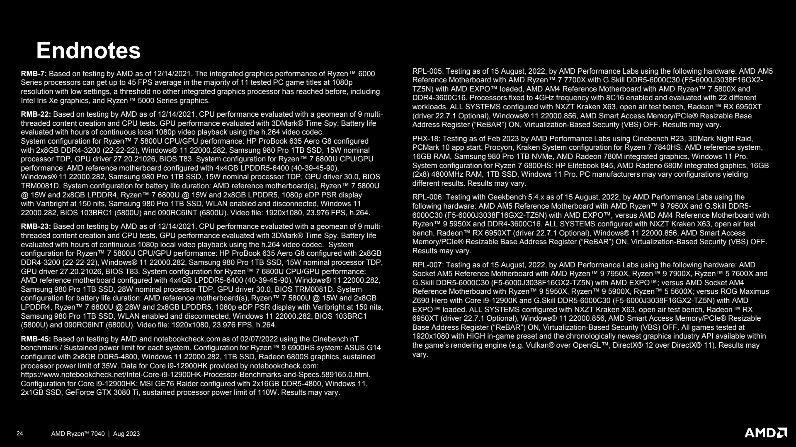

## Endnotes

RMB-7: Based on testing by AMD as of 12/14/2021. The integrated graphics performance of Ryzen™ 6000 Series processors can get up to 45 FPS average in the majority of 11 tested PC game titles at 1080p resolution with low settings, a threshold no other integrated graphics processor has reached before, including Intel Iris Xe graphics, and Ryzen™ 5000 Series graphics.

RMB-22: Based on testing by AMD as of 12/14/2021. CPU performance evaluated with a geomean of 9 multithreaded content creation and CPU tests. GPU performance evaluated with 3DMark® Time Spy. Battery life evaluated with hours of continuous local 1080p video playback using the h.264 video codec. System configuration for Ryzen™ 7 5800U CPU/GPU performance: HP ProBook 635 Aero G8 configured with 2x8GB DDR4-3200 (22-22-22), Windows® 11 22000.282, Samsung 980 Pro 1TB SSD, 15W nominal processor TDP, GPU driver 27.20.21026, BIOS T83. System configuration for Ryzen™ 7 6800U CPU/GPU performance: AMD reference motherboard configured with 4x4GB LPDDR5-6400 (40-39-45-90), Windows® 11 22000.282, Samsung 980 Pro 1TB SSD, 15W nominal processor TDP, GPU driver 30.0, BIOS TRM0081D. System configuration for battery life duration: AMD reference motherboard(s), Ryzen™ 7 5800U @ 15W and 2x8GB LPDDR4, Ryzen™ 7 6800U @ 15W and 2x8GB LPDDR5, 1080p eDP PSR display with Varibright at 150 nits, Samsung 980 Pro 1TB SSD, WLAN enabled and disconnected, Windows 11 22000.282, BIOS 103BRC1 (5800U) and 090RC6INT (6800U). Video file: 1920x1080, 23.976 FPS, h.264.

RMB-23: Based on testing by AMD as of 12/14/2021. CPU performance evaluated with a geomean of 9 multithreaded content creation and CPU tests. GPU performance evaluated with 3DMark® Time Spy. Battery life evaluated with hours of continuous 1080p local video playback using the h.264 video codec. System configuration for Ryzen™ 7 5800U CPU/GPU performance: HP ProBook 635 Aero G8 configured with 2x8GB DDR4-3200 (22-22-22), Windows® 11 22000.282, Samsung 980 Pro 1TB SSD, 15W nominal processor TDP, GPU driver 27.20.21026, BIOS T83. System configuration for Ryzen™ 7 6800U CPU/GPU performance: AMD reference motherboard configured with 4x4GB LPDDR5-6400 (40-39-45-90), Windows® 11 22000.282, Samsung 980 Pro 1TB SSD, 28W nominal processor TDP, GPU driver 30.0, BIOS TRM0081D. System configuration for battery life duration: AMD reference motherboard(s), Ryzen™ 7 5800U @ 15W and 2x8GB LPDDR4, Ryzen™ 7 6800U @ 28W and 2x8GB LPDDR5, 1080p eDP PSR display with Varibright at 150 nits, Samsung 980 Pro 1TB SSD, WLAN enabled and disconnected, Windows 11 22000.282, BIOS 103BRC1 (5800U) and 090RC6INT (6800U). Video file: 1920x1080, 23.976 FPS, h.264.

RMB-45: Based on testing by AMD and notebookcheck.com as of 02/07/2022 using the Cinebench nT benchmark / Sustained power limit for each system. Configuration for Ryzen™ 9 6900HS system: ASUS G14 configured with 2x8GB DDR5-4800, Windows 11 22000.282, 1TB SSD, Radeon 6800S graphics, sustained processor power limit of 35W. Data for Core i9-12900HK provided by notebookcheck.com: https://www.notebookcheck.net/Intel-Core-i9-12900HK-Processor-Benchmarks-and-Specs.589165.0.html. Configuration for Core i9-12900HK: MSI GE76 Raider configured with 2x16GB DDR5-4800, Windows 11, 2x1GB SSD, GeForce GTX 3080 Ti, sustained processor power limit of 110W. Results may vary.

RPL-005: Testing as of 15 August, 2022, by AMD Performance Labs using the following hardware: AMD AM5 Reference Motherboard with AMD Ryzen™ 7 7700X with G.Skill DDR5-6000C30 (F5-6000J3038F16GX2TZ5N) with AMD EXPO™ loaded, AMD AM4 Reference Motherboard with AMD Ryzen™ 7 5800X and DDR4-3600C16. Processors fixed to 4GHz frequency with 8C16 enabled and evaluated with 22 different workloads. ALL SYSTEMS configured with NXZT Kraken X63, open air test bench, Radeon™ RX 6950XT (driver 22.7.1 Optional), Windows® 11 22000.856, AMD Smart Access Memory/PCIe® Resizable Base Address Register ("ReBAR") ON, Virtualization-Based Security (VBS) OFF. Results may vary.

PHX-18: Testing as of Feb 2023 by AMD Performance Labs using Cinebench R23, 3DMark Night Raid, PCMark 10 app start, Procyon, Kraken System configuration for Ryzen 7 7840HS: AMD reference system, 16GB RAM, Samsung 980 Pro 1TB NVMe, AMD Radeon 780M integrated graphics, Windows 11 Pro. System configuration for Ryzen 7 6800HS: HP Elitebook 845, AMD Radeno 680M integrated gaphics, 16GB (2x8) 4800MHz RAM, 1TB SSD, Windows 11 Pro. PC manufacturers may vary configurations yielding different results. Results may vary.

RPL-006: Testing with Geekbench 5.4.x as of 15 August, 2022, by AMD Performance Labs using the following hardware: AMD AM5 Reference Motherboard with AMD Ryzen™ 9 7950X and G.Skill DDR56000C30 (F5-6000J3038F16GX2-TZ5N) with AMD EXPO™, versus AMD AM4 Reference Motherboard with Ryzen™ 9 5950X and DDR4-3600C16. ALL SYSTEMS configured with NXZT Kraken X63, open air test bench, Radeon™ RX 6950XT (driver 22.7.1 Optional), Windows® 11 22000.856, AMD Smart Access Memory/PCIe® Resizable Base Address Register ("ReBAR") ON, Virtualization-Based Security (VBS) OFF. Results may vary.

RPL-007: Testing as of 15 August, 2022, by AMD Performance Labs using the following hardware: AMD Socket AM5 Reference Motherboard with AMD Ryzen™ 9 7950X, Ryzen™ 9 7900X, Ryzen™ 5 7600X and G.Skill DDR5-6000C30 (F5-6000J3038F16GX2-TZ5N) with AMD EXPO™; versus AMD Socket AM4 Reference Motherboard with Ryzen™ 9 5950X, Ryzen™ 9 5900X, Ryzen™ 5 5600X; versus ROG Maximus Z690 Hero with Core i9-12900K and G.Skill DDR5-6000C30 (F5-6000J3038F16GX2-TZ5N) with AMD EXPO™ loaded. ALL SYSTEMS configured with NXZT Kraken X63, open air test bench, Radeon™ RX 6950XT (driver 22.7.1 Optional), Windows® 11 22000.856, AMD Smart Access Memory/PCIe® Resizable Base Address Register ("ReBAR") ON, Virtualization-Based Security (VBS) OFF. All games tested at 1920x1080 with HIGH in-game preset and the chronologically newest graphics industry API available within the game's rendering engine (e.g. Vulkan® over OpenGL™, DirectX® 12 over DirectX® 11). Results may vary.

<!-- p.25 -->

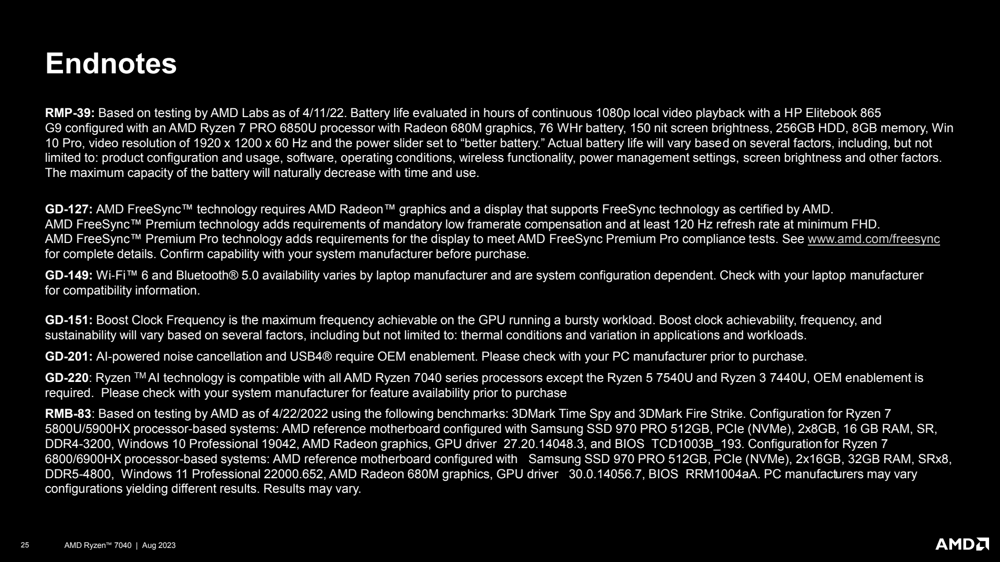

## Endnotes

RMP-39: Based on testing by AMD Labs as of 4/11/22. Battery life evaluated in hours of continuous 1080p local video playback with a HP Elitebook 865 G9 configured with an AMD Ryzen 7 PRO 6850U processor with Radeon 680M graphics, 76 WHr battery, 150 nit screen brightness, 256GB HDD, 8GB memory, Win 10 Pro, video resolution of 1920 x 1200 x 60 Hz and the power slider set to "better battery." Actual battery life will vary based on several factors, including, but not limited to: product configuration and usage, software, operating conditions, wireless functionality, power management settings, screen brightness and other factors. The maximum capacity of the battery will naturally decrease with time and use.

GD-127: AMD FreeSync™ technology requires AMD Radeon™ graphics and a display that supports FreeSync technology as certified by AMD. AMD FreeSync™Premium technology adds requirements of mandatory low framerate compensation and at least 120 Hz refresh rate at minimum FHD. AMD FreeSync™ PremiumPro technology adds requirements for the display to meet AMD FreeSync Premium Pro compliance tests. See www.amd.com/freesync for complete details. Confirm capability with your system manufacturer before purchase.

GD-149: Wi-Fi™ 6 and Bluetooth® 5.0 availability varies by laptop manufacturer and are system configuration dependent. Check with your laptop manufacturer for compatibility information.

GD-151: Boost Clock Frequency is the maximum frequency achievable on the GPU running a bursty workload. Boost clock achievability, frequency, and sustainability will vary based on several factors, including but not limited to: thermal conditions and variation in applications and workloads.

GD-201: AI-powered noise cancellation and USB4® require OEM enablement. Please check with your PC manufacturer prior to purchase.

GD-220: Ryzen TM AI technology is compatible with all AMD Ryzen 7040 series processors except the Ryzen 5 7540U and Ryzen 3 7440U, OEM enablement is required. Please check with your system manufacturer for feature availability prior to purchase

RMB-83: Based on testing by AMD as of 4/22/2022 using the following benchmarks: 3DMark Time Spy and 3DMark Fire Strike. Configuration for Ryzen 7 5800U/5900HX processor-based systems: AMD reference motherboard configured with Samsung SSD 970 PRO 512GB, PCIe (NVMe), 2x8GB, 16 GB RAM, SR, DDR4-3200, Windows 10 Professional 19042, AMD Radeon graphics, GPU driver 27.20.14048.3, and BIOS TCD1003B\_193. Configuration for Ryzen 7 6800/6900HX processor-based systems: AMD reference motherboard configured with Samsung SSD 970 PRO 512GB, PCIe (NVMe), 2x16GB, 32GB RAM, SRx8, DDR5-4800, Windows 11 Professional 22000.652, AMD Radeon 680M graphics, GPU driver 30.0.14056.7, BIOS RRM1004aA. PC manufacturers may vary configurations yielding different results. Results may vary.

<!-- p.26 -->

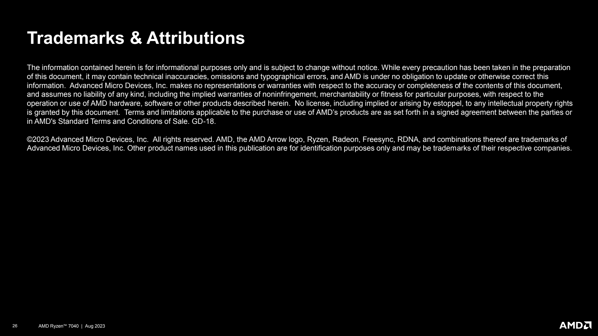

## Trademarks &amp; Attributions

The information contained herein is for informational purposes only and is subject to change without notice. While every precaution has been taken in the preparation of this document, it may contain technical inaccuracies, omissions and typographical errors, and AMD is under no obligation to update or otherwise correct this information. Advanced Micro Devices, Inc. makes no representations or warranties with respect to the accuracy or completeness of the contents of this document, and assumes no liability of any kind, including the implied warranties of noninfringement, merchantability or fitness for particular purposes, with respect to the operation or use of AMD hardware, software or other products described herein. No license, including implied or arising by estoppel, to any intellectual property rights is granted by this document. Terms and limitations applicable to the purchase or use of AMD's products are as set forth in a signed agreement between the parties or in AMD's Standard Terms and Conditions of Sale. GD-18.

©2023 Advanced Micro Devices, Inc. All rights reserved. AMD, the AMD Arrow logo, Ryzen, Radeon, Freesync, RDNA, and combinations thereof are trademarks of Advanced Micro Devices, Inc. Other product names used in this publication are for identification purposes only and may be trademarks of their respective companies.

<!-- p.27 -->

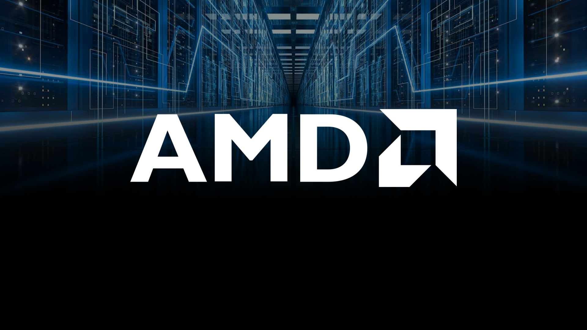

27

AMD Ryzen™ 7040 | Aug 2023
