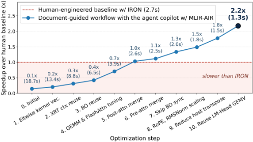
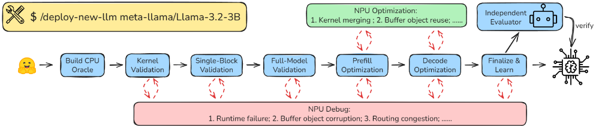

> 本文件由 `arXiv2606.07586-LLM-Deployment-Spatial-NPU.pdf` 自动转换（docling 2.140.0，2026-10-17）。图片在 `images/` 目录；表格与数字请以 PDF 原文为准；`<!-- p.N -->` 标记对应 PDF 第 N 页。

<!-- p.1 -->

## From Human Guidance to Autonomy: Agent Skill System for End-to-End LLM Deployment on Spatial NPUs

Jiajie Li Erwei Wang∗ Zhiru Zhang Samuel Bayliss∗

Cornell University ∗AMD

{jl4257, zhiruz}@cornell.edu ,{erwei.wang, samuel.bayliss}@amd.com

Abstract-Spatial neural processing units (NPUs) provide an energy-efficient platform for edge LLM inference, but efficiently deploying an LLM end-to-end on such hardware remains laborintensive. Although AI coding agents have begun to lower this cost, existing studies have largely focused on single-kernel optimization rather than end-to-end LLM deployment on resourceconstrained spatial NPUs.

We present a two-stage methodology, instantiated on the AMD XDNA™ 2 NPU, that progresses from human-guided development to agent autonomy. In the first stage, we develop a reference deployment of Llama-3.2-1B through human-guided agent assistance. The resulting implementation achieves a speedup of 2.2× on prefill and 4.0× on decode over the hand-optimized baseline, with the optimization trajectory and its lessons recorded as structured documentation throughout. In the second stage, we distill the documentation into an agent skill system consisting of eight phases, orchestrating the optimization and debugging skill sets, with numerical correctness strictly enforced at each phase.

Using our agent skill system, we autonomously deploy eight additional decoder-only LLMs (Llama-3.2-3B, SmolLM2-1.7B, Qwen2.5-{0.5B, 1.5B, 3B}, Qwen3-{0.6B, 1.7B, 4B}) end-toend on the AMD XDNA 2 NPU using the open-source compiler stack. To our knowledge, these models have not previously been deployed on AMD NPUs via any open-source software stack. Each deployment completes in 0.5-4 hours of agent wall time with almost no human guidance, and passes the numericalcorrectness gates, demonstrating functional generalization to previously unencountered LLMs. Three of the eight match or exceed the sustained performance of our Llama-3.2-1B reference deployment, suggesting that the resulting implementations can be competitive without additional model-specific human engineering.

## I. INTRODUCTION

Large language models are increasingly deployed at the edge for lower latency, stronger privacy, and offline operation. These settings impose strict power and thermal constraints, motivating the use of accelerators with higher energy efficiency than general-purpose CPUs or GPUs. Spatial neural processing units (NPUs) have emerged as a key class of accelerator for this regime.

Spatial NPUs achieve efficiency by exposing explicit hardware management to the software stack. Unlike processors with implicit cache hierarchies, spatial NPUs expose distributed on-chip memories, explicit data-movement scheduling, and tile-level kernel placement directly to the programmer.

Jiajie Li performed this work at AMD.

Deploying an LLM end-to-end onto NPUs with competitive performance typically takes substantial expert engineering to tackle all these challenges.

Agentic systems for accelerator programming [3], [6], [8], [9], [13]-[15] reduce engineering effort by automating kernel generation. However, no existing research primarily targets end-to-end LLM deployment on a resource-constrained spatial NPU. They also do not encode the full deployment workflow as composable Agent Skills [2] that can be invoked autonomously by a coding agent. We address both gaps for endto-end LLM deployment on the AMD XDNA™ 2 NPU [10].

Our approach consists of two stages, embodying a transition from human guidance to agent autonomy. In the first stage, we construct a reference Llama-3.2-1B on NPU with human guidance and agent assistance, and document the optimization trajectory and its lessons throughout. In the second stage, we distill the documentation into a reusable agent skill system that supports the autonomous deployment of additional LLMs. The paper makes three novel contributions:

- An end-to-end Llama-3.2-1B deployment on the AMD XDNA 2 NPU (§III) that achieves a speedup of 2.2× on prefill and 4.0× on decode over the hand-optimized baseline. The optimization trajectory and its lessons are maintained as documents throughout, forming the foundation of the skill system.
- An agent skill system for end-to-end LLM deployment on NPUs (§IV), comprising an eight-phase skill chain with strict numerical correctness gates, sets of optimization and debug skills that auto-trigger on common patterns, and an independent evaluator agent that re-runs every gate to prevent the generator from bypassing it.
- First open-source end-to-end deployment of eight additional LLMs on the AMD XDNA 2 NPU (§V): Llama3.2-3B, SmolLM2-1.7B, Qwen2.5-{0.5B, 1.5B, 3B}, and Qwen3-{0.6B, 1.7B, 4B}. Each deploys autonomously in 0.5-4 hours of agent wall time, with three of them matching or exceeding the sustained performance of our Llama-3.2-1B reference.

## II. BACKGROUND

Target hardware. We target the AMD XDNA 2 NPU in Ryzen™ AI 300/400 Series processors. Compute tiles are arranged in a 4×8 array, each with a 64KB L1 scratchpad.

<!-- p.2 -->

Each column also includes a 512KB memory tile (L2) shared by its four compute tiles, plus a shim tile bridging to host DDR. Compute tiles communicate via configurable streaming interconnects and cascade connections to neighbors.

Programming model. We program the NPU through MLIRAIR [12], a platform-agnostic compiler abstraction for spatial accelerators built on MLIR. MLIR-AIR defines the AIR dialect, which exposes the array's spatial structure as loop nests. AIR models spatial partitioning, temporal iteration, and intertile communication explicitly, exposing the main deployment decisions for an AI agent to inspect and modify.

IRON [7] is another programming abstraction that sits one layer closer to the hardware. It exposes compute tiles, memory tiles, and shim tiles directly, with data movement wired through ObjectFifos and DMA tasks. This gives expert programmers fine-grained control over tiling, double buffering, data layout, and pipeline placement, well suited for hand-tuned kernels.

Dato [4] raises the programming model to a task-based dataflow abstraction. It treats on-chip communication and data sharding as first-class program constructs, and expresses an application as a task graph. This shifts low-level tile binding and data movement to the compiler, improving productivity and portability.

LLMs on AMD XDNA NPU. AMD Ryzen AI Software [1] and FastFlowLM [5] deploy multiple LLMs on AMD XDNA NPUs, but they keep their NPU kernel implementation closedsource and primarily target quantized LLMs. Prior to our work, the only end-to-end LLM deployment with open-source NPU kernels and compiler stack is the BF16 Llama-3.2-1B example shipped with IRON, which we use as our baseline in §III. MLIR-AIR has no prior LLM deployment example.

Agent skills. Agent Skills [2] provide a portable format for encoding domain knowledge that a coding agent discovers and invokes autonomously. Community skill collections such as Superpowers [11] apply this format to general software engineering. To our knowledge, no existing skill set targets end-to-end LLM deployment on spatial NPUs.

## III. AGENT-ASSISTED MAPPING OF LLAMA-3.2-1B

This section describes how we mapped a BF16 Llama-3.21B end-to-end onto the AMD XDNA 2 NPU by working with an AI coding agent acting as our copilot. The deployment outperforms the human-engineered baseline by 2.2× on prefill and 4.0× on decode. We also maintain a set of documents that log experiences, caveats, and the performance optimization trajectory, which becomes the reusable foundation for the skill system in §IV.

## A. Document-Guided Workflow with a Coding Agent

Modern AI coding agents such as Claude Code can write code well, but on a long multi-session project they need a human to plan and direct, and a persistent way to remember what has been done. Development on the NPU makes this acute: tooling documentation is sparse, and opaque error messages surface frequently. Without a running record of decisions and debugging, every new session starts blind, easily redoing past work or breaking past fixes.

Fig. 1. Prefill optimization trajectory of Llama-3.2-1B (BF16, seq len=2048) on the AMD XDNA 2 NPU.

To avoid this, we pair a structured development plan with a set of Markdown documents alongside the code. The plan has two parts: first reach end-to-end functional correctness for prefill and decode, then optimize each path's performance separately. Across both stages, plan.md captures the overall strategy, progress.md tracks the current phase, and issues.md accumulates each non-obvious bug, its root cause, and the workaround applied. The performance stage adds perf\_opt\_traj.md, which logs every optimization attempt with measured before/after results, alongside perkernel design notes (gemm.md, attention.md, rope.md, . . . ) that record each kernel's design rationale, shape-specific tuning, tile configurations, and known pitfalls. The humanengineered baseline with IRON serves as the performance reference at every iteration, both per-kernel and end-to-end.

Throughout, the coding agent is Claude Code paired with Claude Opus 4.7 (1M context). The human directs and approves while the agent does the search, code edits, profiling, and tool runs. In each session, the agent reads the relevant documents to recover state, proposes the next step against the plan, executes it under human supervision, and updates the documents as work progresses. This documentation-first discipline keeps the workflow durable across sessions.

## B. Challenges and the Optimization Trajectory

Mapping the model end-to-end on NPU surfaced challenges in both correctness and performance. We kept correctness in check throughout the trajectory with a CPU FP32 reference, gating every kernel and block change against ground truth. Performance challenges fell into three categories, each addressed by specific steps in Figure 1.

(A) Kernel efficiency at production shapes. Reaching peak kernel performance requires several optimization techniques: vectorization (Step 1), shape-specific tile tuning (Step 4 GEMM), fused kernel design (Step 4 FlashAttention), and scaling with tile-array parallelism (Step 8). The main challenge is scaling kernels from validation shapes to production LLM shapes, where implementations must satisfy additional architectural and runtime constraints such as DMA-channel availability, L1/L2 memory capacity, and BufferObject descriptor limits. Cases that expose missing compiler coverage are reported upstream and resolved iteratively.

<!-- p.3 -->

(B) Reducing kernel dispatch overhead. NPU kernel dispatch has non-negligible overhead from the application, runtime, driver, firmware, and hardware layers. This overhead can exceed the kernel's actual execution time. We merged consecutive kernels into single dispatches. In prefill, we merged the eight-kernel post-attention block (Step 5: output projection + SwiGLU FFN) into one dispatch and the six-kernel preattention block (Step 6: RMSNorm + QKV projections + RoPE) into another, reducing per-layer dispatches from 15 to 3. The same merging applies to decode with GEMV variants. This merging also saves memory copies of intermediate activations between the NPU and the host.

(C) Host-side optimization. Host-side overheads such as context setup, buffer management, host-device data transfers, and layout transposes add up across many kernel calls. We reused the XRT context across calls (Step 2) and recycled per-layer buffer objects via zero-copy mapping (Step 3). We skipped redundant host-device transfers for buffers the NPU writes for static weights and intermediate activations (Step 7), and chose activation layouts that let consecutive kernels hand off without host-side transpose (Step 9). Finally, prefill writes only the last token's logits from the LM Head, removing a large NPU-to-host transfer of the full-sequence logits tensor (Step 10).

As a result, on a 2048-token sequence, prefill achieves a 2.2× speedup over IRON (commit 2b62dc7), with a time-tofirst-token (TTFT) of 1.3 s. Decode achieves a 4.0× speedup, reaching 10.8 tokens/s (TPS). The trajectory and its lessons are logged and distilled into reusable agent skills in the next section.

## IV. SKILL SYSTEM

Building on the experience of §III, we distill the maintained document set into a self-evolving agent skill system to automate the deployment of unencountered LLMs. Figure 2 shows the system and Table I catalogs each skill. Each maintained document maps to a skill component: plan.md and progress.md define the orchestrator and its phase skills, the per-kernel design notes (gemm.md, attention.md, . . . ) become a kernel registry used for Phase 1, perf\_opt\_traj.md becomes the optimization skills applied in Phase 4 and Phase 5, and issues.md turns into the auto-invoked debug skills.

The eight-phase decomposition mirrors the high-level plan we followed in §III. Phases 0-3 establish end-to-end functional correctness. Phase 0 pulls the HuggingFace (HF) model and decomposes it into a kernel-by-kernel CPU FP32 reference verified against the HF output. Phase 1 verifies each NPU kernel at the model's required shapes. Phase 2 wires those kernels into a single transformer block. Phase 3 cascades to the full N-layer model. Phases 4 and 5 invoke optimization skills from a shared skill set to address prefill and decode bottlenecks. Phase 6 integrates prefill and decode into a single inference runner, profiles the deployment to produce a performance report, and harvests new findings into lessons.md. Phase 7 spawns an independent evaluator agent without prior context to re-audit the deployment.

TABLE I ALL SKILLS IN THE SYSTEM, WITH THEIR TYPE AND PURPOSE.

| Skill                                                                                                                                                            | Type                                                            | Purpose                                                                                                                                                                                                                                                                    |
|------------------------------------------------------------------------------------------------------------------------------------------------------------------|-----------------------------------------------------------------|----------------------------------------------------------------------------------------------------------------------------------------------------------------------------------------------------------------------------------------------------------------------------|
| Deploy new LLM                                                                                                                                                   | Orchestrator                                                    | Scaffold workspace & dispatch phases                                                                                                                                                                                                                                       |
| Build CPU oracle Kernel validation Single-block validation Full-model validation Prefill optimization Decode optimization Finalize & learn Independent evaluator | Phase 0 Phase 1 Phase 2 Phase 3 Phase 4 Phase 5 Phase 6 Phase 7 | Decompose CPU FP32 oracle from HF Per-kernel verification vs oracle Single transformer block on NPU N-layer cascade & final logits check Apply prefill perf patterns Apply decode perf patterns Runner integration & lesson harvest Recheck every gate on a fresh subagent |
| Multi-kernel merging Buffer object reuse Layout alignment                                                                                                        | Optimization Optimization Optimization                          | Merge N kernels into one dispatch Load weights with zero-copy mapping Align layouts to skip host transposes                                                                                                                                                                |
| Runtime failure Buffer object corruption Routing congestion                                                                                                      | Debug Debug Debug                                               | Diagnose kernel hang at runtime Diagnose BO corruption runtime error Diagnose routing congestion hang                                                                                                                                                                      |

Each of Phases 0-6 closes with a strict numerical gate against the CPU FP32 reference, measuring absolute error, relative error, and Pearson correlation across the phase's output. The gate passes only if all three meet phase-specific thresholds. For Phases 4 and 5, the gate additionally requires that each optimization step measurably improves performance over the prior baseline. If the gate fails, the agent invokes a matching debug skill on a known symptom, or asks the user if the failure is a new one. If the gate passes, the agent stops at a human-in-the-loop checkpoint where the user reviews the phase output and either approves or redirects. Separating Phase 7's evaluator from the deploying agent prevents reward hacking [16]. The evaluator re-runs every numerical gate from scratch and re-profiles to verify that measured performance matches the profiling report submitted by the deploying agent. A fail verdict blocks final acceptance.

Two skill sets complement the phase pipeline: the optimization skills distilled from §III-B patterns, and the debug skills distilled from high-impact bug reports. Each set currently contains three entries, and both are expected to grow gradually. A new debugging fix or optimization pattern, once verified, becomes a new entry. At the end of Phase 6, new experiences are also harvested into lessons.md and fed back into the skill system for subsequent deployments to inherit.

## V. EVALUATION

Experiment setup. All deployments target the AMD XDNA 2 NPU in Ryzen AI 9 HX 370, programmed via MLIR-AIR. The coding agent is Claude Code paired with Claude Opus 4.7 at max reasoning effort. All evaluations use a sequence length of 2048.

With our skill system, we autonomously deploy eight additional decoder-only LLMs end-to-end. To our knowledge, these are the first open-source end-to-end LLM deployments on the AMD XDNA NPU, each completing in 0.5-4 hours with almost no human intervention. Human input is limited to picking among debug directions the agent proposes when it hits an unknown bug.

<!-- p.4 -->

Fig. 2. Overview of our skill system for end-to-end LLM deployment on NPU. The deploy-new-llm orchestrator dispatches eight phases. Phase 4 and 5 draw on optimization skills, and any phase can auto-invoke a debug skill on known failures. Phases 0-6 each close with a numerical gate against the CPU FP32 reference and a human-in-the-loop checkpoint. Phase 7 spawns an independent evaluator that re-audits the deployment from scratch.

TABLE II END-TO-END PERFORMANCE OF THE DEPLOYED LLMS ON THE AMD XDNA 2 NPU USING OUR AGENT SKILL SYSTEM. ηSCALE IS THE SUSTAINED PERFORMANCE ON THIS MODEL NORMALIZED TO LLAMA-3.2-1B'S. DEPLOY TIME (H) IS THE AGENT'S WALL CLOCK FOR ENTIRE DEPLOYMENT.

| Model         |   Config - L |   Config - dhead | Config - h/hkv   | Config - Attn.   |   Config - dmodel |   Config - dffn | Config - &#124;V &#124;   | Config - QKV bias   | Config - QK Norm   |   Prefill - TTFT (s) |   Prefill - ηscale |   Decode - TPS |   Decode - ηscale | Deploy time (h)   |
|---------------|--------------|------------------|------------------|------------------|-------------------|-----------------|---------------------------|---------------------|--------------------|----------------------|--------------------|----------------|-------------------|-------------------|
| Llama-3.2-1B† |           16 |               64 | 32/8             | GQA              |              2048 |            8192 | 128k                      | -                   | -                  |                  1.3 |               1.00 |           10.8 |              1.00 | -                 |
| Llama-3.2-3B  |           28 |              128 | 24/8             | GQA              |              3072 |            8192 | 128k                      | -                   | -                  |                  3.5 |               1.07 |            4.7 |              1.27 | 0.5∗              |
| SmolLM2-1.7B  |           24 |               64 | 32/32            | MHA              |              2048 |            8192 | 49k                       | -                   | -                  |                  2.1 |               1.02 |            7.3 |              1.22 | 0.5∗              |
| Qwen2.5-0.5B  |           24 |               64 | 14/2             | GQA              |               896 |            4864 | 152k                      | ✓                   | -                  |                  0.9 |               0.56 |            8.3 |              0.28 | 4.0∗              |
| Qwen2.5-1.5B  |           28 |              128 | 12/2             | GQA              |              1536 |            8960 | 152k                      | ✓                   | -                  |                  2.6 |               0.67 |            4.9 |              0.60 | 2.5∗              |
| Qwen2.5-3B    |           36 |              128 | 16/2             | GQA              |              2048 |           11008 | 152k                      | ✓                   | -                  |                  3.9 |               0.94 |            4.2 |              1.09 | 1.8               |
| Qwen3-0.6B    |           28 |              128 | 16/8             | GQA              |              1024 |            3072 | 152k                      | -                   | ✓                  |                  2.3 |               0.24 |           10.5 |              0.48 | 1.5∗              |
| Qwen3-1.7B    |           28 |              128 | 16/8             | GQA              |              2048 |            6144 | 152k                      | -                   | ✓                  |                  2.8 |               0.68 |            6.7 |              0.94 | 1.5∗              |
| Qwen3-4B      |           36 |              128 | 32/8             | GQA              |              2560 |            9728 | 152k                      | -                   | ✓                  |                  8.0 |               0.55 |            2.6 |              0.83 | 2.1               |

Table II reports the configurations and measured performance of the eight autonomously deployed LLMs alongside the Llama-3.2-1B reference. The set includes Multi-Head Attention (MHA) and Grouped-Query Attention (GQA), QKV bias (Qwen2.5 family), per-head Q/K normalization (Qwen3 family), and tensor shapes that are not always aligned to tile sizes. All eight LLMs pass all correctness gates and are also manually verified.

To assess how well the optimizations from our Llama-3.21B reference transferred to the autonomous deployments of previously unencountered LLMs with different configurations, we report ηscale for each model. ηscale is each new model's sustained performance relative to Llama-3.2-1B's on the same hardware. Performance here means achieved compute throughput for prefill (compute-bound) and achieved memory bandwidth for decode (memory-bound). ηscale captures hardware utilization rather than absolute latency, so it is comparable across model sizes. ηscale = 1 means this model runs the hardware as efficiently as the reference, ηscale &gt; 1 means it exceeds the reference, and ηscale &lt; 1 means lower efficiency. Full formulas and calibration are in Appendix A.

Across the eight deployed models, ηscale ranges 0.24-1.07

on prefill and 0.28-1.27 on decode. Three models (Llama-3.23B, SmolLM2-1.7B, Qwen2.5-3B) reach ηscale of 0.94-1.27 across both prefill and decode. All three share Llama-3.2-1B's basic transformer block (GQA or MHA over dmodel ≥ 2048 with dffn ≥ 8192) and differ only in size; the existing kernels handle them as-is, and their larger GEMMs amortize the perlaunch dispatch overhead identified in §III-B more effectively than on the reference. The remaining five models reach ηscale of 0.24-0.94, which we attribute to two compounding factors. First, several have small per-kernel work (Qwen3-0.6B has the smallest dffn in our set), so the per-launch dispatch overhead is not amortized. Second, the Qwen families introduce ops that the current kernels do not yet fuse into the projection launches (QKV bias for Qwen2.5, per-head Q/K normalization for Qwen3), and shapes not aligned to tile sizes require padding that wastes useful compute. Both are concrete targets for future kernel and agent skill iterations.

## VI. CONCLUSION AND FUTURE WORK

We presented a two-stage methodology for end-to-end LLM deployment on the AMD XDNA 2 NPU, embodying a transition from human guidance to agent autonomy. Stage one mapped Llama-3.2-1B with a coding-agent copilot, achieving 2.2× prefill and 4.0× decode speedups over the handoptimized baseline, while documenting the trajectory throughout. Stage two distilled the documentation into a reusable agent skill system, which we used to deliver the first open-source end-to-end deployment of eight additional LLMs on the AMD NPU. Each completes in 0.5-4 hours, with three matching or exceeding the reference's sustained performance.

<!-- p.5 -->

Several directions remain open. New skills can target additional performance avenues such as kernel fusion, quantization, and dataflow optimization. Architecture coverage can broaden to support sliding-window attention, Mixture-ofExperts, and Multi-head Latent Attention. The methodology can also extend to other spatial accelerators and coding agents.

## ACKNOWLEDGMENT

Jiajie Li and Zhiru Zhang were supported in part by NSF Award #2118709 and a research gift from AMD.

<!-- p.6 -->

## REFERENCES

- [1] AMD, "AMD Ryzen AI Software," https://www.amd.com/en/products/ software/ryzen-ai-software.html, 2026, accessed: 2026-04-30.
- [2] Anthropic, "Equipping Agents for the Real World with Agent Skills," Anthropic Engineering Blog, https://www.anthropic.com/engineering/ equipping-agents-for-the-real-world-with-agent-skills, 2025.
- [3] K. Cheng, L. Wang, J. Khuu, M. Saroufim, W. Chi, J. Wang, and J. Isaacson, "KernelAgent: Hardware-Guided GPU Kernel Optimization via Multi-Agent Orchestration," PyTorch Blog, https://pytorch.org/blog/kernelagent-hardware-guided-gpu-kerneloptimization-via-multi-agent-orchestration/, 2026.
- [4] S. Fang, H. Chen, N. Zhang, J. Li, H. Meng, A. Liu, and Z. Zhang, "Dato: A task-based programming model for dataflow accelerators," arXiv preprint arXiv:2509.06794, 2025.
- [5] FastFlowLM, "Run LLMs on AMD Ryzen™ AI NPUs in Minutes," https://fastflowlm.com/, 2026, accessed: 2026-04-30.
- [6] C. Hong, S. Bhatia, A. Cheung, and Y. S. Shao, "Autocomp: A Powerful and Portable Code Optimizer for Tensor Accelerators," 2025. [Online]. Available: https://arxiv.org/abs/2505.18574
- [7] E. Hunhoff, J. Melber, K. Denolf, A. Bisca, S. Bayliss, S. Neuendorffer, J. Fifield, J. Lo, P. Vasireddy, P. James-Roxby, and E. Keller, "Efficiency, Expressivity, and Extensibility in a Close-to-Metal NPU Programming Interface," in 2025 IEEE 33rd Annual International Symposium on FieldProgrammable Custom Computing Machines (FCCM). IEEE, 2025, pp. 85-94.
- [8] S. Kalade and G. Schelle, "NPUEval: Optimizing NPU Kernels with LLMs and Open Source Compilers," 2025. [Online]. Available: https://arxiv.org/abs/2507.14403
- [9] G. Liao, H. Qin, Y. Wang, A. Golden, M. Kuchnik, Y. Yetim, J. J. Ang, C. Fu, Y. He, S. Hsia, Z. Jiang, D. Li, U. Pashkevich, V. Puvvada, F. Shi, M. Steiner, R. Xiao, N. Yan, X. Yu, Z. Fang, R. Levenstein, K. Ho, H. Zhu, A. Hammond, R. Li, A. Mathews, K. Gondkar, A. Zainul-Abedin, K. Singh, H. Yu, W. Chi, B. Huang, S. Zhang, N. Weller, Z. Marine, W. Cook, C.-J. Wu, and G. Liu, "KernelEvolve: Scaling Agentic Kernel Coding for Heterogeneous AI Accelerators at Meta," 2026. [Online]. Available: https://arxiv.org/abs/2512.23236
- [10] A. Rico, S. Pareek, J. Cabezas, D. Clarke, B. Ozgul, F. Barat, Y. Fu, S. M¨unz, D. Stuart, P. Schlangen, P. Duarte, S. Date, I. Paul, J. Weng, S. Santan, V. Kathail, A. Sirasao, and J. Noguera, "AMD XDNA NPU in Ryzen AI Processors," IEEE Micro, vol. 44, no. 6, pp. 73-82, 2024.
- [11] J. Vincent, "Superpowers: An Agentic Skills Framework &amp; Software Development Methodology that Works," https://github.com/obra/ superpowers, 2026, accessed: 2026-04-30.
- [12] E. Wang, S. Bayliss, A. Bisca, Z. Blair, S. Chowdhary, K. Denolf, J. Fifield, B. Freiberger, E. Hunhoff, P. James-Roxby, J. Lo, J. Melber, S. Neuendorffer, E. Richter, A. Rosti, J. Setoain, G. Singh, E. Taka, P. Vasireddy, Z. Yu, N. Zhang, and J. Zhuang, "From Loop Nests to Silicon: Mapping AI Workloads onto AMD NPUs with MLIR-AIR," ACM Transactions on Reconfigurable Technology and Systems, 2025.
- [13] J. Wang, V. Joshi, S. Majumder, X. Chao, B. Ding, Z. Liu, P. P. Brahma, D. Li, Z. Liu, and E. Barsoum, "Geak: Introducing Triton Kernel AI Agent &amp; Evaluation Benchmarks," 2025. [Online]. Available: https://arxiv.org/abs/2507.23194
- [14] A. Wei, T. Sun, Y. Seenichamy, H. Song, A. Ouyang, A. Mirhoseini, K. Wang, and A. Aiken, "Astra: A Multi-Agent System for GPU Kernel Performance Optimization," 2025. [Online]. Available: https://arxiv.org/abs/2509.07506
- [15] G. Zhang, S. Zhu, A. Wei, Z. Song, A. Nie, Z. Jia, N. Vijaykumar, Y. Wang, and K. Olukotun, "AccelOpt: A Self-Improving LLM Agentic System for AI Accelerator Kernel Optimization," 2026. [Online]. Available: https://arxiv.org/abs/2511.15915
- [16] L. Zheng, W.-L. Chiang, Y. Sheng, S. Zhuang, Z. Wu, Y. Zhuang, Z. Lin, Z. Li, D. Li, E. Xing, H. Zhang, J. Gonzalez, and I. Stoica, "Judging LLM-as-a-Judge with MT-Bench and Chatbot Arena," in Advances in Neural Information Processing Systems, A. Oh, T. Naumann, A. Globerson, K. Saenko, M. Hardt, and S. Levine, Eds., vol. 36. Curran Associates, Inc., 2023, pp. 46595-46623. [Online]. Available: https://proceedings.neurips. cc/paper files/paper/2023/file/91f18a1287b398d378ef22505bf41832Paper-Datasets and Benchmarks.pdf

## APPENDIX

ηscale measures how efficiently a deployed model uses the NPU relative to our Llama-3.2-1B reference. Higher is better; ηscale &gt; 1 means that the deployed model exceeds the Llama3.2-1B reference. We define

<!-- formula-not-decoded -->

where W is the dominant work-FLOPs (F) for prefill, bytes (B) for decode-and t is the measured time. The numerator is sustained performance (achieved compute throughput for prefill, achieved memory bandwidth for decode); the denominator normalizes it to the reference. We estimate F and B below from the model configuration.

Prefill (compute-bound): F layer prefill . We estimate prefill FLOPs by counting the seven linear projections (QKV, O, and SwiGLU FFN's gate/up/down) and FlashAttention; embeddings, RoPE, and norms are negligible and dropped:

<!-- formula-not-decoded -->

The bracketed term sums the seven projections; 2S2dmodel is causal attention. GQA is captured through hkv (MHA is the special case hkv = h).

Decode (memory-bound): Blayer decode . At each generated token, the NPU loads the layer's weights from DRAM (re-loaded per token at batch=1) and reads the KV cache for the S past tokens. Other transfers-activation vectors, norm parameters, the new K/V written back-are orders of magnitude smaller and we drop them. With weights and KV cache both in BF16:

<!-- formula-not-decoded -->

The first term is the weight bytes (parameters from Eq. 2's bracket, ×2 for BF16); the second is the KV cache (K and V, each S × hkv × dhead BF16 elements).
