> 本文件由 `ESSCIRC2022-Eleftheriou-IMC.pdf` 自动转换（docling 2.140.0，2026-10-17）。每页的整页图在 `images/` 目录；表格与数字请以 PDF 原文为准；`<!-- p.N -->` 标记对应 PDF 第 N 页。

<!-- p.1 -->

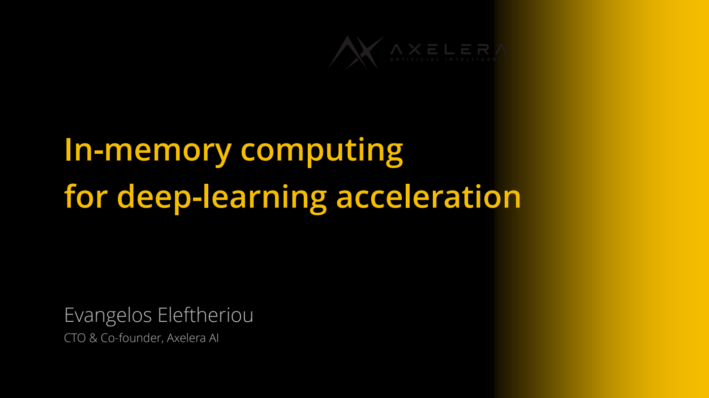

## In-memory computing for deep-learning acceleration

Evangelos Eleftheriou

CTO &amp; Co-founder, Axelera AI

<!-- p.2 -->

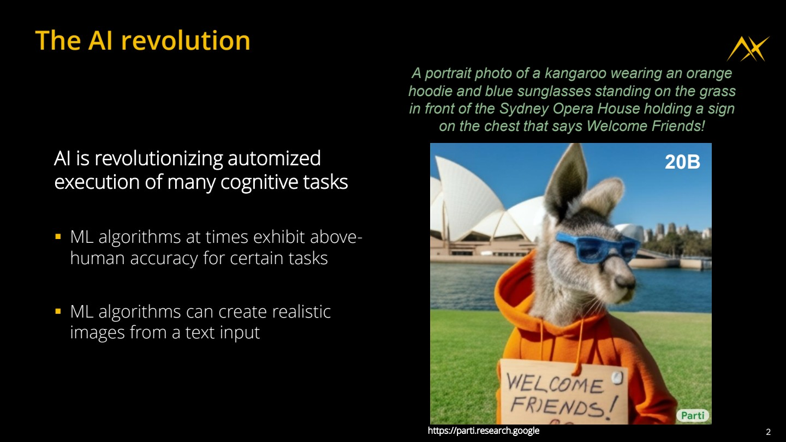

## The AI revolution

## AI is revolutionizing automized execution of many cognitive tasks

- ML algorithms at times exhibit abovehuman accuracy for certain tasks
- ML algorithms can create realistic images from a text input

A portrait photo of a kangaroo wearing an orange hoodie and blue sunglasses standing on the grass in front of the Sydney Opera House holding a sign on the chest that says Welcome Friends!

<!-- p.3 -->

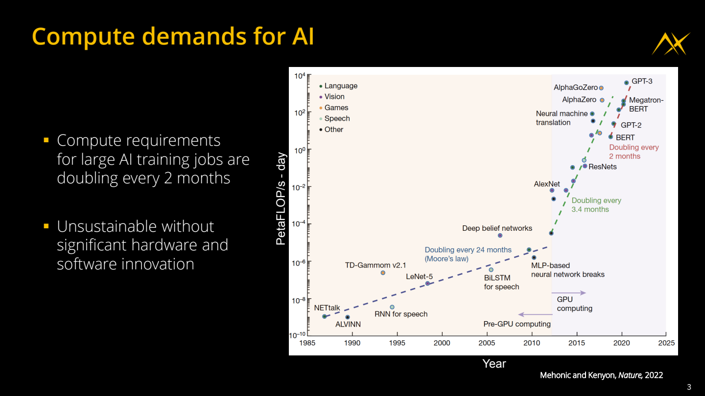

## Compute demands for AI

- Compute requirements for large AI training jobs are doubling every 2 months
- Unsustainable without significant hardware and software innovation

PetaFLOP/s - day

<!-- p.4 -->

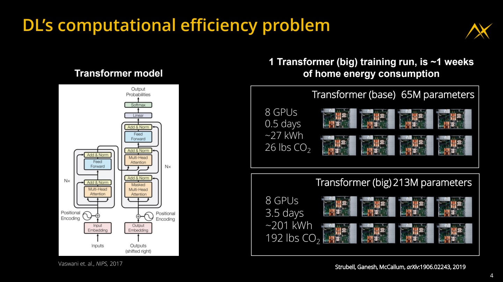

## DL's computational efficiency problem

## Transformer model

1 Transformer (big) training run, is ~1 weeks of home energy consumption

<!-- p.5 -->

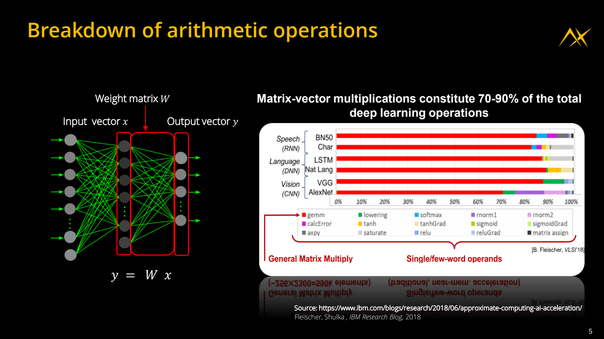

## Breakdown of arithmetic operations

𝑦 = 𝑊 𝑥

## Matrix-vector multiplications constitute 70-90% of the total deep learning operations

<!-- p.6 -->

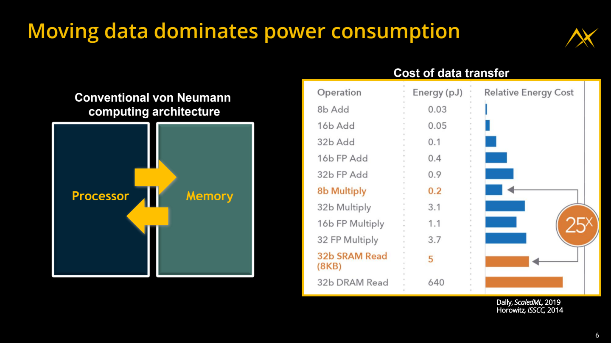

## Moving data dominates power consumption

## Cost of data transfer

<!-- p.7 -->

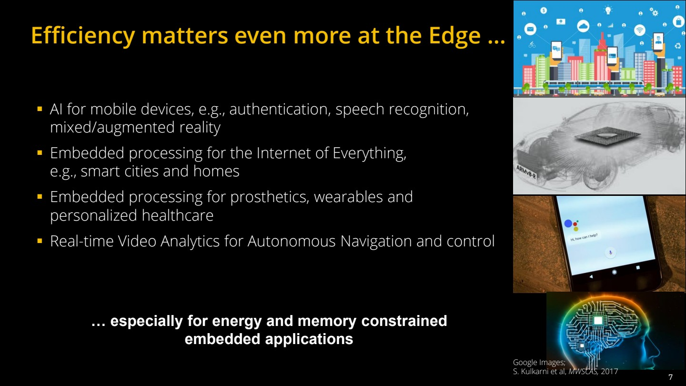

## Efficiency matters even more at the Edge …

- AI for mobile devices, e.g., authentication, speech recognition, mixed/augmented reality
- Embedded processing for the Internet of Everything, e.g., smart cities and homes
- Embedded processing for prosthetics, wearables and personalized healthcare
- Real-time Video Analytics for Autonomous Navigation and control

… especially for energy and memory constrained embedded applications

<!-- p.8 -->

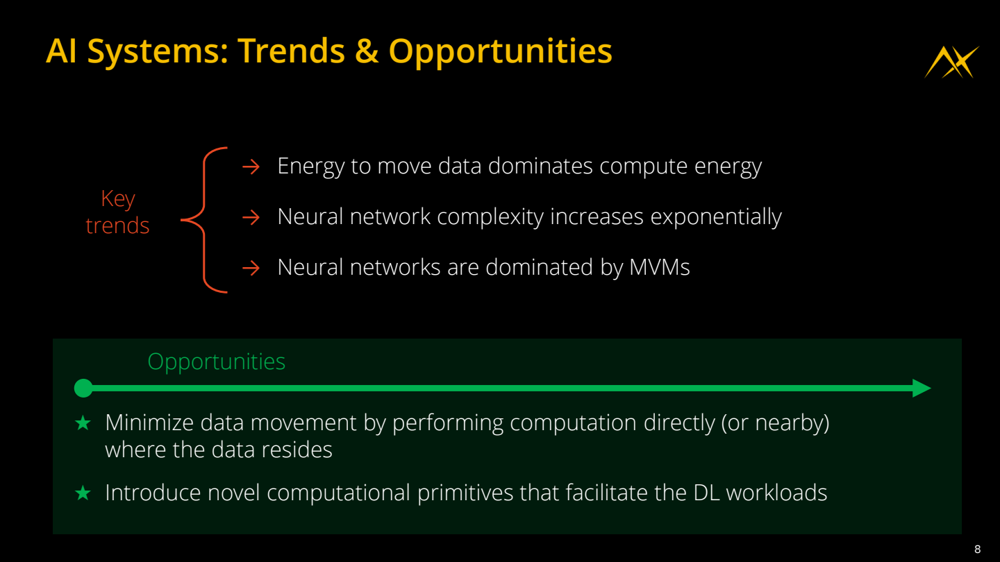

## AI Systems: Trends &amp; Opportunities

- → Energy to move data dominates compute energy
- → Neural network complexity increases exponentially
- → Neural networks are dominated by MVMs

## Opportunities

- ★ Minimize data movement by performing computation directly (or nearby) where the data resides
- ★ Introduce novel computational primitives that facilitate the DL workloads

## Key trends

<!-- p.9 -->

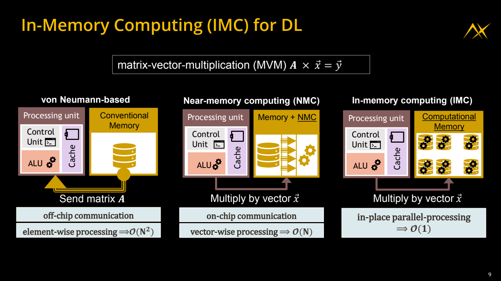

## In-Memory Computing (IMC) for DL

matrix-vector-multiplication (MVM) 𝑨 × Ԧ𝑥 = Ԧ𝑦

## von Neumann-based

## Near-memory computing (NMC)

## In-memory computing (IMC)

<!-- p.10 -->

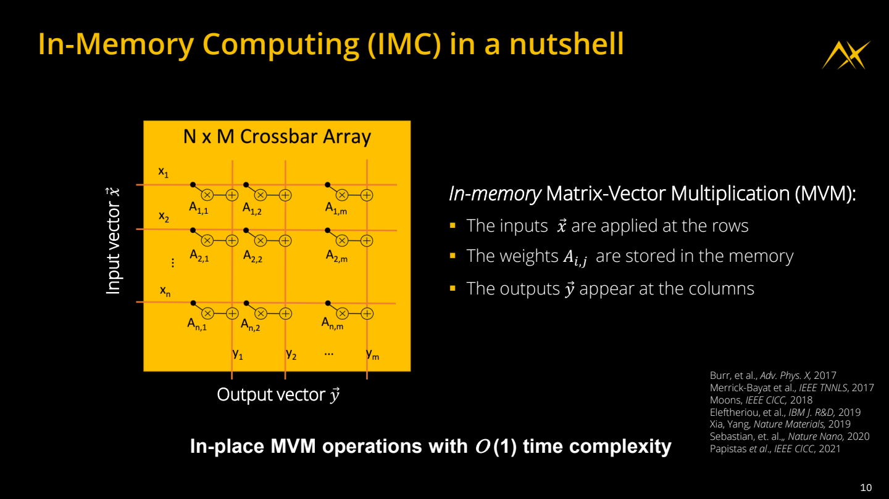

## In-Memory Computing (IMC) in a nutshell

## In-memory Matrix-Vector Multiplication (MVM):

- The inputs Ԧ𝑥 are applied at the rows
- The weights 𝐴𝑖,𝑗 are stored in the memory
- The outputs Ԧ𝑦 appear at the columns

In-place MVM operations with O (1) time complexity Xia, Yang, Nature Materials, 2019 Eleftheriou, et al., IBM J. R&amp;D, 2019 Sebastian, et. al.,, Nature Nano, 2020 Merrick-Bayat et al., IEEE TNNLS, 2017 Papistas et al., IEEE CICC, 2021 Burr, et al., Adv. Phys. X, 2017 Moons, IEEE CICC, 2018

<!-- p.11 -->

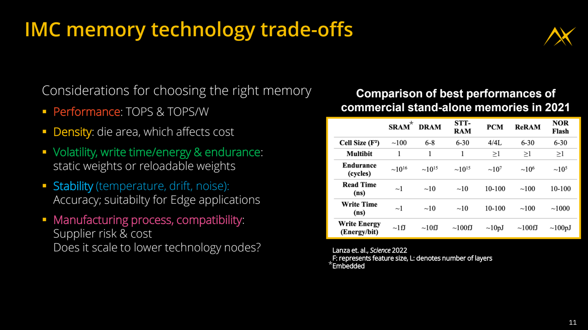

## IMC memory technology trade-offs

Considerations for choosing the right memory

- Performance: TOPS &amp; TOPS/W
- Density: die area, which affects cost
- Volatility, write time/energy &amp; endurance: static weights or reloadable weights
- Stability (temperature, drift, noise): Accuracy; suitabilty for Edge applications
- Manufacturing process, compatibility: Supplier risk &amp; cost Does it scale to lower technology nodes?

## Comparison of best performances of commercial stand-alone memories in 2021

| *   |
|-----|

Lanza et. al., Science 2022 F: represents feature size, L: denotes number of layers Embedded *

<!-- p.12 -->

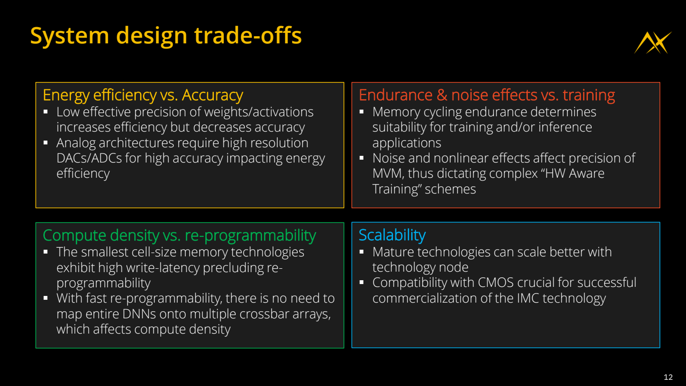

## System design trade-offs

## Energy efficiency vs. Accuracy

- Low effective precision of weights/activations increases efficiency but decreases accuracy
- Analog architectures require high resolution DACs/ADCs for high accuracy impacting energy efficiency

## Compute density vs. re-programmability

- The smallest cell-size memory technologies exhibit high write-latency precluding reprogrammability
- With fast re-programmability, there is no need to map entire DNNs onto multiple crossbar arrays, which affects compute density

## Endurance &amp; noise effects vs. training

- Memory cycling endurance determines suitability for training and/or inference applications
- Noise and nonlinear effects affect precision of MVM, thus dictating complex "HW Aware Training" schemes

## Scalability

- Mature technologies can scale better with technology node
- Compatibility with CMOS crucial for successful commercialization of the IMC technology

<!-- p.13 -->

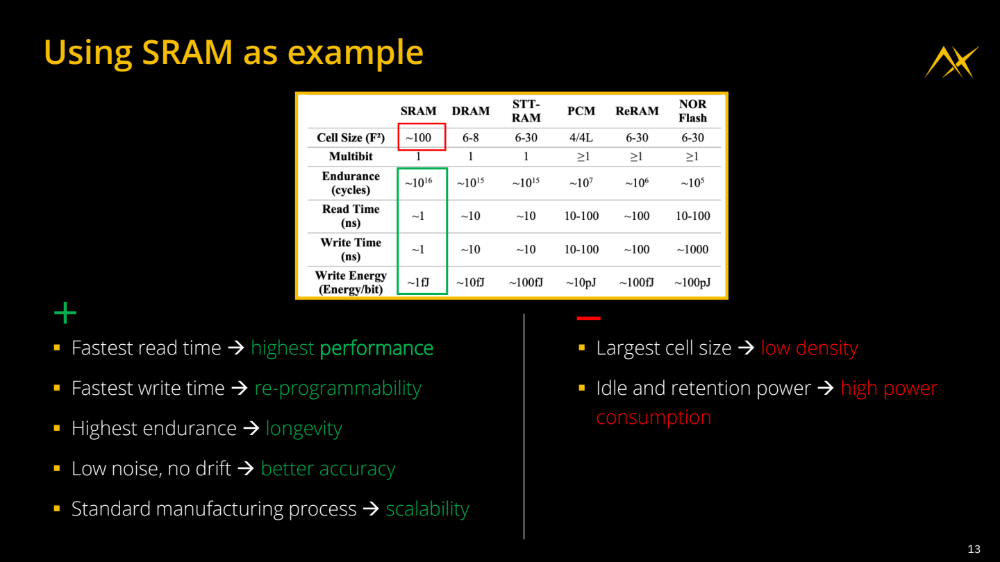

## Using SRAM as example

+

- Fastest read time →highest performance
- Fastest write time → re-programmability
- Highest endurance → longevity
- Low noise, no drift →better accuracy
- Standard manufacturing process → scalability

⎼

- Largest cell size→ low density
- Idle and retention power →high power consumption

<!-- p.14 -->

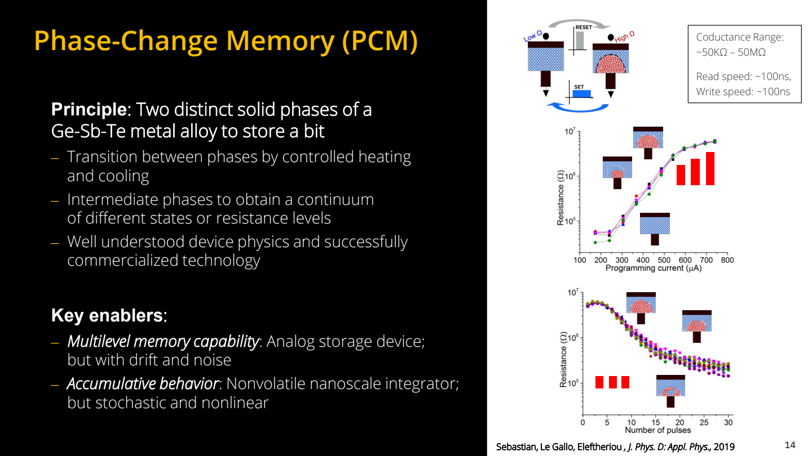

## Phase-Change Memory (PCM)

## Principle: Two distinct solid phases of a Ge-Sb-Temetal alloy to store a bit

- ⎼ Transition between phases by controlled heating and cooling
- ⎼ Intermediate phases to obtain a continuum of different states or resistance levels
- ⎼ Well understood device physics and successfully commercialized technology

## Key enablers:

- ⎼ Multilevel memory capability: Analog storage device; but with drift and noise
- ⎼ Accumulative behavior: Nonvolatile nanoscale integrator; but stochastic and nonlinear

Coductance Range: ~50KΩ - 50MΩ

Read speed: ~100ns,

Write speed: ~100ns

<!-- p.15 -->

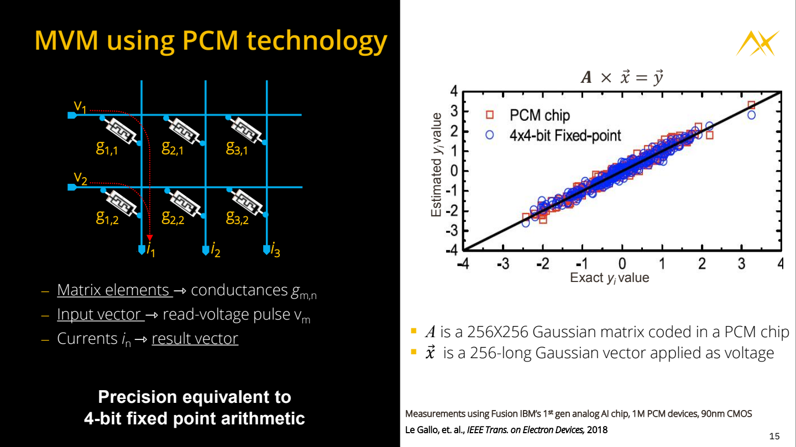

## MVM using PCM technology

- ⎼ Matrix elements ⇾ conductances g m,n
- ⎼ Input vector ⇾ read-voltage pulse v m
- ⎼ Currents i n ⇾ result vector

Precision equivalent to 4-bit fixed point arithmetic

- A is a 256X256 Gaussian matrix coded in a PCM chip
- Ԧ𝑥 is a 256-long Gaussian vector applied as voltage

<!-- p.16 -->

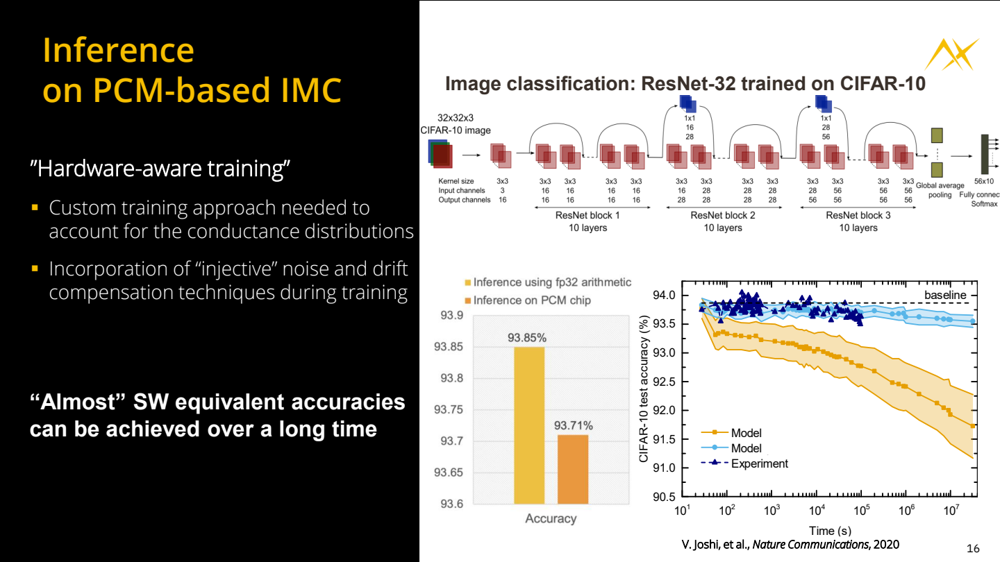

## Inference on PCM-based IMC

## "Hardware-aware training"

- Custom training approach needed to account for the conductance distributions
- Incorporation of "injective" noise and drift compensation techniques during training

"Almost" SW equivalent accuracies can be achieved over a long time

## Image classification: ResNet-32 trained on CIFAR-10

<!-- p.17 -->

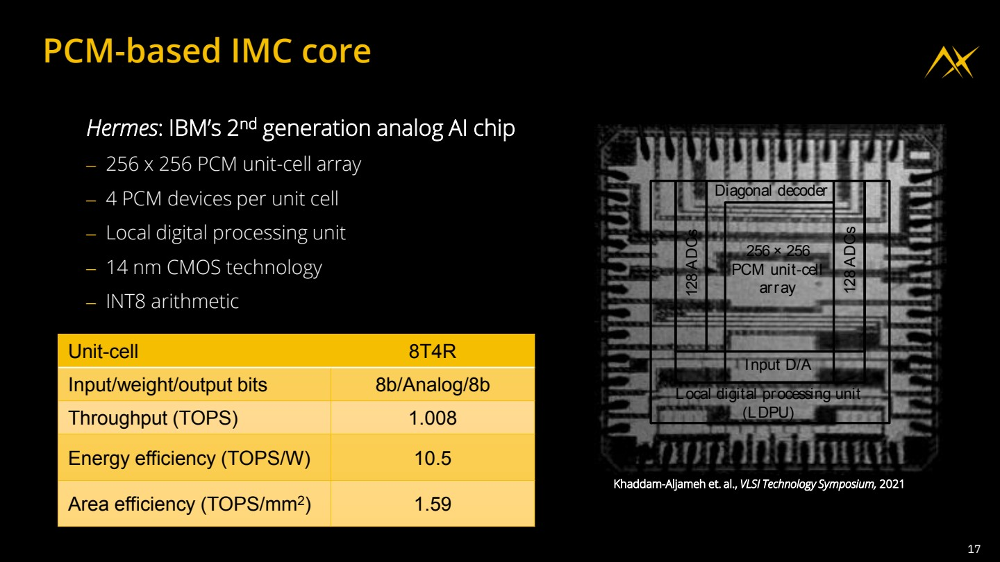

## PCM-based IMC core

Hermes: IBM's 2 nd generation analog AI chip

- ⎼ 256 x 256 PCM unit-cell array
- ⎼ 4 PCM devices per unit cell
- ⎼ Local digital processing unit
- ⎼ 14 nm CMOS technology
- ⎼ INT8 arithmetic

| Unit-cell                    | 8T4R         |
|------------------------------|--------------|
| Input/weight/output bits     | 8b/Analog/8b |
| Throughput (TOPS)            | 1.008        |
| Energy efficiency (TOPS/W)   | ▪ 10.5       |
| Area efficiency (TOPS/mm 2 ) | 1.59         |

Hermes Core Micrograph Syst Tr

. . .

▪ A is a 256X256 Gaussian matrix coded in a PCM chip

▪ x is a 256-long Gaussian vector applied as voltage Khaddam-Aljameh et. al., VLSI Technology Symposium, 2021

8T4Runit-cell circuit

VBL P VBL N

layout TE

<!-- p.18 -->

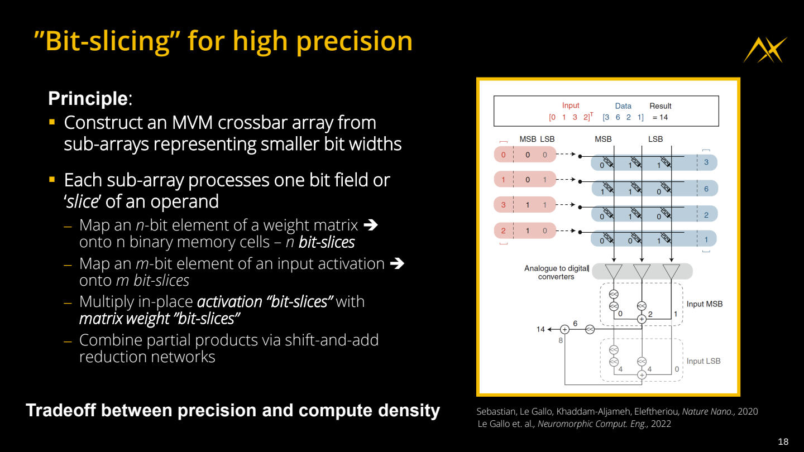

## "Bit-slicing" for high precision

## Principle:

- Construct an MVM crossbar array from sub-arrays representing smaller bit widths
- Each sub-array processes one bit field or 'slice' of an operand
- TQ ⎼ Map an n-bit element of a weight matrix ➔ onto n binary memory cells - n bit-slices
- ⎼ Map an m-bit element of an input activation ➔ onto m bit-slices
- ⎼ Multiply in-place activation "bit-slices" with matrix weight "bit-slices"
- ⎼ Combine partial products via shift-and-add reduction networks

▪ A is a 256X256 Gaussian matrix coded in a PCM chip

▪ x is a 256-long Gaussian vector applied as voltage

<!-- p.19 -->

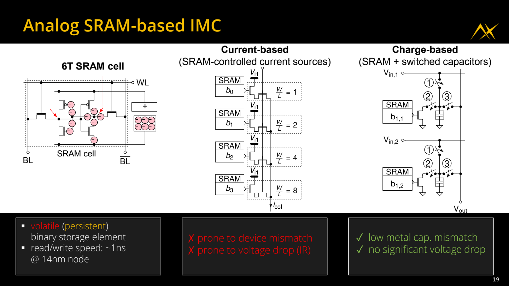

## Analog SRAM-based IMC

## Current-based

(SRAM-controlled current sources)

## Charge-based

(SRAM + switched capacitors)

✗prone to device mismatch ✗prone to voltage drop (IR)

- low metal cap. mismatch
- no significant voltage drop

1

## 0 6T SRAM cell

- volatile (persistent) binary storage element
- read/write speed: ~1ns @ 14nm node

<!-- p.20 -->

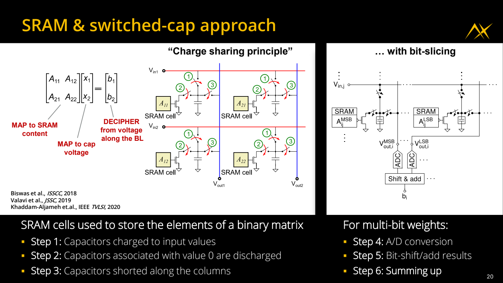

## SRAM &amp; switched-cap approach

## "Charge sharing principle"

## … with bit-slicing

## SRAM cells used to store the elements of a binary matrix

- Step 1: Capacitors charged to input values
- Step 2: Capacitors associated with value 0 are discharged
- Step 3: Capacitors shorted along the columns

## For multi-bit weights:

- Step 4: A/D conversion
- Step 5: Bit-shift/add results
- Step 6: Summing up

<!-- p.21 -->

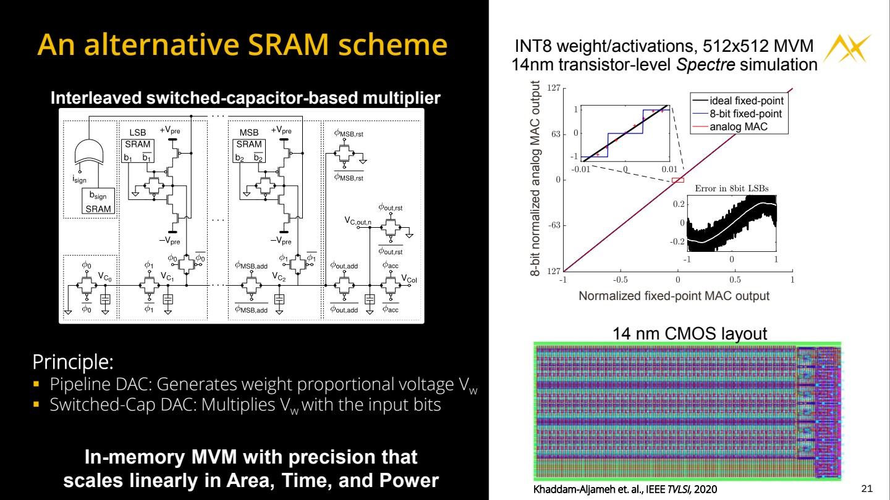

## An alternative SRAM scheme

## Interleaved switched-capacitor-based multiplier

## Principle:

- Pipeline DAC: Generates weight proportional voltage V w
- Switched-Cap DAC: Multiplies V w with the input bits

In-memory MVM with precision that scales linearly in Area, Time, and Power

## INT8 weight/activations, 512x512 MVM 14nm transistor-level Spectre simulation

## 14 nm CMOS layout

<!-- p.22 -->

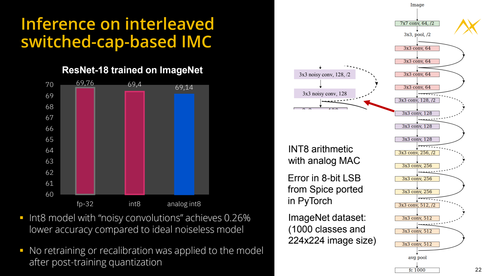

## Inference on interleaved switched-cap-based IMC

## ResNet-18 trained on ImageNet

- Int8 model with "noisy convolutions" achieves 0.26% lower accuracy compared to ideal noiseless model
- No retraining or recalibration was applied to the model after post-training quantization

<!-- p.23 -->

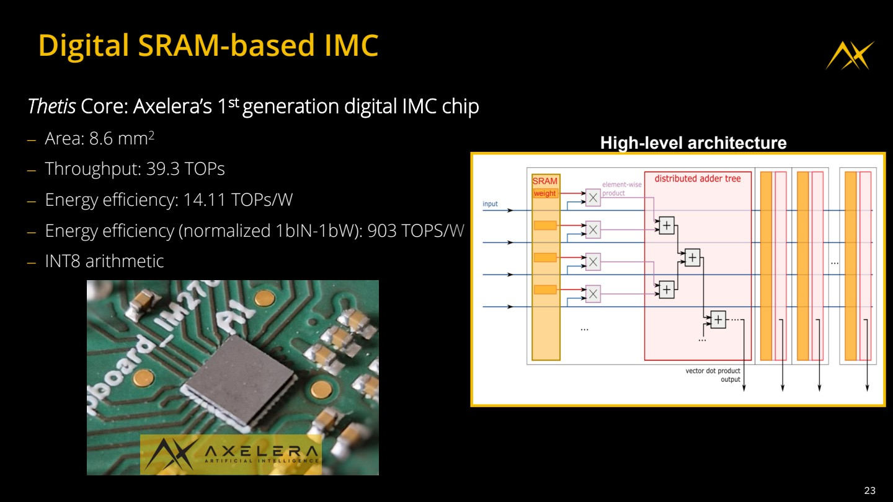

## Digital SRAM-based IMC

## Thetis Core: Axelera's 1 st generation digital IMC chip

- ⎼ Area: 8.6 mm 2
- ⎼ Throughput: 39.3 TOPs
- ⎼ Energy efficiency: 14.11 TOPs/W
- ⎼ Energy efficiency (normalized 1bIN-1bW): 903 TOPS/W
- ⎼ INT8 arithmetic

## High-level architecture

<!-- p.24 -->

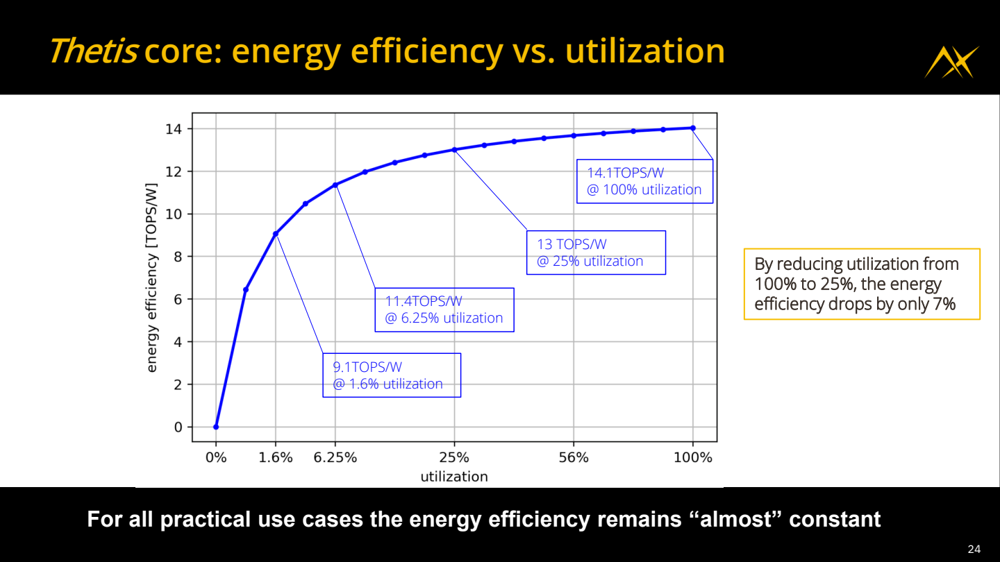

## Thetis core: energy efficiency vs. utilization

By reducing utilization from 100% to 25%, the energy efficiency drops by only 7%

<!-- p.25 -->

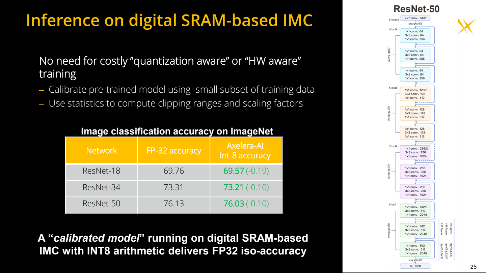

## Inference on digital SRAM-based IMC

No need for costly "quantization aware" or "HW aware" training

- ⎼ Calibrate pre-trained model using small subset of training data
- ⎼ Use statistics to compute clipping ranges and scaling factors

## Image classification accuracy on ImageNet

| Network   |   FP-32 accuracy | Axelera-AI Int-8 accuracy   |
|-----------|------------------|-----------------------------|
| ResNet-18 |            69.76 | 69.57 (-0.19)               |
| ResNet-34 |            73.31 | 73.21 (-0.10)               |
| ResNet-50 |            76.13 | 76.03 (-0.10)               |

A "calibrated model" running on digital SRAM-based IMC with INT8 arithmetic delivers FP32 iso-accuracy

## ResNet-50

14 nm CMOS layout

<!-- p.26 -->

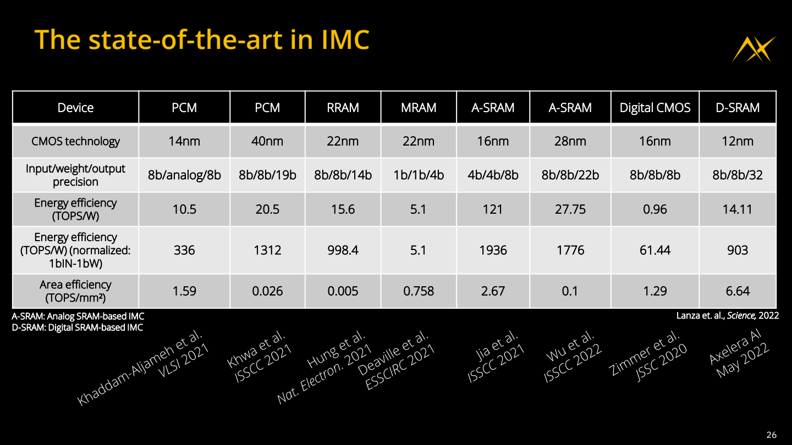

## The state-of-the-art in IMC

| Device                                            | PCM          | PCM       | RRAM      | MRAM     | A-SRAM   | A-SRAM    | Digital CMOS   | D-SRAM   |
|---------------------------------------------------|--------------|-----------|-----------|----------|----------|-----------|----------------|----------|
| CMOS technology                                   | 14nm         | 40nm      | 22nm      | 22nm     | 16nm     | 28nm      | 16nm           | 12nm     |
| Input/weight/output precision                     | 8b/analog/8b | 8b/8b/19b | 8b/8b/14b | 1b/1b/4b | 4b/4b/8b | 8b/8b/22b | 8b/8b/8b       | 8b/8b/32 |
| Energy efficiency (TOPS/W)                        | 10.5         | 20.5      | 15.6      | 5.1      | 121      | 27.75     | 0.96           | 14.11    |
| Energy efficiency (TOPS/W) (normalized: 1bIN-1bW) | 336          | 1312      | 998.4     | 5.1      | 1936     | 1776      | 61.44          | 903      |
| Area efficiency (TOPS/mm²)                        | 1.59         | 0.026     | 0.005     | 0.758    | 2.67     | 0.1       | 1.29           | 6.64     |

A-SRAM: Analog SRAM-based IMC D-SRAM: Digital SRAM-based IMC

Lanza et. al., Science, 2022

<!-- p.27 -->

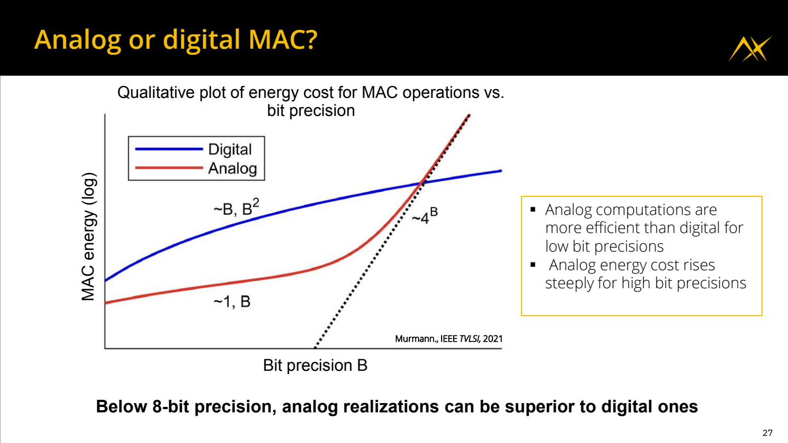

## Analog or digital MAC?

MAC energy (log)

- Analog computations are more efficient than digital for low bit precisions
- Analog energy cost rises steeply for high bit precisions

Below 8-bit precision, analog realizations can be superior to digital ones

<!-- p.28 -->

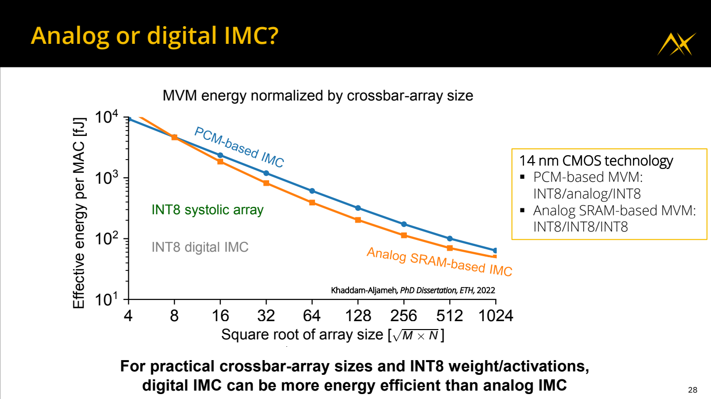

## Analog or digital IMC?

## MVM energy normalized by crossbar-array size

## 14 nm CMOS technology

- PCM-based MVM: INT8/analog/INT8
- Analog SRAM-based MVM: INT8/INT8/INT8

8 16 32 64 128 256 512 1024

For practical crossbar-array sizes and INT8 weight/activations, digital IMC can be more energy efficient than analog IMC

<!-- p.29 -->

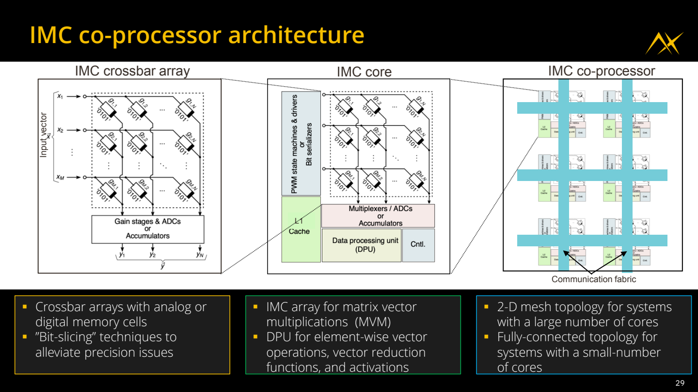

## IMC co-processor architecture

- Crossbar arrays with analog or digital memory cells
- "Bit-slicing" techniques to alleviate precision issues
- IMC array for matrix vector multiplications (MVM)
- DPU for element-wise vector operations, vector reduction functions, and activations
- 2-D mesh topology for systems with a large number of cores
- Fully-connected topology for systems with a small-number of cores

<!-- p.30 -->

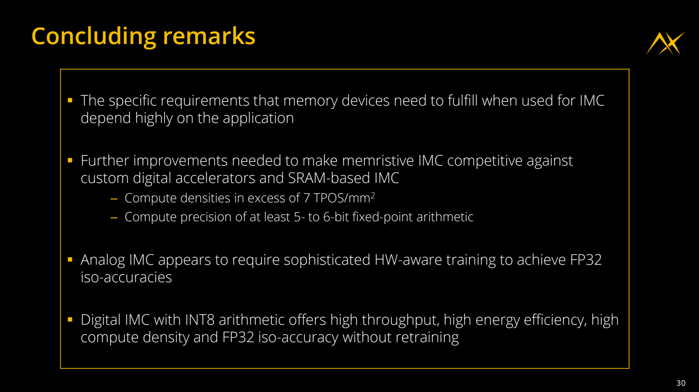

## Concluding remarks

- The specific requirements that memory devices need to fulfill when used for IMC depend highly on the application
- Further improvements needed to make memristive IMC competitive against custom digital accelerators and SRAM-based IMC
- Compute densities in excess of 7 TPOS/mm 2
- Compute precision of at least 5- to 6-bit fixed-point arithmetic
- Analog IMC appears to require sophisticated HW-aware training to achieve FP32 iso-accuracies
- Digital IMC with INT8 arithmetic offers high throughput, high energy efficiency, high compute density and FP32 iso-accuracy without retraining
