> 本文件由 `EdgeAI2024-Axelera-Verhoef-DIMC.pdf` 自动转换（docling 2.140.0，2026-10-17）。每页的整页图在 `images/` 目录；表格与数字请以 PDF 原文为准；`<!-- p.N -->` 标记对应 PDF 第 N 页。

<!-- p.1 -->

## How Axelera AI Uses Digital Compute-in-Memory to Deliver Fast and EnergyEfficient Computer Vision

Head of Machine Learning &amp; Co-Founder

Bram Verhoef Axelera AI

<!-- p.2 -->

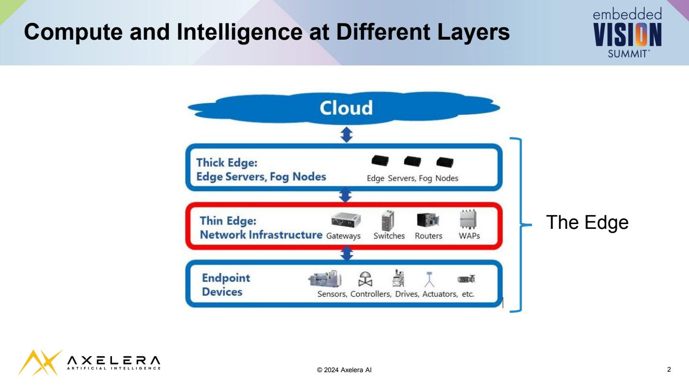

## Compute and Intelligence at Different Layers

<!-- p.3 -->

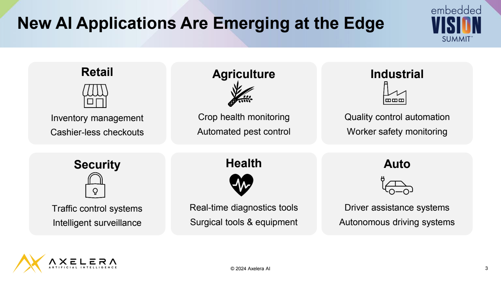

## New AI Applications Are Emerging at the Edge

## Retail

Inventory management Cashier-less checkouts

## Security

## Agriculture

Crop health monitoring Automated pest control

## Health

## Industrial

Quality control automation Worker safety monitoring

## Auto

Traffic control systems Intelligent surveillance Real-time diagnostics tools Surgical tools &amp; equipment Driver assistance systems Autonomous driving systems

<!-- p.4 -->

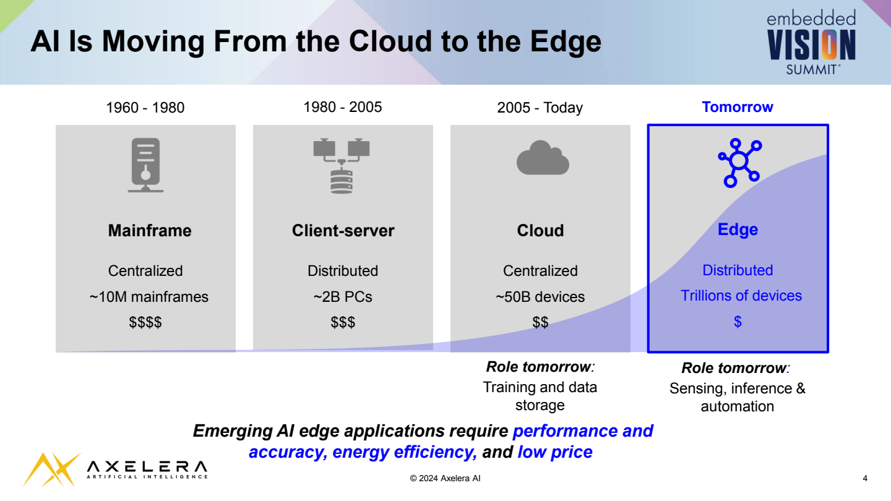

## ΑΙ Is Moving From the Cloud to the Edge

1960 - 1980

1980 - 2005

2005 - Today

## Tomorrow

## Client-server

Distributed ~2B PCs $$$

## Role tomorrow:

Training and data storage

Emerging AI edge applications require performance and accuracy, energy efficiency, and low price Role tomorrow:

Sensing, inference &amp; automation

<!-- p.5 -->

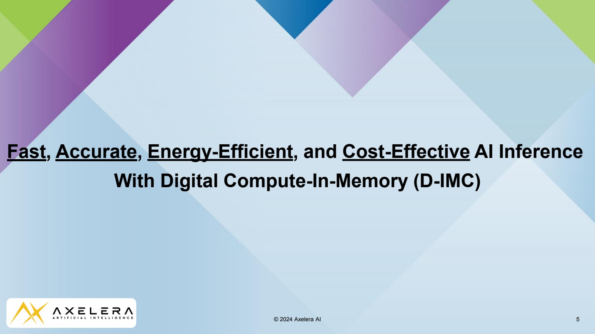

## Fast, Accurate, Energy-Efficient, and Cost-EffectiveAI Inference With Digital Compute-In-Memory (D-IMC)

<!-- p.6 -->

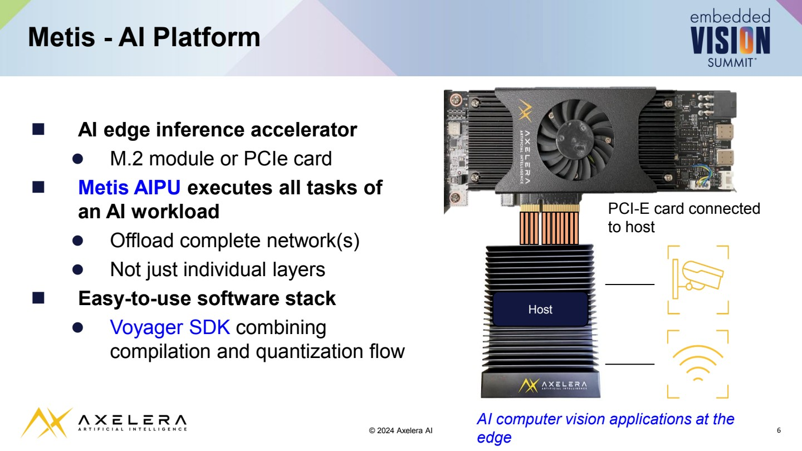

## Metis - AI Platform

-  AI edge inference accelerator
-  M.2 module or PCIe card
-  Metis AIPU executes all tasks of an AI workload
-  Offload complete network(s)
-  Not just individual layers
-  Easy-to-use software stack
-  Voyager SDK combining compilation and quantization flow

<!-- p.7 -->

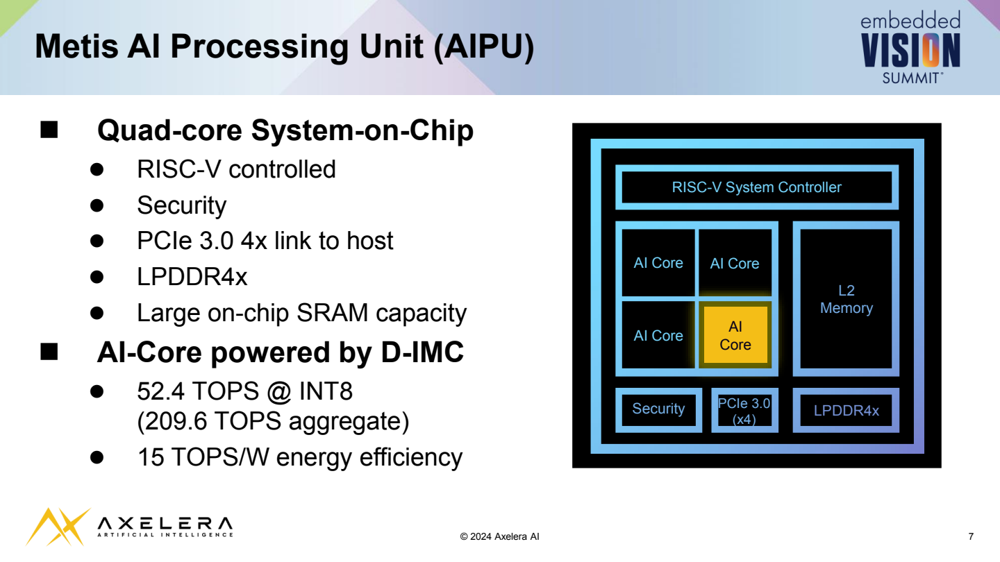

## Metis AI Processing Unit (AIPU)

##  Quad-core System-on-Chip

-  RISC-V controlled
-  Security
-  PCIe 3.0 4x link to host
-  LPDDR4x
-  Large on-chip SRAM capacity

##  AI-Core powered by D-IMC

-  52.4 TOPS @ INT8 (209.6 TOPS aggregate)
-  15 TOPS/W energy efficiency

<!-- p.8 -->

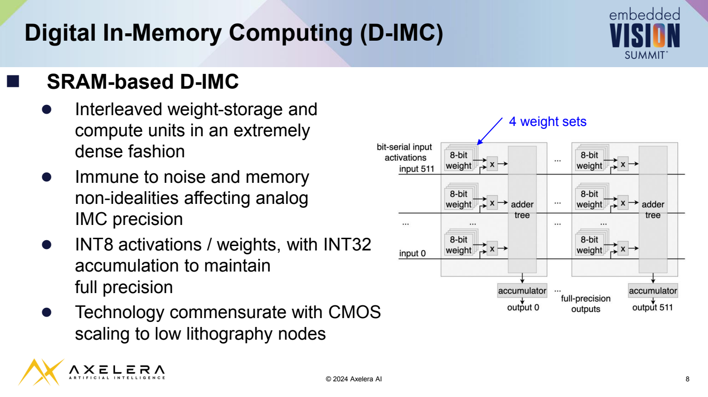

## Digital In-Memory Computing (D-IMC)

##  SRAM-based D-IMC

-  Interleaved weight-storage and compute units in an extremely dense fashion
-  Immune to noise and memory non-idealities affecting analog IMC precision
-  INT8 activations / weights, with INT32 accumulation to maintain full precision
-  Technology commensurate with CMOS scaling to low lithography nodes

<!-- p.9 -->

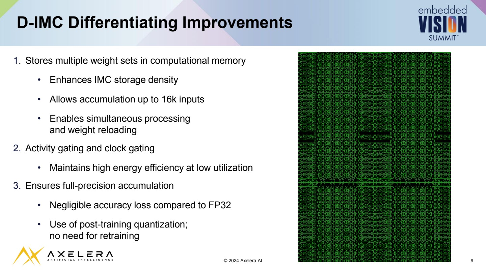

## D-IMC Differentiating Improvements

1. Stores multiple weight sets in computational memory
- Enhances IMC storage density
- Allows accumulation up to 16k inputs
- Enables simultaneous processing and weight reloading
2. Activity gating and clock gating
- Maintains high energy efficiency at low utilization
3. Ensures full-precision accumulation
- Negligible accuracy loss compared to FP32
- Use of post-training quantization; no need for retraining

<!-- p.10 -->

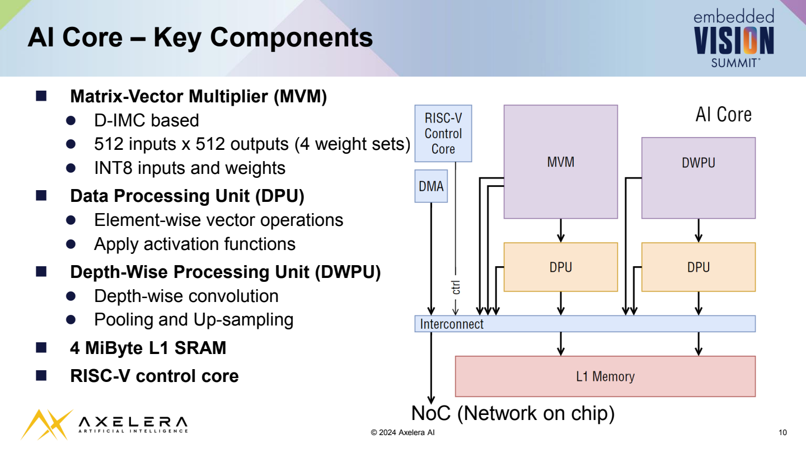

## AI Core - Key Components

##  Matrix-Vector Multiplier (MVM)

-  D-IMC based
-  512 inputs x 512 outputs (4 weight sets)
-  INT8 inputs and weights
-  Data Processing Unit (DPU)
-  Element-wise vector operations
-  Apply activation functions
-  Depth-Wise Processing Unit (DWPU)
-  Depth-wise convolution
-  Pooling and Up-sampling
-  4 MiByte L1 SRAM
-  RISC-V control core

<!-- p.11 -->

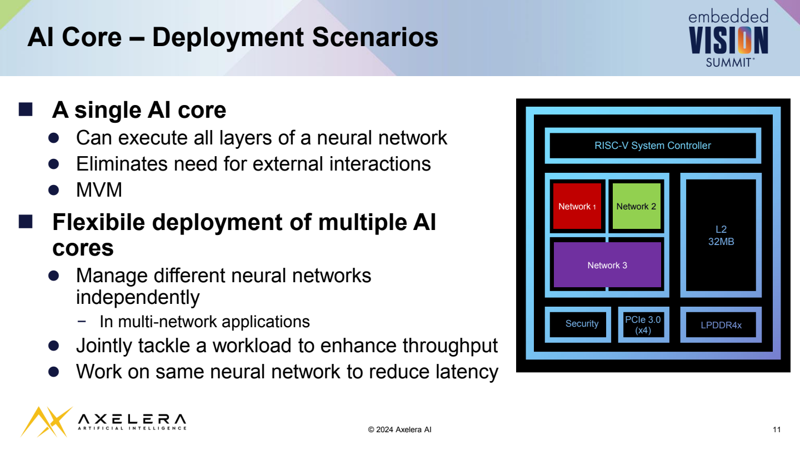

## AI Core - Deployment Scenarios

##  A single AI core

-  Can execute all layers of a neural network
-  Eliminates need for external interactions
-  MVM

##  Flexibile deployment of multiple AI cores

-  Manage different neural networks independently
- In multi-network applications
-  Jointly tackle a workload to enhance throughput
-  Work on same neural network to reduce latency

<!-- p.12 -->

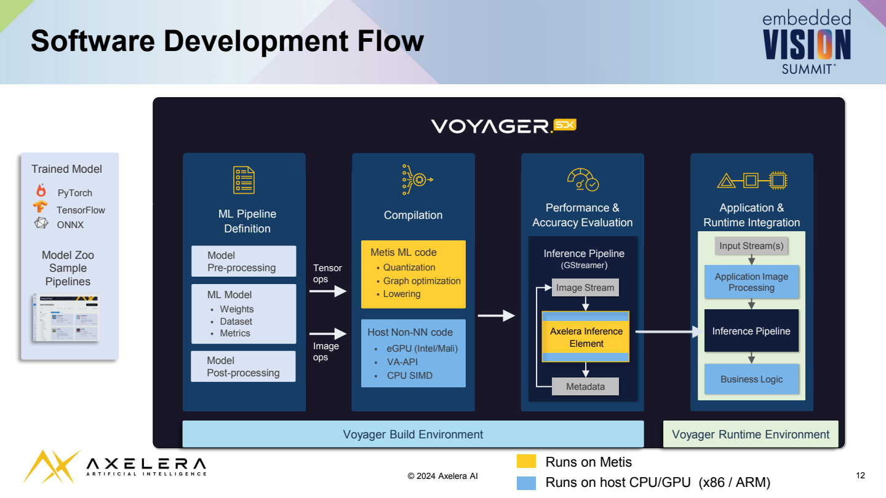

## Software Development Flow

<!-- p.13 -->

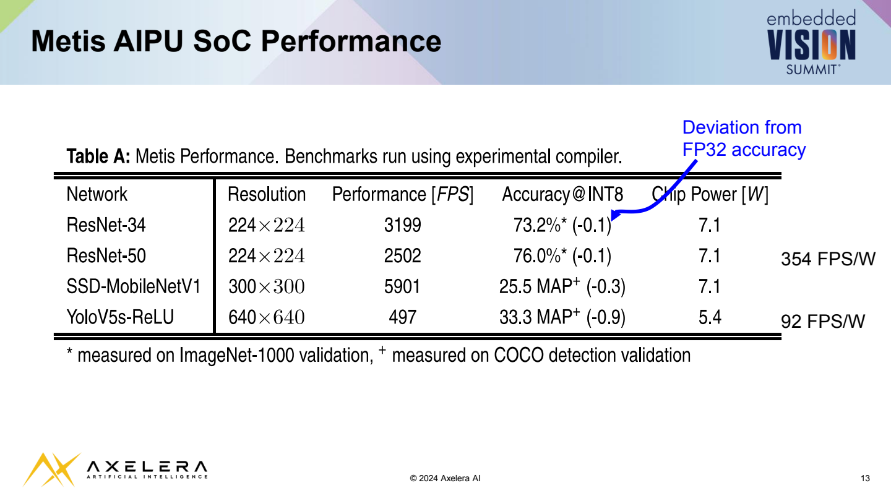

## Metis AIPU SoC Performance

Deviation from FP32 accuracy

| 354 FPS/W   |
|-------------|
| 92 FPS/W    |

<!-- p.14 -->

## YOLOv5s on Metis - Demo Preview

496 FPS YoloV5s inference @640x640

<!-- p.15 -->

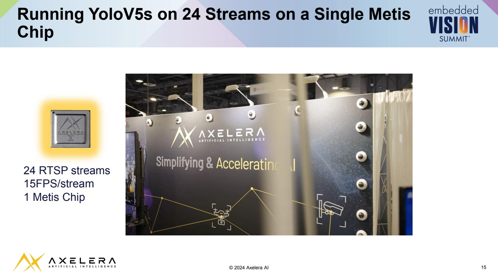

## Running YoloV5s on 24 Streams on a Single Metis Chip

24 RTSP streams 15FPS/stream 1 Metis Chip

<!-- p.16 -->

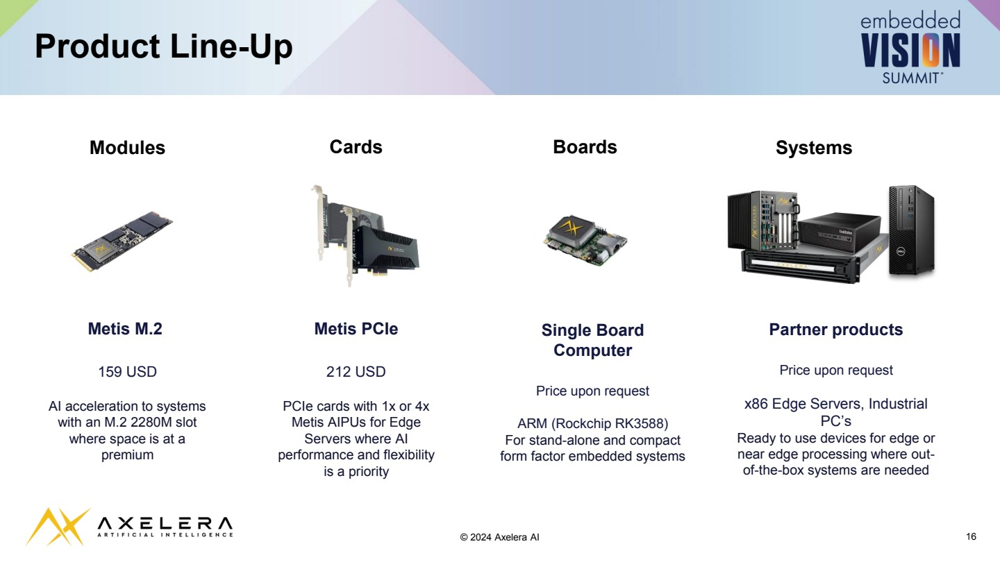

## Product Line-Up

## Modules

## Cards

## Boards

## Systems

Metis M.2

159 USD

AI acceleration to systems with an M.2 2280M slot where space is at a premium Metis PCIe

212 USD

PCIe cards with 1x or 4x Metis AIPUs for Edge Servers where AI performance and flexibility is a priority

## Single Board Computer

Price upon request

ARM (Rockchip RK3588) For stand-alone and compact form factor embedded systems

## Partner products

Price upon request

x86 Edge Servers, Industrial PC's

Ready to use devices for edge or near edge processing where outof-the-box systems are needed

<!-- p.17 -->

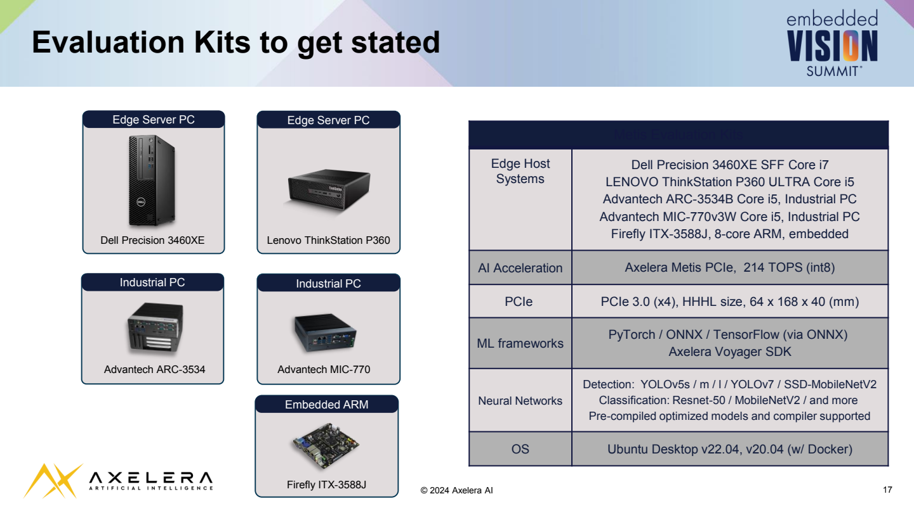

## Evaluation Kits to get stated

Metis Evaluation Kits

| Edge Host Systems   | Dell Precision 3460XE SFF Core i7 LENOVO ThinkStation P360 ULTRA Core i5 Advantech ARC-3534B Core i5, Industrial PC Advantech MIC-770v3W Core i5, Industrial PC Firefly ITX-3588J, 8-core ARM, embedded   |
|---------------------|-----------------------------------------------------------------------------------------------------------------------------------------------------------------------------------------------------------|
| AI Acceleration     | Axelera Metis PCIe, 214 TOPS (int8)                                                                                                                                                                       |
| PCIe                | PCIe 3.0 (x4), HHHL size, 64 x 168 x 40 (mm)                                                                                                                                                              |
| ML frameworks       | PyTorch / ONNX / TensorFlow (via ONNX) Axelera Voyager SDK                                                                                                                                                |
| Neural Networks     | Detection: YOLOv5s / m / l / YOLOv7 / SSD-MobileNetV2 Classification: Resnet-50 / MobileNetV2 / and more Pre-compiled optimized models and compiler supported                                             |
| OS                  | Ubuntu Desktop v22.04, v20.04 (w/ Docker)                                                                                                                                                                 |

<!-- p.18 -->

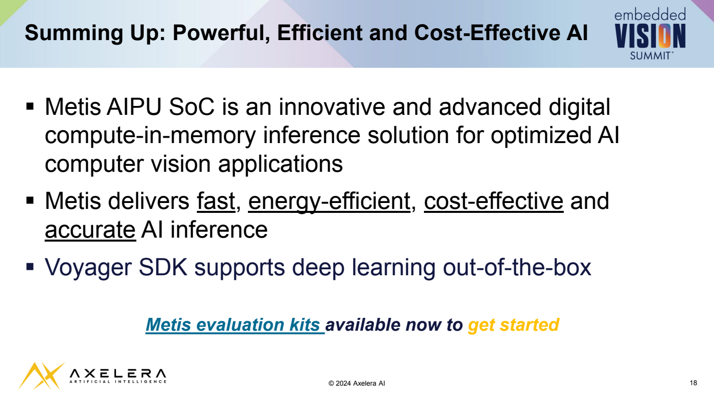

## Summing Up: Powerful, Efficient and Cost-Effective AI

-  Metis AIPU SoC is an innovative and advanced digital compute-in-memory inference solution for optimized AI computer vision applications
-  Metis delivers fast, energy-efficient, cost-effective and accurate AI inference
-  Voyager SDK supports deep learning out-of-the-box

Metis evaluation kits available now to get started

<!-- p.19 -->

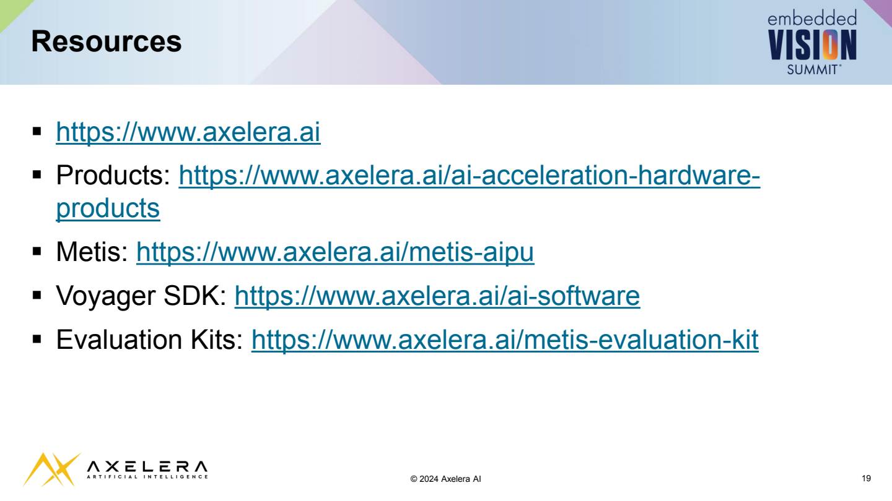

## Resources

- [ https://www.axelera.ai](https://www.axelera.ai/)
- [ Products: https://www.axelera.ai/ai-acceleration-hardwareproducts](https://www.axelera.ai/ai-acceleration-hardware-products)
- [ Metis: https://www.axelera.ai/metis-aipu](https://www.axelera.ai/metis-aipu)
- [ Voyager SDK: https://www.axelera.ai/ai-software](https://www.axelera.ai/ai-software)
- [ Evaluation Kits: https://www.axelera.ai/metis-evaluation-kit](https://www.axelera.ai/metis-evaluation-kit)

<!-- p.20 -->

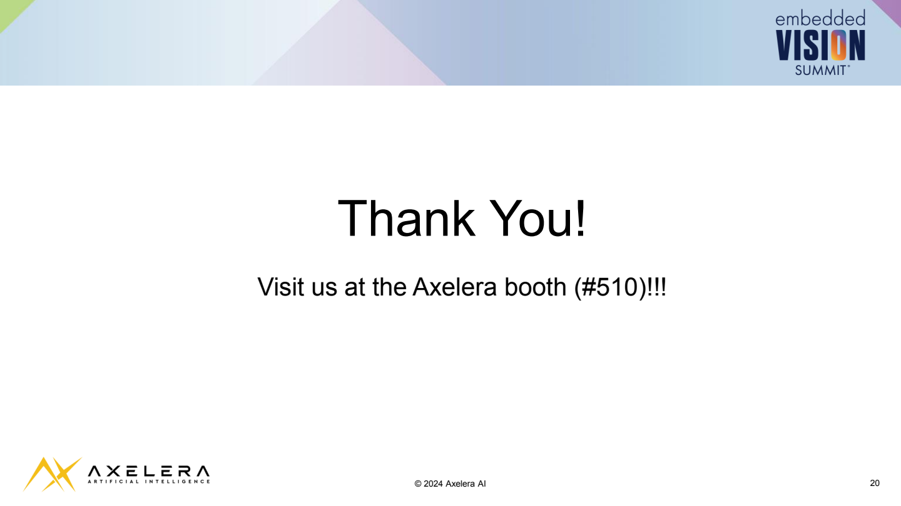

## Thank You!

Visit us at the Axelera booth (#510)!!!
