> 本文件由 `ESA-Axelera-Slides.pdf` 自动转换（docling 2.140.0，2026-10-17）。每页的整页图在 `images/` 目录；表格与数字请以 PDF 原文为准；`<!-- p.N -->` 标记对应 PDF 第 N 页。

<!-- p.1 -->

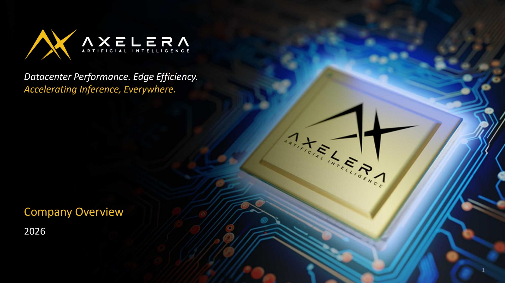

Datacenter Performance. Edge Efficiency. Accelerating Inference, Everywhere.

## Company Overview 2026

<!-- p.2 -->

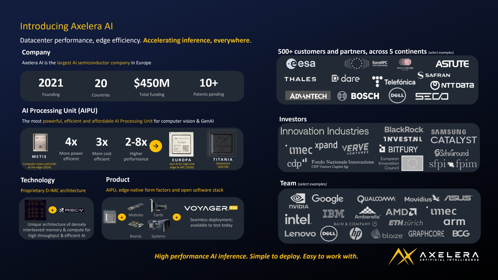

## Introducing Axelera AI

Datacenter performance, edge efficiency. Accelerating inference, everywhere.

## Company

Axelera AI is the largest AI semiconductor company in Europe

## AI Processing Unit (AIPU)

The most powerful, efficient and affordable AI Processing Unit for computer vision &amp; GenAI

## Technology

Proprietary D-IMC architecture

## Product

AIPU, edge-native form factors and open software stack

500+ customers and partners, across 5 continents (select examples)

Team (select examples)

<!-- p.3 -->

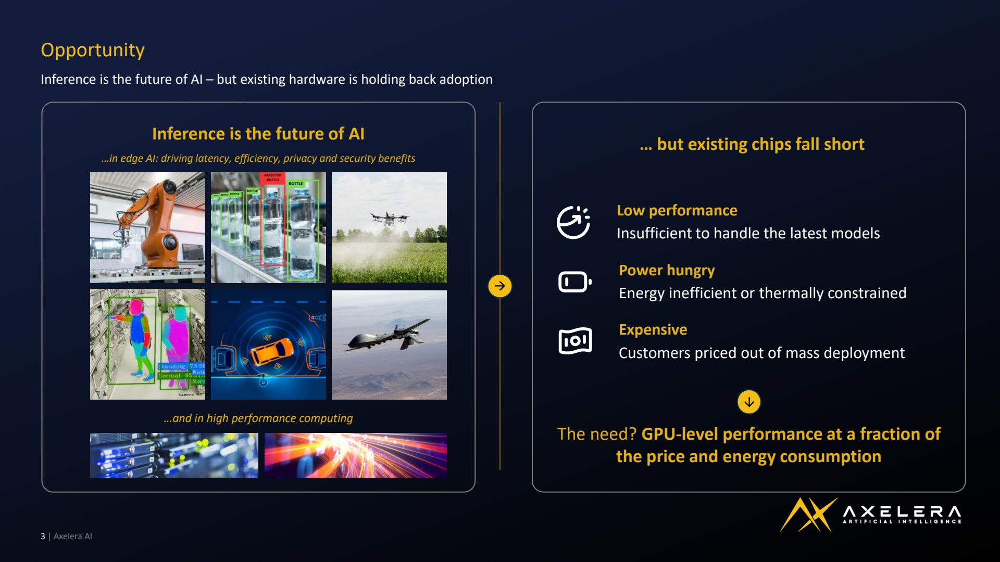

## Opportunity

Inference is the future of AI - but existing hardware is holding back adoption

… but existing chips fall short

## Low performance

Insufficient to handle the latest models

## Power hungry

Energy inefficient or thermally constrained

## Expensive

Customers priced out of mass deployment

The need? GPU-level performance at a fraction of the price and energy consumption

<!-- p.4 -->

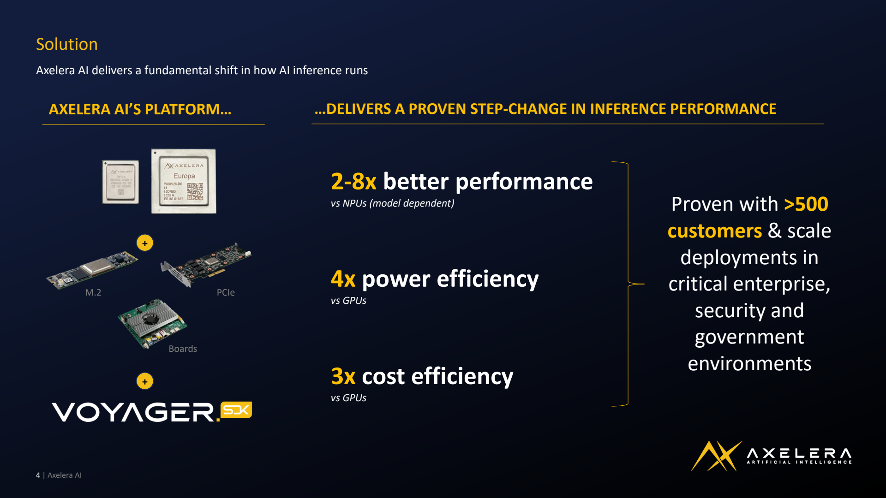

## Solution

Axelera AI delivers a fundamental shift in how AI inference runs

## AXELERA AI'S PLATFORM…

## …DELIVERS A PROVEN STEP-CHANGE IN INFERENCE PERFORMANCE

2-8x better performance vs NPUs (model dependent)

4x power efficiency vs GPUs

3x cost efficiency vs GPUs Proven with &gt;500 customers &amp; scale deployments in critical enterprise, security and government environments

<!-- p.5 -->

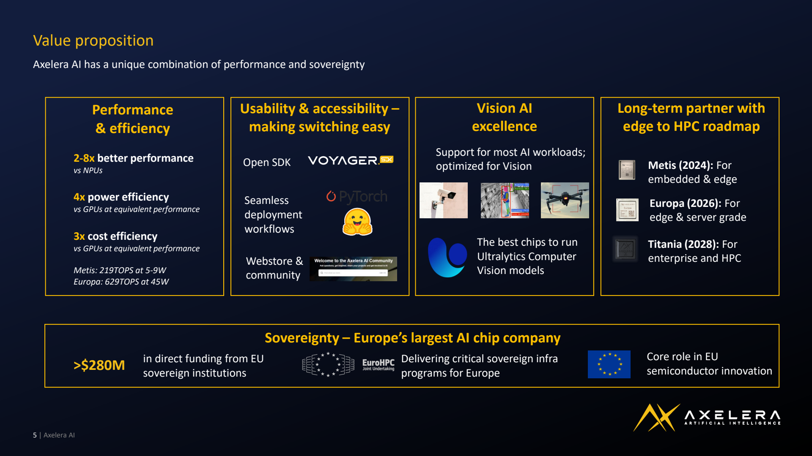

## Value proposition

Axelera AI has a unique combination of performance and sovereignty

## Performance &amp; efficiency

2-8x better performance vs NPUs

4x power efficiency vs GPUs at equivalent performance

3x cost efficiency vs GPUs at equivalent performance

Metis: 219TOPS at 5-9W Europa: 629TOPS at 45W

## Usability &amp; accessibility - making switching easy

Open SDK

Seamless deployment workflows

Webstore &amp; community

## Vision AI excellence

Support for most AI workloads; optimized for Vision

The best chips to run Ultralytics Computer Vision models

## Long-term partner with edge to HPC roadmap

Metis (2024): For embedded &amp; edge

Europa (2026): For edge &amp; server grade

Titania (2028): For enterprise and HPC

in direct funding from EU sovereign institutions

## Sovereignty - Europe's largest AI chip company

Delivering critical sovereign infra programs for Europe Core role in EU semiconductor innovation

<!-- p.6 -->

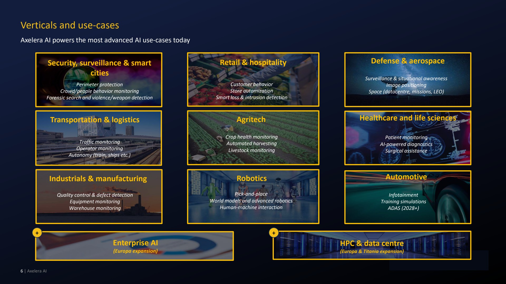

## Verticals and use-cases

Axelera AI powers the most advanced AI use-cases today

## Retail &amp; hospitality

Customer behavior Store automization Smart loss &amp; intrusion detection

## Agritech

Crop health monitoring Automated harvesting Livestock monitoring

## Defense &amp; aerospace

Surveillance &amp; situational awareness Image positioning Space (datacentre, missions, LEO)

## Healthcare and life sciences

Patient monitoring AI-powered diagnostics Surgical assistance

## Security, surveillance &amp; smart cities

Perimeter protection Crowd/people behavior monitoring Forensic search and violence/weapon detection

## Transportation &amp; logistics

Traffic monitoring Operator monitoring Autonomy (train, ships etc.)

## Industrials &amp; manufacturing

Quality control &amp; defect detection Equipment monitoring Warehouse monitoring

<!-- p.7 -->

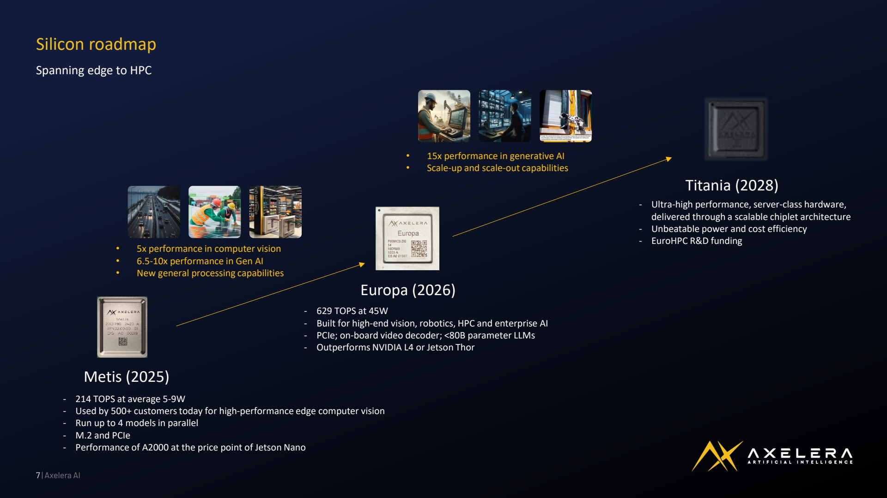

## Silicon roadmap

Spanning edge to HPC

- 5x performance in computer vision
- 6.5-10x performance in Gen AI
- New general processing capabilities

## Metis (2025)

- 214 TOPS at average 5-9W
- Used by 500+ customers today for high-performance edge computer vision
- Run up to 4 models in parallel
- M.2 and PCIe
- Performance of A2000 at the price point of Jetson Nano
- 15x performance in generative AI
- Scale-up and scale-out capabilities

## Europa (2026)

- 629 TOPS at 45W
- Built for high-end vision, robotics, HPC and enterprise AI
- PCIe; on-board video decoder; &lt;80B parameter LLMs
- Outperforms NVIDIA L4 or Jetson Thor

## Titania (2028)

- Ultra-high performance, server-class hardware, delivered through a scalable chiplet architecture
- Unbeatable power and cost efficiency
- EuroHPC R&amp;D funding

<!-- p.8 -->

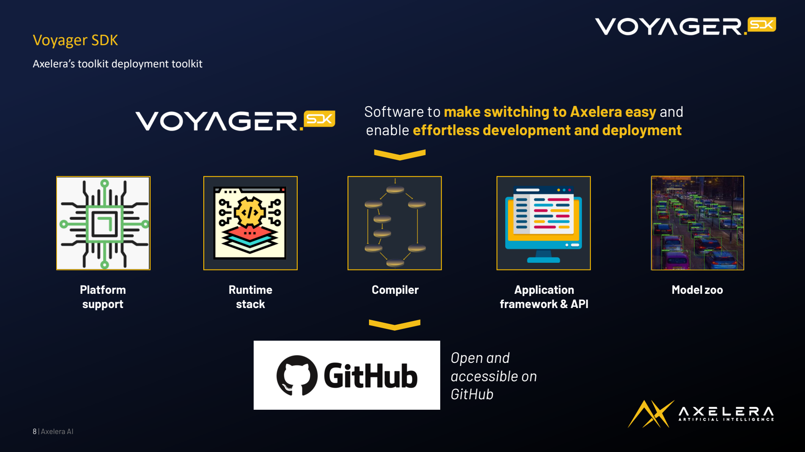

## Voyager SDK

Axelera's toolkit deployment toolkit Software to make switching to Axelera easy and enable effortless development and deployment

Platform support

Runtime stack

Compiler

Application framework &amp; API

Open and accessible on GitHub

Model zoo

<!-- p.9 -->

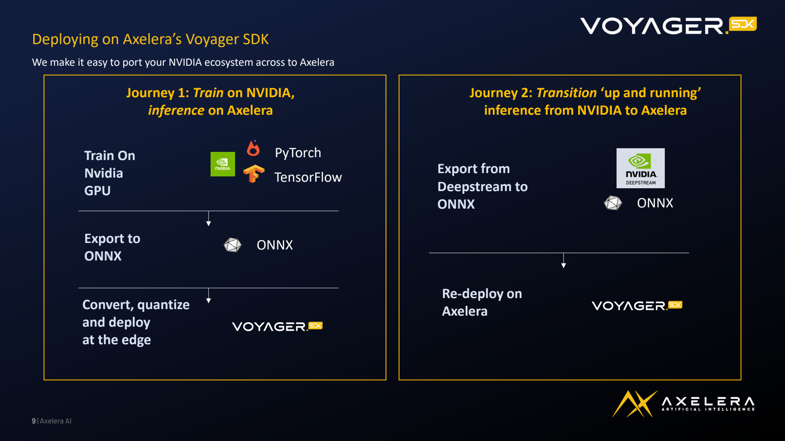

## Deploying on Axelera's Voyager SDK

We make it easy to port your NVIDIA ecosystem across to Axelera

<!-- p.10 -->

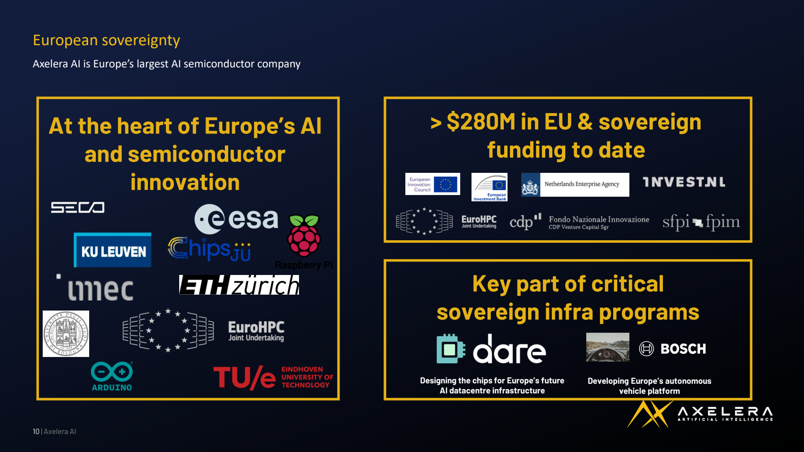

## European sovereignty

Axelera AI is Europe's largest AI semiconductor company

## Key part of critical sovereign infra programs

Designing the chips for Europe's future AI datacentre infrastructure Developing Europe's autonomous vehicle platform

<!-- p.11 -->

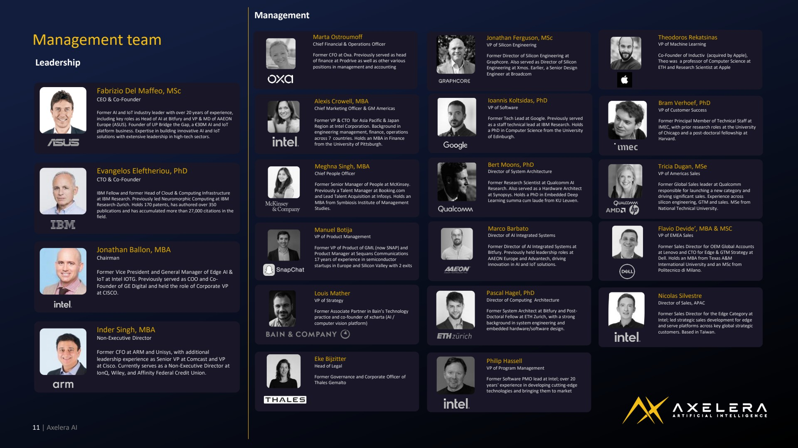

## Management team Leadership

Fabrizio Del Maffeo, MSc CEO &amp; Co-Founder

Former AI and IoT industry leader with over 20 years of experience, including key roles as Head of AI at Bitfury and VP &amp; MD of AAEON Europe (ASUS). Founder of UP Bridge the Gap, a €30M AI and IoT platform business. Expertise in building innovative AI and IoT solutions with extensive leadership in high-tech sectors.

Evangelos Eleftheriou, PhD CTO &amp; Co-Founder

IBM Fellow and former Head of Cloud &amp; Computing Infrastructure at IBM Research. Previously led Neuromorphic Computing at IBM Research-Zurich. Holds 170 patents, has authored over 350 publications and has accumulated more than 27,000 citations in the field.

Jonathan Ballon, MBA Chairman

Former Vice President and General Manager of Edge AI &amp; IoT at Intel IOTG. Previously served as COO and CoFounder of GE Digital and held the role of Corporate VP at CISCO.

Inder Singh, MBA Non-Executive Director

Former CFO at ARM and Unisys, with additional leadership experience as Senior VP at Comcast and VP at Cisco. Currently serves as a Non-Executive Director at IonQ, Wiley, and Affinity Federal Credit Union.

## Management

Marta Ostroumoff

Chief Financial &amp; Operations Officer

Former CFO at Oxa. Previously served as head of finance at Prodrive as well as other various positions in management and accounting

Alexis Crowell, MBA

Chief Marketing Officer &amp; GM Americas

Former VP &amp; CTO for Asia Pacific &amp; Japan Region at Intel Corporation. Background in engineering management, finance, operations across 7 countries. Holds an MBA in Finance from the University of Pittsburgh.

Meghna Singh, MBA Chief People Officer

Former Senior Manager of People at McKinsey. Previously a Talent Manager at Booking.com and Lead Talent Acquisition at Infosys. Holds an MBA from Symbiosis Institute of Management Studies.

Manuel Botija

VP of Product Management Former VP of Product of GML (now SNAP) and Product Manager at Sequans Communications 17 years of experience in semiconductor startups in Europe and Silicon Valley with 2 exits

Louis Mather VP of Strategy

Former Associate Partner in Bain's Technology practice and co-founder of xcharta (AI / computer vision platform)

Eke Bijzitter Head of Legal

Former Governance and Corporate Officer of Thales Gemalto Former Director of Silicon Engineering at Graphcore. Also served as Director of Silicon Engineering at Xmos. Earlier, a Senior Design Engineer at Broadcom Former Tech Lead at Google. Previously served as a staff technical lead at IBM Research. Holds a PhD in Computer Science from the University of Edinburgh.

Jonathan Ferguson, MSc VP of Silicon Engineering

Ioannis Koltsidas, PhD VP of Software

Bert Moons, PhD

Director of System Architecture

Former Research Scientist at Qualcomm AI Research. Also served as a Hardware Architect at Synopsys. Holds a PhD in Embedded Deep Learning summa cum laude from KU Leuven.

Marco Barbato Director of AI Integrated Systems

Former Director of AI Integrated Systems at Bitfury. Previously held leadership roles at AAEON Europe and Advantech, driving innovation in AI and IoT solutions.

Pascal Hagel, PhD Director of Computing Architecture

Former System Architect at Bitfury and PostDoctoral Fellow at ETH Zurich, with a strong background in system engineering and

embedded hardware/software design.

Philip Hassell VP of Program Management

Former Software PMO lead at Intel; over 20 years' experience in developing cutting-edge technologies and bringing them to market Co-Founder of Inductiv (acquired by Apple), Theo was a professor of Computer Science at ETH and Research Scientist at Apple Former Principal Member of Technical Staff at IMEC, with prior research roles at the University of Chicago and a post-doctoral fellowship at Harvard.

Theodoros Rekatsinas VP of Machine Learning

Bram Verhoef, PhD VP of Customer Success

Tricia Dugan, MSe VP of Americas Sales

Former Global Sales leader at Qualcomm responsible for launching a new category and driving significant sales. Experience across silicon engineering, GTM and sales. MSe from National Technical University.

Flavio Devide', MBA &amp; MSC VP of EMEA Sales

Former Sales Director for OEM Global Accounts at Lenovo and CTO for Edge &amp; GTM Strategy at Dell. Holds an MBA from Texas A&amp;M International University and an MSc from Politecnico di Milano.

Nicolas Silvestre Director of Sales, APAC

Former Sales Director for the Edge Category at Intel; led strategic sales development for edge and serve platforms across key global strategic customers. Based in Taiwan.

<!-- p.12 -->

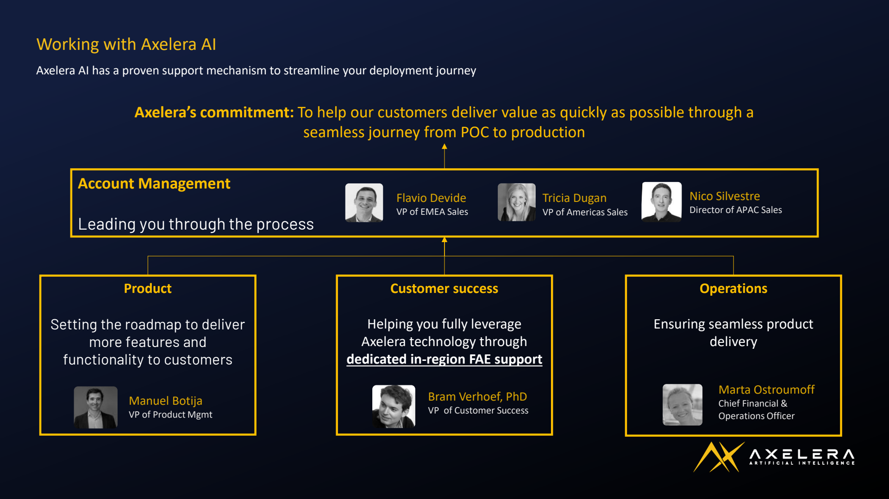

## Working with Axelera AI

Axelera AI has a proven support mechanism to streamline your deployment journey

Axelera's commitment: To help our customers deliver value as quickly as possible through a seamless journey from POC to production

## Account Management

Leading you through the process

Flavio Devide VP of EMEA Sales

Tricia Dugan VP of Americas Sales

Nico Silvestre Director of APAC Sales

## Product

Setting the roadmap to deliver more features and functionality to customers

Manuel Botija VP of Product Mgmt

## Customer success

Helping you fully leverage Axelera technology through dedicated in-region FAE support

Bram Verhoef, PhD VP of Customer Success

## Operations

Ensuring seamless product delivery

Marta Ostroumoff Chief Financial &amp; Operations Officer

<!-- p.13 -->

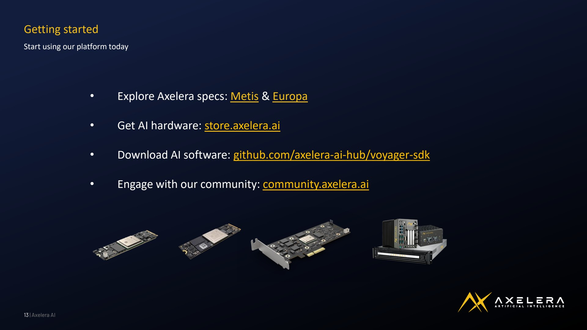

## Getting started

Start using our platform today

- Explore Axelera specs: Metis &amp; Europa
- Get AI hardware: store.axelera.ai
- Download AI software: github.com/axelera-ai-hub/voyager-sdk
- Engage with our community: community.axelera.ai

<!-- p.14 -->

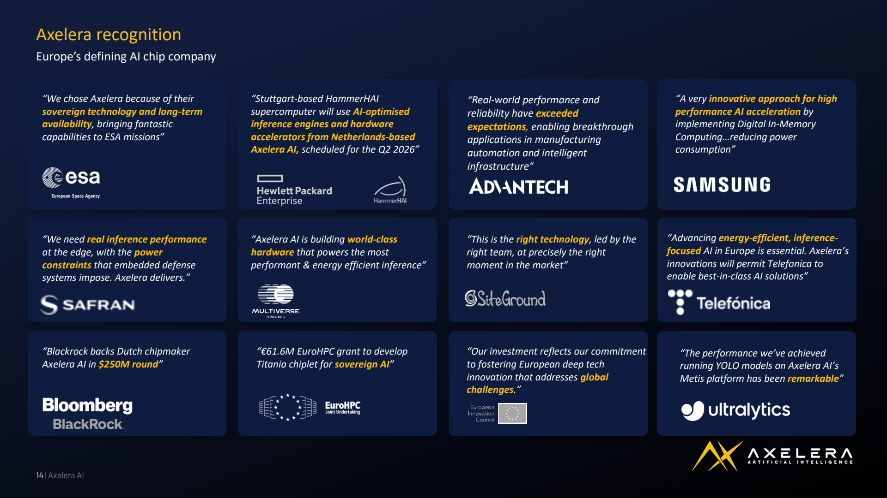

## Axelera recognition

Europe's defining AI chip company

"We chose Axelera because of their sovereign technology and long-term availability, bringing fantastic capabilities to ESA missions"

"We need real inference performance at the edge, with the power constraints that embedded defense systems impose. Axelera delivers."

"Blackrock backs Dutch chipmaker Axelera AI in $250M round"

"Stuttgart-based HammerHAI supercomputer will use AI-optimised inference engines and hardware accelerators from Netherlands-based Axelera AI, scheduled for the Q2 2026"

"Axelera AI is building world-class hardware that powers the most performant &amp; energy efficient inference"

"€61.6M EuroHPC grant to develop Titania chiplet for sovereign AI"

"Real-world performance and reliability have exceeded expectations, enabling breakthrough applications in manufacturing automation and intelligent infrastructure"

"This is the right technology, led by the right team, at precisely the right moment in the market"

"Our investment reflects our commitment to fostering European deep tech innovation that addresses global challenges."

"A very innovative approach for high performance AI acceleration by implementing Digital In-Memory Computing…reducing power consumption"

"Advancing energy-efficient, inferencefocused AI in Europe is essential. Axelera's innovations will permit Telefonica to enable best-in-class AI solutions"

"The performance we've achieved running YOLO models on Axelera AI's Metis platform has been remarkable"

<!-- p.15 -->

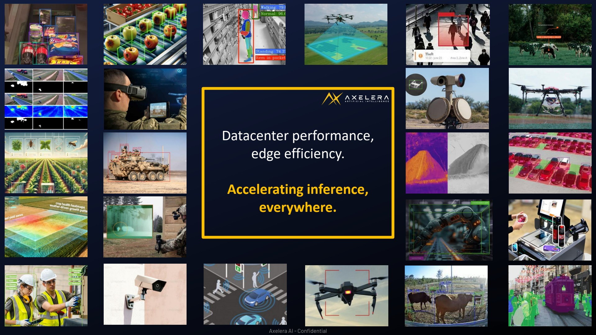

Datacenter performance, edge efficiency.

Accelerating inference, everywhere.
