> 本文件由 `EPCC-HPCAsia25-Axelera.pdf` 自动转换（docling 2.140.0，2026-10-17）。每页的整页图在 `images/` 目录；表格与数字请以 PDF 原文为准；`<!-- p.N -->` 标记对应 PDF 第 N 页。

<!-- p.1 -->

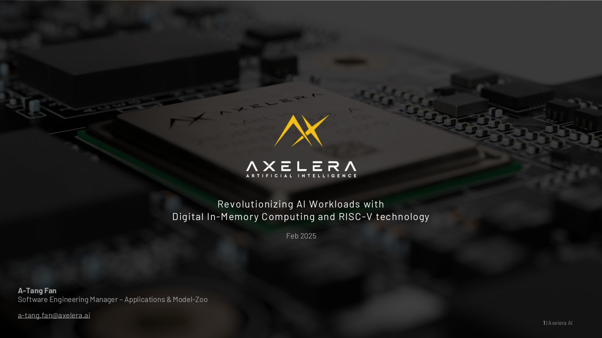

## A-Tang Fan

Software Engineering Manager - Applications &amp; Model-Zoo

a-tang.fan@axelera.ai Revolutionizing AI Workloads with Digital In-Memory Computing and RISC-V technology Feb 2025

<!-- p.2 -->

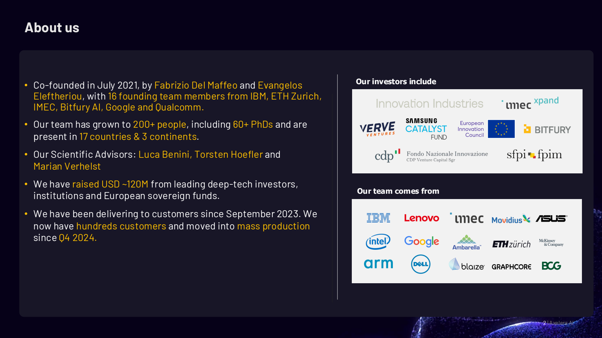

## About us

- Co-founded in July 2021, by Fabrizio Del Maffeo and Evangelos Eleftheriou, with 16 founding team members from IBM, ETH Zurich, IMEC, Bitfury AI, Google and Qualcomm.
- Our team has grown to 200+ people, including 60+ PhDs and are present in 17 countries &amp; 3 continents.
- Our Scientific Advisors: Luca Benini, Torsten Hoefler and Marian Verhelst
- We have raised USD ~120M from leading deep-tech investors, institutions and European sovereign funds.
- We have been delivering to customers since September 2023. We now have hundreds customers and moved intomass production since Q4 2024.

## Our investors include

## Our team comes from

2 | Axelera AI

<!-- p.3 -->

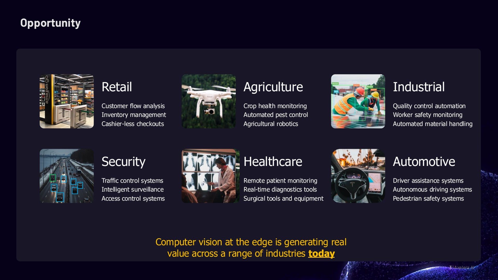

## Opportunity

## Retail

Customer flow analysis Inventory management Cashier-less checkouts

## Security

Traffic control systems Intelligent surveillance Access control systems

## Agriculture

Crop health monitoring Automated pest control Agricultural robotics

## Healthcare

Remote patient monitoring Real-time diagnostics tools Surgical tools and equipment

Computer vision at the edge is generating real value across a range of industries today

## Industrial

Quality control automation Worker safety monitoring Automated material handling

## Automotive

Driver assistance systems Autonomous driving systems Pedestrian safety systems

3 | Axelera AI

<!-- p.4 -->

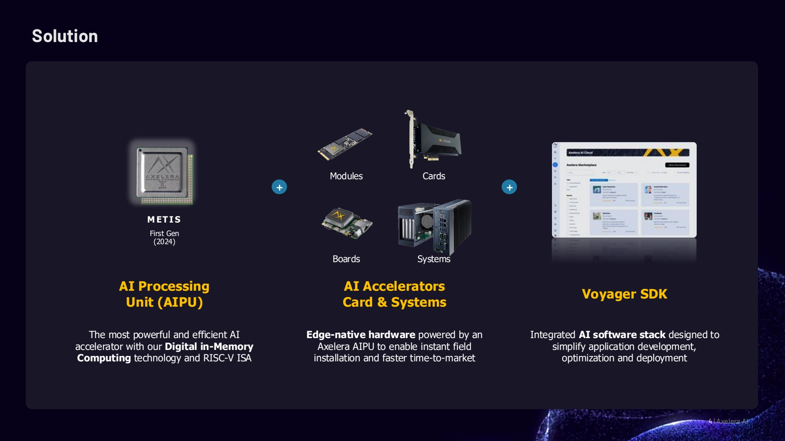

## Solution

MET I S First Gen (2024)

## AI Processing Unit (AIPU)

The most powerful and efficient AI accelerator with our Digital in-Memory Computing technology and RISC-V ISA

## AI Accelerators Card &amp; Systems

Edge-native hardware powered by an Axelera AIPU to enable instant field installation and faster time-to-market

## Voyager SDK

Integrated AI software stack designed to simplify application development, optimization and deployment

4 | Axelera AI

<!-- p.5 -->

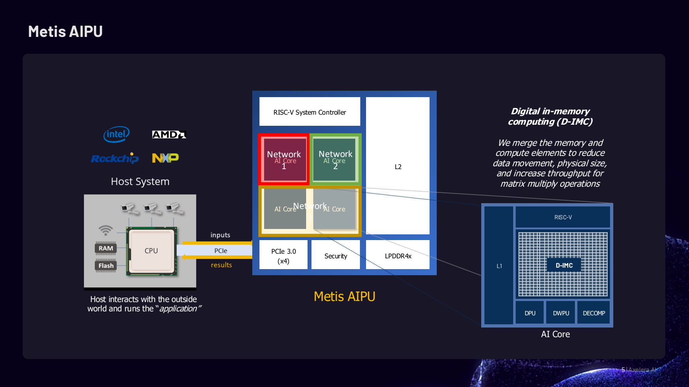

## Metis AIPU

5 | Axelera AI

<!-- p.6 -->

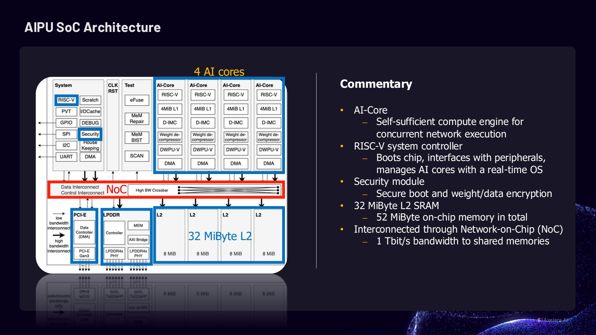

## AIPU SoC Architecture

## 4 AI cores

## Commentary

- AI-Core
- ⎼ Self-sufficient compute engine for concurrent network execution
- RISC-V system controller
- ⎼ Boots chip, interfaces with peripherals, manages AI cores with a real-time OS
- Security module
- ⎼ Secure boot and weight/data encryption
- 32 MiByte L2 SRAM
- ⎼ 52 MiByte on-chip memory in total
- Interconnected through Network-on-Chip (NoC)
- ⎼ 1 Tbit/s bandwidth to shared memories

6 | Axelera AI

<!-- p.7 -->

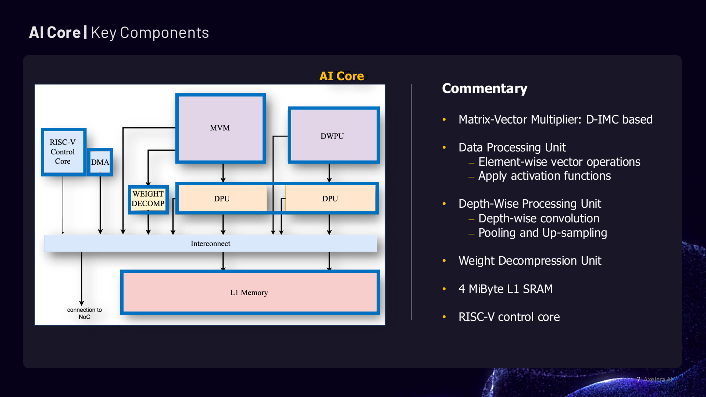

## AI Core | Key Components

## Commentary

- Matrix-Vector Multiplier: D-IMC based
- Data Processing Unit
- ⎼ Element-wise vector operations
- ⎼ Apply activation functions
- Depth-Wise Processing Unit
- ⎼ Depth-wise convolution
- ⎼ Pooling and Up-sampling
- Weight Decompression Unit
- 4 MiByte L1 SRAM
- RISC-V control core

7 | Axelera AI

<!-- p.8 -->

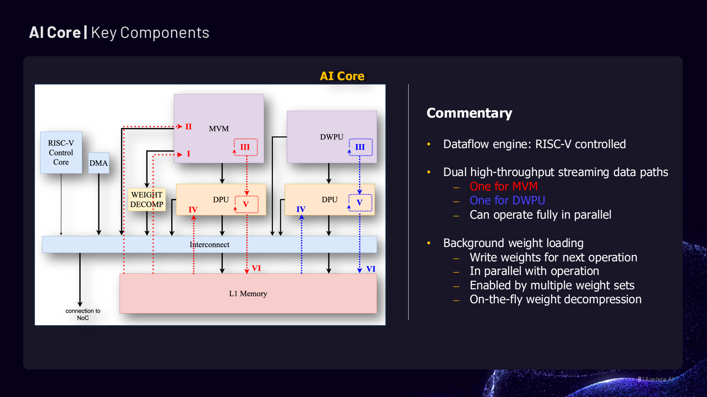

## AI Core | Key Components

## AI Core

## Commentary

- Dataflow engine: RISC-V controlled
- Dual high-throughput streaming data paths
- ⎼ One for MVM
- ⎼ One for DWPU
- ⎼ Can operate fully in parallel
- Background weight loading
- ⎼ Write weights for next operation
- ⎼ In parallel with operation
- ⎼ Enabled by multiple weight sets
- ⎼ On-the-fly weight decompression

8 | Axelera AI

<!-- p.9 -->

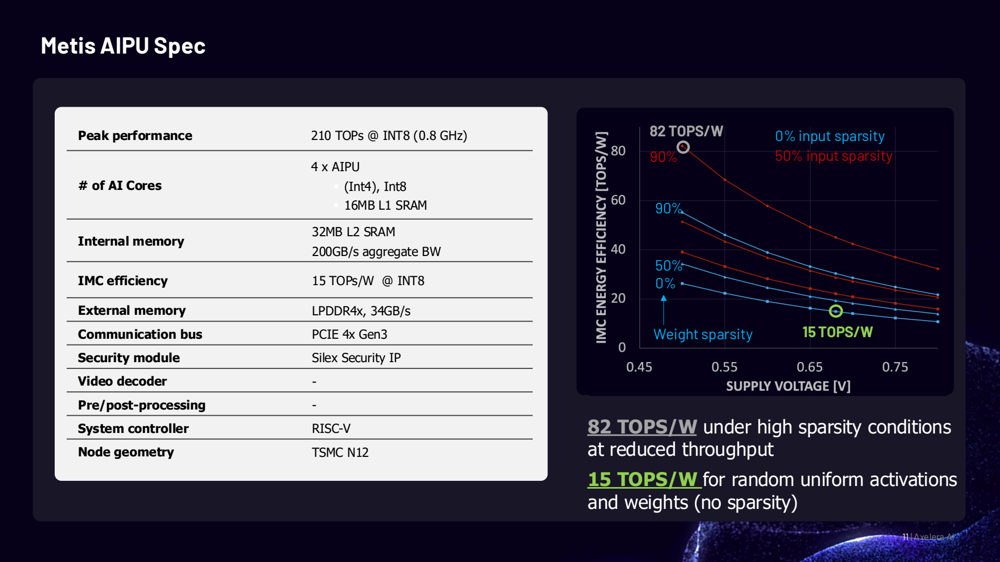

## Metis AIPU Spec

| Peak performance               | 210 TOPs @ INT8 (0.8 GHz)              |
|--------------------------------|----------------------------------------|
| # of AI Cores                  | 4 x AIPU ▪ (Int4), Int8 ▪ 16MB L1 SRAM |
| Internal memory                | 32MB L2 SRAM 200GB/s aggregate BW      |
| IMC efficiency                 | 15 TOPs/W @ INT8                       |
| External memory LPDDR4x,       | 34GB/s                                 |
| Communication bus PCIE 4x Gen3 |                                        |
| Security module                | Silex Security IP                      |
| Video decoder                  | -                                      |
| Pre/post-processing            | -                                      |
| System controller              | RISC-V                                 |
| Node geometry                  | TSMC N12                               |

82 TOPS/W under high sparsity conditions at reduced throughput

15 TOPS/W for random uniform activations and weights (no sparsity)

11 | Axelera AI

<!-- p.10 -->

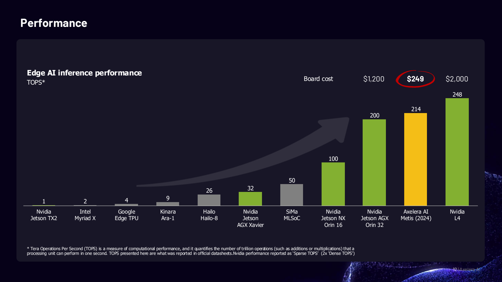

## Performance

* Tera Operations Per Second (TOPS) is a measure of computational performance, and it quantifies the number of trillion operations (such as additions or multiplications) that a processing unit can perform in one second. TOPS presented here are what was reported in official datasheets. Nvidia performance reported as 'Sparse TOPS' (2x 'Dense TOPS')

12 | Axelera AI

<!-- p.11 -->

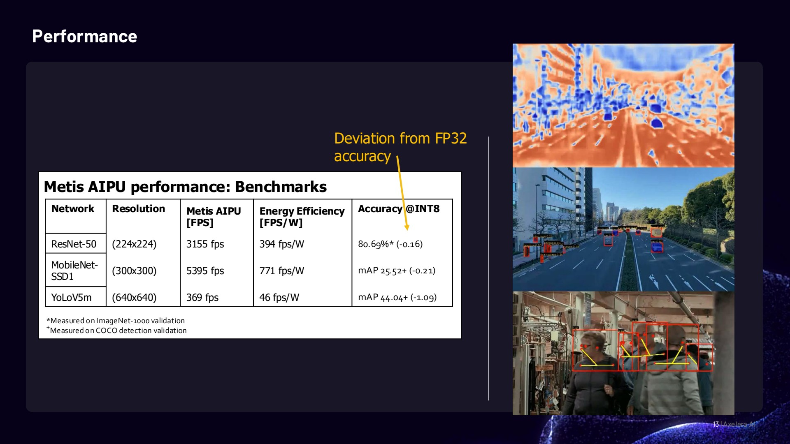

## Performance

## Deviation from FP32 accuracy

## Metis AIPU performance: Benchmarks

| Network   | Resolution   | Metis AIPU [FPS]   | Energy Efficiency [FPS/W]   | Accuracy @INT8   |
|-----------|--------------|--------------------|-----------------------------|------------------|
| (224x224) | 3155 fps     | 394 fps/W          | 80.69%* (-0.16)             | ResNet-50        |
| (300x300) | 5395 fps     | 771 fps/W          | mAP 25.52+ (-0.21)          | MobileNet- SSD1  |
| (640x640) | 369 fps      | 46 fps/W           | mAP 44.04+ (-1.09)          | YoLoV5m          |

<!-- p.12 -->

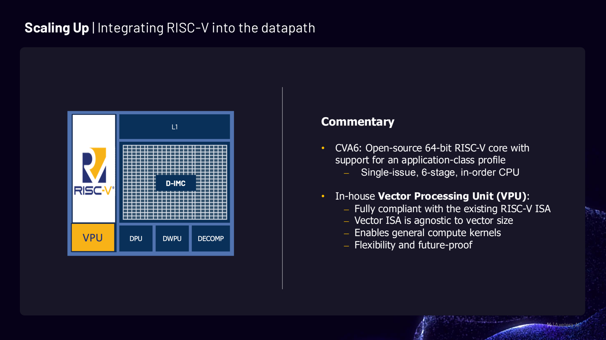

## Scaling Up | Integrating RISC-V into the datapath

## Commentary

- CVA6: Open-source 64-bit RISC-V core with support for an application-class profile
- ⎼ Single-issue, 6-stage, in-order CPU
- In-house Vector Processing Unit (VPU):
- ⎼ Fully compliant with the existing RISC-V ISA
- ⎼ Vector ISA is agnostic to vector size
- ⎼ Enables general compute kernels
- ⎼ Flexibility and future-proof

14 | Axelera AI

<!-- p.13 -->

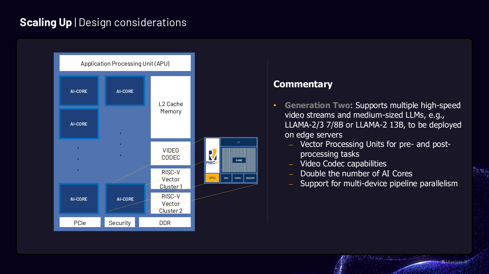

## Scaling Up | Design considerations

15 | Axelera AI

<!-- p.14 -->

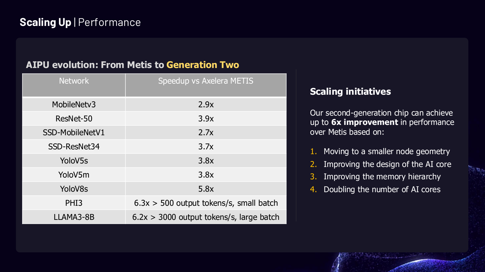

## Scaling Up | Performance

## AIPU evolution: From Metis to Generation Two

| Network         | Speedup vs Axelera METIS                 |
|-----------------|------------------------------------------|
| MobileNetv3     | 2.9x                                     |
| ResNet-50       | 3.9x                                     |
| SSD-MobileNetV1 | 2.7x                                     |
| SSD-ResNet34    | 3.7x                                     |
| YoloV5s         | 3.8x                                     |
| YoloV5m         | 3.8x                                     |
| YoloV8s         | 5.8x                                     |
| PHI3            | 6.3x > 500 output tokens/s, small batch  |
| LLAMA3-8B       | 6.2x > 3000 output tokens/s, large batch |

## Scaling initiatives

Our second-generation chip can achieve up to 6x improvement in performance over Metis based on:

1. Moving to a smaller node geometry
2. Improving the design of the AI core
3. Improving the memory hierarchy
4. Doubling the number of AI cores

<!-- p.15 -->

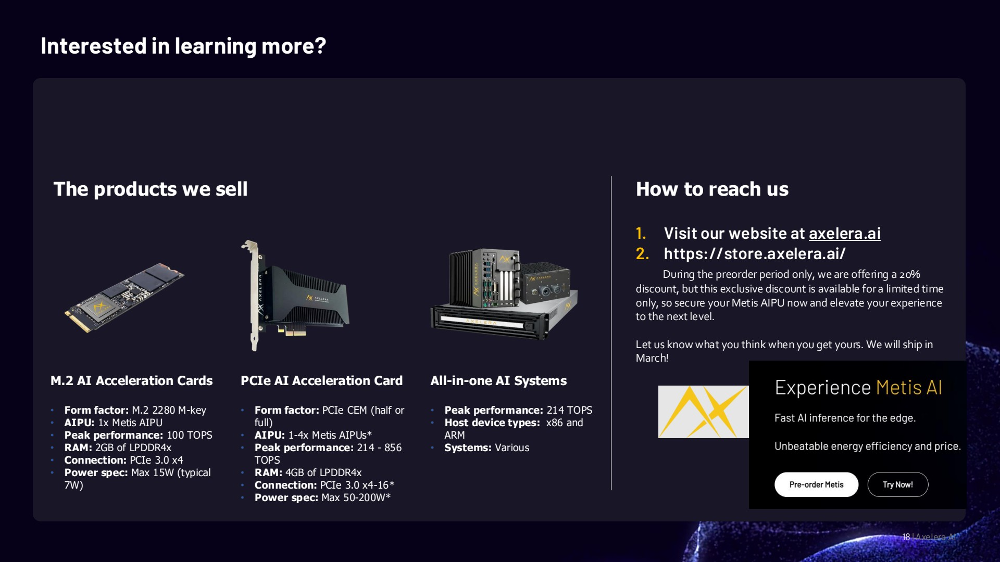

## Interested in learning more?

## The products we sell

## M.2 AI Acceleration Cards

- Form factor: M.2 2280 M-key
- AIPU: 1x Metis AIPU
- Peak performance: 100 TOPS
- RAM: 2GB of LPDDR4x
- Connection: PCIe 3.0 x4
- Power spec: Max 15W (typical 7W)
- Form factor: PCIe CEM (half or full)
- AIPU: 1-4x Metis AIPUs*
- Peak performance: 214 - 856 TOPS
- RAM: 4GB of LPDDR4x
- Connection: PCIe 3.0 x4-16*
- Power spec: Max 50-200W*

PCIe AI Acceleration Card

## All-in-one AI Systems

- Peak performance: 214 TOPS
- Host device types: x86 and ARM
- Systems: Various

## How to reach us

1. Visit our website at axelera.ai
2. https://store.axelera.ai/

During the preorder period only, weare offering a 20% discount, but this exclusive discount is available for a limited time only, so secure yourMetis AIPU nowandelevate your experience to the next level.

Let us knowwhat you thinkwhenyouget yours. Wewill ship in March!

<!-- p.16 -->

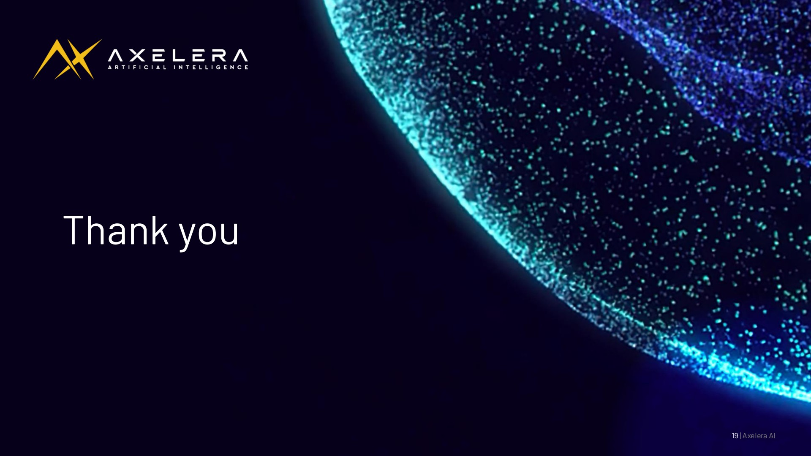

## Thank you

19 | Axelera AI
