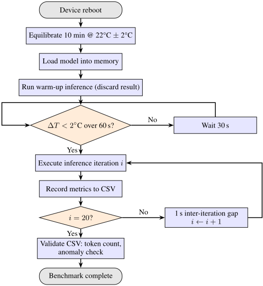
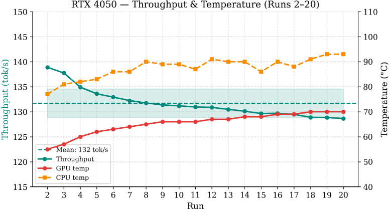
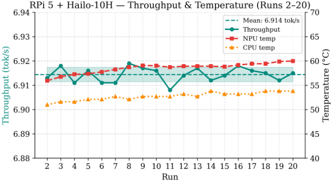
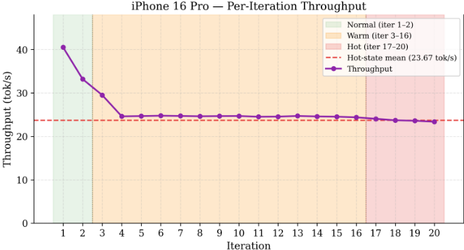
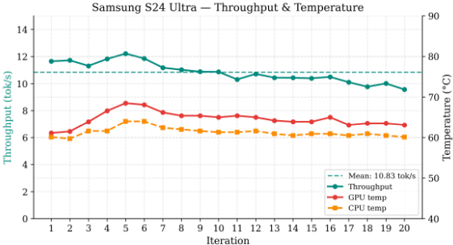

> 本文件由 `arXiv2603.23640-LLM-Inference-at-the-Edge.pdf` 自动转换（docling 2.140.0，2026-10-17）。图片在 `images/` 目录；表格与数字请以 PDF 原文为准；`<!-- p.N -->` 标记对应 PDF 第 N 页。

<!-- p.1 -->

## LLM Inference at the Edge: Mobile, NPU, and GPU Performance Efficiency Trade-offs Under Sustained Load

## Pranay Tummalapalli

## Sahil Arayakandy

Conscious Engines Conscious Engines

pranay@consciousengines.com sahil@consciousengines.com

## Ritam Pal

## Kautuk Kundan

Conscious Engines Conscious Engines

ritam@consciousengines.com kautuk@consciousengines.com

## Abstract

Deploying large language models on-device for always-on personal agents demands sustained inference from hardware tightly constrained in power, thermal envelope, and memory. We benchmark Qwen 2.5 1.5B (4-bit quantised) across four platforms: a Raspberry Pi 5 with Hailo-10H NPU, a Samsung Galaxy S24 Ultra, an iPhone 16 Pro, and a laptop NVIDIA RTX 4050 GPU. Using a fixed 258-token prompt over 20 warm-condition iterations per device under greedy decoding, we measure throughput, latency, power, and thermal behaviour. For mobile platforms, thermal management supersedes peak compute as the primary constraint: the iPhone 16 Pro loses roughly 40% of its peak throughput within three iterations and settles into a Hot-state plateau near 23.7 tok/s, while the S24 Ultra degrades ∼15% over 20 iterations into a Snapdragon governor-regulated plateau near 10 tok/s. On dedicated hardware, distinct constraints dominate: the RTX 4050 is bounded by its battery power ceiling, while the Hailo-10H is limited by on-module memory bandwidth. The RTX 4050 sustains 131.7 tok/s at 34.1 W; the Hailo-10H sustains 6.9 tok/s at under 2 W with near-zero variance, matching the RTX 4050 in energy proportionality at 19× lower throughput. Results should be interpreted as platform-level deployment characterisations for a single model and prompt type, reflecting hardware and software combined, rather than general claims about hardware capability alone.

## 1 Introduction

The emergence of sub-2B parameter language models capable of useful instruction following [1, 2] has renewed interest in on-device LLM deployment. Running inference locally offers offline capability, reduced latency, and privacy, properties that are particularly valuable for always-on personal agents that must respond to continuous streams of user queries without round-tripping to a cloud server.

Modern mobile SoCs include dedicated neural processing units with tens of TOPS of claimed throughput [5, 6], and quantisation techniques such as GPTQ [3] and AWQ [4] compress models to under 1 GB, making them memory-feasible on phones and single-board computers. Yet the gap between peak hardware specifications and sustained real-world inference performance under thermal load remains poorly characterised. Existing benchmarks either target single-inference latency[8, 13],

<!-- p.2 -->

cloud-hosted throughput [7], or report thermal effects only as a side observation rather than a primary focus [9]. The MELTing Point framework [9] provides the closest prior work, characterising LLM inference on mobile devices with attention to energy and thermal behaviour, but does not run extended back-to-back query sequences sufficient to reveal the full thermal degradation curve. Xiao et al. [10] benchmark LLMs on mobile platforms with attention to throughput and observe 10-20% degradation over five consecutive runs, but do not characterise steady-state thermal floors or test beyond a handful of iterations. MLPerf Inference [7] now includes edge LLM scenarios as of v5.1, but measures peak performance without tracking thermal throttling or sustained-workload behaviour.

On the hardware side, quantised LLM inference on dedicated edge NPUs remains largely unexplored in the literature. To the best of our knowledge, no independent benchmark of LLM inference on Hailo hardware has been published; available figures derive from vendor publications alone.

This leaves three questions unanswered: how mobile inference performance degrades over repeated consecutive queries; whether low-power NPU accelerators can match mobile devices in sustained throughput per watt; and what the practical trade-offs are between a dedicated GPU, a mobile SoC, and an edge NPU for always-on agent deployments.

To answer these, we conduct controlled warm-condition benchmarking of Qwen 2.5 1.5B across four platforms, a Raspberry Pi 5 with Hailo-10H NPU, a Samsung Galaxy S24 Ultra, an iPhone 16 Pro, and a laptop with NVIDIA RTX 4050 GPU, using a standardised prompt and uniform metric collection across 20 iterations per device. Our principal contributions are: an independent cross-platform benchmark of sustained LLM inference including a dedicated edge NPU; empirical characterisation of thermal degradation curves on two flagship smartphones showing qualitatively different failure modes; and evidence that the Hailo-10H NPU achieves thermally stable, near-zero-variance inference at energy proportionality comparable to a laptop GPU, positioning dedicated edge NPUs as a compelling platform for always-on, power-sensitive deployments. However, the Hailo-10H's current throughput of 6.9 tok/s, constrained single-sequence autoregressive decode characteristics, represents a significant latency limitation for interactive applications, and should be interpreted as a platform deployment ceiling rather than a fundamental bound on NPU-class inference.

## 2 Background

## 2.1 Quantised Inference on Edge Hardware

Post-training quantisation reduces weight precision from BF16/FP16 to INT4, yielding approximately 4× model size reduction with minimal perplexity degradation on instruction-tuned models [3, 4]. Q4\_0 (4-bit grouped quantisation) has become the dominant format for on-device deployment due to its compatibility with GGUF, MLC-LLM, and MLX runtimes, while GPTQ [3] provides an alternative calibrated quantisation path used by vLLMand PyTorch-based serving stacks. llama.cpp [12] provides cross-platformGGUF-format inference across targets.

## 2.2 Autoregressive Decoding Phases

LLM inference comprises two phases with distinct compute characteristics. During prefill, the input prompt is processed in parallel; this phase is compute-bound, proportional to prompt length, and dominates time-to-first-token (TTFT). During decode, tokens are generated one at a time autoregressively; this phase is memory-bandwidth-bound, with throughput determined by KV-cache access speed. Peak hardware TOPS ratings reflect throughput under compute-bound, high-utilisation conditions. Prefill is relatively compute-bound and scales with available TOPS; sustained decode throughput is memory-bandwidth-bound, with throughput determined by KV-cache access speed, a key distinction when evaluating always-on agents that generate long responses.

## 2.3 Thermal Throttling inMobile SoCs

Mobile SoCs rely on passive cooling and must respect strict power budgets to avoid skin temperature violations. When junction temperatures exceed thermal thresholds, Dynamic Voltage and Frequency Scaling (DVFS) reduces clock frequencies, directly reducing throughput. Sustained LLM inference is particularly susceptible to this mechanism. Recent work on mobile DVFS governors [14] has shown that Energy-Aware Scheduling can cause CPUs to run at suboptimally low frequencies during LLM

<!-- p.3 -->

inference, degrading latency and energy efficiency, illustrating that OS-level power management interacts with inference workloads in ways beyond simple thermal capping.

## 3 Methodology

We select four platforms spanning the performance-efficiency spectrum relevant to personal agent deployment: a Raspberry Pi 5 paired with a Hailo-10H M.2 NPU module, representing always-on lowpower edge deployment; a Samsung Galaxy S24 Ultra as a flagship Android device with Snapdragon 8 Gen 3; an iPhone 16 Pro as a flagship iOS device with Apple A18 Pro; and a laptop with NVIDIA RTX 4050 GPU as a battery-powered edge device in a laptop form factor. Full hardware and software specifications are given in Tables 1 and 2.

## 3.1 Platforms and Inference Stacks

The Hailo-10H connects via PCIe Gen 3.0, providing 40 TOPS at under 5 W. hailo-ollama partitions model layers between NPU and CPU, with attention offloaded to the NPU and Q4 weights dispatched to the NPU's INT8 compute units via the Hailo Dataflow Compiler. Power is sampled from the RPi 5 PMIC rails via an INA219 at 1 kHz; this reflects total system draw rather than isolated NPU power, as no dedicated current sensor sits on the Hailo-10H's PCIe supply.

The Samsung Galaxy S24 Ultra runs the model compiled to TVM binary format targeting the Adreno 750 GPU via Apache TVM 0.14 through MLC-LLM, as a headless Android service on Android 16 with the display held off during the measured run. The runtime uses a 2,048-token context and a 128-token prefill chunk; the reduced chunk inflates prefill latency relative to Adreno hardware capability (see Section 5). Battery current, voltage, and temperature are sampled from the Android BatteryManager and HealthService APIs per iteration, with absolute accuracy caveated.

The iPhone 16 Pro runs a custom SwiftUI app integrating MLX Swift (v0.29.1), with inference dispatched to the A18 Pro GPU via Metal; MLX does not target the Neural Engine. Greedy decoding (temperature = 0.0) with maxKVSize = 2048 fixes output length and KV footprint across iterations. iOS exposes no per-component power draw to third-party apps, so thermal state (ProcessInfo.thermalState) and battery level (UIDevice) are sampled per iteration as the sole energy proxy.

The RTX 4050 laptop serves the model via vLLM with the PyTorch backend on CUDA 12.1; nvidia-smi logs GPU power, utilisation, and temperature at 100 ms. Runs were conducted on battery, which imposes a sustained power ceiling near 35 W (∼45% of the 75 W TGP), so reported throughput is battery-throttled.

Table 1: Hardware specifications across evaluated platforms.

|            | RPi 5 + Hailo-10H             | S24 Ultra             | iPhone 16 Pro                     | RTX 4050 Laptop              |
|------------|-------------------------------|-----------------------|-----------------------------------|------------------------------|
| SoC / CPU  | BCM2712 4×A76 @ 2.4 GHz       | Snapdragon 8 Gen 3    | Apple A18 Pro                     | Intel Core i5- 13420H        |
| AI Accel.  | Hailo-10H NPU (40 TOPS, <5 W) | Hexagon NPU (45 TOPS) | Neural Engine 17- core (∼35 TOPS) | RTX 4050 (80 Ten- sor Cores) |
| RAM        | 8 GB LPDDR4X                  | 12 GB LPDDR5X         | 8 GB Unified                      | 16 GB DDR5                   |
| GPU        | VideoCore VII                 | Adreno 750            | 6-core Apple GPU                  | RTX 4050 (2560 CUDA cores)   |
| VRAM       | Shared                        | Shared                | Shared                            | 6 GB GDDR6                   |
| OS         | Raspberry Pi OS               | Android 16            | iOS 26                            | Ubuntu 22.04.3               |
| Idle power | ∼3.5W                         | ∼0.8 W                | ∼0.6 W                            | ∼15 W§                       |
| Max power  | ∼12W                          | ∼12 W                 | ∼10 W                             | 75 W TGP†                    |

†Acer Nitro V RTX 4050 laptop GPU TGP is 75 W (60 W base + 15 W Dynamic Boost). Benchmarks conducted on battery; sustained inference power was observed at ∼34 W.

§System idle power ∼15 W; GPU idle power ∼2 W per nvidia-smi.

<!-- p.4 -->

Table 2: Software stack versions across platforms.

|                 | RPi 5 +Hailo-10H   | S24 Ultra                  | iPhone 16 Pro           | RTX 4050 Laptop         |
|-----------------|--------------------|----------------------------|-------------------------|-------------------------|
| Framework       | hailo-ollama       | MLC-LLM 0.1.0              | MLX Swift v0.29.1       | vLLM (CUDA 12.1)        |
| Backend         | HailoRT 4.17.0     | OpenCL 3.0 + TVM 0.14      | Metal (MLX)             | PyTorch 2.1.0           |
| Language        | Python 3.10        | Java / NDK r26b            | Swift 5.9 (SwiftUI)     | Python 3.10             |
| Model format    | GGUF Q4_0          | MLC binary q4f16_2         | MLX safetensors Q4_0    | GPTQ Int4 safeten- sors |
| Context window‡ | 2,048              | 2,048                      | 2,048 (KV)              | 2,048                   |
| Power monitor   | INA219 (1 kHz)     | BatteryManager (per-iter)∗ | UIDevice bat- teryLevel | nvidia-smi (100 ms)     |

‡Context window was fixed to 2,048 tokens on all four platforms to hold the KV-cache memory footprint constant across the comparison, versus the model's native 32,768-token window. The runtime knob differs per stack: context\_window\_size on MLC-LLM (S24 Ultra), maxKVSize on MLX (iPhone 16 Pro), num\_ctx on Ollama (RPi 5 + Hailo-10H), and max\_model\_len on vLLM (RTX 4050).

∗Android BatteryManager readings are collected with the display held off throughout the measured run; absolute values are treated with caution (see Section 5).

We select Qwen 2.5 1.5B [1] with 4-bit quantisation as the benchmark model. Selection criteria were threefold: native support across all four inference frameworks, a sub-1 GB memory footprint fitting all device constraints, and a uniform quantisation level across platforms to minimise compression as a confounding variable. Each platform uses a native format conversion of the same base weights: GGUF (hailo-ollama), TVM binary (MLC-LLM), MLX safetensors (iPhone 16 Pro), and HuggingFace safetensors (vLLM). Key specifications are listed in Table 3.

Table 3: Qwen 2.5 1.5B model specifications.

| Attribute       | Value                               |
|-----------------|-------------------------------------|
| Parameters      | 1.5B                                |
| Architecture    | Transformer decoder, GQA (2 groups) |
| Layers          | 28                                  |
| Hidden size     | 1536                                |
| Attention heads | 12                                  |
| Vocabulary      | 151,936 tokens                      |
| Context window  | 32,768 tokens                       |

## 3.2 Prompt and Generation Configuration

All platforms receive an identical prompt (UTF-8, 258 tokens as tokenised by the Qwen 2.5 BPE tokenizer) that elicits long-form structured output, imposing sustained decode load to stress thermal management and memory-bandwidth utilisation rather than burst performance. Effective prefill length including framework-applied chat templates is approximately 270-280 tokens and may vary marginally across inference stacks.

Write an in-depth, structured, and self-contained essay explaining the concept of consciousness from multiple perspectives. Begin by clearly defining consciousness and why it is a difficult concept to study. Then explore the topic from the following viewpoints, dedicating multiple detailed paragraphs to each:

1. Philosophical perspectives, including classical and modern views, major debates, and unresolved questions.
2. Neuroscientific perspectives, covering brain structures, neural correlates, current theories, and experimental approaches.
3. Cognitive science and psychology perspectives, including perception, attention, self-awareness, and consciousness disorders.
4. Artificial intelligence and machine consciousness, discussing whether machines can be conscious, functional vs. phenomenal consciousness,

<!-- p.5 -->

and current limitations of AI systems.

5. Ethical and societal implications of understanding or engineering consciousness.

Throughout the essay: use clear section headings; explain all technical terms in plain language; provide illustrative examples where helpful; compare and contrast different viewpoints; avoid bullet lists unless necessary for clarity. Conclude with a reflective summary discussing what remains unknown and what future research directions may look like. The response should be detailed, continuous, and written in a neutral, academic tone.

All platforms decode greedily (temperature = 0, top-k = 1) until the model emits EOS, so that output length and decode workload are bit-identical across the 20 iterations on a given platform. Under this setting the natural stopping length is 646 tokens on the S24 Ultra (MLC-LLM), 819 tokens on the iPhone 16 Pro (MLX), 564 tokens on the RPi 5 + Hailo-10H, and 1,789 tokens on the RTX 4050 (vLLM). The cross-platform variation reflects differences in tokenisers and chat-template formatting rather than a configurable cap.

## 3.3 Metrics

Table 4 defines all metrics collected during benchmarking. Not all metrics are available on all platforms: thermal state is iOS-only, GPU frequency is Android-only, and power and energy-pertoken are reported only for the RTX 4050 and Hailo-10H due to measurement limitations on mobile platforms discussed in Section 5.

Table 4: Metrics collected across platforms.

| Metric                                                                                                                                             | Unit                                    | Definition                                                                                                                                                                                                                                                                                                                                                                                                                                                                                                                    |
|----------------------------------------------------------------------------------------------------------------------------------------------------|-----------------------------------------|-------------------------------------------------------------------------------------------------------------------------------------------------------------------------------------------------------------------------------------------------------------------------------------------------------------------------------------------------------------------------------------------------------------------------------------------------------------------------------------------------------------------------------|
| Decode tokens Decode time Prefill Time Throughput (TPS) Avg power Peak power Energy/token CPU / GPU temp Thermal state Battery drain GPU frequency | count ms ms tok/s W W mJ °C - % SoC MHz | Tokens generated during the decode phase Wall-clock duration of the decode phase Time from prompt submission to first output token; equivalent to the duration of the prompt encoding phase Ndecode/tdecode Mean system power draw over inference duration Maximum instantaneous power observed Pavg · tdecode/Ndecode Maximum temperature recorded during inference iOS categorical signal: Normal, Warm, or Hot Change in state of charge over full benchmark run Observed GPU clock frequency per iteration (Android only) |

## 3.4 Experimental Protocol

We focus on warm-condition inference: the model is loaded once and remains in memory across all iterations, representing realistic interactive assistant usage where queries arrive consecutively. Cold-start model loading time is recorded where observable but excluded from throughput and latency analysis.

Before each benchmark session, the device is allowed to equilibrate for 10 minutes at ambient temperature (22°C ± 2°C). After loading the model and discarding one warm-up inference, we verify thermal stability (∆T &lt; 2°C over 60 seconds) before executing 20 iterations with a 1-second inter-iteration gap. Per-iteration results are exported to CSV and validated for token count anomalies.

<!-- p.6 -->

Figure 1: Experimental protocol flowchart. Each platform undergoes this procedure independently. Cold-start prefill-time from the warm-up inference is recorded separately and excluded from throughput analysis.

## 4 Results

## 4.1 NVIDIARTX 4050 (Desktop GPU)

The RTX 4050 provides the performance baseline in this study, representative of a battery-powered edge device in a laptop form factor. Table 5 summarises results across 20 warm iterations; run 1 includes cold-start overhead and is excluded from steady-state statistics.

Table 5: RTX 4050 inference performance (runs 2-20, warm condition). Power values derived from system-level measurement at 100ms polling.

| Metric                | Mean                          | Std Dev                       | Min                           | Max                           |
|-----------------------|-------------------------------|-------------------------------|-------------------------------|-------------------------------|
| Decode tokens         | 1789                          | 0                             | 1789                          | 1789                          |
| Decode time (ms)      | 13,697                        | 274                           | 12,881                        | 13,906                        |
| Throughput (tok/s)    | 131.70                        | 2.87                          | 128.65                        | 138.88                        |
| Prefill time (ms)     | 1,998                         | 42                            | 1,894                         | 2,028                         |
| Avg system power (W)  | 34.12                         | 0.17                          | 33.75                         | 34.40                         |
| Peak system power (W) | 35.28                         | 0.21                          | 35.05                         | 35.73                         |
| Energy per token (mJ) | 297.3                         | 6.5                           | 282.7                         | 304.9                         |
| GPU temperature (°C)  | 65.4                          | 4.3                           | 55                            | 70                            |
| CPU temperature (°C)  | 87.5                          | 4.2                           | 77                            | 93                            |
| Battery drain         | 12% over 20 runs (100% → 88%) | 12% over 20 runs (100% → 88%) | 12% over 20 runs (100% → 88%) | 12% over 20 runs (100% → 88%) |

<!-- p.7 -->

Figure 2: RTX 4050 per-run throughput (left axis) and GPU/CPU temperature (right axis) across runs 2-20. Mean throughput of 131.70 tok/s (CV = 2.2%) confirms stable battery-throttled performance; GPU rises from 55°C to 70°C with no throttling observed.

The RTX 4050 sustains a mean throughput of 131.7 tok/s (σ = 2.87, CV = 2.2%) with deterministic output length (1789 tokens per run). Run 1 is excluded as it reflects cold-start model loading (93.8 tok/s, 52.8 W average power). Under battery power, average power stabilises at 34.1 ± 0.2 W with transient peaks reaching 35.73 W, confirming the workload is memory-bandwidth bound rather than compute bound. GPU temperature rises from 55°C at run 2 to 70°C by run 20, reflecting gradual heat buildup, though no thermal throttling is observed-the throughput CV of 2.2% confirms stable performance throughout. Energy per token stabilises at 297 ± 7 mJ across warm runs.

## 4.2 Raspberry Pi 5 + Hailo-10HNPU

Table 6 summarises results across 20 runs. Run 1 includes a cold-start prefill-time of 11.86 s reflecting initial model loading into NPU memory and is excluded from steady-state statistics.

Table 6: RPi 5 + Hailo-10H inference performance (runs 2-20, warm condition).

| Metric                |   Mean |   Std Dev |    Min |    Max |
|-----------------------|--------|-----------|--------|--------|
| Decode tokens         |    564 |         0 |    564 |    564 |
| Decode time (ms)      | 81,569 |        34 | 81,516 | 81,640 |
| Throughput (tok/s)    |  6.914 |     0.003 |  6.908 |  6.919 |
| Prefill time (ms)     |  1,287 |         1 |  1,286 |  1,290 |
| Avg system power (W)  |  1.870 |     0.016 |  1.851 |  1.921 |
| Peak system power (W) |  3.065 |     1.099 |  2.383 |  6.662 |
| Energy per token (mJ) |  270.5 |       2.4 |  267.6 |  277.9 |
| CPU temperature (°C)  |   52.7 |       0.8 |   51.0 |   53.8 |
| NPU temperature (°C)  |   58.5 |       1.1 |   55.9 |   60.0 |

<!-- p.8 -->

Figure 3: RPi 5 + Hailo-10H throughput (line, left axis) and NPU/CPU temperature (lines, right axis) across runs 2-20. Throughput CV of 0.04% and stable temperatures confirm no throttling at any point.

The Hailo-10H delivers the most consistent inference of any platform in this study. With greedy decoding, output length is fully deterministic, all 19 warm runs produce exactly 564 tokens, yielding a decode time CV of 0.04% and a throughput CV of 0.04%, effectively zero variance. Prefill is similarly invariant at 1,287 ± 1 ms (CV = 0.11%), reflecting the deterministic dispatch behaviour of the NPU hardware. Average system power (RPi 5 + Hailo-10H combined) is 1.87 ± 0.02 W, with energy per token of 270.5 ± 2.4 mJ, the lowest of any platform in this study. Thermal behaviour is exemplary: CPU temperature is confined to 52.7 ± 0.8°C and NPU temperature to 58.5 ± 1.1°C, with no upward trend and no throttling observed at any point across all 20 iterations.

The observed throughput of 6.914 tok/s is substantially below the Hailo-10H's rated 40 TOPS peak compute figure, which is expected given the nature of autoregressive LLM decode. Vendor TOPS ratings reflect peak throughput under idealised batch workloads; sustained single-sequence decode is memory-bandwidth bound rather than compute bound, and cannot exploit the NPU's parallel compute units efficiently. The result is broadly consistent with Hailo's own published figure of 6.82 tok/s for Qwen2.5-1.5B-Instruct on the same hardware configuration, suggesting the deployment is operating near the practical ceiling for this platform. The primary bottleneck is on-module LPDDR4 memory bandwidth rather than PCIe: although the Hailo-10H exposes a PCIe Gen 3 ×4 interface ( 4 GB/s theoretical), the Raspberry Pi 5 provides only a PCIe Gen 2 ×1 link ( 500 MB/s theoretical, 400 MB/s effective), this constraint does not appear to be the binding limiter given that our measured throughput matches Hailo's reference figure obtained under identical link conditions. Additional deployment-specific constraints include CPU-NPU layer partitioning in hailo-ollama, where attention layers not offloaded to the NPU execute on the ARM Cortex-A76, and per-token HailoRT dispatch overhead over PCIe. The 6.914 tok/s result should therefore be interpreted as a memory-bandwidthbound deployment figure reflecting the practical ceiling of this platform, rather than a reflection of the NPU's peak compute capability.

## 4.3 iPhone 16 Pro (iOS / MLX)

Table 7 reports available metrics across 20 iterations with greedy decoding and a bounded 2,048token KV cache. Generation length is deterministic at 819 tokens per iteration, so all variance reflects scheduler and thermal effects rather than sampling noise. Per-inference power draw and energy-per-token are not reported for this platform due to iOS measurement limitations.

<!-- p.9 -->

Table 7: iPhone 16 Pro inference performance (20 iterations, warm condition, greedy decoding, maxKVSize = 2,048).

| Metric                    | Mean                                        | Std Dev                                     | Min                                         | Max                                         |
|---------------------------|---------------------------------------------|---------------------------------------------|---------------------------------------------|---------------------------------------------|
| Decode tokens             | 819                                         | 0                                           | 819                                         | 819                                         |
| Decode time (s)           | 32.19                                       | 3.69                                        | 20.23                                       | 35.06                                       |
| Throughput (tok/s)        | 25.89                                       | 4.11                                        | 23.36                                       | 40.49                                       |
| TTFT (s)                  | 0.466                                       | 0.064                                       | 0.268                                       | 0.544                                       |
| Prompt throughput (tok/s) | 606.5                                       | 122.9                                       | 505.7                                       | 1027.5                                      |
| Battery drain (total)     | 5% over 20 iterations (100% → 95%)          | 5% over 20 iterations (100% → 95%)          | 5% over 20 iterations (100% → 95%)          | 5% over 20 iterations (100% → 95%)          |
| Thermal state             | Normal (iter 1-2), Warm (3-16), Hot (17-20) | Normal (iter 1-2), Warm (3-16), Hot (17-20) | Normal (iter 1-2), Warm (3-16), Hot (17-20) | Normal (iter 1-2), Warm (3-16), Hot (17-20) |

Figure 4: iPhone 16 Pro per-iteration throughput across 20 iterations. Background shading indicates thermal state: green (Normal, iter 1-2), orange (Warm, iter 3-16), red (Hot, iter 17-20). Dashed line marks the sustained Hot-state mean of 23.67 tok/s.

The iPhone 16 Pro exhibits a clear three-phase thermal trajectory over 20 iterations. During the first two iterations (Normal state), throughput peaks at 40.49 tok/s and averages 36.83 tok/s. By iteration 3 the device transitions to a Warm state; across iterations 3-16 throughput averages 24.96 tok/s (-38.4% from peak), stabilising within ±1 tok/s after iteration 4. From iteration 17 onwards the device enters the Hot state, where throughput settles at 23.67 ± 0.28 tok/s (CV = 1.2%, -41.5% from peak). The overall throughput CV of 15.9% is driven almost entirely by the Normal-to-Warm transition; within the Warm and Hot plateaus CV drops below 2%, comparable to the other platforms. The 1-second inter-iteration cooldown is insufficient to permit any thermal recovery. Battery state of charge drops 5% over 20 iterations, projecting to approximately 400 inferences per full charge at this output length.

The observed thermal degradation is consistent with prior work on iOS LLM inference. Independent benchmarking of Apple devices under sustained inference [10] finds that Apple GPU performance under iOS exhibits noticeable fluctuations throughout the inference process, with degradation occurring earlier and becoming more pronounced under long-prompt workloads, consistent with our 258-token prompt driving a Normal-to-Warm transition by iteration 3 and a full-Hot plateau by iteration 17. A separate study on iPhone LLM inference [16] explicitly places devices in an ice-cooled environment to mitigate thermal throttling, noting that real-world deployment conditions induce heat buildup and frequency scaling not captured under controlled thermal conditions, corroborating our finding that the 1-second inter-iteration gap is insufficient for thermal recovery under natural operating conditions.

<!-- p.10 -->

## 4.4 Samsung Galaxy S24 Ultra (Android / MLC-LLM)

Table 8 summarises results across 20 warm iterations with greedy decoding, a 2,048-token context window, a 128-token prefill chunk, and the display held off throughout measurement. The benchmark completes all 20 iterations with no OS-enforced frequency floor event.

Table 8: Samsung S24 Ultra inference performance (20 iterations, warm condition, greedy decoding, 2,048-token context, 128-token prefill chunk). Power and energy figures are collected via the Android BatteryManager API with the display off; absolute accuracy remains lower than hardwareinstrumented measurement.

| Metric                   | Mean                               | Std Dev                            | Min                                | Max                                |
|--------------------------|------------------------------------|------------------------------------|------------------------------------|------------------------------------|
| Decode tokens            | 646                                | 0.3                                | 645                                | 646                                |
| Decode time (ms)         | 59,908                             | 4,122                              | 52,906                             | 67,619                             |
| Throughput (tok/s)       | 10.83                              | 0.75                               | 9.55                               | 12.21                              |
| Prefill time (ms)        | 91,376                             | 3,077                              | 89,899                             | 104,108                            |
| Max GPU temperature (°C) | 64.6                               | 1.9                                | 61.1                               | 68.5                               |
| Max CPU temperature (°C) | 61.3                               | 1.2                                | 59.7                               | 64.0                               |
| GPU frequency (MHz)      | 804                                | 75                                 | 720                                | 1,000                              |
| Avg power (mW)∗          | 1,590                              | 198                                | 1,222                              | 2,075                              |
| Energy per token (mJ)∗   | 146.4                              | 10.8                               | 127.9                              | 175.1                              |
| Battery drain (total)    | 7% over 20 iterations (100% → 93%) | 7% over 20 iterations (100% → 93%) | 7% over 20 iterations (100% → 93%) | 7% over 20 iterations (100% → 93%) |

Figure 5: Samsung S24 Ultra per-iteration throughput and temperature across all 20 iterations. Mean throughput of 10.83 tok/s (CV = 6.9%). No OS-enforced frequency floor observed in this run; GPU frequency varied between 720-1,000 MHz.

Across the 20 iterations the S24 Ultra exhibits a gradual thermally-bounded decline in throughput. Throughput peaks at 12.21 tok/s during a brief Adreno DVFS boost (1,000 MHz, iterations 45) and settles into a 720-770 MHz plateau from iteration 8 onward, where throughput averages 10.38 ± 0.44 tok/s (CV = 4.2%) with a minimum of 9.55 tok/s at iteration 20-a 22% degradation from peak. The full 20-iteration mean is 10.83 ± 0.75 tok/s (CV = 6.9%).

Prefill time stabilises at 91,376 ± 3,077 ms (CV = 3.4%). This figure is driven by the 128-token prefill\_chunk\_size, which serialises OpenCL dispatch across many kernel invocations and is not a reliable indicator of Adreno 750 hardware capability.

Thermal behaviour stays within the governor's sustained budget. Peak GPU temperature reaches 68.5°C during the 1,000 MHz boost phase (iteration 5) and subsequently stabilises at 63-65°C with the plateau frequency. Peak CPU temperature follows a similar trajectory (59.7-64.0°C) and neither trends upward after iteration 8. The governor regulates via continuous DVFS rather than threshold-triggered shutdown, producing the observed graceful degradation contour.

<!-- p.11 -->

Average power sits at 1.59 ± 0.20 W with a clear downward trend (1.93 W at iteration 1 to 1.22 W at iteration 20), reflecting the frequency plateau and a cooler sustained GPU. Energy per token averages 146±11 mJ across 20 iterations, placing the S24 Ultra within the same energy band as the RTX 4050 and Hailo-10H (297 and 271 mJ/token respectively at the whole-system level), though the three measurements remain methodologically distinct.

The observed throughput is broadly consistent with prior work on Snapdragon 8 Gen 3 inference. Transformer-Lite [15] reports decode throughput of 10-20 tok/s on Snapdragon 8 Gen 3 for Qwen 1.5 4B under MLC-LLM, placing our 10.83 tok/s mean for the smaller 1.5B model within the expected range and consistent with MLC-LLM's OpenCL backend efficiency on Adreno. Prior work on mobile LLM benchmarking [10] specifically notes that MLC-LLM on Adreno GPUs performs worse in prefill than llama.cpp on CPU, attributed to the difficulty of optimising LLM operators across heterogeneous mobile GPU architectures; we similarly attribute our inflated prefill figure to framework effects, amplified here by the reduced chunk size, rather than to raw Adreno 750 capability. Independent mobile benchmarking studies [10] limit inference to five consecutive runs per session with mandatory reboots between rounds to avoid overheating, so achieving 20 consecutive iterations within the Android governor's sustained budget required the display-off, bounded-context configuration used here.

## 4.5 Cross-PlatformComparison

Table 9 summarises sustained inference performance across all four platforms, and compares power efficiency for the two platforms with reliable power measurements.

Table 9: Cross-platform sustained inference performance and power efficiency summary. iPhone figures reflect sustained Hot state (iterations 17-20); S24 Ultra figures reflect the throttled plateau (iterations 8-20); RTX and Hailo figures reflect runs 2-20 after cold-start exclusion. † = batterythrottled; power reflects GPU-level draw via nvidia-smi. ‡ = whole-system draw via INA219. § = BatteryManager with display off; absolute accuracy caveated (Section 5). ∗ = not available due to platformmeasurement limitations.

| Platform            | TPS         | CV    | Avg Power (W)   | W/tok/s   | mJ/token   |
|---------------------|-------------|-------|-----------------|-----------|------------|
| RTX 4050†           | 131.70±2.87 | 2.2%  | 34.12†          | 0.259†    | 297.3†     |
| iPhone 16 Pro (Hot) | 23.67±0.28  | 1.2%  | ∗               | ∗         | ∗          |
| S24 Ultra (plateau) | 10.38±0.44  | 4.2%  | 1.486§          | 0.143§    | 143.0§     |
| RPi 5 + Hailo-10H   | 6.914±0.003 | 0.04% | 1.870‡          | 0.271‡    | 270.5‡     |

∗Power not available: iOS exposes no per-component API.

Energy figures are not directly comparable across platforms due to differing measurement scope (GPU-level, whole-system, and display-off fuel-gauge).

The RTX 4050 leads by a substantial margin at 131.7 tok/s, delivering 19.0× the throughput of the Hailo-10H, 5.6× that of the iPhone 16 Pro in its sustained Hot state, and 12.7× that of the S24 Ultra in its throttled plateau. Among mobile platforms, the iPhone 16 Pro outperforms the S24 Ultra by 2.3× in sustained throughput.

The Hailo-10H achieves a throughput CV of 0.04%, two orders of magnitude lower than any other platform, a consequence of deterministic NPU scheduling and fixed-length greedy decoding. The iPhone 16 Pro and S24 Ultra both reach throughput CVs under 5% once their respective thermal plateaus are entered, though the path to that plateau involves a 41.5% drop on the iPhone and a 15.0% drop on the S24 Ultra relative to their own peak iterations. Among platforms with reliable power measurements, the Hailo-10H and RTX 4050 exhibit near-identical energy proportionality: 0.271 and 0.259 W per tok/s respectively. Despite an 18.2× difference in absolute power draw and a 19× difference in throughput, the two platforms deliver equivalent computation per joule, with energy per token of 270.5 mJ (Hailo-10H) versus 297.3 mJ (RTX 4050). The S24 Ultra's fuel-gaugederived figure of 143 mJ/token appears lower than both but is measured with the display off via BatteryManager, which excludes panel draw and has coarser absolute accuracy than hardware instrumentation; we report it as suggestive rather than as a definitive comparison.

<!-- p.12 -->

## 5 Discussion

## 5.1 Thermal Behaviour Under Sustained Load

Sustained mobile LLM inference under our test protocol produces two qualitatively different thermal outcomes rather than a single failure mode. The iPhone 16 Pro demonstrates excellent peak throughput (40.49 tok/s) but cannot sustain it: throughput drops ∼27% within three iterations as the device transitions to the Warm state, declines further over the next thirteen, and settles at 23.67 tok/s in the Hot state for the final four iterations, a 41.5% reduction from peak. This is consistent with the passive-cooling design of smartphones, where junction-to-ambient thermal resistance is high and heat dissipation is constrained by form factor.

The S24 Ultra exhibits a milder curve regulated by the Android thermal governor rather than a hard thermal failure. GPU frequency steps down from a brief 1,000 MHz boost at iterations 4-5 to a 720-770 MHz plateau by iteration 8, producing a 15% throughput reduction from peak. This is closer to the RTX 4050's own gradual decline from run 2 to run 20 than to the iPhone's steep Normal-to-Hot transition, and it is achieved under a constrained configuration (display off, 2,048-token context, 128-token prefill chunk) chosen specifically to keep the device within the governor's sustained budget. Under less constrained settings, earlier runs hit the OS-enforced GPU frequency floor documented in the methodology; the present result therefore shows that mobile sustained inference is achievable but requires framework-level configuration discipline.

Taken together, these results suggest thermal management is a primary constraint for mobile LLM inference but not a uniform one. Peak throughput is not sustainable on either smartphone in our test, yet the practical degradation ranges frommild (S24 Ultra, 15%) to severe (iPhone, 41.5%), and the operative ceiling for an always-on workload is the plateau throughput rather than the peak. Both mobile platforms share a one-second inter-iteration gap that does not permit thermal recovery, so always-on agents querying more frequently than several minutes apart would face either the plateau (S24) or the Hot-state ceiling (iPhone) as the operational performance level.

## 5.2 The Case for Dedicated Edge NPUs

The Hailo-10H occupies a different point in the design space. At 6.914 tok/s and 1.87 W, it operates at 19× lower throughput than the battery-throttled RTX 4050 and 3.4× lower than the iPhone 16 Pro's Hot-state plateau, but it does so with near-zero performance variance (CV = 0.04%), deterministic prefill time, no thermal throttling, and a power envelope compatible with battery or low-wattage PSU operation indefinitely. The cold-start model loading cost (11.86 s) is a one-time overhead that does not affect steady-state operation.

Energy per token on the Hailo-10H (270.5 mJ, whole-system) is of the same order as the RTX 4050's GPU-level figure (297.3 mJ) and the S24 Ultra's display-off fuel-gauge estimate (146 mJ), but we stress that these three measurements are not directly comparable in scope (Section 5.4). The defensible claim is that the Hailo-10H does not trade off significantly worse energy-per-token for its low power envelope, not that it achieves GPU-class per-joule efficiency.

The principal limitation is latency. At 6.914 tok/s, a 500-token reply takes ∼72 seconds. This is acceptable for background summarisation, scheduled digest generation, or asynchronous agent tasks where the user is not waiting on the response, but prohibitive for interactive turn-by-turn dialogue. The 6.914 tok/s figure is also substantially attributable to the deployment configuration rather than the NPU itself, and gains are plausible through batched or speculative decoding strategies adapted for NPU dispatch. The present result should therefore be read as a conservative lower bound on Hailo-class NPU inference rather than a ceiling; the thermal and efficiency properties demonstrated here are likely to persist as throughput improves with better host integration.

<!-- p.13 -->

## 5.3 Deployment Implications

Table 10 maps our empirical findings to deployment scenarios under the tested framework and hardware configurations. The four platforms occupy distinct points in the throughput/power/availability space, and no single device dominates across all scenarios.

The RTX 4050 delivers strong throughput and thermal stability where AC power is available, but its 34 W sustained draw imposes meaningful battery constraints. At 12% battery drain over 20 inference runs, continuous battery-powered operation would deplete a typical laptop battery in approximately 2-3 hours under sustained workloads, and genuine always-on battery deployment is not viable at this power envelope. It is therefore rated marginal (∼) for battery-powered always-on use despite its performance headroom.

The iPhone 16 Pro is suitable for intermittent queries and sustains its Hot-state plateau of 23.7 tok/s reliably once thermal equilibrium is reached, but peak throughput is unsustainable and users relying on burst performance will encounter a 41.5% drop under sustained load. The S24 Ultra completes all 20 iterations and settles at a ∼10 tok/s plateau under the display-off, 2,048-token context, 128-token prefill chunk configuration used here, demonstrating that mobile sustained inference is workable with appropriate framework tuning. Deployments that cannot adopt these constraints (for example, apps requiring the display active) would face the earlier throttling behaviour rather than the plateau.

The Hailo-10H offers a complementary rather than competitive operating point. It is the only platform in our study that satisfies thermal stability, low power draw, and consistent availability simultaneously under its tested configuration, and at under 2 W it can sustain continuous operation on a small battery pack or low-wattage PSU indefinitely. Its trade-off is absolute throughput: at 6.914 tok/s it is unsuitable for low-latency streaming responses but well-suited to asynchronous or background inference, where consistent availability matters more than response speed. For deployments that need interactive latency and always-on operation, none of the four platforms in isolation is adequate; combinations of an NPU for background work and a mobile SoC for interactive bursts may be a more realistic architecture than any single device.

Table 10: Deployment scenario suitability based on empirical results. Ratings reflect observed platform behaviour under tested framework configurations only. ✓ = suitable based on observed thermal stability and throughput; ∼ = marginal, either due to thermal degradation, low throughput, or framework limitations; × = unsuitable based on observed thermal failure or throughput floor. S24 Ultra ratings assume the display-off, 2,048-token context, 128-token prefill chunk configuration documented here.

| Scenario                           | RTX 4050   | iPhone 16 Pro   | S24 Ultra   | RPi + Hailo   |
|------------------------------------|------------|-----------------|-------------|---------------|
| Interactive assistant (AC-powered) | ✓          | ∼               | ∼           | ∼             |
| Intermittent queries (5-10/hr)     | ∼          | ✓               | ✓           | ✓             |
| Sustained agent (>20/hr)           | ∼          | ×               | ∼           | ✓             |
| Battery-powered always-on          | ∼          | ×               | ∼           | ✓             |
| Low-latency streaming response     | ✓          | ∼               | ×           | ×             |

## 5.4 Limitations and Threats to Validity

Framework heterogeneity. Each platform uses a different inference framework (vLLM, MLCLLM, MLX, hailo-ollama) and a different quantisation format (GPTQ Int4, q4f16\_2, MLX Q4\_0, GGUF Q4\_0). While all formats are nominally 4-bit, differences in grouping and calibration may introduce confounding variation in output quality and throughput. More fundamentally, observed performance differences reflect the combined effect of hardware and software rather than hardware alone. The S24 Ultra's inflated prefill time, for example, is largely framework-driven, and the RTX 4050's determinism is partly a consequence of vLLM's scheduling behaviour rather than of the GPU itself. Results should therefore be read as end-to-end platform characterisations of what a practitioner would actually deploy, not as hardware benchmarks in isolation. This heterogeneity mirrors real-world deployment constraints, where the available framework is largely fixed by the platform, and in that sense constitutes an ecological validity strength rather than a pure weakness.

<!-- p.14 -->

Single model, single prompt. The study evaluates one model (Qwen 2.5 1.5B) with one longform generation prompt. Shorter outputs, smaller or larger models, or conversational prompts may exhibit different thermal trajectories and plateau behaviour. Token generation lengths also differ across platforms under greedy decoding (564-1,789 tokens), which affects thermal load duration per iteration and complicates direct comparison of thermal behaviour between devices even though the decoding policy is identical.

S24 Ultra configuration constraints. The Android figures reflect a configuration adopted specifically to keep the device within the thermal governor's sustained budget across 20 iterations: the context window is set to 2,048 tokens, the MLC-LLM prefill chunk is set to 128 tokens, and the display is held off throughout the run. The reduced chunk size distributes prefill compute across multiple smaller OpenCL dispatches rather than one large parallel operation, lowering the peak GPU thermal spike per iteration and avoiding the OS-enforced GPU frequency floor observed in earlier unconstrained runs. This trade-off inflates the reported prefill time well beyond the Adreno 750's native compute capability, and the reduced context window bounds the KV cache more tightly than on the other platforms. The S24 Ultra's sustained plateau should therefore be read as achievable under deliberate framework tuning, not as the device's behaviour under default app-developer settings; deployments that cannot adopt these constraints would likely encounter the earlier throttling behaviour.

Power measurement methodology. Power measurement is not uniform across platforms, which limits cross-platform energy comparison. The RTX 4050 uses nvidia-smi GPU power reporting at 100 ms intervals, capturing GPU-level draw with reasonable accuracy. The RPi 5 + Hailo-10H uses an INA219 current sensor on the PMIC supply rails, reflecting whole-system draw rather than isolated accelerator power. The S24 Ultra uses the Android BatteryManager fuel gauge with the display held off; values trend predictably with GPU frequency and temperature but absolute accuracy is lower than hardware-instrumented measurement, and the figure excludes panel draw and any leakage recorded against other system domains. The iPhone 16 Pro exposes no per-component power API; battery state-of-charge serves as a coarse energy proxy. As a result, the energy-per-token figures reported for the three power-instrumented platforms are not directly comparable: the RTX figure reflects GPU-level power, the S24 figure reflects fuel-gauge battery draw with display off, and the Hailo figure reflects whole-system power including the RPi 5 SoC. True accelerator-level efficiency on each platform is likely different from the reported figures, and the apparent energy-per-token similarities between platforms should be read as suggestive rather than definitive. Standardised power instrumentation across edge platforms remains an open methodological challenge.

Other threats to validity. The RTX 4050 was benchmarked on battery, so its reported throughput and power reflect battery-throttled performance rather than the GPU's full 75 W TGP capability. Cold-start behaviour was recorded but not analysed; only steady-state results are reported. Only one unit per platform was tested, so device-to-device variability in thermal performance, binning, and battery condition is not characterised. The 20-iteration session length is sufficient to observe plateau behaviour on all platforms but not to characterise plateau drift over longer horizons. Finally, all observations reflect platform-level behaviour under specific inference frameworks and cannot be attributed to hardware in isolation; alternative software stacks may yield materially different results on the same devices.

## 5.5 Conclusion and FutureWork

Sustained LLM inference on edge platforms is constrained by thermal behaviour, power, and memory bandwidth in different proportions across the four devices tested. The iPhone 16 Pro loses 41.5% of its peak throughput over 20 iterations and settles into a Hot-state plateau at 23.7 tok/s. The S24 Ultra completes 20 iterations with a milder 15% gradual DVFS-regulated decline to a ∼10 tok/s plateau under our constrained configuration, demonstrating that mobile sustained inference is achievable when framework-level tuning respects the governor's sustained budget. The RTX 4050 sustains 131.7 tok/s at battery-throttled 34 W but cannot meaningfully operate as an always-on device on battery. The Hailo-10H sustains 6.914 tok/s at under 2 W with effectively zero variance, providing thermally stable asynchronous inference at the cost of interactive latency.

<!-- p.15 -->

These results do not support a single "best" edge platform recommendation. Rather, the four devices occupy distinct points in the throughput/power/availability space, and matching a platform to a use case requires explicitly characterising whether peak throughput, sustained throughput, battery life, or response latency is the binding requirement.

Future work will characterise plateau stability over 100+ iterations to test whether the observed plateaus drift over longer horizons, replace the Android Battery Manager API with a hardware current sensor for more precise power measurement, investigate duty-cycling and active cooling strategies for mobile deployment, evaluate the impact of quantisation format unification across platforms, and assess additional models and prompt types to broaden generalisability.

## References

- [1] Qwen Team. (2024). Qwen2.5 technical report. arXiv preprint arXiv:2412.15115.
- [2] Touvron, H., et al. (2023). Llama 2: Open foundation and fine-tuned chat models. arXiv preprint arXiv:2307.09288.
- [3] Frantar, E., Ashkboos, S., Hoefler, T., &amp; Alistarh, D. (2023). GPTQ: Accurate post-training quantization for generative pre-trained transformers. ICLR 2023.
- [4] Lin, J., Tang, J., Tang, H., Yang, S., Dang, X., &amp; Han, S. (2023). AWQ: Activation-aware weight quantization for LLM compression and acceleration. arXiv preprint arXiv:2306.00978.
- [5] Qualcomm Technologies, Inc. (2023). Unlocking on-device generative AI with an NPU and heterogeneous computing. Qualcomm Technologies, Inc. Retrieved from https://www.qualcomm.com/content/dam/qcomm-martech/dm-assets/documents/ Unlocking-on-device-generative-AI-with-an-NPU-and-heterogeneous-computing. pdf
- [6] Apple Inc. (2024). iPhone 16 Pro - A18 Pro chip. Retrieved from https://www.apple.com/ iphone-16-pro
- [7] Reddi, V. J., et al. (2020). MLPerf inference benchmark. Proc. ISCA, pp. 446-459. IEEE.
- [8] Ignatov, A., Timofte, R., Chou, W., Wang, K., Wu, M., Hartley, T., &amp;Van Gool, L. (2018). AI Benchmark: Running Deep Neural Networks on Android Smartphones. In Computer Vision - ECCV 2018 Workshops, LNCS vol. 11133, pp. 288-314. Springer. https://arxiv.org/ abs/1810.01109
- [9] Laskaridis, S., Katevas, K., Minto, L., &amp; Haddadi, H. (2024). MELTing point: Mobile evaluation of language transformers. arXiv preprint arXiv:2403.12844.
- [10] Xiao, J., Huang, Q., Chen, X., &amp; Tian, C. (2024). Understanding large language models in your pockets: Performance study on COTS mobile devices. arXiv preprint arXiv:2410.03613.
- [11] MLC Team. (2023). MLC-LLM [Computer software]. GitHub. https://github.com/ mlc-ai/mlc-llm
- [12] Gerganov, G. (2023). llama.cpp [Computer software]. GitHub. https://github.com/ ggerganov/llama.cpp
- [13] Primate Labs. (2024). Geekbench ML benchmark documentation. https://www.geekbench. com/ml/
- [14] Zhang, Z., Dash, P., Hu, Y. C., Xu, Q., Li, J., &amp; Guan, H. (2025). Dissecting the Impact of Mobile DVFS Governors on LLM Inference Performance and Energy Efficiency. arXiv preprint arXiv:2507.02135.
- [15] Shi, L., Zhang, Z., Dong, B., Xiao, Y., Li, T., Wang, J., &amp;Wen, M. (2024). Transformer-Lite: High-efficiency deployment of large language models on mobile phone GPUs. arXiv preprint arXiv:2403.20041.
- [16] Zhang, H., &amp; Huang, J. (2025). Challenging GPU dominance: When CPUs outperform for on-device LLM inference. arXiv preprint arXiv:2505.06461.
