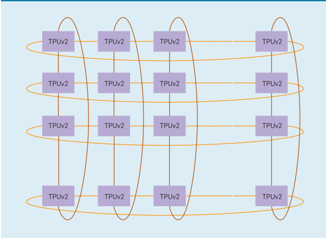
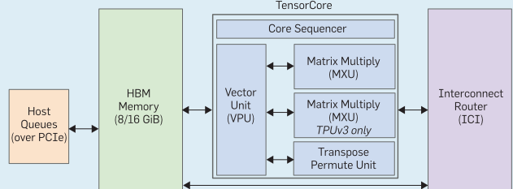
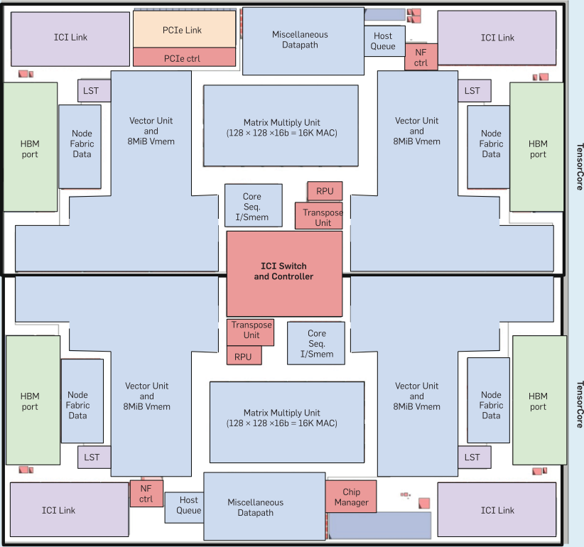
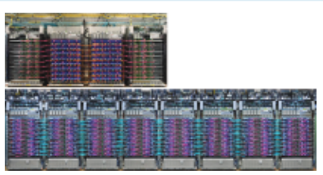
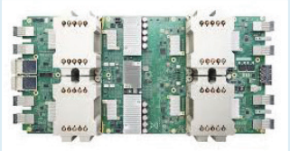
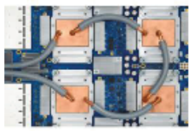
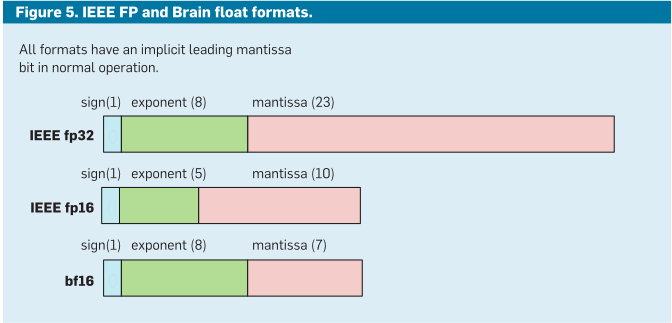
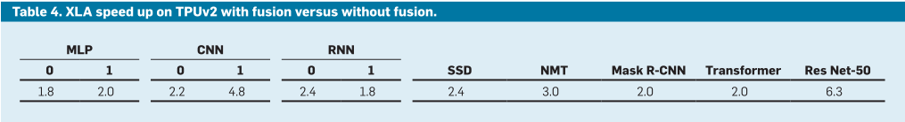
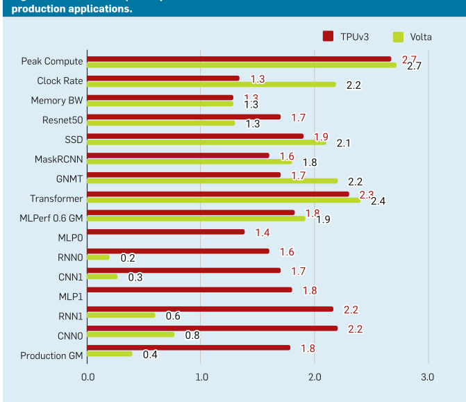
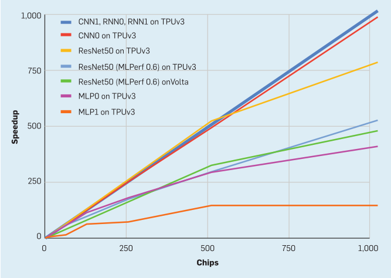

> 本文件由 `Jouppi2020-CACM-DSA-Supercomputer.pdf` 自动转换（docling 2.140.0，2026-10-17）。图片在 `images/` 目录；表格与数字请以 PDF 原文为准；`<!-- p.N -->` 标记对应 PDF 第 N 页。

<!-- p.1 -->

Google's TPU supercomputers train deep neural networks 50x faster than general-purpose supercomputers running a high-performance computing benchmark.

BY NORMAN P. JOUPPI, DOE HYUN YOON, GEORGE KURIAN, SHENG LI, NISHANT PATIL, JAMES LAUDON, CLIFF YOUNG, AND DAVID PATTERSON

## A DomainSpecific Supercomputer for Training Deep Neural Networks

THE RECENT SUCCESS of deep neural networks (DNNs) has inspired a resurgence in domain specific architectures (DSAs) to run them, partially as a result of the deceleration of microprocessor performance improvement due to the slowing of Moore's Law. 17 DNNs have two phases: training, which constructs

accurate models, and inference, which serves those models. Google's Tensor Processing Unit (TPU) offered 50x improvement in performance per watt over conventional architectures for inference. 19,20 We naturally asked whether a successor could do the same for training. This article explores how Google built the first production DSA for the much harder training problem, first deployed in 2017.

Computer architects try to create designs that maximize performance on a set of benchmarks while minimizing costs, such as fabrication or operating cost. 16 In the case of DSAs like Google's TPUs, many of the principles and experiences from decades of building general-purpose CPUs change or do not apply. For example, here are features of the inference TPU (TPUv1) and the training TPU (TPUv2) share but are uncommon in CPUs:

- ˲ 1-2 large cores versus 32-64 small cores in server CPUs.
- ˲ The computational heavy lifting is handled by two-dimensional (2D)

<!-- p.2 -->

128x128- or 256x256-element systolic arrays of multipliers per core, versus either a few scalar multipliers or SIMD (one-dimensional, 16-32-element) multipliers per core in CPUs.

˲ Using narrower data (8-16 bits) to improve efficiency of computation and memory versus 32-64 bits in CPUs.

˲ Dropping general-purpose features irrelevant for DNNs but critical for CPUs such as caches and branch predictors.

The most effective DNN training is supervised learning, where we start with a huge (sometimes billion-example) training dataset of known-correct (input, result) pairs. Pairs might be an image and what it depicts or an audio waveform and the phoneme it represents. We also start with a neural network model, which transforms the input into the result through an intensive calculation of weights (also called parameters); the weights are random initially. Models are typically defined as a graph of layers, where a layer contains a linear algebra part (often a matrix multiplication or convolution using the weights) followed by a nonlinear activation function (often a scalar function, applied elementwise; we call the results activations). Training "learns" weights that raise the likelihood of correctly mapping from input to result.

For some kinds of input data, an embedding at the start of the model transforms from sparse representations into a dense representation suitable for linear algebra; embeddings also contain weights. 27,29 Embeddings might use vectors where features can be represented by notions of distance between vectors. Embeddings involve table lookups, link traversal, and variable length data fields, so they are irregular and memory intensive.

How do we get from random initial weights to trained weights? Current best practices use variants of stochastic gradient descent (SGD). 31 SGD consists of many iterations of three steps: forward propagation, backpropagation, and weight update. Forward propagation takes a randomly chosen training example, applies its inputs to the model, and runs the calculation through the layers to produce a result (which with the random initial weights, is garbage the first time). Forward propagation is functionally similar to DNN inference,

## DNN (Deep Neural Network) wisdom is that bigger machines lead to bigger breakthroughs.

and if we were building an inference accelerator, we could stop there. For training, this is less than a third of the story. SGD next measures the difference or error between the model's result and the known good result from the training set using a loss function. Then back-propagation runs the model in reverse, layerby-layer, to produce a set of error/loss values for each layer's output. These losses measure the deviation from the desired output. Last, weight update combines the input of each layer with the loss value to calculate a set of deltas-changes to weights-which, when added to the weights, would have resulted in nearly zero loss. Updates can have small magnitude. Shrinking further, updates are scaled down by the learning rate to keep SGD numerically stable. Moreover, a suite of algorithmic refinements-including momentum, 30 batch normalization, 18 and optimizers such as Adaptive Gradient (AdaGrad) 14 -require their own state and alter the SGD algorithm to reduce the number of steps to achieve desired accuracy.

Each SGD step makes a tiny adjustment to the weights that improves the model with respect to a single (input, result) pair. Each pass through the entire dataset is an epoch; DNNs typically take tens to hundreds of epochs to train. SGD gradually transforms the random initial weights into a trained model, sometimes capable of superhuman accuracy.

Given this background, we can compare inference and training. Both share some computational elements including matrix multiplications, convolutions, and activation functions, so inference and training DSAs might have similar functional units. Key architectural aspects where the requirements differ include:

˲ Harder parallelization: Each inference is independent, so a simple cluster of servers with DSA chips can scale up inference. A training run iterates over millions of examples, coordinating across parallel resources because it must produce a single consistent set of weights for the model. The number of examples processed in parallel, and the time to evaluate that multiple-example minibatch-often shortened to batch-directly affect total end-to-end training time. A step is the computation to process one minibatch.

<!-- p.3 -->

- ˲ More computation: Back-propagation requires derivatives for every computation in a model. It includes activation functions (some of which are transcendental), and multiplication by transposed weight matrices.
- ˲ More memory: Weight update accesses intermediate values from forward and back propagation, vastly upping storage requirements; temporary storage can be 10x weight storage. For inference, a small activation working set can usually be kept on chip.
- ˲ More programmability: Training algorithms and models are continually changing, so a machine restricted to current best-practice algorithms during design could rapidly become obsolete.
- ˲ Wider data: Quantized arithmetic-8-bit integer instead of 32-bit floating point (FP)-can work for inference like in TPUv1 but reduced-precision training is an active research area. 21,25 The challenge is sufficiently capturing the SGD sum of many small weight updates to preserve the accuracy of using 32-bit FP arithmetic to train models.

After explaining the TPUv2 architecture, we describe the domain specific language (TensorFlow) and compiler (XLA) for TPUv2 and compare the architecture and technology choices for the TPUv2 versus a GPU, the most popular computer for DNN training. Later, we compare performance per chip and full supercomputers of TPUs and GPUs using production applications and the MLPerf benchmarks.

## Designing a Domain-Specific Supercomputer

In 2014, when the TPUv2 project began, the landscape for high-performance machine learning computation was very different from today. Training took place on clusters of CPUs. State-of-the-art parallel training used asynchronous SGD, 12 in part to tolerate tail latencies in shared clusters. Parallel training also divided CPUs into a bipartite graph of workers (running the SGD loop) and parameter servers (hosting weights and adding updates to them).

The DNN training computation appetite appeared unlimited. (Indeed, the computation requirements for the largest training runs grew 10x annually from 2012 to 2018. 2 ) Thus, in 2014 we chose to build a DSA supercomputer instead of clustering CPU hosts with DSA chips. The first reason is that training time is huge. Table 1 shows that one TPUv2 chip would take two to 16 months to train a single Google production application, so a typical application might want to use hundreds of chips. Second, DNN wisdom is that bigger datasets plus bigger machines lead to bigger breakthroughs. Moreover, results like AutoML use 50x more computation to find DNN models that achieve higher accuracy scores than the best models of human DNN experts. 42

Designing a DSA supercomputer interconnect. The critical architecture feature of a modern supercomputer is how its chips communicate: what is the speed of a link; what is the interconnect topology; does it have centralized versus distributed switches; and so on. This choice is much easier for a DSA supercomputer, as the communication patterns are limited and known. For training, most traffic is an all-reduce over weight updates from all nodes of the machine.

If we distribute switch functionality into each chip rather than as a standalone unit, the all-reduction can be built in a dimension-balanced, bandwidth-optimal way for a 2D torus topol-

## key insights

- ˽ With the slowing of Moore's Law, ML breakthroughs require innovation in computer architecture.
- ˽ The increasing importance and appetite for ML training justifies its own custom supercomputer.
- ˽ The co-design of an ML-specific programming system (TensorFlow), compiler (XLA), architecture (TPU), floating-point arithmetic (Brain float16), interconnect (ICI), and chip (TPUv2/v3) let production ML applications scale at 96%-99% of perfect linear speedup and 10x gains in performance/ Watt over the most efficient general-purpose supercomputers.

ogy (see Figure 1). An on-device switch provides virtual-circuit, deadlock-free routing. To enable a 2D torus, the chip has four custom Inter-Core Interconnect (ICI) links, each running at 496Gbits/s per direction in TPUv2. ICI enables direct connections between chips to form a supercomputer using only 13% of each chip (see Figure 3). Direct links simplify rack-level deployment, but in a multi-rack system the racks must be adjacent.

One measure of an interconnect is its bisection bandwidth-the bandwidth available between two halves of a network of the worst-case split. The TPUv2 supercomputer uses a 16x16 2D torus (256 chips), which is 32 links x 496Gbits/s = 15.9Terabits/s of bisection bandwidth. As a comparison, a separate Infiniband switch (used in CPU clusters) that connected 64 hosts (each with, say, four DSA chips) has 64 ports using "only" 100Gbit/s links and a bisection bandwidth of at most 6.4Terabits/s. Our TPUv2 supercomputer provides 2.5x the bisection bandwidth over conventional cluster switches while skipping the cost of the Infiniband network cards, Infiniband switch, and the communication delays of going through the CPU hosts of clusters.

Table 1. Days to train production programs on one TPUv2 chip.

|   MLP0 |   MLP1 |   CNN0 |   CNN1 |   RNN0 |   RNN1 |
|--------|--------|--------|--------|--------|--------|
|    475 |    117 |     63 |    115 |     77 |    147 |

Figure 1. A 2D-torus topology. TPUv2 uses a 16x16 2D torus.

<!-- p.4 -->

Table 2. Batch sizes for the three regions of Shallue. 32 LM1B, Fashion MNIST, and Imagenet are standard DNN datasets.

| Model                       | Perfect   | Diminishing   | Maximum   |
|-----------------------------|-----------|---------------|-----------|
| Transformer on LM1B         | ≤256      | 256-4096      | ≥4096     |
| Simple CNN on Fashion MNIST | ≤512      | 512-2048      | ≥2048     |
| ResNet-50 on Imagenet       | ≤8192     | 8192-65536    | ≥65536    |

Figure 2. Block diagram of a TensorCore (our internal development name for a TPU core, and not related to the Tensor Cores of NVIDIA GPUs).

Fortuitously, building a fast interconnect inspired algorithmic advances. With dedicated hardware, and sharding the examples of a minibatch over nodes of the machine, there is little tail latency, and synchronous parallel training becomes possible. Internal studies 5 suggested that synchronous training could beat asynchronous SGD with equivalent resources. Asynchronous training introduces heterogeneity plus parameter servers that eventually limit parallelization, as the weights get sharded and the bandwidth from parameter servers to workers becomes a bottleneck. Synchronous training eliminated the parameter servers allowing peer- to-peer among workers, using the all-reduce to ensure workers begin and end each parallel step with consistent copies of weights.

Synchronous training has two phases in the critical path-a compute phase and a communication phase that reconciles the weights across learners. The slowest learners and slowest messages through the network limit performance of such a synchronous system. Since the communication phase is in the critical path, a fast interconnect that quickly reconciles weights across learners with well-controlled tail latencies is critical for fast training. The ICI network is key to the excellent TPU supercomputer scaling results; later we show 96%-99% of perfect linear scaleup.

Designing a DSA supercomputer node. The TPUv2 node of the supercomputer followed the main ideas of TPUv1: A large two-dimensional matrix multiply unit (MXU) using a systolic array to reduce area and energy plus large, software-controlled on-chip memories instead of caches. The large MXUs of the TPUs rely on large batch sizes, which amortize memory accesses for weights-performance often increases when memory traffic reduces.

Shallue et al. 32 examined the effect of increasing batch size on training time, and found three regions for all models (as seen in Table 2):

1. Perfect scaling region: Each doubling of batch size halves the number of training steps.
2. Diminishing returns region: Increasing batch size still reduces the number of steps, but more slowly.
3. Maximum data parallelism region: Increasing batch size provides no benefits whatsoever.

Such scaling while preserving accuracy required tuning the learning rate, batch size, and other hyperparameters.

Fortunately for TPUs, these recent results show that batch sizes of 2568,192 scale perfectly without losing accuracy, which makes large MXUs an attractive option for high performance.

Unlike TPUv1, TPUv2 uses two cores per chip. Global wires on a chip don't scale with shrinking feature size, so their relative delay increases. Given that training can use many processors, two smaller TensorCores per chip prevented the excessive latencies of a single large full-chip core. We stopped at two because it is easier to efficiently generate programs for two brawny cores per chip than numerous wimpy cores.

Figure 2 shows the six major blocks of a TensorCore and Figure 3 shows their placement in the TPUv2 chip:

1. Inter-Core Interconnect (ICI). Explained earlier.
2. High Bandwidth Memory (HBM). TPUv1 was memory bound for most of its applications. 20 We solved its memory bottleneck by using High Bandwidth Memory (HBM) DRAM in TPUv2. It offers 20 times the bandwidth of TPUv1 by using an interposer substrate that connects the TPUv2 chip via thirtytwo 128-bit buses to four short stacks of DRAM chips. Conventional servers support many more DRAM chips, but at a much lower bandwidth of at most eight 64-bit busses.
3. The Core Sequencer fetches VLIW (Very Long Instruction Word) instructions from the core's on-chip, software-managed Instruction Memory (Imem), executes scalar operations using a 4K 32-bit scalar data memory (Smem) and 32 32-bit scalar registers (Sregs), and forwards vector instructions to the VPU. The 322-bit VLIW instruction can launch eight operations: two scalar, two vector ALU, vector load and store, and a pair of slots that queue data to and from the matrix

<!-- p.5 -->

multiply and transpose units. The XLA compiler schedules loading Imem via independent overlays of code, as unlike conventional CPUs, there is no instruction cache.

4. The Vector Processing Unit (VPU) performs vector operations using a large on-chip vector memory (Vmem) with 32K 128 x 32-bit elements (16MiB), and 32 2D vector registers (Vregs) that each contain 128 x 8 32-bit elements (4 KiB). The VPU streams data to and from the MXU through decoupling FIFOs. The VPU collects and distributes data to Vmem via data-level parallelism (2D matrix and vector functional units) and instruction-level parallelism (8 operations per instruction).

Your beautiful DSA can fail if bestpractice algorithms change, rendering

## Figure 3. TPUv2 chip floor plan.

It has two TensorCores: Node fabric data and NF controller move on-chip data.

it prematurely obsolete. We handled such a crisis in 2015 during our design in supporting batch normalization. 18 Briefly, batch normalization subtracts out the mean and divides by the standard deviation of a batch, making the values look like samples from the normal distribution. In practice, it both improves prediction accuracy and reduces time-to-train up to 14x! Batch normalization emerged early in 2015, and the results made it a must-do for us. We divided it into vector additions and multiplications over the batch, plus one inverse-square-root calculation. However, the vector operation count was high. We thus added a second SIMD dimension to our vector unit, making its registers and ALUs 128x8 (rather than just 1D 128-wide) and adding an inverse square root operation to the transcendental unit.

5. The MXU produces 32-bit FP products from 16-bit FP inputs that accumulate in 32 bits. All other computations are in 32-bit FP except for results going directly to an MXU input, which are converted to 16-bit FP.

The MXUs are large, but we reduced their size from 256x256 in TPUv1 to 128x128 and have multiple MXUs per chip. The bandwidth required to feed and obtain results from an MXU is proportional to its perimeter, while the computation it provides is proportional to its area. Larger arrays provide more compute per byte of interface bandwidth, but larger arrays can be inefficient. Simulations show that convolutional model utilization of four 128x128 MXUs is 37%-48%, which is 1.6x of a single 256x256 MXU (22%-30%) yet take about the same die area. The reason is that some convolutions are naturally smaller than 256x256, so sections of the MXU would be idle. Sixteen 64x64 MXUs would have a little higher utilization (38%-52%) but would need more area. The reason is the MXU area is determined either by the logic for the multipliers or by the wires on its perimeter for the inputs, outputs, and control. In our technology, for 128x128 and larger the MXU's area is limited by the multipliers but area for 64x64 and smaller MXUs is limited by the I/O and control wires.

<!-- p.6 -->

6. The Transpose Reduction Permute Unit does 128x128 matrix transposes, reductions, and permutations of the VPU lanes.

Alternative DSA supercomputer

## Table 3. Key processor features.

We cannot reveal technology details of our chip partner. Although it is in a larger, older technology, the TPUv2 die size is less than 3/4s of the GPU. TPUv3 is 6% larger in that same technology. TDP stands for Thermal Design Power. The Volta has 80 symmetric multiprocessors.

| Feature                          | TPUv1       | TPUv2            | TPUv3             | Volta              |
|----------------------------------|-------------|------------------|-------------------|--------------------|
| Peak TeraFLOPS/ Chip             | 92 (8b int) | 46 (16b) 3 (32b) | 123 (16b) 4 (32b) | 125 (16b) 16 (32b) |
| Network links x Gbits/s/Chip     | --          | 4 x 496          | 4 x 656           | 6 x 200            |
| Max chips/supercomputer          | --          | 256              | 1024              | Varies             |
| Peak PetaFLOPS/supercomputer     | --          | 11.8             | 126               | Varies             |
| Bisection Terabits/supercomputer | --          | 15.9             | 42.0              | Varies             |
| Clock Rate (MHz)                 | 700         | 700              | 940               | 1530               |
| TDP (Watts)/Chip                 | 75          | 280              | 450               | 450                |
| TDP (Kwatts)/supercomputer       | --          | 124              | 594               | Varies             |
| Die Size (mm 2 )                 | <331        | <611             | <648              | 815                |
| Chip Technology                  | 28nm        | >12nm            | >12nm             | 12nm               |
| Memory size (on-/off-chip)       | 28MiB/8GiB  | 32MiB/16GiB      | 32MiB/32GiB       | 36MiB/32GiB        |
| Memory GB/s/Chip                 | 34          | 700              | 900               | 900                |
| MXUs/Core, MXU Size              | 1 256x256   | 1 128x128        | 2 128x128         | 8 4x4              |
| Cores/Chip                       | 1           | 2                | 2                 | 80                 |
| Chips/CPU Host                   | 4           | 4                | 8                 | 8 or 16            |

## Figure 4. A TPUv2 supercomputer has up to 256 chips and is 18-ft. long (top).

A TPUv3 supercomputer consisting of up to 1,024 chips (below) is about 7-ft. tall and 36-ft. long. A TPUv2 board (center) holds four air-cooled chips and a TPUv3 board (right) also has four chips but uses liquid cooling.

node designs. The TPUv1 article evaluated hypothetical alternatives that examined the changes in performance while varying the MXU size, the clock rate, and the memory bandwidth. 20 We need not hypothesize here, as we implemented and deployed two versions of the training architecture: TPUv2 and TPUv3. TPUv3 has ≈1.35x the clock rate, ICI bandwidth, and memory bandwidth plus twice the number of MXUs, so peak performance rises 2.7x. Liquid cools the chip to allow 1.6x more power. We also expanded the TPUv3 supercomputer to 1024 chips (see Figure 4). Table 3 lists key features of the three TPU generations along with a contemporary GPU (NVIDIA Volta) that we'll compare to below.

The TPUv3 die size is only 6% larger than TPUv2 in the same technology despite having twice as many MXUs per TensorCore simply because the engineers had a better idea beforehand of the layout challenges of the major blocks in TPUv2, which led to a more efficient floor plan for TPUv3.

Designing DSA supercomputer arithmetic. Peak performance is ≥8x higher when using 16-bit FP instead of 32-bit FP for matrix multiply (see Table 3), so it's vital to use 16-bit to get highest performance. While we could have built an MXU using standard IEEE fp16 and fp32 floating point formats (see Figure 5), we first checked the accuracy of 16bit operations for DNNs. We found that:

- ˲ Matrix multiplication outputs and internal sums must remain in fp32.
- ˲ The 5-bit exponent of fp16 matrix multiplication inputs leads to failure

<!-- p.7 -->

of computations that go outside its narrow range, which the 8-bit exponent of fp32 avoids.

- ˲ Reducing the matrix multiplication input mantissa size from fp32's 23 bits to 7 bits did not hurt accuracy.

The resulting brain floating format (bf16) in Figure 5 keeps the same 8-bit exponent as fp32. Given the same exponent size, there is no danger in losing the small update values due to FP underflow of a smaller exponent, so all programs in this article used bf16 on TPUs without much difficulty. Beyond our experience that it works for training production applications, a recent Intel study corroborated its benefits. 21 However, fp16 requires adjustments to training software (loss scaling) to deliver convergence and efficiency. It preserves the effect from small gradients by scaling losses to fit the smaller exponents of fp16. 26

As the size of an FP multiplier scales with the square of the mantissa width, the bf16 multiplier is half the size and energy of a fp16 multiplier: 8² / 11² ≈ 0.5 (accounting for the implicit leading mantissa bit). Bf16 delivers a rare combination: reducing hardware and energy while simplifying software by making loss scaling unnecessary. Thus, ARM and Intel have revealed future chips with bf16.

## Designing a DSA Supercomputer Compiler

The next step was getting software for our hardware. To program CPUs and GPUs for machine learning, a framework such as TensorFlow (TF) 1 specifies the model and data operations machine-independently. TF is a domain-specific library built on Python. NVIDIA GPU-dependent work is supported by a combination of the CUDA language, the CuBLAS and CuDNN libraries, and the TensorRT system. TPUv2/v3s also use TF, with the new system XLA (for accelerated linear algebra) handling the TPU-dependent mapping. XLA also targets CPUs and GPUs. Like many systems that map from domain-specific languages to code, XLA integrates a high-level library and a compiler. A TF front end generates code in an intermediate representation for XLA.

It would seem it should be more difficult to get great performance in a programming system based on Python like TF. However, ML frameworks offer both a higher level of expressiveness and the potential for much better optimization information than lower-level languages like C++. TF programs are graphs of operations, where multi-dimensional array operations are firstclass citizens:

- ˲ They operate on multi-dimensional arrays explicitly, rather than implicitly via nested loops as in C++.
- ˲ They use explicit, analyzable, and bounded data access patterns versus arbitrary access patterns like C++.
- ˲ They have known memory aliasing behavior, unlike C++.

These three factors allow the XLA compiler to safely and correctly transform programs in ways that traditional compilers rarely attain.

XLA does whole-program analysis and optimization. With 2D vector registers and compute units in TPUv2/v3, the layout of data in both compute units and memory is critical to performance, perhaps more than for a vector or SIMD processor. Building efficient code for vector machines, with 1D memory and compute units, is well understood. For the MXU, two 2D

inputs interact to produce a 2D output. Each operand has a memory layout, which gets transformed into a layout in 2D registers, which in turn must be fed at the exact moment to meet systolic array timing in the MXU. (A systolic array reduces register accesses by choreographing data flowing from different directions to regularly arrive at cross points that combine them.) Depending on layout choices, the 2D registers dimensions of 128 and 8 might not be filled, lowering ALU and memory utilization. Moreover, lacking caches, XLA manages all memory transfers, including code overlays and DMA pushes to remote nodes over ICI.

XLA exploits the huge parallelism that an input TF dataflow graph represents. Beyond the parallelism of operations ("ops") in a graph, each op can comprise millions of multiplications and additions on data tensors of millions of elements. XLA maps this abundant parallelism across hundreds of chips in a supercomputer, a few cores per chip, multiple units per core, and thousands of multipliers and adders inside each functional unit. The domain-specific TF language and XLA representation allow precise reasoning about memory use at every point in the program. There are no "aliasing" issues where the compiler must determine whether two pointers might address the same memory-every piece of memory corresponds to a known program variable or temporary. The XLA compiler is free to slice, tile, and lay out memory and operations to best use the on-chip memory bandwidth and to reduce the memory footprint on chip or off chip.

|   MLP |   MLP | CNN     |     | RNN     |         |   Mask R-CNN |   Transformer Res |            |
|-------|-------|---------|-----|---------|---------|--------------|-------------------|------------|
|     0 |     1 | 0 1     |   0 | 1       | SSD NMT |              |               2.0 | Net-50 6.3 |
|   1.8 |   2.0 | 2.2 4.8 | 2.4 | 1.8 2.4 | 3.0     |          2.0 |                   |            |

<!-- p.8 -->

TPUs use a VLIW architecture to express instruction-level parallelism to the many compute units of a TensorCore. XLA uses standard VLIW compilation techniques including loop unrolling, instruction scheduling, and software pipelining to keep all compute units busy and to simultaneously move data through the memory hierarchy to feed them.

Given a memory layout of data, operator fusion can reduce memory use and boost performance. Fusion is a traditional compiler optimization-but applied now to 2D data-that combines ops to reduce memory traffic compared to executing operators sequentially. For example, fusing a matrix multiplication with a following activation function skips writing and reading the intermediate products from memory. Table 4 shows the speedup from the fusion optimization on 2D data is from 1.8 to 6.3.

The TF intermediate form for XLA has thousands of ops. The number of ops increases when programmers cannot combine existing ops if composition is inefficient. Alas, expanding the number of ops is an engineering challenge, since software libraries need to be developed for CPUs, GPUs, and TPUs. The hope was that the XLA compiler could synthesize these thousands of ops from a smaller set of primitive ops.

The XLA team needed only 96 ops as the compiler's target to reduce work for the library/compiler by enhancing composability. For example, XLA has a single op for convolution (kConvolution) letting the compiler handle all the memory layout variations. The TF intermediate form has nine; for example, Conv2D, Conv2dBackpropFilter, DepthwiseConv2dNative, and DepthwiseConv2dNativeBackpropFilter. For the CNN1 program, the XLA compiler fused 63 different operations with at least one kConvolution.

Since ML platforms and DSAs offered a new set of compiler challenges, it was unclear how fast they would improve. Table 5 shows the median gain over only six months for MLPerf from version 0.5 to 0.6 was 1.3x for GPUs and 2.1x for TPUs! (Perhaps the younger XLA compiler has more opportunity to improve than the more mature CUDA stack.) One reason for the large gain is the focus on benchmarks, but production applications also advanced. Increasing bf16 use, optimizing model architecture, and XLA generating better code sped up CNN0 by 1.8x in 15 months and improving partitioning/placement for embeddings and XLA optimizations accelerated MLP0 by 1.65x.

## Contrasting GPU and TPU Architectures

As details of TPU and GPU architectures are now public, let us compare

Table 5. Speedup of MLPerf 0.6 over 0.5 in six months.

|       |   ResNet50 |   SSD |   MaskRCNN |   NMT |   Transformer |   Median |
|-------|------------|-------|------------|-------|---------------|----------|
| Volta |        1.3 |   1.2 |        1.8 |   1.0 |           2.0 |      1.3 |
| TPUv3 |        1.4 |   1.4 |        3.5 |   2.1 |           3.0 |      2.1 |

## Table 6. Adjusted comparison of GPU and TPU.

Die sizes are adjusted by the square of the technology, as the semiconductor technology for TPUs is similar but larger and older than that of the GPU. We picked 15nm for TPUs based on the information in Table 3. Thermal Design Power (TDP) is for 16-chip systems. TPUs come with a host CPU. This GPU price adds price of a n1-standard-16 CPU.

|       | Die size   | Adjusted die size   |   TD - (kw) | Cloud price   | Relative to GPU - Die   |   Relative to GPU - TDP |   Relative to GPU - Price |
|-------|------------|---------------------|-------------|---------------|-------------------------|-------------------------|---------------------------|
| Volta | 815        | 815                 |        12.0 | $3.24         | 1.00                    |                    1.00 |                      1.00 |
| TPUv2 | <611       | <391                |         7.7 | $1.13         | <0.5                    |                    0.64 |                      0.35 |
| TPUv3 | <648       | <415                |         9.3 | $2.00         | <0.5                    |                    0.78 |                      0.62 |

TPU and GPU choices before we compare performance.

Multi-chip parallelization is built into TPUs through ICI and supported through all-reduce operations plumbed through XLA to TF. Similarsized multi-chip GPU systems use a tiered networking approach, with NVIDIA's NVLink inside a chassis and host-controlled InfiniBand networks and switches to tie multiple chassis together.

TPUs offer bf16 FP arithmetic designed for DNNs inside 128x128 systolic arrays that halves the die area and energy versus IEEE fp16 FP multipliers. Volta GPUs have also embraced reduced-precision systolic arrays, with a finer granularity-4x4 or 16x16 depending on hardware or software descriptions-while using fp16 rather than bf16, so they may require software to perform loss scaling plus extra die area and energy.

TPUs are dual-core, in-order machines, where the XLA compiler overlaps computation, memory, and network activities. GPUs are latency-tolerant manycore machines, where each core has many threads and thus very large (20MiB) register files. Threading hardware plus CUDA coding conventions support overlapped operations.

TPUs use software controlled 32MiB scratchpad memories that the compiler schedules, while Volta hardware manages a 6MiB cache and software manages a 7.5MiB scratchpad memory. The XLA compiler directs sequential DRAM accesses typical of DNNs via direct memory access (DMA) controllers on TPUs while GPUs use multithreading plus coalescing hardware for them.

Thottethodi and Vijaykumar 35 concluded that when compared to TPUs:

"[GPUs] incur high overhead in performance, area, and energy due to heavy multithreading which is unnecessary for DNNs which have prefetchable, sequential memory accesses. The systolic organization [of TPUs] ... capture[s] DNNs' data reuse while being simple by avoiding multithreading."

In addition to the contrasting architectural choices, TPU and GPU chips use different technologies, die areas, clock rates, and power. Table 6 gives three related cost measures of these systems: approximate die size adjusted for technology; power for a 16-chip system; and cloud price per chip. The GPU adjusted die size is more than twice that of the TPUs, which suggests the capital costs of the chips is at least double, since there would be at least twice as many TPU dies per wafer. GPU power is 1.3x-1.6x higher, which suggests higher operating expenses, as the total cost of ownership is correlated with power. 19 Finally, the hourly rental prices on Google Cloud Engine are 1.6x-2.9x higher for the GPU. These three different measures consistently suggest TPUv2 and TPUv3 are roughly half to three fourths as expensive as the Volta GPU.

<!-- p.9 -->

## Performance Evaluation

In computer architecture, we "grade on a curve" versus "grade on an absolute scale," so we need to measure performance relative to the competition. Before showing performance of TPU supercomputers, we must establish the virtues of a single chip, for a 1024x speedup from 1,024 wimpy chips is uninteresting.

We first compare training performance for a standard set of ML benchmarks and Google production applications for TPUv2/v3 chip and the Volta GPU chip; TPUv3 and Volta are about the same speed. We then check if four MXUs per chip in TPUv3 really helped, or if other bottlenecks in the TPUv3 chip made the extra MXUs superfluous; they helped! We conclude the chip comparison looking at inference for TPUv2/v3 versus TPUv1; TPUv2/v3 are much faster.

Having established the merits of the TPU chips, we then evaluate the TPUv2/v3 supercomputer. The first step is to see how well it scales; we see 96%-99% of perfect linear speedup at 1024 chips. We then compare the fraction of peak performance and performance per Watt of TPU and traditional supercomputers; TPUs have 5x-10x better performance per Watt.

Chip performance: TPUv2/v3 versus the Volta GPU. Figure 6 shows the performance of TPUv3 and the Volta GPU over TPUv2 for two sets of programs. The first set is five programs that Google and NVIDIA both submitted to MLPerf 0.6 in May 2019, and both use 16-bit multiplication with NVIDIA software performing loss scaling. The geometric mean speedup of these programs over TPUv2 is 1.8 for TPUv3 and 1.9 for Volta.

Figure 6. Performance per chip relative to TPUv2 for five MLPerf 0.6 benchmarks and six production applications.

Table 7. Google's inference (July 2016) and training (April 2019) workloads by DNN model type.

| DNN Model   | TPUv1 July 2016   | TPUv3 April 2019   |
|-------------|-------------------|--------------------|
| MLP         | 61%               | 27%                |
| RNN         | 29%               | 21%                |
| CNN         | 5%                | 24%                |
| Transformer | --                | 21%                |

We also wanted to measure performance of production workloads. We chose six production applications similar to what we used for TPUv1 as representative of Google's workload:

- ˲ In MultiLayer Perceptrons (MLP) each new layer of a model is a set of nonlinear functions of a weighted sum of all outputs (fully connected) from a prior one. This classic DNN usually has text as input. MLP0 is unpublished but MLP1 is RankBrain, 9 which ranks search results for a Web page.
- ˲ In Convolutional Neural Networks (CNN), each ensuing layer is a set of nonlinear functions of weighted sums of spatially nearby subsets of outputs from the prior layer. CNNs usually have images as inputs. CNN0 is AlphaZero, a reinforcement learning algorithm with extensive use of CNNs, which mastered the games chess, Go, and shogi. 34 CNN1 is a Google-internal

model for image recognition.

- ˲ In Recurrent Neural Networks (RNN), each subsequent model layer is a collection of nonlinear functions of weighted sums of outputs and the previous state. Sequence prediction problems, such as language translation, use RNNs. RNN0 is RNMT+ 6 and RNN1 is Improved LAS. 8

We recently compared the representative datacenter workloads by model type for inference on TPUv1 20 versus TPUv2/v3 for training. Table 7 illustrates the fast-changing nature of DNNs. We originally used the name LSTM (Long Short-Term Memory) for TPUv1 applications, a type of RNN. Although sampled three years apartJuly 2016 versus April 2019-we were still surprised that CNNs were a much larger part of datacenter training, and that a new model Transformer 36 -published the year that TPUv2 was deployed-was as popular as RNNs. (Transformer is part of MLPerf 0.5.)

<!-- p.10 -->

Transformer is intended for the same tasks as RNNs, such as translation, but is considerably faster since it lends itself to parallelization while RNNs have sequential dependencies. The layers of Transformer are a mix of MLPs and attention layers. 4 Attention is the key new mechanism used in Transformer; it lets neural networks look up data associatively, in a memory-like structure whose indices themselves are learned. The components of attention resemble those of other layers, including matrix multiplications and dot products, which map well to TPU hardware. One difference is that attention matrices grow with sequence length, adding dynamic shape and memory requirements that complicate some optimizations done by XLA. The success of this recent model (see Figure 6) highlights TPU programmability.

The geometric mean speedup of the six production applications was 1.8 for TPUv3 but only 0.4 for Volta, primarily because they use 8x slower fp32 on GPUs instead of fp16 (Table 3). These are large production applications that are continuously improved, and not simple benchmarks, so it's a lot of work to get them to run at all, and more to run well. As noted earlier, application programmers focus on TPUs, since they are in everyday use, so there is little urge to include loss scaling needed for fp16. (TF kernels for embeddings have not been developed for GPUs, so we exclude MLPs from the GPU geometric mean as they could not run.)

Is TPUv3 memory bound or compute bound? While the peak compute improvement of TPUv3 over TPUv2 is 2.7x, the improvements in memory bandwidth, ICI bandwidth, and clock rate are only ≈1.35x. We wondered whether the extra MXUs in TPUv3 would be underutilized due to bottlenecks elsewhere. Figure 6 shows that one production application runs a bit higher than the memory improvement at 1.4x, but the other five and all the MLPerf 0.6 benchmarks run much faster at 1.6x to 2.3x. The large application batch sizes and sufficient on-chip storage enabled these good results. As the MXUs are not a large part of the chip (Figure 3), doubling the MXUs in TPUv3 clearly proved beneficial.

Figure 7. Supercomputer scaling: TPUv3 and Volta.

Table 8. Days to train MLPerf 0.5 benchmarks on one TPUv2 chip. See Table 1 for time to train production applications.

|   ResNet50 |   SSD |   Mask R-CNN |   GNMT |   Transformer |
|------------|-------|--------------|--------|---------------|
|        0.8 |   0.3 |          1.9 |    0.2 |           0.3 |

Inference on a training chip: TPUv2/ v3 vs. TPUv1. What about inference speed? Running it on a training chipwhich works since it is like the forward pass-could help applications that require frequent training on fresh data. TPUv2/v3 do not support 8-bit integer data types, so inference uses bf16. One upside of using the same arithmetic for training and inference is that ML experts don't need to do extra workcalled quantization-to ensure the same accuracy of the DNN model.

One danger is the larger batch sizes needed to run efficiently on TPUv2/v3 could hurt inference latency. Fortunately, we have DNN models that can meet their latency targets with batch sizes of greater than 1,000. With billions of daily users, inferences per second across the whole data center fleet can be very high.

The LSTM0 benchmark, for instance, ran at 48 inferences per second with a response time of 122ms on TPUv1. 19 TPUv2 runs it 5.6x as fast with a 2.8x lower response time (44ms) at the same batch size. The lower latency in turn allows for larger batches compared to TPUv1 to be served in production yet still meet latency targets. With larger batches, the throughput rose to 11x with a latency improvement of 2x (58ms) vs TPUv1. TPUv3 reduces latency 1.3x (45ms) versus TPUv2 at the same batch size.

DSA supercomputer scaling performance. Alas, only ResNet-50 from MLPerf 0.6 can scale beyond 1,000 TPUs and GPUs. Figure 7 shows three ResNet-50 results. Ying et al. published a ResNet-50 results on TPUv3 that delivered 77% of perfect linear scaleup at 1,024 chips, 41 but the TPUv3 version for MLPerf 0.6 only runs at 52%. The difference is in MLPerf's ground rules. MLPerf requires including evaluation in the training time. (Evaluation runs a holdout dataset after a model training finishes to determine its accuracy.) Like Ying et al., most researchers exclude it when reporting performance. More unusually, MLPerf requires running evaluation at the end of every four epochs to deter benchmark cheating. ML developers would never evaluate that frequently. For MLPerf 0.6, NVIDIA ran ResNet-50 on a cluster of 96 DGX-2H each with 16 Voltas connected via Infiniband switches at 41% of linear scaleup for 1,536 chips.

<!-- p.11 -->

Table 9. Traditional versus TPU supercomputer Top500 and Green500 rank (June 2019) for Linpack and AlphaZero.

| Name    | Cores   | Benchmark   | Data      |   Peta Flop/s | % of Peak   |   Mega-watts |   GFlop/Watt |   Top 500 |   Green 500 |
|---------|---------|-------------|-----------|---------------|-------------|--------------|--------------|-----------|-------------|
| Tianhe  | 4865k   | Linpack     | 32/64 bit |          61.4 | 61%         |        18.48 |          3.3 |         4 |          57 |
| SaturnV | 22k     | Linpack     | 32/64 bit |           1.1 | 59%         |         0.97 |          5.1 |       469 |           1 |
| ABCI    | 392k    | Linpack     | 32/64 bit |          19.9 | 61%         |         1.65 |         14.4 |         8 |           3 |
| TPUv2   | 0.5k    | AlphaZero   | 16/32 bit |           9.9 | 84%         |         0.12 |         79.9 |        22 |           2 |
| TPUv3   | 2k      | AlphaZero   | 16/32 bit |          86.9 | 70%         |         0.59 |        146.3 |         4 |           1 |

See article for caveats about comparing Linpack on 64-bit floating point to ML training on 16-bit floating point.

MLPerf 0.6 benchmarks are much smaller than the production applications; Table 8 shows time to train them on one TPUv2 chip is orders of magnitude less than in Table 1. Thus, we include six production applications largely to show substantial programs that can scale to supercomputer size. The MLPs are limited by embeddings and run only at 14% and 40% of perfect linear scale up on 1,024 TPUv3 chips, but one runs at 96% and three at 99%!

Note that CNN1 is an image recognition DNN much like ResNet101. It scales much better on TPUs because Google's internal image datasets are much larger than what ResNet50 uses (Imagenet).

Traditional vs. DSA supercomputer performance. Traditional supercomputers measure performance using the high-performance computing (HPC) benchmark Linpack and ranking the Top500 (top500.org). The related Green500 list re-ranks the Top500 based on performance per Watt. For these large computers to get utilization above 60%, HPC expands the size of the matrix being solved (weak scaling). (For which Linpack has long been criticized within HPC. 13 ) The TPU scale up, however, uses production programs on real-world datasets.

Table 9 shows where PetaFLOPs/ second and FLOPs/Watt of AlphaZero on TPUv2/v3 would rank in the Top500 and Green500 lists. This comparison is imperfect: conventional supercomputers crunch 32- and 64-bit data rather than the 16- and 32-bit data of TPUs. However, TPUs are running a real application on real data versus a weakly scaled benchmark on synthetic data. TPUv3 has 44x the FLOPS/Watt of Tianhe and 10x of SaturnV and ABCI.

The Fujitsu ABCI supercomputer in Table 9 includes 2,176 Intel CPUs along with 4352 Volta GPUs. Besides running Linpack, Fujitsu submitted a ResNet-50 result for MLPerf 0.6 using 2,048 GPUs. Table 10 shows time to train for ResNet-50 in MLPerf 0.6 and the number of chips for an NVIDIA GPU cluster, the Fujitsu ABCI supercomputer, and a Google TPUv3 supercomputer. Fujitsu varied from the strict benchmark MLPerf 0.6 closed guidelines of the other submissionsthey changed the LARS optimizer and the momentum hyperparameter-so it's not an apples-to-apples comparison. These changes improve performance by 10%-15%, which would also help NVIDIA and TPUv3.

Table 10. Time to train supercomputers from NVIDIA, Fujitsu, and Google on the ResNet-50 benchmark from MLPerf 0.6.

|             | NVIDIA cluster         | ABCI Supercomputer      | TPUv3 Supercomputer    |
|-------------|------------------------|-------------------------|------------------------|
| MLP         | 1536 Voltas + 192 CPUs | 2048 Voltas + 1024 CPUs | 1024 TPUv3s + 128 CPUs |
| Transformer | 80 seconds             | 70 seconds              | 77 seconds             |

## Related Work

A survey documents over 25 years of custom neural network chips, 3 but recent DNN successes led to an explosion in their development. Most designs focus on inference; far fewer, including the TPUv2/v3, target training. We are not aware of any other results that show state-of-the-art accuracy on a working DSA hardware for training.

Of the five training startups, SambaNova has not yet published. Cerebras uses a whole silicon wafer to build their system, essentially treating 84 large "dies" as a single unit. 24 Each "die" has 220MB of SRAM along with about 5k cores, yielding a total of 18GB of on-chip memory and 400k cores that collectively use 15 kilowatts. Like GraphCore, there is no DRAM in the system, so they target small batch sizes to reduce memory needs. The GraphCore 15 GC2 chip holds 1,216 Intelligence Processing Units that support seven threads, each of which has a peak performance of 100GFLOPS/s or 122TFLOPS/s per chip, almost identical to the peak performance of TPUv3 and Volta. It relies on the 300MB onchip SRAM for memory, with two GC2 chips per PCIe board. The Habana Gaudi 38 has eight VLIW SIMD cores, four stacks of HBM2 memory, bf16 arithmetic, and eight 100Gbit/sec Ethernet links to connect many chips together to form larger systems. Wave Computing's 28 Dataflow Processing Unit chip has 16k processors, 8k arithmetic units, 16MB of on-chip memory, and novelty relies on asynchronous logic instead of a clock. It has external DRAM, offering both Hybrid Memory Cube and DDR4 ports. As of February 2020, none of the five training startups has reported training accuracy or timeto-solution.

Academic training studies include the DianNao family of architectures (one of which trains) 7 and ScaleDeep; 37 to our knowledge, neither has been fabricated.

Several studies explored reducedprecision training with accelerator construction in mind. Intel's Flexpoint 22 is a block FP format, 39 although those developers switched to using bf16 for their DNN chips. 40 De Sa et al. 10 reduced precision and relaxed cache coherence. HALP 11 also made algorithmic changes to reduce quantization noise and uses 8-bit integers to train some models. None is yet available in a commercial system.

TPUv2/v3 are not the first domainspecific supercomputers to show large efficiency, performance, and scaling gains. Anton systems 33 showed two order-of-magnitude speedups over traditional supercomputers on molecular dynamics workloads. They also resulted from hardware/software/algorithm codesign, with custom chips, interconnect, and arithmetic.

<!-- p.12 -->

## Conclusion

Benchmarks suggests the TPUv3 chip performs similarly to the contemporary Volta GPU chip, but parallel scaling for production applications is stronger for the TPUv3 supercomputer:

- ˲ Three scale to 1,024 chips at 99% linear speedup;
- ˲ One scales to 1,024 chips at 96% linear speedup; and
- ˲ Two scale to 1,024 chips but are limited by embeddings.

Remarkably, a TPUv3 supercomputer runs a production application using realworld data at 70% of peak performance, higher than general-purpose supercomputers run the Linpack benchmark using weak scaling of manufactured data. Moreover, TPU supercomputers with 256-1,024 chips running a production application have 5x-10x performance/ Watt of the #1 traditional supercomputer on the Green500 list running Linpack and 24x-44x of the #4 supercomputer on the Top500 list. Reasons for this success include the built-in ICI network, large systolic arrays, and bf16 arithmetic, which we expect will become a standard data type for DNN DSAs.

TPUv2/v3 have smaller dies in an older semiconductor process and lower cloud prices despite being less mature at many levels of hardware/software system stack than CPUs and GPUs. These good results despite technological disadvantages suggests the TPU approach is cost-effective and can deliver high architectural efficiency into the future.

Going forward, our ravenous DNN colleagues want the fastest computer that we can build. 2 Despite Moore's Law ending, we expect the demand for faster DNN-specific supercomputers to grow even more quickly than Moore predicted. Trying to satisfy that demand without the help of Moore's Law offers exciting new challenges for computer architects for at least a decade. 17

## Acknowledgments

The authors analyzed TPU systems that involved contributions from many Googlers. Many thanks to the hardware and software teams and engineers for making TPU supercomputers possible, including Paul Barham, Eli Bendersky, Dehao Chen, Chiachen Chou, Jeff Dean, Peter Hawkins, Blake Hechtman, Mark Heffernan, Robert Hundt, Michael Isard, Fritz Kruger, Naveen Kumar, Sameer Kumar, Chris Leary, HyoukJoong Lee, David Majnemer, Lifeng Nai, Thomas Norrie, Tayo Oguntebi, Andy Phelps, Bjarke Roune, Brennan Saeta, Julian Schrittwieser, Andy Swing, Shibo Wang, Tao Wang, Yujing Zhang, and many more.

## References

1. Abadi, M. et al. Tensorflow: Large-scale machine learning on heterogeneous distributed systems. 2016; arXiv preprint arXiv:1603.04467.
2. Amodei, D. and Hernandez, D. AI and compute, 2018; https://blog.openai.com/aiandcompute.
3. Asanovic´ , K. Programmable neurocomputing. The Handbook of Brain Theory and Neural Networks, 2 nd Edition. M.A. Arbib, ed. MIT Press, 2002.
4. Bahdanau, D., Cho, K. and Bengio, Y. Neural machine translation by jointly learning to align and translate. 2014; arXiv preprint arXiv:1409.0473.
5. Chen, J. et al. Revisiting distributed synchronous SGD. 2016; arXiv preprint arXiv:1604.00981.
6. Chen, M.X. et al. The best of both worlds: Combining recent advances in neural machine translation. 2018; arXiv preprint arXiv:1804.09849.
7. Chen, Y. et al. Dadiannao: A machine-learning supercomputer. In Proceedings of the 47 th Int'l Symp. on Microarchitecture, (2014), 609-622.
8. Chiu, C.C. et al. State-of-the-art speech recognition with sequence-to-sequence models. In Proceedings of the IEEE Int'l Conference on Acoustics, Speech and Signal Processing, (Apr. 2018), 4774-4778.
9. Clark, J. Google turning its lucrative Web search over to AI machines. Bloomberg Technology, Oct. 26, 2015.
10. De Sa, C. et al. Understanding and optimizing asynchronous low-precision stochastic gradient descent. In Proceedings of the 44 th Int'l Symp. on Computer Architecture, (2017), 561-574.
11. De Sa, C. et al. High-accuracy low-precision training. 2018; arXiv preprint arXiv:1803.03383.
12. Dean, J. et al. Large scale distributed deep networks. Advances in Neural Information Processing Systems, (2012), 1223-1231.
13. Dongarra, J. The HPC challenge benchmark: a candidate for replacing Linpack in the Top500? In Proceedings of the SPEC Benchmark Workshop, (Jan. 2007); www.spec.org/workshops/2007/austin/slides/ Keynote\_Jack\_Dongarra.pdf.
14. Duchi, J., Hazan, E. and Singer, Y., Adaptive subgradient methods for online learning and stochastic optimization. J. Machine Learning Research 12 (July 2011), 2121-2159.
15. Graphcore Intelligence Processing Unit. (https://www. graphcore.ai/products/ipu
16. Hennessy, J.L. and Patterson, D.A. Computer Architecture: A Quantitative Approach, 6 th Edition. Elsevier, 2019.
17. Hennessy, J.L. and Patterson, D.A. A new golden age for computer architecture. Commun. ACM 62, 2 (Feb. 2019), 48-60.
18. Ioffe, S. and Szegedy, C. Batch normalization: Accelerating deep network training by reducing internal covariate shift. 2015; arXiv preprint arXiv:1502.03167.
19. Jouppi, N.P. et al. In-datacenter performance analysis of a tensor processing unit. In Proceedings of the 44 th Int'l Symp. on Computer Architecture, (June 2017), 1-12.
20. Jouppi, N.P., Young, C., Patil, N. and Patterson, D. A domain- specific architecture for deep neural networks. Commun. ACM 61, 9 (Sept. 2018), 50-59.
21. Kalamkar, D. et al. A study of Bfloat16 for deep learning training. 2019; arXiv preprint arXiv:1905.12322.
22. Köster, U. et al. Flexpoint: An adaptive numerical
23. format for efficient training of deep neural networks. In Proceedings of the 31 st Conf. on Neural Information Processing Systems, (2017).
23. Kung, H.T. and Leiserson, C.E. Algorithms for VLSI processor arrays. Introduction to VLSI Systems, 1980.
24. Lie, S. Wafer scale deep learning. In Proceedings of the IEEE Hot Chips 31 Symp., (Aug 2019).
25. Mellempudi, N. et al. Mixed precision training with 8-bit floating point. 2019; arXiv preprint arXiv:1905.12334.
26. Micikevicius, P. et al. Mixed precision training. 2017; arXiv preprint arXiv:1710.03740.
27. Mikolov, T. et al. Distributed representations of words and phrases and their compositionality. Advances in Neural Information Processing Systems (2013), 3111-3119.
28. Nicol, C. A dataflow processing chip for training deep neural networks. In Proceedings of the IEEE Hot Chips 29 Symp., (Aug 2017I.
29. Olah, C. Deep learning, NLP, and representations. Colah's blog, 2014; http://colah.github.io/posts/201407-NLP-RNNs-Representations/.
30. Polyak, B.T. Some methods of speeding up the convergence of iteration methods. USSR Computational Mathematics and Mathematical Physics 4, 5 (1964), 1-17.
31. Robbins, H. and Monro, S. A Stochastic approximation method. The Annals of Mathematical Statistics 22, 3 (Sept. 1951), 400-407.
32. Shallue, C.J. et al. Measuring the effects of data parallelism on neural network training. 2018; arXiv preprint arXiv:1811.03600.
33. Shaw, D.E. et al. Anton, a special-purpose machine for molecular dynamics simulation. Commun. ACM 51, 7 (July 2008), 91-97.
34. Silver, D. et al. A general reinforcement learning algorithm that Master's chess, Shogi, and Go through self-play. Science 362, 6419 (2018), 1140-1144.
35. Thottethodi, M. and Vijaykumar, T. Why the GPGPU is less efficient than the TPU for DNNs. Computer Architecture Today Blog, 2019; www.sigarch.org/whythe-gpgpu-is-less-efficientthan-the-tpu-for-dnns/
36. Vaswani, A. et al. Attention is all you need. Advances in Neural Information Processing Systems (2017), 5998-6008.
37. Venkataramani, S. et al. Scaledeep: A scalable compute architecture for learning and evaluating deep networks. In Proceedings of the 45 th Int'l Symp. on Computer Architecture, (2017), 13-26.
38. Ward-Foxton, S. Habana debuts record-breaking AI training chip, (June 2019); https://www.eetimes.com/ document.asp?doc\_id=1334816.
39. Wilkinson, J.H. Rounding Errors in Algebraic Processes, 1st Edition. Prentice Hall, Englewood Cliffs, NJ, 1963.
40. Yang, A. Deep learning training at scale Spring Crest Deep Learning Accelerator (Intel® Nervana™ NNP-T). In Proceedings of the Hot Chips, (Aug. 2019); www.hotchips.org/hc31/HC31\_1.12\_Intel\_Intel. AndrewYang.v0.92.pdf.
41. Ying, C. et al. Image classification at supercomputer scale. 2018; arXiv preprint arXiv:1811.06992.
42. Zoph, B. and Le, Q.V. Neural architecture search with reinforcement learning. 2019; arXiv preprint arXiv:1611.01578.

Norman P. Jouppi is a Distinguished Hardware Engineer at Google, Mountain View, CA, USA.

Doe Hyun Yoon is a staff software engineer at Google, Mountain View, CA, USA.

George Kurian is a senior staff software engineer at Google, Mountain View, CA, USA.

Sheng Li is a staff software engineer and tech lead on ML Accelerator Optimization at Scale at Google, Mountain View, CA, USA.

Nishant Patil is a senior staff software engineer at Google, Mountain View, CA, USA.

James Laudon is an engineering director at Google, Mountain View, CA, USA.

Cliff Young is a software engineer at Google, Mountain View, CA, USA.

David Patterson is a Distinguished Engineer at Google, Mountain View, CA, USA, a professor of Graduate School at the University of California, Berkeley, CA, USA, and Director of the RISC-V International Open Source Laboratory at Berkeley, CA, and Shenzhen, China.

Copyright held by authors/owners.
