> 本文件由 `Jouppi2021-ISCA-TPUv4i-Ten-Lessons.pdf` 自动转换（docling 2.140.0，2026-10-17）。图片在 `images/` 目录；表格与数字请以 PDF 原文为准；`<!-- p.N -->` 标记对应 PDF 第 N 页。

<!-- p.1 -->

## Ten Lessons From Three Generations Shaped Google's TPUv4i

Industrial Product

Norman P. Jouppi, Doe Hyun Yoon, Matthew Ashcraft, Mark Gottscho, Thomas B. Jablin, George Kurian, James Laudon, Sheng Li, Peter Ma, Xiaoyu Ma, Thomas Norrie, Nishant Patil, Sushma Prasad, Cliff Young, Zongwei Zhou, and David Patterson, Google LLC

Abstract-Google deployed several TPU generations since 2015, teaching us lessons that changed our views: semiconductor technology advances unequally; compiler compatibility trumps binary compatibility, especially for VLIW domain-specific architectures (DSA); target total cost of ownership vs initial cost; support multi-tenancy; deep neural networks (DNN) grow 1.5X annually; DNN advances evolve workloads; some inference tasks require floating point; inference DSAs need air-cooling; apps limit latency, not batch size; and backwards ML compatibility helps deploy DNNs quickly. These lessons molded TPUv4i, an inference DSA deployed since 2020.

## I. Introduction to TPUs

Commercial Domain Specific Architectures (DSAs) for Deep Neural Networks (DNNs) are well established [21]. This paper revisits and expands on that work with a fourth generation DSA. It shows the evolution of an architecture family, as production experience has informed new designs beyond the familiar issues of sluggish CPUs and a diminishing Moore's Law [14].

Figure 1. TPUv1 block diagram (left) vs TPUv2/v3.

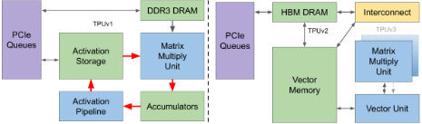

Figure 1 shows the block diagrams of the three TPUs deployed in Google datacenters starting in 2015, and Table 1 gives their key features. Let's review the first three TPUs.

TPUv1, Google's first DNN DSA, handles inference (also called serving). The high-bandwidth loop (red) to the left of Figure 1 shows the main data and computation path that crunches DNN layers. The green Activation Storage and Accumulators SRAM blocks buffer the blue computation blocks of the Matrix Multiply Unit (MXU) and the Activation Pipeline. The systolic array MXU has 64K 8-bit integer Multiply Accumulate (MAC) units. DDR3 DRAM feeds the loop at much lower bandwidth with model parameters (also called weights), and TPUv1 connects to the host CPU over PCIe for exchanging model inputs and outputs at even lower bandwidth. The host CPU also sends TPUv1 instructions over PCIe. Compared to contemporary GPUs and CPUs, its performance/TDP (perf/Watt) on production workloads was 30-80X higher [21, 22].

This paper is part of the Industry Track of ISCA 2021's program.

TPUv2 addresses the harder task of training [23, 30]. First, training parallelization is harder. Each inference is independent, so a simple cluster of servers with DSA chips can scale out. A training run iterates over millions of examples, coordinating across parallel resources because it must produce a single consistent set of weights for the model. Second, computation is harder. Backpropagation requires derivatives for every computation in a model. It includes higher-precision activation functions (some of which are transcendental), and multiplication by transposed weight matrices. Third, training needs more memory. Weight updates access intermediate values from forward and back propagation, vastly upping storage requirements; temporary storage can be 10X weight storage. Fourth, it must be more programmable. Training algorithms and models are continually changing, so a DSA restricted to current best-practice algorithms during design could rapidly become obsolete. Finally, short integers can work for inference, but sufficiently capturing the sum of many small weight updates during training normally needs floating-point arithmetic.

The TPUv1 block diagram can be transformed into TPUv2 via a sequence of changes, showing the more general needs of training over inference. The split on-chip SRAM made sense when buffering data between sequential fixed-function units of TPUv1, but undivided on-chip memory is better for training. The read-only weights for inference allow optimizations that don't work for training, which writes weights. The first change is to merge Activation Storage and the Accumulators into a single Vector Memory (see Figure 1). In TPUv2, a more programmable Vector Unit replaced the fixed-function datapath of the Activation Pipeline of TPUv1 (containing pooling and activation units). Bfloat16 is a better match to DNNs than IEEE 754 fp16 [24], so the MXU was changed to become the first hardware to support it, with 16K MAC units (½ the side of the systolic array, so ¼ of the size). The MXU was then attached to the Vector Unit as a matrix co-processor. Read-only weights make no sense for training-whose goal is setting them-and significant buffer space is needed for temporary per-step variables. DRAM backs Vector Memory so that the pair form a compiler-controlled memory hierarchy. In-package HBM DRAM increases bandwidth 20X over DDR3, keeping the TPUv2 core well utilized. TPUv2 fetches its own 322-bit VLIW instructions from a local memory, rather than the host CPU supplying them.

<!-- p.2 -->

Table 1. Key characteristics of DSAs. The underlines show changes over the prior TPU generation, from left to right. System TDP includes power for the DSA memory system plus its share of the server host power, e.g., add host TDP/8 for 8 DSAs per host.

| Feature                        | TPUv1          | TPUv2           | TPUv3           | TPUv4i            | NVIDIA T4                   |
|--------------------------------|----------------|-----------------|-----------------|-------------------|-----------------------------|
| Peak TFLOPS / Chip             | 92 (8b int)    | 46 (bf16)       | 123 (bf16)      | 138 (bf16/8b int) | 65 (ieee fp16)/130 (8b int) |
| First deployed (GA date)       | Q2 2015        | Q3 2017         | Q4 2018         | Q1 2020           | Q4 2018                     |
| DNN Target                     | Inference only | Training & Inf. | Training & Inf. | Inference only    | Inference only              |
| Network links x Gbits/s / Chip | --             | 4 x 496         | 4 x 656         | 2 x 400           | --                          |
| Max chips / supercomputer      | --             | 256             | 1024            | --                | --                          |
| Chip Clock Rate (MHz)          | 700            | 700             | 940             | 1050              | 585 / (Turbo 1590)          |
| Idle Power (Watts) Chip        | 28             | 53              | 84              | 55                | 36                          |
| TDP (Watts) Chip / System      | 75 / 220       | 280 / 460       | 450 / 660       | 175 / 275         | 70 / 175                    |
| Die Size (mm 2 )               | < 330          | < 625           | < 700           | < 400             | 545                         |
| Transistors (B)                | 3              | 9               | 10              | 16                | 14                          |
| Chip Technology                | 28 nm          | 16 nm           | 16 nm           | 7 nm              | 12 nm                       |
| Memory size (on-/off-chip)     | 28MB / 8GB     | 32MB / 16GB     | 32MB / 32GB     | 144MB / 8GB       | 18MB / 16GB                 |
| Memory GB/s / Chip             | 34             | 700             | 900             | 614               | 320 (if ECC is disabled)    |
| MXU Size / Core                | 1 256x256      | 1 128x128       | 2 128x128       | 4 128x128         | 8 8x8                       |
| Cores / Chip                   | 1              | 2               | 2               | 1                 | 40                          |
| Chips / CPUHost                | 4              | 4               | 4               | 8                 | 8                           |

Training needs large scale, so another enhancement is to add a custom chip-to-chip interconnect fabric (ICI), enabling TPUv2 supercomputers of up to 256 chips [23].

Unlike TPUv1, TPUv2 has two TensorCores per chip. Global wires on a chip don't scale with shrinking feature size (see lesson 1 below), so their relative delay increases. Two smaller cores per chip prevent the excessive latencies of a single large full-chip core. We stopped at two because we believe it is easier to compile programs efficiently for two brawny cores than for numerous wimpy cores.

TPUv3 is a "midlife kicker," a mild redesign of TPUv2 in the same technology that has 2X the number of MXUs and HBM capacity and increases the clock rate, memory bandwidth, and ICI bandwidth by 1.3X. A TPUv3 supercomputer also scales up to 1024 chips. TPUv3 matches the contemporary Volta GPU when both use 16-bit floating point (bfloat16 vs IEEE fp16). However, Volta needs to use IEEE fp32 when training Google production workloads, making TPUv3 ~5X faster. Several applications scale to 1024 chips at 97%-99% of perfect linear speedup [23].

This paper introduces TPUv4i-i stands for inferenceforged by the hard-earned lessons from building and deploying TPUs over 5 years. Section 2 (§2) distills ten of these insights. Had we known about them in 2015, with more time we would have designed these TPUs differently, especially TPUv1. §3 shows how these lessons shaped TPUv4i. To avoid repetition, §3 only lists changes from TPUv3. §4 and §5 compare TPUv4i performance/TDP to TPUv3 for production apps and to NVIDIA T4 for MLPerf Inference 0.5-0.7. §6 describes 5 industry inference DSAs. They often run afoul of the lessons, so none meet Google's 2021 needs. A discussion and conclusion end the paper.

But first are highlights of this paper's contributions:

- Document the unequal improvement in logic, wires, SRAM, and DRAM from 45 nm to 7 nm-including an update of Horowitz's operation energy table [16] from 45 nm to 7 nm-and show how these changes led to four systolic floating point matrix units for TPUv4i in 2020 versus one systolic integer matrix unit for TPUv1 in 2015.
- Explain the difference between designing for performance per TCO vs per CapEx, leading to HBM and a low TDP for TPUv4i, and show how TPUv1's headroom led to application scaleup after the 2017 paper [21].
- Explain backwards ML compatibility, including why inference can need floating point and how it spurred the TPUv4i and TPUv4 designs (§3). Backwards ML compatible training also tailors DNNs to TPUv4i (§2).
- Measure production inference applications to show that DSAs normally run multiple DNNs concurrently, requiring Google inference DSAs to support multi-tenancy.
- Discuss how DNN advances change the production inference workload. The 2020 workload keeps MLP and CNN from 2017 but adds BERT, and RNN succeeds LSTM.
- Document the growth of production DNNs in memory size and computation by ~1.5x annually since 2016, which encourages designing DSAs with headroom.
- Show that Google's TCO and TDP for DNN DSAs are strongly correlated (R = 0.99), likely due to the end of Dennard scaling. TDP offers a good proxy for DSA TCO.
- Document that the SLO limit is P99 time for inference applications, list typical batch sizes, and show how large on-chip SRAM helps P99 performance.
- Explain why TPUv4i architects chose compiler compatibility over binary compatibility for its VLIW ISA.
- Describe Google's latest inference accelerator in production since March 2020 and evaluate its performance/

<!-- p.3 -->

TDP vs. TPUv3 and NVIDIA's T4 inference GPU using production apps and MLPerf Inference benchmarks 0.5-0.7.

Table 2. Energy per Operation: 45 nm [16] vs 7 nm. Memory is pJ per 64-bit access.

|           | Operation       | Picojoules per Operation - 45 nm   | Picojoules per Operation - 7 nm   | Picojoules per Operation - 45 / 7   |
|-----------|-----------------|------------------------------------|-----------------------------------|-------------------------------------|
|           | Int 8           | 0.030                              | 0.007                             | 4.3                                 |
|           | Int 32          | 0.100                              | 0.030                             | 3.3                                 |
|           | + BFloat 16     | --                                 | 0.110                             | --                                  |
|           | IEEE FP 16      | 0.400                              | 0.160                             | 2.5                                 |
|           | IEEE FP 32      | 0.900                              | 0.380                             | 2.4                                 |
|           | Int 8           | 0.200                              | 0.070                             | 2.9                                 |
|           | Int 32          | 3.100                              | 1.480                             | 2.1                                 |
|           | ✕ BFloat 16     | --                                 | 0.210                             | --                                  |
|           | IEEE FP 16      | 1.100                              | 0.340                             | 3.2                                 |
|           | IEEE FP 32      | 3.700                              | 1.310                             | 2.8                                 |
|           | 8 KB SRAM       | 10.000                             | 7.500                             | 1.3                                 |
|           | SRAM 32 KB SRAM | 20.000                             | 8.500                             | 2.4                                 |
|           | 1 MB SRAM 1     | 100.000                            | 14.000                            | 7.1                                 |
| GeoMean 1 | GeoMean 1       | --                                 | --                                | 2.6                                 |
|           |                 | Circa 45 nm                        | Circa 7 nm                        |                                     |
|           | DDR3/4          | 1300 2                             | 1300 2 0                          | 1.0                                 |
|           | DRAM HBM2       | --                                 | 250-450 2                         | --                                  |
|           | GDDR6           | --                                 | 350-480 2                         | --                                  |

Figure 2. DSA gains per chip for MLPerf Training 0.5 to 0.7 over 20 months for the same compilers. The unverified TPUv3 MLPerf 0.5 scores for Mask R-CNN and Transformer are from [23]; all other results are from [28].

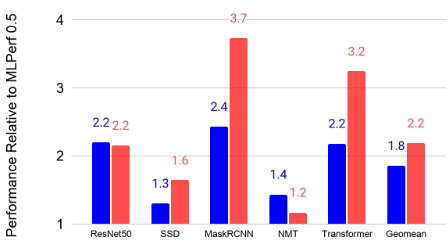

## 2. Ten Lessons Learned Since 2015

We list the 10 most important lessons, even if depending on their experience some readers find them unsurprising. We note, however, that architects of recent commercial ML accelerators ignored some of these lessons (see §6).

1 Horowitz's 1 MB SRAM power is a single bank SRAM. Most would use multiple banks, which explains the 7.1 reduction in 1MB SRAM going from 45 to 7. It is omitted from the geomean.

2 1300 pJ for DDR3/4 DRAM is only the I/O [43]. HBM2 and GDDR6 also list only the I/O energy [26, 32, 42].

The first three lessons apply to any DSA, and perhaps even to GPUs and CPUs. For typographic clarity, the lessons are tagged with circled numbers, e.g., ②.

## ① Logic, wires, SRAM, &amp; DRAM improve unequally

Horowitz's insights on operation energy inspired many DSA designs [16]. Table 2 updates it to 7 nm, showing an average gain of 2.6X from 45 nm, but the change is uneven:

- SRAM access improved only 1.3X-2.4X, in part because SRAM density is scaling slower than in the past. Comparing 65 nm to 7 nm, SRAM capacity per mm 2 is ~5X less dense than ideal scaling would suggest [45].
- DRAM access improved 6.3X due to packaging innovations. High Bandwidth Memory (HBM) places short stacks of DRAM dies close to DSAs over wide buses.
- While not in Table 2, energy per unit length of wire improved &lt;2X [15]. Poor wire delay scaling led TPUv2/v3 to use 2 smaller cores from 1 larger core on TPUv1.

Logic improves much faster than wires and SRAM, so logic is relatively "free." HBM is more energy-efficient than GDDR6 or DDR DRAM. HBM also has the lowest cost per GB/s of bandwidth.

## ② Leverage prior compiler optimizations

Since the 1980s, the fortunes of a new architecture have been bound to the quality of its compilers. Indeed, compiler problems likely sank the Itanium's VLIW architecture [25], yet many DSAs rely on VLIW (see §6) including TPUs. Architects wish for great compilers to be developed on simulators, yet much of the progress occurs after hardware is available since compiler writers can measure actual time taken by code. Thus, reaching an architecture's full potential quickly is much easier if it can leverage prior compiler optimizations rather than starting from scratch.

DSAs are not exceptions to this rule; they are paragons. TPUs rely on the XLA (Accelerated Linear Algebra) compiler, which started in 2016, and NVIDIA GPUs have used the CUDA compiler since 2007. Figure 2 shows the gains over 20 months from MLPerf Training benchmark version 0.5 to 0.7. CUDA compilation improved the GPU by 1.8X. Perhaps because it is less mature, XLA raised the TPU by 2.2X. In contrast, C compilers improve generalpurpose code 1%-2% annually [37]. Good compilers are critical to a DSA's success (see §3). The XLA compiler developed for TPUv2 was enhanced for TPUv3 and TPUv4. Its intermediate language has changed little since TPUv2.

## ③ Design for performance per TCO vs per CapEx

Capital Expense (CapEx) is the price for an item [2]. Operation Expense (OpEx) is the cost of operation, including electricity consumed and power provisioning. Standard accounting amortizes computer CapEx over 3-5 years, so for 3 years TCO = CapEx + 3 ✕OpEx. Google and most companies care more about performance/TCO of production apps (perf/TCO) than raw performance or performance/CapEx (perf/CapEx) of benchmarks [2]. While TCO is the main variable that Google optimizes for during 3 product design, CapEx still influences some business decisions that are outside the scope of this paper.

<!-- p.4 -->

Our experience is that CPUs and GPUs typically aim to maximize performance of benchmarks versus purchase price at the time of their announcement. Since price depends on volume and contract negotiations, some architects use performance/mm 2 as a proxy for perf/CapEx [47].

Alas, performance/mm 2 can look good even if it's bad for perf/TCO, e.g., increasing the clock rate of the Alibaba HanGuang 800 1.5x (0.7 GHz) costs 2.6x more power [20], dropping counters that can help tune DNN performance, or speeding up memory by turning off error correction (ECC §7.B). Moreover, benchmarks are inherently backward looking, since they don't normally factor in growth that can be important for perf/TCO over three years (see Table 4) ⑧.

In contrast, TPUv1's headroom enabled app improvements since publication [21]. Developers maintained SLOs yet increased operations 3X for MLP0 and 6X for CNN1 ⑧. A DSA should aim for good Perf/TCO over its full lifetime, and not only at its birth.

Alas, TCO is confidential. Figure 3 plots TCO versus system TDP for all 4 TPUs plus the NVIDIA T4. Power involves everything in a rack, including a top of rack switch. The trendline shows nearly perfectly correlation, as the correlation coefficient R is 0.99. R is still 0.88 for 15 CPUs, GPUs, and TPUs (§7.D). Use TDP if TCO is unavailable.

Figure 3. TCO vs system TDP for T4 and TPUv1/v2/v3/v4i. An R 2 of 0.982 means R is nearly perfect at 0.99 out of 1.00. System TDP is capacity planning power and not average power, since capacity is more expensive (see §7.D for details).

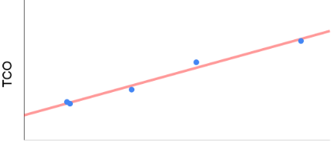

Two TCO factors come directly from power: the costs of electricity used and of provisioning power-power distribution and cooling-which is twice as much as electricity [2]. Much of the rest is computer CapEx . Chip 4 CapEx is not directly tied to power, yet the correlation coefficient R is still 0.90. As Moore's Law slows and without Dennard scaling, using more transistors and die area to build faster processors likely raises both power and cost.

3 Like our TCO, [11] ignores financing, lumps capacity power with

"datacenter infrastructure", and uses 3-year amortization.

4 Datacenter space is amortized over 20 years, so its cost is low.

## The next 3 lessons are focused on DNN DSAs.

## ④ Support Backwards ML Compatibility

Some DNNs have time-to-market constraints, as there can be economic value for timeliness. This perspective led to a principle of backwards ML compatibility. The goal is the same for a new CPU: it should get exactly the same results, including the same exception behavior and correlated performance, in this case for training and serving across TPU generations (starting with TPUv2).

Any new inference TPU would at least need to offer the same numerics to get the same results and the same exception behavior: bfloat16 and IEEE fp32 would be required. If a new TPU doesn't support the same operations or numeric types, then the compiler can't give a backwards ML compatibility guarantee.

Floating point addition is not associative, meaning the order of operations can prevent high-level operations such as matrix multiply or convolution from giving bit-identical results. One can't constrain the compiler to a particular fixed order of operations while still allowing performance optimization. This subtle complication implies using the same compiler that is generating code for all targets in a similar way, since the compiler sometimes changes the order of evaluation. Identical order means a new TPU should be similar to prior TPUs from the compiler's perspective.

Performance should correlate; if it trains well, it should serve well. To deploy immediately, developers don't want a change to a DNN that reduces training step-time to result in poor inference latency, since it could violate the DNN SLO ⑩. Moreover, lesson ⑩ shows that backwards ML compatible training can pre-tune DNNs to the serving hardware.

## ⑤ Inference DSAs need air cooling for global scale

The 75W TPUv1 and 280W TPUv2 were air cooled, but the 450W TPUv3 uses liquid cooling. Liquid cooling requires 5 placing TPUs in several adjacent racks to amortize the cooling infrastructure. That placement restriction is not a problem for training supercomputers, which already consist of several adjacent racks. Moreover, the downsides to limiting training to a few datacenters that have more space are small, since widespread deployment is unnecessary.

Not so for user-facing inference, as low user latency requires a worldwide footprint. Some strategic datacenters are already packed, so finding room for several adjacent racks is hard. To ease deployment, inference DSAs should be air-cooled.

## ⑥ Some inference apps need floating point arithmetic

Quantization for DNNs aims to retain inference-time model quality using integers, even though all training is done in floating point. Quantized arithmetic grants area and power savings, but it can trade those for reduced quality, delayed deployment, and some apps don't work well when quantized (see Figure 4 and NMT from MLPerf Inference 0.5 in §4).

5 Some are air cooled for inference, but most are liquid cooled.

<!-- p.5 -->

TPUv1 required quantization-since it supported only integer arithmetic-which proved a problem for some datacenter applications. Early in TPUv1 development, application developers said a 1% drop in quality was acceptable, but they changed their minds by the time the hardware arrived, perhaps because DNN overall quality improved so that 1% added to a 40% error was relatively small but 1% added to a 12% error was relatively large.

This change meant it could take months of extra development to restore the quality score using integers that experts achieved in floating point during training. For example, the quality for the top scores for the ImageNet competition improved &lt;1% from 2019 to 2020 [18].

This lesson teaches that DSAs may offer quantization, but unlike TPUv1, they should not require it. (Also, see §7.H about quantization aware training.)

Of the DNNs in Table 3, only RNN0 was quantized, and the primary benefit was halving the memory footprint. From MLPerf, 3D-Unet and DLRM have been post-training quantized to 8-bits with accuracy loss &lt;0.1% versus FP32, and the accuracy loss is &lt;1% for BERT.

Figure 4. Quantization error for segmentation [40]. The left image identifies the outline of objects in the right photo. The Int8 outline is fuzzy around the girl's head, so it includes bystanders, and it doesn't isolate the arm of the person in red on the right. The unreliable outline crops the photo incorrectly.

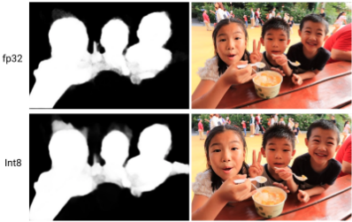

## The final 4 lessons are about the DNN apps

themselves, which one would like to know before designing hardware to run them-whether it is a DSA, GPU, or CPU.

## ⑦ Production inference normally needs multi-tenancy

Like CPUs, DSAs should support multi-tenancy. Sharing can lower costs and reduce latency if applications use many models. For example, translation DNNs need many language pairs and speech DNNs must handle several dialects. Multi-tenancy also supports multiple batch sizes to balance throughput and latency [38]. Another reason is simply good software engineering practices. Examples include trying new features on a fraction of customers, or slowly deploying a new release to reduce the chances of problematic software updates. Table 3 shows &gt;80% of our production inference workload needs multi-tenancy.

Application developers demand fast switching time between models (e.g., &lt;100 us), which cannot be met by loading weights from the CPU host over the PCIe bus (&gt;10 ms), so DSAs need local memory. To keep all weights in on-chip SRAM, we'd need to load &gt;90 MB (e.g, MLP1) in &lt;100 us, or an external memory bandwidth of 900 GB/s, faster than current inference chips (§6). Moreover, Table 4 predicts that DNNs will likely grow. Multi-tenancy suggests fast DRAM for DSAs, since all weights can't fit in SRAM.

Alas, DNN DSA designers often ignore multi-tenancy. Indeed, multi-tenancy is not mentioned in the TPUv1 paper [21]. (It was lucky that the smallest available DDR3 DRAM held 8GB, allowing TPUv1 software to add multi-tenancy.)

Table 3. The 2020 average and maximum size includes multi-tenancy. Next is the number of DNNs sharing the DSA. Last is Google inference workload mix in July 2016 [21] vs February 2020 showing % of the inference workload per DNN, weighted by the TCO of the TPUv1/v2/v3 system. MLP1 is RankBrain [3]; CNN0 is AlphaZero [41]; CNN1 is an internal model for image classification; BERT1 is DeepRank [33]. MLPerf will likely soon add a multi-tenancy requirement.

| Name   |   Avg. Size (MB) | Max Size (MB)   | Multi- tenancy?   | Avg. Number of Programs (StdDev), Range   | % Use 2016/ 2020   |
|--------|------------------|-----------------|-------------------|-------------------------------------------|--------------------|
| MLP0   |              580 | 2500            | Yes               | 27 (±17), 1-93                            | 61%-25%            |
| MLP1   |               90 | N.A.            | Yes               | 5 (±0.3), 1-5                             | 61%-25%            |
| CNN0   |               60 | 454             | No                | 1                                         | 5%-18%             |
| CNN1   |              120 | 680             | Yes               | 6 (±10), 1-34                             | 5%-18%             |
| RNN0   |             1300 | 1300            | Yes               | 13 (±3), 1-29                             | 0%-29%             |
| RNN1   |              120 | 400             | No                | 1                                         | 0%-29%             |
| BERT0  |             3000 | 3000            | Yes               | 9 (±2), 1-14                              | 0%-28%             |
| BERT1  |               90 | N.A.            | Yes               | 5 (±0.3), 1-5                             | 0%-28%             |

| Model   |   Annual Memory Increase |   Annual FLOPS Increase |
|---------|--------------------------|-------------------------|
| CNN1    |                     0.97 |                    1.46 |
| MLP1    |                     1.26 |                    1.26 |
| CNN0    |                     1.63 |                    1.63 |
| MLP0    |                     2.16 |                    2.16 |

Table 4. Annual increase in production applications of 2016.

## ⑧ DNNs grow ~1.5x/year in memory and compute

Unlike benchmarks, programmers continuously improve production applications, which usually increases memory size and computation requirements. Table 4 tracks the average annual increase in memory size and computation for the four original production inference apps that still run on TPUv1/v2/v3. At a ~1.5x annual increase, our production DNNs grow as fast as Moore's Law, like early PC software. This rate suggests architects should provide headroom so that DSAs can remain useful over their full lifetimes.

<!-- p.6 -->

## ⑨ DNN workloads evolve with DNN breakthroughs

Table 3 has the DNNs that are ~100% of Google's inference 2020 workload. MLP and CNN from 2016 remain popular, although some apps switched from MLPs to BERT DNNs (28%), which explains the MLP drop (65% to 25%). BERT appeared in 2018, yet it's already 28% of the workload. To improve quality, a transformer encoder plus LSTM decoder (RNN0) and a Wave RNN (RNN1) replaced LSTMs (29%). This lesson teaches the importance of programmability and flexibility for inference DSAs to track DNN progress.

## ⑩ Inference SLO limit is P99 latency, not batch size

[21, 35] list latency time limits for serving models for production apps. However, recent DSA papers have redefined the latency limit in terms of batch size, often set at 1. Table 5 shows the P99 time SLO for production apps and the MLPerf Inference 0.5 benchmarks (§7.E). It also shows the largest batch size of recent TPUs that meet the SLO. Clearly, datacenter applications limit latency, not batch size. Future DSAs should take advantage of larger batch sizes.

Our production workloads compared to MLPerf average ~9X larger batch sizes despite ~7X stricter latency constraints. Backwards ML compatibility gives performance portability from training to inference ④, so Google's internal models are pre-tuned. By contrast, the MLPerf inference models were trained on GPUs, and so are less well-tuned for TPUs.

Table 5. Latency limit in ms and batch size picked for TPUv4i.

| Production - DNN   |   Production - ms |   Production - batch | Production - DNN   |   Production - ms |   Production - batch | MLPerf 0.7 - DNN   |   MLPerf 0.7 - ms |   MLPerf 0.7 - batch |
|--------------------|-------------------|----------------------|--------------------|-------------------|----------------------|--------------------|-------------------|----------------------|
| MLP0               |                 7 |                  200 | RNN0               |                60 |                    8 | Resnet50           |                15 |                   16 |
| MLP1               |                20 |                  168 | RNN1               |                10 |                   32 | SSD                |               100 |                    4 |
| CNN0               |                10 |                    8 | BERT0              |                 5 |                  128 | GNMT               |               250 |                   16 |
| CNN1               |                32 |                   32 | BERT1              |                10 |                   64 |                    |                   |                      |

## 3. How the 10 Lessons Shaped TPUv4i's Design

Given the importance of leveraging prior compiler optimizations ② and backwards ML compatibility ④-plus the benefits of reusing earlier hardware designs-TPUv4i was going to follow TPUv3: 1 or 2 brawny cores per chip, a large systolic MXU array and vector unit per core, compiler-controlled vector memory, and compiler-controlled DMA access to HBM. To avoid repetition and to leave room for insights, this paper concentrates on the differences from TPUv3; those interested in more details should see [23, 30].

After TPUv3, we reconsidered our strategy of building a single chip that is optimized for training yet also used for inference. Given that design resources are limited, it was hard to design TPUv3+ and TPUv1+ concurrently. NVIDIA also releases training and inference chips sequentially; for example, P4 came six months after the Pascal P100 GPU and T4 followed Volta by one year. Even so, we could likely deliver better fleet-wide perf/TCO if we could afford to design both inference- and training-optimized chips.

The "2 birds with 1 stone" moment came when we realized we could get two chips from a single design by having a single-core chip for inference (like TPUv1) and a dual-core chip for training (like TPUv3), as long as both chips used the same core, scaled versions of the same uncore, and were developed by the same team in a unified codebase. We could further improve TCO ③ of the inference chip by reducing interchip communication bandwidth and MXU logic layout density, which lowered power consumption and maximum power density and enabled air cooling ⑤. Thus, Google deployed the single core TPUv4i for inference and the dual core TPUv4, which scales to 4096 chips, for training. Google previewed TPUv4 as part of the MLPerf Training 0.7 in July 2020, where it was 2.7X faster than TPUv3 [1] and matched the performance of the NVIDIA Ampere GPU [28].

Compiler compatibility, not binary compatibility. Given that TPUv2 and TPUv3 shared a 322-bit VLIW instruction bundle length, conventional architecture wisdom would be for TPUv4i and TPUv4 to try to maintain backwards binary compatibility. We chose to be compiler compatible instead of binary compatible for a few reasons:

- The original argument for VLIW was enabling more hardware resources over time by recompiling the apps with the compiler controlling the new instruction level parallelism, which binary compatibility restricts [8].
- Many engineers built Itanium compilers, including some in the XLA team, where they learned the drawbacks of binary compatibility for a VLIW compiler and hardware.
- The XLA compiler accepts JAX and PyTorch as well as TensorFlow, so TPUs could rely on one compiler versus having an interface that works for many compilers.
- TPU software is maintained and distributed in source code rather than in binary code.

XLA divides the compiling task into producing HighLevel Operations (HLO) that are machine independent and Low-Level Operations (LLO) that are machine dependent. Optimizations at the HLO level apply to all platforms. If a new TPU restricts the needed compiler changes to LLOs, e.g., wider VLIW, it maintains compiler compatibility. Like NVIDIA GPU/CUDA, TPU/XLA illustrates hardware/ software co-design in a commercial setting (see §7.G).

Increased on-chip SRAM storage with common memory (CMEM). The first concern of a DSA after its compiler is the memory system [5]. Limiting memory costs may improve perf/CapEx but could hurt perf/TCO ③. Despite aiming at inference, multi-tenancy ⑦, the rapid growth of DNNs ⑧, and the superior energy efficiency of HBM ① led to TPUv4i to keep using HBM like TPUv3.

Nevertheless, SRAM is 20x more energy efficient than DRAM (Table 2) and there are large data structures that don't fit in Vector Memory (§5). Figures 5 and 6 show the new 128 MB Common Memory (CMEM) of TPUv4i. This expanded memory hierarchy reduces the number of accesses to the slowest and least energy efficient memory (see §5).

<!-- p.7 -->

We picked 128MB as the knee of the curve between good performance and a reasonable chip size, as the amortized chip cost is a significant fraction of TCO ③. Figure 6 shows that the resulting CMEM is 28% of the die area. Since TPUv4i is aimed at inference, its die size is closer to TPUv1's die size than to TPUv3's size (Table 1).

Figure 5. TPUv4i chip block diagram. Architectural memories are HBM, Common Memory (CMEM), Vector Memory (VMEM), Scalar Memory (SMEM), and Instruction Memory (IMEM). The data path is the Matrix Multiply Unit (MXU), Vector Processing Unit (VPU), Cross-Lane Unit (XLU), and TensorCore Sequencer (TCS). The uncore (everything not in blue) includes the On-Chip Interconnect (OCI), ICI Router (ICR), ICI Link Stack (LST), HBM Controller (HBMC), Unified Host Interface (UHI), and Chip Manager (MGR).

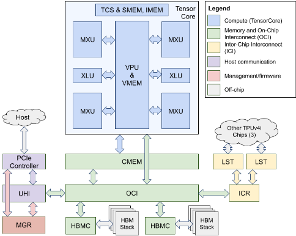

Figure 6. TPUv4i chip floorplan. The die is &lt;400 mm 2 (see Table 1). CMEM is 28% of the area. OCI blocks are stretched to fill space in the abutted floorplan because the die dimensions and overall layout are dominated by the TensorCore, CMEM, and SerDes locations. The TensorCore and CMEM block arrangements are derived from the TPUv4 floorplan.

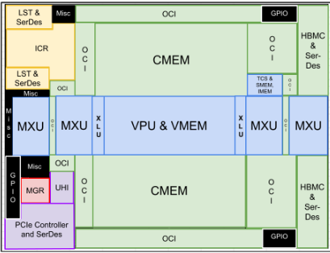

Four-dimensional tensor DMA. Memory system architecture is critical to any DNN accelerator and should be designed to maximize performance of common-case workloads while being flexible enough for future models ⑧, ⑨ [5]. TPUv4i contains tensor DMA engines that are distributed throughout the chip's uncore to mitigate the impact of interconnect latency and wire scaling challenges ①. The tensor DMA engines function as coprocessors that fully decode and execute TensorCore DMA instructions. Feedback from the XLA team on the usability and performance of the TPUv2/v3's two-dimensional (single-strided) DMAs [30] motivated the development of a new four-dimensional (triple-strided) tensor DMA architecture for TPUv4i ②. It is compiler-compatible (but not binary-compatible) with past TPU chips.

The new 4D tensor DMA design supports arbitrary steps-per-stride and positive/negative stride distances in each dimension. The inner vector is the TPUv4i memory system's native 512B word size, which matches the 128-lane 32-bit vector unit inherited from TPUv2/v3 [30] and also facilitates efficient HBM access and interconnect design, as described below. The striding parameters are independently programmable for the source-side and destination-side of the DMA. This feature offloads work from the TensorCore by enabling in-memory 512B-granular 4D tensor copies, reshapes, scatters, gathers, and memsets that can be used for transfers between any pair of architectural memories on the same chip as well as across different chips. The chip-side of any host DMA similarly supports 4D operations. We can emulate more than four dimensions using multiple separate DMAs, thereby reducing ISA encoding space and DMA complexity and cost.

Software is sensitive to DMA bandwidth, with latency being a secondary concern as long as the compiler is able to issue large DMAs or keep enough small DMAs in flight. The DMA bandwidth is designed to be independent of the chosen striding parameters because predictable performance is a key goal for effective compiler optimizations ②.

To maximize predictable performance and simplify hardware and software, TPUv4i unifies the DMA architecture across local (on-chip), remote (chip-to-chip), and host (host-to-chip and chip-to-host) transfers to simplify scaling of applications from a single chip to a complete system. It retains the essence of the TPUv2/v3 relaxed DMA ordering model that is built around explicit software-based synchronization [30]. Unrolled DMA reads and writes are completely unordered both within a DMA and across DMAs. All on-chip memories can each be concurrently accessed using DMAs as well as loads/stores, while off-chip HBM can only be accessed using DMAs. If there are concurrent overlapping address patterns between DMAs and/or load/store instructions, explicit core-DMA synchronization must be used to avoid memory-level hazards. TPUv4i has support for synchronizing partial completion progress of DMAs with the TensorCore to help hide DMA ramp-up and ramp-down latency in case it becomes useful for future compiler optimizations ②, larger DNNs ⑨, and/or tighter workload latency constraints ⑩.

<!-- p.8 -->

Custom on-chip interconnect (OCI). Rapidly growing and evolving DNN workloads ⑧, ⑨ have driven the TPU uncore towards greater flexibility each generation. Each component of past TPUs designs were connected point-to-point (Figure 1). As memory bandwidth increases and the number of components grows, a point-to-point approach becomes too expensive, requiring significant routing resources and die area. It also requires up-front choices about which communication patterns to support. For example, in TPUv3, a TensorCore can only access half of HBM as a local memory [30]: it must go through the ICI to access the other half of HBM. This split imposes limits on how software can use the chip in the future ⑧.

In TPUv4i, we added a shared On-Chip Interconnect (OCI) that connects all components on the die and we can scale its topology based on the components that are present. OCI was particularly important with the addition of CMEM; the choice of how to allocate and transfer data between HBM, CMEM, and VMEM continues to evolve ⑧.

We designed for much wider datapaths compared with a typical SoC-512B native access size instead of 64B cache lines. HBM bandwidth per core also increased by 1.3X over TPUv3 (and we expect similarly significant increases in the future). To handle this scale, we were inspired by NUMA memory systems-take advantage of spatial locality of accesses to minimize latency and bisection bandwidth-but rather than putting the NUMA boundary between cores, we put it between parts inside the same core. While the entire 512B memory word is accessible to any component, the larger high-bandwidth memories (HBM, CMEM, and VMEM) are each physically partitioned into four 128B-wide groups to optimize HBM accesses. The corresponding group for each memory is connected to a segment of the OCI with minimal overlap to other groups, effectively creating four non-overlapping networks with each serving 153 GB/s of HBM bandwidth rather than a single network serving all 614 GB/s. This grouping provides locality that reduces latency and wiring resources, and simplifies interconnect arbitration. This four-way split is essential, as wiring resources don't scale as well as logic ①.

Arithmetic improvements. Another big decision is the arithmetic unit. The danger of requiring quantization⑥and the importance of backwards ML compatibility ④ meant retaining bfloat16 and fp32 from TPUv3 despite aiming at inference. As we also wanted applications quantized for TPUv1 to port easily to TPUv4i, TPUv4i also supports int8.

Our XLA colleagues suggested that they could handle twice as many MXUs in TPUv4i as they did for TPUv3②.

Logic improved the most in the more advanced technology node, ①, so we could afford more MXUs. Equally important, the new CMEM could feed them (§5 and §7.A).

The VLIW instruction needed extra fields to handle the four MXUs and the CMEM scratchpad memory, which were easy to add given no need for binary compatibility. The TPUv4i instruction is 25% wider than TPUv3.

We also wanted to reduce the latency through the systolic array of the MXU while minimizing area and power. Rather than sequentially adding each floating-point multiplication result to the previous partial sum with a series of 128 two-input adders, TPUv4i first sums groups of four multiplication results together, and then adds them to the previous partial sum with a series of 32 two-input adders. This optimized addition cuts the critical path through the systolic array to ¼ the latency of the baseline approach.

Once we decided to adopt a four-input sum, we recognized the opportunity to optimize that component by building a custom four-input floating point adder that eliminates the rounding and normalization logic for the intermediate results. Although the new results are not numerically equivalent, eliminating rounding steps increases accuracy over the old summation logic. Fortunately, the differences from a four- versus two-input adder are small enough to not affect ML results meaningfully ④. Moreover, the four-input adder saved 40% area and 25% power relative to a series of 128 two-input adders. It also reduced overall MXU peak power by 12%, which directly impacts the TDP and cooling system design ⑤ because the MXUs are the most power-dense components of the chip.

Clock Rate and TDP. Air cooling for inference ⑤ and reducing TCO ③ led to a clock rate of 1.05 GHz and chip TDP of 175W, once again closer to TPUv1 (75W) than to TPUv3 (450W).

ICI scaling. To provide headroom for future DNN growth ⑧, TPUv4i has 2 ICI links so that the 4 chips per board can access nearby chip memory quickly (Figure 7) via model partitioning [7]. (TPUv3 uses 4 ICI links.) Apps may use it as the software stack matures and as DNNs grow⑧.

Figure 7. TPUv4i board with 4 chips that are connected by ICI.

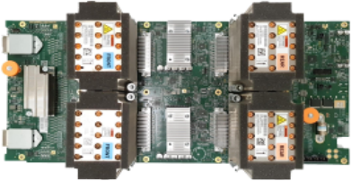

Workload analysis features. Building upon lessons from TPUv1 [21], TPUv4i includes extensive tracing and performance counter hardware features, particularly in the uncore. They are used by the software stack to measure and analyze system-level bottlenecks in user workloads and guide continuous compiler-level and application-level optimizations (Figure 2). These features increase design time and area, but are worthwhile because we aim for Perf/ TCO, not Perf/CapEx ③. The features enable significant system-level performance improvements and boost developer productivity over the lifetime of the product as DNN workloads grow and evolve (see Table 4) ⑦, ⑧, ⑨.

<!-- p.9 -->

Figure 8. Performance (top) and performance/system Watt ③ for production apps ⑨ relative to TPUv2 for the other TPUs.

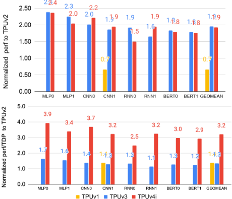

## 4. TPUv4i Performance Analysis

Figure 8 compares performance and perf/TDP of TPUs relative to TPUv2 for the production inference apps ⑨. TPUv3 and TPUv4i are both ~1.9X faster, with TPUv1 0.7X TPUv2. The larger, hotter TPUv2/v3 dies have two cores while the smaller cooler TPUv4i has one, making TPUv4i a win in perf/TCO ③ and for deployment ⑤.

Thus, TPUv4i shines for perf/TDP at 2.3X vs TPUv3. 2.3X is a combination of 1.1X FLOPS (123T vs 138T), 4.5X SRAM capacity (32 vs 144MB), 0.7X DRAM bandwidth (900 vs 614 GB/s), 0.4X TDP (175 vs 450W), and microarchitectural changes such as 2X MXU count per core to improve utilization. The technology upgrade (16 to 7nm) improves energy efficiency and transistor density to enable bigger FLOPS and SRAM. Among these perf/TDP factors, CMEM gained ~1.5X (Figure 11), 7nm contributed ~1.3X, and others contributed the remaining ~1.2X.

The "accelerator wall" paper [9] predicts perf/TDP across DSA generations from the log of the increase in transistors from new semiconductor nodes. Yet TPUv4i delivers 2.3X the TPUv3 perf/TDP using 1.6X the transistors.

Figure 9 compares performance and perf/(system)TDP of TPUv3 and TPUv4i relative to the NVIDIA T4 (see §6) using the MLPerf Inference 0.5-0.7 benchmarks. (§7.C discusses comparing it to A100.) MLPerf has two datacenter scenarios: Server has to meet a P99 latency constraint ⑩ (Table 5), and Offline that batch processes inference tasks without an SLO. The T4 used int8 on ResNet and SSD but used fp16 on NMT, since NVIDIA couldn't get int8 to work for this DNN ⑥. NVIDIA's latest MLPerf Inference code for T4 was run in Google datacenters. (§7.B explains why T4 MLPerf Inference speed slows in Google datacenters.)

TPUs ran all the benchmarks using bf16, yet TPUv4i averages 1.3-1.6X as fast as T4. TPUv4i falls to 0.9-1.0X for perf/TDP ③, although NMT is 1.3X perf/TDP as both DSAs compute in floating point. We also measured performance per average power instead of TDP. TPUv4i was 1.6-2.0X T4 for NMT, 1.0X for ResNet50, and 0.5-0.6X for SSD, with a geomean of 1.0X. SSD depends on NonMax Suppression, which involves many gathers and other slow operations of high memory intensity. GPU's coalescing memory likely runs faster than in TPU's HBM.

Backwards ML compatibility makes TPUv4i good for Google even if its int8 perf/TDP isn't much larger than T4.

Figure 9. Performance (top) and performance/system TDP ③ relative to T4 for TPUv3/v4i in our datacenter (§7.B). Note that the T4 uses int8 for ResNet and SSD and fp16 for NMT. The TPUs use bf16 for all three to maintain backwards ML compatibility ④ with TPUv3/v4. MLPerf Inference 0.7 omits NMT, so we use MLPerf Inference 0.5 code for it and 0.7 code for ResNet and SSD in Figures 9, 10, and 13. (These results are unofficial, as they have not been verified by MLPerf.)

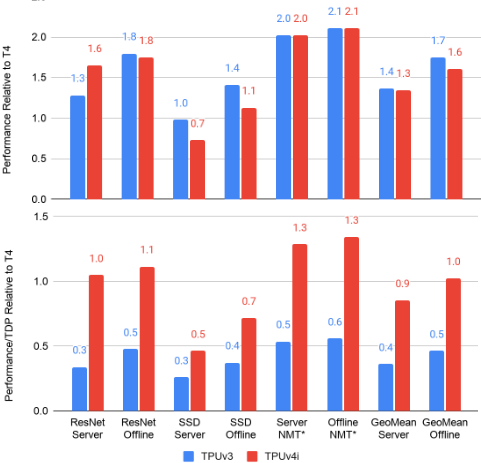

## 5. Performance In More Depth: CMEM

Figure 10 shows the benefit of adding CMEM to TPUv4i, using the MLPerf Inference 0.5-0.7 benchmarks. The average benefit for offline is only 1.1X but 1.3X for server, as the relationship between latency and the latency-limited server performance is nonlinear at some utilization points.

<!-- p.10 -->

To understand CMEM's impact on the production applications ⑨, Figure 11 compares the performance of doubling the HBM bandwidth with CMEM disabled to the standard HBM bandwidth with CMEM enabled. Compiler flags disabled CMEM and running on TPUv4 with one core disabled doubled HBM bandwidth for one core.

Figure 10. Unverified MLPerf Inference impact of turning on CMEM vs no CMEM.

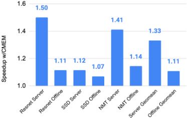

Figure 11. Performance of 2X HBM bandwidth with no CMEM relative to CMEM with standard HBM bandwidth.

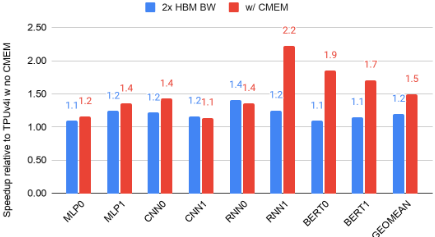

Figure 12. Roofline model showing apps without CMEM (low point) vs with CMEM (high point). Operational intensity (OI) here is operations divided by memory accesses to HBM or to CMEM. If OI were relative to HBM only, CMEM would increase OI and move the points to the right as well as up.

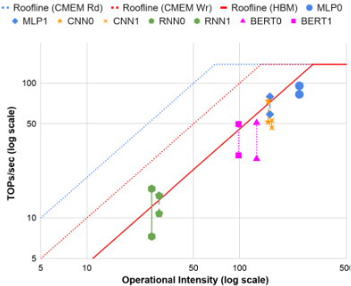

For 5 of the 8 applications, the speedups over TPUv4i without CMEM are similar, both in the range of 1.1 to 1.4X. Our interpretation is that the main benefit of CMEM is the much higher memory bandwidth for these 5 applications; adding CMEM is cheaper, lower power, and easier than doubling HBM bandwidth. For 3 apps the CMEM gain is even higher at 1.7 -2.2X, providing much greater benefits.

The roofline model [46] in Figure 12 helps explain what is going on. It divides applications into compute-bound or memory-bound, using operational intensity to determine where an application is relative to its roofline. The ridgepoint is the operational intensity (FLOPS per byte of memory accessed) that is at the dividing line between memory-bound and compute-bound. While the roofline model normally is checking to see if an application is compute-bound or DRAM-bound, it can be used recursively to see if it is CMEM-bound. The CMEM read bandwidth is 2000 GB/s, its write bandwidth is 1000 GB/s, and unlike HBM it can read and write simultaneously. Figure 12 shows the traditional DRAM roofline (HBM) along with the higher rooflines for CMEM read and CMEM write for the eight production applications. The vertical points show the performance gain per app with CMEM on vs. CMEM off.

BERT1 1.71X. Its HBM footprint is 93 MB, so it could fit in CMEM. However, XLA allocates all parameters in HBM to reduce context switch time and then prefetches into CMEM (§7.F), so it only saves 58% of HBM traffic. The operational intensity goes from 106 without CMEM to 124 with CMEM, still below the HBM ridgepoint of 301.

The working set causes the large speedup of 1.71. BERT1 includes a Gather op for embedding. It does indexed memory access from a large buffer (~63MiB), and this random access pattern causes poor HBM performance. As CMEM is larger than 63MiB, the input table is placed in CMEM, which has a much higher random access bandwidth. As a result, the Gather op is significantly faster (~15x), yielding an overall 1.71x model performance gain.

BERT0 1.85X. Its HBM footprint is 189 MB, larger than CMEM. Prefetching works well with CMEM, saving 50% of HBM traffic. The large speedup is again explained by the embedding table (~98MiB) for the Gather op, which accounts for &gt; 30% of step time without CMEM. When the table is in CMEM, the Gather op runs ~13x faster.

RNN1 2.22X. Its HBM footprint is 254 MB, larger than CMEM. Nevertheless, CMEM filters out an impressive 98% of HBM traffic. This model runs many iterations of GRU layers, and as intermediate tensors are placed in CMEM, it can avoid costly HBM traffic. As this filtered traffic goes to CMEM, the model is now CMEM-bound.

CMEM size. Figure 13 explores the impact of a smaller CMEM than 128 MB on the apps and the MLPerf server benchmarks. The app average performance is 69% at 0MB, 82% at 16MB, 90% at 72MB, and 98% at 112MB. For MLPerf, it is 76% at 0 MB, 87% at 16MB, 97% at 72MB, and 100% at 112MB. Reducing CMEM 10%-20% might have little impact on current DNNs, but given our perf/TCO orientation ③ and the growth of DNNs ⑧, we won't know for sure for a few years if CMEM was too large.

<!-- p.11 -->

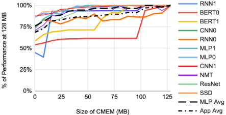

Figure 13. Percent of 128 MB speed as CMEM varies 0-128 MB for the apps and MLPerf Inference 0.5-0.7 server code.

|          |   perf/TDP vs T4 |   TDP (W) | Cores   | GHz   | MiB SRAM   | Type DRAM   |
|----------|------------------|-----------|---------|-------|------------|-------------|
| T4       |             1.00 |        70 | 40      | 0.6   | 20         | GDDR6       |
| Goya     |             0.46 |       200 | 8       | 2.1   | ≈32        | DDR4        |
| Nervana  |             0.69 |       100 | 24      | 1.1   | 60         | LPDDR4      |
| Zebra    |             0.25 |       225 | --      | --    | 54         | DDR4        |
| HanGuang |             2.17 |       280 | 4       | 0.7   | 192        | none        |

Table 6. Five DSAs that ran the MLPerf Inference 0.5 (Goya, Nervana, HanGuang) or 0.7 (T4, Zebra) server scenarios. Goya ran only SSD, and the last three ran only ResNet. Performance is relative to T4 for MLPerf Inference 0.5. TDP in this table is per chip rather than per system, since the latter was unavailable. All have 16-32GB of DRAM except HanGuang, which has none. All results are from [29].

Figure 14. T4 and TPUv4 running unverified MLPerf Inference benchmarks 0.5/0.7 at Google with memory ECC off and on. NVIDIA's MLPerf score is 100% for T4 and 100% for TPUv4i is unverified MLPerf in our datacenter. For the 1 minute case, the T4 was idle initially. It then ranMLPerf with ECC off and on for 1 minute at the fastest clock rate. (T4 offers inline ECC, which uses memory bandwidth.) For the 10 minute case, the machines are not idle beforehand. TPUv4i's speed is unchanged whether ECC is on or off or how long it runs.

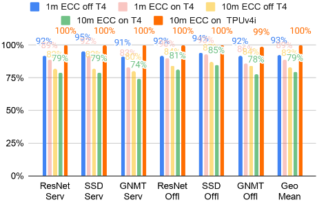

This reminds us of the Activation Storage in TPUv1 (Figure 1). Our initial buffer allocation scheme used most of its 24 MB. We eventually used an integer linear programming solver to effectively triple memory space. The large memory allowed our relatively weak initial compiler to satisfy the apps in TPUv1's early years. This example demonstrates the interplay of compiler quality ② and perf/TCO ③, as architects want good perf/TCO for a DSA's entire lifetime, including its early years.

Now that we've explained TPUv4i and its perf/TDP, let's see how other commercial inference DSAs measure up.

## 6. Related Work

Table 6 shows all five entries for datacenter inference chips for the MLPerf Inference 0.5 and 0.7 server benchmarks.

The T4 [31] is a low power inference chip containing 40 symmetric multiprocessors and a relatively fast GDDR6 DRAM at 320 GB/second (if ECC is off). Its standard clock rate is 0.6 GHz, with a Turbo mode at 1.6 Ghz. It supports floating point and integer numerics. The primary omission that prevents backwards ML compatibility ④with TPUv3 used for training is the lack of bf16 support in T4. This paper compares TPUv4i to it in §4, since of these five chips, T4 comes the closest to meeting Google's needs.

Habana Goya [10,12] is a moderate power inference chip with 8 VLIW SIMD vector cores running at 1.5 GHz attached to a relatively slow DDR4 memory. Its perf/TDP is half of T4 for the SSD benchmark. It has int8 and fp32 but omits bfloat16. Given no backwards ML compatibility when training with TPUs ④ and lessons ⑦ and ⑧ about the importance of multi-tenancy and how fast DNNs grow, Goya would not be a good choice for Google's datacenters.

The Intel Nervana NNP-I 1000 (Spring Hill) is a low power inference chip with 12 VLIW vector cores (with 4K int8/fp16 MACs each) running at 1.1 GHz [4, 17, 44]. They use a relatively slow LPDDR4 memory. Its perf/TDP is 0.7X of T4 for the single ResNet50 benchmark. Like the Goya, it omits bfloat16 and has relatively slow DRAM memory, so we would again worry about backwards ML compatibility ④ plus multi-tenancy ⑦ and DNN growth ⑧ for the NNP-I.

Zebra is a soft core that runs on the Xilinx Alveo FPGA [36]. It offers moderate power at 0.7 GHz [27] with the relatively slow DDR4 DRAM. Its perf/TDP is 4X worse than T4 for ResNet. It has the same deployment concerns for Google as Goya, whose perf/TDP is ~2X higher, plus Zebra is designed exclusively for CNNs ⑨.

Finally, Alibaba HanGuang 800 [20] is a 4-core chip with moderate to high power at 0.7 Ghz. Each core has a Tensor Engine, a Pooling Engine, and a Memory Engine, and it executes CISC-like instructions. Not only is its perf/TDP 2.2X better than T4 for ResNet50, its unnormalized performance is ~9X faster. It also has 192 MB of SRAM, 3.2X larger than the next closest. While the lack of bfloat16 would be an issue ④, the Achilles Heel of the HanGuang 800 is that it has no DRAM whatsoever. [20] mentions the use of a PCIe switch to gang multiple chips together to increase capacity, but using 16 chips to match the multi-tenancy ⑦ sizes of Table 3 would be expensive, and it's unclear how to support DNNs rapid growth⑧.

<!-- p.12 -->

## 7. Discussion

## We start with benchmarks and measurements.

## A. Utilization of peak FLOPS versus roofline

Table 7 shows the average fraction of peak FLOPS/s for four TPUs. One reason is that we increased the number of MXUs over time, as that was a good way to leverage the new technology node ①. Despite 4 MXUs per core in TPUv4i, the MXUs occupy only 11% of the die (Figure 6). 6

A more useful metric than fraction of peak FLOPS is fraction of roofline, limited by memory bandwidth or FLOPS/s depending on the DNN arithmetic intensity. Table 7 shows it generally increasing over time. Without CMEM, TPUv4i FLOPS/s would drop to 22% and roofline to 67%.

Table 7. Average utilization of peak performance and of roofline for our eight production applications.

| TPU                 | TPUv1      | TPUv2     | TPUv3     | TPUv4i    |
|---------------------|------------|-----------|-----------|-----------|
| MXUs/Chip           | 1 256 x256 | 2 128x128 | 4 128x128 | 4 128x128 |
| MXUs % Die Area     | 24%        | 8%        | 11%       | 11%       |
| FLOPS/s Utilization | 20%        | 51%       | 38%       | 33%       |
| HBM Roofline Util.  | 20%        | 66%       | 63%       | 99%       |

## B. Turbo mode and Perf/CapEx versus Perf/TCO

[39] warns that the cooling system is critical to T4 performance, as the clock can slow when temperature rises, since Turbo mode has a 2.6X faster clock. MLPerf Inference runs are required to last at least one minute, which is near the time it takes to heat up a chip and its heatsink fully ③.

Our experiments found that an idle T4 at the lowest clock rate ran at 35℃ (see [13]). If we run MLPerf at 1.6 GHz, the temperature rises to 75℃ in 30 seconds. Thereafter the chip stays at 75℃ with the clock speed varying between 0.9 and 1.3 GHz. Others found different variations in temperature [19], presumably due to running programs with different operational intensity than MLPerf.

Given our datacenter environment plus our need for ECC-optional for MLPerf Inference 0.5 and 0.7-Figure 14 shows the impact of running MLPerf Inference 0.5/0.7 for 10 minutes with ECC enabled: T4 performance drops 19%-26% below its MLPerf Inference 0.5/0.7 level. With ECC on, TPUv4i starts at ~37℃ and rises only ~5℃ over 10 minutes. Google purposely provisions enough power and cooling in datacenters to keep TPUv4i latency constant and includes extra memory for ECC so that it can always be on.

## C. Benchmarking TPUv4i and T4 versus NVIDIA A100

§4 compares TPUv4i to T4, but some asked if the paper should use the A100 instead. Our experience with TPUv3 was that a large, power hungry, expensive chip was a mismatch to inference ③, so the paper uses T4. The A100

6 The TPU ASIC die area is only a small fraction of the total die area in the package. Four 8Hi HBM stacks in TPUv3 total 3456 mm 2 , which swamps the TPU ASIC area (&lt;700 mm 2 in Table 1.)

826 mm 2 chip has 54B transistors and uses 400 Watts, so its TDP is 5.7X higher than T4. MLPerf 0.7 inference shows A100 runs ResNet50 server 4.7X-5.7X faster than T4 and SSD server is 6.0X-7.0X faster. The perf/TDP of A100 is within ±20% of T4. As T4 is more like TPUv4i, it is the best current candidate to compare to (see §6).

## D. Correlation of TCO and TDP

Figure 3 shows R is 0.99 for the 5 DNN DSAs when comparing TCO versus system TDP in Google datacenters. R is still 0.88 (R 2 = 0.78) for 15 chips of CPUs, GPUs, and TPUs across several generations. By definition, a correlation coefficient R ranges from -1.00 to +1.00. If R = 1.00, statisticians say the correlation is perfectly linear. There is a strong linear correlation if R is &gt;0.4, moderate between 0.2 and 0.4, and &lt;0.2 is weak. Turning R into R 2 shows the percent that explains the variability of the dependent variable. An R 2 of 0.98 means TDP explains 98% of the variability of TCO for the five DSAs and an R 2 of 0.78 explains 78% of TCO variability for all 15 processors.

As it is close to how companies decide what to build or buy, we hope future DSA papers will report perf/system TDP over a chip's lifetime.

## E. Power Savings vs TCO and P99 Latency

Trying to maximize average perf/TDP, such as temporarily running faster, can lead to worse tail latencies [6]. TPUs omit techniques like Turbo mode and caches that surely help P50 latency but probably not P99 latency. Most OpEx cost is for provisioning power and not for electricity use [2], so saving power already provisioned for doesn't improve TCO as much as one might hope.

## The last three topics are about TPUv4i software.

## F. Multi-tenancy and on chip SRAM

The XLA compiler allocates weights in DRAM and prefetches them into CMEM for execution to reduce the context switching time for multi-tenancy ⑦; if weights are allocated to CMEM, they must be reloaded before the task can continue. The software stack must also reload CMEM for apps that don't prefetch. BERT1 would take about ~150 microseconds-93MB ÷ 614GB/s-to load the weights from HBM, which is on the borderline of acceptability.

## G. Compiler vs. Binary Compatibility in GPUs and TPUs

Most CPUs require backwards binary compatibility (§3), a problem for VLIW DSAs (§6). TPUs don't. The nearest software approach to TPUv4i is NVIDIA's PTX virtual instruction set. NVIDIA promises PTX compatibility across GPU generations, so some tools and programmers use PTX instead of CUDA.

XLA's Low-Level Operations (LLO) are the closest analogy to PTX (see §3). Only a few programmers write in LLO, as there is no guarantee that LLO code will work for future TPUs and most TPU developers can get good performance without having to resort to LLO coding.

<!-- p.13 -->

## H. Quantization Aware Training

The quantization downsides in ⑥ are for post-training quantization. Another approach is quantization aware training [34], which uses integers during training, allowing the switch to serving without a separate quantization step. Basically, the developer gets backwards ML compatibility while using integer data types.

The challenge is motivating the use of quantization aware training. Some developers might like the better memory footprint or performance for DSAs whose integer arithmetic is faster than floating point. The issue may come down to how much harder training is in integers versus floating point and for how many applications does it work.

## 8. Conclusion

Once Google developed and deployed its first generation inference TPU in datacenters [21], Google's creative ML application developers and economic realities caused us to change the inference and training system roadmaps. Faced with widespread adoption across Google's products, an explosion in the number of ML application developers, and needs for high developer velocity enabling automated roll out of new models multiple times per day, we changed Google's roadmap plans.

In the process, we learned ten lessons about DSAs and DNNs in general and about DNN DSAs specifically that shaped the design of TPUv4i:

- ①Logic improves more quickly than wires and SRAM
- ⇒ TPUv4i has 4 MXUs per core vs 2 for TPUv3 and 1 for TPUv1/v2.
- ②Leverage existing compiler optimizations
- ⇒ TPUv4i evolved from TPUv3 instead of being a brand new ISA.
- ③Design for perf/TCO instead of perf/CapEx
- ⇒ TDP is low, CMEM/HBM are fast, and the die is not big.
- ④ Backwards ML compatibility enables rapid deployment of trained DNNs

⇒TPUv4i supports bf16 and avoids arithmetic problems by looking like TPUv3 from the XLA compiler's perspective.

- ⑤Inference DSAs need air cooling for global scale
- ⇒ Its design and 1.0 GHz clock lowers its TDP to 175W.
- ⑥Some inference apps need floating point arithmetic
- ⇒ It supports bf16 and int8, so quantization is optional.
- ⑦Production inference normally needs multi-tenancy
- ⇒ TPUv4i's HBM capacity can support multiple tenants.
- ⑧DNNs grow ~1.5x annually in memory and compute
- ⇒ To support DNN growth, TPUv4i has 4 MXUs, fast onand off-chip memory, and ICI to link 4 adjacent TPUs.
- ⑨DNN workloads evolve with DNN breakthroughs
- ⇒ Its programmability and software stack help pace DNNs.
- ⑩The inference SLO is P99 latency, not batch size
- ⇒ Backwards ML compatible training tailors DNNs to TPUv4i, yielding batch sizes of 8-128 that raise throughput and meet SLOs. Applications do not restrict batch size.

Dennard scaling is finished, so TCO is becoming even more strongly correlated with power dissipation. Google's TCO and system TDP have a correlation coefficient R of 0.99 for 5 DNN DSAs and 0.88 for a collection of 15 CPUs, GPUs, and TPUs. This paper also updated Horowitz's influential energy operation table [16] to a modern technology with current models of SRAM and DRAM.

With recent processes, logic is still becoming denser and faster, yet SRAM is scaling very weakly ①-5 nm SRAM looks to be only 13% denser than 7 nm [45]-so the energy cost of memory accesses dominates perf/TDP even more ③. Hence, contrary to the ML developer community's convention of trying to minimize FLOPS-which leads to memory-access-intensive DNNs-in a datacenter context, reduced-precision FLOPS can be relatively free in comparison to memory references.

With Moore's Law diminishing and Dennard scaling dead, hardware/software/DNN co-design is the best chance for DNN DSAs to keep vaulting accelerator walls [9, 14].

## Acknowledgment

The authors built or analyzed the systems that involved major contributions from many others. Thanks go to the hardware and software teams for making TPUs possible. 7

We also thank David Culler, Jeff Dean, Urs Hölzle, Christos Kozyrakis, Hank Levy, Alex Ramirez, Partha Ranganathan, and Sophia Shao for feedback on this paper.

7 The people on these teams include Gaurav Agrawal, Catherine Ahlschlager, Ahmet Akyildiz, Ashby Armistead, Sandeep Bhatia, Rich Bonderson, Oliver Bowen, Roger Carpenter, Andrew Casper, Clifford Chao, Dehao Chen, Chiachen Chou, William Chwee, Xiangyu Dong, Houle Gan, Rakesh Gautam, Peter Gavin, Arnd Geis, Ben Gelb, Russ Gibbons, Sandeep Giri, Vinayak Gokhale, Pareesa Golnari, Rajendra Gottipati, Nils Graef, Jesse Guss, Benjamin Gwin, David Haskell, Blake Hechtman, Matthew Hedlund, Jian Ho, Doug Hogberg, Jerry Huang, Michael Hsu, Adam Hutchin, Mike Hutton, Berkin Ilbeyi, Srikrishna Iyer, Arpith Jacob, Indira Jayaram, Chetan Kale, Pankaj Kanwar, Srinidhi Kestur, Teju Khubchandani, Woon-Seong Kwon, Namhoon Kim, Andy Koch, Alan Kulawik, Poorna Kumar, Alice Kuo, Steve Lacy, Joshua Lang, Chester Li, Avinash Lingamneni, Derek Lockhart, Stephen Longfield, Fong Lou, Tao Liu, Kyle Lucke, Adriana Maggiore, David Majnemer, Seth Merriman, Rolf Mueller, David Munday, Mandar Munishwar, Hithesh Murthy, Lifeng Nai, Spoorthy Nanjaiah, Andrew Noonan, Alexander Nguyen, Vinh Nguyen, Tayo Oguntebi, Virag Parekh, Jose Baiocchi Paredes, Sang-Keun Park, Tejas Parikh, Omkar Pathak, Ram Babu Penugonda, Andy Phelps, Vaishali Raghuraman, Guru Rajamani, Andrew Ranck, Paul Rodman, Bjarke Roune, Ohad Russo, Amit Sabne, Amir Salek, Kirk Sanders, Julian Schrittwieser, Chris Severn, Boone Severson, Hamid Shojaei, Jaideep Singh, Tej Soni, Jaswanth Sreeram, Dan Steinberg, Jim Stichnot, Qian Sun, Mercedes Tan, Hua Tang, Horia Toma, Alex Thomson, Ani Udipi, Dimitris Vardoulakis, Sandeep Venishetti, Jack Webber, Monica Wong-Chan, Hsin-Jung Yang, Mingyao Yang, Xiaoming Yu, Lu Yuan, Sara Zebian, Feini Zhang, and Ce Zheng.

<!-- p.14 -->

## 9. References

- [1] Google breaks AI performance records in MLPerf with world's fastest training supercomputer.
- [2] Barroso, L.A., Hölzle, U. and Ranganathan, P., 2018. The datacenter as a computer: Designing warehouse-scale machines. Synthesis Lectures on Computer Architecture, 13.
- [3] Clark, J. October 26, 2015, Google Turning Its Lucrative Web Search Over to AI Machines. Bloomberg Technology.
- [4] Cutress, I. Intel 10nm Spring Hill NNP-I Inference Chip, Hot Chips 31, August 20, 2019.
- [5] Dally, W.J., Turakhia, Y. and Han, S., 2020. Domain-specific hardware accelerators. Communications of the ACM, 63(7), 48-57.
- [6] Dean, J. and Barroso, L.A., 2013. The tail at scale. Communications of the ACM, 56(2), pp.74-80.
- [7] Dey, S., Mukherjee, A. and Pal, A., 2019, November. Embedded Deep Inference in Practice: Case for Model Partitioning. In Proceedings of the 1st Workshop on Machine Learning on Edge in Sensor Systems (pp. 25-30).
- [8] Fisher, J.A., Faraboschi, P. and Young, C., 2005. Embedded computing: a VLIW approach to architecture, compilers and tools. Elsevier.
- [9] Fuchs, A. and Wentzlaff, D., 2019, February. The accelerator wall: Limits of chip specialization. In 2019 IEEE Int'l Symp. on High Performance Computer Architecture, pp. 1-14.
- [10] Goya, Goya Inference Platform White Paper, Nov. 2020.
- [11] Grot, B., Hardy, D., Lotfi-Kamran, P., Falsafi, B., Nicopoulos, C. and Sazeides, Y., 2012. Optimizing data-center TCO with scale-out processors. IEEE Micro.
- [12] Gwennap, L. Habana Wins Cigar for AI Inference, Microprocessor Report, February 18, 2019. www.linleygroup.com/mpr/article.php?id=12103
- [13] Harmon, W., NVIDIA Tesla T4 AI Inferencing GPU Benchmarks and Review, October 2, 2019,
- [14] Hennessy, J.L. and Patterson, D.A., 2019. A new golden age for computer architecture. Communications of the ACM, 62(2), 48-60.
- [15] Ho, R., Mai, K.W. and Horowitz, M.A., 2001. The future of wires. Proceedings of the IEEE, 89(4), pp.490-504.
- [16] Horowitz, M., 2014. Computing's energy problem (and what we can do about it). In 2014 IEEE Int'l Solid-State Circuits Conference Digest of Technical Papers (ISSCC) (pp. 10-14).
- [17] Hruska, J., Intel Details Its Nervana Inference and Training AI Cards, August 2019.
- [18] Imagenet, 2020.
- [19] Jia, Z., Maggioni, M., Smith, J. and Scarpazza, D.P., 2019. Dissecting the NVIDIA Turing T4 GPU via microbenchmarking. arXiv preprint arXiv:1903.07486.
- [20] Jiao, Y., Han, L. and Long, X., 2020, August. Hanguang 800 NPU-The Ultimate AI Inference Solution for Data Centers. In 2020 IEEE Hot Chips 32 Symp. (pp. 1-29).
- [21] Jouppi, N.P., Young, C., Patil, N., Patterson, D., et al, 2017, June. In-datacenter performance analysis of a Tensor Processing Unit. In Computer Architecture (ISCA), 2017 ACM/IEEE 44th Annual Int'l Symp. on (pp. 1-12).
- [22] Jouppi, N.P., Young, C., Patil, N. and Patterson, D., 2018. A domain-specific architecture for deep neural networks. Communications of the ACM, 61(9), pp.50-59.
- [23] Jouppi, N.P., Yoon, D.H., Kurian, G., Li, S., Patil, N., Laudon, J., Young, C. and Patterson, D., 2020. A domain-specific supercomputer for training deep neural networks. Communications of the ACM, 63(7), pp.67-78.
- [24] Kalamkar, D., Mudigere, D., Mellempudi, N., Das, D., Banerjee, K., Avancha, S., Vooturi, D.T., Jammalamadaka, N., Huang, J., Yuen, H. and Yang, J., 2019. A study of bfloat16 for deep learning training. arXiv preprint arXiv:1905.12322.
- [25] Knuth, D.E. and Binstock, A., 2008. Interviewwith Donald Knuth. Web page at www.informit.com/articles/article.aspx.
- [26] Micron, TN-ED-03: GDDR6: The Next-Generation Graphics DRAM.
27. [[27] Mipsology , MLPerf Inference 0.7 details.
- [28] MLPerf, MLPerf Training v0.7 Results, July 29, 2020, mlperf.org/training-results-0-7.
- [29] MLPerf is a trademark of MLCommons.org. All results 1/8/2021. All results 1/8/2021. Figure 2: Train-05-4, Train-0.5-20,Train-0.5-21; Table 6: Inf-0.5-25, Inf-0.5-21, Inf-0.5-33, Inf-0.7-119, Inf-0.5-31.
- [30] Norrie, T., Patil, N., Yoon, D.H., Kurian, G., Li, S., Laudon, J., Young, C., Jouppi, N. and Patterson, D., 2021. The Design Process for Google's Training Chips: TPUv2 and TPUv3. IEEE Micro, 41:2, 56-63.
- [31] NVIDIA, NVIDIA T4 70W Low Profile PCIe GPU Accelerator, PB-09256-001\_v05, April 2020.
- [32] O'Connor, M., Chatterjee, N., Lee, D., Wilson, J., Agrawal, A., Keckler, S.W. and Dally, W.J., 2017, October. Fine-grained DRAM: energy-efficient DRAM for extreme bandwidth systems. In 2017 50th Annual IEEE/ACM Int'l Symp. on Microarchitecture.
- [33] Pang, L., Lan, Y., Guo, J., Xu, J., Xu, J. and Cheng, X., 2017, November. Deeprank: A new deep architecture for relevance ranking in information retrieval. In Proceedings of the 2017 ACM on Conference on Information and Knowledge Management.
- [34] Park, E., Yoo, S. and Vajda, P., 2018. Value-aware quantization for training and inference of neural networks. In Proceedings of the European Conference on Computer Vision (ECCV) (pp. 580-595).
- [35] Park, J., et al, 2018. Deep learning inference in facebook data centers: Characterization, performance optimizations and hardware implications. arXiv preprint arXiv:1811.09886.
- [36] Patel, B., and Larzul, L., Deep Learning Inferencing with Mipsology using Xilinx ALVEO™ on Dell EMC Infrastructure, November 5, 2019.
- [37] Patterson, D., Bennett, J., Embench™: A Modern Benchmark for Embedded Computing (in preparation).
- [38] Romero, F., Li, Q., Yadwadkar, N.J. and Kozyrakis, C., 2019. INFaaS: A Model-less Inference Serving System. arXiv preprint arXiv:1905.13348.
- [39] Schmuelling, G., NVIDIA MLPerf Inference System Under Test (SUT) performance tuning guide,
40. [[40] Shih, Y., Lai, W.S. and Liang, C.K., 2019. Distortion-free wide-angle portraits on camera phones. ACM Transactions on Graphics, 38(4), pp.1-12.
41. [[41] Silver, D., Schrittwieser, J., Simonyan, K., Antonoglou, I., Huang, A., Guez, A., Hubert, T., Baker, L., Lai, M., Bolton, A. and Chen, Y., 2017. Mastering the game of Go without human knowledge. Nature, 550(7676), pp.344-359.
- [42] Smith, R., Micron Spills on GDDR6X, August 20, 2020, Anandtech.com/
- [43] Stojanović, V., 2012, Designing VLSI Interconnects with Monolithically Integrated Silicon-Photonics,
- [44] Wechsler, O., Behar, M. and Daga, B., 2019. Spring Hill (NNP-I 1000) Intel's data center inference chip. In 2019 IEEE Hot Chips 31 Symp. (pp. 1-12).
45. [[45] Technology Node, en.wikichip.org/wiki/technology\_node
46. [[46] Williams, S., Waterman, A. and Patterson, D., 2009. Roofline: an insightful visual performance model for multicore architectures. Communications of the ACM, 52(4), pp.65-76.
47. [[47] Zimmer, B., April 20, 2020 "Problems Facing Analog and In -Memory Computing," presentation at UC Berkeley.
