> 本文件由 `Patterson2022-Decade-of-ML-Accelerators-Lessons.pdf` 自动转换（docling 2.140.0，2026-10-17）。每页的整页图在 `images/` 目录；表格与数字请以 PDF 原文为准；`<!-- p.N -->` 标记对应 PDF 第 N 页。

<!-- p.1 -->

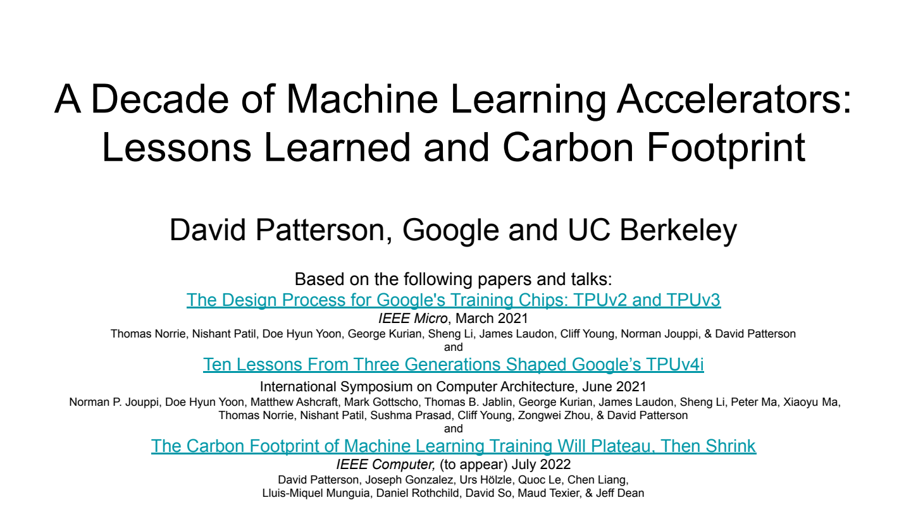

## A Decade of Machine Learning Accelerators: Lessons Learned and Carbon Footprint

## David Patterson, Google and UC Berkeley

Based on the following papers and talks:

[The Design Process for Google's Training Chips: TPUv2 and TPUv3](http://ieeexplore.ieee.org/document/9351692)

IEEE Micro, March 2021

Thomas Norrie, Nishant Patil, Doe Hyun Yoon, George Kurian, Sheng Li, James Laudon, Cliff Young, Norman Jouppi, &amp; David Patterson and

## [Ten Lessons From Three Generations Shaped Google's TPUv4i](http://www.markgottscho.com/papers/2021_NJouppi_ISCA.pdf)

Norman P. Jouppi, Doe Hyun Yoon, Matthew Ashcraft, Mark Gottscho, Thomas B. Jablin, George Kurian, James Laudon, Sheng Li, Peter Ma, Xiaoyu Ma, Thomas Norrie, Nishant Patil, Sushma Prasad, Cliff Young, Zongwei Zhou, &amp; David Patterson

International Symposium on Computer Architecture, June 2021 and

## [The Carbon Footprint of Machine Learning Training Will Plateau, Then Shrink](https://www.techrxiv.org/articles/preprint/The_Carbon_Footprint_of_Machine_Learning_Training_Will_Plateau_Then_Shrink/19139645)

IEEE Computer, (to appear) July 2022

David Patterson, Joseph Gonzalez, Urs Hölzle, Quoc Le, Chen Liang, Lluis-Miquel Munguia, Daniel Rothchild, David So, Maud Texier, &amp; Jeff Dean

<!-- p.2 -->

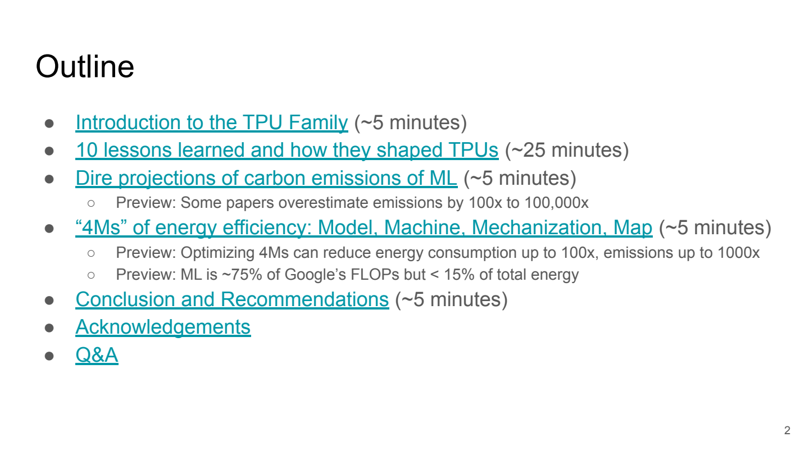

## Outline

- Introduction to the TPU Family (~5 minutes)
- 10 lessons learned and how they shaped TPUs (~25 minutes)
- Dire projections of carbon emissions of ML (~5 minutes)
- Preview: Some papers overestimate emissions by 100x to 100,000x
- "4Ms" of energy efficiency: Model, Machine, Mechanization, Map (~5 minutes)
- Preview: Optimizing 4Ms can reduce energy consumption up to 100x, emissions up to 1000x
- Preview: ML is ~75% of Google's FLOPs but &lt; 15% of total energy
- Conclusion and Recommendations (~5 minutes)
- Acknowledgements
- Q&amp;A

<!-- p.3 -->

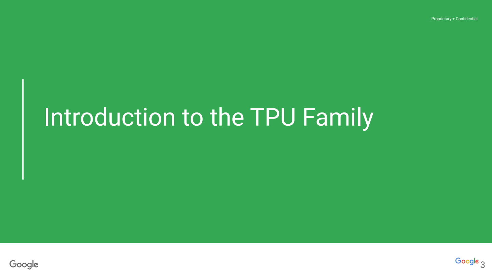

## Introduction to the TPU Family

<!-- p.4 -->

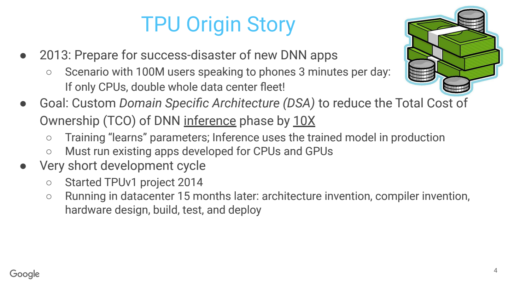

## TPU Origin Story

- 2013: Prepare for success-disaster of new DNN apps
- Scenario with 100M users speaking to phones 3 minutes per day: If only CPUs, double whole data center fleet!
- Goal: Custom Domain Specific Architecture (DSA) to reduce the Total Cost of Ownership (TCO) of DNN inference phase by 10X
- Training "learns" parameters; Inference uses the trained model in production
- Must run existing apps developed for CPUs and GPUs
- Very short development cycle
- Started TPUv1 project 2014
- Running in datacenter 15 months later: architecture invention, compiler invention, hardware design, build, test, and deploy

<!-- p.5 -->

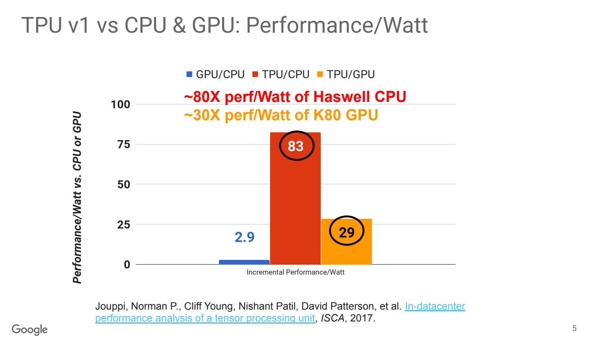

## TPU v1 vs CPU &amp; GPU: Performance/Watt

Jouppi, Norman P., Cliff Young, Nishant Patil, David Patterson, et al. In-datacenter performance analysis of a tensor processing unit, ISCA, 2017.

<!-- p.6 -->

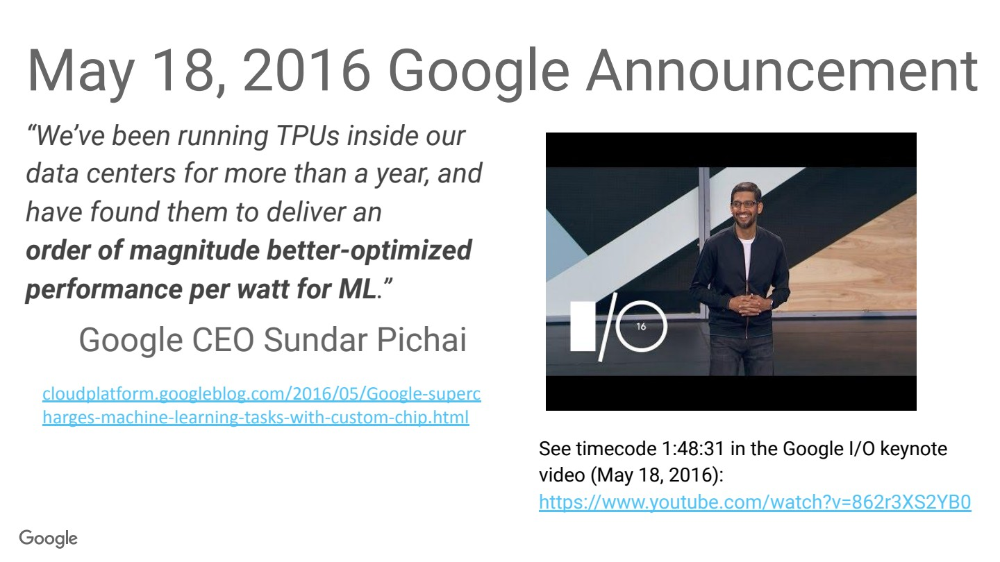

## May 18, 2016 Google Announcement

"We've been running TPUs inside our data centers for more than a year, and have found them to deliver an order of magnitude better-optimized performance per watt for ML."

Google CEO Sundar Pichai

cloudplatform.googleblog.com/2016/05/Google-superc harges-machine-learning-tasks-with-custom-chip.html See timecode 1:48:31 in the Google I/O keynote video (May 18, 2016):

[https://www.youtube.com/watch?v=862r3XS2YB0](https://www.youtube.com/watch?v=862r3XS2YB0)

<!-- p.7 -->

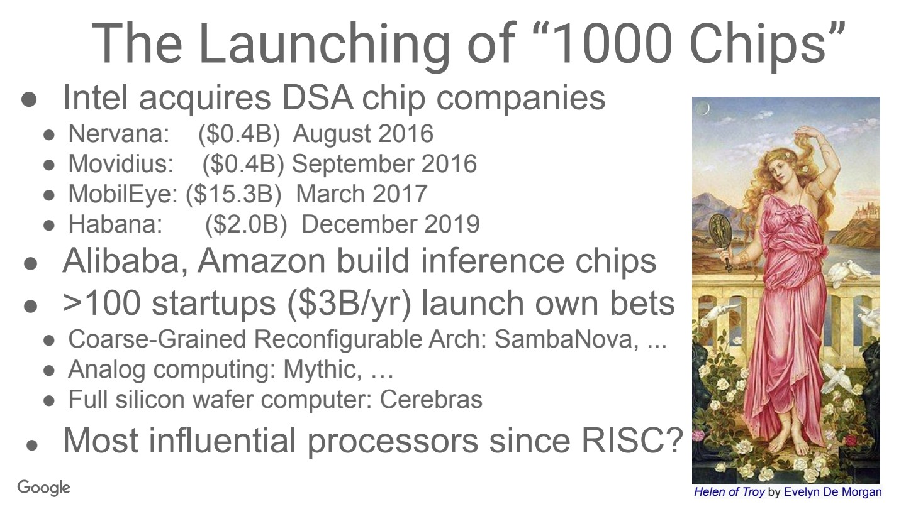

## The Launching of "1000 Chips"

- Intel acquires DSA chip companies
- Nervana: ($0.4B) August 2016
- Movidius: ($0.4B) September 2016
- MobilEye: ($15.3B) March 2017
- Habana: ($2.0B) December 2019
- Alibaba, Amazon build inference chips
- &gt;100 startups ($3B/yr) launch own bets
- Coarse-Grained Reconfigurable Arch: SambaNova, ...
- Analog computing: Mythic, …
- Full silicon wafer computer: Cerebras
- Most influential processors since RISC?

7 Helen of Troy by Evelyn De Morgan

<!-- p.8 -->

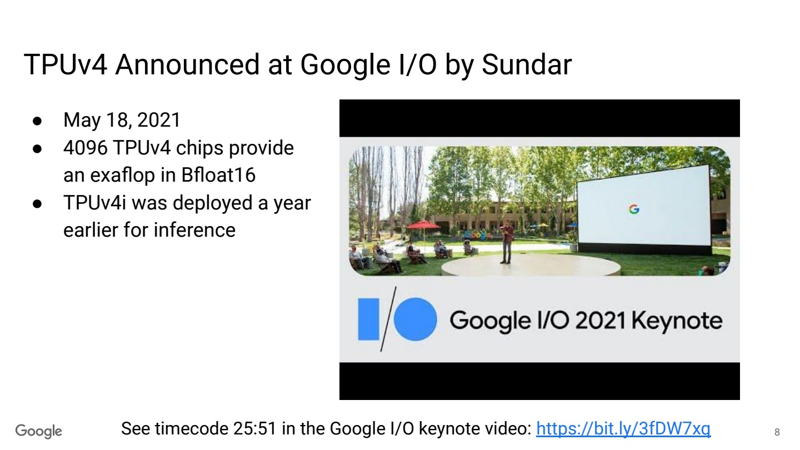

## TPUv4 Announced at Google I/O by Sundar

- May 18, 2021
- 4096 TPUv4 chips provide an exaflop in Bfloat16
- TPUv4i was deployed a year earlier for inference

<!-- p.9 -->

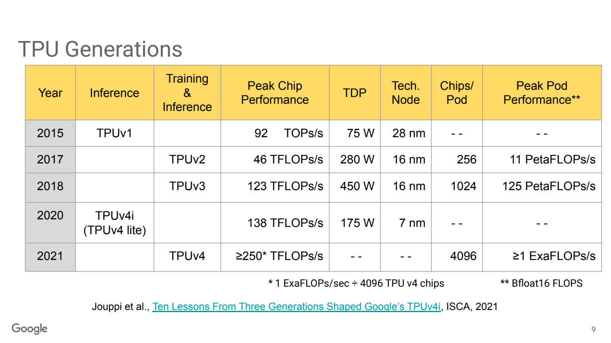

## TPU Generations

|   Year | Inference           | Training & Inference   | Peak Chip Performance   | TDP   | Tech. Node   | Chips/ Pod   | Peak Pod Performance**   |
|--------|---------------------|------------------------|-------------------------|-------|--------------|--------------|--------------------------|
|   2015 | TPUv1               |                        | 92 TOPs/s               | 75 W  | 28 nm        | - -          | - -                      |
|   2017 |                     | TPUv2                  | 46 TFLOPs/s             | 280 W | 16 nm        | 256          | 11 PetaFLOPs/s           |
|   2018 |                     | TPUv3                  | 123 TFLOPs/s            | 450 W | 16 nm        | 1024         | 125 PetaFLOPs/s          |
|   2020 | TPUv4i (TPUv4 lite) |                        | 138 TFLOPs/s            | 175 W | 7 nm         | - -          | - -                      |
|   2021 |                     | TPUv4                  | ≥250* TFLOPs/s          | - -   | - -          | 4096         | ≥1 ExaFLOPs/s            |

[Jouppi et al., Ten Lessons From Three Generations Shaped Google's TPUv4i, ISCA, 2021](http://www.markgottscho.com/papers/2021_NJouppi_ISCA.pdf)

** Bfloat16 FLOPS

<!-- p.10 -->

## Ten Lessons and how they shaped TPUs

<!-- p.11 -->

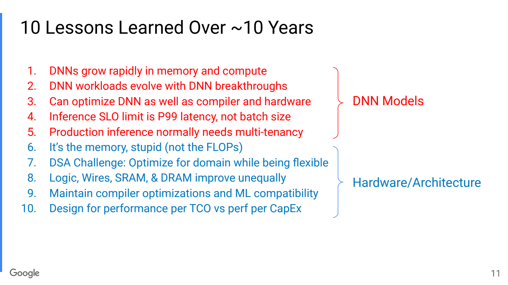

## 10 Lessons Learned Over ~10 Years

1. DNNs grow rapidly in memory and compute
2. DNN workloads evolve with DNN breakthroughs
3. Can optimize DNN as well as compiler and hardware
4. Inference SLO limit is P99 latency, not batch size
5. Production inference normally needs multi-tenancy
6. It's the memory, stupid (not the FLOPs)
7. DSA Challenge: Optimize for domain while being flexible
8. Logic, Wires, SRAM, &amp; DRAM improve unequally
9. Maintain compiler optimizations and ML compatibility
10. Design for performance per TCO vs perf per CapEx

DNN Models

Hardware/Architecture

<!-- p.12 -->

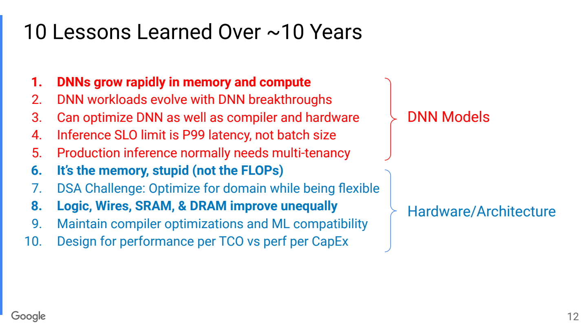

## 10 Lessons Learned Over ~10 Years

1. DNNs grow rapidly in memory and compute
2. DNN workloads evolve with DNN breakthroughs
3. Can optimize DNN as well as compiler and hardware
4. Inference SLO limit is P99 latency, not batch size
5. Production inference normally needs multi-tenancy
6. It's the memory, stupid (not the FLOPs)
7. DSA Challenge: Optimize for domain while being flexible
8. Logic, Wires, SRAM, &amp; DRAM improve unequally
9. Maintain compiler optimizations and ML compatibility
10. Design for performance per TCO vs perf per CapEx

DNN Models

Hardware/Architecture

<!-- p.13 -->

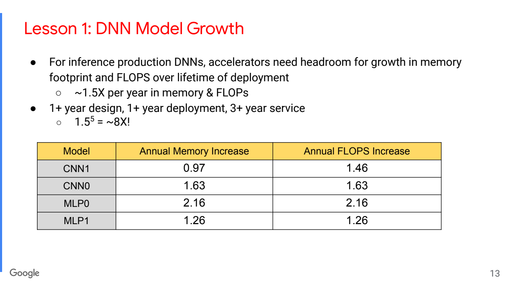

## Lesson 1: DNN Model Growth

- For inference production DNNs, accelerators need headroom for growth in memory footprint and FLOPS over lifetime of deployment
- ~1.5X per year in memory &amp; FLOPs
- 1+ year design, 1+ year deployment, 3+ year service ○ 1.5 5 = ~8X!

|   Model |   Annual Memory Increase | Annual FLOPS Increase   |
|---------|--------------------------|-------------------------|
|    0.97 |                     1.46 | CNN1                    |
|    1.63 |                     1.63 | CNN0                    |
|    2.16 |                     2.16 | MLP0                    |
|    1.26 |                     1.26 | MLP1                    |

<!-- p.14 -->

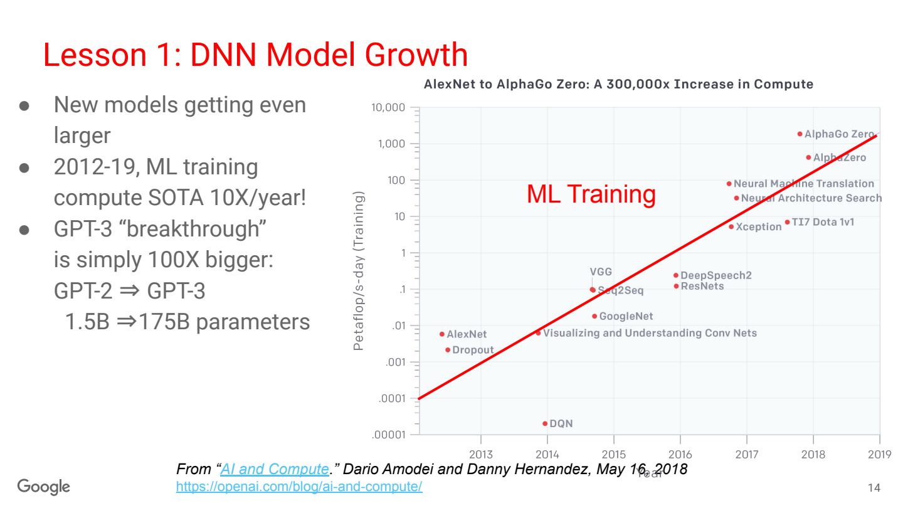

## Lesson 1: DNN Model Growth

- New models getting even larger
- 2012-19, ML training compute SOTA 10X/year!
- GPT-3 "breakthrough" is simply 100X bigger: GPT-2 ⇒ GPT-3 1.5B ⇒175B parameters

<!-- p.15 -->

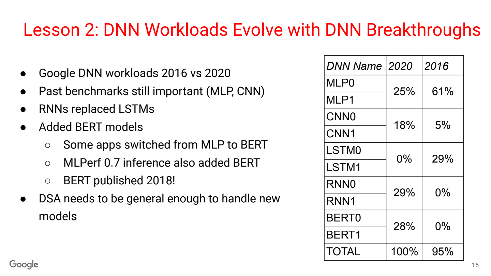

## Lesson 2: DNN Workloads Evolve with DNN Breakthroughs

- Google DNN workloads 2016 vs 2020
- Past benchmarks still important (MLP, CNN)
- RNNs replaced LSTMs
- Added BERT models
- Some apps switched from MLP to BERT
- MLPerf 0.7 inference also added BERT
- BERT published 2018!
- DSA needs to be general enough to handle new models

| DNN Name         | 2020   | 2016   |
|------------------|--------|--------|
| MLP0 MLP1        | 25%    | 61%    |
| CNN0             | 18%    | 5%     |
| CNN1 LSTM0 LSTM1 | 0%     | 29%    |
| RNN0 RNN1        | 29%    | 0%     |
| BERT0 BERT1      | 28%    | 0%     |
| TOTAL            | 100%   | 95%    |

<!-- p.16 -->

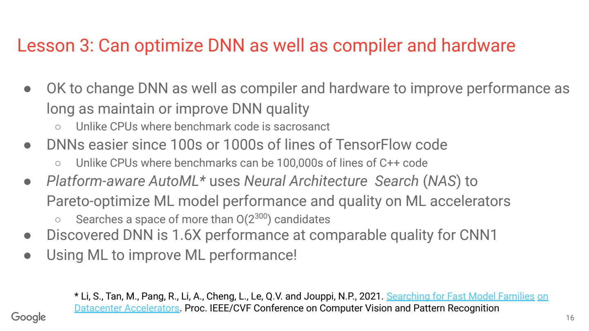

## Lesson 3: Can optimize DNN as well as compiler and hardware

- OK to change DNN as well as compiler and hardware to improve performance as long as maintain or improve DNN quality
- Unlike CPUs where benchmark code is sacrosanct
- DNNs easier since 100s or 1000s of lines of TensorFlow code
- Unlike CPUs where benchmarks can be 100,000s of lines of C++ code
- Platform-aware AutoML* uses Neural Architecture Search (NAS) to Pareto-optimize ML model performance and quality on ML accelerators
- Searches a space of more than O(2 300 ) candidates
- Discovered DNN is 1.6X performance at comparable quality for CNN1
- Using ML to improve ML performance!

<!-- p.17 -->

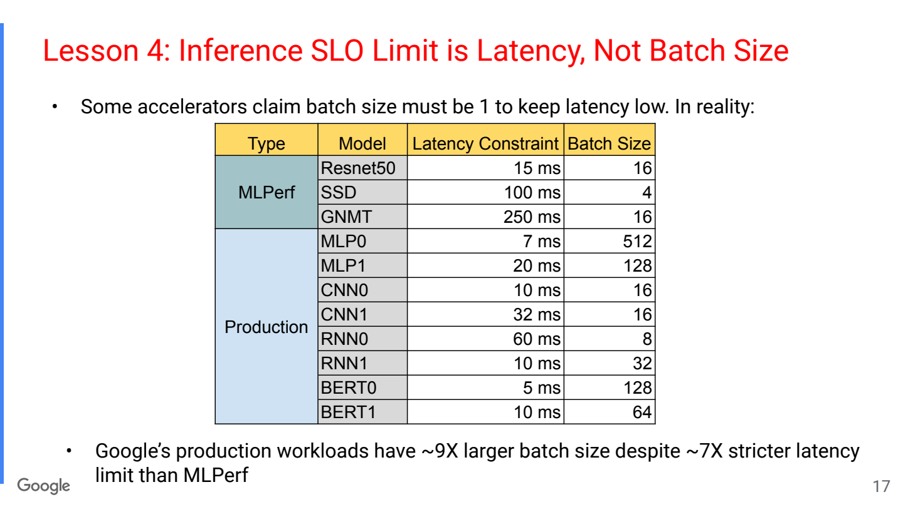

## Lesson 4: Inference SLO Limit is Latency, Not Batch Size

- Some accelerators claim batch size must be 1 to keep latency low. In reality:
- Google's production workloads have ~9X larger batch size despite ~7X stricter latency limit than MLPerf

| Type       | Model    | Latency Constraint   |   Batch Size |
|------------|----------|----------------------|--------------|
| MLPerf     | Resnet50 | 15 ms                |           16 |
|            | SSD      | 100 ms               |            4 |
|            | GNMT     | 250 ms               |           16 |
| Production | MLP0     | 7 ms                 |          512 |
| Production | MLP1     | 20 ms                |          128 |
| Production | CNN0     | 10 ms                |           16 |
| Production | CNN1     | 32 ms                |           16 |
| Production | RNN0     | 60 ms                |            8 |
| Production | RNN1     | 10 ms                |           32 |
| Production | BERT0    | 5 ms                 |          128 |
| Production | BERT1    | 10 ms                |           64 |

<!-- p.18 -->

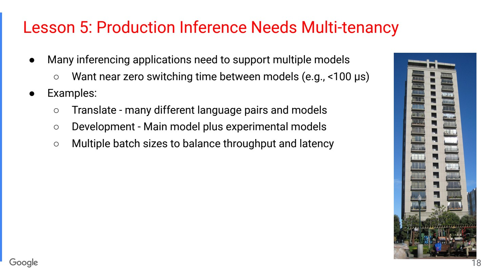

## Lesson 5: Production Inference Needs Multi-tenancy

- Many inferencing applications need to support multiple models
- Want near zero switching time between models (e.g., &lt;100 μs)
- Examples:
- Translate - many different language pairs and models
- Development - Main model plus experimental models
- Multiple batch sizes to balance throughput and latency

<!-- p.19 -->

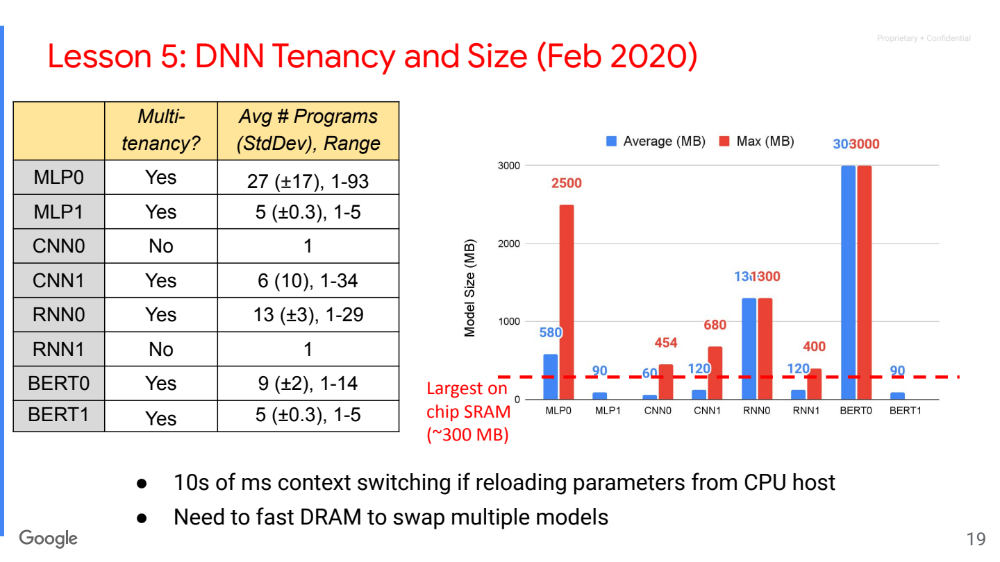

## Lesson 5: DNN Tenancy and Size (Feb 2020)

|       | Multi- tenancy?   | Avg # Programs (StdDev), Range   |
|-------|-------------------|----------------------------------|
| MLP0  | Yes               | 27 (±17), 1-93                   |
| MLP1  | Yes               | 5 (±0.3), 1-5                    |
| CNN0  | No                | 1                                |
| CNN1  | Yes               | 6 (10), 1-34                     |
| RNN0  | Yes               | 13 (±3), 1-29                    |
| RNN1  | No                | 1                                |
| BERT0 | Yes               | 9 (±2), 1-14                     |
| BERT1 | Yes               | 5 (±0.3), 1-5                    |

- 10s of ms context switching if reloading parameters from CPU host
- Need to fast DRAM to swap multiple models

<!-- p.20 -->

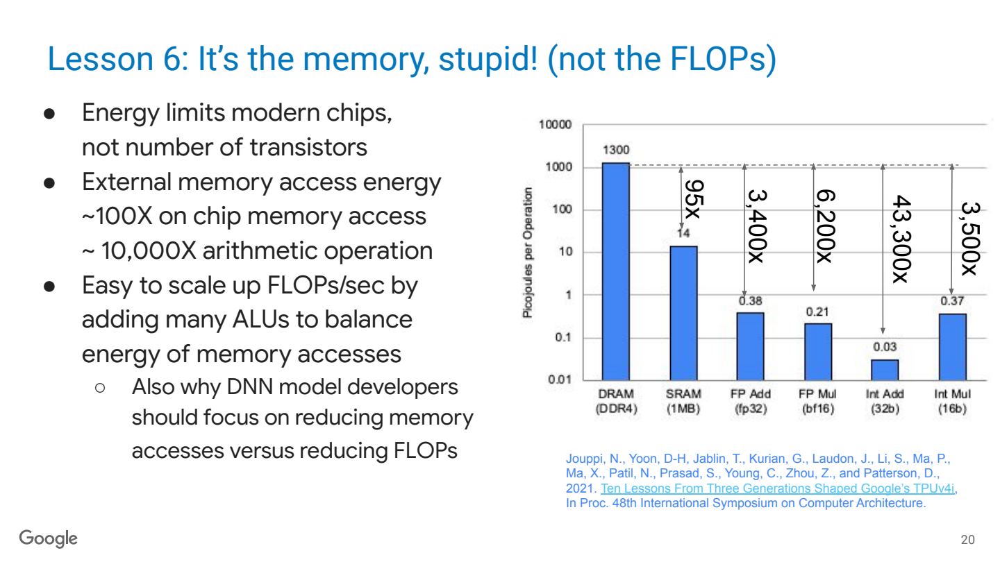

## Lesson 6: It's the memory, stupid! (not the FLOPs)

- Energy limits modern chips, not number of transistors
- External memory access energy
- ~100X on chip memory access
- ~ 10,000X arithmetic operation
- Easy to scale up FLOPs/sec by adding many ALUs to balance energy of memory accesses
- Also why DNN model developers should focus on reducing memory accesses versus reducing FLOPs

Jouppi, N., Yoon, D-H, Jablin, T., Kurian, G., Laudon, J., Li, S., Ma, P., Ma, X., Patil, N., Prasad, S., Young, C., Zhou, Z., and Patterson, D., 2021. Ten Lessons From Three Generations Shaped Google's TPUv4i, In Proc. 48th International Symposium on Computer Architecture.

<!-- p.21 -->

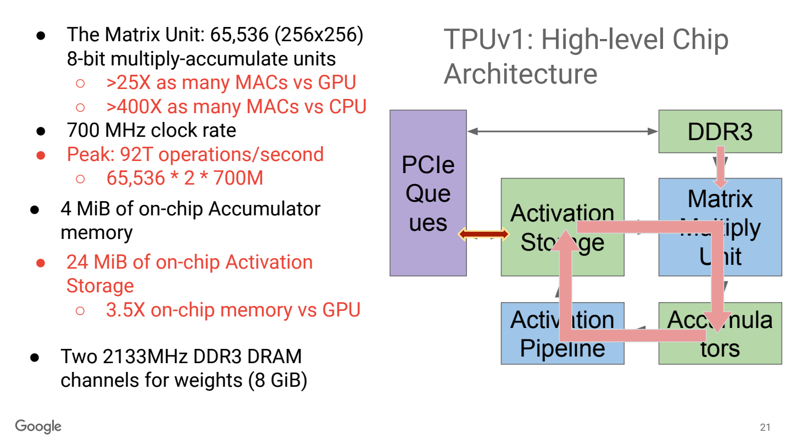

- The Matrix Unit: 65,536 (256x256) 8-bit multiply-accumulate units
- &gt;25X as many MACs vs GPU
- &gt;400X as many MACs vs CPU
- 700 MHz clock rate
- Peak: 92T operations/second
- 65,536 * 2 * 700M
- 4 MiB of on-chip Accumulator memory
- 24 MiB of on-chip Activation Storage
- 3.5X on-chip memory vs GPU
- Two 2133MHz DDR3 DRAM channels for weights (8 GiB)

## TPUv1: High-level Chip Architecture

<!-- p.22 -->

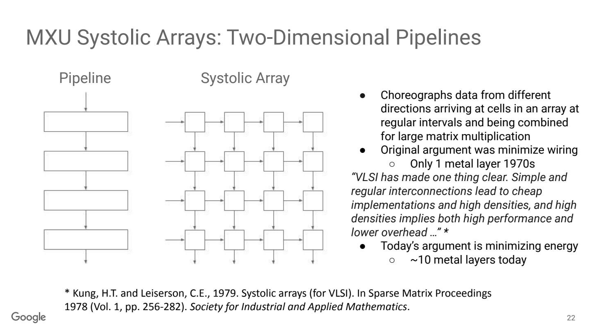

## MXU Systolic Arrays: Two-Dimensional Pipelines

- Choreographs data from different directions arriving at cells in an array at regular intervals and being combined for large matrix multiplication
- Original argument was minimize wiring
- Only 1 metal layer 1970s

"VLSI has made one thing clear. Simple and regular interconnections lead to cheap implementations and high densities, and high densities implies both high performance and lower overhead …" *

- Today's argument is minimizing energy
- ~10 metal layers today

* Kung, H.T. and Leiserson, C.E., 1979. Systolic arrays (for VLSI). In Sparse Matrix Proceedings 1978 (Vol. 1, pp. 256-282). Society for Industrial and Applied Mathematics.

<!-- p.23 -->

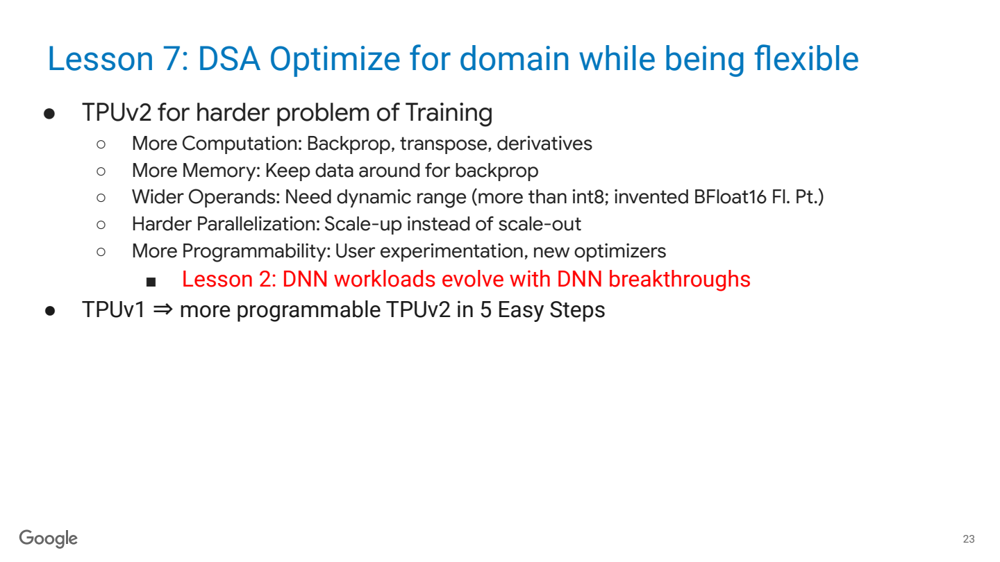

## Lesson 7: DSA Optimize for domain while being flexible

- TPUv2 for harder problem of Training
- More Computation: Backprop, transpose, derivatives
- More Memory: Keep data around for backprop
- Wider Operands: Need dynamic range (more than int8; invented BFloat16 Fl. Pt.)
- Harder Parallelization: Scale-up instead of scale-out
- More Programmability: User experimentation, new optimizers
- ■ Lesson 2: DNN workloads evolve with DNN breakthroughs
- TPUv1 ⇒ more programmable TPUv2 in 5 Easy Steps

<!-- p.24 -->

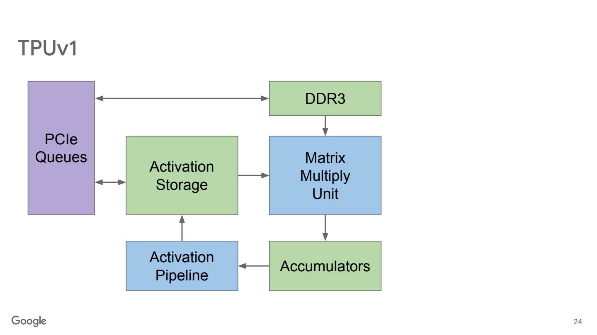

## TPUv1

<!-- p.25 -->

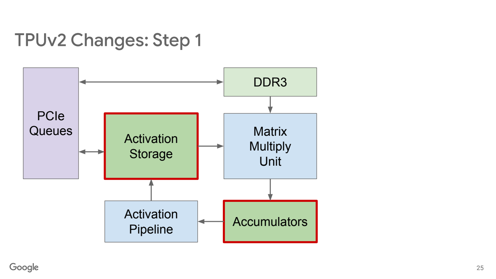

## TPUv2 Changes: Step 1

<!-- p.26 -->

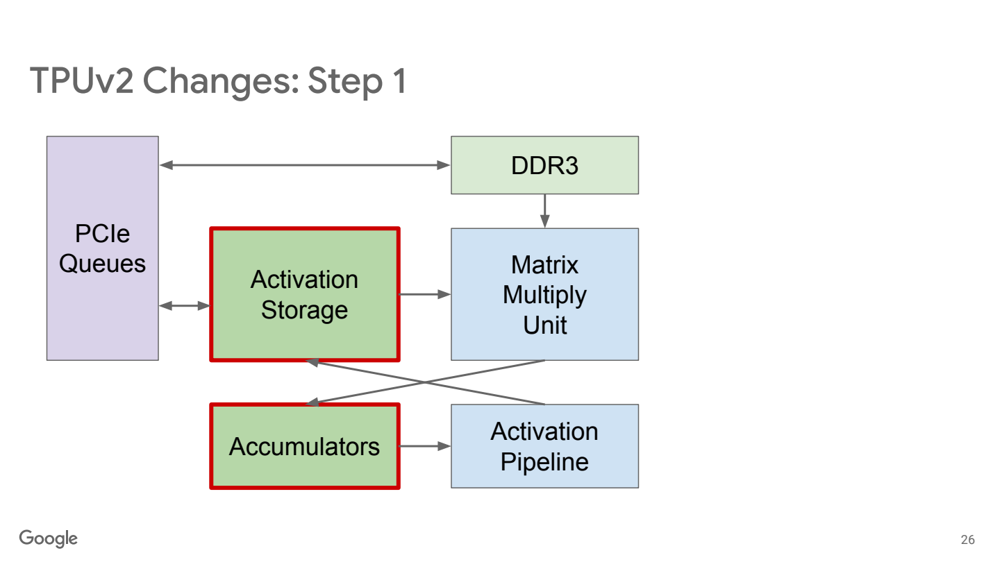

## TPUv2 Changes: Step 1

<!-- p.27 -->

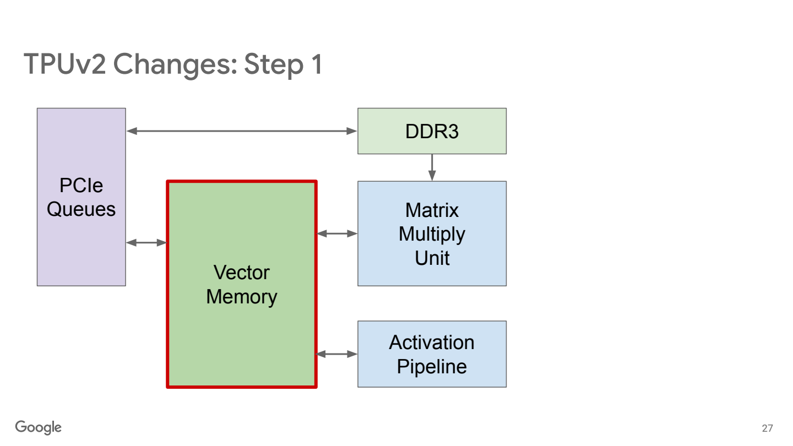

## TPUv2 Changes: Step 1

<!-- p.28 -->

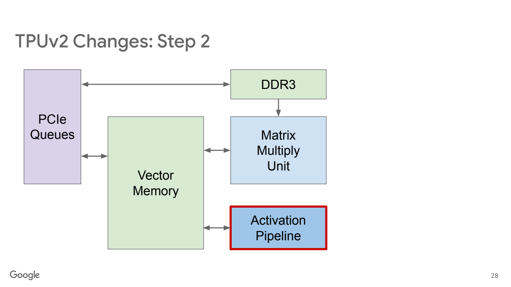

## TPUv2 Changes: Step 2

<!-- p.29 -->

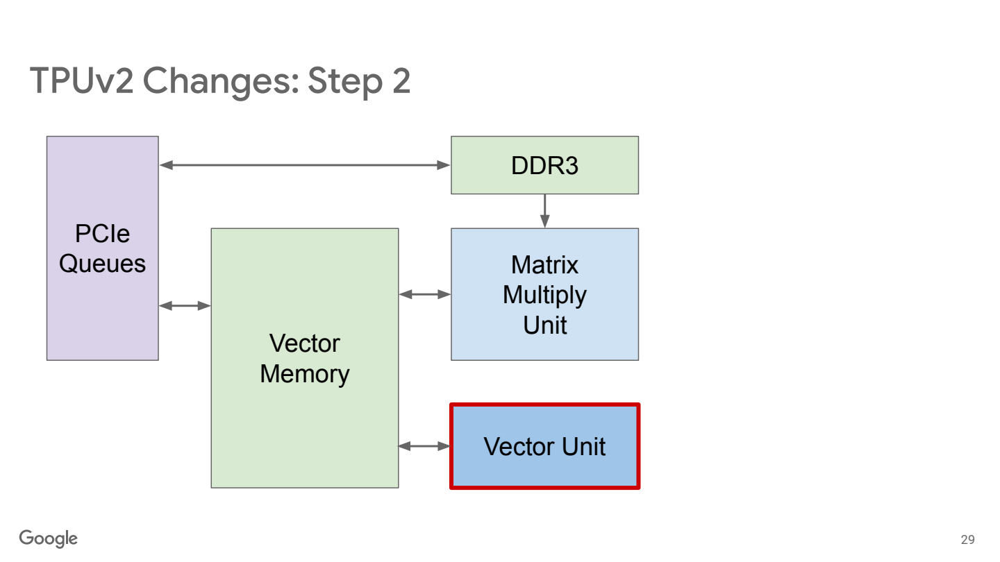

## TPUv2 Changes: Step 2

<!-- p.30 -->

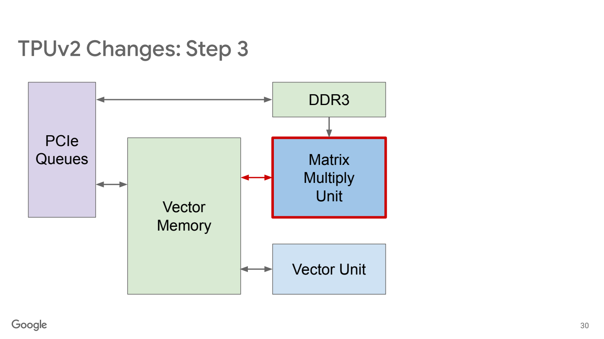

## TPUv2 Changes: Step 3

<!-- p.31 -->

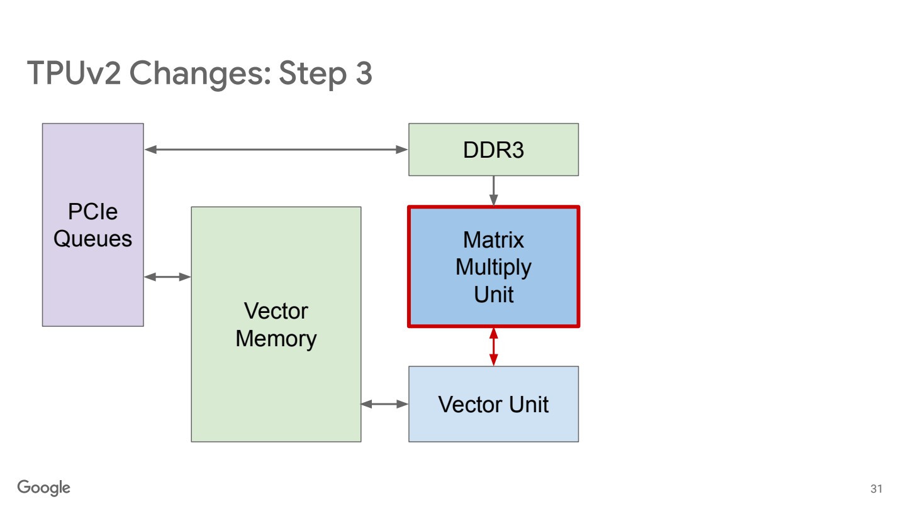

## TPUv2 Changes: Step 3

<!-- p.32 -->

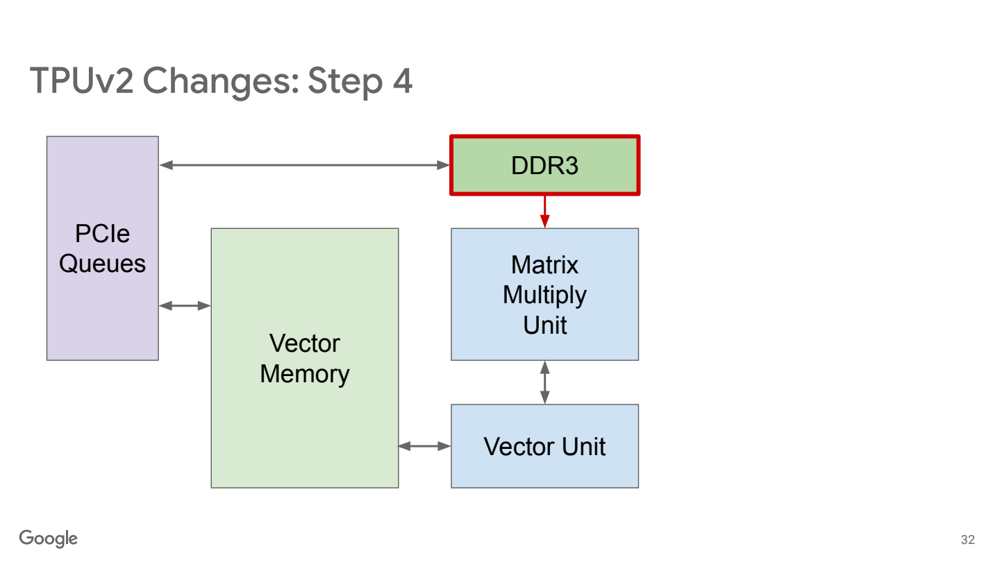

## TPUv2 Changes: Step 4

<!-- p.33 -->

## TPUv2 Changes: Step 4

<!-- p.34 -->

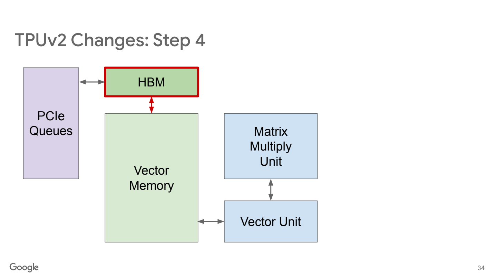

## TPUv2 Changes: Step 4

<!-- p.35 -->

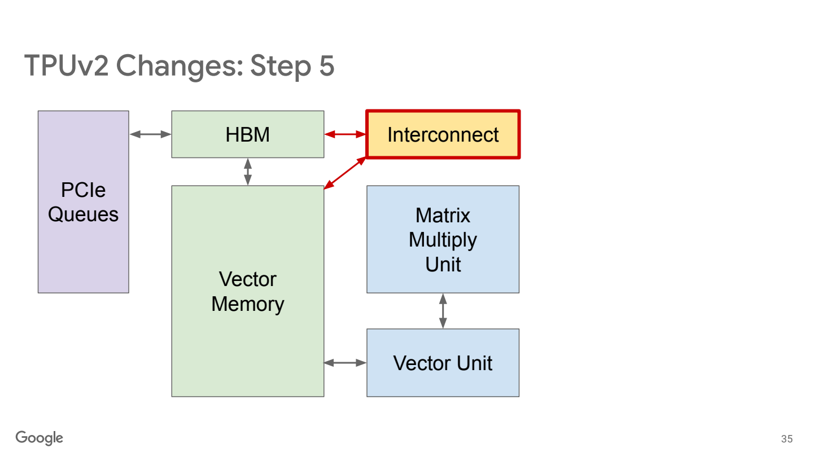

## TPUv2 Changes: Step 5

<!-- p.36 -->

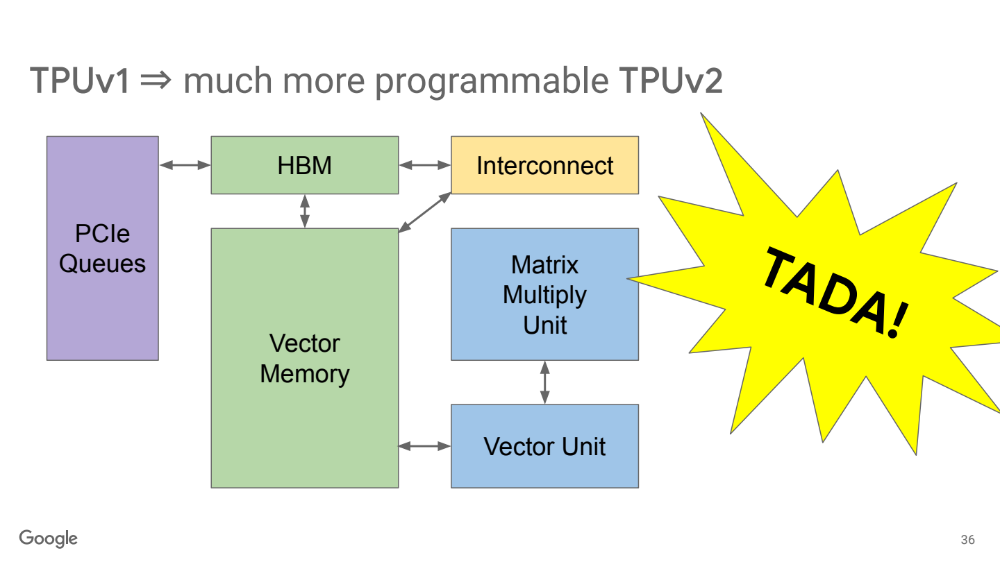

## TPUv1 ⇒ much more programmable TPUv2

<!-- p.37 -->

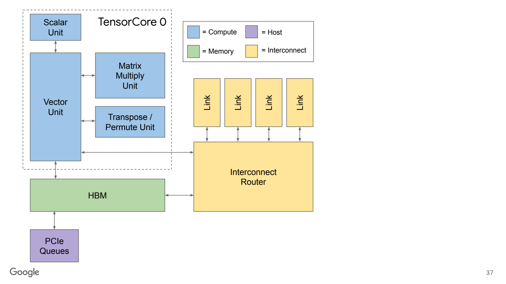

<!-- p.38 -->

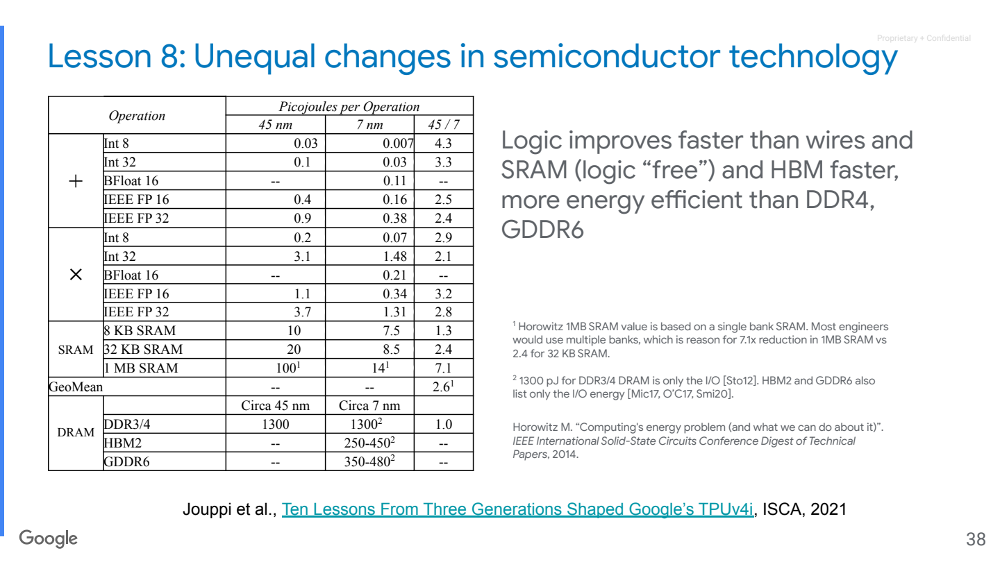

## Lesson 8: Unequal changes in semiconductor technology

| Operation   | Operation       | Picojoules per Operation - 45 nm   | Picojoules per Operation - 7 nm   | Picojoules per Operation - 45 / 7   |
|-------------|-----------------|------------------------------------|-----------------------------------|-------------------------------------|
|             | Int 8           | 0.030                              | 0.007                             | 4.3                                 |
|             | Int 32          | 0.100                              | 0.030                             | 3.3                                 |
|             | + BFloat 16     | --                                 | 0.110                             | --                                  |
|             | IEEE FP 16      | 0.400                              | 0.160                             | 2.5                                 |
|             | IEEE FP 32      | 0.900                              | 0.380                             | 2.4                                 |
|             | Int 8           | 0.200                              | 0.070                             | 2.9                                 |
|             | Int 32          | 3.100                              | 1.480                             | 2.1                                 |
|             | ✕ BFloat 16     | --                                 | 0.210                             | --                                  |
|             | IEEE FP 16      | 1.100                              | 0.340                             | 3.2                                 |
|             | IEEE FP 32      | 3.700                              | 1.310                             | 2.8                                 |
|             | 8 KB SRAM       | 10.000                             | 7.500                             | 1.3                                 |
|             | SRAM 32 KB SRAM | 20.000                             | 8.500                             | 2.4                                 |
|             | 1 MB SRAM       | 100 1 .000                         | 14 1 .000                         | 7.1                                 |
| GeoMean     | GeoMean         | --                                 | --                                | 2.6 1                               |
|             |                 | Circa 45 nm                        | Circa 7 nm                        |                                     |
|             | DRAM DDR3/4     | 1300                               | 1300 2 0                          | 1.0                                 |
|             | HBM2            | --                                 | 250-450 2                         | --                                  |
|             | GDDR6           | --                                 | 350-480 2                         | --                                  |

Logic improves faster than wires and SRAM (logic "free") and HBM faster, more energy efficient than DDR4, GDDR6

1 Horowitz 1MB SRAM value is based on a single bank SRAM. Most engineers would use multiple banks, which is reason for 7.1x reduction in 1MB SRAM vs 2.4 for 32 KB SRAM.

2 1300 pJ for DDR3/4 DRAM is only the I/O [Sto12]. HBM2 and GDDR6 also list only the I/O energy [Mic17, O'C17, Smi20].

Horowitz M. "Computing's energy problem (and what we can do about it)". IEEE International Solid-State Circuits Conference Digest of Technical Papers, 2014.

[Jouppi et al., Ten Lessons From Three Generations Shaped Google's TPUv4i, ISCA, 2021](http://www.markgottscho.com/papers/2021_NJouppi_ISCA.pdf)

<!-- p.39 -->

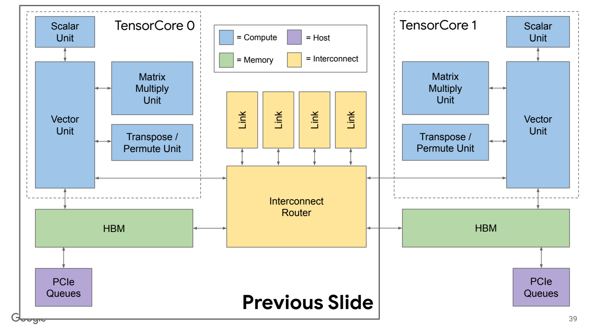

Scalar

Unit

Vector

Unit HBM

PCIe

Queues TensorCore 0

Matrix

Multiply

Unit

Transpose /

Permute Unit

= Compute

= Memory

= Host

= Interconnect

Link Link Link Link Interconnect Router

Previous Slide TensorCore 1

Matrix

Multiply

Unit

Transpose /

Permute Unit Scalar Unit Vector Unit HBM

PCIe

Queues

<!-- p.40 -->

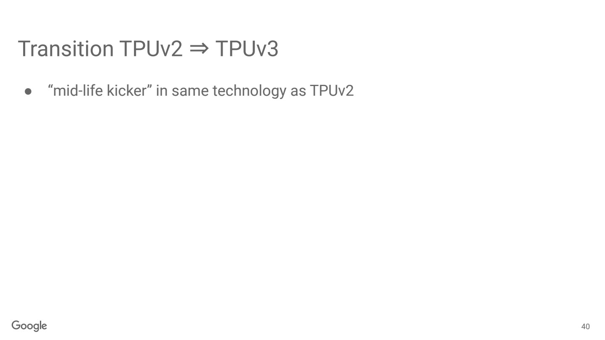

## Transition TPUv2 ⇒ TPUv3

- "mid-life kicker" in same technology as TPUv2

<!-- p.41 -->

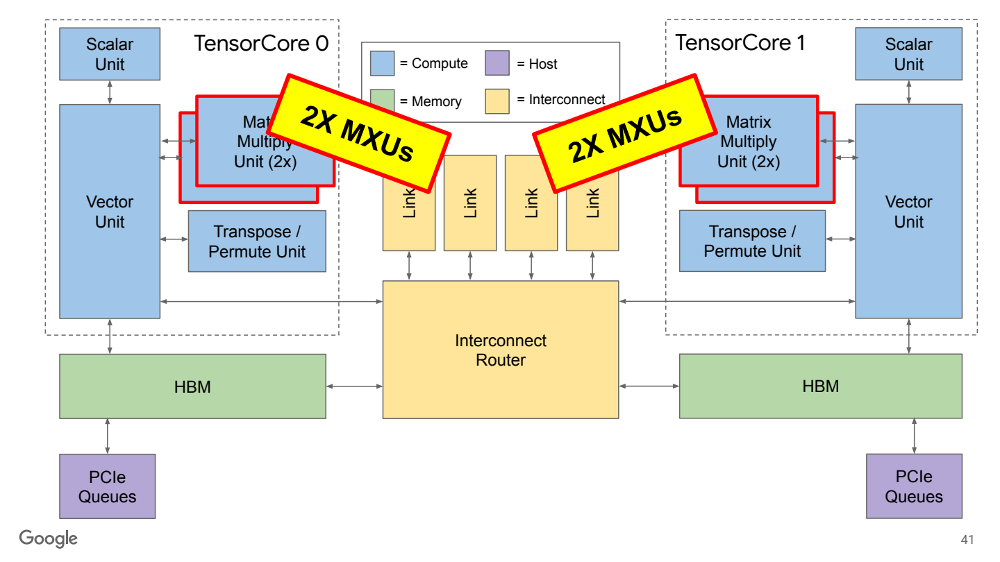

<!-- p.42 -->

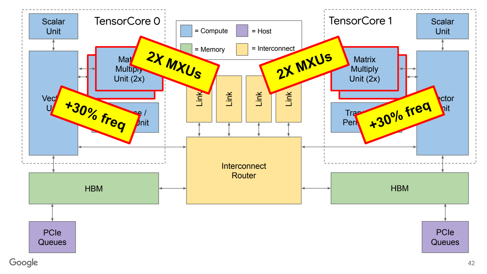

<!-- p.43 -->

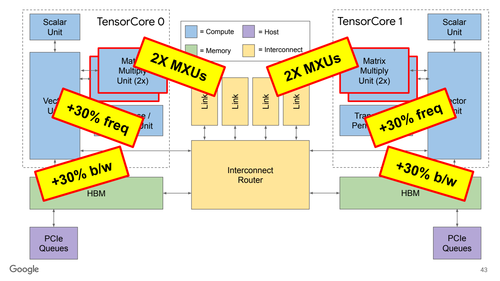

<!-- p.44 -->

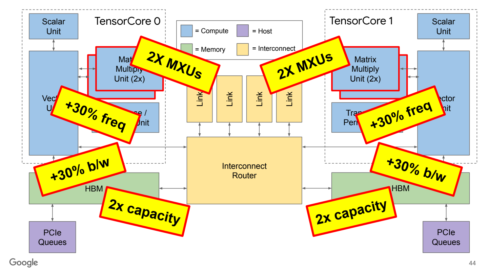

<!-- p.45 -->

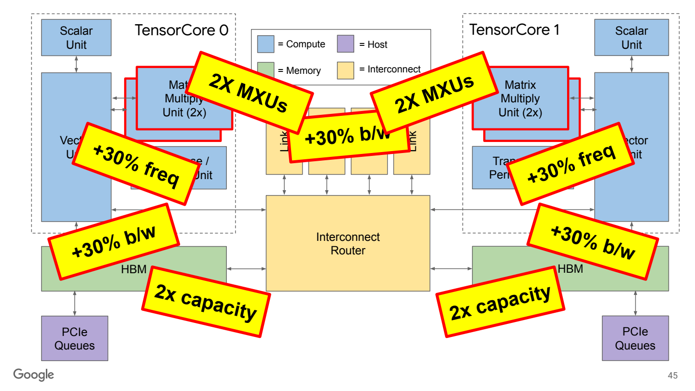

<!-- p.46 -->

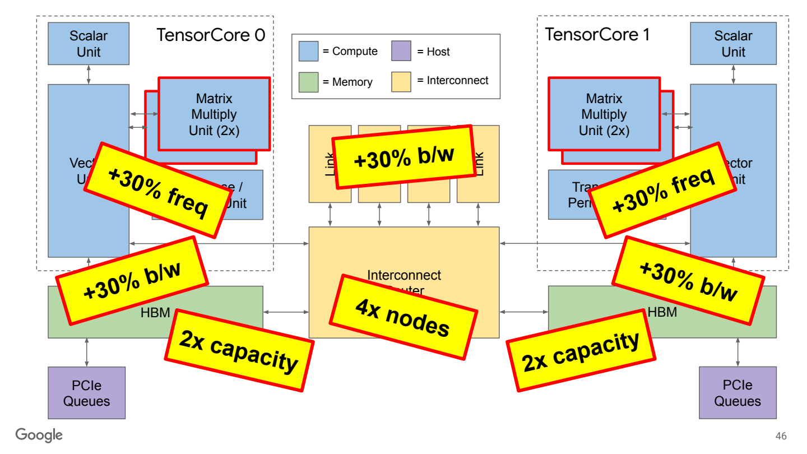

<!-- p.47 -->

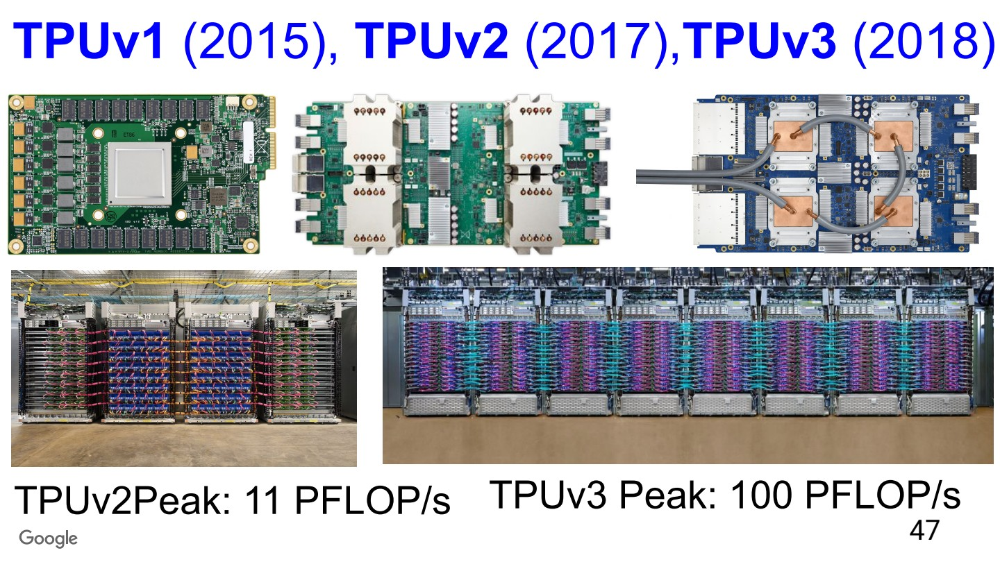

## TPUv1 (2015), TPUv2 (2017),TPUv3 (2018)

TPUv2Peak: 11 PFLOP/s TPUv3 Peak: 100 PFLOP/s 47

<!-- p.48 -->

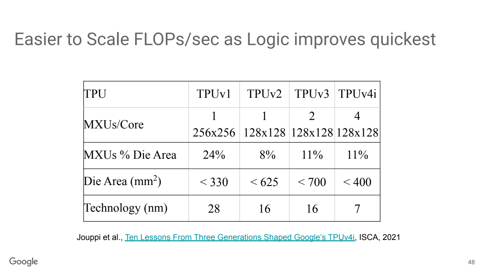

## Easier to Scale FLOPs/sec as Logic improves quickest

| TPU              | TPUv1     | TPUv2     | TPUv3     | TPUv4i    |
|------------------|-----------|-----------|-----------|-----------|
| MXUs/Core        | 1 256x256 | 1 128x128 | 2 128x128 | 4 128x128 |
| MXUs % Die Area  | 24%       | 8%        | 11%       | 11%       |
| Die Area (mm 2 ) | < 330     | < 625     | < 700     | < 400     |
| Technology (nm)  | 28        | 16        | 16        | 7         |

[Jouppi et al., Ten Lessons From Three Generations Shaped Google's TPUv4i, ISCA, 2021](http://www.markgottscho.com/papers/2021_NJouppi_ISCA.pdf)

<!-- p.49 -->

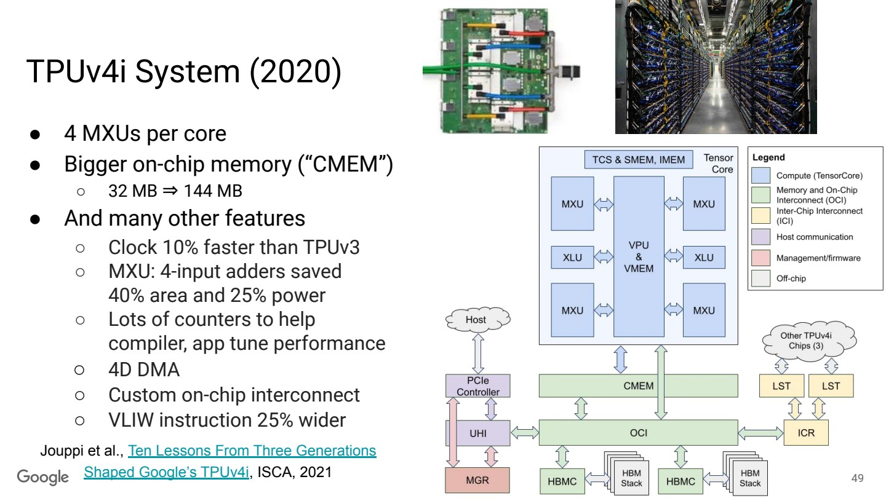

## TPUv4i System (2020)

- 4 MXUs per core
- Bigger on-chip memory ("CMEM")
- 32 MB ⇒ 144 MB
- And many other features
- Clock 10% faster than TPUv3
- MXU: 4-input adders saved 40% area and 25% power
- Lots of counters to help compiler, app tune performance
- 4D DMA
- Custom on-chip interconnect
- VLIW instruction 25% wider

[Jouppi et al., Ten Lessons From Three Generations Shaped Google's TPUv4i, ISCA, 2021](http://www.markgottscho.com/papers/2021_NJouppi_ISCA.pdf)

<!-- p.50 -->

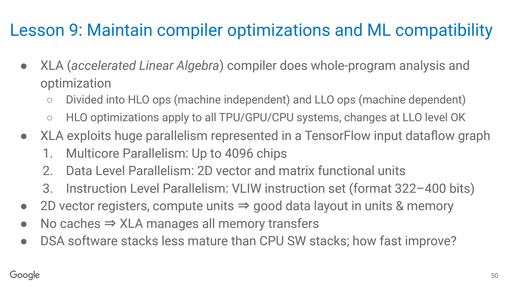

## Lesson 9: Maintain compiler optimizations and ML compatibility

- XLA (accelerated Linear Algebra) compiler does whole-program analysis and optimization
- Divided into HLO ops (machine independent) and LLO ops (machine dependent)
- HLO optimizations apply to all TPU/GPU/CPU systems, changes at LLO level OK
- XLA exploits huge parallelism represented in a TensorFlow input dataflow graph
1. Multicore Parallelism: Up to 4096 chips
2. Data Level Parallelism: 2D vector and matrix functional units
3. Instruction Level Parallelism: VLIW instruction set (format 322-400 bits)
- 2D vector registers, compute units ⇒ good data layout in units &amp; memory
- No caches ⇒ XLA manages all memory transfers
- DSA software stacks less mature than CPU SW stacks; how fast improve?

<!-- p.51 -->

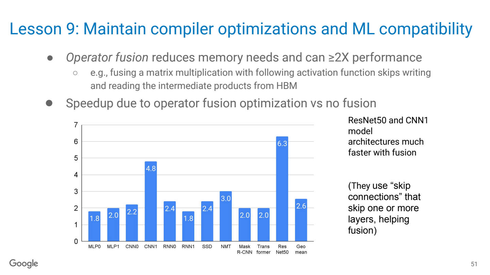

## Lesson 9: Maintain compiler optimizations and ML compatibility

- Operator fusion reduces memory needs and can ≥2X performance
- e.g., fusing a matrix multiplication with following activation function skips writing and reading the intermediate products from HBM
- Speedup due to operator fusion optimization vs no fusion

ResNet50 and CNN1 model architectures much faster with fusion

(They use "skip connections" that skip one or more layers, helping fusion)

<!-- p.52 -->

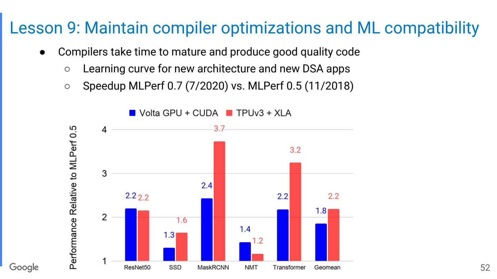

## Lesson 9: Maintain compiler optimizations and ML compatibility

- Compilers take time to mature and produce good quality code
- Learning curve for new architecture and new DSA apps
- Speedup MLPerf 0.7 (7/2020) vs. MLPerf 0.5 (11/2018)

<!-- p.53 -->

## Lesson 9: Maintain compiler optimizations and ML compatibility

- Luiz Barroso: "Train overnight &amp; deploy next day"
- Need identical results in inference and training
- DNN DSAs need Backwards ML Compatibility, not binary compatibility
- Goal is like x86 from a user perspective: getting the same results (same numerics) and exception behavior with predictable performance
- Floating point add is not associative ⇒ order of operations can prevent high-level operations (such as matmul or convolution) from giving same results
- Compiler must optimize code ⇒ rearranges code
- Want same compiler generating code for all targets similarly ⇒ similar targets

<!-- p.54 -->

## Lesson 10: Optimize Perf/TCO vs. Perf/CapEx

- TCO = Total Cost of Ownership
- Capital Expenditure (CapEx): Price (Purchase cost)
- Operation Expenditure (OpEx): Operation cost
- Electricity, cost of cooling, cost of space, etc.
- 3 to 4 year accounting amortization common:
- TCO = CapEx + 4 x OpEx
- Chip/board vendors focus on Perf/CapEx
- Google focuses on Perf/TCO on production apps
- Accelerator CapEx can be less than 25% of inference TCO
- The inference application still needs to run on the host
- Focus on perf/TCO can lead to significantly different system design tradeoffs

<!-- p.55 -->

## TPUv4 vs TPUv4i: Optimize Perf/TCO for the fleet

- TPUv1 had 1 core
- TPUv2, TPUv3 had 2 cores
- Want to improve Perf/TCO of TPUv4
- Decided to split design:
- Dual core for training ("TPUv4")
- Single core for inference ("TPUv4i")
- Also reduced amount of HBM for inference to lower cost
- Much lower TDP: 175W for TPUv4i (450W for TPUv3)
- Also HBM to support more parameters over lifetime of TPUv4i inference chip
- Lesson 1: DNNs grow rapidly in memory and compute
- Lesson 5: Production inference normally needs multi-tenancy

<!-- p.56 -->

## Evaluation: Production Apps Perf/Watt TPUv4i vs TPUv3

<!-- p.57 -->

## Lesson 10: Perf/TCO ⇒ Perf/W

- 4 TPUs + T4 TCO strongly correlated to System TDP (R = 0.99)
- R = 0.88 for 15 CPUs, GPUs, TPUs
- Use Perf/W as proxy for TCP
- Ending of Moore's Law &amp; Dennard Scaling, faster ⇒ more power &amp; cost
- TCO: electricity &amp; provisioning power + Chip Capex

<!-- p.58 -->

## 10 Lessons Learned (DNNs and Architecture/Hardware)

1. DNNs grow rapidly in memory and compute ⇒ Each generation: 4X chips/pod, 2X perf/chip,
2. 2X HBM capacity
2. DNN workloads evolve with DNN breakthroughs ⇒ Each generation: reduce HW obstacles to
4. help compiler
3. Can optimize DNN as well as compiler and HW ⇒ Use ML to tailor DNN to compiler and HW
4. Inference SLO limit is P99 latency, not batch size ⇒ Batch sizes 4-512 improve performance
7. 6.
8. It's the memory, stupid (not the FLOPs) ⇒ ~100,000 ALUs amortize memory access energy
7. DSA Challenge: Optimize for domain while flexible ⇒ Replace dedicated functions with vector unit
8. Logic, Wires, SRAM, &amp; DRAM improve unequally ⇒ 2X MXUs per core per TPU generation
9. Maintain compiler optimizations, ML compatibility ⇒ Similar architecture to TPUv2 versus brand new instruction set for TPUv3/v4
5. Inference normally needs multi-tenancy ⇒ HBM memory allows fast switch to new tenant
10. Design for performance/TCO vs perf/CapEx ⇒ 1 core for inference, 2 cores for training, lots of memory capacity

<!-- p.59 -->

## 10 Lessons Learned (DNNs and Architecture/Hardware)

1. DNNs grow rapidly in memory and compute⇒ Each generation: 4X chips/pod, 2X perf/chip, 2X HBM capacity
2. DNN workloads evolve with DNN breakthroughs ⇒ Each generation: reduce HW obstacles to help compiler
3. Can optimize DNN as well as compiler and HW ⇒ Use ML to tailor DNN to compiler and HW
4. Inference SLO limit is P99 latency, not batch size ⇒ Batch sizes 4-512 improve performance
5. Inference normally needs multi-tenancy ⇒ HBM memory allows fast switch to new tenant
6. It's the memory, stupid (not the FLOPs) ⇒ ~100,000 ALUs amortize memory access energy
7. DSA Challenge: Optimize for domain while flexible ⇒ Replace dedicated functions with vector unit
8. Logic, Wires, SRAM, &amp; DRAM improve unequally
9. ⇒ 2X MXUs per core per TPU generation
9. Maintain compiler optimizations, ML compatibility ⇒ Similar architecture to TPUv2 versus brand new instruction set for TPUv3/v4
10. Design for performance/TCO vs perf/CapEx
12. ⇒ 1 core for inference, 2 cores for training, lots of memory capacity

<!-- p.60 -->

## Dire Projections of Carbon Emissions for ML Training

<!-- p.61 -->

## Malthusian Predictions about ML Training

- Environmental cost to improve ML task (2024)?* "The answers are grim: Training such a model would cost US $100 billion and would produce as much carbon emissions as New York City does in a month. And if we estimate the computational burden of a 1 percent error rate, the results are considerably worse."

[Thompson, N.C., et al., October 2021. Deep Learning's Diminishing Returns: The Cost of Improvement is Becoming Unsustainable, IEEE Spectrum](https://ieeexplore.ieee.org/document/9563954/)

- "In fact, by 2026, the training cost of the largest AI model predicted by the compute demand trend line would cost more than the total U.S. GDP." [$20T]

Lohn, J. and Musser, M., January 2022. AI and Compute-How Much Longer Can Computing Power Drive Artificial Intelligence Progress? Center for Security and Emerging Technology

61

<!-- p.62 -->

<!-- p.63 -->

## We studied Operational energy use, not Lifecycle

- Responsible AI is a broad topic; this focus is carbon emissions from ML training (matching much of the attention in ML community and public)
- Emissions can be classified as
- Operational: energy cost of operating ML hardware including datacenter overheads (Scope 2), or
- Lifecycle: operational + embedded carbon emitted during manufacturing of all components, from chips to datacenter buildings (Scope 3)
- Like prior work we focus on operational emissions
- Estimating lifecycle emissions is a larger, more difficult, future study
- Emissions measured as tCO 2 e = 1000 kg of CO 2 equivalent emissions
- Includes greenhouse gases like methane

<!-- p.64 -->

## How to document energy use and CO 2 e

KWh = Hours to train ✕ Number of Processors ✕ Average Power per Processor ✕ PUE

- [Google, Facebook publish quarterly PUE for all regions (e.g., Iowa, Oklahoma )](https://www.google.com/about/datacenters/efficiency/)
- Power Usage Effectiveness: energy overhead "wasted" in datacenter (doesn't get to computers); if overhead is 50%, PUE = 1.5
- ML experts already know Hours to Train and Number of Processors
- Average Power per Processor:
- Measure power while running like we did
- Or reuse our Google average power numbers
- ■ TPUv2: 228 Watts ± 5% (Transformer, Evolved Transformer, NAS)
- ■ P100 GPU: 284 Watts ± 10% (Transformer, Evolved Transformer, NAS)
- ■ TPU v3: 283 Watts ± 10% (T5, Meena, Gshard, Switch Transformer)
- ■ V100 GPU: 325 Watts ± 2% (GPT-3, Transformer Big)

tCO 2 e = KWh ✕ tCO 2 e per KWh

- Ask datacenter operator for tCO 2 e per KWh
- [Google publishes %carbon free energy per datacenter](https://cloud.google.com/blog/topics/sustainability/google-releases-carbon-free-energy-percentage-for-2020)

<!-- p.65 -->

## 4Ms of Energy Efficiency for ML

<!-- p.66 -->

## Good News #1: Reduce energy 100X, CO2e 1000X

Energy efficiency in ML can be improved by 4 (multiplicative) best practices

"4Ms of ML Energy Efficiency"

1. Model. Transformer (2017) to Primer (2021) is 4x
2. Machine. P100 (2017) to TPUv4 (2021) is 14x
3. Mechanization (datacenter efficiency). PUE from global average to Google average is 1.4x
4. Maps (geographic location, energy source). Avg %Carbon Free Energy (2017) to Google OK %CFE is 9x (2021)

<!-- p.67 -->

## 4Ms for NLP: GLaM (TPUv4, Google Oklahoma datacenter, 2021) vs GPT-3 (V100 GPU, Microsoft datacenter, 2020)

- 18 months after GPT-3
- GLaM has better accuracy for same tasks as GPT-3
- 7X more parameters
- Mixture of experts:
- 8% parameters/token
- 3X less time, energy
- 14X less CO 2 e

Du, N., et al 2021. GLaM: Efficient Scaling of Language Models with Mixture-of-Experts. arXiv preprint arXiv:2112.06905.

<!-- p.68 -->

## Good News #2: ML at Google &lt;15% overall energy

- ML energy use April 2019, 2020, 2021
- Almost all ML training and most inference run on TPUs and GPUs
- For CPU inference, Google-Wide Profiling to measure libraries used for ML inference
- Each year for past 3 years, ML portion of Google energy use (research, development, production) between 10% and 15%
- Overall energy use grows annually with usage, but ML % is stable
- ⅗ for inference, ⅖ for training/year
- DNNs were 70%-80% FLOPs yet 10%-15% energy
- Lesson 6: It's the memory, stupid (not the FLOPs)
- Lesson 8: Logic, Wires, SRAM, &amp; DRAM improve unequally
- CO 2 e if replaced TPUs with CPUs of equivalent FLOPS? (50X as many?)

Non-ML

<!-- p.69 -->

## Climate change is one of our most important challenges

- But must get numbers right to ensure work on biggest challenges

<!-- p.70 -->

## Good News #3: Dire ML estimates were faulty

- Concerns rightly raised about CO 2 e of ML
- [So19] NAS for Evolved Transformer didn't include emissions
- [Str19] estimated emissions of this Neural Architecture Search (NAS)
- Cited ~1500 times
- Used P100 vs TPUv2, US averages vs Google DC: 5X too high for NAS
- + Used full model vs small proxy for search: 19X ⇒ 88X too high for NAS
- Some papers citing [Str19] confused NAS with Training cost
- NAS done once per problem domain+architectural search space
- NAS emissions ~1000x training emissions of DNN model found in search
- How avoid these errors? (Hard to correct published papers)
- ML authors publish costs, energy, emissions
- If not, check your results with original authors before publishing?

[Str19] Strubell, E., Ganesh, A. and McCallum, A., June 2019. Energy and policy considerations for deep learning in NLP. Annual Meeting of the Association for Computational Linguistics.

[So19] So, D., Le, Q. and Liang, C., 2019. The Evolved Transformer. In International Conference on Machine Learning (ICML).

<!-- p.71 -->

## Good News #3: Dire ML estimates were faulty

● Claims that training Evolved Transformer took: 2M GPU hours*, Cost $millions*, CO 2 e = 5X lifetime emissions of a car**

- Right numbers: 120 TPUv2 hours, Cost $40, 0.00004 car emissions

* Thompson, N.C., et al., 2020. The computational limits of deep learning. arXiv:2007.05558.

[** Freitag, C., et al, 2021. The real climate and transformative impact of ICT: A critique of estimates, trends, and regulations. Patterns 2(9).](https://www.sciencedirect.com/science/article/pii/S2666389921001884)

<!-- p.72 -->

## Conclusion and Recommendations

<!-- p.73 -->

## Conclusion

- 10 Lessons learned from previous TPU generations drove next design
1. DNNs grow rapidly in memory and compute
2. DNN workloads evolve with DNN breakthroughs
3. Can optimize DNN as well as compiler and hardware
4. Inference SLO limit is P99 latency, not batch size
5. Production inference normally needs multi-tenancy
6. It's the memory, stupid (not the FLOPs)
7. DSA Challenge: Optimize for domain while being flexible
8. Logic, Wires, SRAM, &amp; DRAM improve unequally
9. Maintain compiler optimizations and ML compatibility
10. Design for performance per TCO vs perf per CapEx
- Four generations of TPU significantly improve Perf/TCO and Emissions of ML
- 2019-2021: ML 70%-80% of FLOPS but only 10%-15% of Google energy use

<!-- p.74 -->

## Recommendations for ML Research and ML Practice

- Model: ML researchers keep developing more efficient ML models: 2x-4x
- Research Challenge: Reduce cost of training and inference of giant models like GPT-3, GlaM
- ■ Focus on memory accesses vs FLOPS
- Practice: Also publish energy consumption and carbon footprint of model to
- ■ Foster competition beyond ML quality e.g., speed, emissions
- ■ Ensure accurate accounting of their work (external estimates were off 100x-100,000x)
- Machine: Build faster, more efficient ML HW (e.g., A100 GPU, TPU v4): 2x-4x
- Research Challenge: Leverage Sparsity with Systolic Arrays
- Research Challenge: How to do lifecycle costs (Scope 3), not just operational costs (Scope 2)
- Mechanization: Datacenter operators publish datacenter efficiency (PUE): 1.4x
- Practice: Also publish % carbon free of energy supply per location
- Map: ML practitioners use greenest datacenters per region, often in Cloud: 5x-10x
- Practice: Increase carbon free energy per location (2 in Europe, 3 in US ~90% carbon free energy)
- Co-optimize 4Ms to realize the amazing potential of ML to positively impact many fields in a sustainable manner

74

<!-- p.75 -->

## Thanks to the TPU Team, Including:

Gaurav Agrawal, Catherine Ahlschlager, Ahmet Akyildiz, Ashby Armistead, Sandeep Bhatia, Rich Bonderson, Oliver Bowen, Roger Carpenter, Andrew Casper, Clifford Chao, Dehao Chen, Chiachen Chou, William Chwee, Xiangyu Dong, Houle Gan, Rakesh Gautam, Peter Gavin, Arnd Geis, Ben Gelb, Russ Gibbons, Sandeep Giri, Vinayak Gokhale, Pareesa Golnari, Rajendra Gottipati, Nils Graef, Jesse Guss, Benjamin Gwin, David Haskell, Blake Hechtman, Matthew Hedlund, Jian Ho, Doug Hogberg, Jerry Huang, Michael Hsu, Adam Hutchin, Mike Hutton, Berkin Ilbeyi, Srikrishna Iyer, Arpith Jacob, Indira Jayaram, Chetan Kale, Pankaj Kanwar, Srinidhi Kestur, Teju Khubchandani, Woon-Seong Kwon, Namhoon Kim, Andy Koch, Alan Kulawik, Poorna Kumar, Alice Kuo, Steve Lacy, Joshua Lang, Chester Li, Avinash Lingamneni, Derek Lockhart, Stephen Longfield, Fong Lou, Tao Liu, Kyle Lucke, Adriana Maggiore, David Majnemer, Seth Merriman, Rolf Mueller, David Munday, Mandar Munishwar, Hithesh Murthy, Lifeng Nai, Spoorthy Nanjaiah, Andrew Noonan, Alexander Nguyen, Vinh Nguyen, Tayo Oguntebi, Virag Parekh, Jose Baiocchi Paredes, Sang-Keun Park, Tejas Parikh, Omkar Pathak, Ram Babu Penugonda, Andy Phelps, Vaishali Raghuraman, Guru Rajamani, Andrew Ranck, Paul Rodman, Bjarke Roune, Ohad Russo, Amit Sabne, Amir Salek, Kirk Sanders, Julian Schrittwieser, Chris Severn, Boone Severson, Hamid Shojaei, Jaideep Singh, Tej Soni, Jaswanth Sreeram, Dan Steinberg, Jim Stichnot, Qian Sun, Mercedes Tan, Hua Tang, Horia Toma, Alex Thomson, Ani Udipi, Dimitris Vardoulakis, Sandeep Venishetti, Jack Webber, Monica Wong-Chan, Hsin-Jung Yang, Mingyao Yang, Xiaoming Yu, Lu Yuan, Sara Zebian, Feini Zhang, Ce Zheng, and many others.

<!-- p.76 -->

## Backup Slides

<!-- p.77 -->

## Get numbers right to ensure working on the actual biggest information technology challenge

- Within IT, more likely climate challenge is lifecycle cost of manufacturing computing equipment of all types/sizes vs operational cost of ML training

<!-- p.78 -->

## Discussion: Is Training a large % of Cloud footprint?

- Google total energy consumed 2020 = 15.4 TeraWatt-hours
- Microsoft total energy 2020 = 10.8 TW-h
- Energy for GLaM, GPT-3 is round off error
- How much for all of the training tasks vs final run?
- Need tools to collect: experiment-impact-tracker [Hen20], CodeCarbon [Lac19]
- Since final run takes ~1 month, development tests likely much smaller (like proxy in NAS)
- AutoML* result used ~same computation to explore vs final run computation ⇒ 2X total

<!-- p.79 -->

## Discussion: ML training vs other activities and overall ML energy consumption

| Model Trained          |   Air Trips |
|------------------------|-------------|
| NAS (Primer)           |         2.2 |
| NAS (Evo. Transformer) |         2.7 |
| GLaM                   |        33.0 |
| GPT-3                  |       460.0 |

- Jet round trip 1 passenger SF↔NY = 1.2 tCO 2 e
- Air travel 2019: 39M flights, 925M passengers
- 2.5% world's annual CO 2 of 33B tCO 2
- 2019: 22,000 from 68 countries attended in person two main ML Conferences
- NeurIPS (Vancouver Canada)
- CVPR (Long Beach CA US)
- If 80% flew = ~21,000 trips, ~40X CO 2 e of training 2 large NLP models + 2 NASs

<!-- p.80 -->

## Discussion: Datacenter energy consumption

- Worry that growth of cloud means explosion of energy use
- End users purchasing fewer servers for on premise datacenters, instead computing more in cloud
- Cloud is greener: Lower PUE, not idle burning power, …
- Science paper*: global datacenter energy consumption increased by only 6% vs 2010, despite computing capacity increasing by 550% from 2010-2018
- Only 15%-20% workloads moved to the cloud** ⇒ still plenty of headroom for Cloud growth to replace inefficient on-premise datacenters

* Masanet, E., Shehabi, A., Lei, N., Smith, S. and Koomey, J., 2020. Recalibrating global datacenter energy-use estimates. Science, 367(6481), pp.984-986.

Koomey, J. and Masanet, E., 2021. Does not compute: Avoiding pitfalls assessing the Internet's energy and carbon impacts. Joule, 5(7), pp.1625-1628.

[** Evans, B. 2021, Amazon Shocker: CEO Jassy Says Cloud Less than 5% of All IT Spending, https://cloudwars.co/amazon/amazon-shocker-ceo-jassy-cloud-less-than-5-percent-it-spending/](https://cloudwars.co/amazon/amazon-shocker-ceo-jassy-cloud-less-than-5-percent-it-spending/)

<!-- p.81 -->

## sunroof.withgoogle.com: &gt;170M rooftops mapped w/ solar data across 21,500 cities

From Jeff Dean Keynote "Sustainable Computation and Machine Learning Platforms at Google", MIT Climate Implications of Computing &amp; Communications Workshop, 3/3/22

<!-- p.82 -->

## Environmental Insights Explorer

Helping cities make meaningful progress toward reducing carbon emissions by using Google Maps data

400 cities using Environmental Insights Explorer today

Google's aim to help more than 500 cities reduce an aggregate of 1 gigaton of carbon emissions annually by 2030

From Jeff Dean Keynote "Sustainable Computation and Machine Learning Platforms at Google", MIT Climate Implications of Computing &amp; Communications Workshop, 3/3/22

<!-- p.83 -->

Find more eco-friendly options to get around with Google Maps

e.g. 1 billion km of transit results on Google Maps per day, helping to limit carbon emissions by giving people access to mass transit options, bike routes, and traffic information.

<!-- p.84 -->

See the associated carbon emissions per seat for every flight, and quickly find lower-carbon options on Google Flights
