> 本文件由 `Abts2020-ISCA-Think-Fast-TSP.pdf` 自动转换（docling 2.140.0，2026-10-17）。图片在 `images/` 目录；表格与数字请以 PDF 原文为准；`<!-- p.N -->` 标记对应 PDF 第 N 页。

<!-- p.1 -->

## Think Fast: A Tensor Streaming Processor (TSP) for Accelerating Deep Learning Workloads

Dennis Abts, Jonathan Ross, Jonathan Sparling, Mark Wong-VanHaren, Max Baker, Tom Hawkins, Andrew Bell, John Thompson, Temesghen Kahsai, Garrin Kimmell, Jennifer Hwang, Rebekah Leslie-Hurd, Michael Bye, E.R. Creswick, Matthew Boyd, Mahitha Venigalla, Evan Laforge, Jon Purdy, Purushotham Kamath, Dinesh Maheshwari, Michael Beidler, Geert Rosseel, Omar Ahmad, Gleb Gagarin, Richard Czekalski, Ashay Rane, Sahil Parmar, Jeff Werner, Jim Sproch, Adrian Macias, Brian Kurtz

## Groq, Inc. · Mountain View, California

Abstract-In this paper, we introduce the Tensor Streaming Processor (TSP) architecture, a functionally-sliced microarchitecture with memory units interleaved with vector and matrix deep learning functional units in order to take advantage of dataflow locality of deep learning operations. The TSP is built based on two key observations: (1) machine learning workloads exhibit abundant data parallelism, which can be readily mapped to tensors in hardware, and (2) a simple and deterministic processor with producer-consumer stream programming model enables precise reasoning and control of hardware components, achieving good performance and power efficiency. The TSP is designed to exploit parallelism inherent in machine-learning workloads including instruction-level, memory concurrency, data and model parallelism, while guaranteeing determinism by eliminating all reactive elements in the hardware (e.g. arbiters, and caches). Early ResNet50 image classification results demonstrate 20.4K processed images per second (IPS) with a batch-size of onea 4× improvement compared to other modern GPUs and accelerators [44]. Our first ASIC implementation of the TSP architecture yields a computational density of more than 1 TeraOp/s per square mm of silicon for its 25×29 mm 14nm chip operating at a nominal clock frequency of 900 MHz. The TSP demonstrates a novel hardware-software approach to achieve fast, yet predictable, performance on machine-learning workloads within a desired power envelope.

## I. INTRODUCTION

The world is increasingly turning to computationallyintensive deep learning algorithms to solve important problems in science, transportation, security, and beyond. These workloads continue to grow both in size and complexity, presenting serious scalability, performance, and usability challenges for traditional CPU and GPU architectures. Keeping pace with this demand requires that we provision abundant on-chip ALUs and utilize them at near-peak performance throughout program execution. Unfortunately, hardware complexity of many microarchitectures makes it difficult to reason about runtime stalls. Furthermore, while microarchitectural enhancements such as caches, branch predictors, and prefetchers help tremendously in improving performance, they do not bound worst-case performance.

Over the last decade, data center operators have installed many-core systems as a stalwart fixture in warehouse-scale computers (WSC) [7], [11], [13]. These increasingly heterogeneous systems have dozens of processing cores that vary widely in form and function, including GPUs, TPUs, FPGAs, and smart IO controllers for efficient remote direct memory access. Such efforts have largely focused on accelerating deep neural network training and inference performance for a wide range of workloads: convolutional neural networks (CNNs) for recommendation algorithms, computer vision (CV) and image classification; recurrent neural networks (RNNs) for natural language processing [20], [58]; and now attention and transformer models [10], [55]. The increased computational requirements of these models has been the catalyst for a resurgence of architectural innovation [21].

Fig. 1. Conventional 2D mesh of cores (a) reorganized into a functionally sliced arrangement of tiles (b).

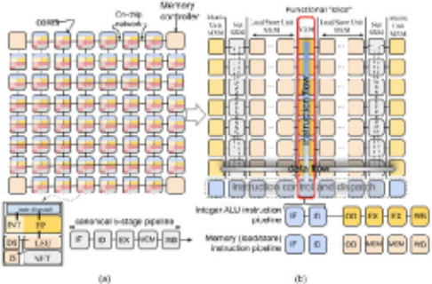

The demand for domain-specific architectures, as well as their widespread adoption into cloud computing ecosystems [34], [48], provides a unique opportunity for novel microarchitectures targeting deep learning applications. A range of innovative solutions are emerging-from Cerebras' waferscale integration [15] to more traditional chip multiprocessors like GraphCore's IPU [25]. Broadly speaking, all of these efforts are focused on delivering more compute capability per floor tile in the data center. In other words, the focus is on increasing computational density for a fixed power envelope. Our approach is based on rethinking conventional chip multiprocessor organization, resulting in a new architecture centered around the tensor abstraction, a Tensor Streaming Processor (TSP). The TSP uses a tiled microarchitecture that allows us to easily scale vector size to the underlying tensor shapes which they represent. Tensor computations are performed using a streaming processing model where computational elements are arranged spatially by function to take advantage of dataflow locality as tensors flow past. This novel approach enables us to achieve significantly better performance than the state of the art, with initial Resnet50 image classification results of 20.4K sample images per second (IPS) using a batch-size of one-a 4× improvement compared to other modern GPUs and accelerators [44]. In the remainder of this section, we discuss the core architectural elements that set the TSP apart.

<!-- p.2 -->

## A. Functional slicing

To understand the novelty of our approach, consider the chip organization shown in Figure 1(a). In a conventional chip multiprocessor (CMP) [56] [12] each "tile" is an independent core which is interconnected using the on-chip network to exchange data between cores. Instruction execution is carried out over several stages [46]: 1) instruction fetch (IF), 2) instruction decode (ID), 3) execution on ALUs (EX), 4) memory access (MEM), and 5) writeback (WB) to update the results in the GPRs. In contrast from conventional multicore, where each tile is a heterogeneous collection of functional units but globally homogeneous, the TSP inverts that and we have local functional homogeneity but chip-wide (global) heterogeneity.

The TSP reorganizes the homogeneous two-dimensional mesh of cores in Figure 1(a) into the functionally sliced microarchitecture shown in Figure 1(b). In this approach, each tile implements a specific function and is stacked vertically into a "slice" in the Y-dimension of the 2D on-chip mesh. We disaggregate the basic elements of a core in Figure 1(a) per their respective functions: instruction control and dispatch (ICU), memory (MEM), integer (INT) arithmetic, float point (FPU) arithmetic, and network (NET) interface, as shown by the slice labels at the top of Figure 1(b). Each row of the 2D on-chip mesh contains a cross section of all functional slices (see Figure 2). In this organization, each functional slice is independently controlled by a sequence of instructions specific to its on-chip role. For instance, the MEM slices support Read and Write but not Add or Mul, which are only in arithmetic functional slices (the VXM and MXM slices).

Fig. 2. The organization and dataflow within a row in the on-chip network.

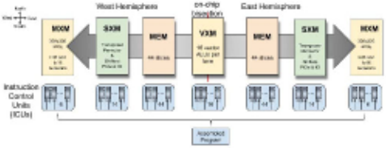

All of a slice's tiles execute the same instruction stream (SIMD), so we can factor out the common instruction decode and dispatch logic into its own tile (ICU) and decompose the normal instruction execution pipeline into two areas: (i) instruction fetch, decode, and parceling and (ii) operand read, execute, and writeback. This approach decouples the memory subsystem [52] from the functional units retrieving their operands and depositing results. Each functional slice implements a 20-stage vector pipeline that spans the tiles of each slice, with each tile producing 16 elements of the 320element maximum vector length. This organization naturally decomposes instruction flow in the vertical dimension, and data flow in the horizontal dimension as it passes over different function types. With this processor organization, instruction execution is carried out by different tiles: instruction fetching and decoding in the ICU and operand decode, execution and writeback at each tile of functional slice as the (vertical flowing) dispatched instruction intersects with the (horizontal flowing) operand data on which it is operating.

## B. Parallel lanes and streams

Data parallelism for each slice's SIMD execution is provided via a programming abstraction called parallel lanes. These parallel lanes correspond to elements of data vectors, an abstraction common to many ML frameworks like TensorFlow [2]. In the TSP model, instructions flow Northward from the ICUs to the functional slices, while data (operands and results) flow East and West between functional slices. Any inter-lane data movement within a vector uses the on-chip network (SXM) slice.

As shown in Figures 1 and 5, the on-chip network is implemented as X-dim mesh and Y-dim mesh of tiles with X-YX dimension order routing. Each instruction specifies the first hop direction (East or West), so memory instruction semantics have both an address and a dataflow direction (Figure 2). Streams are routed in the X-dimension through MEM, and routed in the Y-dimension using the SXM's permuter and laneshifters to move data elements vertically. The MEM and SXM provide deterministic routing [16] of stream data as it flows in the X and Y dimensions, respectively.

Each element of a stream is 1-byte with larger data types (e.g. int16, int32, and fp32) being constructed from several streams (2, 4, and 4 respectively). Multi-byte data types are always naturally stream-aligned based on the size of the data type. Data alignment is accomplished by the compiler. For instance, int16 is aligned on a stream pair, and int32 is aligned on a quad-stream (e.g. SG4 0 is stream 0-3, SG4 1 is streams 4-7, and so forth).

In a conventional load-store architecture the general-purpose registers (GPRs) provide fast access to ALU operands and storage of ALU outputs. As an example, consider a simple sum of two N-element vectors, X and Y, to produce result Z, as shown in Figure 3. In this example, a RISC core will loop on four instructions to perform an element-wise addition: the Add R1,R2,R3 would first need a LOAD R1,X and a LOAD R2,Y to move the operands into the GPRs, and the result in R3 must be written back to main memory with STORE R3,Z. With the TSP architecture, functional slices interact with streams of data in a producer-consumer fashion. That is, they consume operands from streams and produce results onto a (possibly different) stream, similar to an assembly line operator (functional slice) and conveyor belt (stream).

<!-- p.3 -->

Fig. 3. Conventional RISC execution contrasted with producer-consumer streams in the TSP.

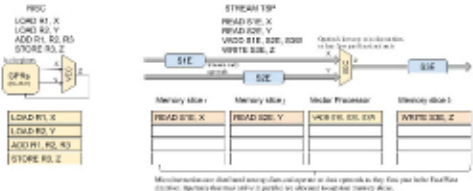

Conceptually, the functional slices are fixed and data is flowing across their processing elements as shown in Figure 2. As the data flows through the slice, each functional unit can optionally intercept the data operands and compute a result (if its a processing element like an ALU), or move data between lanes on the network if its a switching element.

Streams provide a programming abstraction and are a conduit through which data flows between functional slices. Unlike GPRs, the functional slices operate on streams of parallel data flowing East or West across chip. The horizontally flowing streams carrying operands intercept the vertically (Northward) flowing instructions (Figure 2) to perform a computation on a functional slice. The compiler precisely tracks the chip's architectural state and uses that knowledge to ensure that instructions correctly intercept its stream operand(s).

Streams are implemented in hardware by a chip-wide streaming register file (SR). They are architecturally-visible and transport operands and results between slices. A common software pattern involves reading operand data from one or more MEM slices that is then subsequently consumed and operated on by a downstream arithmetic slice. The results of the operation are then produced onto another stream such that they can be written back to memory. For example, a Z=X+Y operation might require four instructions: Read S1,X and Read S2,Y are executed on two MEM slices and directed inward toward an INT slice to perform the Add S1,S2,S3. Lastly, the result is stored back to memory via a Write S3,Z. The streams represent a collection of N-elements, operated upon in a SIMD manner by each functional slice.

## C. Paper organization

The remainder of this paper describes the microarchitecture of the Groq tensor streaming processor (TSP) with the following contributions:

- we introduce functional-sliced tile microarchitecture and the stream programming abstraction built upon it;
- we describe our first implementation of the TSP in 14nm ASIC technology, memory system and functional units,

programmimg model, instruction set architecture (ISA) and design tradeoffs for efficient operation at batch-size of 1;

- we present early performance results on ResNet50 [27] image classification model executing a sample image query in less than 49µs, yielding 20.4K IPS of batch-size1 inference throughput, a 4-5× improvement compared to Google's TPU or Habana Lab's GOYA chips; and
- we provide a detailed discussion of architecture tradeoffs for accelerating machine learning workloads more generally, and lessons learned from mapping ResNet50 v2 image classification model to the TSP hardware.

## II. ARCHITECTURE OVERVIEW

The tensor stream processor architecture makes several deliberate tradeoffs on the hardware-software interface, pushing the complexities associated with scheduling into the compiler. Specifically, it falls on the compiler to precisely schedule instructions so as to use the hardware correctly and efficiently. At times this may involve selecting one of several means by which an algorithm or meta-operation may be realized on the hardware. Removing the control complexity of dynamic instruction scheduling for multi-issue execution units allows the instruction control unit (ICU) to be relatively small, accounting for less the 3% of the area. The compiler has access to the following architecturally-visible state:

- 320-lane programming abstraction overlaid on the TSP block diagram (Figure 5) where each tile in the on-chip mesh operates on 16-lanes in a SIMD manner. We refer to this 16-lane unit as a "superlane" which is a cross-section of all the functional slices on the chip and the minimum granularity of computation. As such, a superlane represents the architecture's minimum vector length, minVL, of 16 elements. Likewise, the vertical composition of 20 tiles to form a functional slice (Figure 5) produces a maximum vector length, maxVL, of 20×16=320 elements.
- 144 independent instruction queues (ICUs) on-chip, each can issue one or more instructions per cycle and the compiler has explicit control of the program order in each instruction queue.
- 64 logical streams per lane for moving operands or results on-chip with 32 streams Eastward, and 32 streams Westward as shown in Figure 2.
- 220 MiBytes of globally shared SRAM that delivers 32 bytes per lane of stream bandwidth and low-latency access to model parameters. For example, the MEM can read and MXM can install 400K weights into all four 320×320 arrays in less than 40 cycles including SRAM and on-chip network transit delay.

Streams are designated by both an identifier 0..31 and direction, for instance, in(28) designates stream 28 inward, and out(24) is stream 24 toward the outward edge of the chip 1 .

1 We use both inward (toward the chip bisection) and outward (toward the outward edge of the chip) as well as cardinal directions Eastward and Westward as shown in Figures 2 and 4.

<!-- p.4 -->

Fig. 4. Stream registers are numbered to show their locations between the functional slices within a superlane.

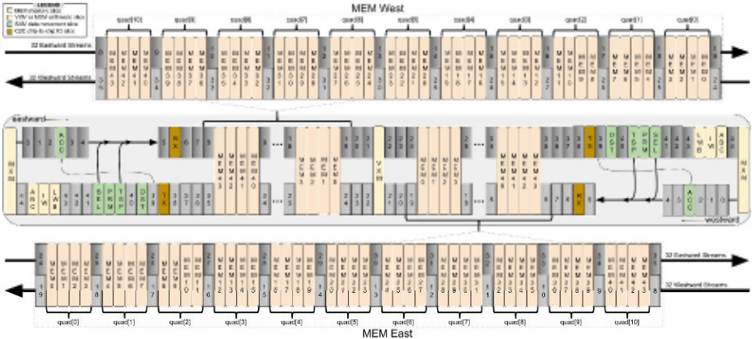

The components of a superlane are organized spatially as shown in Figure 2. The TSP's instruction set architecture (ISA) defines instructions spanning five different functional areas. The partitioned global address space (PGAS [6]) presented by the memory (MEM) slices provides memory semantics for vectors to be addressed from SRAM and loaded into an architecturally-visible stream with a direction of dataflow toward the functional slice intending to operate on them.

Fig. 5. Die photo of 14nm ASIC implementation of the Groq TSP.

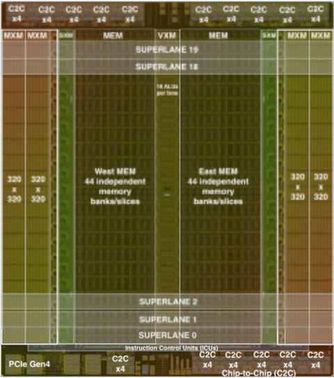

- 1) The instruction control unit (ICU) provides explicit instruction fetching with IFetch, and inter-slice synchronization using Sync and Notify instructions to perform a chip-wide barrier synchronization among participating functional slices. A repeated-NOP (no-op) instruction allows for precise cycle-by-cycle control of inter-instruction delay; for example, the compiler has cycle-accurate control when scheduling two operations A and B using an intervening NOP so that N cycles separate them OpA NOP(N) OpB.
- 2) A vector execution module (VXM) consists of a 4×4 mesh of ALUs in each lane for point-wise arithmetic operations.
- 3) The matrix execution module (MXM) consists of four (4) independent 2D MACC (multiply-accumulate) arrays that operate on int8 or fp16 data types.
- 4) On chip data movement uses the switch execution module (SXM) for intra-superlane and inter-lane switching by rearranging elements of vectors. The SXM is analogous to the NET interface to communicate between cores in Figure 1. Together the MEM and SXM work in tandem to form the X-Y dimensions of the on-chip network.
- 5) The East and West hemisphere of on-chip memory module (MEM) is composed of 44 parallel slices of SRAM and provides the memory concurrency necessary to fully utilize the 32 streams in each direction. Each slice provides 13-bits of physical addressing of 16-byte memory words, each byte maps to a lane, for a total of 220 MiBytes of on-chip SRAM.
- 6) Chip-to-chip (C2C) modules provide Send and Receive primitives for exchanging 320-byte vectors between a pair of chips. The first TSP implementation (Figure 5) has a total of sixteen (16) ×4 links operating at 30 Gbps each for a total off-chip bandwidth of

<!-- p.5 -->

TABLE I SUMMARY OF INSTRUCTIONS FOR EACH FUNCTIONAL SLICE.

| Function   | Instruction                                                             | Description                                                                                                                                                                                                                                                                                                                                                                               |
|------------|-------------------------------------------------------------------------|-------------------------------------------------------------------------------------------------------------------------------------------------------------------------------------------------------------------------------------------------------------------------------------------------------------------------------------------------------------------------------------------|
| ICU        | NOP N Ifetch Sync Notify Config Repeat n, d                             | No-operation, can be repeated N times to delay by N cycles Fetch instructions from streams or local memory Parks at the head of the instruction dispatch queue to await barrier notification Releases the pending barrier operations causing instruction flow to resume Configure low-power mode Repeat the previous instruction n times, with d cycles between iterations                |
| MEM        | Read a,s Write a,s Gather s, map Scatter s, map                         | Load vector at address a onto stream s Store stream s register contents into main memory address a Indirectly read addresses pointed to by map putting onto stream s Indirectly store stream s into address in the map stream                                                                                                                                                             |
| VXM        | unary operation binary operation type conversions ReLU TanH Exp RSqrt   | z = op x point-wise operation on 1 operand, x, producing 1 result, z (eg. mask, negate) z = x op y point-wise operations with 2 operands x and y producing 1 result, z (e.g. add, mul, sub) Converting fixed point to floating point, and vice versa Rectified linear unit activation function max(0,x) Hyperbolic tangent - activation function exponentiation ex Reciprocal square root |
| MXM        | LW IW ABC ACC                                                           | Load weights (LW) from streams to weight buffer Install weights (IW) from streams or LW buffer into the 320×320 array Activation buffer control (ABC) to initiate and coordinate arriving activations Accumulate (ACC) either INT32 or FP32 result from MXM                                                                                                                               |
| SXM        | Shift up/down N Permute map Distribute map Rotate stream Transpose sg16 | Lane-shift streams up/down by N lanes, and Select between North/South shifted vectors Bijective permute 320 inputs map ---→outputs Rearrange or replicate data within a superlane (16 lanes) Rotate n×n input data to generate n2 output streams with all possible rotations (n=3 or n=4) Transpose 16×16 elements producing 16 output streams with rows and columns interchanged         |
| C2C        | Deskew Send Receive                                                     | Manage skew across plesiochronous links Send a 320-byte vector Receive a 320-byte vector, emplacing it in main memory                                                                                                                                                                                                                                                                     |

16×4×30Gb/s ×2 directions = 3.84 Tb/s of off-chip pin bandwidth that can be flexibly partitioned to support highradix [37] [49] [3] interconnection networks of TSPs for large-scale systems. The host interface for PCIe Gen4 is also handled in this module. It provides a lightweight DMA engine to emplace a model onto the TSP memory, and provides an entry point for bootstrapping the model execution. It also provides a general mechanism for passing interrupts to the host, which may be necessary in the event we observe a multi-bit memory error, for example.

A sequence of instructions performed on different functional slices can be chained to create more complex actions without the need to writeback intermediate results to memory. This allows us to efficiently process streams at full bandwidth and lowest latency.

## A. Parallel streams programming model

Machine learning algorithms typically operate on vectors with coefficients of a specified data type (eg. int8, fp16, etc). We may interpret these vectors as an abstraction over the underlying data, whose elements can be processed by the same operation in a SIMD manner. The TSP operates on vectors, sometimes organized into rank-2 tensors, and relies on the graph-lowering compiler to transform higher rank tensors into rank-2 tensors over hardware-supported data types.

The TSP's programming model is a producer-consumer model where each functional slice acts as a consumer and a producer of one or more streams. When a vector is read from main memory it is given a stream identifier (0..31) and direction: eastward, or westward. Once the vector is read into a stream register it is a stream and is "flowing" in the given direction in the following sense: Given spatially-adjacent functional slices at coordinates x0, x1, x2 (where the spatial coordinate increases in the direction of flow), then at a given time ti, the vector representing stream s1 at slice x1 can be accessed as operands by that slice. Similarly, the slices at x0 and x2 will have access to different stream values for the same stream register. In the following cycle ti+1, the value s1 either propagated to the functional slice at x2, or else it is overwritten with a result r1 produced by the slice at x1 at cycle t. Similarly, the stream value s0 that was present to be consumed by the functional unit at coordinate x0 at time ti will be (absent x0 overwriting the value at time ti) available in the next cycle ti+1 to the slice at x1. Stream operands are steered toward the slice that is consuming them and producing a result stream. Streams are constantly flowing across the chip, serving as the means by which slices communicate with one another. Figure 4 provides a graphical depiction of the interleaving of functional units and stream registers that combine to support this programming model.

## B. Memory model

The on-chip memory supplies operands for each functional slice by reading an address from a memory (MEM) slice, denoted MEMi. Memory is partitioned into two hemispheres (Figure 5), each having 44 slices numbered 0 to 43 with slice MEM0 closest to the VXM and MEM43 nearest to the SXM. Each MEM slice comprises 20 tiles, arranged in a vertical stack, yielding a 2.5 Mibyte per-slice capacity, or

<!-- p.6 -->

220 MiBytes for all 88 slices on-chip. The 88 slices provide the needed memory concurrency to supply 32 operands per lane, every cycle. Slices of memory are partitioned into 16byte words, each word spread across a superlane, and each byte of each word occupying a lane of an input channel or an output feature. That is, byte 0 is lane0, byte 1 is lane1, and so forth. Each tile produces a ×16 portion of the vector, which is concatenated with the 16 elements from the adjacent tile beneath. Instructions execute in a cycle-by-cycle staggered manner across all 20 tiles in the slice; instructions flow Northward over the span of 20 cycles visiting each tile in the slice.

For the sake of exposition, assume a 1 GHz operating frequency of the core clock. The stream register bandwidth, B, exported by each MEM interface on the East and West edge of each MEM hemisphere is capable of keeping the functional units adequately fed with data operands in order to saturate the peak arithmetic capacity of the functional units. The stream registers provide a combined capacity of 20 TiB/s of read (operand) and write (result) bandwidth, as shown in Eq. 1.

<!-- formula-not-decoded -->

Since the SRAM banks are shuttling data between the stream registers and SRAM cells, the SRAM bandwidth, M, must exceed the stream bandwidth B. The SRAM bandwidth of on-chip memory is given in Equation 2.

<!-- formula-not-decoded -->

on-chip memory bandwidth, or 27.5 TiB/s of SRAM bandwidth in each hemisphere.

Instruction fetching (further described in Section III-A3) consumes a maximum SRAM bandwidth of 144×16, or 2.25 TiB/s of maximum instruction fetch bandwidth. Each MEM hemisphere exports 20 TiB/s of stream bandwidth from its 27.5 TiB/s of SRAM bandwidth which must also satisfy the maximum instruction issue rate of 2.25 TiB/s across all functional slices. With 27.5 TiB/s of SRAM bandwidth and 2.25 TiB/s of instruction fetch bandwidth, this still leaves 25 TiB/s of SRAM bandwidth from which to service 20 TiB/s of stream register bandwidth for operands and results.

## C. Staggered instruction execution

In the TSP programming model, an instruction is issued on a functional slice at a given compiler-scheduled time t, and executes as a SIMD operation on stream-supplied operand vectors (of up to 320-elements), producing vectors of the same length on result streams. At the micro-architectural level, the 320-element SIMD instruction is pipelined across the vertical stack of tiles in the slice. That is, at the scheduled time t the instruction will be issued to the bottom-most tile of the slice, (corresponding to the first 16-element superlane of operand/result vectors). In the subsequent cycle, the instruction will be propagated to the next tile northward in the slice, which in turn executes the instruction on the next 16-element super lane of operand vectors. This process continues cycleby-cycle until it has traversed all 20 tiles in the slice. The combination of vertical instruction pipelining described above, along with the need for operands and instructions to coincide at a precise time, results in a spatial "stagger" of SIMD operand and result data as depicted in Figure 6. As shown, a single 320-byte vector, represented as 20 black squares, are moving eastward along a stream. The data for successive 16element superlanes are lagging by 1 cycle to accommodate the pipelined execution of an MXM instruction issued to the southern-most tile depicted at time t1.

## D. Error handling and reliability

Large scale deployments within warehouse-scale computers [11] require hardware-based error correction when possible to be resilient in the face of transient errors. The error correcting code (ECC) used to protect vectors in SRAM memory is also used as they flow on the stream registers on-chip. Since the memory system is highly banked and replicated, we want to avoid replicating the XOR-tree for computing ECC across a wide, 128-bit, memory word. Instead, we take advantage of the producer-consumer nature of the stream programming model and generate ECC check bits only at the producer and they are stored alongside the 128-bit memory word as 9-bit ECC, 137bits in total. The ECC scheme implements SECDED (singleerror correction with double-error detection) to allow us to tolerate a single-bit error in the memory word or anywhere along the streaming data path. When a functional slice is going to operate on a stream, ie. consume a stream, it will check the ECC bits to ensure data integrity before operating on it. This mechanism covers both the SRAM soft errors, any datapath soft errors that might arise in the stream registers.

Any soft error upsets (SEUs) on operands or instruction text are automatically corrected and recorded in a control and status register (CSR) for an error handler to interrogate later. These transient soft errors and automatic corrections are an early sign of wearout and often used as a proxy for identifying marginal chips in large-scale systems.

## E. Chaining functional slices

Each functional slice has a predefined set of instructions (eg Read, Write, Add, Mul, etc) that define its supported operations. Furthermore, functional slices consume operands from and produce results to streams. A more complex sequence of operations, a microprogram, is composed of one or more slices coordinating in a producer-consumer manner to create one or more output streams. This is accomplished by logically "chaining" multiple slices together to consume input data from up-stream slices, operate on that data to produce a new result stream, where it later can be consumed by a down-stream slice in a similar manner. In general, each functional slice can choose the direction of its result stream, so that streams can be logically "turned around" (ie. reverse their direction of flow from East-to-West, or vice versa) at any slice. With this cooperative producer-consumer model operating on data streams we can compose more elaborate operations by chaining together different functional slices as shown in Equation 3 below, where a composite function, F, is an amalgam of several functional slices chained together.

Fig. 6. Staggered instruction execution and dataflow within a superlane.

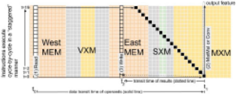

<!-- p.7 -->

<!-- formula-not-decoded -->

This dataflow composition allows us to exploit "data flow locality" by passing the same data across multiple functional slices which can optionally operate on the data to produce some output stream. The output from one functional slice can be used as the input to another slice allowing for logical chaining of operations through a common stream register.

## F. Scalable vectors

The underlying data type supported by the TSP hardware is a vector. The number of elements in each vector can vary from 16 elements, one superlane, all the way to 320 elements using all 20 superlanes on-chip. That is, the minimum vector length, or minVL, is 16 bytes and maxVL is a 320 byte-sized element array. A maxVL of 320 bytes is comparatively long compared to typical SIMD extensions to x86 (e.g AVX512b [31]). Because the vector length (VL) can vary from 16 to 320 elements, we provide instructions to configure each tile for a low-power mode to effectively power-down any unused superlane (row of the mesh) and reduce the power consumed. This scalable vector approach allows us to grow the VL from 16 to 320 bytes in 16-lane steps, powering-down the unused tiles, yielding a more energy-proportional [14] system.

## III. INSTRUCTION SET

The TSP's instruction set architecture (ISA) exposes temporal information about each instruction to allow the compiler precise control of each instruction's dispatch time. We augment each instruction with the following temporal parameters:

- dfunc functional delay - each instruction requires 1 or more cycles to produce its stream output. The dfunc timing parameter allows the compiler to reason about when the output of an instruction will be available on the architecturally-visible stream registers.
- dskew instruction-operand skew - the timing relationship between the instruction dispatch time relative to when its stream operands are required. The dskew parameter on each instruction informs the compiler how to schedule the operand arrival times with the instruction dispatch time in order to get them to properly intersect in time and space.

The parameters are necessary to track the exact spatial relationship between instructions and operands. Conceptually, the compiler is solving a two-dimensional scheduling of instructions and data in both time and space (ie. stream register location on-chip as shown in Figure 4). The execution time of an instruction includes the instruction functional delay, and stream propagation (transit) delay to get from stream register location i (SRi) to j (SRj), as shown in the superlane dataflow in Figure 4.

<!-- formula-not-decoded -->

In Equation 4 the time, T, executing an instruction where N is the number of tiles in the functional slice, and dfunc is the functional delay of the instruction being executed (cycles) for the output stream to appear on the SRi (stream register at location i in Figure 4) en route to the consumer at SRj. The transit delay, δ(j, i) is the distance (in cycles) between SRj and SRi. The TSP programming model relies on two critical elements: (1) deterministic data paths in hardware, and (2) exposing temporal information about an instruction's execution latency through the ISA, the compiler's back-end can precisely track the position and time-of-use of any stream on-chip. Exposing this additional temporal information across the static-dynamic interface [43] giving rise to "softwaredefined hardware."

The remainder of this section provides an summary of the different instructions available on each functional slice. We discuss each functional slice type and give examples in assembly language.

## A. Instruction control unit (ICU)

The instructions in the instruction control unit (ICU) are common to all functional slices. As such, they contain common instructions like NOP and Repeat, and synchronization primitives Sync and Notify to allow the independent functional slices to be initially synchronized so the compiler can reason about instruction execution times and allow cooperative parallelism among the functional slices on-chip.

```
1 import groq.api as g 2 x = g.random_tensor(shape=[1024, 320], 3 dtype=g.Int8) 4 y = g.random_tensor(shape=[1024, 320], 5 dtype=g.Int8) 6 x_strm = x.read(stream='S_0') 7 y_strm = y.read(stream='S_4') 8 z = g.add(x_strm, y_strm, stream='S_0') 9 out_addrs = g.malloc([1024, 320]) 10 z.write(out_addrs)
```

Listing 1. Streaming Add from example in Figure 3.

- 1) No-op: The compiler uses explicit NOPs to provide temporal separation between two instructions in program order. A NOP has a repeat count 16-bit field which allows 1 NOP to wait from 1 ns up to 65 µs for a 1GHz clock. The compiler uses NOP instructions to control the relative timing of the functional slices and the data on which they operate. The repeated NOP is implemented in the ICU's tile and common to

<!-- p.8 -->

all functional slices. The NOP allows the slice to turn off the clock enables when NOP-ing for anything longer than a few cycles. While NOP is likely the most common instruction, it is not programmer-visible in as much as the compiler inserts them implicitly.

2) Synchronization: Each functional slice is independent, however, the compiler keeps track of a logical program time. Conceptually it is similar to a program counter in a conventional CPU, except the compiler tracks the state of 144 independent program queues on a cycle-by-cycle basis. So at logical time t the compiler knows the state of each IQ on the chip. We use a NOP instruction to coordinate the temporal relationship between instructions in the same IQ, or between instructions in different IQs. In addition to repeated-NOPs we must provide a higher-level synchronization across all functional slices on the chip in order to reason about program correctness. That is the role of the Sync and Notify instructions. They provide a barrier synchronization mechanism across all 144 independent queues on the chip. One IQ is designated as the notifier and it issues a Notify instruction while all other IQs are parked on a Sync instruction - receipt of the Notify is broadcast to all the IQs to satisfy the pending Sync and begin processing instructions again.

This barrier synchronization is only required once after the chip resets. However, in practice, we start each program with a set of "preamble" instructions which configure each tile then perform a Sync to ensure that all functional slices are aligned to the same logical time. A chip-wide barrier synchronization can be accomplished in 35 clock cycles, from the time the Notify is issued to the time the Sync is satisfied and retired to allow subsequent instructions to flow. After this compulsory barrier synchronization, the functional slices can compute and communicate results in a synchronization-free manner through the stream registers and reason about program correctness using a simple timing model (Figure 4) of the chip.

3) Instruction fetching: The Ifetch instruction has a single stream operand which carries the text of the instructions in their program order, filling the IQ with 640-bytes (a pair of 320-byte vectors) of instructions. All functional slices can fetch instructions simultaneously with normal instruction execution. The compiler performs omniscient prefetching of the program's text to keep all 144 IQs busy on each cycle by inserting Ifetch instructions into every slices' instruction stream. It is imperative that IQs never go empty so that a precise notion of "logical time" is maintained across the chip.

## B. Memory (MEM)

The memory (MEM) slices provide the programming abstraction of a partitioned global shared address space with the address space laid out uniformly across the 88 slices. Each MEM slice contains pseudo-dual-port SRAMs that are capable of servicing a pair of read and write requests simultaneously assuming they are not targeting the same bank. As such, we expose the bank bit so that the compiler can manage the underlying SRAM efficiently and appropriately. This allows the compiler to take advantage of up to 176-way memory concurrency-88 slices each with 2 banks-to read operands to or store results from streams.

Fig. 7. The MXM block diagram showing activations and weights being loaded at the side of the array, and INT32 or FP32 results flow back from the inside edge.

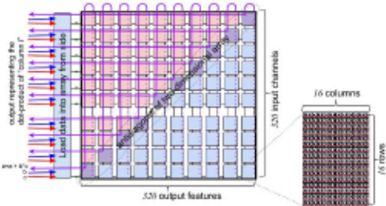

Each MEM slice supports both direct and stream-indirect addressing modes. Read and write use direct addressing, since the address is fully specified in the instruction itself. Indirect addressing uses the contents of a stream, s, to specify an address map for a gather or scatter. With indirect addressing, the physical address comes from the stream value, providing a layer of indirection in the memory referencing.

## C. Vector (VXM) processor

Each superlane implements a 4x4 mesh of vector ALUs capable of doing ×16-SIMD computations - 16 vector ALUs per lane. Each of the ALU's 32-bit input operands are organized along naturally aligned quad-stream group (SG4). The vector ALUs do not produce condition codes or status flags from the last instruction; they are stateless. Instead, the VXM provides both saturating and modulo variants (add\_sat, add\_mod and mul\_sat, mul\_mod) for addition and multiplication, which allows differing semantics for handling arithmetic exceptions. The TSP supports chaining together two or more vector ALUs within each lane, allowing multiple ALU operations to be performed without committing the intermediate results to main memory, saving a write and subsequent read of each intermediate result. This allows for efficient parallel implementations of algorithms for batch normalization, quantization, or more complex activation functions like leaky ReLU activation function, for instance.

## D. Matrix execution module (MXM)

The matrix execution module (MXM) provides four (4) independent 320×320 (Figure 7) planes of multiply-accumulate (MACC) units. Each 320×320 plane is comprised of 20 16×16 supercells that produce a partial-sum each cycle and pass it to the adjacent tile for use in its computation. It requires 16 streams each with 16 bytes to install 256 8-bit weights (IW) in each supercell on every cycle. Using all 32 streams in each direction allows us to emplace weights in both MXM planes simultaneously on both MXM hemispheres, loading all 409,600 weights on-chip in less than 40 cycles. With weights installed, every cycle the MXM can generate a new int32 dot-product of input activations with installed weights. The features output from the MXM can be accumulated using the accumulators on each int32 or fp32 output stream.

<!-- p.9 -->

Fig. 8. The SXM provides a combination of North (up) and South (down) shifting operations which can be combined using the select.

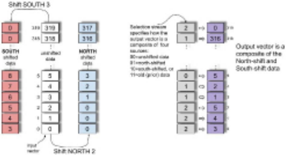

The MXM supports numerics for both 8-bit integer, and 16-bit floating point by using two 320×320 byte-planes in tandem for 16-bit floating point results. The 320-element sum is produced for each output with only a single rounding step at the end to convert to int32 or fp32 results.

## E. Switch execution module (SXM)

The switch execution module (SXM) contains several functions for transposition, permutation, shifting and rotation of data elements. Collectively, these operations are used for performing tensor reshape operations common to ML workloads, and fulfill the functionality of the NET slice in Figure 1. Data movement on-chip is carried out by routing data in two dimensions: horizontally propagating streams in the X-dimension shuttling between SRAM and functional units within each superlane, and vertically in the Y-dimension where the SXM is used to move streams in the North-South directions. The SXM provides two sets of lane shifters that execute shift instructions (Figure 8) both North and South. The lane-shifters are usually allocated in pairs since we typically shift a vector up or down and select which elements we want from either (i) North-shifted, (ii) South-shifted, or (iii) unshifted data elements, as shown in more detail in Figure 8. In addition, the SXM provides a permute instruction which employs a programmed bijection to remap the 320 lanes on a set of similarly indexed streams, one per superlane.

The distributor slice within the SXM is used to arbitrarily remap the 16 lanes within each superlane. As streams pass through the distributor, they can be remapped at full bandwidth, or zero-fill any or all of the 16 elements. This provides a very efficient mechanism for common tensor operations like zero padding or rearranging elements of a 4x4 filter.

Transposing the dimensions of a tensor is a very common operation on tensor data types. The TSP supports a twodimension transpose of 256 elements organized as 16 streams each with 16 elements. A transpose operation takes 16 incoming streams and produces 16 output streams with the rows and columns exchanged. This allows us to efficiently move data from the atomic 16-byte MEM word into 16

different MEM slices where they are now addressable. There are two instances of the SXM on-chip, one in each hemisphere (Figure 5). Each can issue two (2) transpose instructions, yielding a maximum of four (4) simultaneous transpose 16x16 operations.

## IV. RESNET50

In this section we describe our early results and lessonslearned from implementing ResNet50 [27], a popular image classification model, on the TSP hardware. In the process of bringing up new hardware, the software stack is critical for mapping the underlying tensor operations to the TSP's instruction set that implements them. The compiler is also responsible for memory management of tensors (weights and activations) and program text which describes the model itself. The MEM system provides the compiler with a flat, globally shared address space, with 220 Mibytes of total capacity. As a matter of policy, the compiler reserves several MEM slices to serve as "instruction dispatch" slices where the machine-coded instructions are stored and supplied on streams to service Ifetch instructions on different functional slices where the instructions will eventually be executed.

As a broad objective, the model implementation seeks to maximize functional slice utilization, and minimize latency. This means we want to take advantage of streaming operands into the MXMs and VXMs as much as possible. The four (4) 320×320 MXM planes are used for matrix multiply operations. The 16 vector ALUs in each lane are tasked with requantizing the int32 outputs from the MXM to produce int8 results which are streamed through an activation function ReLU [8]. From the perspective of both performance and power, when possible we want to chain the results from one functional slice (eg. MXM) to the input of another functional slice (eg. VXM) eliminating the read and write operations to store the intermediate results to MEM. Figure 10 shows a plot of power consumption as the program executes, layer by layer. The spikes in the power correspond to cycles where we perform four (4) simultaneous conv2d operations in a regime where we saturate the TSP's arithmetic throughput.

## A. Explicitly managing memory

To maximize stream concurrency, the compiler allocates memory for a tensor's concurrent stream operands into separate MEM slices - as streams propagate through the MEM system they "pick up" operands from the MEM slices en route to the MXM. This fine-grain memory management required that we expose the various levels of memory concurrency in the ISA allowing the compiler to explicitly schedule individual banks in each MEM slice. There are use-cases where we simultaneously read operands from one bank and write results to the other bank in the same slice. As an example, the transpose instruction takes 16 input streams and produces 16 output streams with the rows and columns transposed. By exposing the bank concurrency within each MEM slice, we take advantage the pseudo-dual-ported SRAM for dual read/write access per slice with a read of inputs from one bank and a write of the results to the opposite bank of the SRAM. An example of this concurrency is shown in Figure 11, which shows the different operations (read, write, transpose, rotate, etc) in a max pooling operation. From Figure 11 the solid lines show operand flow and dotted-line shows result data flow. We see the 16 concurrent streams are read from memory by Read(1) and sent to the SXM where they undergo a transposition of their elements, and 16 stream results flow back to MEM where they are commited to SRAM by Write(1). From this figure, it is evident that each operation is preceded by read instructions to provide the stream operands and followed by a write to commit the results back to MEM.

<!-- p.10 -->

Conventional CPUs rely on a memory hierarchy to implicitly move data between caches to service load/store operations. Cache hierarchies introduce a reactive agent in the data path and the undesired unpredictability, or non-determinism, in the data path to provide the illusion of sequentially consistent memory transactions within the memory hierarchy. The TSP's MEM system is unlike a conventional CPUs. Instead, we provide a thin layer of memory management that is used to identify the memory concurrency on an operation by operation basis. As an example, the code below shows the memory management for a transpose operation; an instruction that take 16 streams as input and creates 16 streams of output. The malloc function returns a tensor of addresses allocated across 16 memory slices, one for each concurrent stream.

```
1 # Read from 16 slices onto 16 streams 2 # Transpose data 3 # Write from 16 streams into 16 slices 4 import groq as g 5 tensor = g.random_tensor(shape=[1024, 320], 6 dtype=g.Int8, layout=[64, 16]) 7 streams_16 = tensor.read(streams=range(16)) 8 streams_16_t = g.transpose16(streams_16) 9 out_addrs = g.malloc(shape=[1024, 320], 10 layout=[64, 16]) 11 streams_16_t.write(out_addrs)
```

Listing 2. Memory management.

## B. Resource bottlenecks

To maximize value of on-chip resources we want to fully utilize the most expensive resources, which in the TSP's case is the MXM's four (4) 320x320 MACC arrays and the MEM slices feeding them. In our implementation of ResNet50 we found that the available ALU resources were well-balanced between the most computationally expensive operations (convolution and matrix multiply) which were able to stream results at full bandwidth through the VXM to perform requantization and ReLU operations in preparation for the next layer's operations. There were limited situations where the VXM ALU resources could not stream at the full bandwidth due to number of operations that needed to be performed by the VXMs (ie. depth of operations in a software pipeline), the throughput delay was short, or minimized by the parallelism across VXM ALUs and the concurrency available within each ALU for Int8 data.

## C. Optimizations

The first revision of ResNet50 utilized algorithms that distribute operations across the full chip to take advantage of the compute performance of the MXM and VXM. A common pattern in ResNet50 is Read → Conv2D → Requantize → ReLU→Write. The tensor sizes in ResNet50 layers are large enough to continuously stream data through the MXM and VXM for up to several hundred cycles at a time. The next pipeline is not able to start until the functional slices became available for computation. The full tensor was streamed through the pipeline and written to memory as a delay before streaming the results through the next pipeline.

This approach to pipeline the different layers left resources under utilized at the beginning and end of the streaming operations as latency bubbles were created as the pipeline filled and emptied. The initial memory allocations prevented starting the next pipeline when the previous pipeline was emptying due to memory slice contention. By adjusting the memory allocation patterns of input and output tensors to distribute the data across multiple slices. Interleaving banks within the memory slice was carefully orchestrated so that we were able to read a previous pipeline's output from memory before the previous pipeline had completed writing its results. These optimizations further reduced the overall latency of our ResNet50 implementation by approximately 5,500 cycles to our current performance of 20.4K IPS.

## D. Quantization

For our initial implementation of ResNet50 we selected a post-training layer-based symmetric int8 quantization strategy for convolutions and matrix multiplies. The MXM accepts int8 or fp16 inputs and accumulates to int32 or fp32 respectively. These values are then requantized back to int8 or fp16. The VXM has fp32 capacity to stream at the same rate of output produced by the 4 MXM planes. This approach enabled higher precision across operations between matrix multiplies and convolutions improving the model's overall precision. This resulted and a smaller quantization loss of 0.5% compared to quantizing each operation. This initial approach leaves room to improve. The streaming architecture has capacity for an axisbased asymmetric quantization approach which will be used on future revisions and will reduce quantization accuracy loss.

## E. Model Accuracy

The MXM has capacity for 320×320 matrix multiply. The channel depths of the layers in ResNet50 are powers of 2. The input and output channel depths of convolutions determine the dimensions of the weights. The misalignment between the 320×320 capacity and the 256×256 dimensions of weights split across multiple passes under-utilizes the MXM. By fitting the model to the capacity of the MXM we are able to increase the number of computations without additional latency.

We trained an alternative version of ResNet50 with increased channel depths to take advantage of MXM capacity. We found the additional weights contributed to higher accuracy in the fp32 model. The standard ResNet50 trained to an accuracy of 75.6% Top-1 and 92.8% Top-5 while the alternative version, taking full advantage of the 320-element VL, trained to an accuracy of 77.2% Top-1 and 93.6% Top-5. This encouraging result demonstrates how to exploit additional model capacity when using the maxVL of 320 to improve accuracy for the same computational cost and latency.

<!-- p.11 -->

## F. Deterministic performance

The TSP's hardware eliminates arbiters and other reactive elements in the data path, making performance deterministic and precisely predictable from run-to-run execution. Within the ResNet50 model we can determine the exact latency of each layer. ResNet101 and ResNet152 match ResNet50's structure with the exception of a repeated set of additional layers. From the demonstrated performance of ResNet50 on the TSP we can project the performance of ResNet101 and ResNet152 to the cycle. Based on our current ResNet50 implementation our ResNet101 throughput will be 14.3k IPS and ResNet152 throughput will be 10.7k IPS.

## V. DISCUSSION

This section describes initial proof-points and performance results of mapping the ResNet50 [27] v2 image classification model to our underlying tensor streaming processor. To preface our discussion, the authors would like to point out that we received silicon back from the fab in July of 2019, just five (5) months before the ISCA paper deadline. In that brief timespan, we validated A0 silicon and implemented ResNet50 on a new architecture, compiler, assembler, and tool chain for debugging and visualization. Nevertheless, our initial implementation of ResNet50 was a proof-point and reference model for compiler validation, performing an inference query of the ResNet model in &lt; 43µs, yielding a throughput of 20.4K images per second with each image sample being a separate query (ie. batch size of 1). That represents a 2.5× speedup relative to the Google TPU v3 [44] large batch inference. Perhaps more importantly, the TSP has an inference latency of only 49 µs for a single image sample, which is nearly a 5× reduction in end-to-end latency compared to Intel/Habana's Goya [1] inference chip which takes 240 µs for batch 1 inference [44].

Fig. 9. Roofline diagram showing arithmetic throughput (at 1 GHz core clock) varying with offered load.

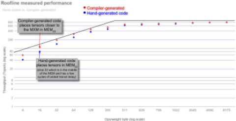

Fig. 10. Power usage for ResNet50 layers.

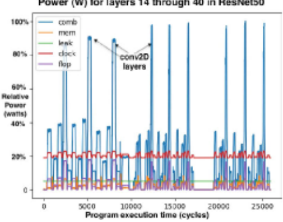

a) Operating regimes: The roofline diagram [57] in Figure 9 provides an intuitive framework for understanding the different operating regimes of the chip, limited by either (i) on-chip memory bandwidth, or (ii) arithmetic performance as delineated by the sloped peak in the diagram. The sloped region indicates where the TSP becomes memory bandwidth bound loading weights into the MXM array for a subsequent conv2D or MatMul. The "roofline peak" indicates the saturation point where the arithmetic units are operating at peak utilization and we are subsequently arithmetically limited.

- b) Matrix operations: Matrix operations are the workhorse of ML workloads, and the MEM slices can read 409,600 weights from memory and install them into the four (4) 320×320 MXM arrays in less than 40 cycles including SRAM and on-chip network transit delay! This is only possible because the MEM slices deliver 32 1-byte stream operands for each of the 320 parallel lanes, or 10 TiB/s of operand stream bandwidth into the MXMs. The labeled data points are measured results with model weights laid out in MEM so that we locate them toward the middle of the chip in MEM slices - that is, ideally the compiler will layout tensors in MEM slices so that data transit from memory slice MEMi to MXM is minimized.

c) On-chip network: Typically, on-chip communication has been carried out by routing packets [19] among cores, whereby packets undergo routing, arbitration, and output port scheduling, and as such often incur conflicts, thus introducing nondeterminism and requiring flow control [16], [17]. However, on each tick of the core clock, the TSP propagates stream values by one stream register hop in the direction of flow as shown in Figure 4. The TSP hardware does not track the origin or destination slice, instead streams simply flow (propagate) Eastward or Westward until they fall off the edge of the chip or are overwritten by a functional slice. In contrast to this more conventional on-chip network, the TSP uses stream registers (numbered in Figure 4) within each MEM to move data in the X-dimension (superlane), and uses the SXM to move data in the Y-dimension on-chip through lane permutation.

<!-- p.12 -->

Fig. 11. Example instruction schedule for 3x3 max pool in ResNet50.

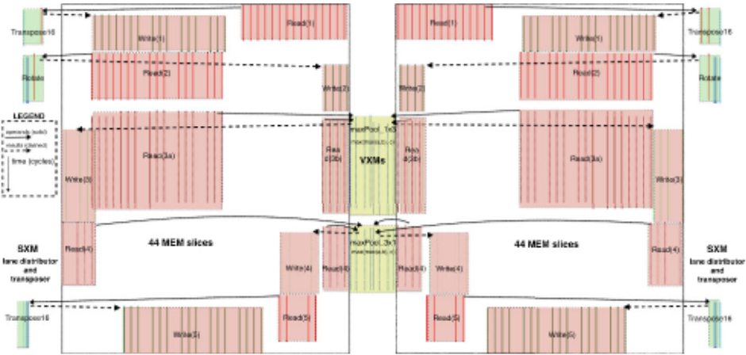

## VI. RELATED WORK

GraphCore's IPU [25] uses more than 1200 cores each with 256 Kibytes of SRAM storage, approximately 300 Mibytes of capacity for model parameters. However, GraphCore's IPU uses bulk-synchronous communication, which performs an implicit synchronization. In contrast, our stream programming model does not require explicit synchronization of producer and consumers, except once at the beginning of the program.

Coarse-grain reconfigureable architectures (CGRAs) [47] focus on the highly regular communication patterns and image transforms that make ML workloads embarrassingly data parallel. They map tensor operations to underlying hardware primitives of pattern memory unit (PMU) and pattern compute unit (PCU). The Stanford Imagine [35] and Merrimac [18] stream supercomputer map stream constructs to the underlying programming hierarchy of a local register file and each compute cluster has access to its own bank of a stream register file for communication between clusters. In contrast, the TSP architecture does not have any local register files, or FIFOs for communicating, instead relying on a chip-wide set of streaming registers for communicating results between the processing elements in each functional slice.

Prior research [5], [9], [23], [26], [32], [33], [38], [51] reduces off-chip communication by leveraging processing in memory, variable bit width, compression, or locality-aware design. Since the TSP contains large amount of deterministic memory, we avoid frequently accessing off-chip memory. Several prior proposals explore pruning based on sparsity [45], [60], based on model- or domain-specific data patterns [4], [22], [24], [28]-[30], [36], [41], [50], [54], [61], [62], or communication optimizations [39], [40], [53]. The TSP does not use such optimizations to maintain a strictly deterministic execution time and power profile.

## VII. CONCLUSION

In this paper, we have introduced a novel hardware architecture of the first-generation Groq tensor streaming processor (TSP). The TSP architecture reorganizes a conventional 2D mesh of cores into a functionally-sliced tiled microarchitecture that scales from a minVL of 16-elements to a maxVL of 320-elements. It is able to exploit dataflow locality within a superlane to dramatically reduce latency. The abundant on-chip memory bandwidth is able to concurrently feed the four (4) MXM arrays of 320×320 MACC (multiply-accumulate) cores for MatMul and conv2D operations, which are the workhorses of many ML applications. Further, each of the 320 parallel lanes have access to 16 powerful vector processors, for a total of 5,120 vector ALUs on-chip, capable of 32-bit fixed and floating point operations. Supporting both int8 and fp16 native data types allows a single-chip solution for both quantized inference models and model training with floating point.

Modern ASIC technology yields ≈25 billion transistors on a single die. Broadly speaking, we are spending transistors on (1) fixed or floating-point ALUs for arithmetic, and (2) storage and communicating data among the available ALUs. We want to maximize the number of ALUs that we can stream operands into at full bandwidth. In effect, our "conversion rate" for how well the architecture can extract value from the underlying CMOS technology is measured by the number of deep learning operations we can perform (ie raw performance) normalized for transistor count. The first-generation Groq TSP (at 1 GHz) in 14nm ASIC and packaged as a PCIe CEM form factor, yields a peak performance of 820 TeraOps/sec from 26.8B transistors on-chip - 30K deep learning Ops/sec/transistor. Comparatively, Volta 100 which is capable of 130 TeraFlops of mixed-precision arithmetic, from 21.1B transistors in 815 mm2 implemented in a 12nm ASIC node - yielding 6.2K

<!-- p.13 -->

Ops/sec/transistor. Compared to leading GPUs [42], [44], [59], the TSP architecture delivers 5× the computational density for deep learning ops. We see a direct speedup in real application performance as we demonstrate a nearly 4× speedup in batchsize-1 throughput and a nearly 4× reduction of inference latency compared to leading TPU, GPU, and Habana Lab's GOYA chip.

## ACKNOWLEDGEMENTS

With any new endeavor where the starting point is simply an idea, a lot of people and effort goes into synthesizing that idea and bringing it to fruition. We would like to thank Christopher Clark, Sushma Honnavara-Prasad, Greg Thorson, and Srivi Dhruvanarayan for early contributions to the project. We also want to thank Michelle Tomasko for encouraging publishing these early results in the face of difficult engineering schedules.

## REFERENCES

- [1] Habana Lab's GOYA inference chip. https://habana.ai/wp-content/ uploads/pdf/habana labs goya whitepaper.pdf.
- [2] Mart´ın Abadi, Paul Barham, Jianmin Chen, Zhifeng Chen, Andy Davis, Jeffrey Dean, Matthieu Devin, Sanjay Ghemawat, Geoffrey Irving, Michael Isard, Manjunath Kudlur, Josh Levenberg, Rajat Monga, Sherry Moore, Derek G. Murray, Benoit Steiner, Paul Tucker, Vijay Vasudevan, Pete Warden, Martin Wicke, Yuan Yu, and Xiaoqiang Zheng. TensorFlow: A System for Large-Scale Machine Learning. In Symposium on Operating Systems Design and Implementation (OSDI), pages 265-283, Savannah, GA, November 2016.
- [3] Jung Ho Ahn, Nathan Binkert, Al Davis, Moray McLaren, and Robert S. Schreiber. HyperX: Topology, Routing, and Packaging of Efficient Large-Scale Networks. In Conference on High Performance Computing Networking, Storage and Analysis (SC), pages 1-11, 2009.
- [4] V. Akhlaghi, A. Yazdanbakhsh, K. Samadi, R. K. Gupta, and H. Esmaeilzadeh. SnaPEA: Predictive Early Activation for Reducing Computation in Deep Convolutional Neural Networks. In International Symposium on Computer Architecture (ISCA), pages 662-673, 2018.
- [5] Berkin Akin, Zeshan A. Chishti, and Alaa R. Alameldeen. ZCOMP: Reducing DNN Cross-Layer Memory Footprint Using Vector Extensions. In International Symposium on Microarchitecture (MICRO), pages 126138, 2019.
- [6] George Almasi. PGAS (Partitioned Global Address Space) languages. Encyclopedia of Parallel Computing, pages 1539-1545, 2011.
- [7] Alexey Andreyev. Introducing data center fabric, the next-generation Facebook data center network. https://code.facebook.com/posts/ 360346274145943.
- [8] Raman Arora, Amitabh Basu, Poorya Mianjy, and Anirbit Mukherjee. Understanding deep neural networks with rectified linear units. arXiv preprint arXiv:1611.01491, 2016.
- [9] A. Azizimazreah and L. Chen. Shortcut Mining: Exploiting Cross-Layer Shortcut Reuse in DCNN Accelerators. In International Symposium on High Performance Computer Architecture (HPCA), pages 94-105, 2019.
- [10] Dzmitry Bahdanau, Kyunghyun Cho, and Yoshua Bengio. Neural Machine Translation by Jointly Learning to Align and Translate. In International Conference on Learning Representations (ICLR), 2015.
- [11] Luiz Andre Barroso. Warehouse-Scale Computing. In International Conference on Management of Data (SIGMOD), 2010.
- [12] Luiz Andr´e Barroso, Kourosh Gharachorloo, Robert McNamara, Andreas Nowatzyk, Shaz Qadeer, Barton Sano, Scott Smith, Robert Stets, and Ben Verghese. Piranha: A Scalable Architecture Based on Singlechip Multiprocessing. In International Symposium on Computer Architecture (ISCA), pages 282-293, 2000.
- [13] Luiz Andre Barroso and Urs Hoelzle. The Datacenter As a Computer: An Introduction to the Design of Warehouse-Scale Machines. Morgan and Claypool Publishers, 1st edition, 2009.
- [14] Luiz Andr´e Barroso and Urs H¨olzle. The Case for Energy-Proportional Computing. IEEE Computer, 40(12):33-37, December 2007.
- [15] Cerebras CS-1. http://cerebras.net.
- [16] W. J. Dally and B. Towles. Principles and Practices of Interconnection Networks. Morgan Kaufmann, San Francisco, CA, 2004.
- [17] William J. Dally. Virtual-Channel Flow Control. IEEE Transactions on Parallel and Distributed Systems, 3(2):194-205, 1992.
- [18] William J Dally, Francois Labonte, Abhishek Das, Pat Hanrahan, JungHo Ahn, Jayanth Gummaraju, Mattan Erez, Nuwan Jayasena, Ian Buck, Timothy J Knight, et al. Merrimac: Supercomputing with streams. In Supercomputing (SC), pages 35-35, 2003.
- [19] William J. Dally and Brian Towles. Route Packets, Not Wires: On-chip Inteconnection Networks. In Design Automation Conference (DAC), pages 684-689, 2001.
- [20] Jeffrey Dean, Greg Corrado, Rajat Monga, Kai Chen, Matthieu Devin, Mark Mao, Marc'aurelio Ranzato, Andrew Senior, Paul Tucker, Ke Yang, Quoc V. Le, and Andrew Y. Ng. Large Scale Distributed Deep Networks. In Advances in Neural Information Processing Systems, pages 1223-1231. 2012.
- [21] Jeffrey Dean, David Patterson, and Cliff Young. A New Golden Age in Computer Architecture: Empowering the Machine Learning Revolution. IEEE Micro, PP:1-1, 01 2018.
- [22] Chunhua Deng, Fangxuan Sun, Xuehai Qian, Jun Lin, Zhongfeng Wang, and Bo Yuan. TIE: Energy-efficient Tensor Train-based Inference Engine for Deep Neural Network. In International Symposium on Computer Architecture (ISCA), pages 264-278, 2019.
- [23] Charles Eckert, Xiaowei Wang, Jingcheng Wang, Arun Subramaniyan, Ravi Iyer, Dennis Sylvester, David Blaauw, and Reetuparna Das. Neural Cache: Bit-serial In-cache Acceleration of Deep Neural Networks. In International Symposium on Computer Architecture (ISCA), pages 383396, 2018.
- [24] Ashish Gondimalla, Noah Chesnut, Mithuna Thottethodi, and T. N. Vijaykumar. SparTen: A Sparse Tensor Accelerator for Convolutional Neural Networks. In International Symposium on Microarchitecture (MICRO), pages 151-165, 2019.
- [25] GraphCore Intelligence Processing Unit IPU. https://www.graphcore.ai/posts/how-to-build-a-processor-for-machineintelligence-part-2.
- [26] Sumanth Gudaparthi, Surya Narayanan, Rajeev Balasubramonian, Edouard Giacomin, Hari Kambalasubramanyam, and Pierre-Emmanuel Gaillardon. Wire-Aware Architecture and Dataflow for CNN Accelerators. In International Symposium on Microarchitecture (MICRO), pages 1-13, 2019.
- [27] Kaiming He, Xiangyu Zhang, Shaoqing Ren, and Jian Sun. Deep Residual Learning for Image Recognition. In Computer Vision and Pattern Recognition (CVPR), pages 770-778, 2016.
- [28] K. Hegde, R. Agrawal, Y. Yao, and C. W. Fletcher. Morph: Flexible Acceleration for 3D CNN-Based Video Understanding. In International Symposium on Microarchitecture (MICRO), pages 933-946, 2018.
- [29] Kartik Hegde, Hadi Asghari-Moghaddam, Michael Pellauer, Neal Crago, Aamer Jaleel, Edgar Solomonik, Joel Emer, and Christopher W. Fletcher. ExTensor: An Accelerator for Sparse Tensor Algebra. In International Symposium on Microarchitecture (MICRO), pages 319-333, 2019.
- [30] Weizhe Hua, Yuan Zhou, Christopher De Sa, Zhiru Zhang, and G. Edward Suh. Boosting the Performance of CNN Accelerators with Dynamic Fine-Grained Channel Gating. In International Symposium on Microarchitecture (MICRO), pages 139-150, 2019.
- [31] Intel AVX 512 Instructions. https://software.intel.com/enus/articles/intel-avx-512-instructions.
- [32] A. Jain, A. Phanishayee, J. Mars, L. Tang, and G. Pekhimenko. Gist: Efficient Data Encoding for Deep Neural Network Training. In International Symposium on Computer Architecture (ISCA), pages 776-789, 2018.
- [33] Hanhwi Jang, Joonsung Kim, Jae-Eon Jo, Jaewon Lee, and Jangwoo Kim. MnnFast: A Fast and Scalable System Architecture for Memoryaugmented Neural Networks. In International Symposium on Computer Architecture (ISCA), pages 250-263, 2019.
- [34] Norman P. Jouppi, Cliff Young, Nishant Patil, David Patterson, Gaurav Agrawal, Raminder Bajwa, Sarah Bates, Suresh Bhatia, Nan Boden, Al Borchers, Rick Boyle, Pierre-luc Cantin, Clifford Chao, Chris Clark, Jeremy Coriell, Mike Daley, Matt Dau, Jeffrey Dean, Ben Gelb, Tara Vazir Ghaemmaghami, Rajendra Gottipati, William Gulland, Robert Hagmann, C. Richard Ho, Doug Hogberg, John Hu, Robert Hundt, Dan Hurt, Julian Ibarz, Aaron Jaffey, Alek Jaworski, Alexander Kaplan, Harshit Khaitan, Daniel Killebrew, Andy Koch, Naveen Kumar, Steve Lacy, James Laudon, James Law, Diemthu Le, Chris Leary, Zhuyuan Liu, Kyle Lucke, Alan Lundin, Gordon MacKean, Adriana Maggiore, Maire Mahony, Kieran Miller, Rahul Nagarajan, Ravi Narayanaswami, Ray Ni, Kathy Nix, Thomas Norrie, Mark Omernick,

<!-- p.14 -->

Narayana Penukonda, Andy Phelps, Jonathan Ross, Matt Ross, Amir Salek, Emad Samadiani, Chris Severn, Gregory Sizikov, Matthew Snelham, Jed Souter, Dan Steinberg, Andy Swing, Mercedes Tan, Gregory Thorson, Bo Tian, Horia Toma, Erick Tuttle, Vijay Vasudevan, Richard Walter, Walter Wang, Eric Wilcox, and Doe Hyun Yoon. In-Datacenter Performance Analysis of a Tensor Processing Unit. In International Symposium on Computer Architecture (ISCA), pages 1-12, 2017.

- [35] Brucek Khailany, William J Dally, Ujval J Kapasi, Peter Mattson, Jinyung Namkoong, John D Owens, Brian Towles, Andrew Chang, and Scott Rixner. Imagine: Media Processing with Streams. IEEE Micro, 21(2):35-46, 2001.
- [36] H. Kim, J. Sim, Y. Choi, and L. Kim. NAND-Net: Minimizing Computational Complexity of In-Memory Processing for Binary Neural Networks. In International Symposium on High Performance Computer Architecture (HPCA), pages 661-673, 2019.
- [37] John Kim, William J. Dally, Brian Towles, and Amit K. Gupta. Microarchitecture of a high-radix router. In ISCA '05: Proceedings of the 32nd Annual International Symposium on Computer Architecture, pages 420-431, Madison, WI, USA, 2005. IEEE Computer Society.
- [38] Alberto Delm´as Lascorz, Sayeh Sharify, Isak Edo, Dylan Malone Stuart, Omar Mohamed Awad, Patrick Judd, Mostafa Mahmoud, Milos Nikolic, Kevin Siu, Zissis Poulos, and Andreas Moshovos. ShapeShifter: Enabling Fine-Grain Data Width Adaptation in Deep Learning. In International Symposium on Microarchitecture (MICRO), pages 28-41, 2019.
- [39] Y. Li, J. Park, M. Alian, Y. Yuan, Z. Qu, P. Pan, R. Wang, A. Schwing, H. Esmaeilzadeh, and N. S. Kim. A Network-Centric Hardware/Algorithm Co-Design to Accelerate Distributed Training of Deep Neural Networks. In International Symposium on Microarchitecture (MICRO), pages 175-188, 2018.
- [40] Youjie Li, Iou-Jen Liu, Yifan Yuan, Deming Chen, Alexander Schwing, and Jian Huang. Accelerating Distributed Reinforcement Learning with In-Switch Computing. In International Symposium on Computer Architecture (ISCA), pages 279-291, 2019.
- [41] M. Mahmoud, K. Siu, and A. Moshovos. Diffy: a D´ej`a vu-Free Differential Deep Neural Network Accelerator. In International Symposium on Microarchitecture (MICRO), pages 134-147, 2018.
- [42] Stefano Markidis, Steven Wei Der Chien, Erwin Laure, Ivy Bo Peng, and Jeffrey S Vetter. Nvidia Tensor Core Programmability, Performance &amp; Precision. In International Parallel and Distributed Processing Symposium Workshops (IPDPSW), pages 522-531, 2018.
- [43] Stephen W Melvin and Yale N Patt. A Clarification of the Dynamic/Static Interface. In International Conference on Systems Sciences, 1987.
- [44] MLPerf results. http://mlperf.org.
- [45] A. Parashar, M. Rhu, A. Mukkara, A. Puglielli, R. Venkatesan, B. Khailany, J. Emer, S. W. Keckler, and W. J. Dally. SCNN: An accelerator for compressed-sparse convolutional neural networks. In 2017 ACM/IEEE 44th Annual International Symposium on Computer Architecture (ISCA), pages 27-40, 2017.
- [46] David A. Patterson and John L. Hennessy. Computer Architecture: A Quantitative Approach. Morgan Kaufmann Publishers Inc., San Francisco, CA, USA, 1990.
- [47] Raghu Prabhakar, Yaqi Zhang, David Koeplinger, Matt Feldman, Tian Zhao, Stefan Hadjis, Ardavan Pedram, Christos Kozyrakis, and Kunle Olukotun. Plasticine: A Reconfigurable Architecture For Parallel Paterns. In International Symposium on Computer Architecture (ISCA), pages 389-402, 2017.
- [48] Andrew Putnam, Adrian M. Caulfield, Eric S. Chung, Derek Chiou, Kypros Constantinides, John Demme, Hadi Esmaeilzadeh, Jeremy Fowers, Gopi Prashanth Gopal, Jan Gray, Michael Haselman, Scott Hauck,
- [50] Sayeh Sharify, Alberto Delmas Lascorz, Mostafa Mahmoud, Milos Nikolic, Kevin Siu, Dylan Malone Stuart, Zissis Poulos, and Andreas Moshovos. Laconic Deep Learning Inference Acceleration. In Inter-

Stephen Heil, Amir Hormati, Joo-Young Kim, Sitaram Lanka, James Larus, Eric Peterson, Simon Pope, Aaron Smith, Jason Thong, Phillip Yi Xiao, and Doug Burger. A Reconfigurable Fabric for Accelerating Large-scale Datacenter Services. In International Symposium on Computer Architecuture (ISCA), pages 13-24, 2014.

- [49] Steve Scott, Dennis Abts, John Kim, and William J. Dally. The blackwidow high-radix clos network. In Proceedings of the 33rd Annual International Symposium on Computer Architecture, ISCA '06, page 16-28, USA, 2006. IEEE Computer Society. national Symposium on Computer Architecture (ISCA), pages 304-317, 2019.
- [51] Hardik Sharma, Jongse Park, Naveen Suda, Liangzhen Lai, Benson Chau, Vikas Chandra, and Hadi Esmaeilzadeh. Bit Fusion: Bit-level Dynamically Composable Architecture for Accelerating Deep Neural Networks. In International Symposium on Computer Architecture (ISCA), pages 764-775, 2018.
- [52] James E. Smith. Decoupled Access/Execute Computer Architectures. In International Symposium on Computer Architecture (ISCA), pages 112-119, 1982.
- [53] L. Song, J. Mao, Y. Zhuo, X. Qian, H. Li, and Y. Chen. HyPar: Towards Hybrid Parallelism for Deep Learning Accelerator Array. In International Symposium on High Performance Computer Architecture (HPCA), pages 56-68, 2019.
- [54] M. Song, J. Zhao, Y. Hu, J. Zhang, and T. Li. Prediction Based Execution on Deep Neural Networks. In International Symposium on Computer Architecture (ISCA), pages 752-763, 2018.
- [55] Ashish Vaswani, Noam Shazeer, Niki Parmar, Jakob Uszkoreit, Llion Jones, Aidan N. Gomez, Lukasz Kaiser, and Illia Polosukhin. Attention Is All You Need. CoRR, abs/1706.03762, 2017.
- [56] D. Wentzlaff, P. Griffin, H. Hoffmann, Liewei Bao, B. Edwards, C. Ramey, M. Mattina, Chyi-Chang Miao, J.F. Brown, and A. Agarwal. On-Chip Interconnection Architecture of the Tile Processor. Micro, IEEE, 27(5):15-31, September-October 2007.
- [57] Samuel Williams, AndrewWaterman, and David Patterson. Roofline: An Insightful Visual Performance Model for Floating-Point Programs and Multicore Architectures. Technical report, Lawrence Berkeley National Lab (LBNL), Berkeley, CA (United States), 2009.
- [58] Yonghui Wu, Mike Schuster, Zhifeng Chen, Quoc V. Le, Mohammad Norouzi, Wolfgang Macherey, Maxim Krikun, Yuan Cao, Qin Gao, Klaus Macherey, Jeff Klingner, Apurva Shah, Melvin Johnson, Xiaobing Liu, Lukasz Kaiser, Stephan Gouws, Yoshikiyo Kato, Taku Kudo, Hideto Kazawa, Keith Stevens, George Kurian, Nishant Patil, Wei Wang, Cliff Young, Jason Smith, Jason Riesa, Alex Rudnick, Oriol Vinyals, Greg Corrado, Macduff Hughes, and Jeffrey Dean. Google's Neural Machine Translation System: Bridging the Gap between Human and Machine Translation. CoRR, abs/1609.08144, 2016.
- [59] Rengan Xu, Frank Han, and Quy Ta. Deep Learning at Scale on NVIDIA V100 Accelerators. In Performance Modeling, Benchmarking and Simulation of High Performance Computer Systems (PMBS), pages 23-32, 2018.
- [60] J. Yu, A. Lukefahr, D. Palframan, G. Dasika, R. Das, and S. Mahlke. Scalpel: Customizing DNN Pruning to the Underlying Hardware Parallelism. In International Symposium on Computer Architecture (ISCA), pages 548-560, 2017.
- [61] Jiaqi Zhang, Xiangru Chen, Mingcong Song, and Tao Li. Eager Pruning: Algorithm and Architecture Support for Fast Training of Deep Neural Networks. In International Symposium on Computer Architecture (ISCA), pages 292-303, 2019.
- [62] Yuhao Zhu, Anand Samajdar, Matthew Mattina, and Paul Whatmough. Euphrates: Algorithm-SoC Co-design for Low-power Mobile Continuous Vision. In International Symposium on Computer Architecture (ISCA), pages 547-560, 2018.
