> 本文件由 `ATPESC2022-Groq-Ling.pdf` 自动转换（docling 2.140.0，2026-10-17）。每页的整页图在 `images/` 目录；表格与数字请以 PDF 原文为准；`<!-- p.N -->` 标记对应 PDF 第 N 页。

<!-- p.1 -->

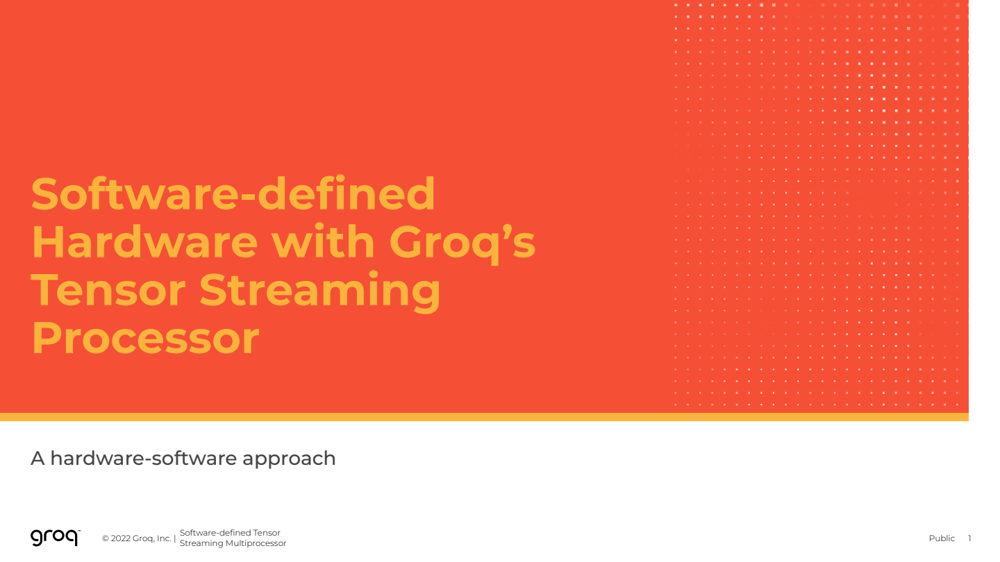

Software-defined Hardware with Groq's Tensor Streaming Processor

A hardware-software approach

1

<!-- p.2 -->

## HELLO ATPESC Andrew Ling, Ph.D. Sr. Director Software

<!-- p.3 -->

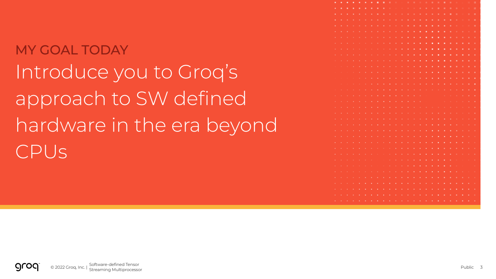

MY GOAL TODAY Introduce you to Groq's approach to SW defined hardware in the era beyond CPUs

<!-- p.4 -->

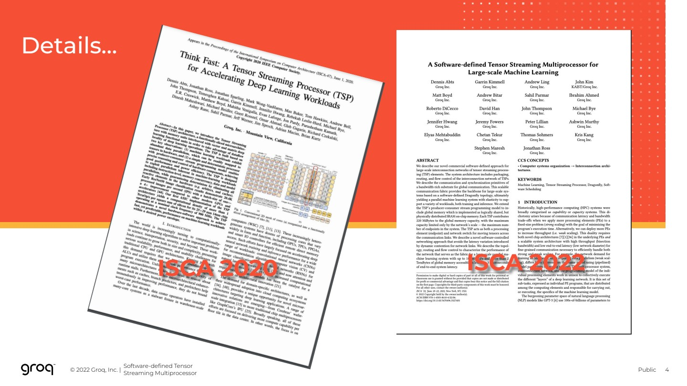

## Details…

ISCA 2022

<!-- p.5 -->

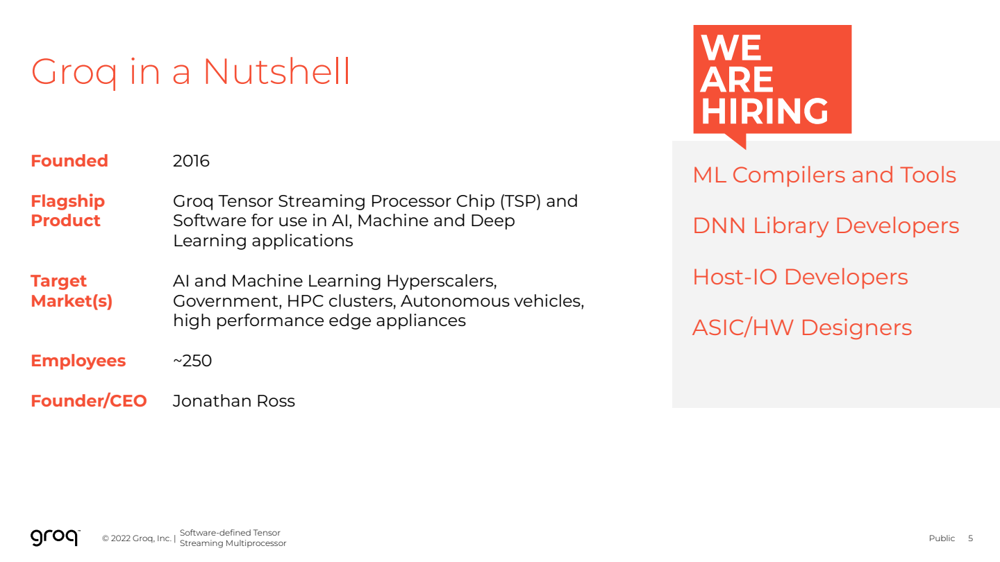

## Groq in a Nutshell

Founded

Flagship Product

Target Market(s)

Employees

2016

Groq Tensor Streaming Processor Chip (TSP) and Software for use in AI, Machine and Deep Learning applications

AI and Machine Learning Hyperscalers, Government, HPC clusters, Autonomous vehicles, high performance edge appliances

~250

Founder/CEO Jonathan Ross

ML Compilers and Tools

DNN Library Developers

Host-IO Developers

ASIC/HW Designers

<!-- p.6 -->

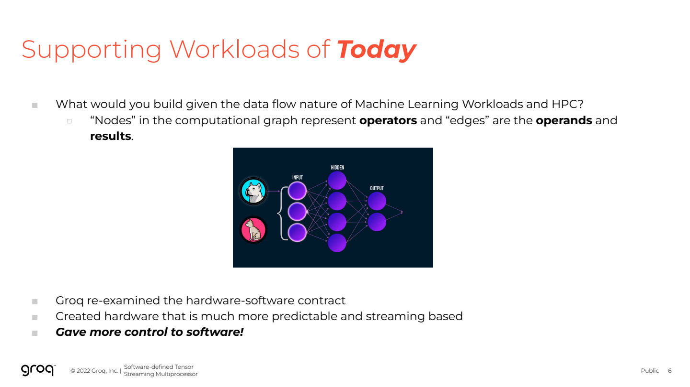

## Supporting Workloads of Today

- ■ What would you build given the data flow nature of Machine Learning Workloads and HPC?
- □ "Nodes" in the computational graph represent operators and "edges" are the operands and results.
- ■ Groq re-examined the hardware-software contract
- ■ Created hardware that is much more predictable and streaming based
- ■ Gave more control to software!

<!-- p.7 -->

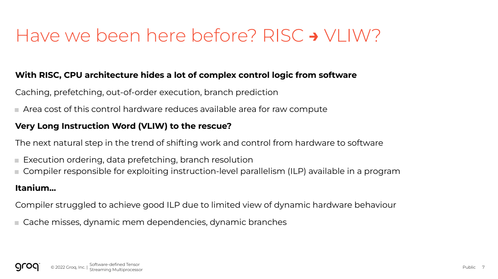

## Have we been here before? RISC → VLIW?

## With RISC, CPU architecture hides a lot of complex control logic from software

Caching, prefetching, out-of-order execution, branch prediction

- ■ Area cost of this control hardware reduces available area for raw compute

## Very Long Instruction Word (VLIW) to the rescue?

The next natural step in the trend of shifting work and control from hardware to software

- ■ Execution ordering, data prefetching, branch resolution
- ■ Compiler responsible for exploiting instruction-level parallelism (ILP) available in a program

## Itanium…

Compiler struggled to achieve good ILP due to limited view of dynamic hardware behaviour

- ■ Cache misses, dynamic mem dependencies, dynamic branches

<!-- p.8 -->

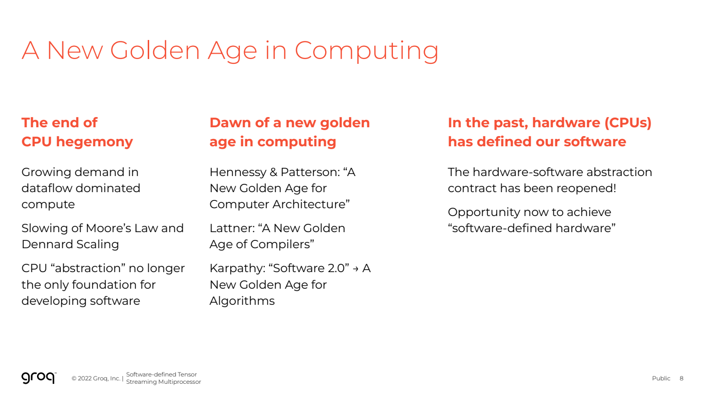

## A New Golden Age in Computing

## The end of CPU hegemony

## Dawn of a new golden age in computing

## In the past, hardware (CPUs) has defined our software

Growing demand in dataflow dominated compute

Slowing of Moore's Law and Dennard Scaling

CPU "abstraction" no longer the only foundation for developing software Hennessy &amp; Patterson: "A New Golden Age for Computer Architecture"

Lattner: "A New Golden Age of Compilers"

Karpathy: "Software 2.0" → A New Golden Age for Algorithms The hardware-software abstraction contract has been reopened!

Opportunity now to achieve "software-defined hardware"

<!-- p.9 -->

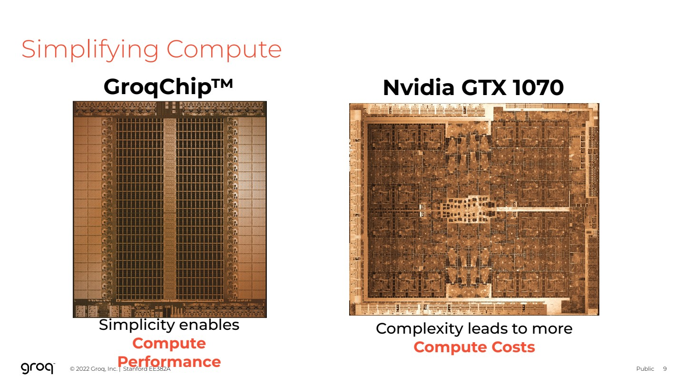

## Simplifying Compute

## GroqChip™

## Nvidia GTX 1070

© 2022 Groq, Inc. | Stanford EE382A Simplicity enables Compute Performance

Complexity leads to more Compute Costs

<!-- p.10 -->

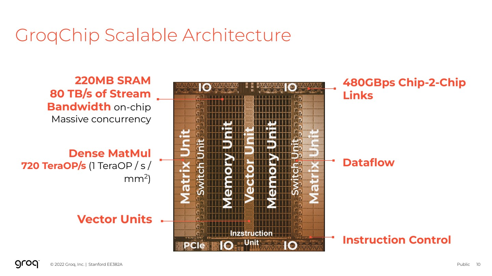

## GroqChip Scalable Architecture

<!-- p.11 -->

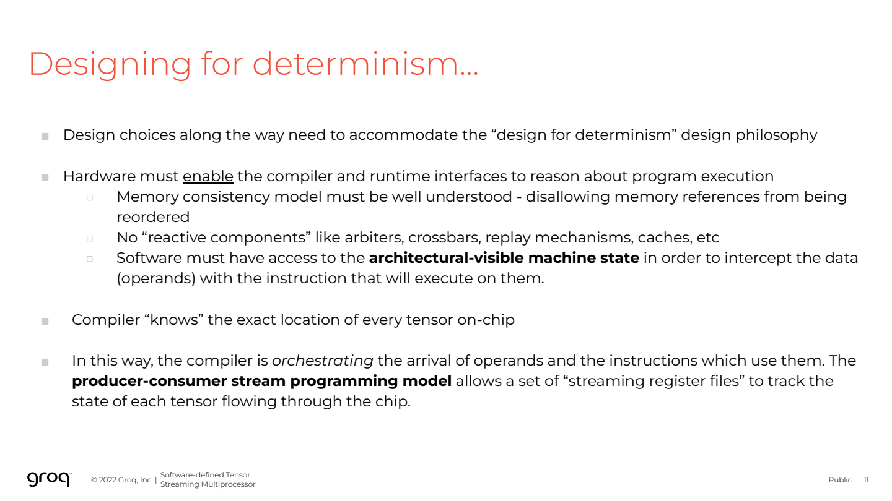

## Designing for determinism…

- ■ Design choices along the way need to accommodate the "design for determinism" design philosophy
- ■ Hardware must enable the compiler and runtime interfaces to reason about program execution
- □ Memory consistency model must be well understood - disallowing memory references from being reordered
- □ No "reactive components" like arbiters, crossbars, replay mechanisms, caches, etc
- □ Software must have access to the architectural-visible machine state in order to intercept the data (operands) with the instruction that will execute on them.
- ■ Compiler "knows" the exact location of every tensor on-chip
- ■ In this way, the compiler is orchestrating the arrival of operands and the instructions which use them. The producer-consumer stream programming model allows a set of "streaming register files" to track the state of each tensor flowing through the chip.

<!-- p.12 -->

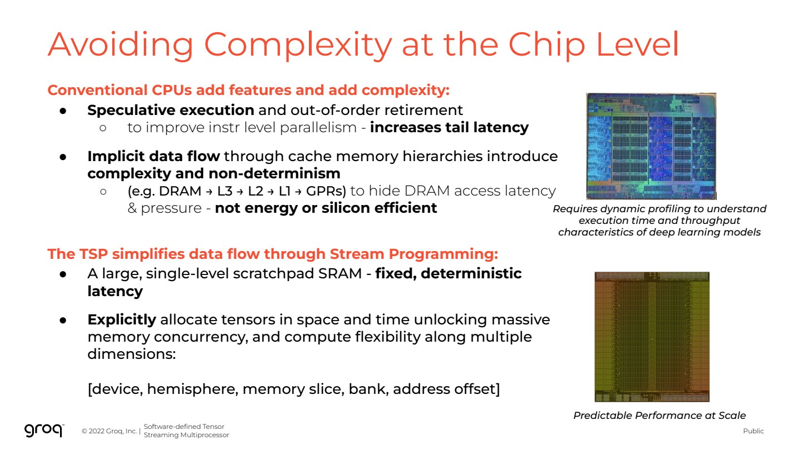

## Avoiding Complexity at the Chip Level

## Conventional CPUs add features and add complexity:

- Speculative execution and out-of-order retirement
- to improve instr level parallelism - increases tail latency
- Implicit data flow through cache memory hierarchies introduce complexity and non-determinism
- (e.g. DRAM → L3 → L2 → L1 → GPRs) to hide DRAM access latency &amp; pressure - not energy or silicon efficient

Requires dynamic profiling to understand execution time and throughput characteristics of deep learning models

## The TSP simplifies data flow through Stream Programming:

- A large, single-level scratchpad SRAM - fixed, deterministic latency
- Explicitly allocate tensors in space and time unlocking massive memory concurrency, and compute flexibility along multiple dimensions:

[device, hemisphere, memory slice, bank, address offset]

Intel Cascade Lake

Groq TSP

Predictable Performance at Scale

<!-- p.13 -->

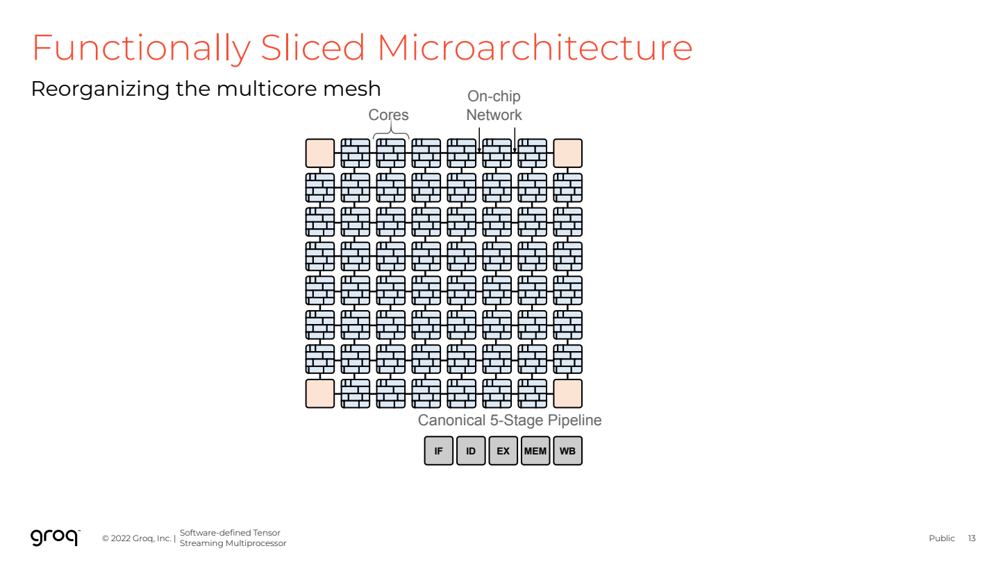

## Functionally Sliced Microarchitecture

Reorganizing the multicore mesh

<!-- p.14 -->

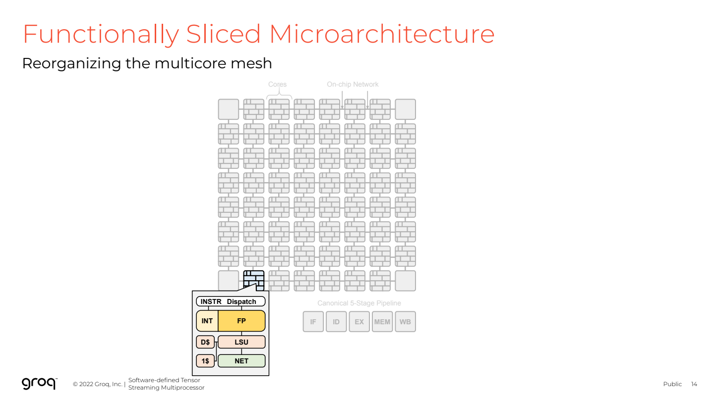

## Functionally Sliced Microarchitecture

Reorganizing the multicore mesh

<!-- p.15 -->

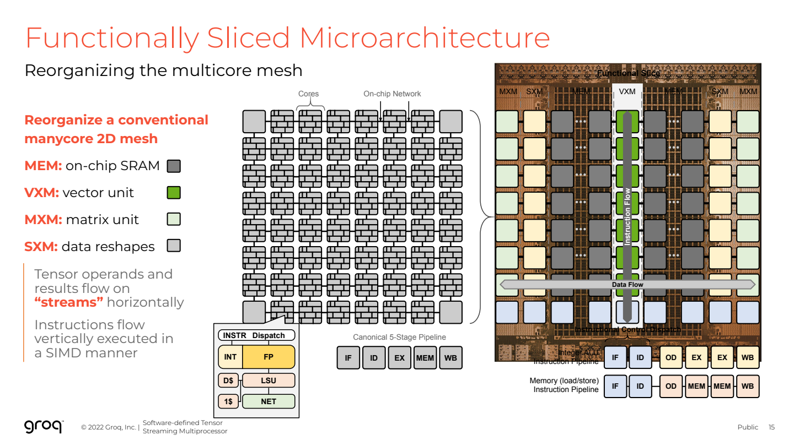

## Functionally Sliced Microarchitecture

Reorganizing the multicore mesh

## Reorganize a conventional manycore 2D mesh

- MEM: on-chip SRAM
- VXM: vector unit
- MXM: matrix unit
- SXM: data reshapes

Tensor operands and results flow on "streams" horizontally

Instructions flow vertically executed in a SIMD manner

<!-- p.16 -->

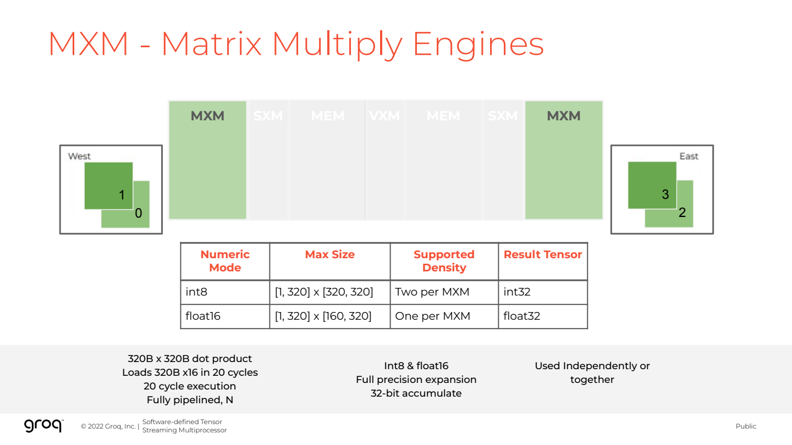

## MXM - Matrix Multiply Engines

| Numeric Mode   | Max Size              | Supported Density   | Result Tensor   |
|----------------|-----------------------|---------------------|-----------------|
| int8           | [1, 320] x [320, 320] | Two per MXM         | int32           |
| float16        | [1, 320] x [160, 320] | One per MXM         | float32         |

320B x 320B dot product Loads 320B x16 in 20 cycles 20 cycle execution Fully pipelined, N

Int8 &amp; float16 Full precision expansion 32-bit accumulate Used Independently or together

<!-- p.17 -->

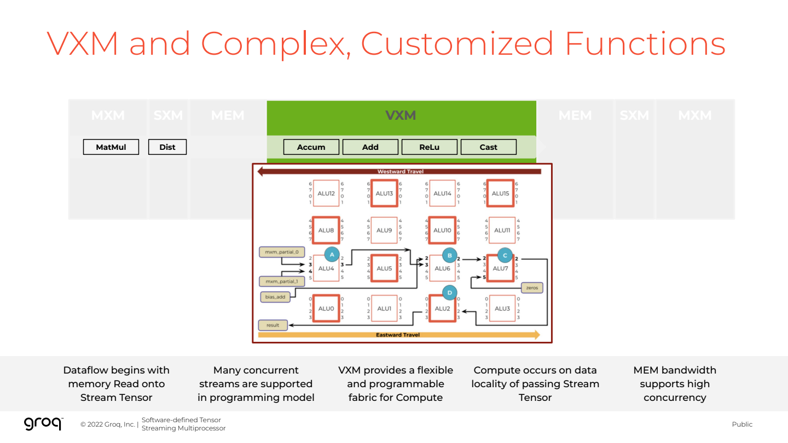

## VXM and Complex, Customized Functions

MXM

MatMul

Dataflow begins with memory Read onto Stream Tensor MEM

Many concurrent streams are supported in programming model VXM provides a flexible and programmable fabric for Compute MEM

Compute occurs on data locality of passing Stream Tensor MXM

MEM bandwidth supports high concurrency

SXM

Dist SXM

<!-- p.18 -->

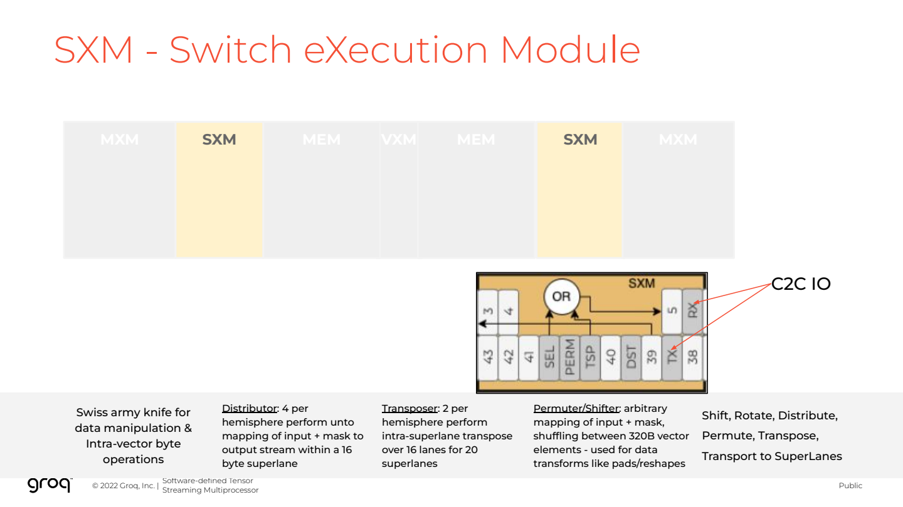

## SXM - Switch eXecution Module

Swiss army knife for data manipulation &amp; Intra-vector byte operations Distributor: 4 per hemisphere perform unto mapping of input + mask to output stream within a 16 byte superlane Transposer: 2 per hemisphere perform intra-superlane transpose over 16 lanes for 20 superlanes Permuter/Shifter: arbitrary mapping of input + mask, shuffling between 320B vector elements - used for data transforms like pads/reshapes Shift, Rotate, Distribute, Permute, Transpose, Transport to SuperLanes

<!-- p.19 -->

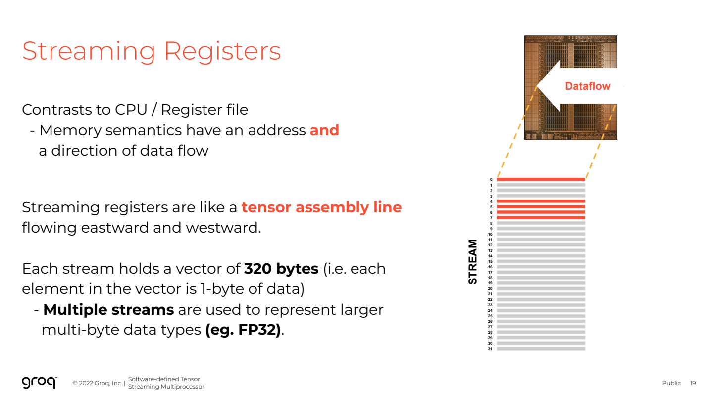

## Streaming Registers

Contrasts to CPU / Register file

- Memory semantics have an address and a direction of data flow

Streaming registers are like a tensor assembly line flowing eastward and westward.

Each stream holds a vector of 320 bytes (i.e. each element in the vector is 1-byte of data)

- Multiple streams are used to represent larger multi-byte data types (eg. FP32).

<!-- p.20 -->

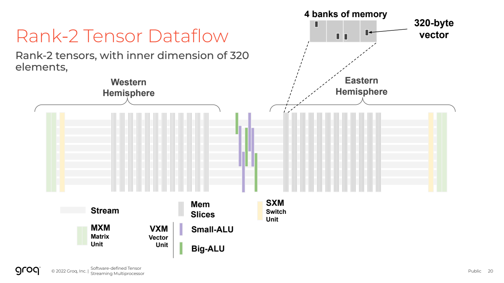

<!-- p.21 -->

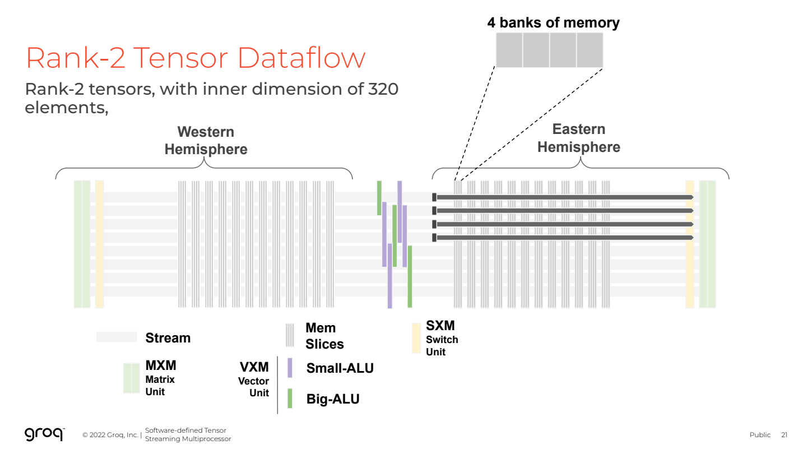

<!-- p.22 -->

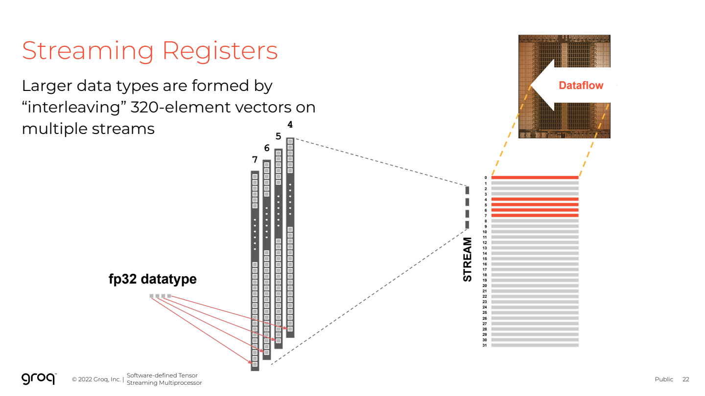

<!-- p.23 -->

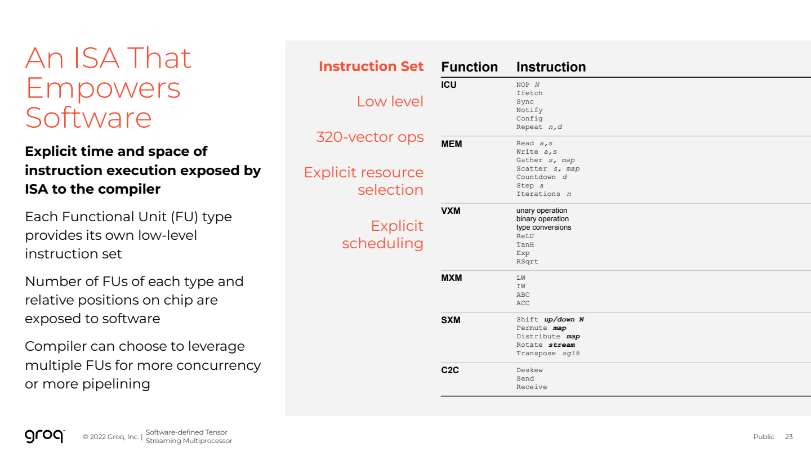

## An ISA That Empowers Software

Explicit time and space of instruction execution exposed by ISA to the compiler

Each Functional Unit (FU) type provides its own low-level instruction set

Number of FUs of each type and relative positions on chip are exposed to software

Compiler can choose to leverage multiple FUs for more concurrency or more pipelining

## Instruction Set

Low level

320-vector ops

Explicit resource selection

Explicit scheduling

| Function   | Instruction                                                                     |
|------------|---------------------------------------------------------------------------------|
| ICU        | NOP N Ifetch Sync Notify Config Repeat n,d                                      |
| MEM        | Read a,s Write a,s Gather s, map Scatter s, map Countdown d Step a Iterations n |
| VXM        | unary operation binary operation type conversions ReLU TanH Exp RSqrt           |
| MXM        | LW IW ABC ACC                                                                   |
| SXM        | Shift up/down N Permute map Distribute map Rotate stream Transpose sg16         |
| C2C        | Deskew Send Receive                                                             |

<!-- p.24 -->

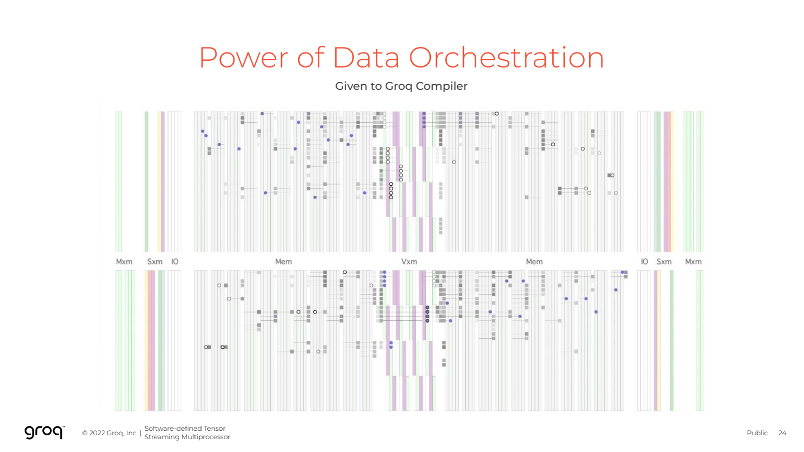

## Power of Data Orchestration

Given to Groq Compiler Compilation

<!-- p.25 -->

© 2022 Groq, Inc. |

Software-defined Tensor

Streaming Multiprocessor Public

<!-- p.26 -->

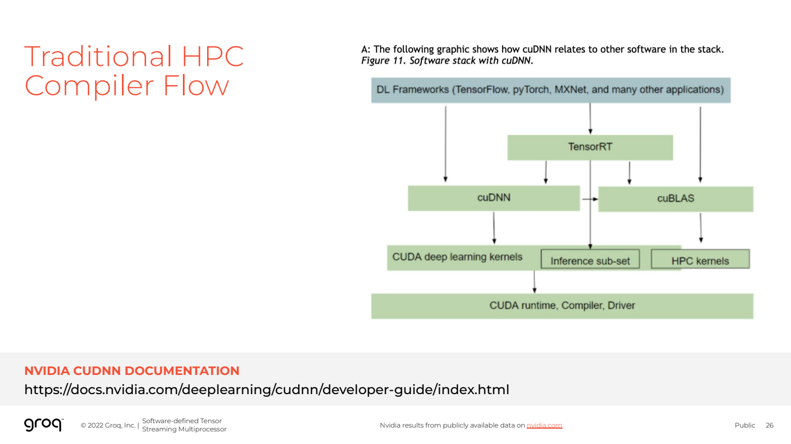

## Traditional HPC Compiler Flow

## NVIDIA CUDNN DOCUMENTATION

https://docs.nvidia.com/deeplearning/cudnn/developer-guide/index.html

<!-- p.27 -->

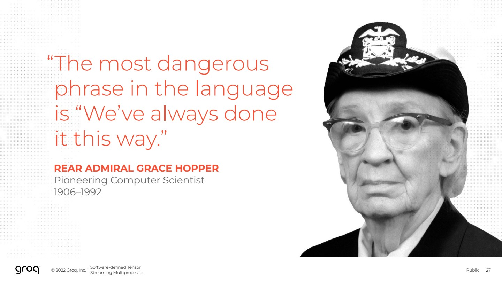

"The most dangerous phrase in the language is "We've always done it this way."

## REAR ADMIRAL GRACE HOPPER

Pioneering Computer Scientist 1906-1992

<!-- p.28 -->

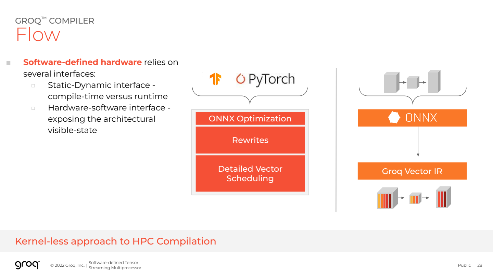

## Flow

- ■ Software-defined hardware relies on several interfaces:
- □ Static-Dynamic interface - compile-time versus runtime
- □ Hardware-software interface - exposing the architectural visible-state

## Kernel-less approach to HPC Compilation

<!-- p.29 -->

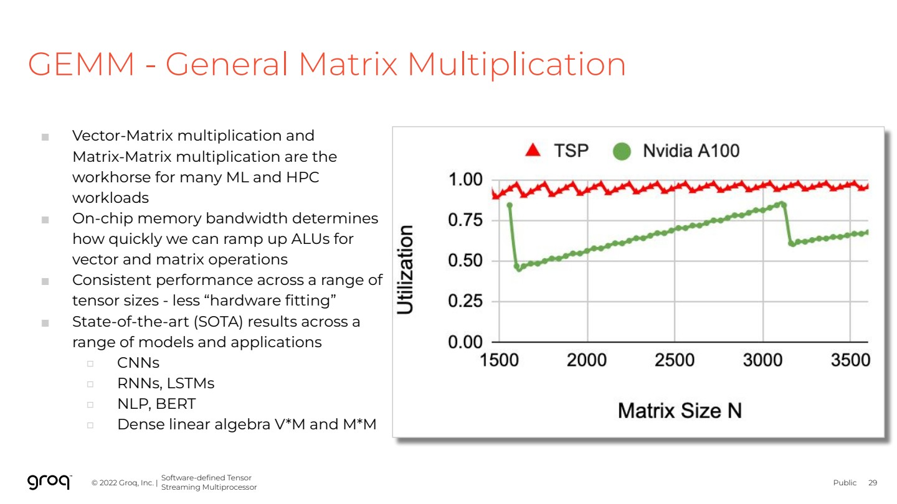

## GEMM - General Matrix Multiplication

- ■ Vector-Matrix multiplication and Matrix-Matrix multiplication are the workhorse for many ML and HPC workloads
- ■ On-chip memory bandwidth determines how quickly we can ramp up ALUs for vector and matrix operations
- ■ Consistent performance across a range of tensor sizes - less "hardware fitting"
- ■ State-of-the-art (SOTA) results across a range of models and applications
- □ CNNs
- □ RNNs, LSTMs
- □ NLP, BERT
- □ Dense linear algebra V*M and M*M

<!-- p.30 -->

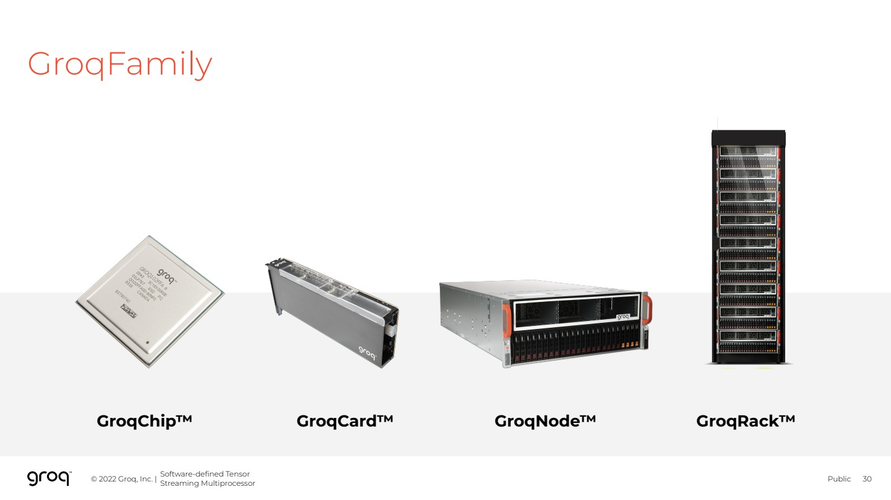

## GroqFamily

GroqChip™

GroqCard™

GroqNode™

GroqRack™

<!-- p.31 -->

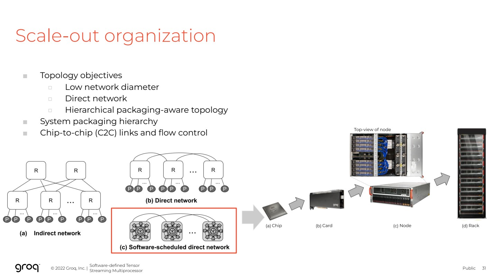

## Scale-out organization

- ■ Topology objectives
- □ Low network diameter
- □ Direct network
- □ Hierarchical packaging-aware topology
- ■ System packaging hierarchy
- ■ Chip-to-chip (C2C) links and flow control

<!-- p.32 -->

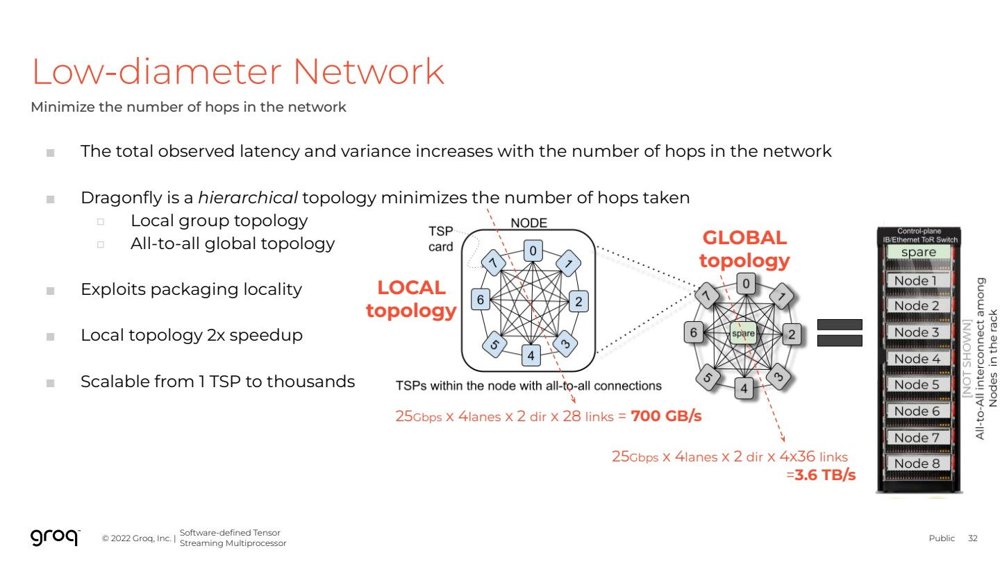

## Low-diameter Network

Minimize the number of hops in the network

- ■ The total observed latency and variance increases with the number of hops in the network
- ■ Dragonfly is a hierarchical topology minimizes the number of hops taken
- □ Local group topology
- □ All-to-all global topology
- ■ Exploits packaging locality
- ■ Local topology 2x speedup
- ■ Scalable from 1 TSP to thousands

<!-- p.33 -->

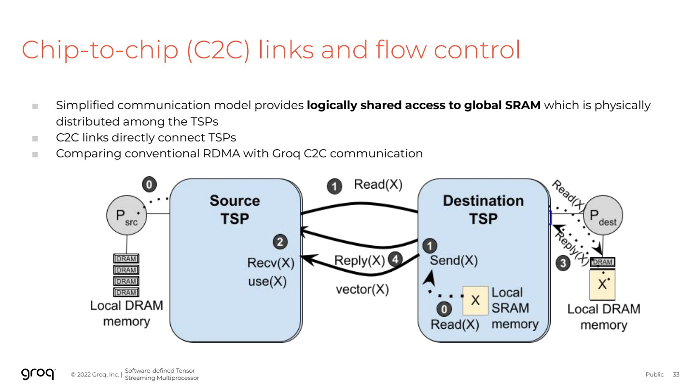

## Chip-to-chip (C2C) links and flow control

- ■ Simplified communication model provides logically shared access to global SRAM which is physically distributed among the TSPs
- ■ C2C links directly connect TSPs
- ■ Comparing conventional RDMA with Groq C2C communication

<!-- p.34 -->

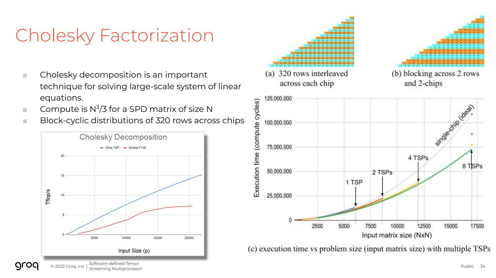

## Cholesky Factorization

- ■ Cholesky decomposition is an important technique for solving large-scale system of linear equations.
- ■ Compute is N 3 /3 for a SPD matrix of size N
- ■ Block-cyclic distributions of 320 rows across chips

<!-- p.35 -->

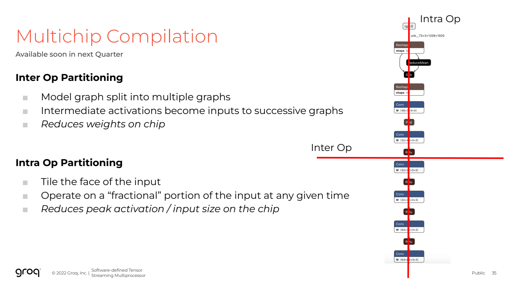

## Multichip Compilation

Available soon in next Quarter

## Inter Op Partitioning

- ■ Model graph split into multiple graphs
- ■ Intermediate activations become inputs to successive graphs
- ■ Reduces weights on chip

## Intra Op Partitioning

- ■ Tile the face of the input
- ■ Operate on a "fractional" portion of the input at any given time
- ■ Reduces peak activation / input size on the chip

Inter Op

<!-- p.36 -->

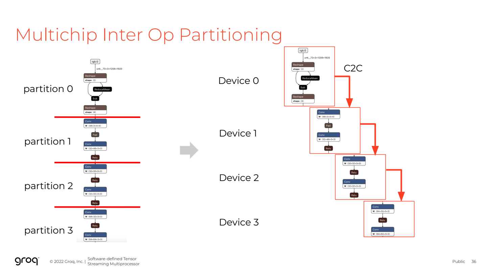

## Multichip Inter Op Partitioning

Device 0

Device 1

Device 2

Device 3

<!-- p.37 -->

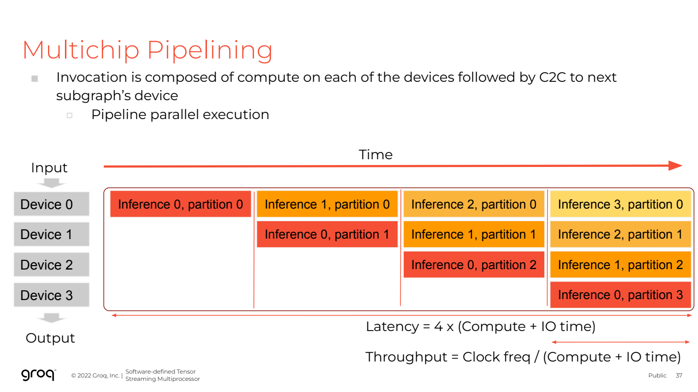

## Multichip Pipelining

- ■ Invocation is composed of compute on each of the devices followed by C2C to next subgraph's device
- □ Pipeline parallel execution

Input

Device 0

Device 1

Device 2

Device 3

Output Time Inference 0, partition 0 Inference 1, partition 0 Inference 2, partition 0 Inference 3, partition 0

Inference 0, partition 1 Inference 1, partition 1 Inference 2, partition 1

Inference 0, partition 2 Inference 1, partition 2

Inference 0, partition 3

Latency = 4 x (Compute + IO time)

Throughput = Clock freq / (Compute + IO time)

<!-- p.38 -->

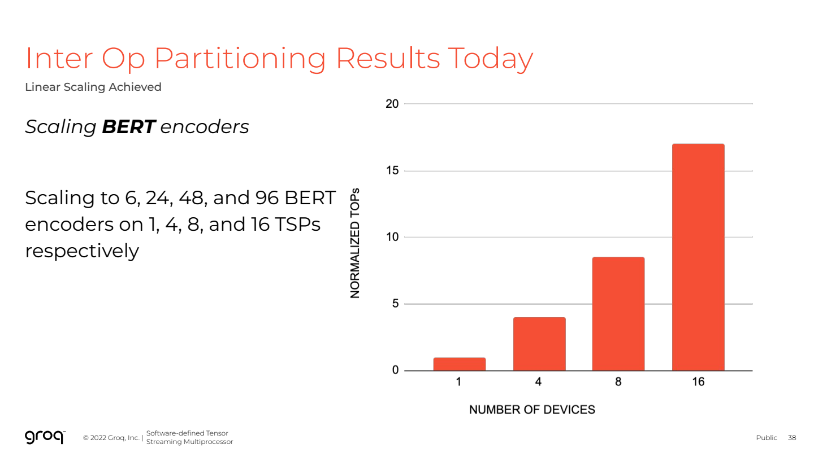

## Inter Op Partitioning Results Today

Linear Scaling Achieved

## Scaling BERT encoders

Scaling to 6, 24, 48, and 96 BERT encoders on 1, 4, 8, and 16 TSPs respectively Results

<!-- p.39 -->

<!-- p.40 -->

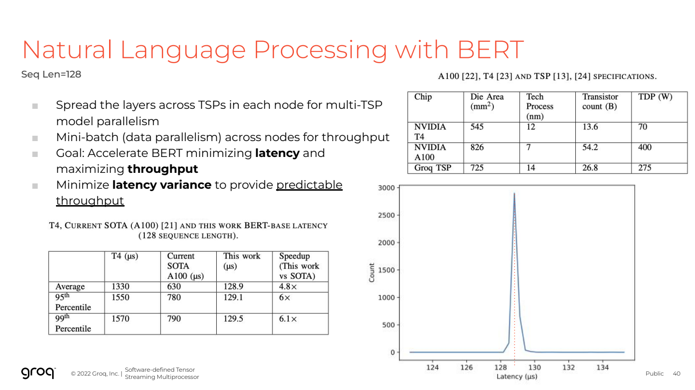

## Natural Language Processing with BERT

Seq Len=128

- ■ Spread the layers across TSPs in each node for multi-TSP model parallelism
- ■ Mini-batch (data parallelism) across nodes for throughput
- ■ Goal: Accelerate BERT minimizing latency and maximizing throughput
- ■ Minimize latency variance to provide predictable throughput

<!-- p.41 -->

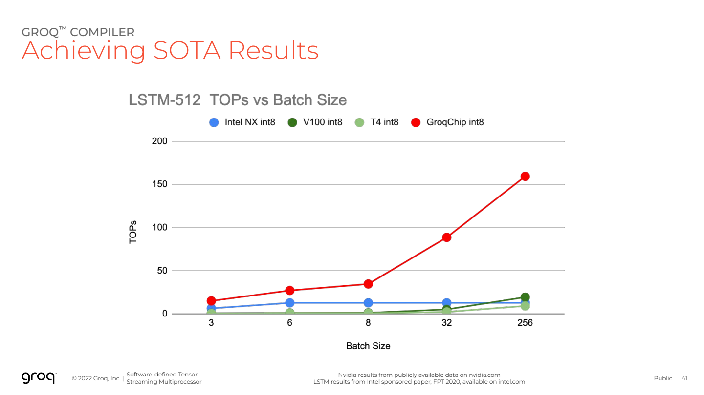

## GROQ ™ COMPILER Achieving SOTA Results

<!-- p.42 -->

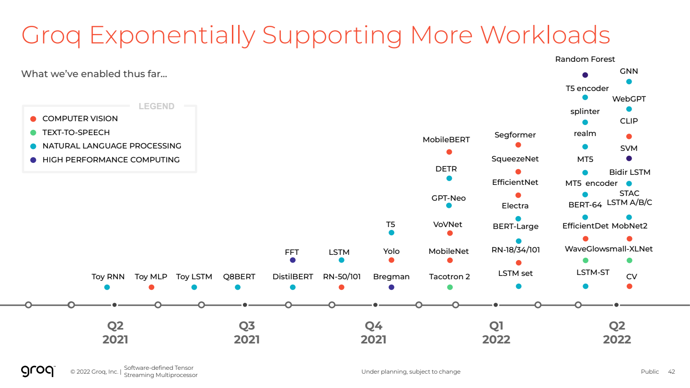

## Groq Exponentially Supporting More Workloads

<!-- p.43 -->

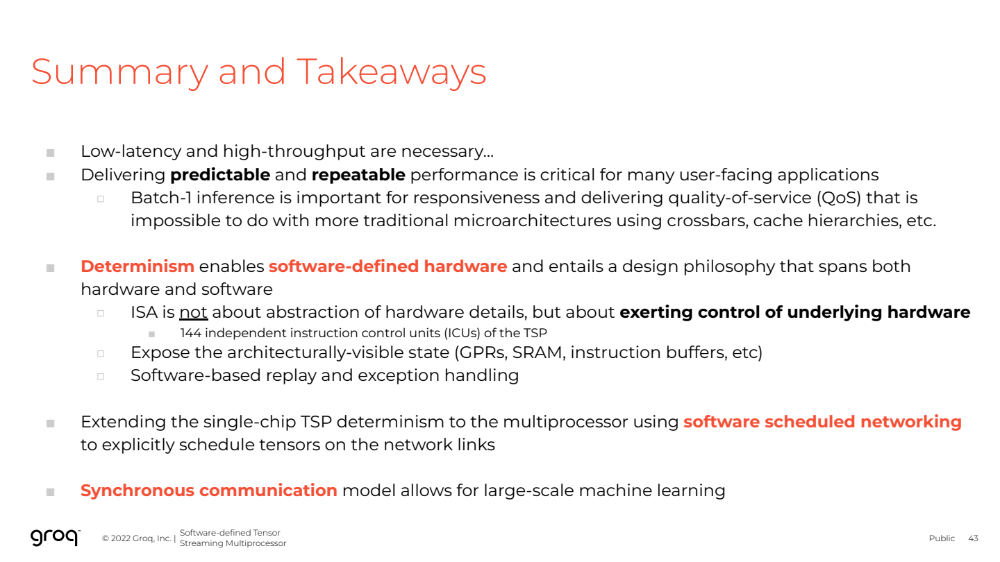

## Summary and Takeaways

- ■ Low-latency and high-throughput are necessary…
- ■ Delivering predictable and repeatable performance is critical for many user-facing applications
- □ Batch-1 inference is important for responsiveness and delivering quality-of-service (QoS) that is impossible to do with more traditional microarchitectures using crossbars, cache hierarchies, etc.
- ■ Determinism enables software-defined hardware and entails a design philosophy that spans both hardware and software
- □ ISA is not about abstraction of hardware details, but about exerting control of underlying hardware
- ■ 144 independent instruction control units (ICUs) of the TSP
- □ Expose the architecturally-visible state (GPRs, SRAM, instruction buffers, etc)
- □ Software-based replay and exception handling
- ■ Extending the single-chip TSP determinism to the multiprocessor using software scheduled networking to explicitly schedule tensors on the network links
- ■ Synchronous communication model allows for large-scale machine learning

<!-- p.44 -->

© 2022 Groq, Inc. |

Software-defined Tensor

Streaming Multiprocessor Join us…

Public
