> 本文件由 `HC34-Groq-Abts-Scaleout-TSP.pdf` 自动转换（docling 2.140.0，2026-10-17）。每页的整页图在 `images/` 目录；表格与数字请以 PDF 原文为准；`<!-- p.N -->` 标记对应 PDF 第 N 页。

<!-- p.1 -->

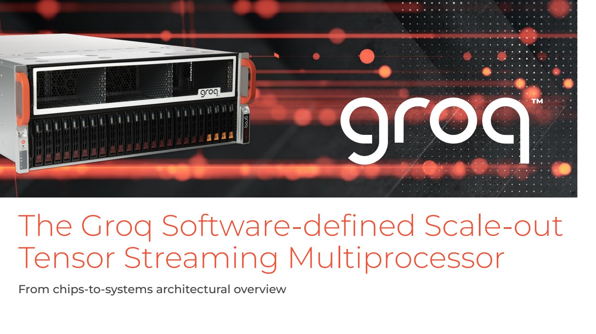

## The Groq Software-defined Scale-out Tensor Streaming Multiprocessor

From chips-to-systems architectural overview

© 2022 Groq, Inc. |

HotChips34 - 2022

Public

<!-- p.2 -->

## Dennis Abts

Chief Architect &amp; Groq Fellow dabts@groq.com

Dennis Abts, John Kim, Garrin Kimmell, Matthew Boyd, Kris Kang, Sahil Parmar, Andrew Ling, Andrew Bitar, Ibrahim Ahmed, Jonathan Ross

<!-- p.3 -->

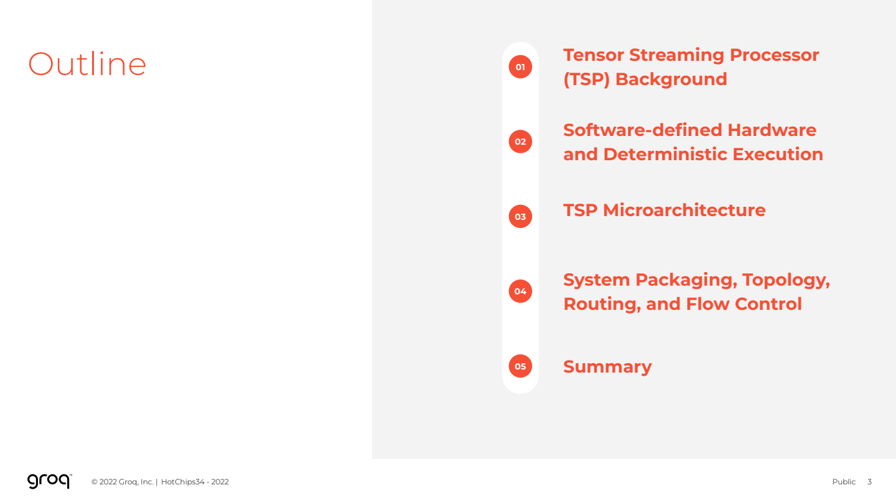

## Outline

- 01 Tensor Streaming Processor
- (TSP) Background
- 02 Software-defined Hardware and Deterministic Execution
- 03 TSP Microarchitecture
- 04 System Packaging, Topology, Routing, and Flow Control
- 05 Summary

<!-- p.4 -->

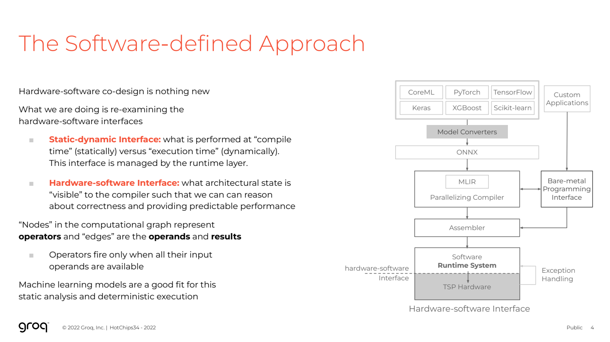

## The Software-defined Approach

Hardware-software co-design is nothing new

What we are doing is re-examining the hardware-software interfaces

- ■ Static-dynamic Interface: what is performed at "compile time" (statically) versus "execution time" (dynamically). This interface is managed by the runtime layer.
- ■ Hardware-software Interface: what architectural state is "visible" to the compiler such that we can can reason about correctness and providing predictable performance

"Nodes" in the computational graph represent operators and "edges" are the operands and results

- ■ Operators fire only when all their input operands are available

Machine learning models are a good fit for this static analysis and deterministic execution Hardware-software Interface

<!-- p.5 -->

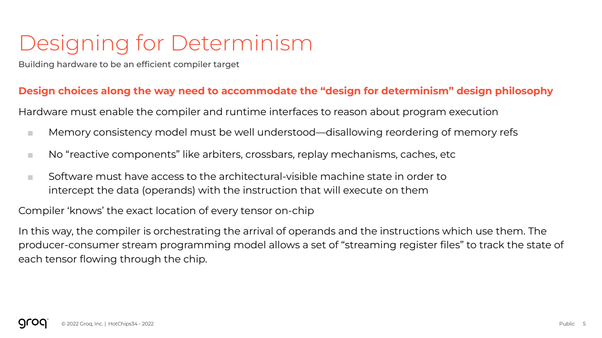

## Designing for Determinism

Building hardware to be an efficient compiler target

## Design choices along the way need to accommodate the "design for determinism" design philosophy

Hardware must enable the compiler and runtime interfaces to reason about program execution

- ■ Memory consistency model must be well understood-disallowing reordering of memory refs
- ■ No "reactive components" like arbiters, crossbars, replay mechanisms, caches, etc
- ■ Software must have access to the architectural-visible machine state in order to intercept the data (operands) with the instruction that will execute on them

Compiler 'knows' the exact location of every tensor on-chip

In this way, the compiler is orchestrating the arrival of operands and the instructions which use them. The producer-consumer stream programming model allows a set of "streaming register files" to track the state of each tensor flowing through the chip.

<!-- p.6 -->

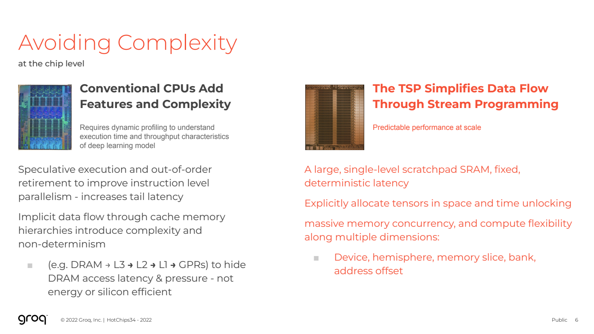

## Avoiding Complexity

at the chip level

## Conventional CPUs Add Features and Complexity

Requires dynamic profiling to understand execution time and throughput characteristics of deep learning model

Speculative execution and out-of-order retirement to improve instruction level parallelism - increases tail latency

Implicit data flow through cache memory hierarchies introduce complexity and non-determinism

- ■ (e.g. DRAM → L3 → L2 → L1 → GPRs) to hide DRAM access latency &amp; pressure - not energy or silicon efficient

Intel Cascade Lake

## The TSP Simplifies Data Flow Through Stream Programming

Predictable performance at scale

A large, single-level scratchpad SRAM, fixed, deterministic latency

Explicitly allocate tensors in space and time unlocking

massive memory concurrency, and compute flexibility along multiple dimensions:

- ■ Device, hemisphere, memory slice, bank, address offset

<!-- p.7 -->

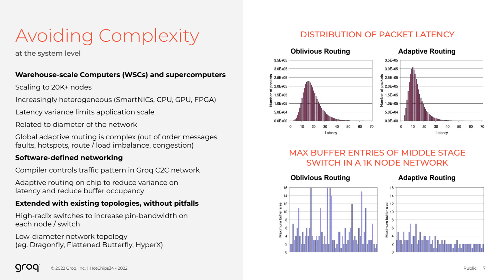

## Avoiding Complexity

at the system level

## Warehouse-scale Computers (WSCs) and supercomputers

Scaling to 20K+ nodes

Increasingly heterogeneous (SmartNICs, CPU, GPU, FPGA)

Latency variance limits application scale

Related to diameter of the network

Global adaptive routing is complex (out of order messages, faults, hotspots, route / load imbalance, congestion)

## Software-defined networking

Compiler controls traffic pattern in Groq C2C network

Adaptive routing on chip to reduce variance on latency and reduce buffer occupancy

## Extended with existing topologies, without pitfalls

High-radix switches to increase pin-bandwidth on each node / switch

Low-diameter network topology (eg. Dragonfly, Flattened Butterfly, HyperX)

## DISTRIBUTION OF PACKET LATENCY

Oblivious Routing

Adaptive Routing

## MAX BUFFER ENTRIES OF MIDDLE STAGE SWITCH IN A 1K NODE NETWORK

Oblivious Routing

Adaptive Routing

<!-- p.8 -->

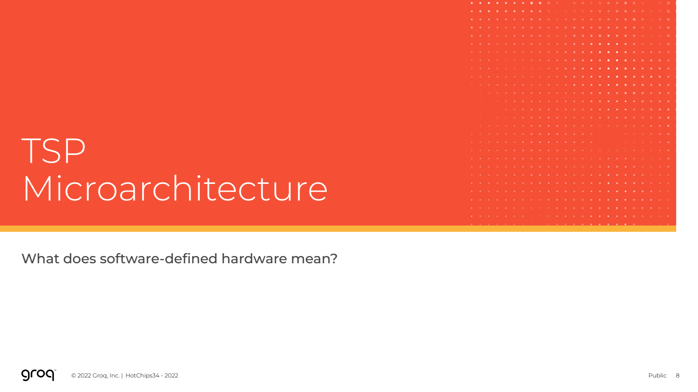

## TSP Microarchitecture

What does software-defined hardware mean?

<!-- p.9 -->

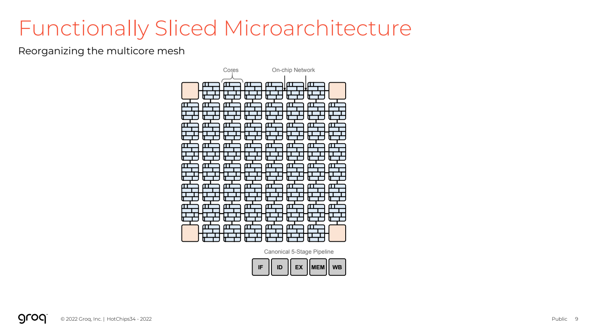

## Functionally Sliced Microarchitecture

Reorganizing the multicore mesh

<!-- p.10 -->

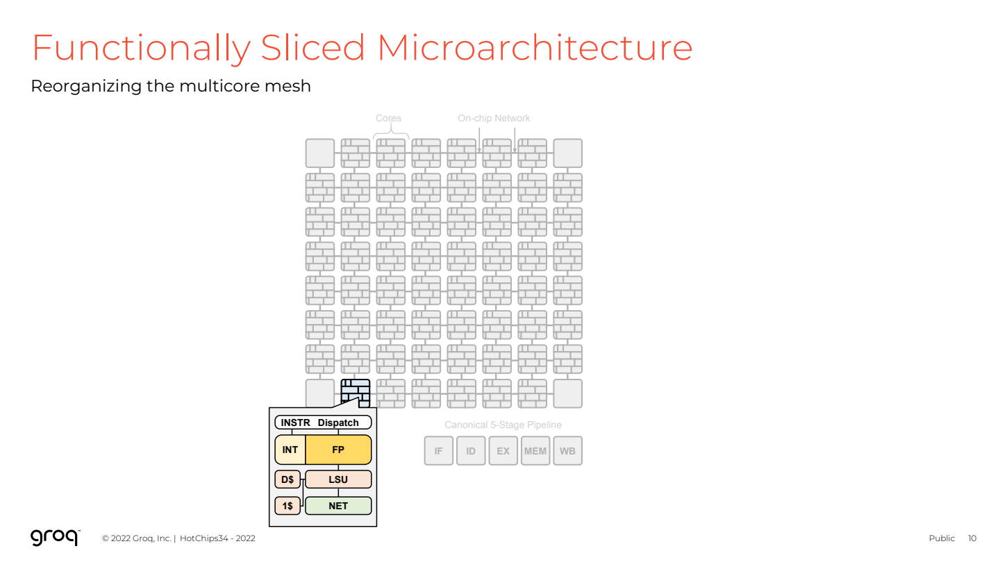

## Functionally Sliced Microarchitecture

Reorganizing the multicore mesh

<!-- p.11 -->

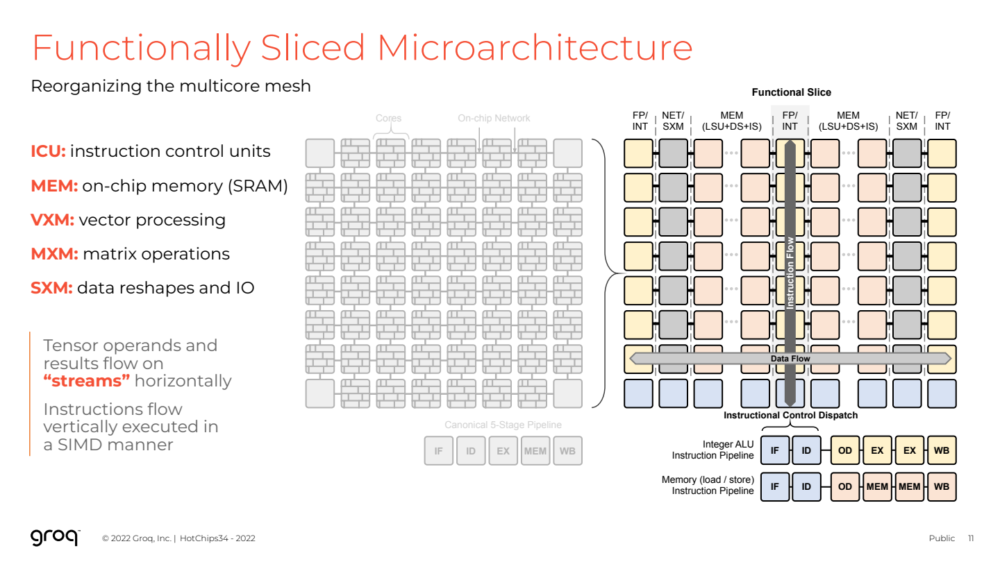

## Functionally Sliced Microarchitecture

Reorganizing the multicore mesh

ICU: instruction control units

MEM: on-chip memory (SRAM)

VXM: vector processing

MXM: matrix operations

SXM: data reshapes and IO

Tensor operands and results flow on "streams" horizontally

Instructions flow vertically executed in a SIMD manner

## Functional Slice

<!-- p.12 -->

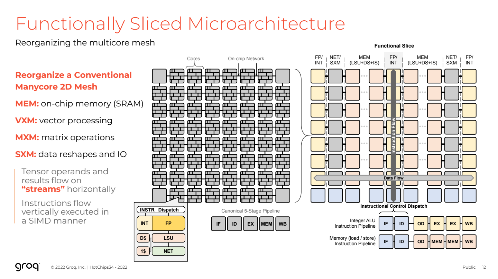

## Functionally Sliced Microarchitecture

Reorganizing the multicore mesh

## Reorganize a Conventional Manycore 2D Mesh

MEM: on-chip memory (SRAM)

VXM: vector processing

MXM: matrix operations

SXM: data reshapes and IO

Tensor operands and results flow on "streams" horizontally

Instructions flow vertically executed in a SIMD manner

<!-- p.13 -->

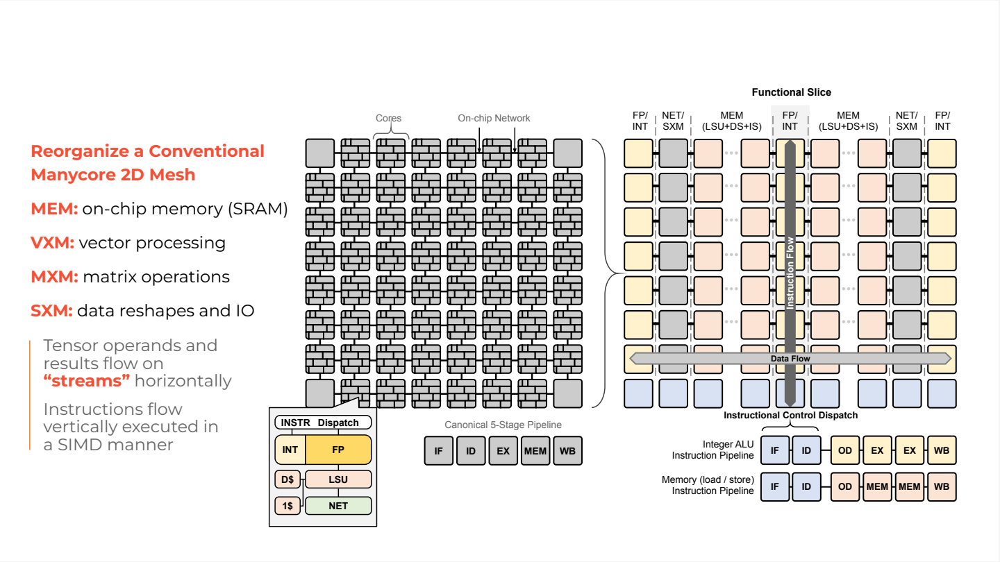

© 2022 Groq, Inc. |

HotChips34 - 2022

Public

<!-- p.14 -->

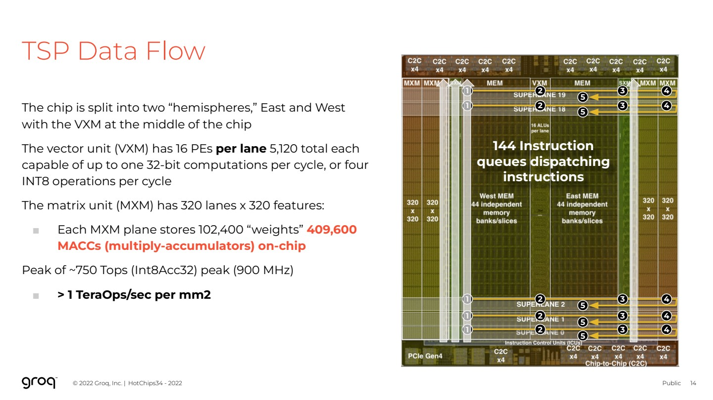

## TSP Data Flow

The chip is split into two "hemispheres," East and West with the VXM at the middle of the chip

The vector unit (VXM) has 16 PEs per lane 5,120 total each capable of up to one 32-bit computations per cycle, or four INT8 operations per cycle

The matrix unit (MXM) has 320 lanes x 320 features:

- ■ Each MXM plane stores 102,400 "weights" 409,600 MACCs (multiply-accumulators) on-chip

Peak of ~750 Tops (Int8Acc32) peak (900 MHz)

- ■ &gt; 1 TeraOps/sec per mm2

<!-- p.15 -->

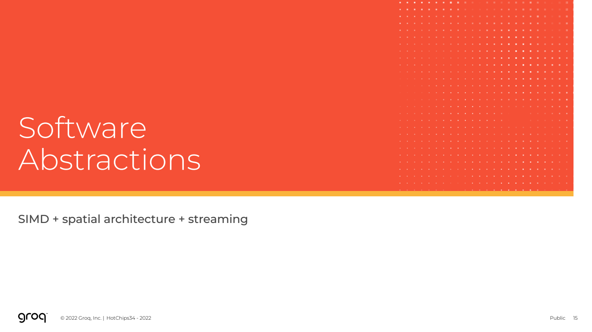

## Software Abstractions

SIMD + spatial architecture + streaming

<!-- p.16 -->

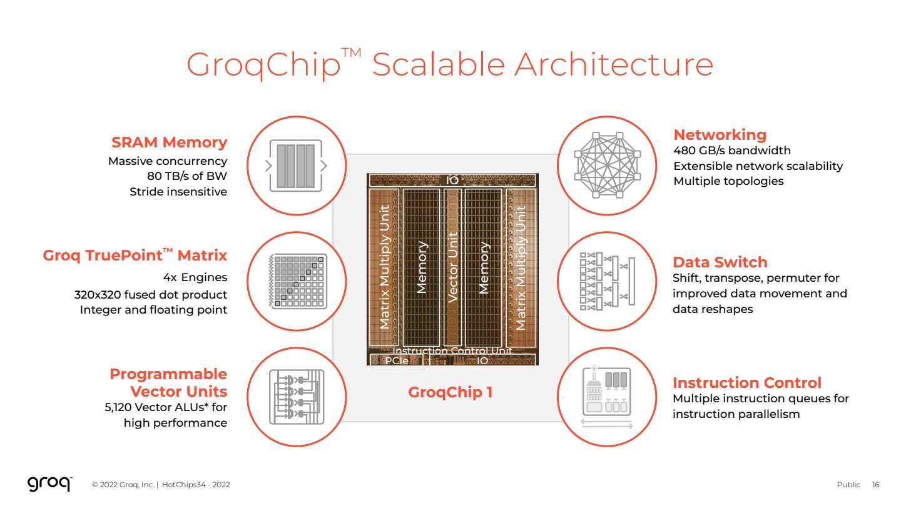

## GroqChip ™ Scalable Architecture

SRAM Memory Massive concurrency

80 TB/s of BW Stride insensitive

## Groq TruePoint ™ Matrix

4x Engines 320x320 fused dot product Integer and floating point

## Programmable

Vector Units 5,120 Vector ALUs* for

high performance

## Networking

480 GB/s bandwidth Extensible network scalability Multiple topologies

## Data Switch

Shift, transpose, permuter for improved data movement and data reshapes

## Instruction Control

Multiple instruction queues for instruction parallelism

GroqChip 1

<!-- p.17 -->

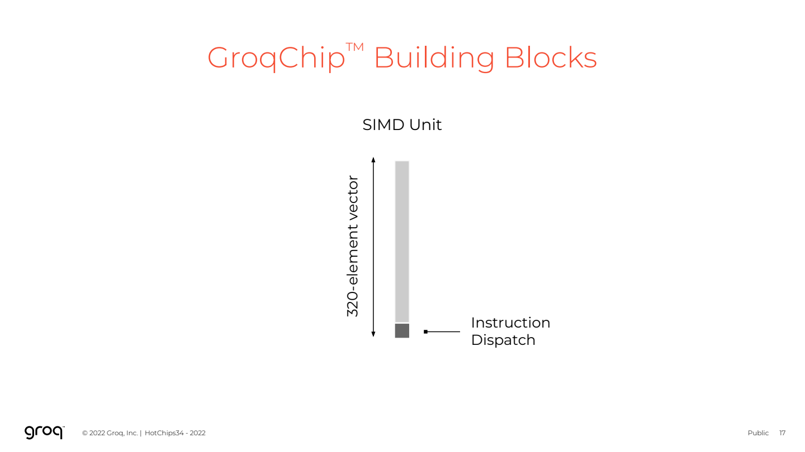

## GroqChip ™ Building Blocks

SIMD Unit

<!-- p.18 -->

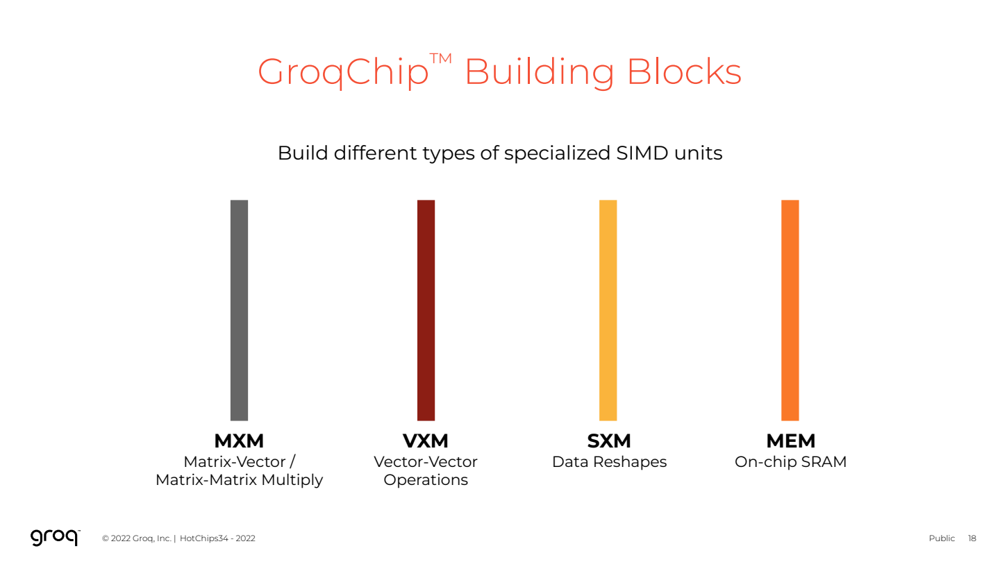

## GroqChip ™ Building Blocks

Build different types of specialized SIMD units

VXM Vector-Vector Operations

SXM Data Reshapes

MEM On-chip SRAM

<!-- p.19 -->

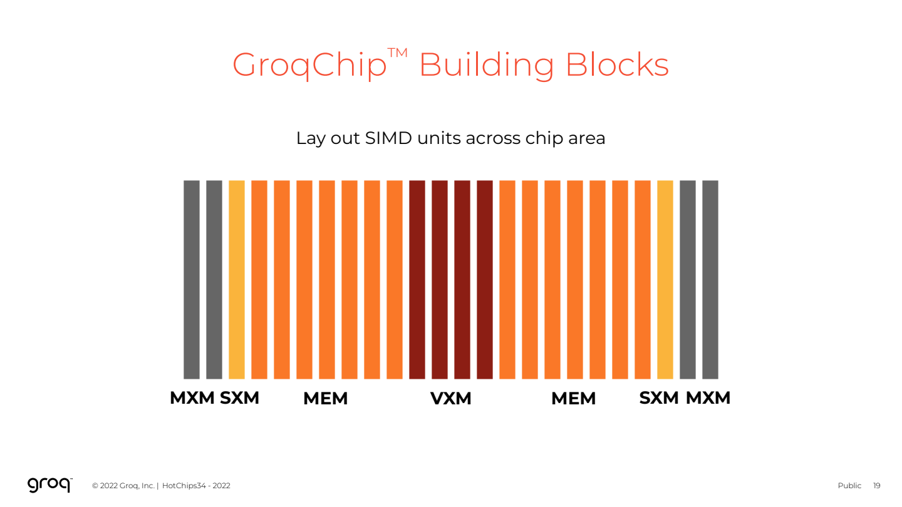

## GroqChip ™ Building Blocks

Lay out SIMD units across chip area

<!-- p.20 -->

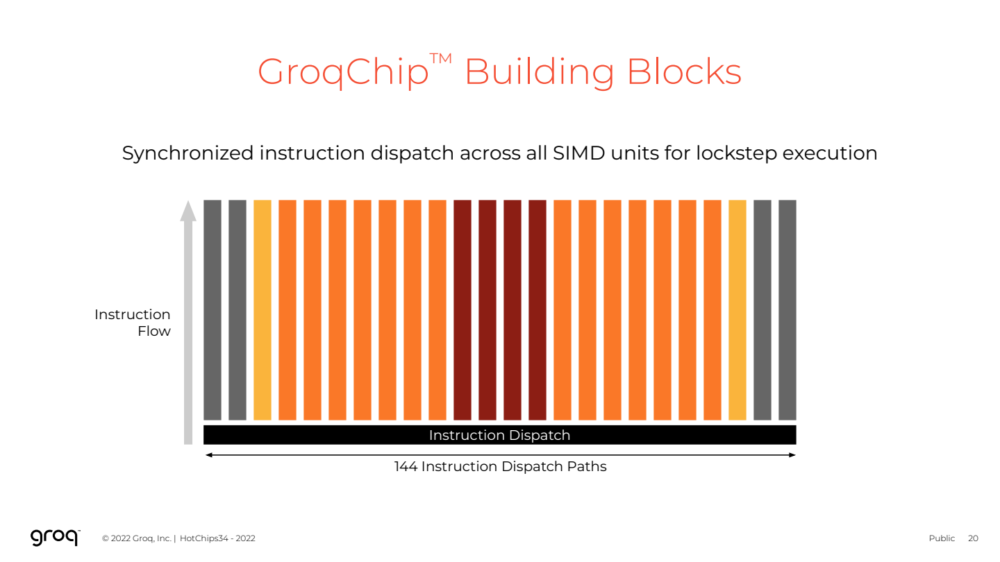

## GroqChip ™ Building Blocks

Synchronized instruction dispatch across all SIMD units for lockstep execution

<!-- p.21 -->

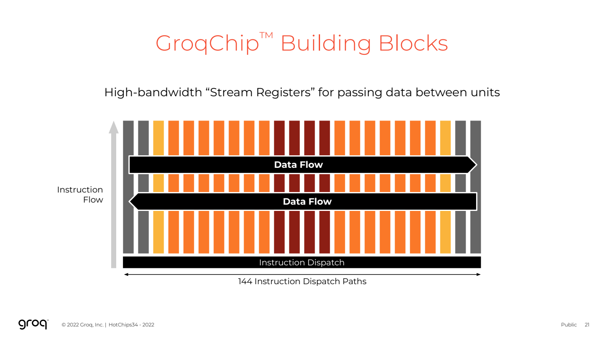

## GroqChip ™ Building Blocks

High-bandwidth "Stream Registers" for passing data between units

<!-- p.22 -->

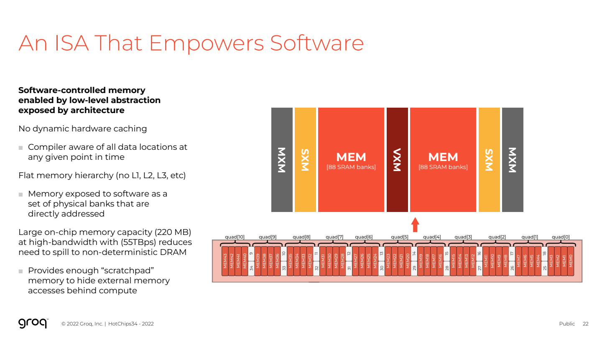

## An ISA That Empowers Software

## Software-controlled memory enabled by low-level abstraction exposed by architecture

No dynamic hardware caching

- ■ Compiler aware of all data locations at any given point in time

Flat memory hierarchy (no L1, L2, L3, etc)

- ■ Memory exposed to software as a set of physical banks that are directly addressed

Large on-chip memory capacity (220 MB) at high-bandwidth with (55TBps) reduces need to spill to non-deterministic DRAM

- ■ Provides enough "scratchpad" memory to hide external memory accesses behind compute

<!-- p.23 -->

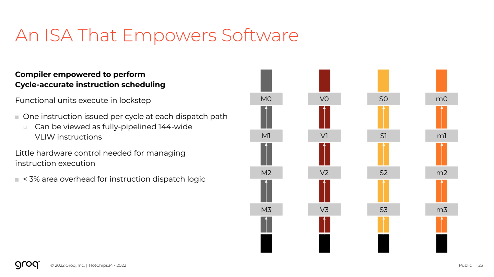

## An ISA That Empowers Software

## Compiler empowered to perform Cycle-accurate instruction scheduling

Functional units execute in lockstep

- ■ One instruction issued per cycle at each dispatch path
- □ Can be viewed as fully-pipelined 144-wide VLIW instructions

Little hardware control needed for managing instruction execution

- ■ &lt; 3% area overhead for instruction dispatch logic

<!-- p.24 -->

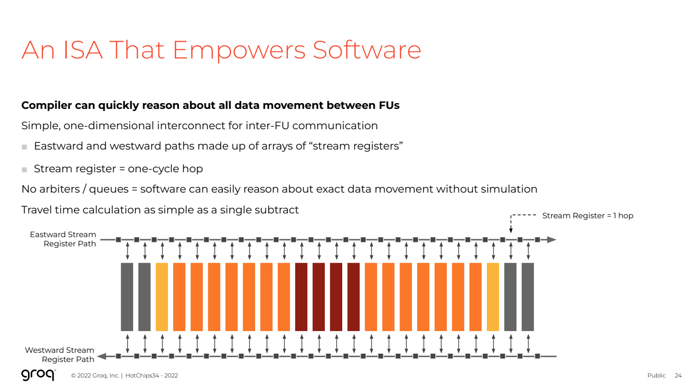

## An ISA That Empowers Software

## Compiler can quickly reason about all data movement between FUs

Simple, one-dimensional interconnect for inter-FU communication

- ■ Eastward and westward paths made up of arrays of "stream registers"
- ■ Stream register = one-cycle hop

No arbiters / queues = software can easily reason about exact data movement without simulation

Travel time calculation as simple as a single subtract

<!-- p.25 -->

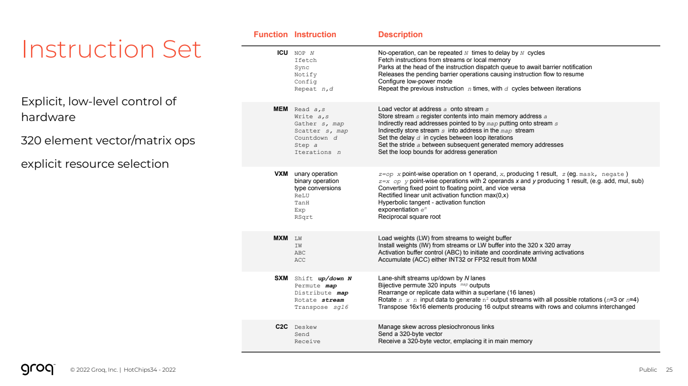

## Instruction Set

Explicit, low-level control of hardware 320 element vector/matrix ops explicit resource selection

| Function   | Instruction                                                                     | Description                                                                                                                                                                                                                                                                                                                                                                               |
|------------|---------------------------------------------------------------------------------|-------------------------------------------------------------------------------------------------------------------------------------------------------------------------------------------------------------------------------------------------------------------------------------------------------------------------------------------------------------------------------------------|
| ICU        | NOP N Ifetch Sync Notify Config Repeat n,d                                      | No-operation, can be repeated N times to delay by N cycles Fetch instructions from streams or local memory Parks at the head of the instruction dispatch queue to await barrier notification Releases the pending barrier operations causing instruction flow to resume Configure low-power mode Repeat the previous instruction n times, with d cycles between iterations                |
| MEM        | Read a,s Write a,s Gather s, map Scatter s, map Countdown d Step a Iterations n | Load vector at address a onto stream s Store stream s register contents into main memory address a Indirectly read addresses pointed to by map putting onto stream s Indirectly store stream s into address in the map stream Set the delay d in cycles between loop iterations Set the stride a between subsequent generated memory addresses Set the loop bounds for address generation |
| VXM        | unary operation binary operation type conversions ReLU TanH Exp RSqrt           | z=op x point-wise operation on 1 operand, x, producing 1 result, z (eg. mask, negate ) z=x op y point-wise operations with 2 operands x and y producing 1 result, (e.g. add, mul, sub) Converting fixed point to floating point, and vice versa Rectified linear unit activation function max(0,x) Hyperbolic tangent - activation function exponentiation e π Reciprocal square root     |
| MXM        | LW IW ABC ACC                                                                   | Load weights (LW) from streams to weight buffer Install weights (IW) from streams or LW buffer into the 320 x 320 array Activation buffer control (ABC) to initiate and coordinate arriving activations Accumulate (ACC) either INT32 or FP32 result from MXM                                                                                                                             |
| SXM        | Shift up/down N Permute map Distribute map Rotate stream Transpose sg16         | Lane-shift streams up/down by N lanes Bijective permute 320 inputs map outputs Rearrange or replicate data within a superlane (16 lanes) Rotate n x n input data to generate n 2 output streams with all possible rotations (n=3 or n=4) Transpose 16x16 elements producing 16 output streams with rows and columns interchanged                                                          |
| C2C        | Deskew Send Receive                                                             | Manage skew across plesiochronous links Send a 320-byte vector Receive a 320-byte vector, emplacing it in main memory                                                                                                                                                                                                                                                                     |

<!-- p.26 -->

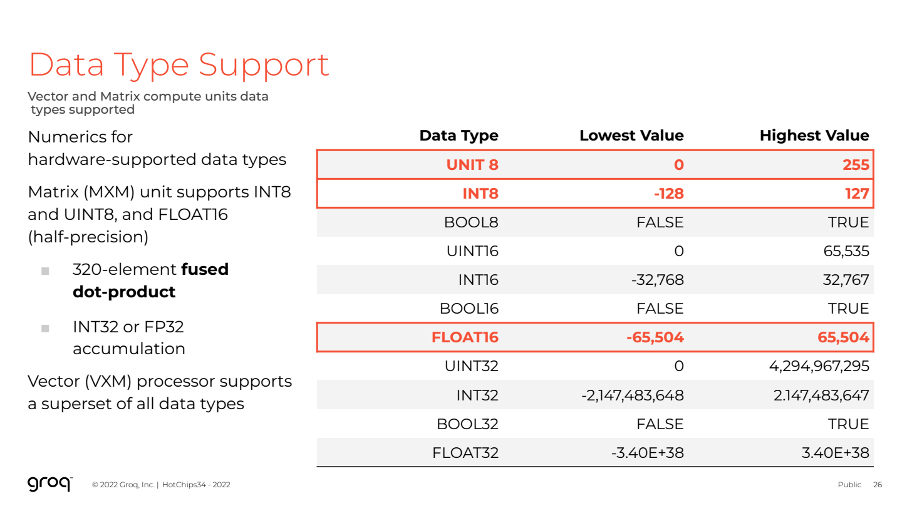

## Data Type Support

Vector and Matrix compute units data types supported

Numerics for hardware-supported data types

Matrix (MXM) unit supports INT8 and UINT8, and FLOAT16 (half-precision)

- ■ 320-element fused dot-product
- ■ INT32 or FP32 accumulation

Vector (VXM) processor supports a superset of all data types

| Data Type   | Lowest Value   | Highest Value   |
|-------------|----------------|-----------------|
| UNIT 8      | 0              | 255             |
| INT8        | -128           | 127             |
| BOOL8       | FALSE          | TRUE            |
| UINT16      | 0              | 65,535          |
| INT16       | -32,768        | 32,767          |
| BOOL16      | FALSE          | TRUE            |
| FLOAT16     | -65,504        | 65,504          |
| UINT32      | 0              | 4,294,967,295   |
| INT32       | -2,147,483,648 | 2.147,483,647   |
| BOOL32      | FALSE          | TRUE            |
| FLOAT32     | -3.40E+38      | 3.40E+38        |

<!-- p.27 -->

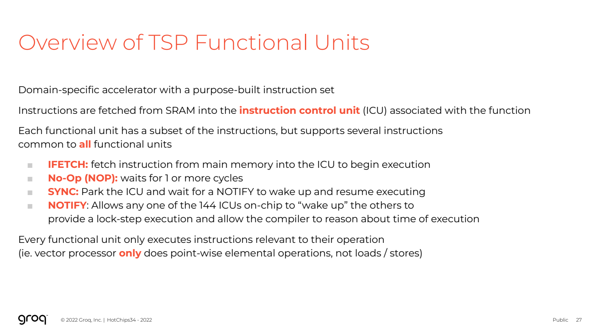

## Overview of TSP Functional Units

Domain-specific accelerator with a purpose-built instruction set

Instructions are fetched from SRAM into the instruction control unit (ICU) associated with the function

Each functional unit has a subset of the instructions, but supports several instructions common to all functional units

- ■ IFETCH: fetch instruction from main memory into the ICU to begin execution
- ■ No-Op (NOP): waits for 1 or more cycles
- ■ SYNC: Park the ICU and wait for a NOTIFY to wake up and resume executing
- ■ NOTIFY: Allows any one of the 144 ICUs on-chip to "wake up" the others to provide a lock-step execution and allow the compiler to reason about time of execution

Every functional unit only executes instructions relevant to their operation (ie. vector processor only does point-wise elemental operations, not loads / stores)

<!-- p.28 -->

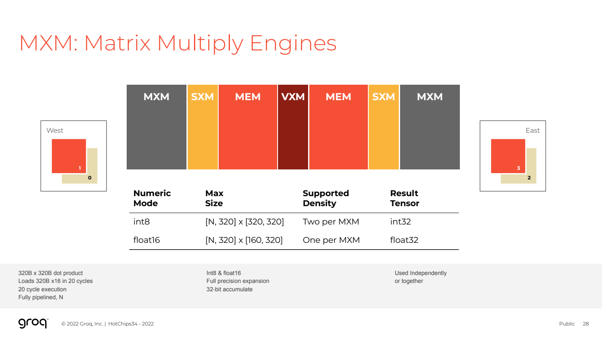

## MXM: Matrix Multiply Engines

320B x 320B dot product Loads 320B x16 in 20 cycles 20 cycle execution Fully pipelined, N

| Numeric Mode   | Max Size              | Supported Density   | Result Tensor   |
|----------------|-----------------------|---------------------|-----------------|
| int8           | [N, 320] x [320, 320] | Two per MXM         | int32           |
| float16        | [N, 320] x [160, 320] | One per MXM         | float32         |

Int8 &amp; float16 Full precision expansion 32-bit accumulate Used Independently or together

<!-- p.29 -->

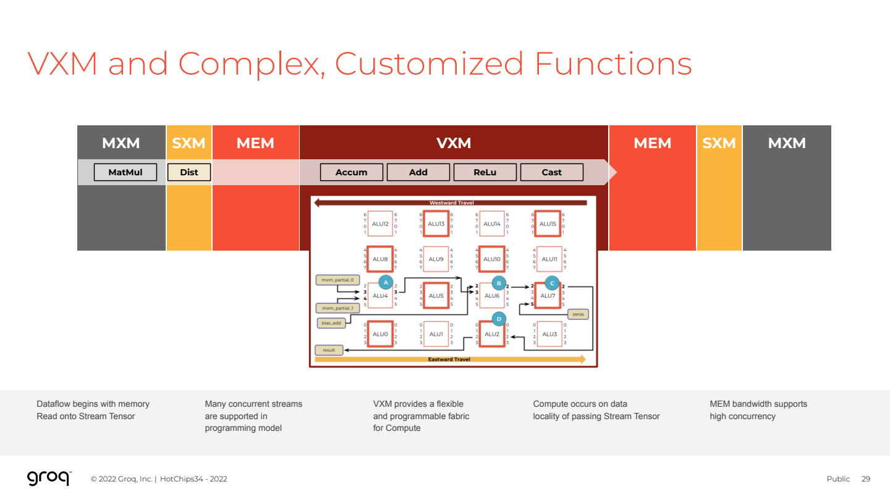

## VXM and Complex, Customized Functions

<!-- p.30 -->

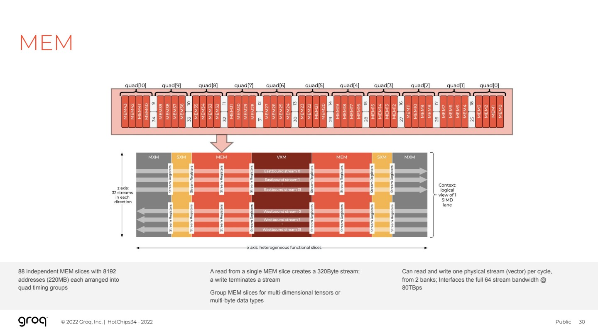

## MEM

88 independent MEM slices with 8192 addresses (220MB) each arranged into quad timing groups A read from a single MEM slice creates a 320Byte stream; a write terminates a stream Group MEM slices for multi-dimensional tensors or multi-byte data types Can read and write one physical stream (vector) per cycle, from 2 banks; Interfaces the full 64 stream bandwidth @ 80TBps

<!-- p.31 -->

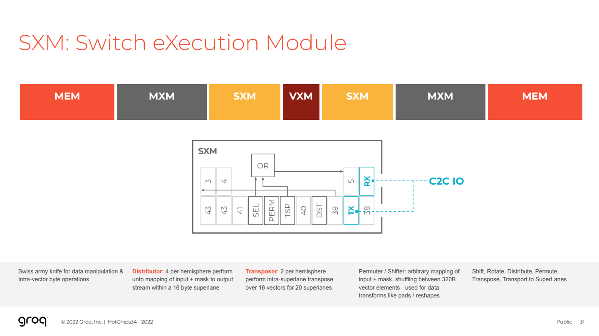

## SXM: Switch eXecution Module

MEM

Swiss army knife for data manipulation &amp; Intra-vector byte operations MXM

SXM VXM

Distributor: 4 per hemisphere perform unto mapping of input + mask to output stream within a 16 byte superlane Transposer: 2 per hemisphere perform intra-superlane transpose over 16 vectors for 20 superlanes Permuter / Shifter: arbitrary mapping of input + mask, shuffling between 320B vector elements - used for data transforms like pads / reshapes Shift, Rotate, Distribute, Permute, Transpose, Transport to SuperLanes

<!-- p.32 -->

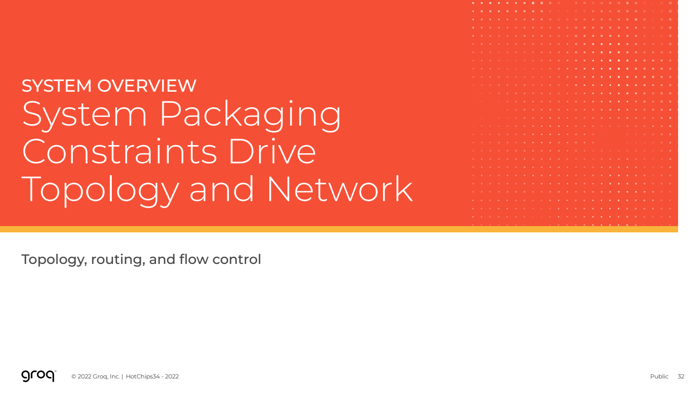

## SYSTEM OVERVIEW System Packaging Constraints Drive Topology and Network

Topology, routing, and flow control

<!-- p.33 -->

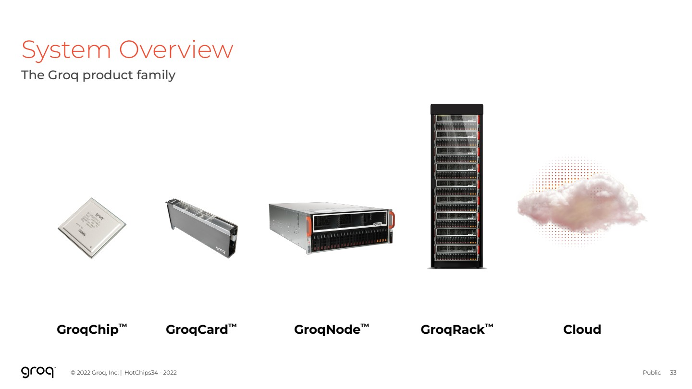

## System Overview

The Groq product family

GroqChip ™

GroqCard ™

GroqNode ™

GroqRack ™

Cloud

<!-- p.34 -->

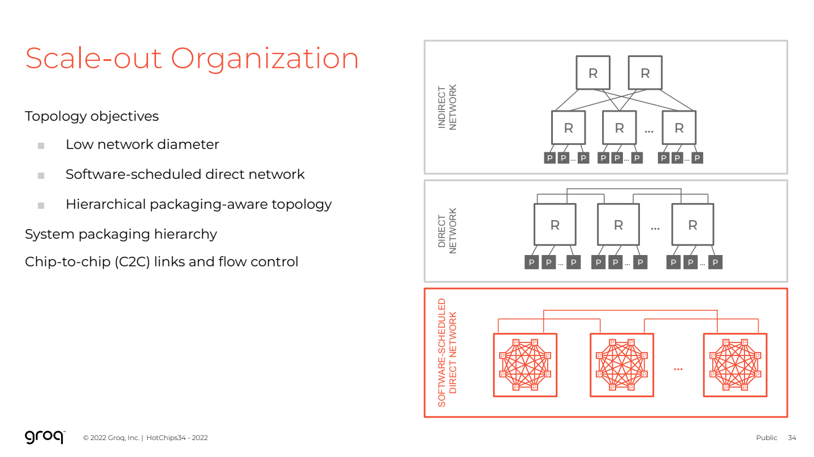

## Scale-out Organization

## Topology objectives

- ■ Low network diameter
- ■ Software-scheduled direct network
- ■ Hierarchical packaging-aware topology

System packaging hierarchy

Chip-to-chip (C2C) links and flow control

<!-- p.35 -->

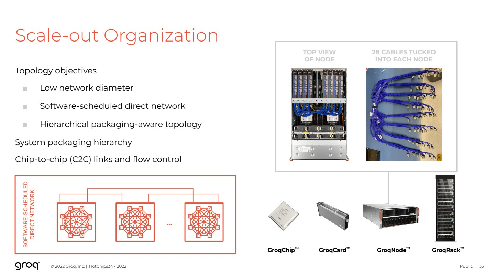

## Scale-out Organization

Topology objectives

- ■ Low network diameter
- ■ Software-scheduled direct network
- ■ Hierarchical packaging-aware topology

System packaging hierarchy

Chip-to-chip (C2C) links and flow control

GroqChip ™

GroqCard ™

GroqNode ™

GroqRack ™

<!-- p.36 -->

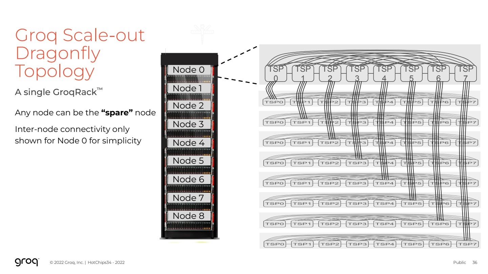

## Groq Scale-out Dragonfly Topology

A single GroqRack ™

Any node can be the "spare" node

Inter-node connectivity only shown for Node 0 for simplicity

<!-- p.37 -->

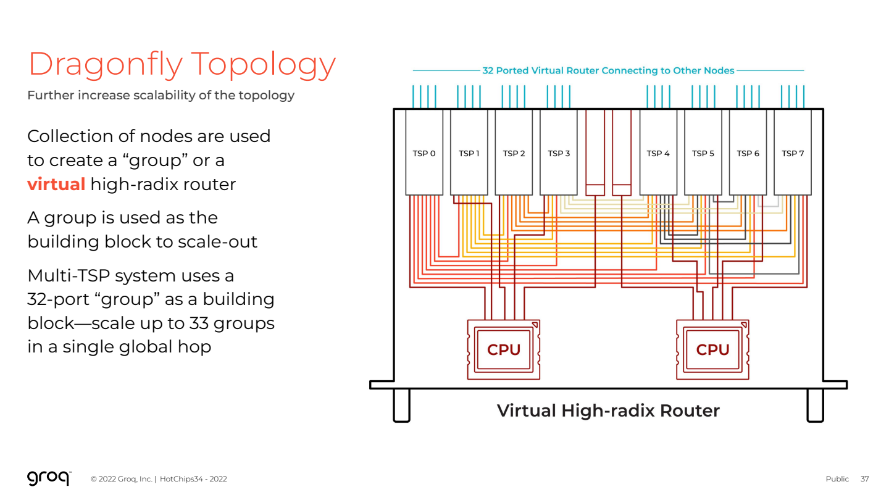

## Dragonfly Topology

Further increase scalability of the topology

Collection of nodes are used to create a "group" or a virtual high-radix router

A group is used as the building block to scale-out

Multi-TSP system uses a 32-port "group" as a building block-scale up to 33 groups in a single global hop

<!-- p.38 -->

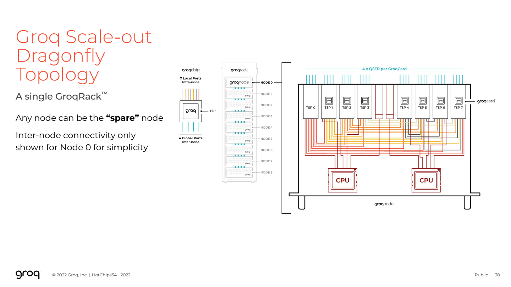

## Groq Scale-out Dragonfly Topology

A single GroqRack ™

Any node can be the "spare" node

Inter-node connectivity only shown for Node 0 for simplicity

<!-- p.39 -->

## Global Synchronization

<!-- p.40 -->

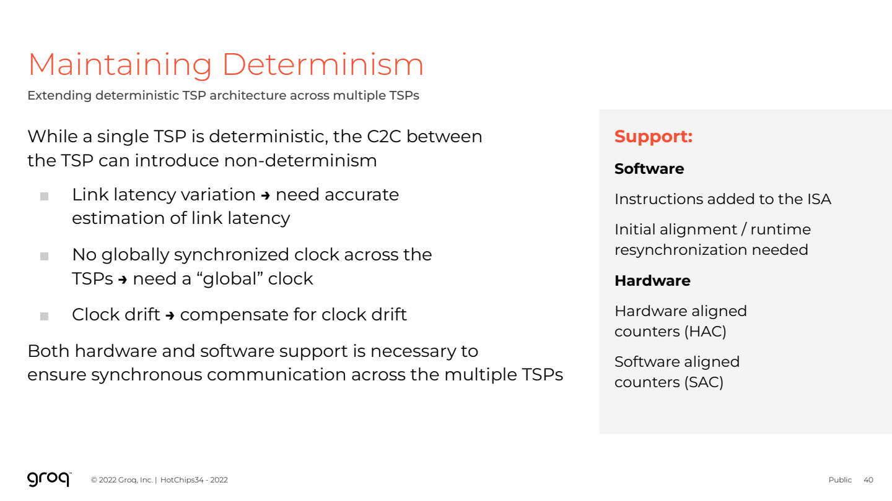

## Maintaining Determinism

Extending deterministic TSP architecture across multiple TSPs

While a single TSP is deterministic, the C2C between the TSP can introduce non-determinism

- ■ Link latency variation → need accurate estimation of link latency
- ■ No globally synchronized clock across the TSPs → need a "global" clock
- ■ Clock drift → compensate for clock drift

Both hardware and software support is necessary to ensure synchronous communication across the multiple TSPs

## Support:

## Software

Instructions added to the ISA

Initial alignment / runtime resynchronization needed

## Hardware

Hardware aligned counters (HAC)

Software aligned counters (SAC)

<!-- p.41 -->

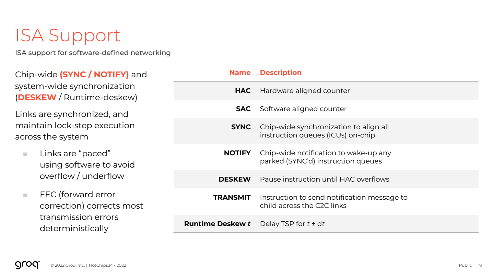

## ISA Support

ISA support for software-defined networking

Chip-wide (SYNC / NOTIFY) and system-wide synchronization (DESKEW / Runtime-deskew)

Links are synchronized, and maintain lock-step execution across the system

- ■ Links are "paced" using software to avoid overflow / underflow
- ■ FEC (forward error correction) corrects most transmission errors deterministically

## Name Description

| HAC                                                                      | Hardware aligned counter   |
|--------------------------------------------------------------------------|----------------------------|
| Software aligned counter                                                 | SAC                        |
| Chip-wide synchronization to align all instruction queues (ICUs) on-chip | SYNC                       |
| Chip-wide notification to wake-up any parked (SYNC'd) instruction queues | NOTIFY                     |
| Pause instruction until HAC overflows                                    | DESKEW                     |
| Instruction to send notification message to child across the C2C links   | TRANSMIT                   |
| Runtime Deskew t for t ± dt                                              | Delay TSP                  |

<!-- p.42 -->

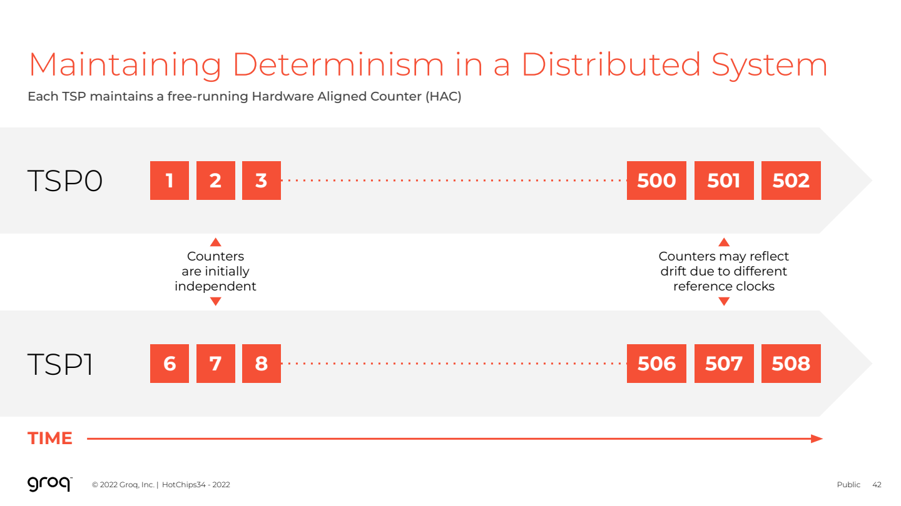

## Maintaining Determinism in a Distributed System

Each TSP maintains a free-running Hardware Aligned Counter (HAC)

<!-- p.43 -->

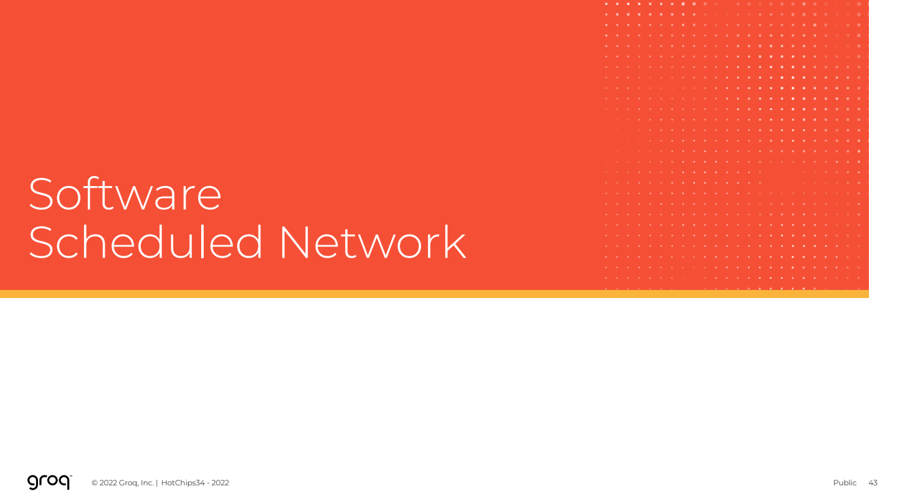

Software Scheduled Network

<!-- p.44 -->

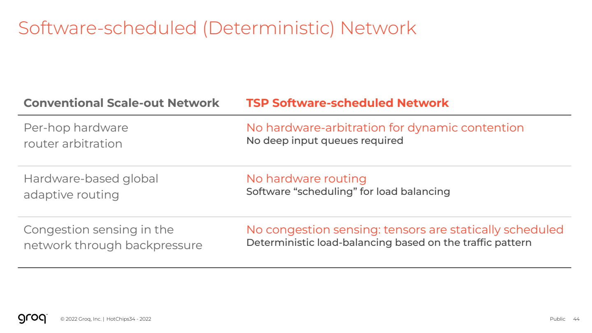

## Software-scheduled (Deterministic) Network

| Conventional Scale-out Network                         | TSP Software-scheduled Network                                                                                    |
|--------------------------------------------------------|-------------------------------------------------------------------------------------------------------------------|
| Per-hop hardware router arbitration                    | No hardware-arbitration for dynamic contention No deep input queues required                                      |
| Hardware-based global adaptive routing                 | No hardware routing Software "scheduling" for load balancing                                                      |
| Congestion sensing in the network through backpressure | No congestion sensing: tensors are statically scheduled Deterministic load-balancing based on the traffic pattern |

<!-- p.45 -->

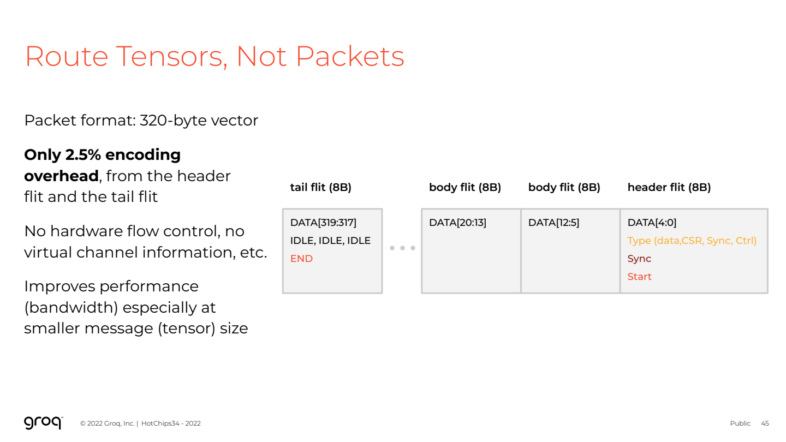

## Route Tensors, Not Packets

Packet format: 320-byte vector

## Only 2.5% encoding

overhead, from the header flit and the tail flit

No hardware flow control, no virtual channel information, etc.

Improves performance (bandwidth) especially at smaller message (tensor) size tail flit (8B)

DATA[319:317] IDLE, IDLE, IDLE END

| body flit (8B)   | body flit (8B)   | header flit (8B)                                 |
|------------------|------------------|--------------------------------------------------|
| DATA[20:13]      | DATA[12:5]       | DATA[4:0] Type (data,CSR, Sync, Ctrl) Sync Start |

<!-- p.46 -->

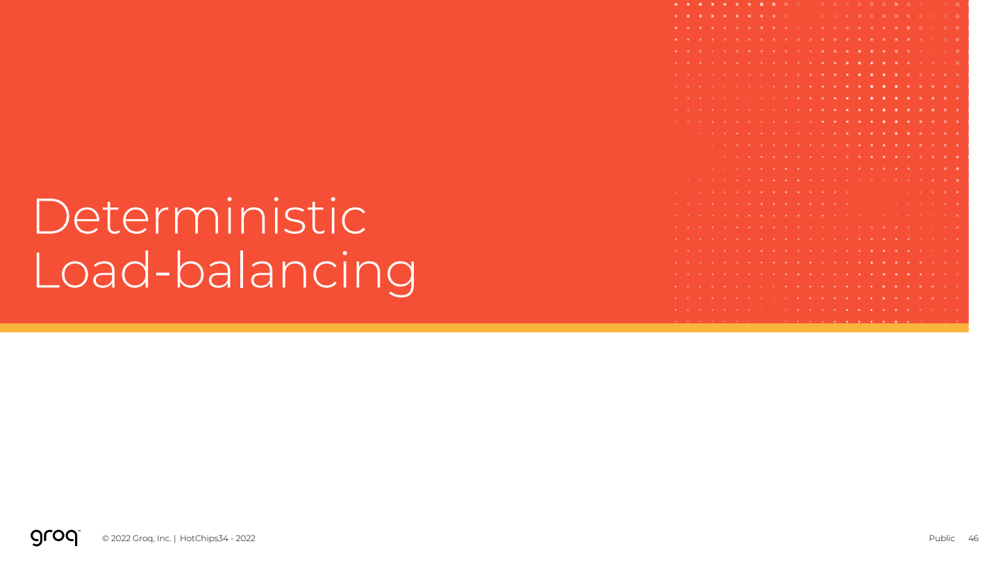

Deterministic Load-balancing

<!-- p.47 -->

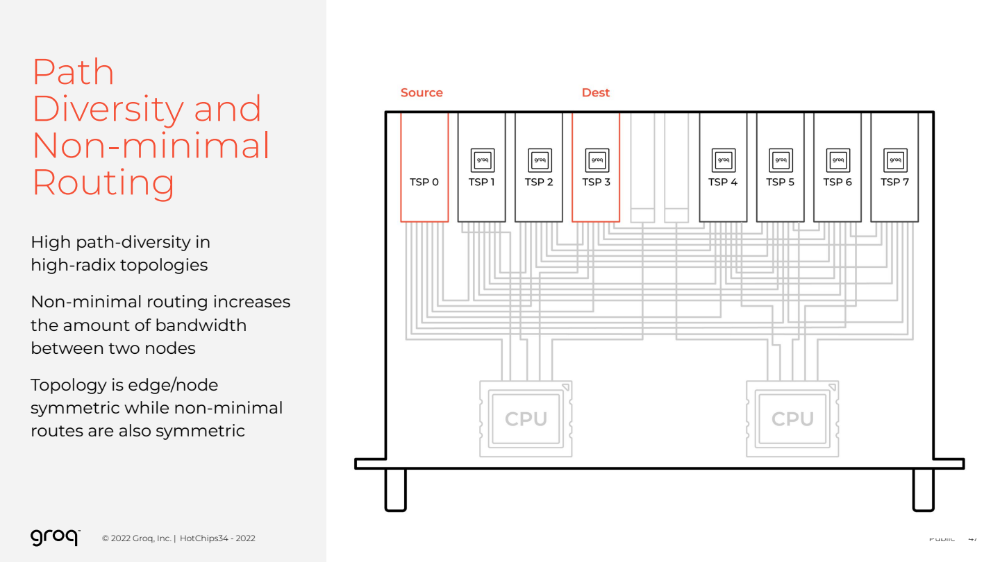

## Path Diversity and Non-minimal Routing

High path-diversity in high-radix topologies

Non-minimal routing increases the amount of bandwidth between two nodes

Topology is edge/node symmetric while non-minimal routes are also symmetric

<!-- p.48 -->

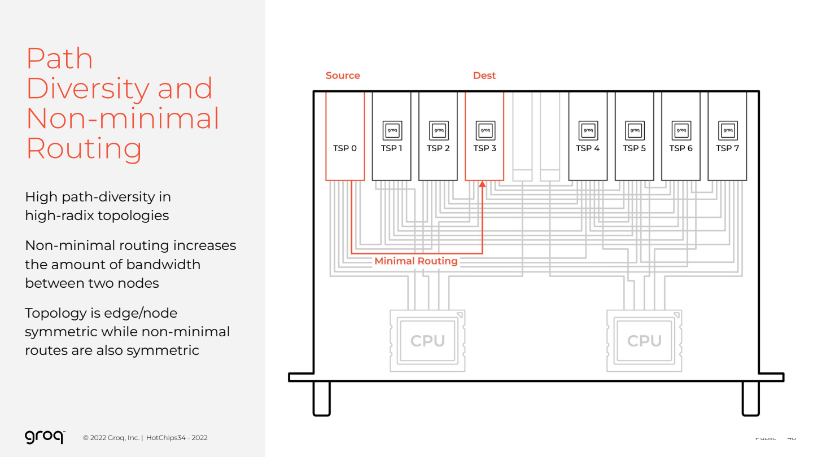

## Path Diversity and Non-minimal Routing

High path-diversity in high-radix topologies

Non-minimal routing increases the amount of bandwidth between two nodes

Topology is edge/node symmetric while non-minimal routes are also symmetric

<!-- p.49 -->

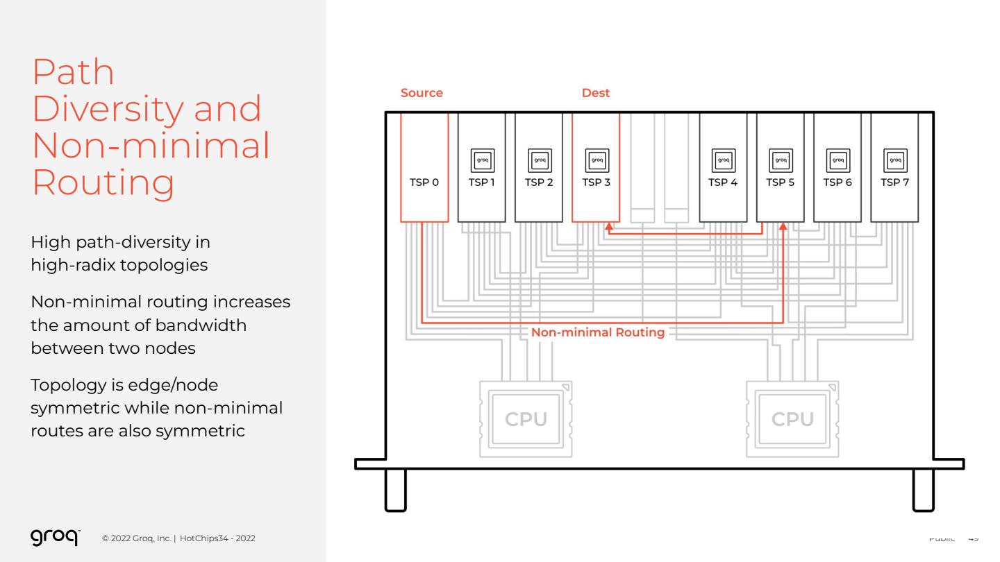

## Path Diversity and Non-minimal Routing

High path-diversity in high-radix topologies

Non-minimal routing increases the amount of bandwidth between two nodes

Topology is edge/node symmetric while non-minimal routes are also symmetric

<!-- p.50 -->

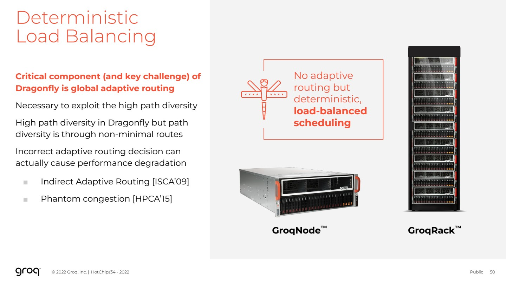

## Deterministic Load Balancing

## Critical component (and key challenge) of Dragonfly is global adaptive routing

Necessary to exploit the high path diversity

High path diversity in Dragonfly but path diversity is through non-minimal routes

Incorrect adaptive routing decision can actually cause performance degradation

- ■ Indirect Adaptive Routing [ISCA'09]
- ■ Phantom congestion [HPCA'15]

No adaptive routing but deterministic, load-balanced scheduling

GroqNode ™

GroqRack ™

<!-- p.51 -->

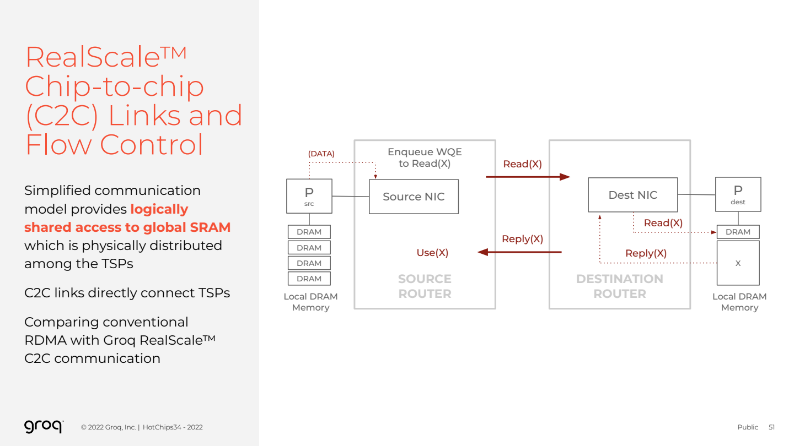

## RealScale™ Chip-to-chip (C2C) Links and Flow Control

Simplified communication model provides logically shared access to global SRAM which is physically distributed among the TSPs

C2C links directly connect TSPs

Comparing conventional RDMA with Groq RealScale™ C2C communication

<!-- p.52 -->

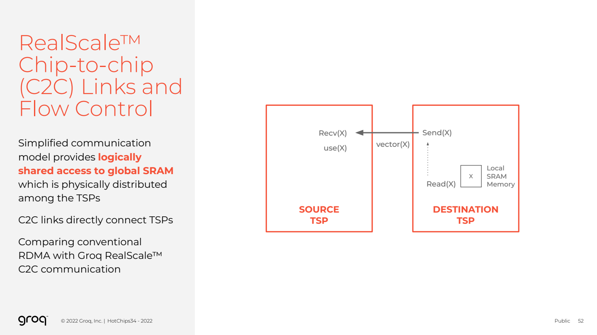

## RealScale™ Chip-to-chip (C2C) Links and Flow Control

Simplified communication model provides logically shared access to global SRAM which is physically distributed among the TSPs

C2C links directly connect TSPs

Comparing conventional RDMA with Groq RealScale™ C2C communication

<!-- p.53 -->

## Reliability

Reliability and scalability are two sides of the same coin

<!-- p.54 -->

## Redundancy Within TSP

"Spare" superlane on each TSP for recovering manufacturing yield

- ■ 21 superlanes on-chip
- ■ Only place where we "hide" the spare superlane from the compiler
- ■ Enables use of an "all-good" die to tolerate a single superlane hard-fault
- ■ Redundant power supply in each node, and
- ■ Redundant node in each system

<!-- p.55 -->

## Determinism Simplifies ASIC Design &amp; Verification

Assume-guarantee reasoning and producer-consumer interfaces

Functional units have well-defined inputs from (stream register file) SRF stations located interstitially between the functional units

Express assumptions (constraints) and guarantees (properties) that can be checked at each functional unit as safety properties

Functional units are designed to be stateless and side-effect free

Assumptions in Software are expressed as Guarantees held by the hardware, and vice versa

Adhering to a "deterministic" design philosophy ensures

- ■ No reactive components in the hardware datapaths
- ■ No reordering of memory or network transactions
- ■ Fixed-latency functional units make instructions predictable
- ■ Exposing the necessary architecturally-visible machine state for the compiler to reason about program correctness

No "liveness" properties across the chip or system

- ■ No cooperating FSMs as part of a the hardware coherence mechanism
- ■ No arbiters or link-layer replay etc.

<!-- p.56 -->

## Software Stack

Reliability and redundancy

## Software-defined hardware relies on several interfaces:

- ■ Static-dynamic Interface: compile-time versus runtime
- ■ Hardware-software Interface: exposing the architectural visible-state

## Exception handling needs special attention

- ■ Resolve exceptions ahead of time if possible (ie. arithmetic overflow behavior)
- ■ FEC (forward error correction) to correct single-bit errors and detect multiple-bit errors
- ■ SECDED error correcting code (ECC) on all SRAM and hardware structures on-chip
- □ Data paths
- □ Stream registers
- □ Instruction control units, instruction fetch buffers

<!-- p.57 -->

## ECC Everywhere

For the past decade, since 90 nm transistors have been used, we have seen a large increase in observed soft error upset (SEUs) on memory structures as well as flip flops

Protect control and datapaths

- ■ Instruction buffers (x144)
- ■ Instruction queues (x144)
- ■ Streaming register files (SRFs) hold operands and results
- □ (32 x138-bit) east and west for a total of 64 320-byte stream registers on-chip
- □ 45 SRF stations across the superlane for on-chip data transfer
- each has SECDED (single-error-correction and double-error-detection)

<!-- p.58 -->

## It Pays To Be Paranoid…

Avoiding Silent Data Corruption (SDC)

Silent Data Corruption (SDC) happens for a variety of reasons

- ■ High-energy particles can cause bit-flips in SRAMs as well as flip-flops
- ■ 11-year "solar cycle" makes solar ejections peak in the middle of the cycle - about 2024-25 increasing the flux at terrestrial elevations
- ■ Across a large fleet, a hyper-scaler is able to detect these SDC events but are difficult to impede them from occurring

Manufacturing variability and early-life failures

- ■ Weibull distribution (bathtub curve)
- ■ SI / PI noise can cause errors on high-speed channels

<!-- p.59 -->

## Protecting Critical Hardware Structures

Protect the control and data path

Superlane has 45 SRF stations, all are SECDED protected to correct single-bit errors and detect multi-bit corruption on the data operands or results flowing on the streams

<!-- p.60 -->

## Exception Handling and Determinism

Faults happen… plan accordingly

NaN and Inf may arise due to SDC or SEUs in SRAMs or critical hardware structures (ie. matrix unit)

Decide ahead of time what the exception handling should be for arithmetic exceptions (numerical overflow/underflow)

- ■ ADD\_SAT and ADD\_MOD
- ■ SUB\_SAT and SUB\_MOD
- ■ MUL\_SAT and MUL\_MOD

Avoiding arithmetic exceptions by allowing the compiler to decide the semantics of arithmetic errors at compile time

One-shot replay on an error allows the runtime to check if the fault is transient (resolves) or persistent and must replay the inference on an alternate set of hardware resources

- ■ Initiate the FRU hardware replacement with DevOps and the MTTR ticker starts

<!-- p.61 -->

## DISCUSSION Workload Evaluations

<!-- p.62 -->

## Cholesky Factorization

Cholesky decomposition is an important technique for solving large-scale system of linear equations

Compute is N 3 /3 for a SPD matrix of size N

Block-cyclic distributions of 320 rows across chips

<!-- p.63 -->

## Natural Language Processing with BERT

Seq Len=128

Spread the layers across TSPs in each node for multi-TSP model parallelism

Mini-batch (data parallelism) across nodes for throughput

Goal: Accelerate BERT minimizing latency and maximizing throughput

Minimize latency variance to provide predictable throughput

<!-- p.64 -->

## GEMM: General Matrix Multiplication

Vector-Matrix multiplication and Matrix-Matrix multiplication are the workhorse for many ML and HPC workloads

On-chip memory bandwidth determines how quickly we can ramp up ALUs for vector and matrix operations

Consistent performance across a range of tensor sizes - less "hardware fitting"

State-of-the-art (SOTA) results across a range of models and applications

- ■ CNNs
- ■ RNNs, LSTMs
- ■ NLP, BERT
- ■ Dense linear algebra V*M and M*M

<!-- p.65 -->

## AllReduce Comparison Results

Only a handful of cycles to Read(vector)-&gt;Send(vector) enables fine-grained communication across the 16 directly connected links on each TSP

Comparison made with 8 GPU A100 system with NCCL

A100 system has approximately 3x higher network channel bandwidth

When normalized, Groq TSP matches the bandwidth at large tenor size while significantly improving bandwidth at intermediate tensor size

<!-- p.66 -->

## Summary and Takeaways

Next steps and future work

<!-- p.67 -->

## Compiler Progress

<!-- p.68 -->

## Summary and Takeaways

Low-latency and high-throughput are necessary for compute-intensive deep learning

Delivering predictable and repeatable performance is critical for many user-facing applications

- ■ Batch-1 inference is important for responsiveness and delivering quality-of-service (QoS) that is impossible to do with more traditional microarchitectures using crossbars, cache hierarchies, etc.

Determinism enables software-defined hardware and entails a design philosophy that spans both hardware and software

- ■ ISA is not about abstraction of hardware details, but about exerting control of underlying hardware
- □ 144 independent instruction control units (ICUs) of the TSP
- ■ Expose the architecturally-visible state (GPRs, SRAM, instruction buffers, etc)
- ■ Software-based replay and exception handling

Extending the single-chip TSP determinism to the multiprocessor using software scheduled networking to explicitly schedule tensors on the network links

Synchronous communication model allows for lock-free communication up to very large systems

<!-- p.69 -->

## Thank You

Contact me or the Groq team at info@groq.com FOLLOW US ON:
