> 本文件由 `Abts2022-ISCA-Software-defined-TSM.pdf` 自动转换（docling 2.140.0，2026-10-17）。图片在 `images/` 目录；表格与数字请以 PDF 原文为准；`<!-- p.N -->` 标记对应 PDF 第 N 页。

<!-- p.1 -->

## A Software-defined Tensor Streaming Multiprocessor for Large-scale Machine Learning

| Dennis Abts       | Garrin Kimmell   |
|-------------------|------------------|
| Groq Inc.         | Groq Inc.        |
| Matt Boyd         | Andrew Bitar     |
| Groq Inc.         | Groq Inc.        |
| Roberto DiCecco   | David Han        |
| Groq Inc.         | Groq Inc.        |
| Jennifer Hwang    | Jeremy Fowers    |
| Groq Inc.         | Groq Inc.        |
| Elyas Mehtabuddin | Chetan Tekur     |
| Groq Inc.         | Groq Inc.        |
|                   | Stephen Maresh   |
|                   | Groq Inc.        |

| Andrew Ling Groq Inc.   | John Kim KAIST/Groq Inc.   |
|-------------------------|----------------------------|
| Sahil Parmar            | Ibrahim Ahmed              |
| Groq Inc.               | Groq Inc.                  |
| John Thompson           | Michael Bye                |
| Groq Inc.               | Groq Inc.                  |
| Peter Lillian           | Ashwin Murthy              |
| Groq Inc.               | Groq Inc.                  |
| Thomas Sohmers          | Kris Kang                  |
| Groq Inc.               | Groq Inc.                  |
| Jonathan Ross Groq Inc. |                            |

## ABSTRACT

We describe our novel commercial software-defined approach for large-scale interconnection networks of tensor streaming processing (TSP) elements. The system architecture includes packaging, routing, and flow control of the interconnection network of TSPs. We describe the communication and synchronization primitives of a bandwidth-rich substrate for global communication. This scalable communication fabric provides the backbone for large-scale systems based on a software-defined Dragonfly topology, ultimately yielding a parallel machine learning system with elasticity to support a variety of workloads, both training and inference. We extend the TSP's producer-consumer stream programming model to include global memory which is implemented as logically shared, but physically distributed SRAM on-chip memory. Each TSP contributes 220 MiBytes to the global memory capacity, with the maximum capacity limited only by the network's scale - the maximum number of endpoints in the system. The TSP acts as both a processing element (endpoint) and network switch for moving tensors across the communication links. We describe a novel software-controlled networking approach that avoids the latency variation introduced by dynamic contention for network links. We describe the topology, routing and flow control to characterize the performance of the network that serves as the fabric for a large-scale parallel machine learning system with up to 10,440 TSPs and more than 2 TeraBytes of global memory accessible in less than 3 microseconds of end-to-end system latency.

Permission to make digital or hard copies of part or all of this work for personal or classroom use is granted without fee provided that copies are not made or distributed for profit or commercial advantage and that copies bear this notice and the full citation on the first page. Copyrights for third-party components of this work must be honored. For all other uses, contact the owner/author(s).

ISCA '22, June 18-22, 2022, New York, NY, USA

© 2022 Copyright held by the owner/author(s).

ACM ISBN 978-1-4503-8610-4/22/06.

## CCS CONCEPTS

- Computer systems organization → Interconnection architectures.

## KEYWORDS

Machine Learning, Tensor Streaming Processor, Dragonfly, Software Scheduling

## 1 INTRODUCTION

Historically, high-performance computing (HPC) systems were broadly categorized as capability or capacity systems. This dichotomy arises because of communication latency and bandwidth trade-offs when we apply more processing elements (PEs) to a fixed-size problem (strong scaling) with the goal of minimizing the program's execution time. Alternatively, we can deploy more PEs to increase throughput (i.e. weak scaling). This duality requires both novel chip architectures [7][1][36] in the underlying PEs and a scalable system architecture with high throughput (bisection bandwidth) and low end-to-end latency (low network diameter) for fine-grained communication necessary to efficiently handle both strong and weak scaling. For example, the network demand for training an ML model, often requiring data parallelism (weak scaling), differs from inference on that same model using (pipelined) model parallelism (ie. strong scaling). The multiprocessor system, interconnection network, and the programming model of the individual processing elements work in unison to collectively execute the different "layers" of a deep learning network. It is this set of sub-tasks, expressed as individual PE programs, that are distributed among the computing elements and responsible for carrying out, or executing, the specifics of the machine learning model.

The burgeoning parameter space of natural language processing (NLP) models like GPT-3 [6] use 100s-of-billions of parameters to achieve state-of-the-art accuracy for a variety of inference applications. These models require significant compute resources for both training [31] [39] and inference to spread the model across multiple processing elements. The computational demands of large models are twofold: requiring memory resources to store model parameters, constants, and gradients to fit into the available memory of each processing element; and load balance the computation (flops) across the processing elements. To efficiently train these models, a variety of techniques have been used to exploit both pipelined (model) parallelism [30][19] and data (mini-batch) parallelism.

<!-- p.2 -->

Figure 1: A conventional manycore chip multiprocessor with sources of non-determinism (highlighted in red) which can reorder memory and network references.

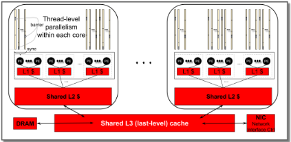

In a conventional CPU or GPU multiprocessor, the memory and network resources are dynamically shared among the processing elements (Fig 1) and are a source of non-determinism. To make an ML model amenable to execution on a parallel computer, we must first decompose the model into sub-tasks that can be mapped to the underlying processing elements of the system. The communication cost among the PEs is tightly coupled to the system's packaging hierarchy which seeks to exploit "packaging locality" wherein proximal compute resources are densely connected providing more bandwidth among these highly-connected components. As a result, the parallel decomposition strategy is aligned with the system packaging hierarchy in terms of racks, nodes, and eventually the PEs carrying out the execution of each sub-task.

This paper describes the novel software-defined system architecture of a commercial, scale-out tensor streaming processing (TSP) multiprocessor. The software-defined multi-TSP system extends the determinism of a single TSP using software-scheduled high-radix Dragonfly network and ISA "runtime deskew" instruction support to maintain the illusion of a synchronous, lock-step system. We describe the system architecture in terms of TSP endpoints [1], network topology, routing, flow control, and fault tolerance. The scalability or scale-out bandwidth is determined from the system packaging constraints which in turn drive the system's "bandwidth profile" (Fig 2). The bandwidth profile expresses the relationship between system scale (number of endpoints) and global bandwidth and illustrates the bandwidth cliffs at each system packaging boundary. As Fig 2 shows, small systems with fewer than 16 TSPs can take advantage of abundant wire density within the node, and larger systems up to several hundred TSPs can take advantage of about 50 GB/sec of global (bisection) bandwidth per TSP. As system size grows beyond 264 TSPs, the available global bandwidth flattens to about 14 GB/sec of global bandwidth per TSP endpoint. The Dragonfly network delivers flat global bandwidth up to the maximum system configuration of 145 cabinets for a total of 10,440 TSPs.

Figure 2: The global bandwidth profile per TSP.

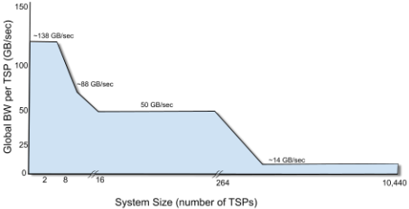

In the remainder of this paper, we describe the system architecture that enables a synchronous communication model across the network fabric of TSP elements, in particular:

- We propose a software-scheduled high-radix interconnection network that enables deterministic communication among TSPs and eliminates latency variance. We also describe the design and implementation of a software-scheduled Dragonfly topology for scale-out TSP system.
- We describe the hardware-software interface implementation including instruction level support to "deskew" and align a set of plesiochronous links to enable a synchronous distributed programming model and a tensor-based communication protocol that eliminates packet headers/footers.
- We propose and describe a novel source-based routing and flow control that enables a software-scheduled network with explicit software control of the traffic pattern and its total ordering of packets across the network.
- We evaluate system performance on representative workloads: 1) distributed matrix multiplication, 2) Cholesky factorization, and 3) latency-sensitive collectives such as AllReduce that are essential for scaled ML or converged HPC applications.

## 2 SCALE-OUT SYSTEMORGANIZATION

The programming model of the TSP is based upon a statically scheduled, deterministic execution with 220 MiBytes of local storage for parameters and instruction text [1]. Each TSP is programmed using a producer-consumer stream programming model that allows functional units to be chained together. The TSP's functional units are organized as 320-element SIMD (single instruction multiple data) instruction execution into functional slices consisting of a group of 20 tiles, each of which perform a 16-way SIMD computation on the data. To enable seamless scalability and preserve that programming model across multiple TSP processing elements, the network also needs to be deterministic. In this section, we describe the Dragonfly topology that is exploited for the software-defined system architecture to provide scalability. We detail the core topology design objectives to achieve the desired scale-out application demands, the hierarchical organization of the system based on the Dragonfly topology, and the fundamental properties of the chip-to-chip (C2C) links between processing elements.

<!-- p.3 -->

Figure 3: The global shared address space is physically distributed among the TSPs in the system.

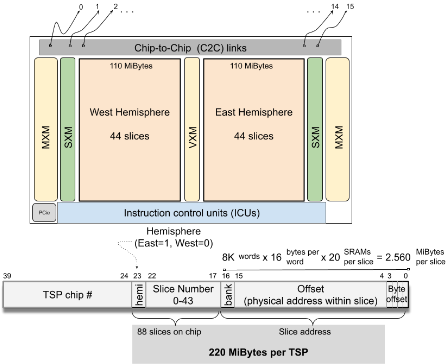

Figure 4: High-level organization of (a) indirect network, (b) direct networks, and (c) proposed software-scheduled ("direct") scale-out organization (R: router, P: processing endpoint).

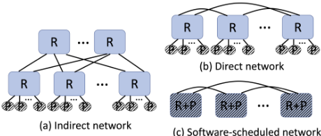

## 2.1 Topology Objectives

The objectives of the scale-out multi-TSP system topology are the following.

Low network diameter: The total observed communication latency and variance increases with the number of hops in the the network. Thus, reducing the network diameter is known to reduce network latency (hop count) as well as lower the network cost [26]. Direct Network: System topologies can be classified as either indirect or direct networks 1 (Fig 4). While indirect networks such as fattree have been commonly used for large-scale systems, they require intermediate switches or routers that introduce non-determinism from dynamic arbitration and queuing. Instead, a direct network (Fig 4(b)) removes intermediate routers as all routers have endpoints connected to them. In the scale-out TSP system, the direct network is extended to create a "glueless" multiprocessor by combining the processing endpoints and the routers (Fig 4(c)) - thus, directly connect TSPs to create their communication fabric. While eliminating the non-determinism that can be induced by the intermediate routers, software-scheduled network organization also enables high injection bandwidth as the router node bandwidth effectively becomes processing endpoint injection bandwidth.

1 Indirect networks are defined as systems where endpoints and switches are considered "separate" while direct networks can be represented as endpoints and switches being a single "node." [11]

Figure 5: Four levels of packaging hierarchy, where each chip (a) is fitted with a heat-sink and packaged on a PCIe card (b) and eight TSP cards are co-located within the a shared memory node (c) occupying four rack units (4RU) in the rack (d). An expanded view of node shows the abundant intra-node, low-profile cables within the chassis to exploit packaging locality.

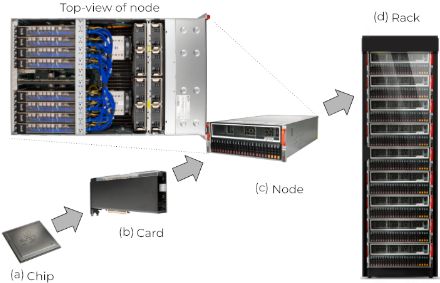

Hierarchical Packaging-aware Topology: The topology of the interconnection network is driven primarily by the packaging constraints [11] imposed by system packaging hierarchy. In particular, while high-radix routers can achieve low network diameter, enabling high-radix can be a challenge in the scale-out systems packaging (pin) constraints. The packaging constraints encountered in designing our system vary across levels of the hierarchy: from pin-count constraints on the ASIC die level; area and form-factor constraints at the PCIe card level; general-purpose CPU (non-TSP) compute, power, cooling, and cabling routing constraints at the chassis level; to cable length and power at the rack level.

To achieve the objectives described above, the Dragonfly [25] topology was leveraged in the scale-out system. While high-radix topologies such as Flattened Butterfly [24] or HyperX [3] can be leveraged, their scalability is limited when the router or node radix is small. However, by using a collection of routers as a group, a virtual high-radix network can be created with the Dragonfly and enables scalable topology with lower radix node while not requiring intermediate switches that is required for topologies such as the fat-tree.

## 2.2 Systempackaging hierarchy

The basic building block of the system packaging is a 4U chassis enclosure which houses eight TSPs as shown in Fig 5 that is referred to as a "node." The pin-bandwidth from each TSP is partitioned into 7 "local" links and 4 "global" links. The 7 local links are used to provide full connectivity between the group of 8 TSPs that are within the same SMP coherence domain and can communicate synchronously with other TSPs in the node (Fig 6). All of the global links for each TSP within a node can be combined to create a

<!-- p.4 -->

Figure 6: Scale-out topology block diagram.

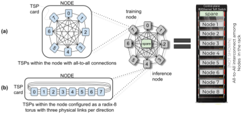

32 "virtual" port high-radix router to effectively be a "group" that is used as a building block of the Dragonfly topology. Each C2C link consist of four (4) lanes and thus in theory, the radix can be increased to 11 × 4 = 44 ports. However, the packaging constraints of a PCIe card limits the number of links that can be exposed for inter-node communication. Instead, we exploit the abundant wire density within the 4U node chassis level of the packaging hierarchy, to enable full connectivity between the 8 TSPs while reducing the amount of bandwidth for global communication.

Using a node as a building block with 32-port virtual router, the TSP system can scale out up to 33 nodes for total of 33×8 = 264 TSPs by providing full connectivity between all of the nodes that results in a three hop topology with minimal routing. Thus, it allows finegrained communication across the 264 TSP system and efficient access to its combined 56 GiBytes of global SRAM (Fig 3). At the next higher layer of the packaging hierarchy is the rack, consisting of nine (9) nodes, each with eight (8) TSPs, interconnected via the four (4) "global" links per TSP for a total of 32 × 9 = 288 ports of global bandwidth. To scale to even larger systems, we can use the rack as the "local group" and partition half of the 288-ports to doubly-connect the set of nine (9) nodes within each rack using half (144) of the ports so that we have the proper 2× "internal speedup" within the local group required to route traffic among the global links. The remaining 144 ports are used to connect to other racks in the system and delivers up to 145 racks in the maximally configured system or 145 (racks) ×72 (TSPs per rack) for a total of 10,440 TSPs in the largest system with at-most 5 hop diameter using minimal routing (two in the source-rack, one global hop, and two in the destination-rack).

## 2.3 Chip-to-chip (C2C) links and flow control

The chip-to-chip (C2C) links connect TSPs both within and between nodes. The C2C links use low-swing differential signaling operating up to 30 Gbps 2 over 34 AWG cables, with the longest cable being 0.75 meter within the node. This low-profile cabling is designed to lay flat underneath the shroud used on the 4U enclosure. Likewise, we can exploit packaging locality and keep cables within the rack relatively short (&lt;2m) and use low-cost QSFP (quad-small form package) electrical cables limiting the more expensive active optical cables for longer rack-to-rack connections. Each node has

2 The C2C links support a variety of operating speeds, however, in general we operate all the links at the same data rate of 25 Gbps for both electrical cables within racks and active-optical transceivers between racks, with a combined bandwidth of 100 Gbps across the four lanes in a link.

28 internal C2C cables to fully-connect the eight (8) TSPs with their 7 peers within the node. This allows us to keep 73% of the cables (44 of 60 cables used by each node) short and inexpensive using electrical signaling.

As a consequence of the deterministic network design, the hardware is disallowed from asserting back pressure which would disrupt deterministic operation of the network. Instead, software explicitly schedules vectors on each physical link in the system taking into account the channel bandwidth and latency of each channel to ensure we never overflow the transmitter or underflow the receiver. Specifically, as a tensor flows hop by hop through the network, we use the local SRAM storage on each TSP to provide intermediate buffering of the tensor's individual vectors and in this way, a vector is the flow control unit (flit). Since the network path is fully deterministic, a tensor consisting of one or more vector flits can be scheduled using virtual cut through [23] flow control since the receiving TSP can immediately begin sending vectors to the next-hop of the tensor's path.

## 3 MAINTAININGDETERMINISM INA DISTRIBUTED SYSTEM

The collection of functional units on each TSP act as a single logical core which is scheduled statically (at compile-time). We extend the single-chip TSP determinism to a multi-chip distributed system so that we can efficiently share the global SRAM without requiring a mutex to guarantee atomic access to the global memory - instead, we communicate with explicit send or receive instructions at specific times so we can reason about program correctness from this total ordering. In order to achieve this predictable behavior, the TSP hardware-software interface exposes all architecturally-visible state (all SRAM, and stream registers) so that the static computation graph can be expressed as a series of dependencies that impose temporal deadlines on the operand arrival times of tensors being communicated. We express these dependencies as a DAG (directed acyclic graph) to explicitly schedule the communication traffic. Summary of ISA support to enable determinism across multiple nodes is shown in Table 1.

A multi-TSP system relies on three mechanisms to establish and maintain synchrony: i) a per-TSP collection of hardware-aligned counters that are continuously (every 256 cycles) exchanged to maintain a global consensus time; ii) a procedure for initial program alignment that utilizes the links to ensure every TSP begins executing its instructions simultaneously; iii) a runtime resynchronization process to account for individual TSP clock drift during long-running computations.

## 3.1 Hardware aligned counters (HAC)

Synchronizing a network of TSPs involves a combination of hardware and software mechanisms. Each TSP maintains a free-running internal hardware aligned counter (HAC) with a low (&lt; 256 cycle) overflow period. 3 When two TSPs are connected via a point-topoint C2C link, each TSP will transmit its internal HAC value to its peer. This provides a mechanism for characterizing link latency by having a TSP transmit its current HAC value, then its peer reflect that value back. When the reflected HAC value is returned to the originating TSP, it is compared with the internal free-running HAC, with the difference being the link latency (modulo a multiple of the HAC period) (Fig 7(a)). This procedure is repeated until we have an acceptable confidence in the estimate of mean latency and variance within the system tolerance. Table 2 summarizes the results of performing this operation 100K times within a 8-TSP node and latency for 7 of the intra-node C2C links are shown.

3 The HAC period is also referred to as an epoch.

<!-- p.5 -->

Table 1: ISA support for a deterministic scale-out system.

| Name             | Description                                                       |
|------------------|-------------------------------------------------------------------|
| HAC              | hardware aligned counter                                          |
| SAC              | software aligned couner                                           |
| SYNC             | intra-chip pause instruction                                      |
| NOTIFY           | intra-chip global signal to functional units to restart execution |
| DESKEW           | pause instruction until HAC over- flows                           |
| TRANSMIT         | instruction to send notification to child through C2C link        |
| RUNTIME_DESKEW 𝑡 | delay TSP for 𝑡 ±𝛿𝑡                                               |

After a link latency is characterized, two peer TSPs 𝑇0 and 𝑇1, with an observed latency with mean 𝐿, are configured in a parent/child relationship such that the HAC maintained within 𝑇0 (i.e., HAC0) serves as the reference and is periodically transmitted to 𝑇1. When the instantaneous value of HAC0 is received by 𝑇1, its value plus the latency 𝐿 is compared to HAC1. The difference represents initial misalignment from continual clock drift. The value of HAC1 is adjusted to reduce the difference (the maximum adjustment rate is configurable). After a sufficient number of iterations of this process (approximately bounded by the period of the HAC counters), the two counters HAC0 and HAC1 will converge within a neighborhood determined by the jitter of the link latency. Thus, this protocol determines a common periodic reference for two TSPs. To expand this protocol to a multi-hop network of TSPs, a spanning tree of parent/child HAC relationships is established to maintain a common HAC reference time distributed across the network.

The HAC alignment procedure serves as the foundation upon which the synchronous distributed system is programmed. We build upon this foundation with software-controlled ISA support for a common software clock reference. We recall the foundations for deterministic scheduling [1] of multiple functional units on a single TSP depends on a SYNC instruction to "pause" issue from the independent instruction streams for the various units, followed by a single functional unit issuing a NOTIFY instruction. This NOTIFY instruction in turn results in a global control signal (with known latency) to be delivered to the paused functional units, causing them to restart execution on the same clock cycle. This NOTIFY thus serves as the software-controlled time reference upon which all other static scheduling is derived.

## 3.2 Initial program alignment

The SYNC and NOTIFY instructions provide a chip-wide synchronization mechanism that relies on a shared clock and fully-deterministic control propagation path which does not exist in a multi-TSP system since each TSP has an independent clock source. However, the common (periodic) HAC reference can be combined to provide the illusion of a shared clock across the entire system in the following manner. First, we introduce a DESKEW instruction that allows us to align program execution with the (local) HAC. When a functional unit executes a DESKEW, it will pause issuing subsequent instructions on that functional unit until the next time the HAC overflows or the epoch boundary. This allows us to ensure that distributed computation can begin relative to a HAC epoch boundary that is a shared reference time among TSPs in the network.

Table 2: HAC latency characterization of seven (7) intra-node C2C links based on 100K iterations.

| link   |   min |   mean |   max |   std |
|--------|-------|--------|-------|-------|
| A      |   209 | 216.87 |   228 |  2.93 |
| B      |   210 | 216.87 |   227 |  2.88 |
| C      |   209 | 216.41 |   226 |  2.66 |
| D      |   210 | 216.47 |   226 |  2.71 |
| E      |   209 | 216.27 |   226 |  2.78 |
| F      |   209 | 216.48 |   225 |  2.63 |
| G      |   211 | 217.35 |   228 |  2.84 |

Fig 7(b) shows the HAC-based synchronization procedure using DESKEW instructions in preparation for invoking a multi-TSP program. At time 𝑡1, the child device is locally placed into a polling synchronization loop. In the polling loop, at each epoch boundary (shown as HAC=0), the child device will wait to receive a vector from the parent device. If that vector has not been transmitted yet, the loop will continue. At time 𝑡2 a parent program is invoked that performs a DESKEW followed by a TRANSMIT. Though the events 𝑡1 and 𝑡2 are unsynchronized, the use of DESKEW forces alignment of the subsequent instruction with the shared HAC value. The TRANSMIT from the parent happens at an epoch boundary and the vector arrives at the child at some time 𝑡3. This vector will be consumed by the RECV instruction that will issue following the next epoch boundary following 𝑡3. This will cause the child device to exit the synchronization loop at ⌊𝐿/𝑝𝑒𝑟𝑖𝑜𝑑⌋ +1 clock epochs 4 following the transmit from the parent to child device, at time 𝑡4. Finally, both the parent and child device will issue a (chip-local) NOTIFY instruction at time 𝑡4 to begin synchronized computation.

To support scaling to multi-hop networks, the system incorporates the DESKEW-based synchronization process repeatedly along each hop of the HAC spanning tree, with an overall synchronization overhead of ( ⌊𝐿/𝑝𝑒𝑟𝑖𝑜𝑑⌋ +1) ∗ℎ total cycles, where 𝐿 the maximum single-link latency and ℎ the height of the spanning tree. Note that this overhead occurs only at the start of a distributed inference. A lighter-weight (approximately 1 epoch) runtime resynchronization process described in the following section is used to adjust for clock skew during program execution.

## 3.3 Runtime deskew for resynchronization

The HAC-based scheme described in the previous section establishes a common starting time reference for a multi-TSP system, but the inter-TSP drift due to frequency uncertainty of the independent clocks across multiple TSPs must also be tolerated. The TSP provides an additional software aligned counter (SAC) to allow the TSPs to re-synchronize during computation to keep accumulated drift within allowable tolerances. The SAC is a free-running counter with the same period as the HAC. However, unlike the HAC, it is not updated to correspond with upstream HAC peers, but rather continues to freely count local clock cycles. The delta between a TSP's SAC and HAC, thus represents the accumulated drift of the "local" view of time (i.e. SAC) since the last synchronization and the "global" view of time (i.e., HAC).

4𝐿 is the latency of the parent to child link and the period is the epoch length or 252 clock cycles. The HAC is an 8-bit counter, but 4 values are reserved for special control codes.

<!-- p.6 -->

Figure 7: Sequence diagram overview of synchronization for (a) HAC exchange and adjustment and (b) initial synchronization.

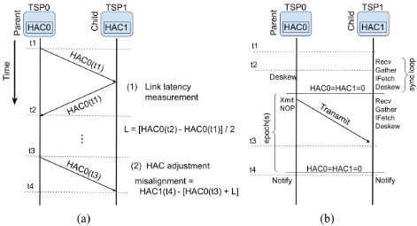

To reconcile the local vs global time, a RUNTIME\_DESKEW instruction is provided in the ISA. The instruction takes a single parameter: a target number of clock cycles to stall. When executed, the TSP will delay for the target number of cycles plus or minus 𝛿𝑡 , the signed difference of the HAC and SAC. In the event that 𝛿𝑡 is positive, the "local" time is faster than the "global" time represented by the HAC, and the TSP will stall for the target number of cycles plus 𝛿𝑡 , and vice-versa if the difference is negative. In this manner the "local" time is re-aligned with the "global" time, the multi-TSP system is re-synchronized, and the accumulated global error is reduced to the link jitter. This RUNTIME\_DESKEW instruction is scheduled to be executed on each TSP within the network at the same time. While it is executing, the other functional units on each TSP are quiesced by performing a SYNC instruction to park each ICUs, until it is subsequently awakened via a NOTIFY instruction.

## 4 SOFTWARE-SCHEDULEDNETWORKING (SSN)

A foundational characteristic of the TSP architecture is its deterministic data paths. Execution latency of all instructions is known statically (at compile time) and therefore exposed to the compiler via the ISA (instruction set architecture). As described earlier in the previous section, the hardware extends the guarantee of deterministic execution from a single TSP to a multi-TSP system. Achieving this determinism across the full network allows the compiler to not only have cycle-accurate knowledge of all data movement within a single TSP, but also across the links connecting the network of TSP processing elements. The exact timing (in cycles) to inject a vector at the source TSP, as well as the exact cycles data will arrive at a destination TSP, can all be resolved at compile time. We refer to this networking paradigm as software-scheduled networking (SSN) since it replaces the notion of dynamically routing packets as they flow in the network, with scheduling tensors at compile time. With our SSN approach, all contention for both functional units and network links are resolved at compile-time. In the remainder of this section, we discuss the design of the interconnection network of the TSP multiprocessor system that enables software-scheduled network, including:

Figure 8: Comparison of (a) conventional network and (b) software-scheduled network (SSN) when routing contention can occur. SSN resolves all contention via software at compile-time and does not require adaptive hardware or congestion sensing to assert back-pressure.

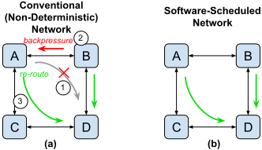

- (A) Deterministic traffic pattern from static graph analysis
- (B) Scheduling of communication, not routing
- (C) Deterministic routing, including non-minimal routes
- (D) No hardware arbitration and explicit (software) flow control
- (E) Forward-error-correction (FEC) to avoid reactive link-layer replay

## 4.1 Traffic pattern known a-priori

To enable SSN, the communication or the network traffic pattern needs to be known. For most of the workloads that multi-TSP targets, the communication pattern, both in space and in time, are known a-priori to the communication itself during the compile time. As a result, the optimal routing or "scheduling" decision can be made based on the the traffic pattern. In particular, SSN takes advantage of a ML model's static computation graph and a priori knowledge of the traffic pattern to enable an alternative scheme for routing tensors as a collection of back-to-back vectors which are the flow control units (flits) within the network. This provides finegrained (320 byte) communications between TSPs by extending this single-chip determinism to the entire network of TSPs and lays the foundation for scheduling tensors precisely to the clock cycle across the network links.

The traffic pattern is an emergent property of the underlying ML model, and how the model is partitioned across processing elements allowing for both model parallelism (i.e., distributing different layers across TSPs) and data parallelism to exploit mini-batch parallelism across the cluster. Model decomposition is automated by the compiler to auto-scale the workload across a desired number of TSP elements. The compiler partitions the workload into smaller sub-tasks and maps them to individual TSPs responsible for executing them. This mapping process induces the traffic pattern for the parallel workload. For pipelined model parallelism [30][19] [31] we compute the precise execution time of each pipe stage's sub-task and exchange activations between the layers of each stage. This process is fundamentally different than the conventional approach since we know the exact execution time of each stage (to the clock cycle) and therefore do not require dynamic profiling to extract the run-time characteristics of the sub-tasks. This makes the parallel decomposition step precise and explicitly under control of the compiler. This flexibility, in turn, allows the compiler's scheduling algorithm to explicitly make computation and communication trade-offs to change the ratio of compute to communication time and control the surface-to-volume characteristics of the parallel workload. The compiler will overlap as much compute and communication to effectively hide the C2C link latency.

<!-- p.7 -->

Figure 9: Communication model for (a) a conventional network using remote DMA and (b) the TSP communication model which eliminates the request leg of the transaction.

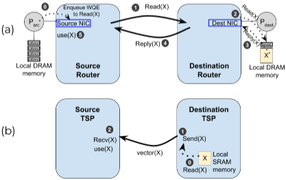

## 4.2 Scheduled, Not Routed

The routing algorithm determines the path a message takes through the network and is commonly implemented in hardware using lookup-tables to provide a simple output-port mapping for each incoming packet by inspecting the packet's destination node. In comparison, the multi-TSP system explicitly controls and schedules the hop-by-hop path through the network by orchestrating a sequence of send and receive instructions on the source and destination nodes, respectively. Given that all data movement can be statically inferred, the compiler orchestrates data movement based on global information across time and space to eliminate conflicts for shared output ports.

To highlight the advantages of SSN, an example is shown in Fig 8 with four TSPs. Assume both TSPs A and B sends traffic to D, creating contention for the shared link from B to D. TSP A has two minimal routes to TSP D - routing through TSP B or routing through TSP C. Without global information on B's downstream congestion, TSP A's may route through TSP B. This routing can result in congestion at TSP B and create back-pressure towards TSP A (2). Once the back-pressure is sensed, TSP A can route through TSP C (3). This reactivity resulting from arbitration and backpressure not only adds complexity to the hardware but also adds latency and non-determinism. In comparison, SSN moves this decisionmaking from the hardware into the compiler where it can schedule data movement across the network to avoid contention and enable deterministic communication.

The scheduling of communication enables an alternative communication model, compared to conventional networks. Conventional networks provide a simple abstraction for communication between a pair of processors, A and B, in the system (e.g., Infiniband's queue-pair abstraction). As an example of the transactional nature of the network, consider a simple remote transaction where processor A sends a message like "read the value of address X from processor B and reply to processor A." Upon receipt, processor B, issues a DRAM read and sends the reply back to processor A incurring one round-trip network latency (Fig 9(a)). With a softwarescheduled networking, we only incur half of the network requests since we know when to send the reply(X) message to the expectant processor A, eliminating the "request" leg of the protocol traffic (Fig 9(b)). In this model, data is "pushed" toward the TSP that will be consuming it, and from a programming model perspective, where the tensor comes from (local versus remote memory) is irrelevant.

## 4.3 Deterministic Load-balancing

The multi-TSP system exploits the path diversity of the Dragonfly by deterministically spreading the offered traffic across the available links. In the same way that more conventional networks spread packets within a message across the available up links of a fat-tree [38] network, we are spreading the 320-byte vectors of a larger tensor across the C2C links in the path between the source and destination TSP. The abundant path diversity of the Dragonfly hierarchical topology is unlocked using "non-minimal" routing to spread the offered traffic across multiple injection links in each TSP. This "load balances" the global network links based on the offered load (tensor size) and precise scheduling of the individual vectors (flits) to enable deterministic load-balancing. While providing deterministic load-balancing, this also avoids any end-to-end reordering of hardware-based adaptive routing that strives for the same goal.

One key difference in the network topology, compared with hardware-based topologies, is that the "routers" are effectively "endpoints" that are injecting traffic (Fig 4(c)). This is a critical difference since the amount of bandwidth injected is no longer limited by the injection bandwidth but by the switch router bandwidth. It is also critical as it requires non-minimal routing to be bandwidth-aware non-minimal routing. In a hardware-defined Dragonfly, if there is no congestion (or contention) for the minimal path, all packets are routed minimally. When network congestion is sensed, routing may avoid minimal paths and route non-minimally to use an otherwise under-utilized path with the goal of reducing latency and improving overall throughput. As a result, in a hardware-defined Dragonfly, if only a single source and a single destination are communicating, non-minimal is not necessary since an injection channel cannot oversubscribe a single network channel. However, in SSN, nonminimal routing can be exploited to provide higher amount of bandwidth between the source and the destination TSP.

Software-scheduled routing still entails a "decision" to determine whether packets should be routed minimally or non-minimally. In prior works utilizing hardware-based routing, the decisions are made dynamically on a per-packet basis using local congestion information (e.g. FIFO depth, or transmit credits) available in the router. Making the routing decision at compile-time like all other functional units on the TSP allows the compiler's scheduling algorithm to schedule the network links optimally. We use the tensor's physical data volume (i.e., the product of a tensor's dimensions H×W×C) as the data volume being communicated, and based on the tensor size we select the number of links to spread the traffic across. Fig 10 provides an analysis on the benefit of non-minimal routing as the message size varies and the number of non-minimal paths within a TSP chassis is modified. The analysis assume 8-node TSP that are fully connected and thus, one minimal path and seven non-minimal paths for each source-destination pair. The analysis provides an optimal distribution of minimally- and non-minimally routed messages such that overall latency for communication is minimized. The analysis shows that for a message size smaller than 8kB, there is no benefit of non-minimal routing. However, for larger message sizes, the benefit of non-minimal routing gradually increases and the benefit of more bandwidth (or more non-minimal paths) provide higher benefit for larger message size. The actual crossover point on the benefit of non-minimal routing is a function of the message size, the number of non-minimal paths, and per-hop latency (not shown).

<!-- p.8 -->

Figure 10: Performance benefit of non-minimal routing as the message size increases and the number of non-minimal path increases.

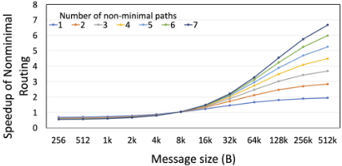

## 4.4 FlowControl

To enable SSN, the interconnection disallows dynamic arbitration since it would result in non-determinism and make it impossible for the compiler to explicitly schedule and pace every link. There is also no conventional "queuing" or buffers that are commonly found in datacenter networks, aside from very shallow buffers at the interface between the C2C logic and TSP core clock boundaries. In addition, virtual channels (VCs) [10] are commonly used to avoid routing deadlock with non-minimal global adaptive routing and guarantee circular dependencies do not occur. With softwarescheduled routing, circular dependencies between packets can still occur; however, routing deadlock is fundamentally caused when packets hold on to a resource (e.g., buffer or VC) while requesting another resource (e.g., downstream buffer). With software-scheduled networking, packets or messages are scheduled in advance; thus, the packets do not hold on to the resource while requesting another resource and routing deadlock cannot occur - and VCs are not needed. Similarly, toroidal deadlock scenarios arise in torus networks due to overlapping VC dependencies around the torus links (Fig 6b). The local group radix-8 torus topology enables efficient nearest-neighbor communication with adjacent TSPs for inference using pipelined model parallelism. With a radix-8 local group topology, we triple-connect physical links within the torus to increase the nearest-neighbor throughput. Our software-scheduled approach avoids the complexity and cost of additional virtual (or physical) channels to avoid deadlock.

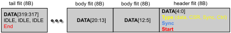

Figure 11: Packet format of a 320-byte vector has an encoding efficiency of 97.5% (320/328 bytes).

| tail flit (8B)                     | body flit (8B)   | body flit (8B)   | header flit (8B)                                  |
|------------------------------------|------------------|------------------|---------------------------------------------------|
| DATA[319:317] IDLE, IDLE, IDLE End | DATA[20:13]      | DATA[12:5]       | DATA[4:0] Type (data, CSR, Sync, Ctrl) Sync Start |

One benefit of scheduling and the lack of hardware flow control is that data no longer needs to be encapsulated into packets and messages in order to traverse the network; instead, all information about data movement has been encoded in the instruction streams produced by the compiler with only 2.5% encoding overhead (Fig 11) of each vector.

## 4.5 Forward error correction (FEC)

Point-to-point networks like PCIe typically employ a link-layer retry (e.g. a sliding-window retransmission protocol) to replay packets at the link-layer so that errors are not observed by the network or application layers. Unfortunately, this link-level retry mechanism also introduces non-deterministic behavior since it changes the expected arrival time of the retransmitted packets and thus interferes with the global synchronization of the system. Instead, to maintain determinism in the face of transmission errors, we use forward error correction (FEC) on every link to correct simple transmission errors and detect uncorrectable burst errors. This keeps the collection of point-to-point physical links deterministic between any source-destination TSP pair in the system. We route packets hop by hop through the network, correcting any transmission errors in situ, and flag any critical errors that require the runtime system to "replay" the inference (i.e. a software replay) to determine if the fault is transient and disappears after replaying the inference, or persists after a retry and requires physical intervention (e.g., to replace a marginal cable, power supply unit, or TSP card) to remedy the fault.

The scale of a parallel computer - the maximum number of processing elements in the system - is in a very practical sense limited by the reliability of the system. The TSP processing elements use a deterministic datapath and error correction of all single-bit errors (SBEs) which are corrected in situ by the TSP hardware, and detect all multi-bit errors (MBEs) so that the runtime software can replay the inference on a set of known good hardware if and when a critical error is identified.

The system reliability strategy uses N+1 redundancy by provisioning a hot spare node (Fig 6) in every deployed rack. The Dragonfly topology is both edge and node symmetric so the network remains fully-connected (ie. there is a path between every source-destination pair in the system) and is key to making this N+1 resiliency practicable. This strategy allows the runtime to monitor system health and replace any unusable nodes with the spare node as the runtime layer marshals resources for invoking the parallel program's execution. This overhead can be reduced by provisioning a redundant node per system such that, for example, a 33 node system with four racks would have 1 of 33 nodes as the spare (reducing the overhead from 11% to 3%, leaving 32 nodes (256 TSPs) for executing the parallel program. By provisioning a hot-spare node and providing a software-replay mechanism we can gracefully recover from a critical fault by having the runtime replay the inference. We protect against these critical errors with FEC on the network links and single-error correction and double-error detection (SECDED) extensively throughout the TSP's memory system, data paths, and instruction buffers.

<!-- p.9 -->

Figure 12: The abstraction layers of the hardware-software interface and software stack.

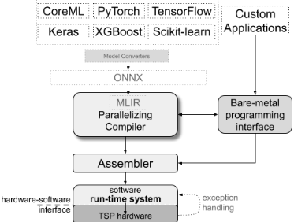

## 5 EVALUATIONANDDISCUSSION

In this section we evaluate the latency and bandwidth characteristics of several workloads from both HPC and machine learning including: distributed matrix multiplication, BERT-Large, AllReduce collective communications, and Cholesky factorization. The Cholesky workload in particular is difficult to efficiently parallelize due to a loop-carried dependence of a vector-matrix multiplication on the inner-loop. The matrix-matrix, vector-matrix, and matrix transpose operations are representative of and commonly used by many machine learning models, like sequence-to-sequence models (e.g. LSTMs) and transformers.

## 5.1 Software stack

Fig 12 illustrates the different layers of the software stack with two primary design entry points either as PyTorch or TensorFlow inputs, or a custom application on top of a bare-metal programming interface. Both bare-metal API and the compiler share the same assembler and runtime stack where the scheduled program is passed to the assembler to generate a machine-code binary that is then run on the TSP. When targeting multiple TSPs, the input model is either automatically partitioned by the compiler or manually by the programmer, and an individual TSP binary is compiled and prepared for each TSP in the system. The runtime system then emplaces all program collateral on the TSPs and synchronizes all programs (as described earlier in Section 3) so that we launch the inference simultaneously across all cooperating TSPs.

Figure 13: Matrix multiplication on an Nvidia A100 and the TSP for various Matrix sizes 𝑁 on a single chip.

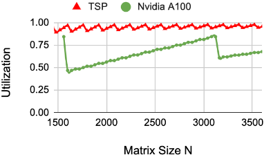

Figure 14: Performance of a matrix-matrix computation of size [800×32576]×[32576×8192] (left) latency vs number of TSPs, and (right) throughput and utilization vs number of TSPs.

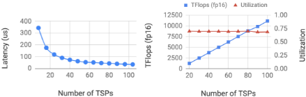

## 5.2 Distributedmatrixmultiplication

Matrix operations like vector-matrix and matrix-matrix multiplication are workhorses of ML models. To map matrix workloads (i.e. [M×N] × [N×L]) onto multiple TSPs, we take two approaches: column-wise weight splits where the second matrix ([N×L]) is split equally column-wise across multiple TSPs and the final results are then concatenated together. Alternatively, row-wise weight splits where the second matrix is split equally ([N×L] row-wise) across multiple TSPs and the first matrix ([M×N]) is split column-wise; the final result is the reduction of all the partial product matrices produced by each TSP. For single chip, the compiler decomposes a matrix multiply into [1× K]×[K × 320] sub-operations, where K=[160,320] i.e. the vector lengths of the hardware for FP16 and int8 respectively. Additionally, a TSP can run two FP16 or four int8 sub-operations each cycle. Results are shown in Fig 13 and compares the achievable utilization of the TSP and Nvidia's A100 when computing the matrix operation [2304×4096]×[4096×N], for N=[1376..3500] as described in [33]. As Fig 13 highlights, we are able to achieve at least 80% utilization consistently at different matrix sizes on the TSP, which contrasts with conventional architectures such as GPUs. Using a combination of column-wise and row-wise weight splits, we can further decompose large matrices and run them on multiple TSPs to minimize the overall latency of the operation.

To demonstrate our matrix decomposition approach, we decompose the [800×32576]×[32576×8192] operation amongst several TSPs using column-wise and row-wise weight splits. We first divide the operation into eight (8) sub-operations using column-wise splits (i.e. eight [800×32576]×[32576×(8192/8)] operations). We further decompose the operations onto more TSPs by dividing into even smaller using row-wise splits of the form [800×(32576/N)] × [(32576/N)×(8192/8)] where N=[1..13], where we try to cluster row-wise splits in a single node to leverage the Dragonfly topology. A reduction is applied within a node on all the partial results (with 8 TSPs) to create one [800×(8192/8)] result per node. Finally, if needed, the result on each node is reduced and transferred with one of its neighboring nodes over C2C until eight 800×(8192/8) results are produced. These are concatenated together to form the final [800×8192] result.

<!-- p.10 -->

Figure 15: Throughput measured in FP16 TFlops for a matrix-matrix multiplication of size N, for cluster size of 100, 200, and 300 TSPs.

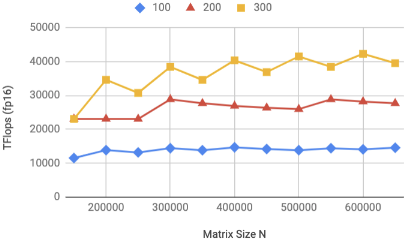

The results of distributed matrix multiplication are shown in Fig 14 where we assume a Dragonfly topology described previously, with each TSP operating at 900MHz with PCIe Gen4 ×16 host CPU interface. As Fig 14 shows, latency reduces as we perform more row-wise splits and add more TSPs since adding more TSPs adds both compute processing elements and communication (C2C) links allowing the system performance to grow proportionally as we add more TSPs.

Column-wise splits are used for large matrix operations on a cluster of TSPs to avoid any large reductions of partial products, and reduce IO bandwidth requirements that are required in rowwise splits (Fig 15 i.e. [N×N] × [N×N] is decomposed to X [N×N] × [N×(N/X)] operations run on X TSPs ). When compared to [17] which uses a cluster of Nvidia V100s, we can achieve over 100× more FP16 throughput compared to the peak performance on 432 GPUs achieving approximately 2800 (fp64) TFlops on matrix sizes of 650000×650000. Unfortunately, V100 GPU cluster results using FP16 data are not publicly known, however, despite differences in precision the TSP speedup is significant.

The results in Fig 14 highlight how using column-wise and rowwise weight splits complement each other and can yield extremely low-latency matrix-matrix operations. The split scheme produces good results for the matrix dimensions we used. However, depending on the ML model or workload, these dimensions can vary drastically - yielding different split schemes. For example, in scenarios where the resultant matrix is relatively small, row-wise splits outperform column-wise splits, since communication bandwidth needs are limited. Additionally, with the Dragonfly topology, reductions within a node are extremely efficient since each TSP within the node has direct access to the other 7 TSPs within that node.

The input bandwidth requirements vary drastically depending on the data ordering of the computation. Decomposing a matrix-matrix operation on a single TSP involves decomposing the operations into a sequence of [1×K] × [K×320] operations, where K=160 for FP16 or K=320 for int8 data values. Depending on the sequence of K×320 tiles we load into the matrix multiply unit on the TSP, the bandwidth requirements can change drastically. For example, for a [100000×100000] secondary weight matrix, if K×320 tiles are loaded in column-major order (i.e. load rows 0-159, followed by rows 160-320, and so on) this requires approximately 570 GB/s of incoming bandwidth to the chip in order to maintain the computation throughput. However, traversing the secondary weight matrix in row-major order reduces demand on incoming bandwidth to only 3.7 GB/s which is well within the channel capacity of a 16-lane PCIe Gen4 link. In our results shown in Fig 15, we are assuming input matrices are streamed over PCIe in the order (row, or column-order) that minimizes the injected data volume transferred across PCIe.

## 5.3 All-Reduce Bandwidth

Collective operations are used to provide global communication among cooperating processing elements. These performancecritical operations often bottleneck the overall system performance because they are constrained by the slowest link - the network link having highest channel load - making it critical to "load balance" the physical links of the network to avoid variation in the communication latency among the communicating TSPs. Fig 16 shows the effective (realized) bandwidth performing an 8-way AllReduce operation across different tensor sizes, with a zoomed-in region showing the performance for different message sizes [27]. The combination of synchronous communication over a direct network with very low overhead (Fig 11) allows the All-Reduce to quickly saturate the available network capacity.

A GPU or CPU system with shared-memory semantics will communicate results via shared DRAM, and requires a flag (mutex) to indicate when the data is produced (ie. globally visible) and can safely be consumed. After writing the data, but before writing the flag, a memory fence is required to ensure sequential consistency between the producer and the consumer. This "lock-based" shared memory mailbox is flexible [27], but it requires an additional semaphore for coordination (the mutex, or flag variable) which is unnecessary on the Groq system since the compiler tracks the total ordering of memory references and global time of reference, it does not require the added flag to signal the consumer. Instead,

Figure 16: Realized throughput of an 8-way AllReduce.

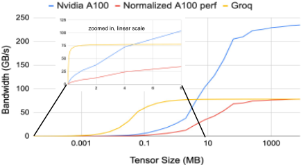

<!-- p.11 -->

Figure 17: BERT-Large latency histogram across 24,240 runs.

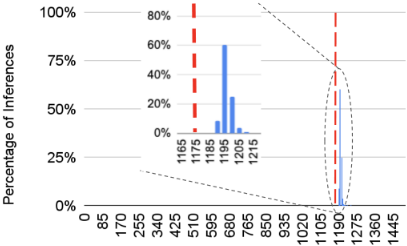

the consumer will respect the data dependence and only be issued after the data is updated, ensuring a sequentially consistent view of global memory. We see the effect of this shared-memory overhead in Fig 16 (zoomed in) as the Groq system outperforms competitive systems on fine-grained communication 5 , despite the A100 having more pin bandwidth. The normalized results for A100 shows the performance of A100 if the total pin bandwidth was normalized to the pin bandwidth of a TSP. When normalized, the performance (or throughput) of TSP AllReduce matches A100 at large tensor size while significantly outperforming A100 at smaller tensor size.

## 5.4 Transformers on TSPs

In order to illustrate the predictable and deterministic nature of our TSP at scale, we execute a single inference of BERT-Large running on four TSPs within a GroqNode 24,240 times, using SQuAD1.1 dev Dataset, and measure the latency of the inference which includes the input read and write time over PCIe. Once measured, we bin each time into 5𝜇s bins which is plotted in Fig 17, which shows the zoomed in histogram plot. The results show that 99% of inferences return in under 1225 𝜇s, with all of them returning by 1300𝜇s. The dotted line at 100% highlights the estimated latency returned by our compiler, and shows that it is within 2% of the actual measured latency in the majority of cases. The deviation and variance between estimated and measured is due to the extended invocation time of the PCIe data transfer for the input and output transfers when running BERT-Large on 4 TSPs. When executing BERT-Base on a single TSP, we see a similar relationship between the estimated and measured latency, where their results are within 2% of each other.

As we add processing elements (TSPs) to the system, we are simultaneously adding both compute resources (vector and matrix ALUs) as well as communication links to the (direct) interconnection network. In addition the the predictable nature of the TSP at scale, Groq TSPs are able to achieve linear scaling as you add more TSPs to the system. This is illustrated in Fig 18 which shows the realized TOPs when executing transformer models, normalized to the execution time on a single TSP. In this run, we scale a BERT

5 Results for A100 were measured on an 8 A100 GPU system with 300 GB/s of NVlink bandwidth per GPU connected through NVSwitch. The measurements are from nccl-tests [34] and results of bus bw is shown.

Figure 18: BERT encoders executed on 1, 4, 8, and 16 TSPs, and normalized to the realized throughput (TOPs) on a single TSP.

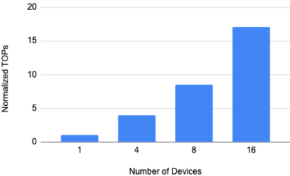

model size from 6, to 24, 48, and 96 encoders and run it on 1, 4, 8 and 16 TSPs respectively. Due to linear scaling, we are able to scale the realized throughput proportionally to the number of devices. For example by increasing the compute capacity to 4 TSPs, we are able to realize 4× more throughput (realized TeraOps) when compared to the execution of BERT on a single TSP.

## 5.5 Cholesky factorization on TSPs

The matrix multiplication unit on the TSP consumes two matrices 𝐴 and 𝐵, containing floating-point values with dimensions at most 160×320, and generates the output 𝐴𝐵𝑇 . The inputs are read from stream registers flowing outward, away from the vector processing unit in the center of the chip, and the output is written to stream registers flowing inward, toward the vector processing unit. After generating an update vector 𝑆 with the matrix multiplication unit, each iteration of Cholesky modifies it with these vector operations:

Figure 19: Cholesky factorization across multiple TSPs.

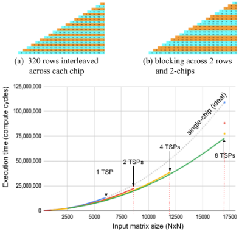

<!-- p.12 -->

```
def cho l esky_vec tor_ops ( S , U, i ) : ( n , m) = np . shape ( S ) I = S [ i : n , [ i ] ] - U[ 0 : n - i , [ 0 ] ] s p l a t = r s q r t ( I [ 0 ] [ 0 ] ) updates = I [ 0 : n - i , [ 0 ] ] ∗ s p l a t return ( updates )
```

Here, 𝑆 is the input matrix, 𝑖 is the index of the current iteration, and 𝑟𝑠𝑞𝑟𝑡 is a custom approximation of the reciprocal square root function. All of these operations are mapped onto the ALUs in the vector processing unit in order to modify the data in a single fly-by. We implement Cholesky by channeling the data through the matrix and vector units alternately. The matrix is partitioned across multiple TSPs as shown in Fig 19(a) and (b), we use a block-cyclic distribution of 320 rows on each TSP. The overall parallel execution time for Cholesky factorization is proportional to 𝑝 3 3 for a 𝑝 × 𝑝 input matrix, that when executed on multiple TSPs yields a net speedup of 1.2×, 1.4×, and 1.5× for 2, 4, and 8 TSPs, respectively as shown in Fig 19(c). We show good scaling from 14.9 FP16 TFlops on 4 TSPs to 22.4 FP16 TFlops on 8 TSPs, with 3× realized throughput compared to the best known results [16].

## 5.6 Traffic patterns

The TSPs participating in model parallel workload will exchange global results using an all-reduce across the system to distribute the result. This "collective" operation decomposes to many finegrained vector reductions that are accumulated and then broadcast across all participants. We use non-minimal routing and per-device compute capacity to efficiently distribute and accumulate partial reductions bidirectionally. The worst-case latency in a 256-TSP Dragonfly uses only three (3) hops and thus an all-reduce across all TSPs has a pipelined network latency of 722 ns per hop ×3 hops = 2,166 ns, or ≈2.1 𝜇sec. A three-stage, hierarchical all-reduce uses the 8-way fully connected TSPs within each node as the first stage, the four global links between nodes for the second stage, and final 8-way fully connected network within each node to complete the hierarchical all-reduce.

In Fig 20, we show the performance breakdown of a 4-TSP system running BERT-Large, including the communication time (C2C) and compute time. To illustrate the importance of load-balancing the functional units, we show results for both (a) our initial (unoptimized) compiler implementation which partitioned the workload by balancing only FLOPs (floating point operations), whereas (b) the optimized compiler carefully considers data movements to exploit the spatial organization of the TSP. The optimized implementation results in approximately 26% improvement in realized throughput.

## 6 RELATEDWORK

Scale-out Machine Learning Systems: State of the art NLP workloads have billions of model parameters requiring both memory capacity and bandwidth to move those parameters into the PEs where they are computed on. The software-defined Dragonfly network allows the TSPs in the system to communicate synchronously with no wasted execution incurred for barriers. Different scaleout systems have been proposed, including Google TPU [42] that uses proprietary interconnect to scale out TPUs using a 2D torus topology. Habana Gaudi [29] training chips uses commodity ethernet to provide full connectivity within a server while enabling scale-out through ethernet as well. Nvidia DGX Pod [32] scales out using NVlink within a DGX system while Infiniband is used to scale-out the systems. Tesla [22] outlined a high-radix topology to scale-out their training system. However, all of these systems are fundamentally based on hardware-defined networks; in comparison, this work addresses how software-scheduled network can be leveraged to enable deterministic communication.

Figure 20: Performance breakdown of BERT-Large on a 4TSP system with (a) an un-optimized and (b) an optimized compiler.

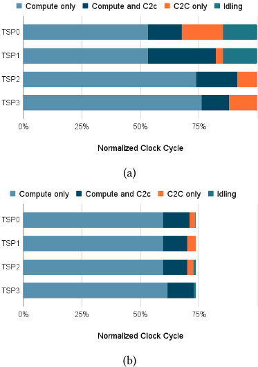

High-Radix Networks: Dragonfly topology [25] has been proposed for scalable large-scale systems in high-performance computing. Different variations of Dragonfly have been proposed including Dragonfly+ [40] and MegaFly [14]. Cray/HPE have implemented a Dragonfly topology with different group topology in their XC systems [4] and their Slingshot network [37] while providing allto-all connectivity between the groups. To exploit the path diversity of the Dragonfly topology, different global adaptive routing algorithms [20, 41] have been proposed to enable higher performance across different traffic patterns. However, all prior work have focused on hardware-based Dragonfly network; in comparison, this work proposes a software-scheduled Dragonfly network that presents different opportunities as well as challenges. Spreading the offered traffic across available physical links to increase the throughput and reduce the observed message latency is the goal of adaptive routing [15][20][2]; however, prior adaptive routing was done in hardware while this work proposes a software scheduled routing. To minimize performance variations in a multi-hop network, globally fair arbitration have been proposed. Age-based arbitration [2] has been implemented to enable global fairness and techniques such as equality-of-service [28] has been proposed to approximate global fairness. However, while globally fair arbitration can improve fairness, it does not provide determinism.

<!-- p.13 -->

Deterministic Execution: Many hardware/software techniques have been proposed to enable determinism in general-purpose multi-core processors [5, 13, 18, 35]. Recently, similar deterministic execution have been proposed for GPUs [8, 21] as well as data-parallel environments [12] and high-performance computing

[9] to enable reproducible execution. While prior work have proposed deterministic execution across different processor architectures, with support from both software and hardware, to the best of our knowledge, no prior work have explored how deterministic execution can be achieved across multiple nodes of a scale-out system.

## 7 CONCLUSION

We describe the system architecture of a novel, purpose-built commercial system for scalable ML and converged HPC applications. The novel source-based, software-scheduled routing algorithm allows the automatic parallelizing compiler to load balance the global links of the Dragonfly network. This deterministic load balancing allows the compiler to schedule the physical network channels by spreading a large tensor across multiple non-minimal paths to maximize throughput, or use minimal routing to accomplish a barrier-free all-reduce with minimal end to end latency. We demonstrate and discuss system performance on representative workloads like distributed matrix multiplication, All-Reduce, BERT-Large, and Cholesky factorization. We extend the Groq's TSP stream programming model from a single-chip to large scale system-wide determinism using a combination of hardware-alignment counters and ISA support to facilitate runtime deskew operations to provide the illusion of a globally synchronous distributed system.

## ACKNOWLEDGEMENTS

With any new endeavor where the starting point is simply an idea, a lot of people and effort goes into synthesizing that idea and bringing it to fruition. We would like to thank the anonymous reviewers for their helpful comments. We would like to thank Greg Thorson for early contributions to this work. Special thanks to Mike Cherba and Sarah Massengill for detailed comments on early drafts of the manuscript.

## REFERENCES

- [1] Dennis Abts, Jonathan Ross, Jonathan Sparling, Mark Wong-VanHaren, Max Baker, Tom Hawkins, Andrew Bell, John Thompson, Temesghen Kahsai, Garrin Kimmell, Jennifer Hwang, Rebekah Leslie-Hurd, Michael Bye, E.R. Creswick, Matthew Boyd, Mahitha Venigalla, Evan Laforge, Jon Purdy, Purushotham Kamath, Dinesh Maheshwari, Michael Beidler, Geert Rosseel, Omar Ahmad, Gleb Gagarin, Richard Czekalski, Ashay Rane, Sahil Parmar, Jeff Werner, Jim Sproch, Adrian Macias, and Brian Kurtz. 2020. Think Fast: A Tensor Streaming Processor (TSP) for Accelerating Deep Learning Workloads. In 2020 ACM/IEEE 47th Annual International Symposium on Computer Architecture (ISCA). 145-158. https://doi.org/10.1109/ISCA45697.2020.00023
- [2] Dennis Abts and Deborah Weisser. 2007. Age-Based Packet Arbitration in LargeRadix k-ary n-cubes. In Proceedings of the 2007 ACM/IEEE Conference on Supercomputing (Reno, Nevada) (SC '07). Association for Computing Machinery, New
3. [York, NY, USA, Article 5, 11 pages. https://doi.org/10.1145/1362622.1362630](https://doi.org/10.1145/1362622.1362630)
- [3] Jung Ho Ahn, Nathan Binkert, Al Davis, MorayMcLaren, and Robert S. Schreiber. 2009. HyperX: Topology, Routing, and Packaging of Efficient Large-Scale Networks. In Conference on High Performance Computing Networking, Storage and Analysis (SC). 1-11.
- [4] Bob Alverson, Edwin Froese, Larry Kaplan, and Duncan Roweth. 2012. The Cray XC Scaleable System. In Cray Inc. White Paper.
- [5] Tom Bergan, Owen Anderson, Joseph Devietti, Luis Ceze, and Dan Grossman. 2010. CoreDet: A Compiler and Runtime System for Deterministic Multithreaded Execution. In Proceedings of the Fifteenth International Conference on Architectural Support for Programming Languages and Operating Systems (Pittsburgh, Pennsylvania, USA) (ASPLOS XV). Association for Computing Machinery, New York, NY, USA, 53-64. https://doi.org/10.1145/1736020.1736029
- [6] Tom B Brown, Benjamin Mann, Nick Ryder, Melanie Subbiah, Jared Kaplan, Prafulla Dhariwal, Arvind Neelakantan, Pranav Shyam, Girish Sastry, Amanda Askell, et al. 2020. Language models are few-shot learners. arXiv preprint arXiv:2005.14165 (2020).
- [7] Cerebras CS-1. 2021. http://cerebras.net. http://cerebras.net (2021).
- [8] Yuan Hsi Chou, Christopher Ng, Shaylin Cattell, Jeremy Intan, Matthew D. Sinclair, Joseph Devietti, Timothy G. Rogers, and Tor M. Aamodt. 2020. Deterministic Atomic Buffering. In 2020 53rd Annual IEEE/ACM International Symposium on Microarchitecture (MICRO). 981-995. https://doi.org/10.1109/MICRO50266.2020. 00083
- [9] Caroline Collange, David Defour, Stef Graillat, and Roman Iakymchuk. 2014. A Reproducible Accurate Summation Algorithm for High-Performance Computing. In Technical Report HAL-00949355, INRIA,.
- [10] William J. Dally. 1992. Virtual-Channel Flow Control. IEEE Transactions on Parallel and Distributed Systems 3, 2 (1992), 194-205.
- [11] W. J. Dally and B. Towles. 2004. Principles and Practices of Interconnection Networks. Morgan Kaufmann, San Francisco, CA.
- [12] David Defour and Sylvain Collange. 2015. Reproducible floating-point atomic addition in data-parallel environment.. In FedCSIS (Annals of Computer Science and Information Systems, Vol. 5). IEEE, 721-728. http://dblp.uni-trier.de/db/conf/ fedcsis/fedcsis2015.html#DefourC15
- [13] Joseph Devietti, Brandon Lucia, Luis Ceze, and Mark Oskin. 2009. DMP: Deterministic Shared Memory Multiprocessing. In Proceedings of the 14th International Conference on Architectural Support for Programming Languages and Operating Systems (Washington, DC, USA) (ASPLOS XIV). Association for Computing Machinery, New York, NY, USA, 85-96. https://doi.org/10.1145/1508244.1508255
- [14] Mario Flajslik, Eric Borch, and Mike A. Parker. 2018. Megafly: a topology for exascale systems. In High Performance Computing, Rio Yokota, Michèle Weiland, David Keyes, and Carsten Trinitis (Eds.). Springer International Publishing, Cham, 289-310.
- [15] Christopher J. Glass and Lionel M. Ni. 1992. The turn model for adaptive routing. In Proceedings of the International Symposium on Computer Architecture.
- [16] Azzam Haidar, Ahmad Abdelfatah, Stanimire Tomov, and Jack Dongarra. 2017. High-performanceCholesky factorization for GPU-only execution. In Proceedings of the General Purpose GPUs. ACM New York, NY, USA, 42-52.
- [17] Thomas Herault, Yves Robert, George Bosilca, and Jack Dongarra. 2019. Generic Matrix Multiplication for Multi-GPU Accelerated Distributed-Memory Platforms over PaRSEC. In 2019 IEEE/ACM 10th Workshop on Latest Advances in Scalable Algorithms for Large-Scale Systems (ScalA). 33-41. https://doi.org/10.1109/ ScalA49573.2019.00010
- [18] Derek R. Hower, Polina Dudnik, Mark D. Hill, and David A. Wood. 2011. Calvin: Deterministic or not? Free will to choose. In 2011 IEEE 17th International Symposium on High Performance Computer Architecture. 333-334. https: //doi.org/10.1109/HPCA.2011.5749741
- [19] Yanping Huang, Youlong Cheng, Ankur Bapna, Orhan Firat, Dehao Chen, Mia Chen, HyoukJoong Lee, Jiquan Ngiam, Quoc V Le, Yonghui Wu, et al. 2019. Gpipe: Efficient training of giant neural networks using pipeline parallelism. Advances in neural information processing systems 32 (2019), 103-112.
- [20] Nan Jiang, John Kim, andWilliam J. Dally. 2009. Indirect Adaptive Routing on Large Scale Interconnection Networks. In Proceedings of ISCA'09. Austin, TX, 220-231.
- [21] Hadi Jooybar, Wilson W.L. Fung, Mike O'Connor, Joseph Devietti, and Tor M. Aamodt. 2013. GPUDet: A Deterministic GPU Architecture. In Proceedings of the Eighteenth International Conference on Architectural Support for Programming Languages and Operating Systems (Houston, Texas, USA) (ASPLOS '13). Association for Computing Machinery, New York, NY, USA, 1-12. https: //doi.org/10.1145/2451116.2451118
- [22] Andrej Karpathy. 2021. Keynote at Workshop on Autonomous Driving.
- [23] Parviz Kermani and Leonard Kleinrock. 1979. Virtual cut-through: A new computer communication switching technique. Computer Networks (1976) 3, 4 (1979), 267-286.
- [24] John Kim, James Balfour, andWilliamDally. 2007. Flattened butterfly topology for on-chip networks. In Proceedings of the 40th Annual IEEE/ACM International Symposium on Microarchitecture. IEEE Computer Society, 172-182.

<!-- p.14 -->

- [25] JohnKim,William J Dally, Steve Scott, andDennis Abts. 2008. Technology-driven, highly-scalable dragonfly topology. In ACM SIGARCH Computer Architecture News, Vol. 36:3. IEEE Computer Society, 77-88.
- [26] John Kim, William J. Dally, Brian Towles, and Amit K. Gupta. 2005. Microarchitecture of a High-Radix Router. In ISCA '05: Proceedings of the 32nd Annual International Symposium on Computer Architecture. IEEE Computer Society, Madison, WI, USA, 420-431.
- [27] Benjamin Klenk, Nan Jiang, Greg Thorson, and Larry Dennison. 2020. An InNetwork Architecture for Accelerating Shared-Memory Multiprocessor Collectives. In 2020 ACM/IEEE 47th Annual International Symposium on Computer Architecture (ISCA). 996-1009. https://doi.org/10.1109/ISCA45697.2020.00085
- [28] Michael M. Lee, John Kim, Dennis Abts, Michael Marty, and Jae W. Lee. 2010. Probabilistic Distance-Based Arbitration: Providing Equality of Service for Many-Core CMPs. In Proceedings of the 2010 43rd Annual IEEE/ACM International Symposium on Microarchitecture (MICRO '43). IEEE Computer Society, USA, 509-519. https://doi.org/10.1109/MICRO.2010.18
- [29] Eitan Medina. 2019. Habana Labs Approach to Scaling AI Training. In Hot Chips 31 Symposium, Palo Alto, CA, USA.
- [30] Deepak Narayanan, Aaron Harlap, Amar Phanishayee, Vivek Seshadri, Nikhil R Devanur, Gregory R Ganger, Phillip B Gibbons, and Matei Zaharia. 2019. PipeDream: generalized pipeline parallelism for DNN training. In Proceedings of the 27th ACM Symposium on Operating Systems Principles. 1-15.
- [31] Deepak Narayanan, Mohammad Shoeybi, Jared Casper, Patrick LeGresley, Mostofa Patwary, Vijay Anand Korthikanti, Dmitri Vainbrand, Prethvi Kashinkunti, Julie Bernauer, Bryan Catanzaro, et al. 2021. Efficient large-scale language model training on gpu clusters. arXiv preprint arXiv:2104.04473 (2021).
- [32] NVIDIA. 2011. NVidia DGX POD. https://www.nvidia.com/en-us/data-center/ dgx-pod- reference-architecture/
- [33] Nvidia. 2021. Matrix Multiplication Background, User Guide. Technical Report. NVIDIA.
- [34] [NVIDIA. 2021. NCCL Tests. https://github.com/NVIDIA/nccl-tests/](https://github.com/NVIDIA/nccl-tests/)
- [35] Marek Olszewski, Jason Ansel, and Saman Amarasinghe. 2009. Kendo: Efficient Deterministic Multithreading in Software. In Proceedings of the 14th International Conference on Architectural Support for Programming Languages and Operating Systems (Washington, DC, USA) (ASPLOS XIV). Association for Computing Machinery, New York, NY, USA, 97-108. https://doi.org/10.1145/1508244.1508256
- [36] Raghu Prabhakar, Yaqi Zhang, David Koeplinger, Matt Feldman, Tian Zhao, Stefan Hadjis, Ardavan Pedram, Christos Kozyrakis, and Kunle Olukotun. 2017. Plasticine: A Reconfigurable Architecture For Parallel Paterns. In International Symposium on Computer Architecture (ISCA). 389-402.
- [37] Steve Scott. 2019. Rosetta: A 64-port Switch for Cray's Slingshot Interconnect. Keynote 2, HOTI.
- [38] Steve Scott, Dennis Abts, John Kim, and William J. Dally. 2006. The BlackWidow High-Radix Clos Network. In Proceedings of the 33rd Annual International Symposium on Computer Architecture (ISCA '06). IEEE Computer Society, USA, 16-28. https://doi.org/10.1109/ISCA.2006.40
- [39] Mohammad Shoeybi, Mostofa Patwary, Raul Puri, Patrick LeGresley, Jared Casper, and Bryan Catanzaro. 2019. Megatron-lm: Training multi-billion parameter language models using model parallelism. arXiv preprint arXiv:1909.08053 (2019).
- [40] A. Shpiner, Z. Haramaty, S. Eliad, V. Zdornov, B. Gafni, and E. Zahavi. 2017. Dragonfly+: low cost topology for scaling datacenters. In 2017 IEEE 3rd International Workshop on High-Performance Interconnection Networks in the Exascale and Big-Data Era (HiPINEB). 1-8. https://doi.org/10.1109/HiPINEB.2017.11
- [41] JongminWon, Gwangsun Kim, John Kim, Ted Jiang, Mike Parker, and Steve Scott. 2015. Overcoming Far-end Congestion in Large-Scale Networks. In IEEE 21st International Symposium on High Performance Computer Architecture (HPCA).
- [42] Cliff Young. 2017. Evaluation of the Tensor Processing Unit: A Deep Neural Network Accelerator for the Datacenter. In Hot Chips 29 Symposium, Palo Alto, CA, USA.
