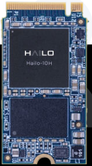
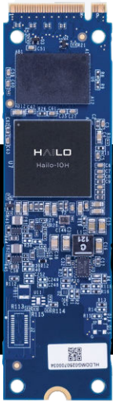
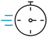
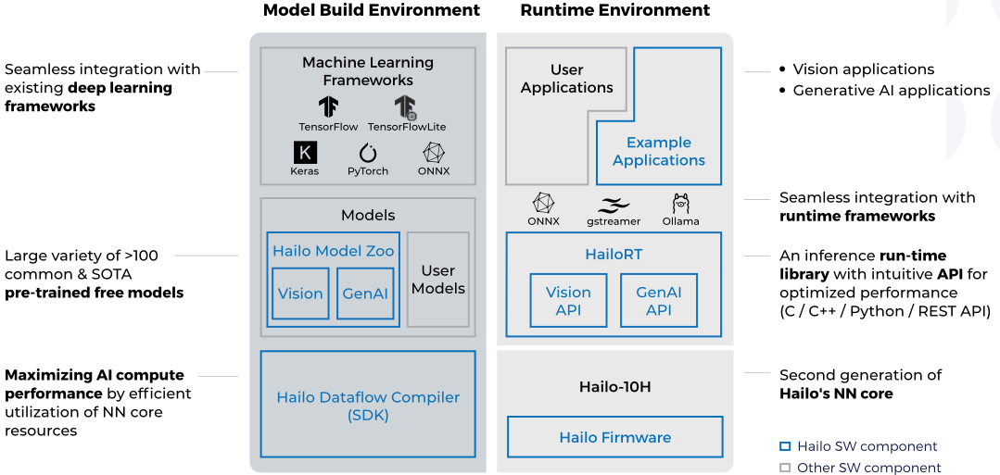

> 本文件由 `Hailo-10H-M2-ET-Product-Brief.pdf` 自动转换（docling 2.140.0，2026-10-17）。图片在 `images/` 目录；表格与数字请以 PDF 原文为准；`<!-- p.N -->` 标记对应 PDF 第 N 页。

<!-- p.1 -->

## Hailo-10H M.2 Key M ET AI Acceleration Module

Immersive generative AI experience on the edge

## Key Features &amp; Benefits

High-performance processing of vision and generative AI models

Featuring the Hailo-10H AI accelerator with 40|20 TOPS (INT4|8)

Best-in-class power efficiency; Consumes 2.5W (typical)

First to market AI accelerator with generative AI capabilities

Second generation of Hailo's market leading AI accelerator Robust and mature software suite, supported by the world's largest edge AI community Industrial grade, supporting -40°C to 85°C

## Always On - AI on the Edge

Local AI processing enables:

## Cost Efficiency

- → Reduce bandwidth consumption
- → No paid subscription to cloud-base AI tools

## Availability

Continues access to essential applications, even in offline mode

## Responsiveness

Low latency and enhanced user experience

## Privacy

No transmission of personal and business-sensitive data to cloud

## Technical Specifications

Form factor

M.2 Key M (2242, 2280)

ON-Module DDR

4|8GB LPDDR4/4X

## Interface

PCIe Gen-3.0, 4-lanes (x4)

Supported host architectures x86 or ARM

## Supported AI frameworks

TensorFlow, TensorFlow Lite, Keras, PyTorch &amp; ONNX

## Supported operating systems

Linux, Windows, Android

## Featuring the Hailo-10H AI Accelerator

The Hailo-10H unique, powerful and scalable structure-driven dataflow architecture takes advantage of the core properties of neural networks. It enables edge devices to run deep learning applications at full scale more efficiently and effectively than traditional solutions, while significantly lowering costs.

<!-- p.2 -->

## Comprehensive Software Suite

AI software suite which seamlessly integrates with existing deep learning development frameworks to allow smooth and easy integration in existing development ecosystems. The Hailo AI software suite includes:

## Hailo Ecosystem

Hailo collaborates with leading partners to seamlessly integrate their products with ours, creating easy-to-use, dependable, and highquality solutions that adhere to the industry's most rigorous standards. Our extensive network of high quality partners covers various regions and market segments, delivering innovative solutions to our customers.

To view our extensive network click here

## System Usage

M.2 module connected to the various types of host processors via PCIe.

www.hailo.ai Click here for more information &amp; product inquiry

