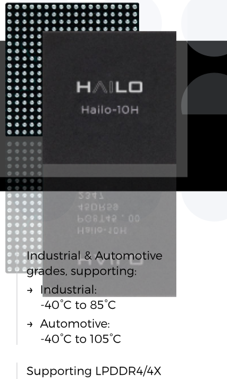
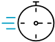
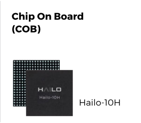
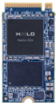
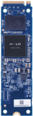
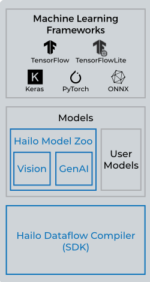
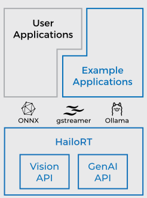

> 本文件由 `Hailo-10H-Product-Brief.pdf` 自动转换（docling 2.140.0，2026-10-17）。图片在 `images/` 目录；表格与数字请以 PDF 原文为准；`<!-- p.N -->` 标记对应 PDF 第 N 页。

<!-- p.1 -->

## Hailo-10H AI Accelerator

Immersive generative AI experience on the edge

## Key Features &amp; Benefits

High-performance processing of vision and generative AI models

40|20 TOPS (INT4|8)

Best-in-class power efficiency; Consumes 2.5W (typical)

First to market AI accelerator with generative AI capabilities

Second generation of Hailo's market leading AI accelerator

Robust and mature software suite, supported by the world's largest edge AI community

## Always On - AI on the Edge

Local AI processing enables:

## Cost Efficiency

- → Reduce bandwidth consumption
- → No paid subscription to cloud-base AI tools

## Availability

Continues access to essential applications, even in offline mode

## Responsiveness

Low latency and enhanced user experience

## Privacy

No transmission of personal and business-sensitive data to cloud

Hailo-10H Offering

## Modules

Enable fast time to market &amp; easy hardware integration

Hailo-10H M.2 2242

Hailo-10H M.2 2280

## Hailo-10H Neural Core Architecture

Proprietary, powerful and scalable structure-driven dataflow architecture that takes advantage of the core properties of neural networks. It enables edge devices to run deep learning applications at full scale more cost-effectively and power-efficiently than any other solution in the market.

<!-- p.2 -->

## Comprehensive Software Suite

AI software suite which seamlessly integrates with existing deep learning development frameworks to allow smooth and easy integration in existing development ecosystems. The Hailo AI software suite includes:

## Model Build Environment

Seamless integration with existing deep learning frameworks

Large variety of &gt;100

common &amp; SOTA

pre-trained free models

Maximizing AI compute performance by efficient utilization of NN core resources

## Runtime Environment

- Vision applications
- Generative AI applications
- Seamless integration with runtime frameworks
- An inference run-time library with intuitive API for optimized performance (C / C++ / Python / REST API)

Second generation of Hailo's NN core

- Hailo SW component
- Other SW component

## Neural Network Models &amp; Application Support

AI frameworks: TensorFlow, TensorFlow Lite, Keras, PyTorch &amp; ONNX

## System Usage

Co-processor connected to the various types of host processors via PCIe and USB

Part Number Hailo-10H Industrial: HNC2HBI11SM

www.hailo.ai Starter Kit M.2 module with Hailo-10H for development &amp; prototyping of edge AI applications Product Inquiry Host Architectures: x86, ARM

OSs: Linux, Windows, Android Comprehensive Dataflow Compiler enables customer to port their neural network models easily &amp; quickly

