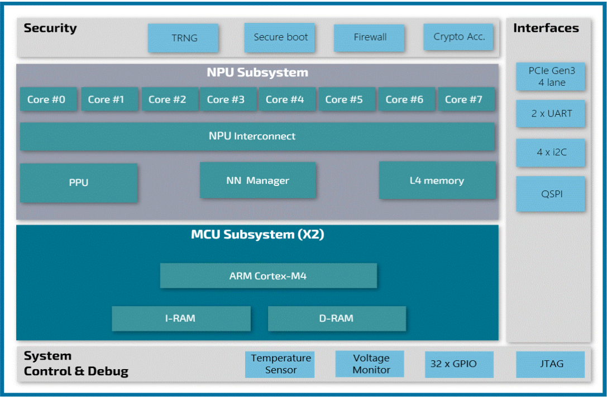
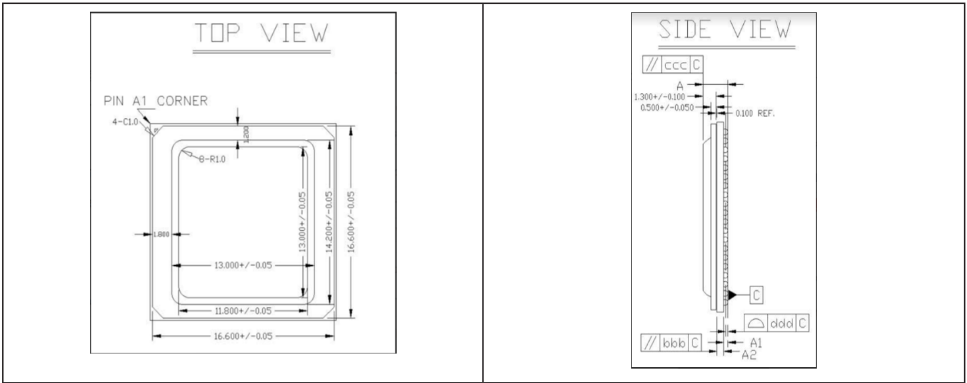
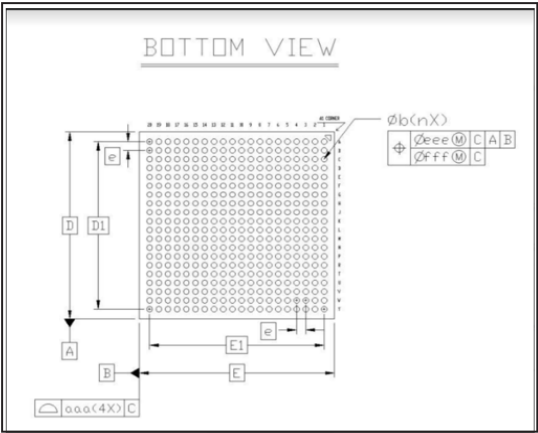
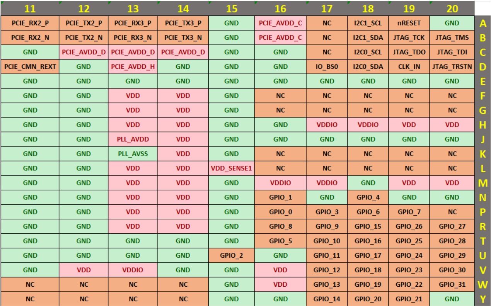
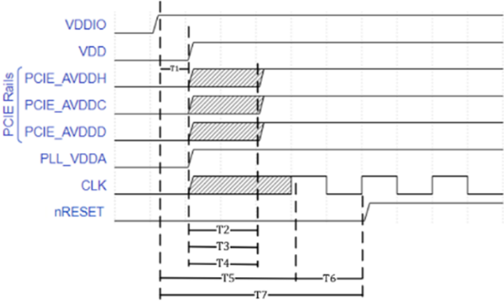
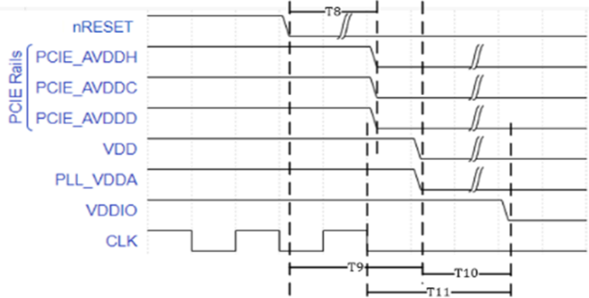
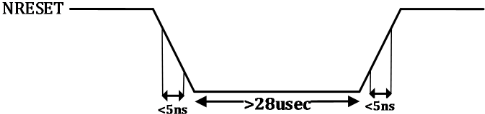
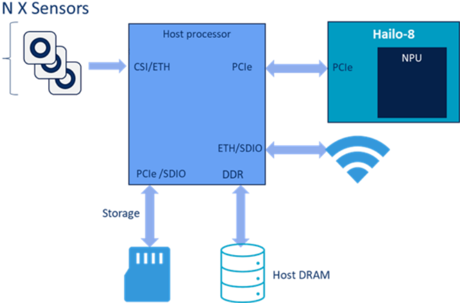

> 本文件由 `Hailo-8-Datasheet.pdf` 自动转换（docling 2.140.0，2026-10-17）。图片在 `images/` 目录；表格与数字请以 PDF 原文为准；`<!-- p.N -->` 标记对应 PDF 第 N 页。

<!-- p.1 -->

## Hailo-8™ Datasheet

Revision 1.9.2

April 2026

## Part Number

## Industrial: HNC18BI11BH

<!-- p.2 -->

## Disclaimer and Proprietary Information Notice

## Copyright

© 2026 Hailo Technologies Ltd ("Hailo"). All rights reserved.

No part of this document may be reproduced or transmitted in any form without the express, written permission of Hailo. Nothing contained in this document should be construed as granting any license or right to use proprietary information without the written permission of Hailo.

This version of the document supersedes all previous versions.

## General Notice

To the fullest extent permitted by law, Hailo provides this document "as is" and disclaims all warranties, either express or implied, statutory, or otherwise, including but not limited to the warranties of merchantability, noninfringement of third-party rights, and fitness for particular purposes.

This document may inadvertently contain technical inaccuracies or other errors. Hailo assumes no liability for any such errors and for damages, whether direct, indirect, incidental, consequential, or otherwise, that may result from such errors, including but not limited to loss of data or profits.

The content in this document is subject to change without notice. Hailo reserves the right to make changes to document content without notification to users.

## Trademarks

All trademarks, trade names and logos of Hailo ® are and shall remain the sole property of Hailo Technologies Ltd. We make use of such software, tools, systems and other components of third parties as detailed in this document. Any reference made in this document to such third party is only a description of our use or compatibility with such third party's product, software, tool or system. No reference or attribution made by us suggests partnership, cooperation or endorsement of Hailo® or any of our products or parts thereof by such third party. All rights, title and interest in and to the trademarks, trade names and logos of third parties included in this document are and shall remain of its legal owner.

D-PHY™ is a trademark of MIPI Alliance, Inc. All service marks, logos, trademarks and trade names relating to MIPI® and MIPI activities are owned by MIPI Alliance, Inc. and any use of such marks by Hailo Technologies Ltd. is under license

Arm ® , CoreSight™, Cortex ® TrustZone ® are registered trademarks of Arm Limited (or its subsidiaries or affiliates) in the US and/or elsewhere.

MIPI® and CSI-2® are registered trademarks of MIPI Alliance, Inc.

All rights reserved. Synopsys &amp; DesignWare are registered trademarks of Synopsys, Inc.

©Cadence Design Systems, Inc. All rights reserved worldwide. Cadence®, the Cadence® logo are registered trademarks of Cadence Design Systems, Inc.

PCIe ® and PCI Express ® are registered trademarks of PCI-SIG.

## Copyright

SDIO Portions Copyright © 2025 Synopsys, Inc. Used with permission.

DDR, D-PHY and USB Portions Copyright © 2025 Cadence Design Systems, Inc. Used with permission.

<!-- p.3 -->

## Documentation Control

## History Table

| Revision   | Date           | Description                                                                                                                                                                                                                                                                                       |
|------------|----------------|---------------------------------------------------------------------------------------------------------------------------------------------------------------------------------------------------------------------------------------------------------------------------------------------------|
| 1.0        | September 2021 | Mass Production release                                                                                                                                                                                                                                                                           |
| 1.0.1      | September 2021 | Table 4 - Updated RGMII signals direction                                                                                                                                                                                                                                                         |
| 1.0.2      | January 2022   | Section 1.5 - updated block diagram Section 2.1 - Pinout Description - added Top View description, added VDDIO to legend. Section 4.4.2 - added average values for VDD Changed BootStrap section position. Corrected commercial P/N on tile page                                                  |
| 1.0.3      | March 2022     | Section 1.3 - Removed option for C2C connection Section 5.2 - editorial changes Section 2.2 added description of IO_BS0 to Table 4 added missing J3 Ball corrected NRESET Ball number to A19 Section 4.1 - Analog power rails Maximum ratings of the Voltage and temperature sensors were changed |
| 1.1        | December 2022  | Corrected typos in Ball chart Section 2.2-U5 removed from GND Replaced V3 with A19 Section 2.2 U5 and J3 added to RESERVED                                                                                                                                                                        |
| 1.2        | August 2023    | Section 4.3 Updated Power-up sequence and timing requirements                                                                                                                                                                                                                                     |
| 1.3        | October 2023   | Section 5.1 Updated System modes and usage scenarios                                                                                                                                                                                                                                              |
| 1.4        | December 2023  | Section 4.4.1 updated VDDIO to 300 mA Typo correction on pin names PCIE_REFCLK and CSI_TX _CLK                                                                                                                                                                                                    |
| 1.5        | August 2024    | Updated Functional Assignment table                                                                                                                                                                                                                                                               |
| 1.6        | April 2025     | Updated power rail voltage values Section 4.1.1                                                                                                                                                                                                                                                   |
| 1.7        | August 2025    | Maximum PCIe payload for Hailo-8™ is 256 Byte                                                                                                                                                                                                                                                     |
| 1.8        | December 2025  | Revised datasheet                                                                                                                                                                                                                                                                                 |
| 1.9        | January 2026   | Changed pin U5 from GND to RSVD in the pin chart Added more test cases to Section 4.5.2                                                                                                                                                                                                           |
| 1.9.1      | February 2026  | Added H19, H20, M19, M20, V04, V06, V10, V12 and U04 to the Functional Assignment table                                                                                                                                                                                                           |
| 1.9.2      | April 2026     | Updated the power modes data in Section 5.3 NN Core                                                                                                                                                                                                                                               |

<!-- p.4 -->

## Table of Contents

| 1. Overview                                  |   9 |
|----------------------------------------------|-----|
| 1.1. Introduction                            |   9 |
| 1.2. General Description                     |   9 |
| 1.3. Applications                            |   9 |
| 1.4. Features                                |  10 |
| 1.5. Block Diagram                           |  11 |
| 1.6. Ordering Information                    |  12 |
| 1.7. Mechanical Details                      |  12 |
| 2. Pinout Description                        |  14 |
| 2.1. Pin Assignment                          |  14 |
| 2.2. Functional Assignment                   |  17 |
| 3. Thermal Characteristics                   |  23 |
| 3.1. Thermal Resistance                      |  23 |
| 4. Electrical Characteristics                |  24 |
| 4.1. Absolute Maximum Ratings                |  24 |
| 4.1.1. Power Rails                           |  24 |
| 4.1.2. Thermal Ratings                       |  24 |
| 4.2. Recommended Operating Conditions        |  25 |
| 4.3. Power-up Sequence                       |  26 |
| 4.4. Power-Down Sequence                     |  28 |
| 4.5. Power Consumption                       |  29 |
| 4.5.1. Maximum Supply Current                |  29 |
| 4.5.2. Supply Current in Selected Test Cases |  29 |
| 4.6. Digital I/O DC Characteristics          |  30 |
| 4.7. PCIe Characteristics (DC and AC)        |  33 |
| 4.8. Reset Timing Characteristics            |  35 |
| 5. Detailed Description                      |  36 |
| 5.1. System Modes and Usage                  |  36 |
| 5.2. Bootstraps                              |  36 |
| 5.3. NN Core                                 |  37 |
| 5.4. High Bandwidth Interfaces               |  38 |
| 5.4.1. PCI Express (PCIe)                    |  38 |
| 5.5. Low Bandwidth Interfaces                |  39 |

<!-- p.5 -->

| 5.5.1. Inter-Integrated Circuit (I2C)                                   |   39 |
|-------------------------------------------------------------------------|------|
| 5.5.2. Quad Serial Peripheral Interface (QSPI)                          |   39 |
| 5.5.3. Universal Asynchronous Receiver Transmitter (UART)               |   39 |
| 5.6. MCU                                                                |   40 |
| 5.6.1. ARM Cortex M4 Processors                                         |   40 |
| 5.6.2. MCU Memory                                                       |   40 |
| 5.6.3. Flash System                                                     |   40 |
| 5.7. System Peripherals                                                 |   41 |
| 5.7.1. Temperature Sensor                                               |   41 |
| 5.7.2. Voltage Monitor                                                  |   41 |
| 5.8. Security System                                                    |   41 |
| 5.8.1. Features                                                         |   41 |
| 5.8.2. True Random Number Generator (TRNG)                              |   41 |
| 5.8.3. Cryptographic Accelerator                                        |   42 |
| 5.8.4. Trusted Execution Environment (TEE)                              |   42 |
| 5.8.5. Firewall                                                         |   42 |
| List of Figures                                                         |      |
| Figure 1. Hailo-8™ block diagram                                        |   11 |
| Figure 2. Hailo-8™ package views                                        |   12 |
| Figure 3. Pin charts displaying the Hailo-8™ ball chart pin assignments |   16 |
| Figure 4 Hailo 8™ Power-up sequence                                     |   26 |
| Figure 5. Reset Characteristics                                         |   35 |
| Figure 6. Hailo-8™ as a Companion Device                                |   36 |
| List of Tables                                                          |      |
| Table 1. Glossary of terms                                              |    7 |
| Table 2. Part ordering information                                      |   12 |
| Table 3. Hailo-8™ package dimensions                                    |   13 |
| Table 4. Hailo-8™ functional pin assignment                             |   17 |
| Table 5 Hailo-8™ Thermal resistance                                     |   23 |
| Table 6. Absolute maximum power rail ratings                            |   24 |
| Table 7. Absolute maximum thermal ratings                               |   24 |
| Table 8. Hailo-8™ operating ranges                                      |   25 |
| Table 9. Power-up Sequence Timing Requirements                          |   27 |

<!-- p.6 -->

| Table 10. Power-Down Sequence Timing Requirements                |   28 |
|------------------------------------------------------------------|------|
| Table 11. Maximum supply current                                 |   29 |
| Table 12. Power consumption                                      |   29 |
| Table 13. Failsafe digital pin DC characteristics                |   30 |
| Table 14. Regular GPIOs DC characteristics                       |   31 |
| Table 15. PCIe Gen1 transmitter characteristics                  |   33 |
| Table 16. PCIe Gen2 transmitter characteristics                  |   33 |
| Table 17. PCIe Gen3 transmitter characteristics                  |   33 |
| Table 18. PCIe transmitter data rate independent characteristics |   34 |
| Table 19. PCIe receiver electrical idle detect threshold         |   34 |
| Table 20. PCIe receiver termination characteristics              |   34 |

<!-- p.7 -->

## Glossary

Table 1 provides a useful list of acronyms and abbreviations.

Table 1. Glossary of terms

| Abbreviation   | Definition                                |
|----------------|-------------------------------------------|
| CMOS           | Complementary Metal-Oxide Semiconductor   |
| CS             | Chip Select                               |
| DMA            | Direct Memory Access                      |
| DNN            | Deep Neural Network                       |
| ECC            | Error Correction Code                     |
| FPS            | Frames per Second                         |
| FPU            | Floating Point Accelerator Unit           |
| GND            | Ground                                    |
| GPIO           | General-Purpose Input Output              |
| HS             | High Speed                                |
| I/O            | Input Output                              |
| I2C            | Inter-Integrated Circuit                  |
| JTAG           | Joint Test Action Group                   |
| LVCMOS         | Low Voltage CMOS (Technology)             |
| MCU            | Microcontroller Unit                      |
| MMU            | Memory Management Unit                    |
| MPU            | Memory Protection Unit                    |
| NN             | Neural Network                            |
| PCIe           | Peripheral Component Interconnect Express |
| PHY            | Physical Layer                            |
| PLL            | Phase-Locked Loop                         |
| PVT            | Process, Voltage, and Temperature         |
| QSPI           | Quad Serial Peripheral Interface          |
| SPI            | Serial Peripheral Interface               |
| TOPS           | Tera Operations Per Second                |

<!-- p.8 -->

| Abbreviation   | Definition                                  |
|----------------|---------------------------------------------|
| UART           | Universal Asynchronous Receiver Transmitter |
| VCC            | Supply Voltage to Circuit                   |
| VDD            | Operating Voltage of the Chip               |
| VDDIO          | Operating Voltage for I/ODigital Interface  |

<!-- p.9 -->

## 1. Overview

## 1.1. Introduction

This datasheet provides a technical description of the Hailo-8™ Artificial Intelligence (AI) accelerator for proper design with the Hailo-8™. This document should be used together with the Hailo-8™ Board Design Guidelines.

## 1.2. General Description

The Hailo-8™ delivers exceptional efficiency for neural network (NN) deployment through unique architecture elements within the Hailo-8™ NN Core, including:

- Distributed memory fabric with purpose-built pipeline elements that allow very low-power memory access during NN processing.
- Highly efficient computational elements that can be allocated dynamically according to workload needs.
- A dataflow-oriented interconnect that adapts to the structure of the NN and enables high resource utilization.

The NN Core integrates with a variety of industry-leading standard interfaces and subsystems to support high efficiency and high compute edge AI solutions.

By combining performance, low power and advanced video analytics capabilities, Hailo-8™ supports a wide range of edge AI applications.

## 1.3. Applications

The Hailo-8™ enables a broad range of applications, including:

- Smart cities: public safety, intelligent mobility, healthmonitoring, infrastructure &amp; services management
- Industry 4.0: manufacturing automation, robotic vision, safety &amp; security
- Smart retail: automated store, smart analytics, targeted advertising
- Smart home: lifestyle &amp; entertainment, safety &amp; security
- Drones: sensing, avoidance and navigation

<!-- p.10 -->

## 1.4. Features

Neural Processing Unit (NN-Core)

- Hailo NNmulti-stream, multi-network core up to 26 TOPS
- Hardware offload engines for Deep Neural Networks (DNN) with pre and post processing:
  - Tensor manipulation (crop &amp; resize, ROI pooling, reshape)
  - NonMaximumSuppression (NMS)
  - Bi-linear transformation
  - Softmax

## MCU

- Dual ARMCortex-M4 processors @200MHz
- 640 KB internal SRAM (ECC protected)
- FPU, MPU

## Interfaces

- 4-lane PCI Express Gen3 endpoint with integrated PHY
- 2 UART interfaces
- 4 I2C interfaces
- Quad SPI Interface
  - Supports clock rates up to 50MHz
  - Provides access to external serial flash devices for code and data storage

## System Peripherals

- Voltagemonitor
- Temperature sensor

## Security features

- Hardware crypto accelerators
- Firewall
- Secure ROMand Boot

## Package

- 400-pin HFCBGA
- 0.8mmpitch
- 17mm x 17mm

<!-- p.11 -->

## 1.5. Block Diagram

The subsystems and functional modules of the Hailo-8™ are displayed in Figure 1 below.

Figure 1. Hailo-8™ block diagram

<!-- p.12 -->

## 1.6. Ordering Information

Table 2. Part ordering information

| Part Number   | Device Grade        | Operating Temperature Range   |
|---------------|---------------------|-------------------------------|
| HNC18BI11BH   | Hailo-8™ Industrial | -40 to 85 °C                  |

## 1.7. Mechanical Details

The top, side and bottom views of the 400-pin HFCBGA package are displayed in Figure 2 and Table 3 lists the package dimensions.

Figure 2. Hailo-8™ package views

<!-- p.13 -->

Table 3. Hailo-8™ package dimensions

| Description                | Symbol   | Common Dimensions - Min   | Common Dimensions - Nom   | Common Dimensions - Max   |
|----------------------------|----------|---------------------------|---------------------------|---------------------------|
| Total thickness            | A        | 2.326                     | 2.476                     | 2.626                     |
| Stand-off                  | A1       | 0.300                     | -                         | 0.500                     |
| Substrate thickness        | A2       | C676 Ref                  | C676 Ref                  | C676 Ref                  |
| Body size                  | E        | 17 BSC                    | 17 BSC                    | 17 BSC                    |
| Body size                  | D        | 17 BSC                    | 17 BSC                    | 17 BSC                    |
| Ball diameter              |          | 0.500                     | 0.500                     | 0.500                     |
| Ball width                 | b        | 0.400                     | -                         | 0.600                     |
| Ball pitch                 | e        | C.800 BSC                 | C.800 BSC                 | C.800 BSC                 |
| Ball count                 | d        | 400                       | 400                       | 400                       |
| Edge ball center to center | E1       | 15.200 BSC                | 15.200 BSC                | 15.200 BSC                |
| Edge ball center to center | D1       | 15.200 BSC                | 15.200 BSC                | 15.200 BSC                |
| Package edge tolerance     | aaa      | C.200                     | C.200                     | C.200                     |
| Substrate parallelism      | bbb      | C.250                     | C.250                     | C.250                     |
| Top parallelism            | ccc      | C.350                     | C.350                     | C.350                     |
| Coplanarity                | ddd      | 0.150                     | 0.150                     | 0.150                     |
| Ball offset (package)      | eee      | 0.250                     | 0.250                     | 0.250                     |
| Ball offset (ball)         | fff      | 0.100                     | 0.100                     | 0.100                     |

<!-- p.14 -->

## 2. Pinout Description

## 2.1. Pin Assignment

The two pin charts in Figure 3 show the pin layout and coordinate map for the Hailo-8™ ball grid pin assignments.

<!-- p.15 -->

<!-- p.16 -->

Figure 3. Pin charts displaying the Hailo-8™ ball chart pin assignments

<!-- p.17 -->

## 2.2. Functional Assignment

Hailo-8™ functional pin assignment is described below in Table 4 Pin Types are categorized as follows:

- Power - power rails
- I - input signals (Analog/LVCMOS)
- O - output signals (Analog/LVCMOS)
- OD - Open Drain IO

## Table 4. Hailo-8™ functional pin assignment

| Pin Numbers                                                                                                                                                                                                                                                                                                                                                        | Pin Name               | Default Direction      | Description               | Ball Reset State       | Cell Type              | Default Schmitt Trigger   | I/O Voltage            |
|--------------------------------------------------------------------------------------------------------------------------------------------------------------------------------------------------------------------------------------------------------------------------------------------------------------------------------------------------------------------|------------------------|------------------------|---------------------------|------------------------|------------------------|---------------------------|------------------------|
| Main Power and Sensing                                                                                                                                                                                                                                                                                                                                             | Main Power and Sensing | Main Power and Sensing | Main Power and Sensing    | Main Power and Sensing | Main Power and Sensing | Main Power and Sensing    | Main Power and Sensing |
| A01, A05, A15, A20, B05, B15, C04, C05, C09, C10, C11, C15, C16, D01, D04, D05, D07, D10, D12, D14, D15, D16, E04, E05, E06, E07, E08, E09, E11, E12, E13, E14, E15, E16, E17, E18, E19, E20, F04, F07, F08, F11, F12, F15, G01, G02, G03, G04, G07, G08, G11, G12, G15, H04, H07, H08, H11, H12, H15, H16, J07, J08, J11, J12, J15, J16, J17, J18, J19, J20, K02, | GND                    |                        | Digital ground for device |                        | Power                  |                           |                        |

<!-- p.18 -->

| Pin Numbers                                                                                                                                                                                                                                                                                                                                                                                                                    | Pin Name   | Default Direction   | Description                | Ball Reset State   | Cell Type   | Default Schmitt Trigger   | I/O Voltage   |
|--------------------------------------------------------------------------------------------------------------------------------------------------------------------------------------------------------------------------------------------------------------------------------------------------------------------------------------------------------------------------------------------------------------------------------|------------|---------------------|----------------------------|--------------------|-------------|---------------------------|---------------|
| K04, K07, K08, K11, K12, K15, L02, L07, L08, L11, L12, M01, M02, M03, M04, M07, M08, M11, M12, M15, M18, N01, N02, N03, N04, N07, N08, N11, N12, N15, N17, N19, N20, P01, P02, P03, P04, P07, P08, P11, P12, P15, R01, R04, R07, R08, R11, R12, R15, T01, T02, T03, T04, T05, T06, T07, T08, T09, T10, T11, T12, T13, T14, T15, U01, U02, U03, U06, U07, U08, U10, U11, U12, U13, U14, U16, V05, V08, V09, V11, V14, V15, W15, | GND        |                     | Digital ground for device  |                    | Power       |                           |               |
| Y01, Y15, Y16, Y20 F05, F06, F09, F10, F13, F14, G05, G06, G09, G10, G13, G14, H05, H06, H09, H10, H13, H14, H19, H20, M19, M20, J05, J06, J14, K05, K06, K14, L05, L06, L09, L10, L13, L14, M05, M06, M09, M10, M13, M14, N05, N06, N09, N10, N13, N14, P05, P06, P09, P10, P13, P14, R05, R06, R09, R10, R13, R14, V04, V06, V10, V12, V16, W16                                                                              | VDD        |                     | Digital supply             |                    | Power       |                           |               |
| D02, D03, H17, H18, J09, J10, K09, K10, M16, M17, R02, R03, V07, V13                                                                                                                                                                                                                                                                                                                                                           | VDDIO      |                     | Digital supply for IO pads |                    | Power       |                           |               |

<!-- p.19 -->

| Pin Numbers                   | Pin Name                      | Default Direction             | Description                                        | Ball Reset State              | Cell Type                     | Default Schmitt Trigger       | I/O Voltage                   |
|-------------------------------|-------------------------------|-------------------------------|----------------------------------------------------|-------------------------------|-------------------------------|-------------------------------|-------------------------------|
| K13                           | PLL_VSSA                      |                               | Analog ground for PLL                              |                               | Power                         |                               |                               |
| J13                           | PLL_VDDA                      |                               | Analog supply for PLL                              |                               | Power                         |                               |                               |
| E10, U9                       | AVDD_TS                       |                               | Analog supply for temperature sensor               |                               | Power                         |                               |                               |
| L04                           | AVDD_VS                       |                               | Analog supply for voltage sensor                   |                               | Power                         |                               |                               |
| J04                           | VDD_SENSE                     |                               | Sense for VDD                                      |                               | Sensing                       |                               |                               |
| L15                           | VDD_SENSE1                    |                               | Sense for VDD                                      |                               | Sensing                       |                               |                               |
| PCI Express (PCIe) Interfaces | PCI Express (PCIe) Interfaces | PCI Express (PCIe) Interfaces | PCI Express (PCIe) Interfaces                      | PCI Express (PCIe) Interfaces | PCI Express (PCIe) Interfaces | PCI Express (PCIe) Interfaces | PCI Express (PCIe) Interfaces |
| D06                           | PCIE_WAKE_N                   | Input                         | PCIe wake signal to host                           |                               | LVCMOS                        |                               |                               |
| D08                           | PCIE_CLKREQ_N                 | Output                        | PCIe clock request to host                         | Drive 0                       | LVCMOS                        |                               |                               |
| D09                           | PCIE_PERST_N                  | Input                         | PCIe reset in                                      | PD                            | LVCMOS                        | Yes                           |                               |
| D11                           | PCIE_CMN_REXT                 | I                             | PCIe calibration connection to external resistor   |                               | Analog                        |                               |                               |
| A06, A08, A12, A14            | PCIE_TX[0:3]_P                | I                             | PCIe positive signal of data transmit diff- pair   |                               | Analog                        |                               |                               |
| B06, B08, B12, B14            | PCIE_TX[0:3]_N                | O                             | PCIe negative signal of data transmit diff- pair   |                               | Analog                        |                               |                               |
| A07, A09, A11, A13            | PCIE_RX[0:3]_P                | I                             | PCIe positive signal of the data receive diff-pair |                               | Analog                        |                               |                               |
| B07, B09, B11, B13            | PCIE_RX[0:3]_N                | I                             | PCIe negative signal of data receive diff- pair    |                               | Analog                        |                               |                               |
| B10                           | PCIE_REFCLK_N                 | I                             | PCIe ref clock in negative                         |                               | Analog                        |                               |                               |
| A10                           | PCIE_ REFCLK_P                | I                             | PCIe ref clock in positive                         |                               | Analog                        |                               |                               |

<!-- p.20 -->

| Pin Numbers                                                  | Pin Name                                                     | Default Direction                                            | Description                                                  | Ball Reset State                                             | Cell Type                                                    | Default Schmitt Trigger                                      | I/O Voltage                                                  |
|--------------------------------------------------------------|--------------------------------------------------------------|--------------------------------------------------------------|--------------------------------------------------------------|--------------------------------------------------------------|--------------------------------------------------------------|--------------------------------------------------------------|--------------------------------------------------------------|
| A04, A16, B4, B16                                            | PCIE_AVDD_C                                                  |                                                              | Analog power for high-speed clock and digital functions      |                                                              | Power                                                        |                                                              |                                                              |
| C06, C07, C08, C12, C13, C14                                 | PCIE_AVDD_D                                                  |                                                              | Clean analog power for high speed clock                      |                                                              | Power                                                        |                                                              |                                                              |
| D13                                                          | PCIE_AVDD_H                                                  |                                                              | PCIe Analog I/O voltage                                      |                                                              | Power                                                        |                                                              |                                                              |
| Flash Interface                                              | Flash Interface                                              | Flash Interface                                              | Flash Interface                                              | Flash Interface                                              | Flash Interface                                              | Flash Interface                                              | Flash Interface                                              |
| V03                                                          | FLASH_RESET                                                  | Output                                                       | Flash reset out                                              | PD, Drive 1                                                  | LVCMOS                                                       |                                                              |                                                              |
| Y03, W03                                                     | FLASH_CS[0:1]_N                                              | Output                                                       | Flash chip select, active low                                | PU, Drive 1                                                  | LVCMOS                                                       |                                                              |                                                              |
| Pin multiplexed with GPIOs                                   | FLASH_CS[2:3]_N                                              |                                                              | Flash chip select, active low                                | PD                                                           |                                                              |                                                              |                                                              |
| V01, V02, Y02, W02                                           | FLASH_DQ[0:3]                                                | Input                                                        | Flash data in/out                                            |                                                              | LVCMOS                                                       |                                                              |                                                              |
| W01                                                          | FLASH_SCLK                                                   | Output                                                       | Flash clock                                                  | Drive 0                                                      | LVCMOS                                                       |                                                              |                                                              |
| Universal Asynchronous Receiver Transmitter (UART) Interface | Universal Asynchronous Receiver Transmitter (UART) Interface | Universal Asynchronous Receiver Transmitter (UART) Interface | Universal Asynchronous Receiver Transmitter (UART) Interface | Universal Asynchronous Receiver Transmitter (UART) Interface | Universal Asynchronous Receiver Transmitter (UART) Interface | Universal Asynchronous Receiver Transmitter (UART) Interface | Universal Asynchronous Receiver Transmitter (UART) Interface |
| J01, J02                                                     | UART[0:1]_RXD                                                | Input                                                        | UART receive data                                            | PD                                                           | LVCMOS                                                       | Yes                                                          |                                                              |
| H01                                                          | UART[0]_TXD                                                  | Input                                                        | UART transmit data                                           | PD                                                           | LVCMOS                                                       | Yes                                                          |                                                              |
| H02                                                          | UART[1]_TXD                                                  | HiZ                                                          | UART transmit data                                           |                                                              | LVCMOS                                                       |                                                              |                                                              |
| Inter-Integrated Circuit (I2C) Interface                     | Inter-Integrated Circuit (I2C) Interface                     | Inter-Integrated Circuit (I2C) Interface                     | Inter-Integrated Circuit (I2C) Interface                     | Inter-Integrated Circuit (I2C) Interface                     | Inter-Integrated Circuit (I2C) Interface                     | Inter-Integrated Circuit (I2C) Interface                     | Inter-Integrated Circuit (I2C) Interface                     |
| D18, B18                                                     | I2C[0:1]_SDA                                                 | Input                                                        | I2C[0-1] serial data                                         | PU                                                           | LVCMOS                                                       |                                                              |                                                              |
| C18, A18                                                     | I2C[0:1]_SCL                                                 | Input                                                        | I2C[0-1] clock                                               | PU                                                           | LVCMOS                                                       |                                                              |                                                              |
| Pin multiplexed with GPIOs                                   | I2C[0:3]_ CURRENT_                                           | I/O                                                          | Fast mode I2C pin                                            |                                                              |                                                              |                                                              |                                                              |
| SRC_EN                                                       | SRC_EN                                                       | SRC_EN                                                       | SRC_EN                                                       | SRC_EN                                                       | SRC_EN                                                       | SRC_EN                                                       | SRC_EN                                                       |

<!-- p.21 -->

| Pin Numbers                | Pin Name        | Default Direction   | Description                                      | Ball Reset State   | Cell Type       | Default Schmitt Trigger   | I/O Voltage     |
|----------------------------|-----------------|---------------------|--------------------------------------------------|--------------------|-----------------|---------------------------|-----------------|
| Pin multiplexed with GPIOs | I2C[2:3]_SDA    | I/O                 | I2C[2-3] serial data                             |                    |                 |                           |                 |
| Pin multiplexed with GPIOs | I2C[2:3]_SCL    | O                   | I2C[2-3] clock                                   |                    |                 |                           |                 |
| Bootstrap                  | Bootstrap       | Bootstrap           | Bootstrap                                        | Bootstrap          | Bootstrap       | Bootstrap                 | Bootstrap       |
| D17                        | IO_BS0          | Input               | See Section 5.2.                                 | PD                 | LVCMOS          |                           |                 |
| Reset and Clock            | Reset and Clock | Reset and Clock     | Reset and Clock                                  | Reset and Clock    | Reset and Clock | Reset and Clock           | Reset and Clock |
| D19                        | CLK_IN          | Input               | Main clock                                       |                    | LVCMOS          |                           |                 |
| A19                        | NRESET          | I                   | Chip reset, active low                           | PD                 | LVCMOS          | Yes                       |                 |
| JTAG                       | JTAG            | JTAG                | JTAG                                             | JTAG               | JTAG            | JTAG                      | JTAG            |
| C20                        | JTAG_TDI        | Input               | JTAG data input                                  | PU                 | LVCMOS          |                           |                 |
| C19                        | JTAG_TDO        | Output              | JTAG data output                                 | Drive0, PD         | LVCMOS          |                           |                 |
| B20                        | JTAG_TMS        | Input               | JTAG mode select                                 | PU                 | LVCMOS          |                           |                 |
| B19                        | JTAG_TCK        | Input               | JTAG clock                                       | PD                 | LVCMOS          |                           |                 |
| D20                        | JTAG_TRSTN      | Input               | JTAG reset. Active low                           | PD                 | LVCMOS          | Yes                       |                 |
| GPIO                       | GPIO            | GPIO                | GPIO                                             | GPIO               | GPIO            | GPIO                      | GPIO            |
| P16, U15, P17, N18         | GPIO[0, 2-4]    | Output              | General configurable pins. Output during Bootup. | Drive 0            | LVCMOS          |                           |                 |
| N16                        | GPIO[1]         | Output              | General configurable pins. Output during Bootup. | Drive X            | LVCMOS          |                           |                 |
| T16                        | GPIO[5]         | Output              | General configurable pins. Output during Bootup. | Drive 1            | LVCMOS          |                           |                 |

<!-- p.22 -->

| Pin Numbers                                                                    | Pin Name                          | Default Direction                 | Description                       | Ball Reset State                  | Cell Type Default Trigger         | Schmitt I/O Voltage               |
|--------------------------------------------------------------------------------|-----------------------------------|-----------------------------------|-----------------------------------|-----------------------------------|-----------------------------------|-----------------------------------|
| P18, P19, R16, R17, V17, W17, Y17, R18, T18, U18, V18, W18, Y18, Y19, W19, V19 | GPIO[6-9, 12-23]                  | Intput                            | General configurable pins         | PD                                | LVCMOS                            |                                   |
| T17, U17, U19, T19, R19, R20, T20, U20                                         | GPIO[10-11, 24- 29]               | Output                            | General configurable pins         | Drive 0                           | LVCMOS                            |                                   |
| V20, W20                                                                       | GPIO[30-31]                       | Output                            | General configurable pins         | Drive 1                           | LVCMOS                            |                                   |
| Electronic Trace Management (ETM)                                              | Electronic Trace Management (ETM) | Electronic Trace Management (ETM) | Electronic Trace Management (ETM) | Electronic Trace Management (ETM) | Electronic Trace Management (ETM) | Electronic Trace Management (ETM) |
| Pin multiplexed with GPIOs                                                     | ETM_TRACE_ CLOCK                  |                                   | ETM clock out                     |                                   |                                   |                                   |
| Pin multiplexed with GPIOs                                                     | ETM_DATA[0-3]                     |                                   | ETM trace data out                |                                   |                                   |                                   |
| Miscellaneous                                                                  | Miscellaneous                     | Miscellaneous                     | Miscellaneous                     | Miscellaneous                     | Miscellaneous                     | Miscellaneous                     |
| H03, J03, U05, W04, Y04                                                        | RESERVED                          | I                                 | Factory use only. Do not connect. | PD                                |                                   |                                   |
| U04                                                                            | FUSE_VQPS                         | I                                 | Factory use only. Connect to GND. | PD                                |                                   |                                   |

<!-- p.23 -->

## 3. Thermal Characteristics

## 3.1. Thermal Resistance

Package thermal resistance values for various junctions and airflow conditions are provided in Table 5.

The measurements were obtained using a JEDEC standard test board as defined in JESD51-9: Test Board for Array Surface Mount Package Thermal Measurements.

The JEDEC test board used for these results is characterized as follows:

- 8 layer PCB
- PCB dimensions - 101.5mm x 114.5mm
- PCB thickness - 1.6mm

Table 5 Hailo-8™ Thermal resistance

| Location            | Airflow       |   Thermal Resistance (° C/W) |
|---------------------|---------------|------------------------------|
| Junction to ambient | No airflow    |                          8.9 |
| Junction to ambient | 1 m/s airflow |                          7.8 |
| Junction to ambient | 2 m/s airflow |                          7.3 |
| Junction to board   | No airflow    |                         2.28 |
| Junction to case    | No airflow    |                         0.35 |

<!-- p.24 -->

## 4. Electrical Characteristics

## 4.1. Absolute Maximum Ratings

Stresses above the absolute maximum ratings listed in Table 6 and Table 7 may cause permanent damage to the device and affect device reliability. These values are stress ratings only; functional operation of the device under these conditions is not guaranteed or implied.

## 4.1.1. Power Rails

Table 6 provides the absolute maximum ratings of the power rails.

Table 6. Absolute maximum power rail ratings

| Supply Name                          | Description                                                 | Min                     | Max                     | Unit                    |
|--------------------------------------|-------------------------------------------------------------|-------------------------|-------------------------|-------------------------|
| Digital Power Rails                  | Digital Power Rails                                         | Digital Power Rails     | Digital Power Rails     | Digital Power Rails     |
| VDD                                  | Top logic                                                   | -0.5                    | 1.05                    | V                       |
| VDDIO                                | IO banks                                                    | -0.5                    | 2.5                     | V                       |
| PCIe Analog Power Rails              | PCIe Analog Power Rails                                     | PCIe Analog Power Rails | PCIe Analog Power Rails | PCIe Analog Power Rails |
| PCIE_AVDD_D                          | Analog power for non-high-speed clock and digital functions | -0.35                   | 1.05                    | V                       |
| PCIE_AVDD_C                          | Clean analog power for high-speed clock applications        | -0.35                   | 1.05                    | V                       |
| PCIE_AVDD_H                          | High voltage power for the bias and parts of the PLL        | -0.35                   | 2.5                     | V                       |
| Miscellaneous                        | Miscellaneous                                               | Miscellaneous           | Miscellaneous           | Miscellaneous           |
| PLL_AVDD                             | PLL analog power rail                                       | -0.35                   | 1.05                    | V                       |
| FUSE_VQPS                            | Factory use only. Connect to GND                            | -                       | -                       | V                       |
| AVDD_TS                              | Temperature sensor analog power rail                        | -0.35                   | 2.5                     | V                       |
| AVDD_VS                              | Voltage sensor analog power rail                            | -0.35                   | 2.5                     | V                       |
| Input voltage applied to digital IOs | Input Low Voltage                                           | -0.35                   | 2.5                     | V                       |
| V_ESD (HBM)                          | Electrostatic discharge voltage (Human Body Model)          | 2000                    | 2000                    | V                       |
| V_ESD (CDM)                          | Electrostatic discharge voltage (Charged Device Model)      | 500                     | 500                     | V                       |
| Latch UP (LU)                        | Class II of JESD78E immunity level                          | A1                      | A1                      | V                       |

## 4.1.2. Thermal Ratings

Table 7 provides the storage and maximum junction temperature values.

Table 7. Absolute maximum thermal ratings

| Parameter   | Description                  | Value       | Unit   |
|-------------|------------------------------|-------------|--------|
| T_Storage   | Storage temperature          | -65 to +150 | °C     |
| T_J         | Maximum junction temperature | 125         | °C     |

<!-- p.25 -->

## 4.2. Recommended Operating Conditions

Table 8 describes the recommended operating conditions for power rails, clocks, and ambient temperature.

Table 8. Hailo-8™ operating ranges

| Supply Name                   | Description                                                 | Min                           | Nom                           | Max                           | Unit                          |
|-------------------------------|-------------------------------------------------------------|-------------------------------|-------------------------------|-------------------------------|-------------------------------|
| Digital Domain Power Rails    | Digital Domain Power Rails                                  | Digital Domain Power Rails    | Digital Domain Power Rails    | Digital Domain Power Rails    | Digital Domain Power Rails    |
| VDD                           | Digital supply for core                                     | 0.76                          | 0.8                           | 0.88                          | V                             |
| VDDIO                         | Digital Power Rail for IO banks                             | 1.62                          | 1.8                           | 1.98                          | V                             |
| PCIe PHY Analog Power Rails   | PCIe PHY Analog Power Rails                                 | PCIe PHY Analog Power Rails   | PCIe PHY Analog Power Rails   | PCIe PHY Analog Power Rails   | PCIe PHY Analog Power Rails   |
| PCIE_AVDD_D                   | Analog power for non-high-speed clock and digital functions | 0.76                          | 0.8                           | 0.88                          | V                             |
| PCIE_AVDD_C                   | Clean analog power for high-speed clock applications        | 0.76                          | 0.8                           | 0.88                          | V                             |
| PCIE_AVDD_H                   | High voltage power for the bias and parts of the PLL        | 1.08                          | 1.8                           | 1.98                          | V                             |
| Other Power Rails             | Other Power Rails                                           | Other Power Rails             | Other Power Rails             | Other Power Rails             | Other Power Rails             |
| PLL_AVDD                      | PLL analog power rail                                       | 0.76                          | 0.8                           | 0.88                          | V                             |
| FUSE_VQPS                     | Factory use only -connect to GND                            | -                             | -                             | -                             | V                             |
| AVDD_TS                       | Temperature sensor analog power rail                        | 1.62                          | 1.8                           | 1.98                          | V                             |
| AVDD_VS                       | Voltage sensor analog power rail                            | 1.62                          | 1.8                           | 1.98                          | V                             |
| External Clocks               | External Clocks                                             | External Clocks               | External Clocks               | External Clocks               | External Clocks               |
| CLK_IN 1                      | Frequency                                                   | 25±100PPM                     | 25±100PPM                     | 25±100PPM                     | MHz                           |
| CLK_IN 1                      | Duty Cycle                                                  | 40                            | 50                            | 60                            | %                             |
| Ambient Operating Temperature | Ambient Operating Temperature                               | Ambient Operating Temperature | Ambient Operating Temperature | Ambient Operating Temperature | Ambient Operating Temperature |
| T_A                           | Industrial grade                                            | -40                           |                               | 85                            | o C                           |

<!-- p.26 -->

## 4.3. Power-up Sequence

The power-up sequence should follow these guidelines 1 :

1. Initial state: nRESET pin is asserted (held low).
2. The VDDIO rises to 1.8V. Slew rate should be less than 18V/ms 2 .
3. The VDD rises to 0.8V. VDDmust hold VDD &lt;VDDIO-0.3V. Slew rate of VDD should be less than 18V/ms.
4. PLL\_VDDA should rise with VDD and be powered fromVDD power regulator with filtering.
5. After the VDD reaches final level:
- a. Power-up PCIE\_AVDD\_D, PCIE\_AVDD\_C, PCIE\_AVDD\_H in any order. There are no timing limitations (minimum or maximum) when powering up multiple power supplies.
- b. PCIE\_AVDD\_D, PCIE\_AVDD\_C can be powered fromVDD power regulator as long as noise target is met 3 .
6. Enable reference clock after VDDIO has reached the final voltage level.
7. De-assert nRESET after clock is stable for 10 cycles. The clock is stable when it meets the requirements for CLK\_IN.
8. For PCIe application: De-assert nRESET before or up to 500us PCIe PERST is de-asserted. For non-PCIe application: Add 1K-2K PU on PERSTn

Figure 4 Hailo 8™ Power-up sequence

1T12 requirement derived from PCI Express Specification Rev 3.0, Section 2.6.2. AC Specifications: T12 requirement derived from PCI Express Specification Rev 3.0, Section 2.6.2. AC Specifications:

<!-- p.27 -->

Table 9. Power-up Sequence Timing Requirements

|    | Description                       |   Min | Nom   | Max    | Unit   |                             |
|----|-----------------------------------|-------|-------|--------|--------|-----------------------------|
| T1 | VDDIO to VDD                      |     1 | -     | -      | us     |                             |
| T2 | VDD to PCIE_AVDD_H                |     1 | -     | -      | us     |                             |
| T3 | VDD to PCIE_AVDD_C                |     1 | -     | -      | us     |                             |
| T4 | VDD to PCIE_AVDD_D                |     1 | -     | -      | us     |                             |
| T5 | VDDIO to Stable Clock             |     1 | -     | -      | us     |                             |
| T6 | Stable CLK to nRESET de-assertion |   100 | -     | -      | us     |                             |
| T7 | VDDIO to nRESET de-assertion      |     1 | -     | 70     | ms     | For non-PCIe implementation |
| T7 | VDDIO to nRESET de-assertion      |     1 | -     | PERST# | ms     | For PCIe implementation     |

<!-- p.28 -->

## 4.4. Power-Down Sequence

The power down sequence should follow the reverse order of the power up sequence.

1. Assert nRESET
2. Power down I/F power rails : PCIE\_AVDD\_D, PCIE\_AVDD\_C and PCIE\_AVDD\_H in any order.
3. Power down VDD and PLL\_VDDA
4. De-assert reference clock before VDDIO power-down.
5. Power down the VDDIO

Table 10. Power-Down Sequence Timing Requirements

|     | Description                                     |   Min | Nom   | Max   | Unit   |
|-----|-------------------------------------------------|-------|-------|-------|--------|
| T8  | nRESET assertion to PCIE power rails power down |     1 | -     | -     | us     |
| T9  | nRESET assertion to VDD power down              |     1 | -     | -     | us     |
| T10 | VDD to VDDIO power down                         |     1 | -     | -     | us     |
| T11 | CLK De-assertion to VDDIO power down            |     1 | -     | -     | us     |

<!-- p.29 -->

## 4.5. Power Consumption

## 4.5.1. Maximum Supply Current

The maximum current that can be drawn from each power rail is application dependent. The measurements in Table 11 were made during device characterization and represent worst-case results across all PVT corners. The numbers are provided here only as general guidelines for power supply design.

Table 11. Maximum supply current

| Supply Name   |   *Max Current | Unit   |
|---------------|----------------|--------|
| VDD1          |           14.5 | A      |
| VDDIO2        |            0.3 | A      |
| PCIE_AVDD_D   |            280 | mA     |
| PCIE_AVDD_C   |            180 | mA     |
| PCIE_AVDD_H   |             21 | uA     |
| PLL_AVDD      |            1.2 | mA     |
| AVDD_TS       |            0.5 | mA     |
| AVDD_VS       |            0.3 | mA     |

## 4.5.2. Supply Current in Selected Test Cases

To illustrate how power consumption depends on the compute intensity, Table 12 presents the Hailo8™ average power under selected test cases. Measurements were taken at an ambient temperature of 25°C with VDD set to 0.8V while the Hailo-8™ was operating in normal power mode.

Table 12. Power consumption

| Test Condition            | Average Power   | Comments   |
|---------------------------|-----------------|------------|
| 3Model: Resnet50 1371 FPS | 3.6W            | batch=1    |
| Model: YOLOv8m 140 FPS    | 4.7W            | batch=8    |
| Model: YOLOv11m 101 FPS   | 3.4W            | batch=8    |

<!-- p.30 -->

## 4.6. Digital I/O DC Characteristics

There are two types of digital of I/O:

Signals in this group are: PCIE\_PERST\_N, PCIE\_CLKREQ\_N, PCIE\_WAKE\_N, GPIO0, GPIO1, CLK\_IN

1. Failsafe I/Os with strong pull-up or pull-down and NRESET.
2. Regular I/Os: All remaining GPIOs use this I/O type.

Table 13 describes the DC characteristics of the failsafe digital pins as characterized across all PVT corners.

Table 13. Failsafe digital pin DC characteristics

| Symbol   | Parameter                                                                   | Min        |   Typical | Max        | Unit   |
|----------|-----------------------------------------------------------------------------|------------|-----------|------------|--------|
| V IL     | Input Low Voltage                                                           | -0.3       |           | 0.35*VDDIO | V      |
| V IH     | Input High Voltage                                                          | 0.65*VDDIO |           | 1.98       | V      |
| V T      | Threshold Point                                                             | 0.91       |         1 | 1.13       | V      |
| V T+     | Schmitt Trigger Low to High Threshold Point                                 | 0.97       |      1.09 | 1.2        | V      |
| V T-     | Schmitt Trigger High to Low Threshold Point                                 | 0.75       |      0.86 | 0.97       | V      |
| V TPU    | Threshold point with Pull-Up Resistor Enabled                               | 0.82       |      0.95 | 1.07       | V      |
| V TPD    | Threshold point with Pull-Down Resistor Enabled                             | 0.91       |      1.01 | 1.14       | V      |
| V T+PU   | Schmitt Trigger Low to High Threshold Point with Pull-Up Resistor Enabled   | 0.87       |         1 | 1.13       | V      |
| V T-PU   | Schmitt Trigger High to Low Threshold Point with Pull-Up Resistor Enabled   | 0.69       |       0.8 | 0.92       | V      |
| V T+PD   | Schmitt Trigger Low to High Threshold Point with Pull-Down Resistor Enabled | 0.98       |      1.09 | 1.22       | V      |
| V T-PD   | Schmitt Trigger High to Low Threshold Point with Pull-Down Resistor Enabled | 0.75       |      0.86 | 0.98       | V      |
| I L      | Input Leakage Current @ Vi=1.8V or 0V                                       |            |           | +/-10      | uA     |
| I OZ     | Tri-State Output Leakage Current @ Vi=1.8V or 0V                            |            |           | +/-10      | uA     |

<!-- p.31 -->

| Symbol   | Parameter                | Min   |   Typical | Max   | Unit   |
|----------|--------------------------|-------|-----------|-------|--------|
| R PU     | Pull-Up Resistor         | 31    |        46 | 84    | KΩ     |
| R PD     | Pull-Down Resistor       | 31    |        44 | 71    | KΩ     |
| V OL     | Output Low Voltage       |       |           | 0.45  | V      |
| V OH     | Output High Voltage      | 1.35  |           |       | V      |
| C        | Output/Input capacitance | -     |      1.05 | -     | pF     |

Table 14 describes the DC characteristics of the regular GPIOs pins, as characterized across all PVT corners.

Table 14. Regular GPIOs DC characteristics

| Symbol   | Parameter                                                                   | Min        |   Typical | Max        | Unit   |
|----------|-----------------------------------------------------------------------------|------------|-----------|------------|--------|
| V IL     | Input Low Voltage                                                           | -0.3       |           | 0.35*VDDIO | V      |
| V IH     | Input High Voltage                                                          | 0.65*VDDIO |           | 1.98       | V      |
| V T      | Threshold Point                                                             | 0.82       |      0.92 | 1          | V      |
| V T+     | Schmitt Trigger Low to High Threshold Point                                 | 0.98       |       1.1 | 1.21       | V      |
| V T-     | Schmitt Trigger High to Low Threshold Point                                 | 0.74       |      0.82 | 0.9        | V      |
| V TPU    | Threshold point with Pull-Up Resistor Enabled                               | 0.82       |      0.91 | 1          | V      |
| V TPD    | Threshold point with Pull-Down Resistor Enabled                             | 0.83       |      0.93 | 1.02       | V      |
| V T+PU   | Schmitt Trigger Low to High Threshold Point with Pull-Up Resistor Enabled   | 0.97       |      1.09 | 1.2        | V      |
| V T-PU   | Schmitt Trigger High to Low Threshold Point with Pull-Up Resistor Enabled   | 0.73       |      0.81 | 0.89       | V      |
| V T+PD   | Schmitt Trigger Low to High Threshold Point with Pull-Down Resistor Enabled | 0.99       |      1.11 | 1.22       | V      |
| V T-PD   | Schmitt Trigger High to Low Threshold Point with Pull-Down Resistor Enabled | 0.75       |      0.83 | 0.91       | V      |
| I L      | Input Leakage Current @ Vi=1.8V or 0V                                       |            |           | +/-10      | uA     |
| I OZ     | Tri-State Output Leakage Current @ Vi=1.8V or 0V                            |            |           | +/-10      | uA     |

<!-- p.32 -->

| Symbol   | Parameter                                   | Min   |   Typical | Max   | Unit   |
|----------|---------------------------------------------|-------|-----------|-------|--------|
| R PU     | Pull-Up Resistor                            | 17    |        24 | 40    | KΩ     |
| R PD     | Pull-Down Resistor                          | 17    |        23 | 36    | KΩ     |
| V OL     | Output Low Voltage                          |       |           | 0.45  | V      |
| V OH     | Output High Voltage                         | 1.35  |           |       | V      |
| C        | Output/Input capacitance for all other pads | -     |      0.88 | -     | pF     |

<!-- p.33 -->

## 4.7. PCIe Characteristics (DC and AC)

The following tables describe the PCIe characteristics as characterized across all PVT corners.

Table 15. PCIe Gen1 transmitter characteristics

| Parameter       | Description                                                      | Min    |    Max | Unit   |
|-----------------|------------------------------------------------------------------|--------|--------|--------|
| VTX-DIFF-PP     | Differential peak-peak Tx voltage swing for full swing operation | 876    |   1130 | mV     |
| VTX-DIFF-PP-LOW | Differential peak-peak Tx voltage swing for low swing operation  | 489.33 | 669.19 | mV     |
| LTX-SKEW        | Lane-to-Lane Output Skew                                         | -      |  0.438 | ns     |

Table 16. PCIe Gen2 transmitter characteristics

| Parameter       | Description                                                      | Min   |   Max | Unit   |
|-----------------|------------------------------------------------------------------|-------|-------|--------|
| VTX-DIFF-PP     | Differential peak-peak Tx voltage swing for full swing operation | 810   |  1070 | mV     |
| VTX-DIFF-PP-LOW | Differential peak-peak Tx voltage swing for low swing operation  | 445   |   625 | mV     |
| LTX-SKEW        | Lane-to-Lane Output Skew                                         | -     | 0.235 | ns     |

Table 17. PCIe Gen3 transmitter characteristics

| Parameter       | Description                                                      | Min   | Max   | Unit   |
|-----------------|------------------------------------------------------------------|-------|-------|--------|
| VTX-DIFF-PP     | Differential peak-peak Tx voltage swing for full swing operation | 800   | 1010  | mV     |
| VTX-DIFF-PP-LOW | Differential peak-peak Tx voltage swing for low swing operation  | 401   | 547   | mV     |
| VTX-EIEOS-FS    | Minimum voltage swing during EIEOS for full swing signaling      | 262   | -     | mVPP   |
| VTX-EIEOS-RS    | Minimum voltage swing during EIEOS for reduced swing signaling   | 256   | -     | mVPP   |
| LTX-SKEW        | Lane-to-Lane Output Skew                                         | -     | 0.438 | ns     |

<!-- p.34 -->

Table 18. PCIe transmitter data rate independent characteristics

| Parameter            | Description                                                | Min   |   Max | Unit   |
|----------------------|------------------------------------------------------------|-------|-------|--------|
| VTX-AC-CM-PP         | Tx AC peak-peak commonmode voltage                         | -     |   134 | mVPP   |
| VTX-DC-CM            | Tx DC peak-peak common mode voltage                        | 0.396 | 0.404 | V      |
| VTX-CM-DC-LINE-DELTA | Absolute Delta of DC Common Mode Voltage between D+ and D- | 2.1   |   7.2 | mV     |
| VTX-IDLE-DIFF-AC-p   | Electrical Idle Differential Peak Output Voltage           | 8.09  | 19.98 | mV     |
| VTX-IDLE-DIFF-DC     | DC Electrical Idle Differential Output Voltage             | 0.1   |   1.4 | mV     |
| ZTX-DIFF-DC          | DC differential Tx impedance                               | 69.2  |  75.3 | Ω      |

Table 19. PCIe receiver electrical idle detect threshold

| Parameter            | Description                      |   Min |   Max | Unit   |
|----------------------|----------------------------------|-------|-------|--------|
| VRX-IDLE-DET-DIFF-PP | Electrical Idle Detect threshold |    92 |   154 | mV     |

Table 20. PCIe receiver termination characteristics

| Parameter                       | Description                                                    | Min   | Max   | Unit   |
|---------------------------------|----------------------------------------------------------------|-------|-------|--------|
| ZRX-DC                          | Receiver DC single ended impedance                             | 49.7  | 54.9  | Ω      |
| ZRX-HIGH-IMP-DC-POS (0- 200 mV) | DC input CM input impedance for V≥0 during Reset or power-down | 53k   | -     | Ω      |
| ZRX-HIGH-IMP-DC-POS (> 200 mV)  | DC input CM input impedance for V≥0 during Reset or power-down | 144k  | -     | Ω      |
| ZRX-HIGH-IMP-DC-NEG             | DC input CM input impedance for V<0 during Reset or power-down | 4.6k  | -     | Ω      |

<!-- p.35 -->

## 4.8. Reset Timing Characteristics

The NRESET pad should be driven with a reset signal that meets the timing requirements described below to ensure a valid reset pulse for the Hailo-8™ device:

1. Rise and fall time (measured between 20% and 80% of VDDIO) &lt; 5ns
2. NRESET assertion time (held low) &gt;28us.

Figure 5. Reset Characteristics

<!-- p.36 -->

## 5. Detailed Description

This section describes the main system mode and usage scenario for the Hailo-8™ device and provides supporting information on its subsystems.

For additional details, refer to the Hailo-8™ software documentation available on the Hailo Developer Zone.

## 5.1. System Modes and Usage

In the primary usage mode, shown in Figure 6 Hailo-8™ operates as a companion device that offloads neural network workloads from the host processor. The device receives inference data, processes it efficiently, and returns the results, typically communicating with the host processor over PCIe

Figure 6. Hailo-8™ as a Companion Device

## 5.2. Bootstraps

Hailo-8™ includes one functional bootstrap, IO\_BS0, which selects between two possible boot modes: PCIe boot when the bootstrap is pulled up, or Flash boot when it is pulled down.

- PCIe boot: The Hailo-8™ ROMmanages the boot process in coordination with the host processor running the HailoRT PCIe driver. The Hailo-8™ firmware is then fetched over the PCIe link to complete device initialization.
- Flash boot: The Hailo-8™ ROM loads its firmware directly froman SPI flash device to complete the boot process.

Appropriate boot flow may be selected based on specific system requirements. Refer to the flow diagram in Section 5. for further details.

<!-- p.37 -->

For further implementation guidance and bootstrap connectivity recommendations, see the Hailo-8™ Hardware Integration Guide.

## 5.3. NN Core

The Hailo-8™ NN Core enables efficient deployment of Deep NNs (DNNs) using eight internal functional units called clusters.

Key features include:

- Up to 26 TOPs at 8-bit precision
- Eight clusters that support deployment of multiple NNs.
  - Compute, control andmemory structure optimized for NN primitives.
  - Fully programmable architecture supporting all common NN building blocks through the Hailo Dataflow Compiler (this includes, but is not limited to, layers such as convolution, pooling, fully connected and activation).
  - Native support for advanced NN architectures, including split, concatenation and add layers.
- Power modes
  - Power shutdown available at cluster level
- Up to 16 I/O channels to the NN core
- Configurable interconnect between NN core inputs, outputs and pre/post units.
- 8/16-bit precision for both weights and activations, configurable at layer granularity.
- 4-bit precision for weights, configurable at layer granularity.
- NN pre/post processing hardware accelerator used to offload the following functions fromhost:
  - Up to eight pre/post processing configurable engines
  - NMS engine
- Up to 128k proposals post score threshold
- One comparison per cycle, two NMS engines may be aggregated to offer double throughput
- Configurable intersection over union and score threshold with up to 16 threshold classes
  - Bilinear interpolation engine
- Streaming bilinear up to 8K resolution
- Crop and Resize operations
  - Reshape engine
- Translates standardized formats to Hailo proprietary format and vice versa
- Offloads advanced tensor reshape operations
  - Softmax engine

<!-- p.38 -->

## 5.4. High Bandwidth Interfaces

## 5.4.1. PCI Express (PCIe)

Hailo-8™ includes a PCI-SIG compliant 4-lane PCIe Gen3 PHY and controller, enabling integration as a PCIe endpoint. It provides a dedicated scatter-gather DMA for efficient memory mapped transactions.

Key features include:

- Up to 32 Gbps bi-directional throughput
  - x1, x2, x4 lane configurations
  - Supports link rate of 2.5, 5.0, 8.0 GT/s per lane
- Lane reversal support
- L1 PM Sub-states with CLKREQ
- Latency Tolerance Reporting (LTR)
- Single Physical Function
- Single Virtual Function
- Single Virtual Channel (VC)
- Up to 2.5μs read latency fromhost memory in full BW
- Support also Device low power modes - D0, D3
- Up to 256 Bytemaximumpayload size
- Advanced Error Reporting (AER) support
- ECRC generation and check support
- MSI (up to 32) and INTmessage support
- Internal DMA (32 channels)
- Dynamic Scatter-Gather DMA configuration, such as interrupt generation or start and end conditions for each specific SG page.
- Core Context switch over PCIe - configuration and data
- FWboot fromPCIe
- Control protocol
- Up to 16 dedicated RX and TX channels with low latency streaming FIFOs
- Supports out of order TLP arrival with integrated re-order buffer
- Retransmit buffer of 2KB
- Receive buffer of 2KB
- Up to 32 outstanding read requests
- Integrated safety mechanisms that detect transient and permanent faults in data and control

<!-- p.39 -->

paths

- Full support for link power management including ASPM L0, ASPM L1, L1.1 and L1.2

## 5.5. Low Bandwidth Interfaces

## 5.5.1. Inter-Integrated Circuit (I2C)

Hailo-8™ includes up to four I2C interfaces that may also operate as SCCB (Serial Camera Control Bus) masters for sensor control.

Key features include:

- Each interface can operate as Master or Slave
- Supports high-speed and low-speedmodes
- Bandwidth options
  - Fast mode, up to 400Kbps
  - High-speedmode, up to 3.4Mb/s

## 5.5.2. Quad Serial Peripheral Interface (QSPI)

Hailo-8™ includes a single QSPI interface for connection to external Flash devices.

Key features include:

- Supports up to two external Chip Selects (CS)
- Execute in Place (XIP) capability
- Up to 1Gb external memory address space
- SPI (x1), DSPI (x2) and QSPI (x4) modes
- DDR and SDRmodes
- Boot fromexternal Flash
- External device clock frequency of up to 50MHz

## 5.5.3. Universal Asynchronous Receiver Transmitter (UART)

Hailo-8™ includes two simple UART interfaces (UART0 and UART1) without flow-control signals.

Key features include:

- 8-bit communication with parity and fixed at one stop bit
- Baud rate up to 2Mbaud

<!-- p.40 -->

## 5.6. MCU

Hailo-8™ includes two ARM® Cortex-M4 processors with an associated memory subsystem. These processors are used exclusively by the Hailo-8™ firmware and are not available for any other purpose

## 5.6.1. ARM Cortex M4 Processors

Each of the two ARM Cortex-M4 processors are equipped with a Memory Protection Unit (MPU) and a Floating Point Accelerator Unit (FPU) engine.

The processors communicate with each other through mailbox and semaphore modules.

Key features include:

- MPU
- FPU
- Embedded TraceMicrocell (ETM)
- Support for up to 200MHz frequency
- ARMprocessor based on ARMv7 architecture
- Boot fromexternal Flash or PCIe by external boot strap pins

## 5.6.2. MCU Memory

The MCU memory is accessible by both processors.

Key features include:

- Six data/codememory ports
- Total of 640KB SRAMmemory for code and data with ECC
- 128KB ROM
- Up to 1Gbmemory space for external Flash devices

## 5.6.3. Flash System

The Hailo-8™ flash system is based on external serial Flash devices connected through the QSPI controller. External Flash is typically used to store firmware and application code for the MCU subsystem. Software can either execute directly from serial Flash using execute-in-place (XIP) or copy code and data into internal SRAM, according to system requirements.

Key features include:

- Integration with the QSPI controller for external Flash access
- Support for execute-in-place (XIP) fromexternal serial Flash
- Use of external non-volatilememory for firmware and application storage

<!-- p.41 -->

## 5.7. System Peripherals

## 5.7.1. Temperature Sensor

The Hailo-8™ includes a high-precision low-power junction temperature sensor embedded in the chip. Typical uses include clock speed optimization, power management and thermal management.

Key features include:

- +/- 3.0°C accuracy
- 12-bit resolution (10-bit and 8-bit alternatives at lower accuracy), parallel or serial
- Signature response on demand
- Analog fault coverage

## 5.7.2. Voltage Monitor

Hailo-8™ includes two on-chip voltage monitors that are low-power self-contained blocks designed to monitor differential voltage levels within the core logic voltage domains.

Key features include:

- 16monitoring points
- +/-1% accuracy
- Up to 14-bit resolution
- Digital interface
- Signature response on demand
- Analog fault coverage

## 5.8. Security System

## 5.8.1. Features

Hailo-8™ includes set of security features designed to support typical target applications.

The security subsystem includes:

- Secure boot
- Complete Life CycleManagement (LCM)
- User-provided non-volatile hash (enabling RoT behavior)
- User access to hardware-accelerated cryptographic algorithms
- Secure debug access according to the product life cycle
- Inner configurable firewall to block unexpected access to secure system regions

## 5.8.2. True Random Number Generator (TRNG)

Hailo-8™ includes a TRNG that generates 32-bit random numbers using an integrated analog circuit. The TRNG is fully compliant with FIPS 140-2.

<!-- p.42 -->

## 5.8.3. Cryptographic Accelerator

Hailo-8™ includes a hardware authentication engine and an encryption/decryption engine that support the following algorithms:

- AES (128,192,256)
- SHA1/2
- RSA (2048,3072,4096)

These accelerators can be used for secure boot, data-at-rest and data-in-transit.

## 5.8.4. Trusted Execution Environment (TEE)

The Hailo-8™ TEE monitors and controls incoming and outgoing traffic inside the chip based on predetermined security rules set during software boot.

## 5.8.5. Firewall

The Hailo-8™ includes a configurable hardware firewall that protects access to peripherals inside the device, internal SRAM regions, and external memory spaces.

The firewall enforces access control policies and strengthens the overall security posture of the system.
