> 本文件由 `HC32-Tenstorrent-Compute-Substrate.pdf` 自动转换（docling 2.140.0，2026-10-17）。每页的整页图在 `images/` 目录；表格与数字请以 PDF 原文为准；`<!-- p.N -->` 标记对应 PDF 第 N 页。

<!-- p.1 -->

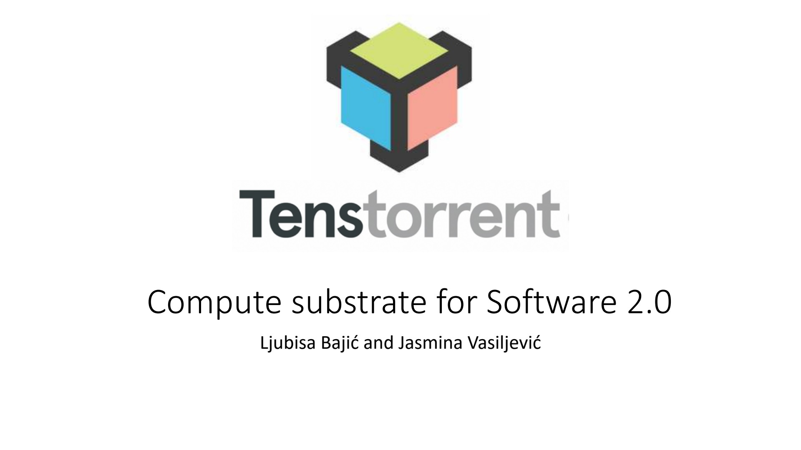

## Compute substrate for Software 2.0

Ljubisa Bajić and Jasmina Vasiljević

<!-- p.2 -->

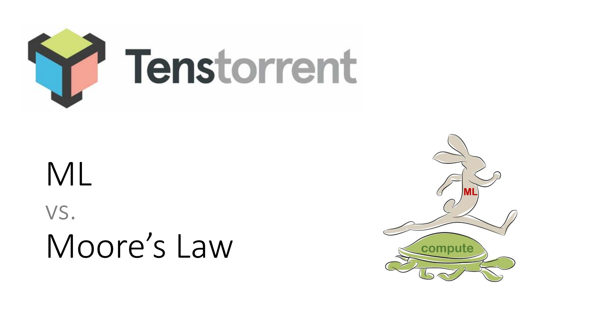

ML

vs.

Moore's Law

<!-- p.3 -->

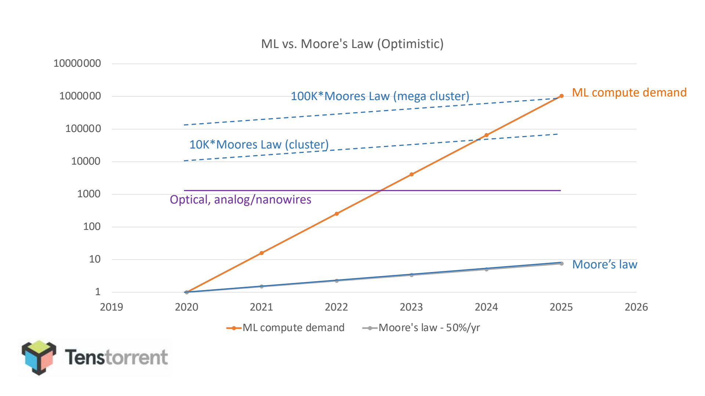

10000000

## ML vs. Moore's Law (Optimistic)

<!-- p.4 -->

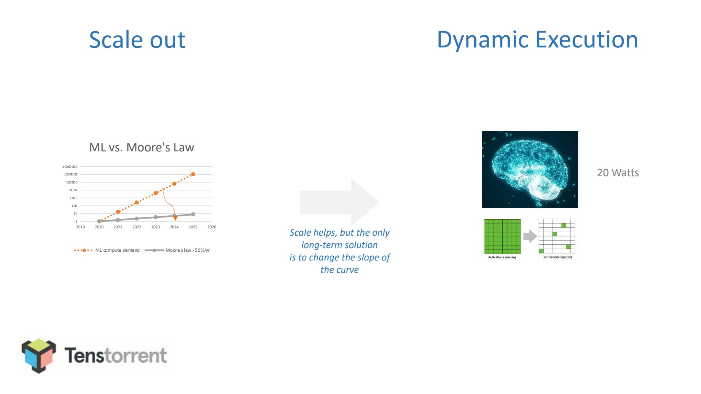

## Scale out

ML vs. Moore's Law

Scale helps, but the only long-term solution is to change the slope of the curve

## Dynamic Execution

20 Watts

<!-- p.5 -->

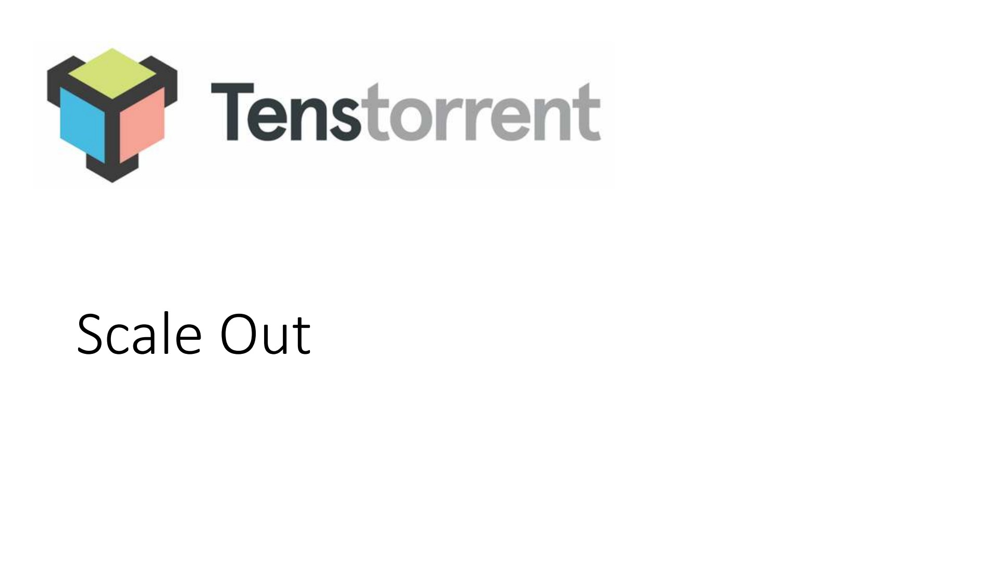

Scale Out

<!-- p.6 -->

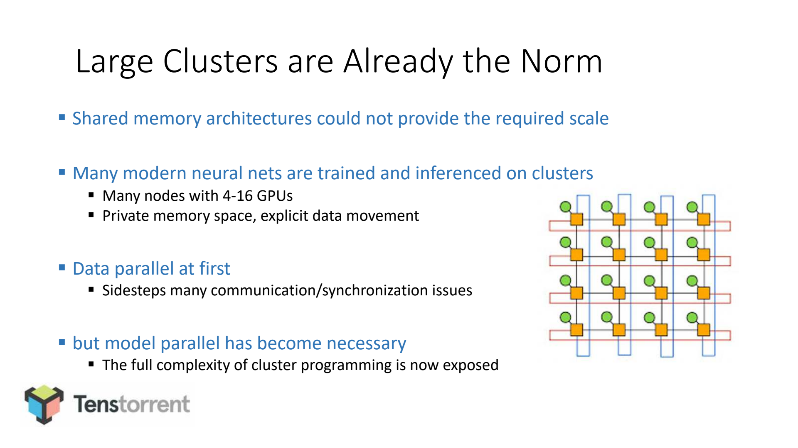

## Large Clusters are Already the Norm

- § Shared memory architectures could not provide the required scale
- § Many modern neural nets are trained and inferenced on clusters
- § Many nodes with 4-16 GPUs
- § Private memory space, explicit data movement
- § Data parallel at first
- § Sidesteps many communication/synchronization issues
- § but model parallel has become necessary
- § The full complexity of cluster programming is now exposed

<!-- p.7 -->

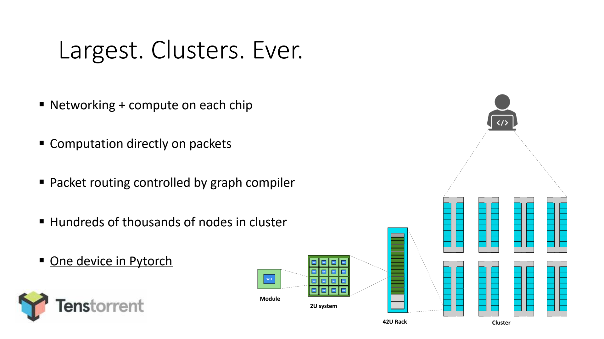

## Largest. Clusters. Ever.

- § Networking + compute on each chip
- § Computation directly on packets
- § Packet routing controlled by graph compiler
- § Hundreds of thousands of nodes in cluster
- § One device in Pytorch

Cluster

<!-- p.8 -->

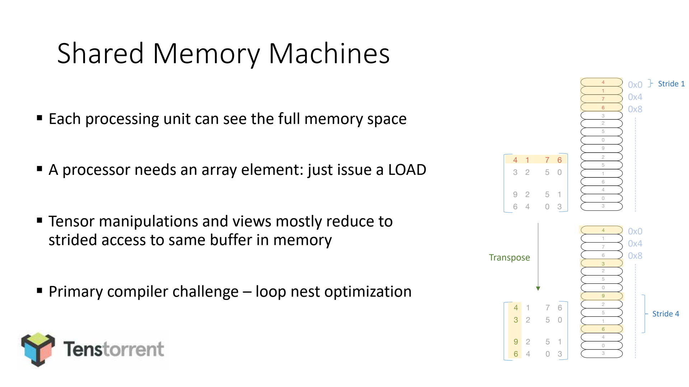

## Shared Memory Machines

- § Each processing unit can see the full memory space
- § A processor needs an array element: just issue a LOAD
- § Tensor manipulations and views mostly reduce to strided access to same buffer in memory
- § Primary compiler challenge - loop nest optimization

<!-- p.9 -->

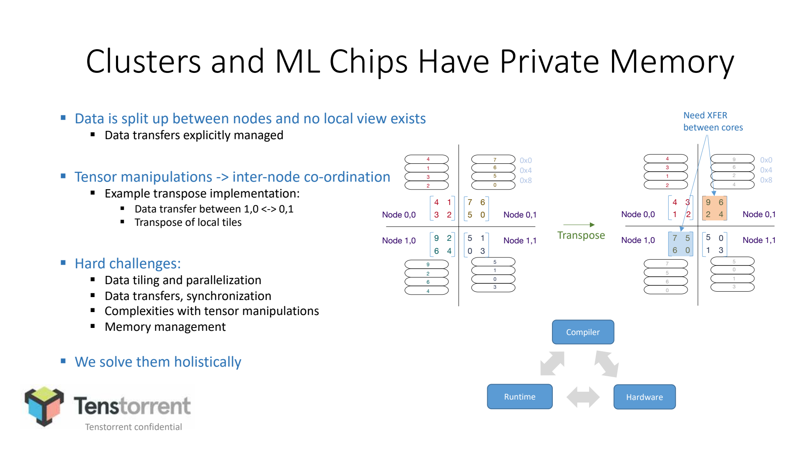

## Clusters and ML Chips Have Private Memory

- § Data is split up between nodes and no local view exists
- § Data transfers explicitly managed
- § Tensor manipulations -&gt; inter-node co-ordination
- § Example transpose implementation:
- § Data transfer between 1,0 &lt;-&gt; 0,1
- § Transpose of local tiles
- § Hard challenges:
- § Data tiling and parallelization
- § Data transfers, synchronization
- § Complexities with tensor manipulations
- § Memory management
- § We solve them holistically

<!-- p.10 -->

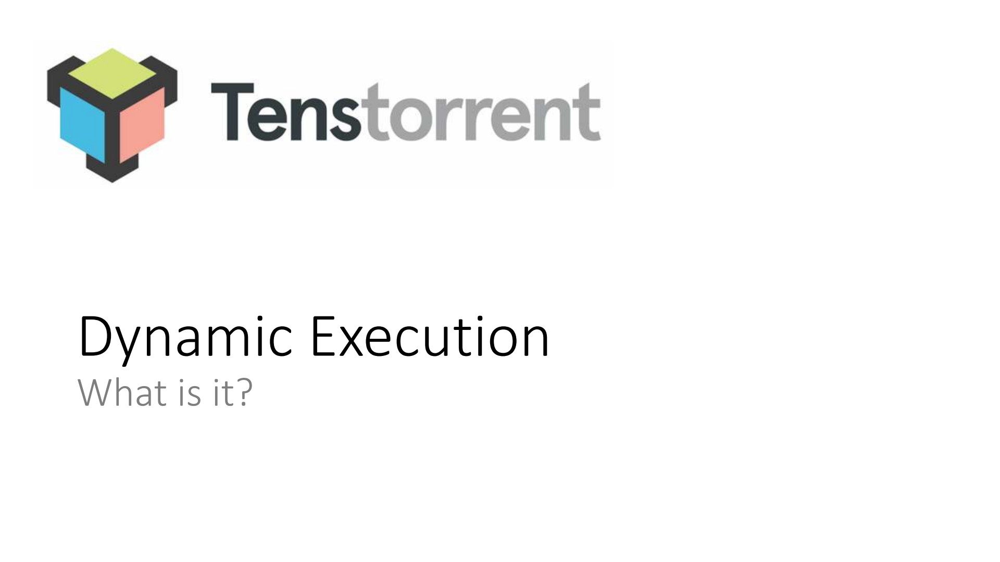

## Dynamic Execution What is it?

<!-- p.11 -->

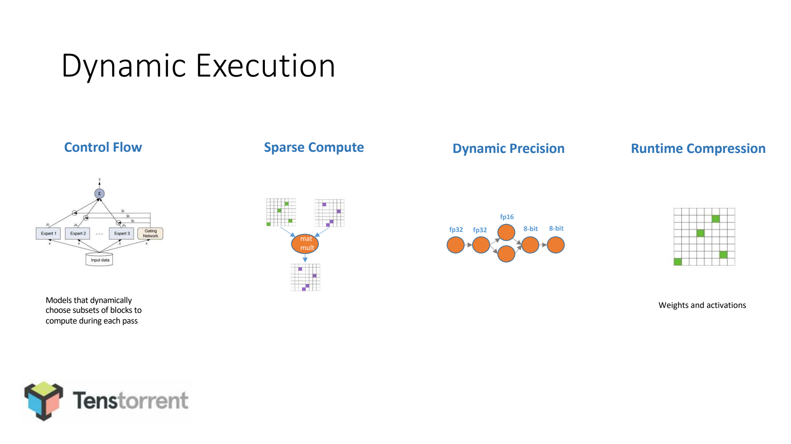

## Dynamic Execution

Control Flow

Models that dynamically choose subsets of blocks to compute during each pass

## Sparse Compute

Dynamic Precision

Runtime Compression

Weights and activations

<!-- p.12 -->

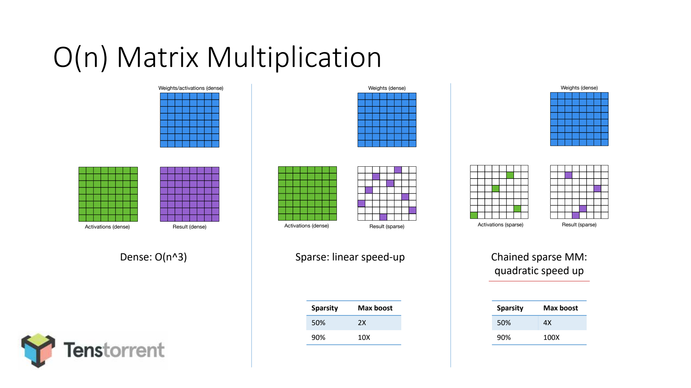

## O(n) Matrix Multiplication

Dense: O(n^3)

Result (sparse)

Sparse: linear speed-up

| Sparsity   | Max boost   |
|------------|-------------|
| 50%        | 2X          |
| 90%        | 10X         |

## Chained sparse MM: quadratic speed up

| Sparsity   | Max boost   |
|------------|-------------|
| 50%        | 4X          |
| 90%        | 100X        |

<!-- p.13 -->

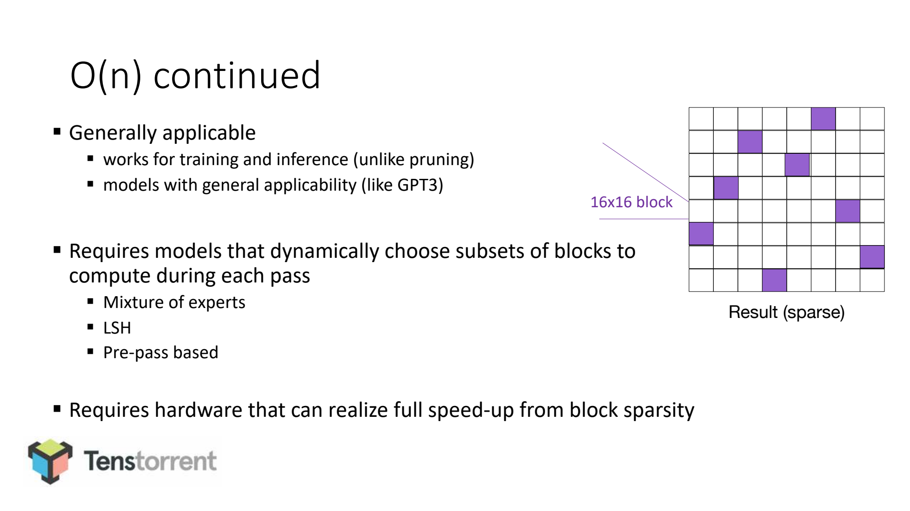

## O(n) continued

- § Generally applicable
- § works for training and inference (unlike pruning)
- § models with general applicability (like GPT3)
- § Requires models that dynamically choose subsets of blocks to compute during each pass
- § Mixture of experts
- § LSH
- § Pre-pass based
- § Requires hardware that can realize full speed-up from block sparsity

Result (sparse)

<!-- p.14 -->

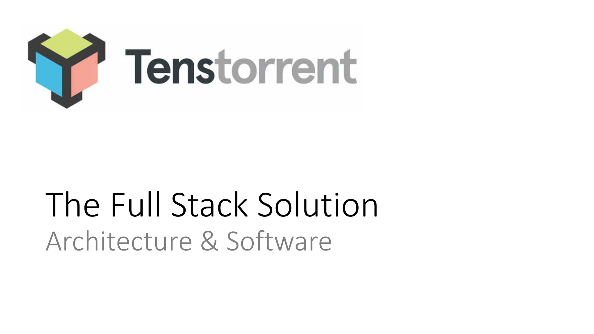

## The Full Stack Solution Architecture &amp; Software

<!-- p.15 -->

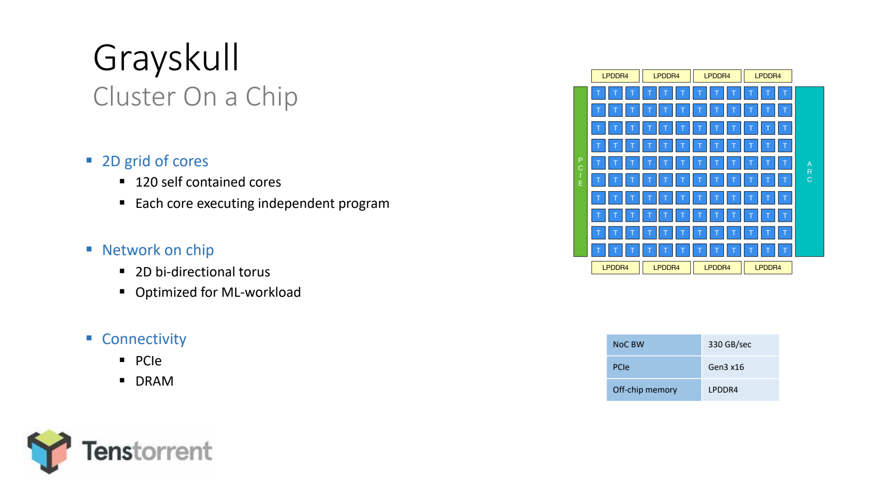

## Grayskull

## Cluster On a Chip

- § 2D grid of cores
- § 120 self contained cores
- § Each core executing independent program

## § Network on chip

- § 2D bi-directional torus
- § Optimized for ML-workload

## § Connectivity

- § PCIe
- § DRAM

| NoC BW          | 330 GB/sec   |
|-----------------|--------------|
| PCIe            | Gen3 x16     |
| Off-chip memory | LPDDR4       |

<!-- p.16 -->

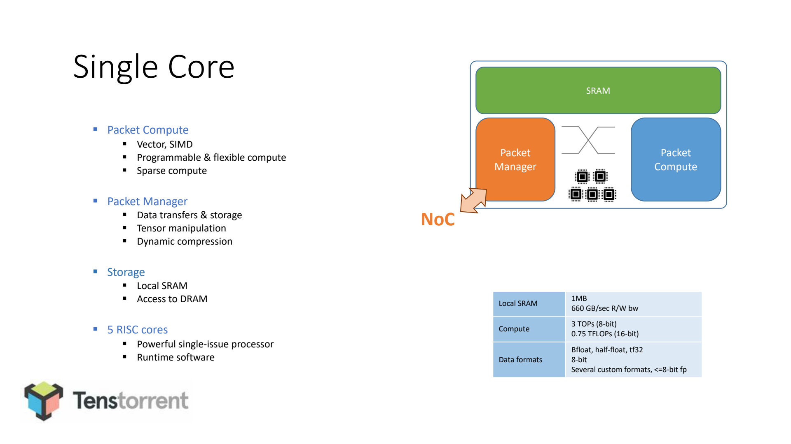

## Single Core

## § Packet Compute

- § Vector, SIMD
- § Programmable &amp; flexible compute
- § Sparse compute

## § Packet Manager

- § Data transfers &amp; storage
- § Tensor manipulation
- § Dynamic compression

## § Storage

- § Local SRAM
- § Access to DRAM

## § 5 RISC cores

- § Powerful single-issue processor
- § Runtime software

| Local SRAM   | 1MB 660 GB/sec R/W bw                                             |
|--------------|-------------------------------------------------------------------|
| Compute      | 3 TOPs (8-bit) 0.75 TFLOPs (16-bit)                               |
| Data formats | Bfloat, half-float, tf32 8-bit Several custom formats, <=8-bit fp |

<!-- p.17 -->

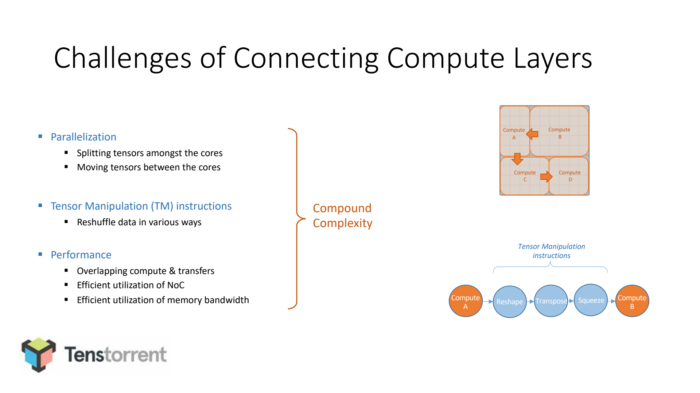

## Challenges of Connecting Compute Layers

## § Parallelization

- § Splitting tensors amongst the cores
- § Moving tensors between the cores
- § Tensor Manipulation (TM) instructions
- § Reshuffle data in various ways

## § Performance

- § Overlapping compute &amp; transfers
- § Efficient utilization of NoC
- § Efficient utilization of memory bandwidth

Compound Complexity

<!-- p.18 -->

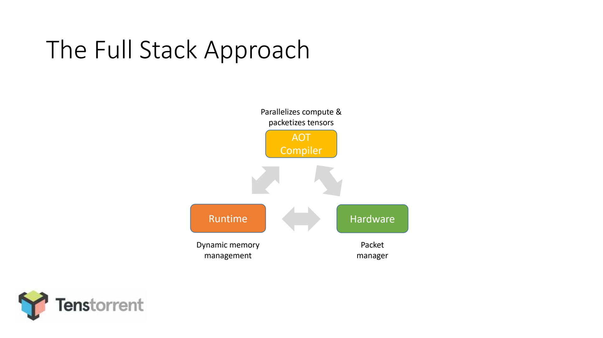

## The Full Stack Approach

<!-- p.19 -->

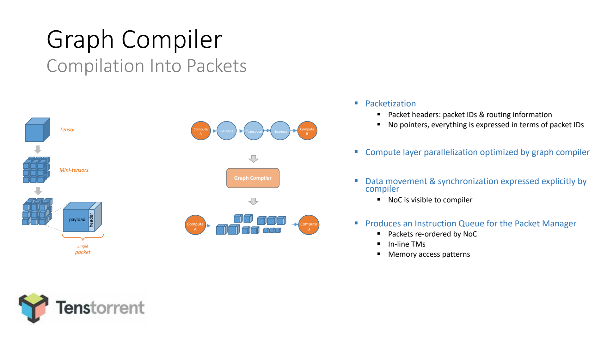

## Graph Compiler

## Compilation Into Packets

## § Packetization

- § Packet headers: packet IDs &amp; routing information
- § No pointers, everything is expressed in terms of packet IDs
- § Compute layer parallelization optimized by graph compiler
- § Data movement &amp; synchronization expressed explicitly by compiler
- § NoC is visible to compiler
- § Produces an Instruction Queue for the Packet Manager
- § Packets re-ordered by NoC
- § In-line TMs
- § Memory access patterns

<!-- p.20 -->

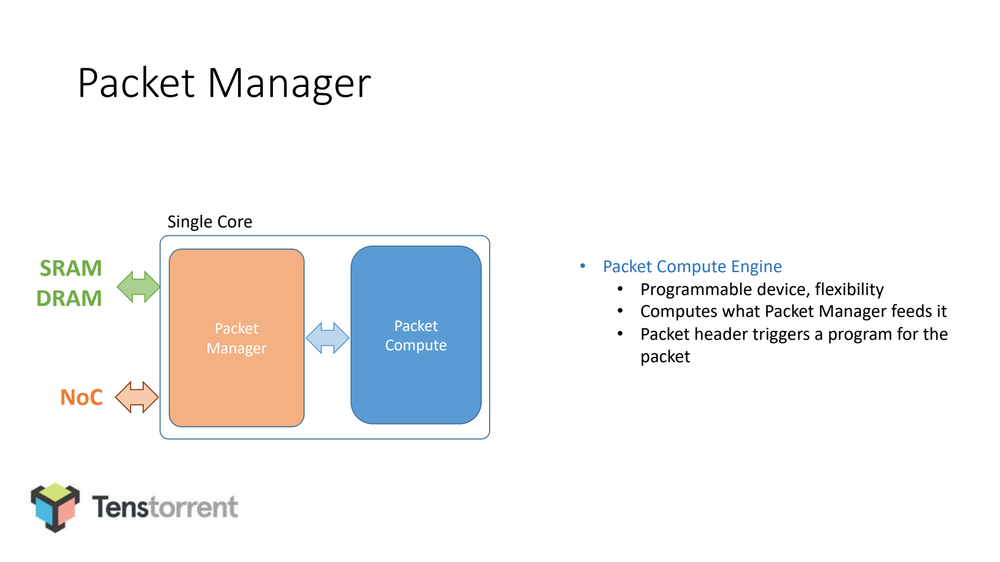

## Packet Manager

## · Packet Compute Engine

- Programmable device, flexibility
- Computes what Packet Manager feeds it
- Packet header triggers a program for the packet

<!-- p.21 -->

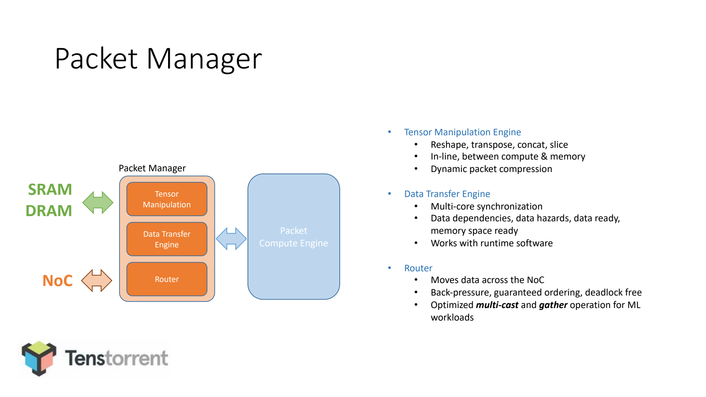

## Packet Manager

## Packet Manager

## · Tensor Manipulation Engine

- Reshape, transpose, concat, slice
- In-line, between compute &amp; memory
- Dynamic packet compression

## · Data Transfer Engine

- Multi-core synchronization
- Data dependencies, data hazards, data ready, memory space ready
- Works with runtime software

## · Router

- Moves data across the NoC
- Back-pressure, guaranteed ordering, deadlock free
- Optimized multi-cast and gather operation for ML workloads

<!-- p.22 -->

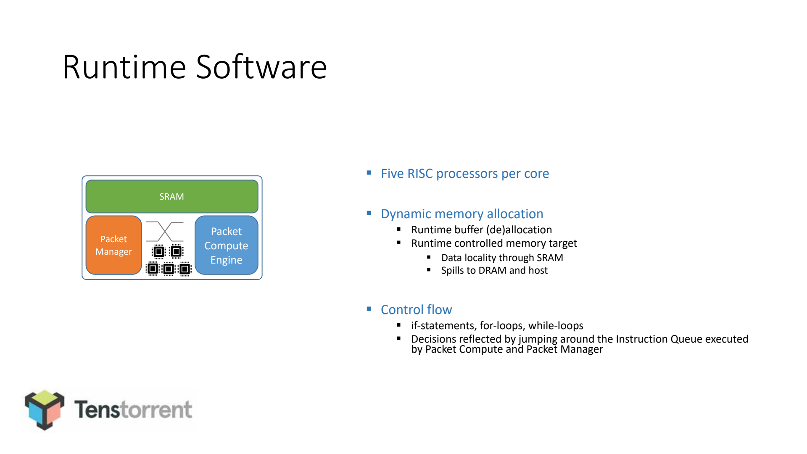

## Runtime Software

- § Five RISC processors per core
- § Dynamic memory allocation
- § Runtime buffer (de)allocation
- § Runtime controlled memory target
- § Data locality through SRAM
- § Spills to DRAM and host
- § Control flow
- § if-statements, for-loops, while-loops
- § Decisions reflected by jumping around the Instruction Queue executed by Packet Compute and Packet Manager

<!-- p.23 -->

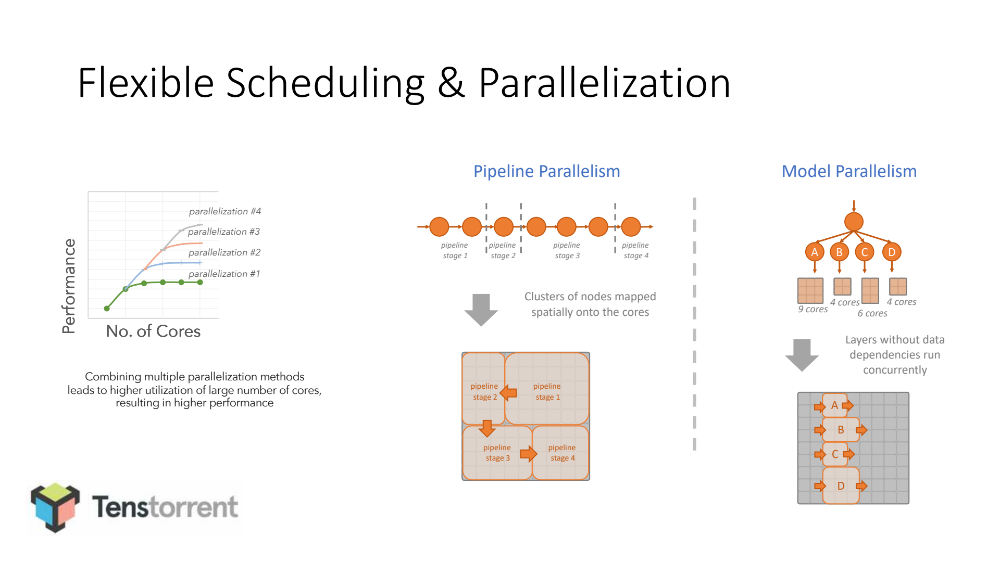

## Flexible Scheduling &amp; Parallelization

Combining multiple parallelization methods leads to higher utilization of large number of cores, resulting in higher performance

## Model Parallelism

<!-- p.24 -->

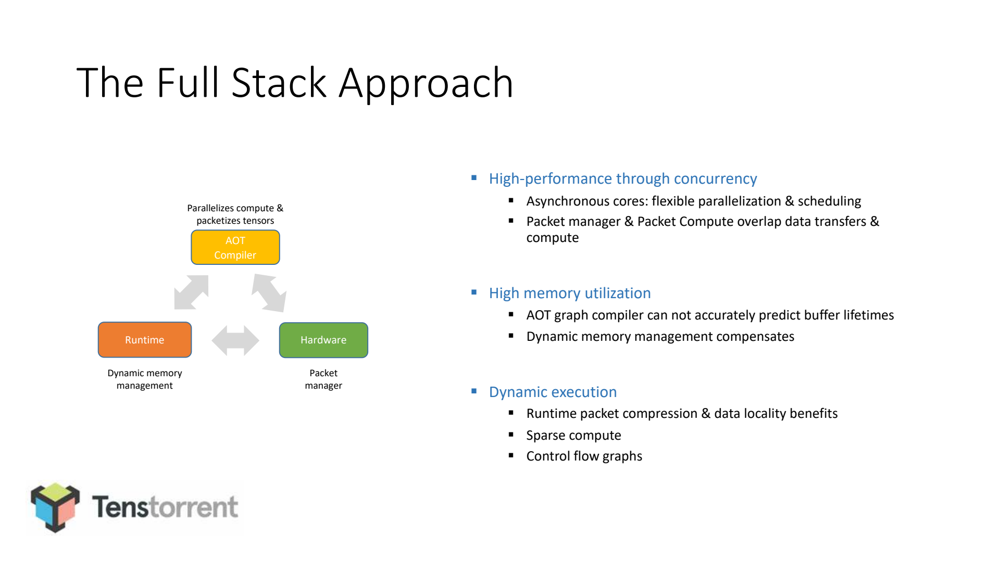

## The Full Stack Approach

## § High-performance through concurrency

- § Asynchronous cores: flexible parallelization &amp; scheduling
- § Packet manager &amp; Packet Compute overlap data transfers &amp; compute

## § High memory utilization

- § AOT graph compiler can not accurately predict buffer lifetimes
- § Dynamic memory management compensates

## § Dynamic execution

- § Runtime packet compression &amp; data locality benefits
- § Sparse compute
- § Control flow graphs

<!-- p.25 -->

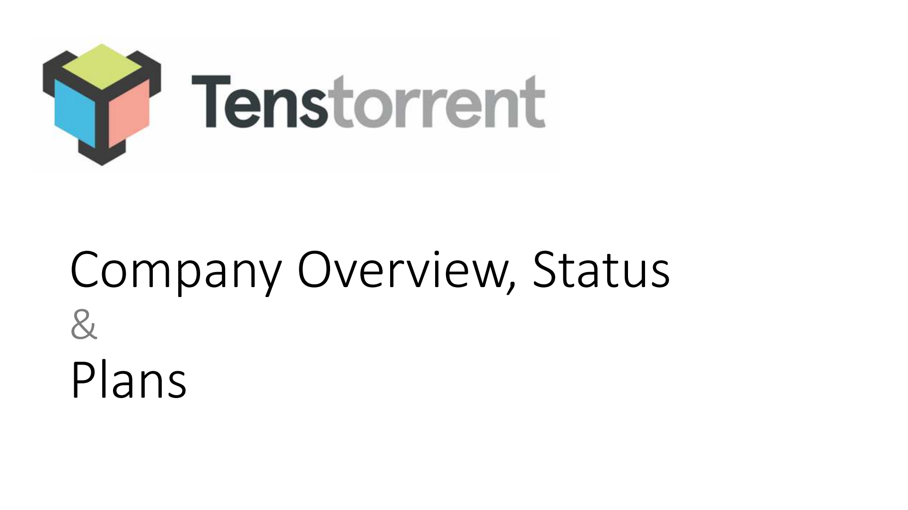

Company Overview, Status &amp; Plans

<!-- p.26 -->

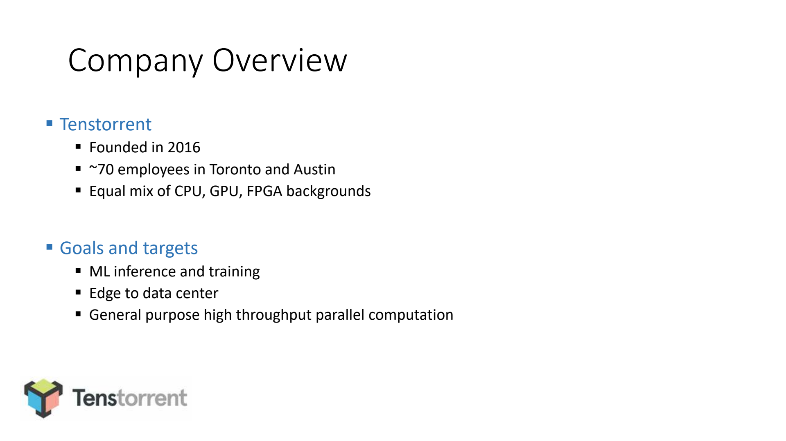

## Company Overview

## § Tenstorrent

- § Founded in 2016
- § ~70 employees in Toronto and Austin
- § Equal mix of CPU, GPU, FPGA backgrounds

## § Goals and targets

- § ML inference and training
- § Edge to data center
- § General purpose high throughput parallel computation

<!-- p.27 -->

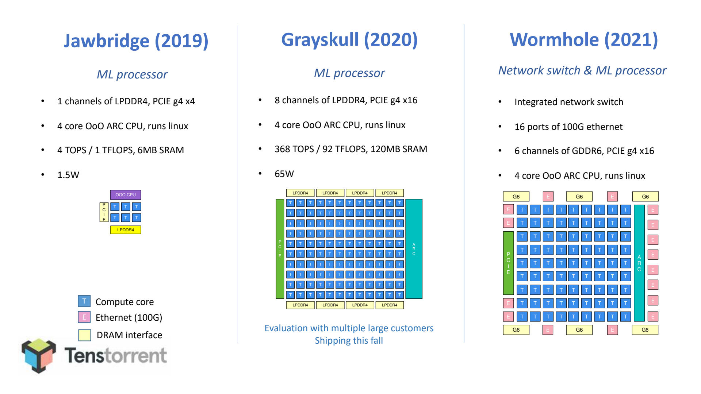

## Jawbridge (2019)

## ML processor

- 1 channels of LPDDR4, PCIE g4 x4
- 4 core OoO ARC CPU, runs linux
- 4 TOPS / 1 TFLOPS, 6MB SRAM
- 1.5W

## Grayskull (2020)

## ML processor

- 8 channels of LPDDR4, PCIE g4 x16
- 4 core OoO ARC CPU, runs linux
- 368 TOPS / 92 TFLOPS, 120MB SRAM
- 65W

## Wormhole (2021)

## Network switch &amp; ML processor

- Integrated network switch
- 16 ports of 100G ethernet
- 6 channels of GDDR6, PCIE g4 x16
- 4 core OoO ARC CPU, runs linux

<!-- p.28 -->

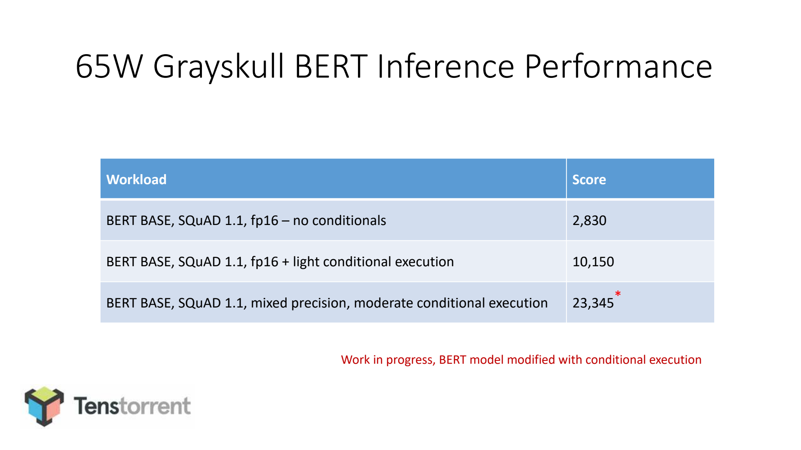

## 65W Grayskull BERT Inference Performance

| Workload                                                              | Score    |
|-----------------------------------------------------------------------|----------|
| BERT BASE, SQuAD 1.1, fp16 - no conditionals                          | 2,830    |
| BERT BASE, SQuAD 1.1, fp16 + light conditional execution              | 10,150   |
| BERT BASE, SQuAD 1.1, mixed precision, moderate conditional execution | 23,345 * |

<!-- p.29 -->

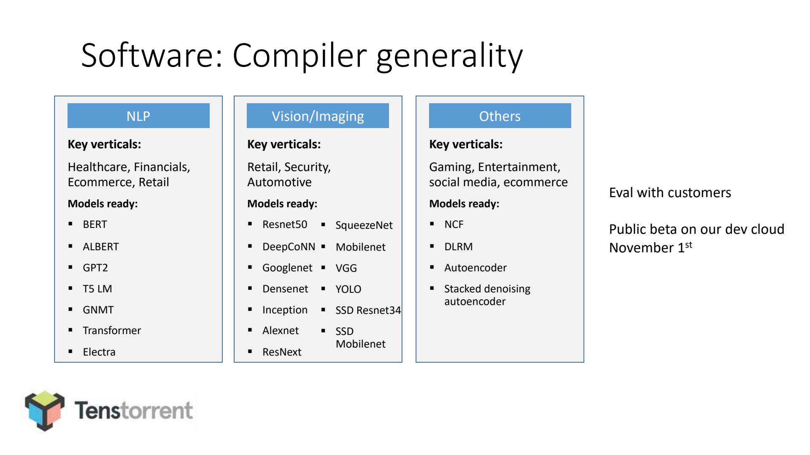

## Software: Compiler generality

## NLP

## Key verticals:

Healthcare, Financials, Ecommerce, Retail

## Models ready:

- § BERT
- § ALBERT
- § GPT2
- § T5 LM
- § GNMT
- § Transformer
- § Electra

## Vision/Imaging

## Key verticals:

Retail, Security, Automotive

## Models ready:

- § Resnet50 § SqueezeNet
- § DeepCoNN § Mobilenet
- § Googlenet § VGG
- § Densenet § YOLO
- § Inception § SSD Resnet34
- § Alexnet
- § ResNext
- § SSD Mobilenet

## NLP Others

## § BERT Key verticals:

§ ALBERT § GPT2 Gaming, Entertainment, social media, ecommerce

## § T5 LM Models ready:

- § NCF
- § DLRM

§ GNMT

§ Transformer

- § Electra § Autoencoder
- § Stacked denoising autoencoder

Eval with customers

Public beta on our dev cloud November 1 st

<!-- p.30 -->

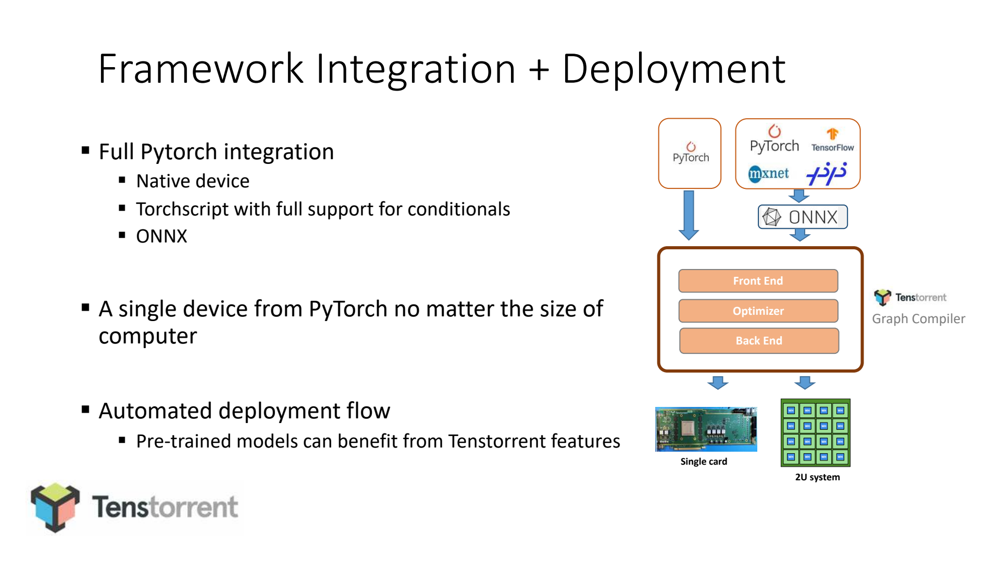

## Framework Integration + Deployment

- § Full Pytorch integration
- § Native device
- § Torchscript with full support for conditionals
- § ONNX
- § A single device from PyTorch no matter the size of computer
- § Automated deployment flow
- § Pre-trained models can benefit from Tenstorrent features

2U system

<!-- p.31 -->

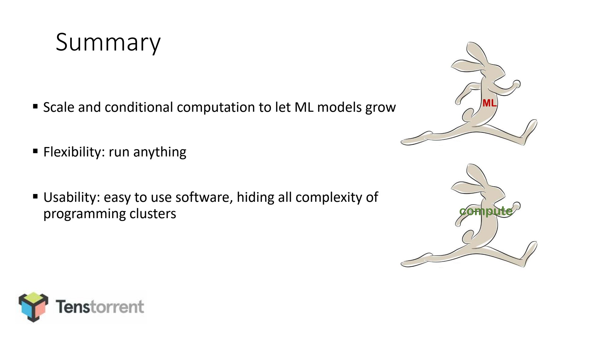

## Summary

- § Scale and conditional computation to let ML models grow
- § Usability: easy to use software, hiding all complexity of programming clusters

- § Flexibility: run anything
