> 本文件由 `HC36-Tenstorrent-Blackhole-Metalium.pdf` 自动转换（docling 2.140.0，2026-10-17）。每页的整页图在 `images/` 目录；表格与数字请以 PDF 原文为准；`<!-- p.N -->` 标记对应 PDF 第 N 页。

<!-- p.1 -->

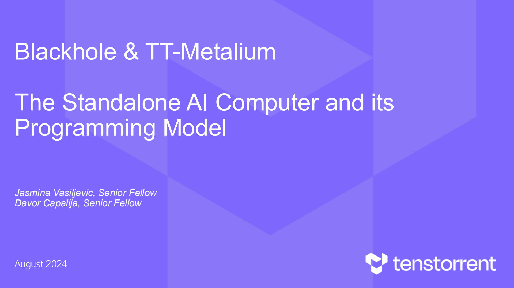

## Blackhole &amp; TT-Metalium

## The Standalone AI Computer and its Programming Model

Jasmina Vasiljevic, Senior Fellow Davor Capalija, Senior Fellow

<!-- p.2 -->

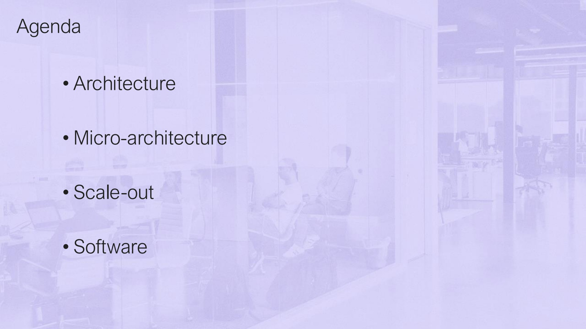

## Agenda

- Architecture
- Micro-architecture
- Scale-out
- Software

<!-- p.3 -->

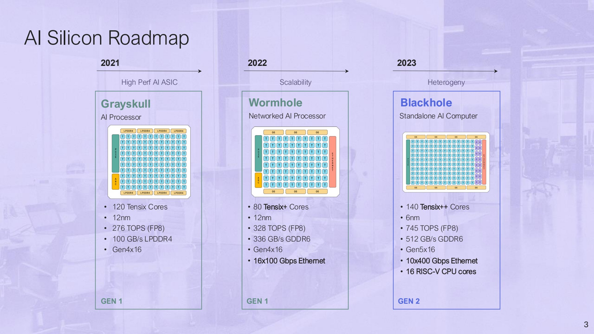

## AI Silicon Roadmap

## 2023

Heterogeny

## Blackhole

Standalone AI Computer

- 140 Tensix++ Cores
- 6nm
- 745 TOPS (FP8)
- 512 GB/s GDDR6
- Gen5x16
- 10x400 Gbps Ethernet
- 16 RISC-V CPU cores

GEN 2

<!-- p.4 -->

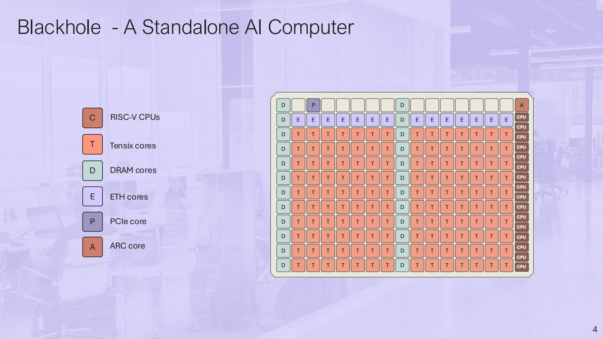

## Blackhole - A Standalone AI Computer

<!-- p.5 -->

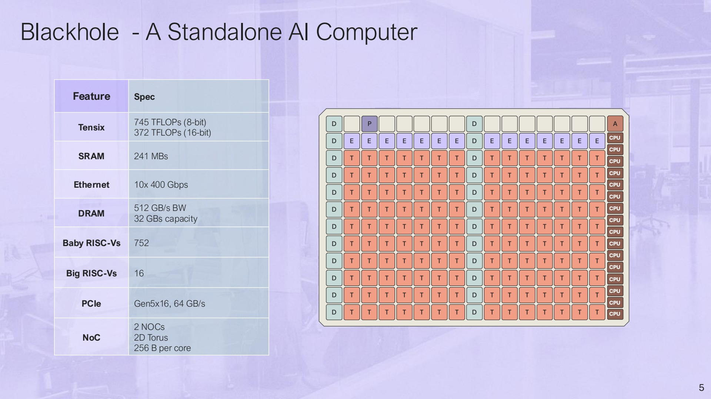

## Blackhole - A Standalone AI Computer

| Feature      | Spec                                   |
|--------------|----------------------------------------|
| Tensix       | 745 TFLOPs (8-bit) 372 TFLOPs (16-bit) |
| SRAM         | 241 MBs                                |
| Ethernet     | 10x 400 Gbps                           |
| DRAM         | 512 GB/s BW 32 GBs capacity            |
| Baby RISC-Vs | 752                                    |
| Big RISC-Vs  | 16                                     |
| PCIe         | Gen5x16, 64 GB/s                       |
| NoC          | 2 NOCs 2D Torus 256 B per core         |

<!-- p.6 -->

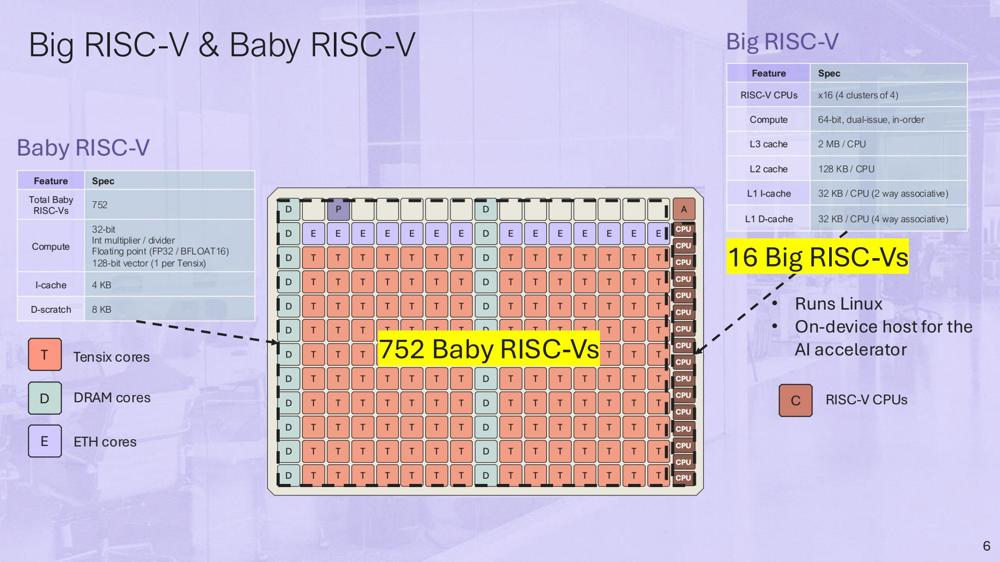

## Big RISC-V &amp; Baby RISC-V

## Baby RISC-V

| Feature            | Spec                                                                                           |
|--------------------|------------------------------------------------------------------------------------------------|
| Total Baby RISC-Vs | 752                                                                                            |
| Compute            | 32-bit Int multiplier / divider Floating point (FP32 / BFLOAT16) 128-bit vector (1 per Tensix) |
| I-cache            | 4 KB                                                                                           |
| D-scratch          | 8 KB                                                                                           |

## Big RISC-V

| Feature     | Spec                            |
|-------------|---------------------------------|
| RISC-V CPUs | x16 (4 clusters of 4)           |
| Compute     | 64-bit, dual-issue, in-order    |
| L3 cache    | 2 MB / CPU                      |
| L2 cache    | 128 KB / CPU                    |
| L1 I-cache  | 32 KB / CPU (2 way associative) |
| L1 D-cache  | 32 KB / CPU (4 way associative) |

<!-- p.7 -->

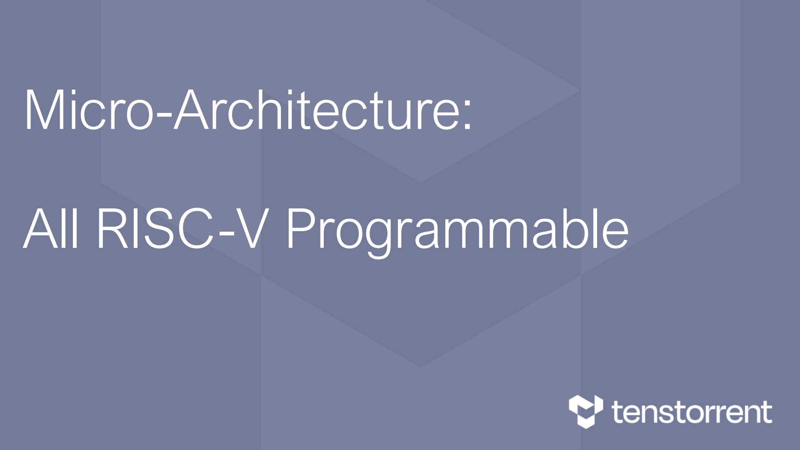

## Micro-Architecture:

## All RISC-V Programmable

<!-- p.8 -->

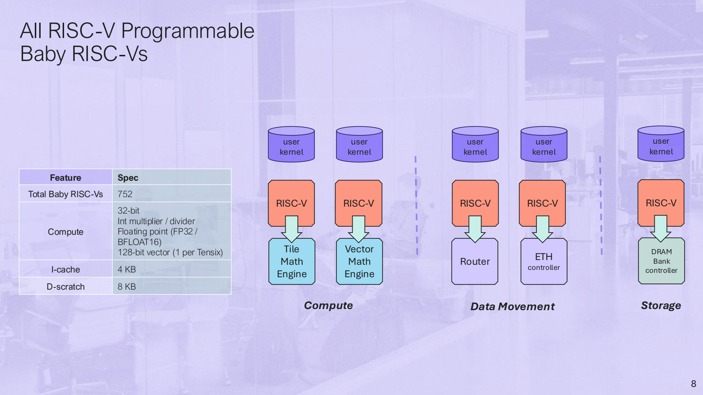

| Feature            | Spec                                                                                           |
|--------------------|------------------------------------------------------------------------------------------------|
| Total Baby RISC-Vs | 752                                                                                            |
| Compute            | 32-bit Int multiplier / divider Floating point (FP32 / BFLOAT16) 128-bit vector (1 per Tensix) |
| I-cache            | 4 KB                                                                                           |
| D-scratch          | 8 KB                                                                                           |

<!-- p.9 -->

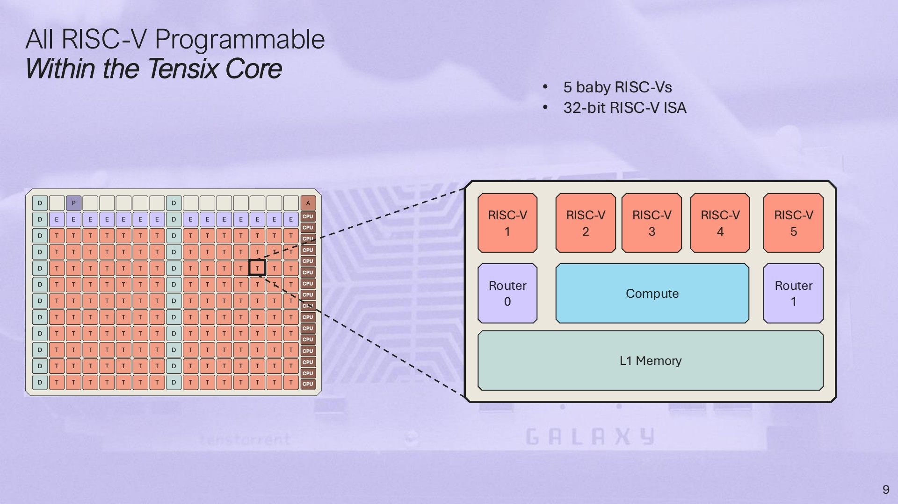

## All RISC-V Programmable Within the Tensix Core

- 5 baby RISC-Vs
- 32-bit RISC-V ISA

<!-- p.10 -->

## All RISC-V Programmable Within the Tensix Core

- 5 baby RISC-Vs
- 32-bit RISC-V ISA

<!-- p.11 -->

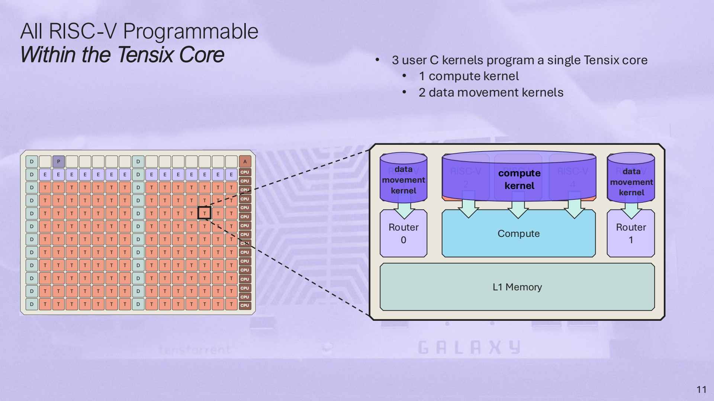

## All RISC-V Programmable Within the Tensix Core

- 3 user C kernels program a single Tensix core
- 1 compute kernel
- 2 data movement kernels

<!-- p.12 -->

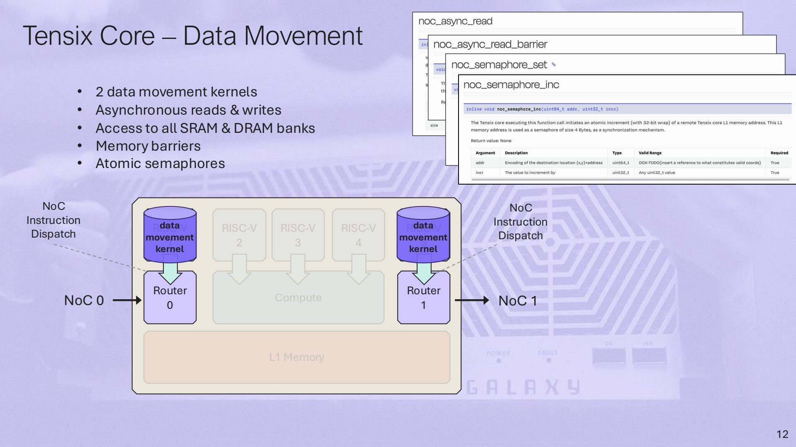

## Tensix Core - Data Movement

- 2 data movement kernels
- Asynchronous reads &amp; writes
- Access to all SRAM &amp; DRAM banks
- Memory barriers
- Atomic semaphores

<!-- p.13 -->

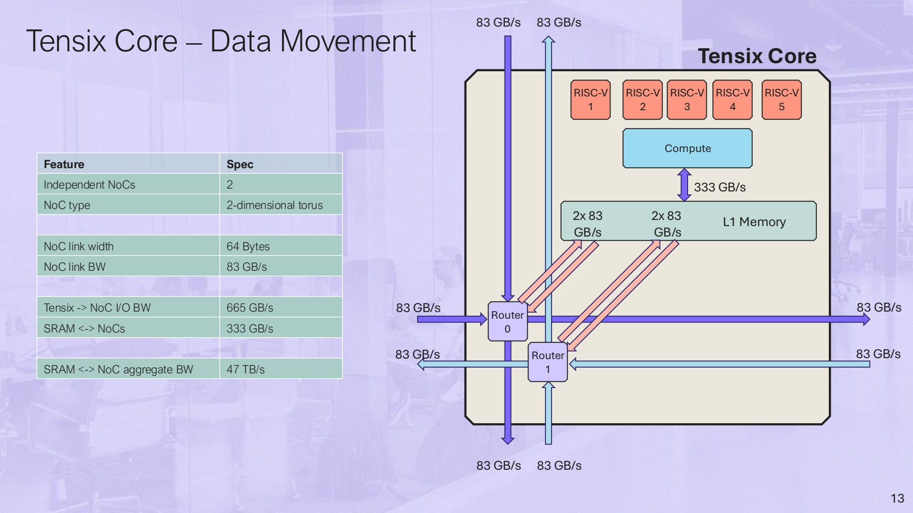

## Tensix Core - Data Movement

| Feature                   | Spec                |
|---------------------------|---------------------|
| Independent NoCs          | 2                   |
| NoC type                  | 2-dimensional torus |
| NoC link width            | 64 Bytes            |
| NoC link BW               | 83 GB/s             |
| Tensix -> NoC I/O BW      | 665 GB/s            |
| SRAM <-> NoCs             | 333 GB/s            |
| SRAM <-> NoC aggregate BW | 47 TB/s             |

<!-- p.14 -->

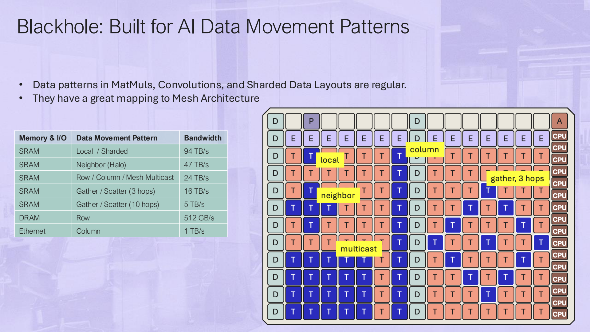

## Blackhole: Built for AI Data Movement Patterns

- Data patterns in MatMuls, Convolutions, and Sharded Data Layouts are regular.
- They have a great mapping to Mesh Architecture

| Memory & I/O   | Data Movement Pattern         | Bandwidth   |
|----------------|-------------------------------|-------------|
| SRAM           | Local / Sharded               | 94 TB/s     |
| SRAM           | Neighbor (Halo)               | 47 TB/s     |
| SRAM           | Row / Column / Mesh Multicast | 24 TB/s     |
| SRAM           | Gather / Scatter (3 hops)     | 16 TB/s     |
| SRAM           | Gather / Scatter (10 hops)    | 5 TB/s      |
| DRAM           | Row                           | 512 GB/s    |
| Ethernet       | Column                        | 1 TB/s      |

<!-- p.15 -->

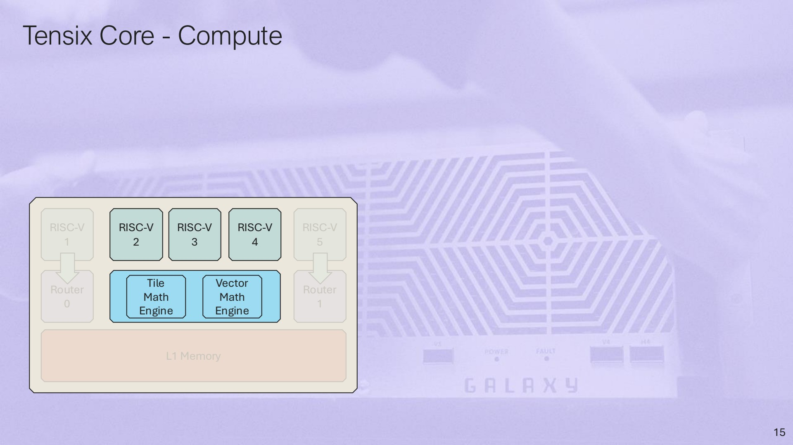

## Tensix Core - Compute

<!-- p.16 -->

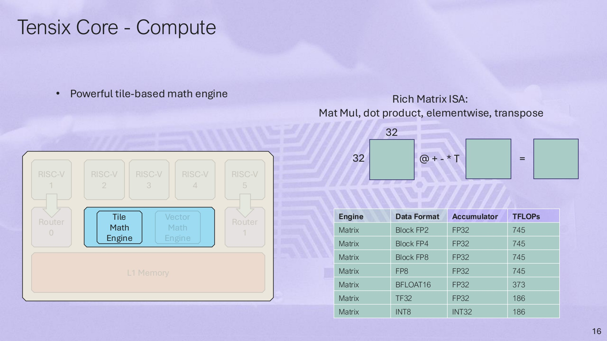

## Tensix Core - Compute

- Powerful tile-based math engine

Rich Matrix ISA: Mat Mul, dot product, elementwise, transpose

| Engine   | Data Format   | Accumulator   |   TFLOPs |
|----------|---------------|---------------|----------|
| Matrix   | Block FP2     | FP32          |      745 |
| Matrix   | Block FP4     | FP32          |      745 |
| Matrix   | Block FP8     | FP32          |      745 |
| Matrix   | FP8           | FP32          |      745 |
| Matrix   | BFLOAT16      | FP32          |      373 |
| Matrix   | TF32          | FP32          |      186 |
| Matrix   | INT8          | INT32         |      186 |

<!-- p.17 -->

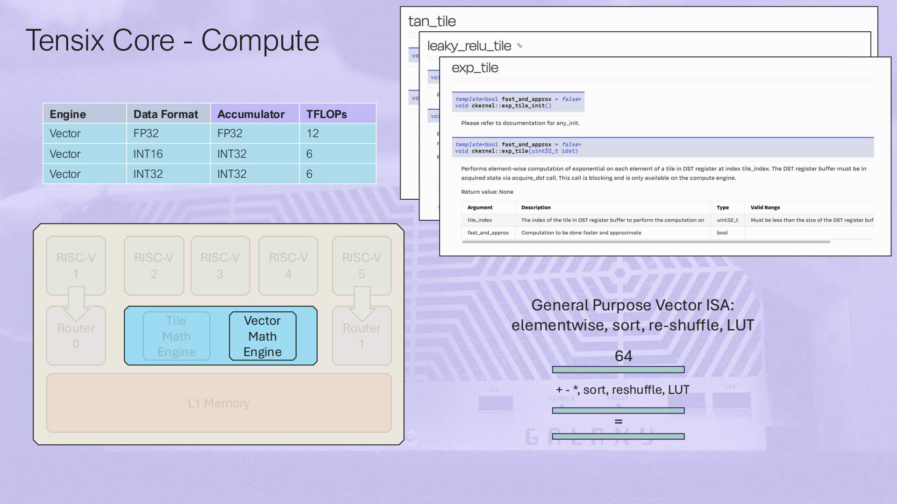

## Tensix Core - Compute

| Engine   | Data Format   | Accumulator   |   TFLOPs |
|----------|---------------|---------------|----------|
| Vector   | FP32          | FP32          |       12 |
| Vector   | INT16         | INT32         |        6 |
| Vector   | INT32         | INT32         |        6 |

<!-- p.18 -->

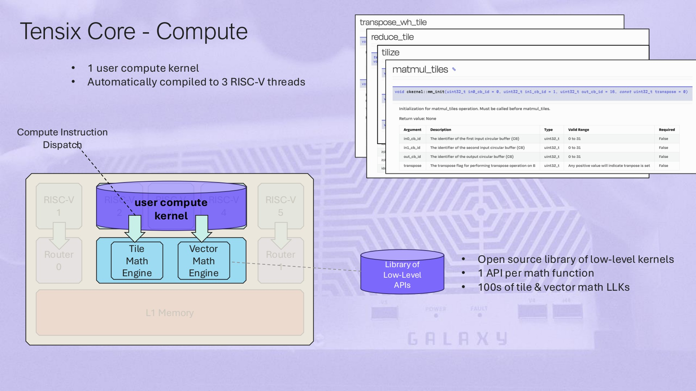

<!-- p.19 -->

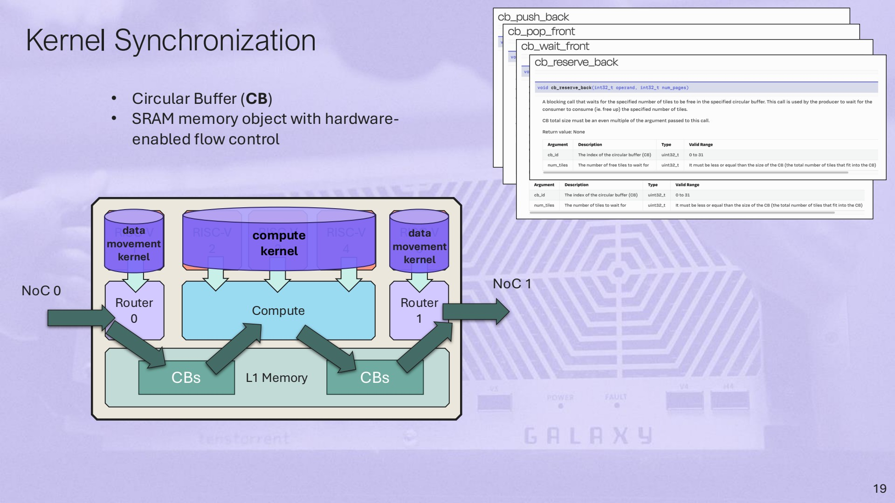

<!-- p.20 -->

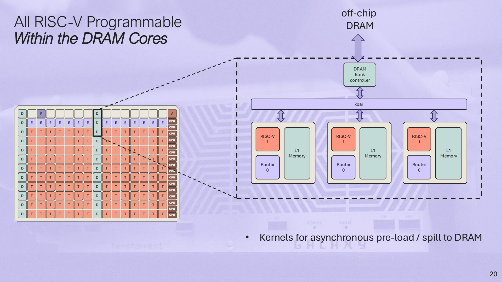

- Kernels for asynchronous pre-load / spill to DRAM

<!-- p.21 -->

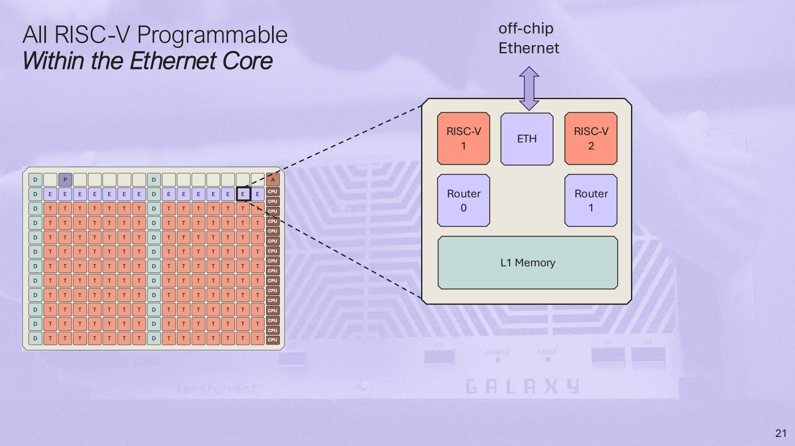

<!-- p.22 -->

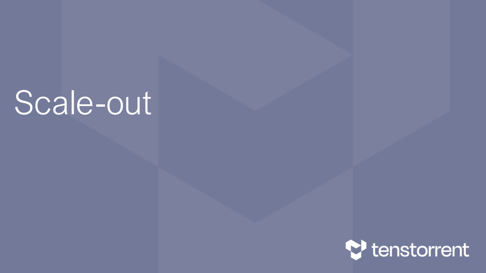

## Scale-out

<!-- p.23 -->

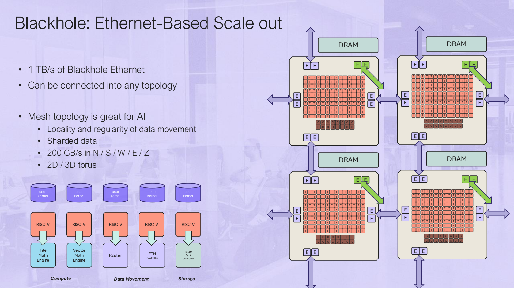

## Blackhole: Ethernet-Based Scale out

- 1 TB/s of Blackhole Ethernet
- Can be connected into any topology
- Mesh topology is great for AI
- Locality and regularity of data movement
- Sharded data
- 200 GB/s in N / S / W / E / Z
- 2D / 3D torus

<!-- p.24 -->

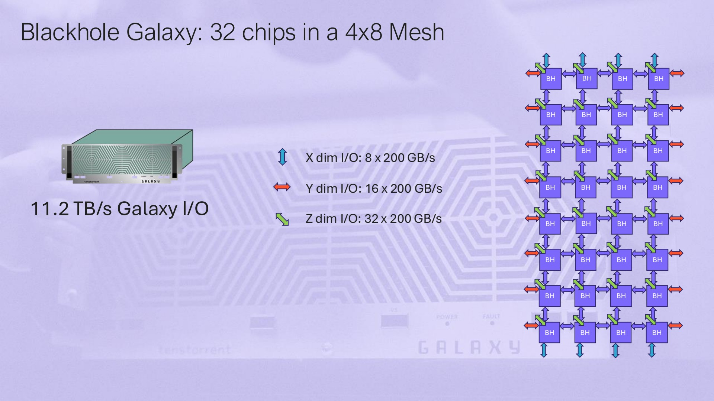

## Blackhole Galaxy: 32 chips in a 4x8 Mesh

<!-- p.25 -->

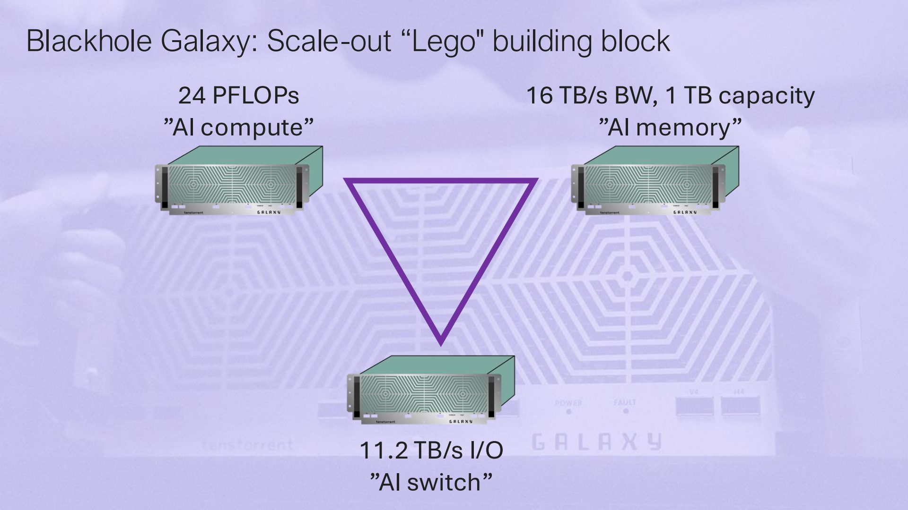

## Blackhole Galaxy: Scale-out "Lego" building block

<!-- p.26 -->

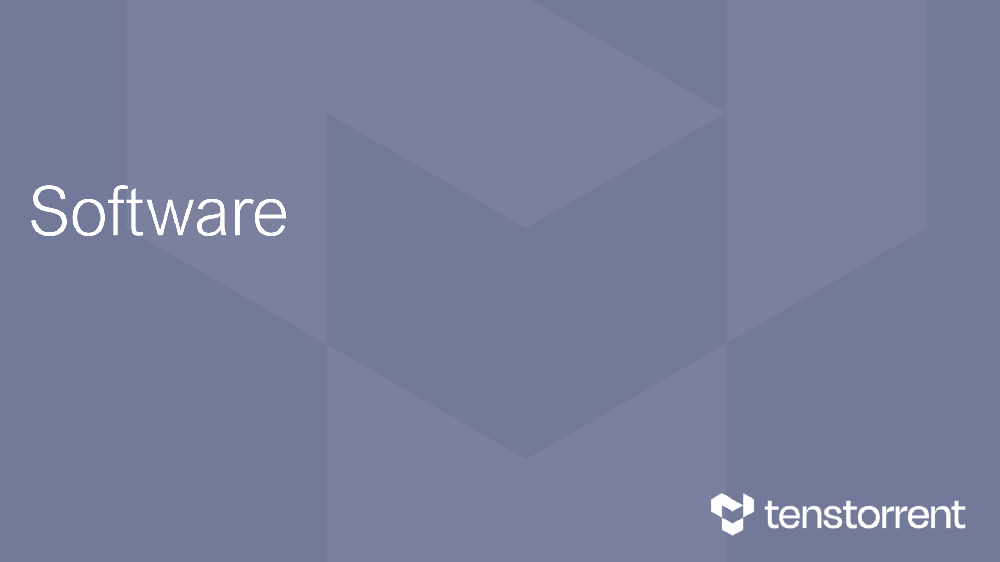

## Software

<!-- p.27 -->

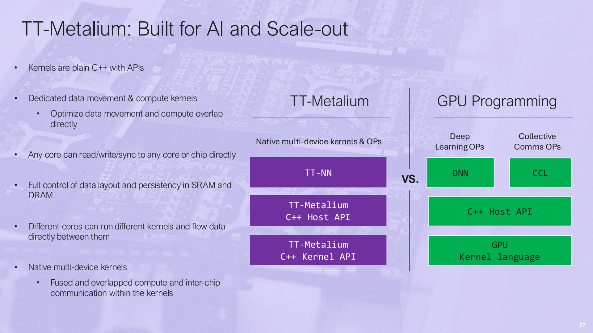

## TT-Metalium: Built for AI and Scale-out

- Kernels are plain C++ with APIs
- Dedicated data movement &amp; compute kernels
- Optimize data movement and compute overlap directly
- Any core can read/write/sync to any core or chip directly
- Full control of data layout and persistency in SRAM and DRAM
- Different cores can run different kernels and flow data directly between them
- Native multi-device kernels
- Fused and overlapped compute and inter-chip communication within the kernels

<!-- p.28 -->

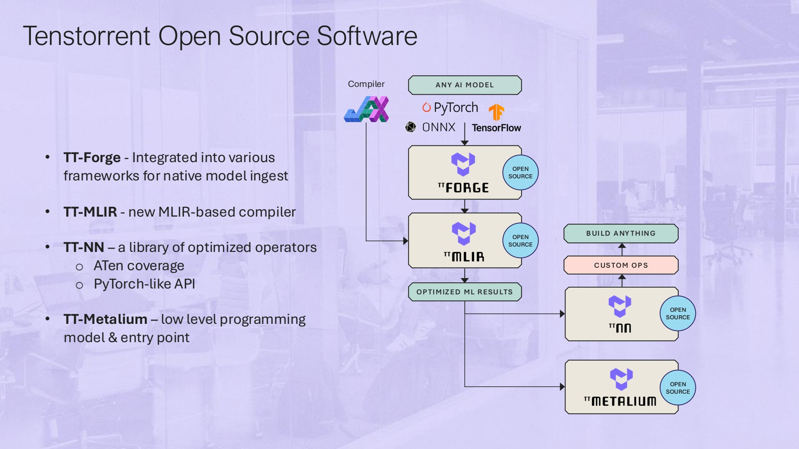

## Tenstorrent Open Source Software

- TT-Forge - Integrated into various frameworks for native model ingest
- TT-MLIR - new MLIR-based compiler
- TT-NN - a library of optimized operators
  - ATen coverage
  - PyTorch-like API
- TT-Metalium - low level programming model &amp; entry point

<!-- p.29 -->

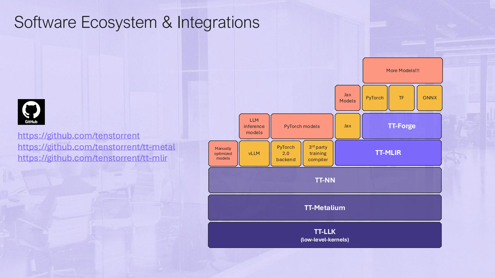

## Software Ecosystem &amp; Integrations

https://github.com/tenstorrent https://github.com/tenstorrent/tt-metal https://github.com/tenstorrent/tt-mlir

<!-- p.30 -->

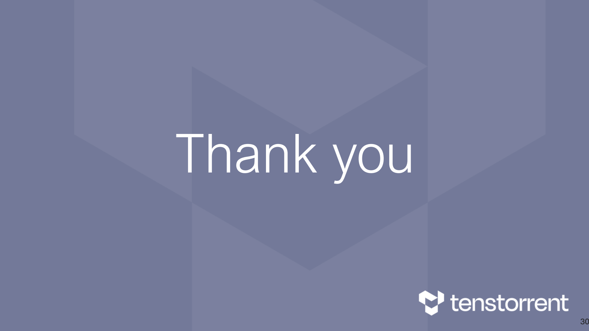

## Thank you
