> 本文件由 `EPCC-HPCAsia25-Intro-Tenstorrent.pdf` 自动转换（docling 2.140.0，2026-10-17）。每页的整页图在 `images/` 目录；表格与数字请以 PDF 原文为准；`<!-- p.N -->` 标记对应 PDF 第 N 页。

<!-- p.1 -->

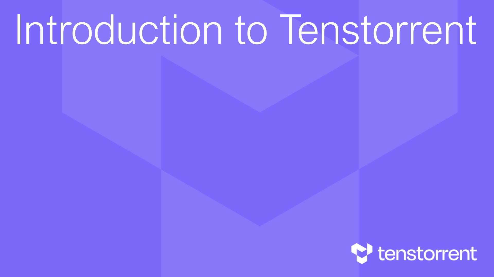

## Introduction to Tenstorrent

<!-- p.2 -->

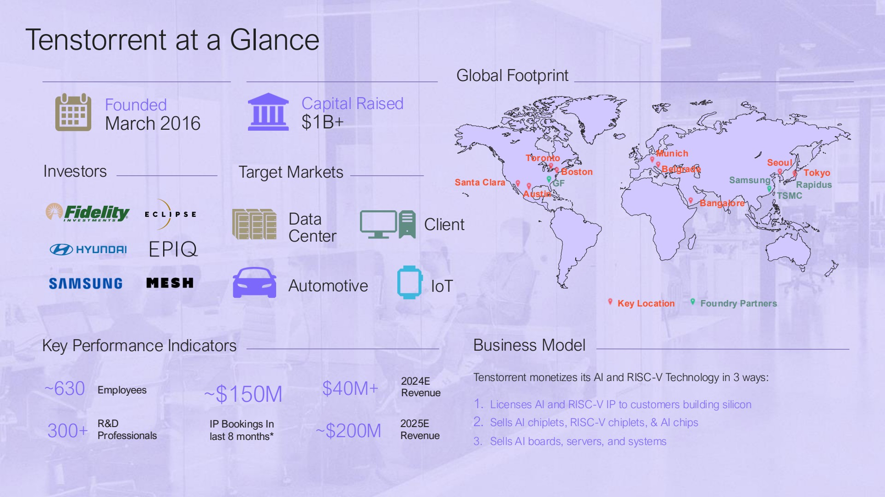

## Tenstorrent at a Glance

## Global Footprint

<!-- p.3 -->

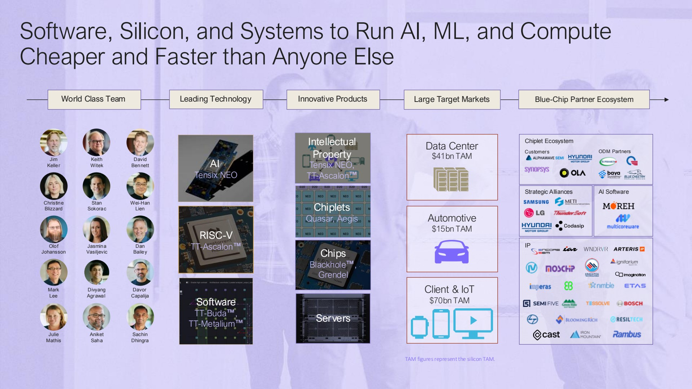

## Software, Silicon, and Systems to Run AI, ML, and Compute Cheaper and Faster than Anyone Else

World Class Team Leading Technology Innovative Products Large Target Markets Blue-Chip Partner Ecosystem Chiplet Ecosystem Customer s ODM Partners Strategic Alliances AI Software

<!-- p.4 -->

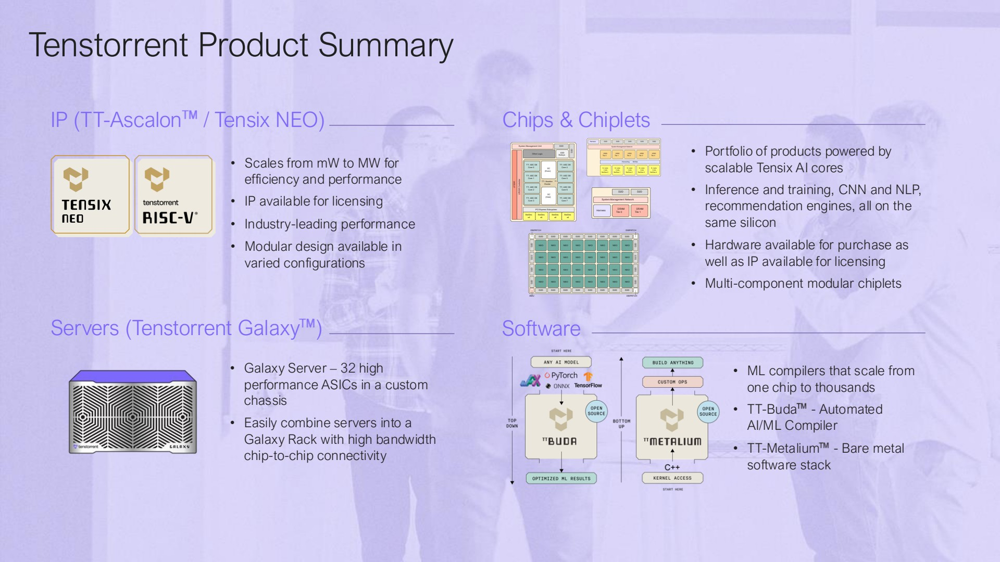

## Tenstorrent Product Summary

## IP (TT-Ascalon / Tensix NEO)

- Scales from mW to MW for efficiency and performance
- IP available for licensing
- Industry-leading performance
- Modular design available in varied configurations

## Servers (Tenstorrent Galaxy )

- Galaxy Server - 32 high performance ASICs in a custom chassis
- Easily combine servers into a Galaxy Rack with high bandwidth chip-to-chip connectivity

## Chips &amp; Chiplets

## Software

- Portfolio of products powered by scalable Tensix AI cores
- Inference and training, CNN and NLP, recommendation engines, all on the same silicon
- Hardware available for purchase as well as IP available for licensing
- Multi-component modular chiplets
- ML compilers that scale from one chip to thousands
- TT-Buda - Automated AI/ML Compiler
- TT-Metalium - Bare metal software stack

<!-- p.5 -->

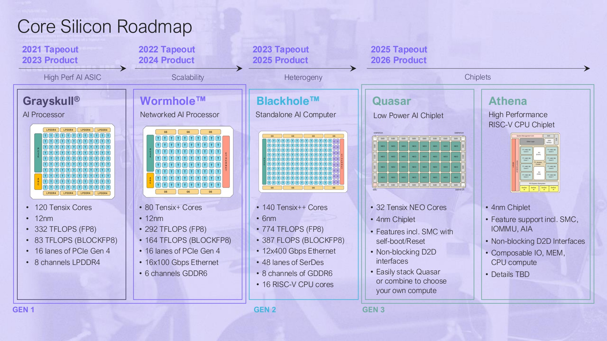

## Core Silicon Roadmap

<!-- p.6 -->

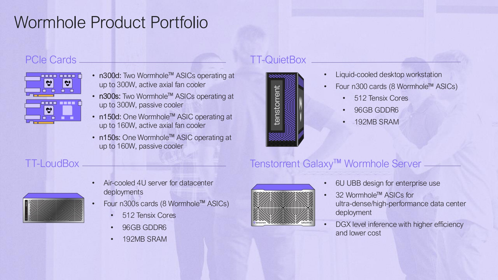

## Wormhole Product Portfolio

## PCIe Cards

## TT-LoudBox

- n300d: Two Wormhole ASICs operating at up to 300W, active axial fan cooler
- n300s: Two Wormhole ASICs operating at up to 300W, passive cooler
- n150d: One Wormhole ASIC operating at up to 160W, active axial fan cooler
- n150s: One Wormhole ASIC operating at up to 160W, passive cooler
- Air-cooled 4U server for datacenter deployments
- Four n300s cards (8 Wormhole ASICs)
- 512 Tensix Cores
- 96GB GDDR6
- 192MB SRAM

## TT-QuietBox

- Liquid-cooled desktop workstation
- Four n300 cards (8 Wormhole ASICs)
- 512 Tensix Cores
- 96GB GDDR6
- 192MB SRAM

## Tenstorrent Galaxy Wormhole Server

- 6U UBB design for enterprise use
- 32 Wormhole ASICs for ultra-dense/high-performance data center deployment
- DGX level inference with higher efficiency and lower cost

<!-- p.7 -->

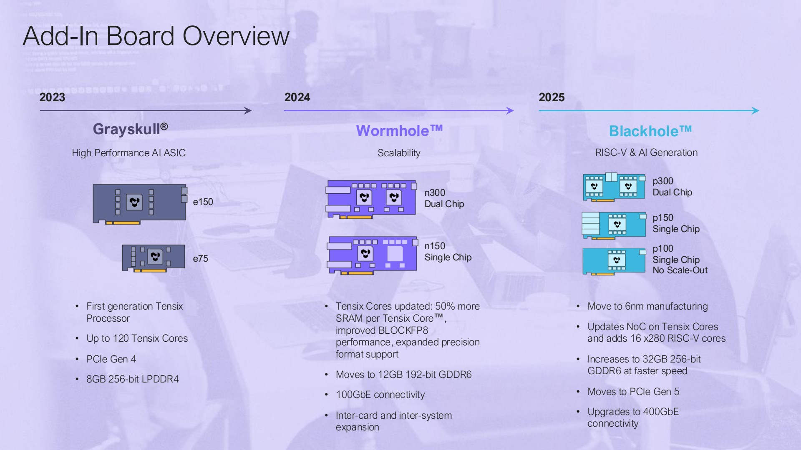

## Add-In Board Overview

<!-- p.8 -->

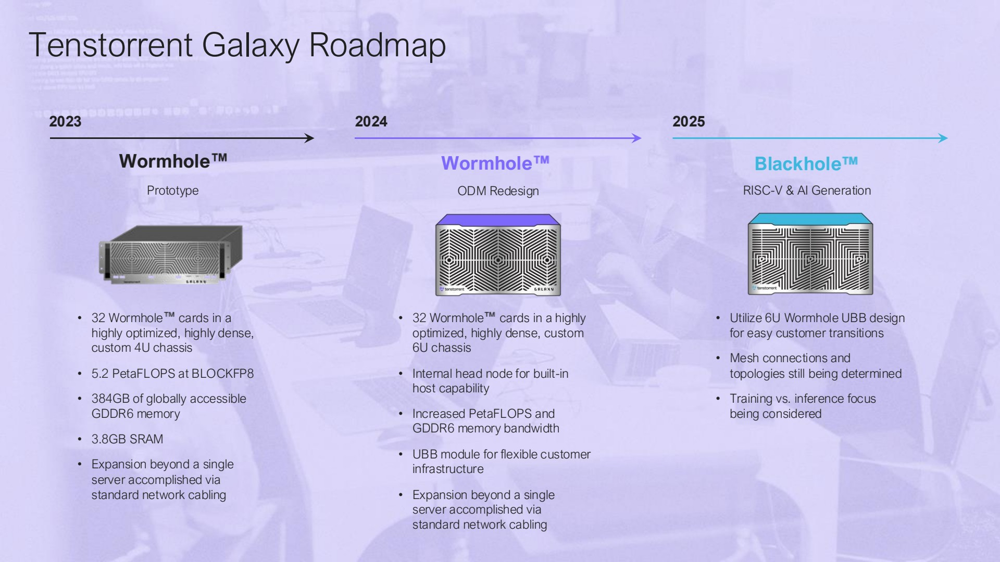

## Tenstorrent Galaxy Roadmap

<!-- p.9 -->

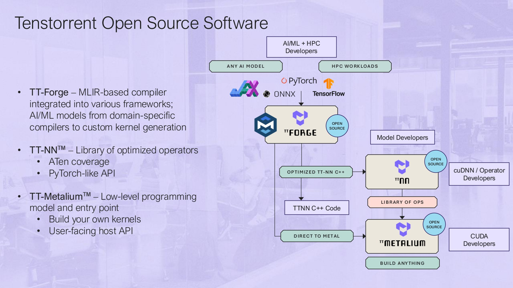

## Tenstorrent Open Source Software

- TT-Forge - MLIR-based compiler integrated into various frameworks; AI/ML models from domain-specific compilers to custom kernel generation
- TT-NN - Library of optimized operators
- ATen coverage
- PyTorch-like API
- TT-Metalium - Low-level programming model and entry point
- Build your own kernels
- User-facing host API

<!-- p.10 -->

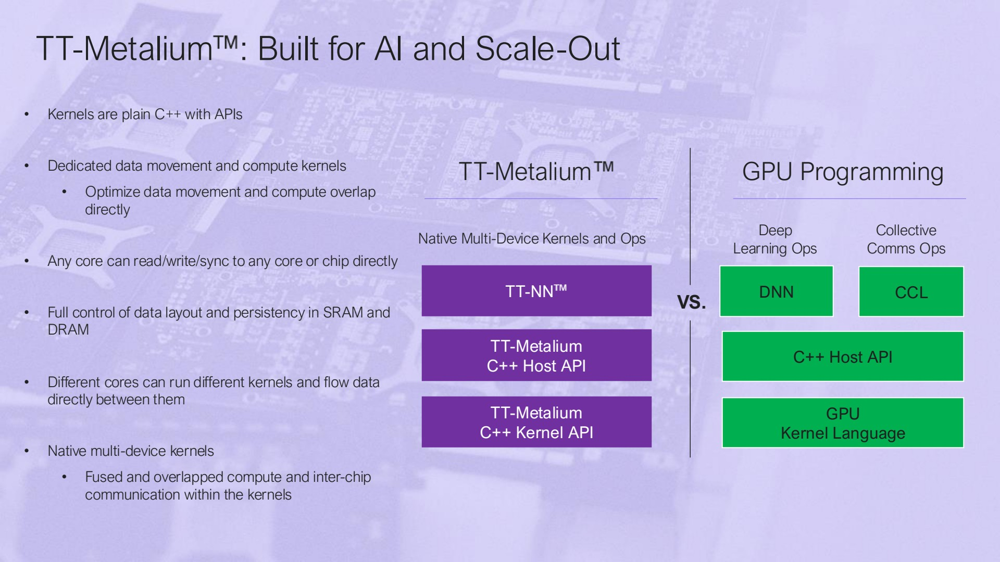

## TT-Metalium : Built for AI and Scale-Out

- Kernels are plain C++ with APIs
- Dedicated data movement and compute kernels
- Optimize data movement and compute overlap directly
- Any core can read/write/sync to any core or chip directly
- Full control of data layout and persistency in SRAM and DRAM
- Different cores can run different kernels and flow data directly between them
- Native multi-device kernels
- Fused and overlapped compute and inter-chip communication within the kernels

<!-- p.11 -->

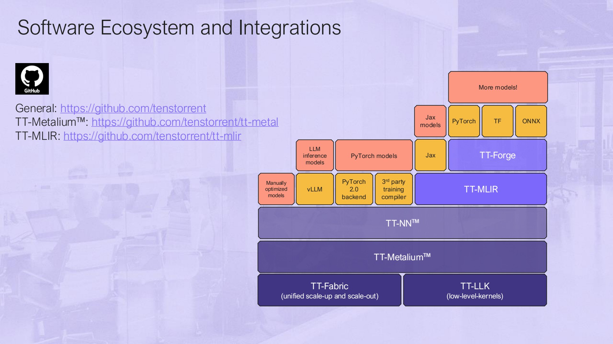

## Software Ecosystem and Integrations

[General: https://github.com/tenstorrent](https://github.com/tenstorrent)

[TT-Metalium : https://github.com/tenstorrent/tt-metal](https://github.com/tenstorrent/tt-metal)

[TT-MLIR: https://github.com/tenstorrent/tt-mlir](https://github.com/tenstorrent/tt-mlir)

<!-- p.12 -->

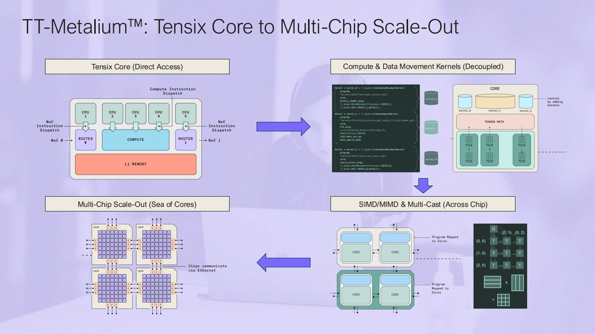

## TT-Metalium : Tensix Core to Multi-Chip Scale-Out

<!-- p.13 -->

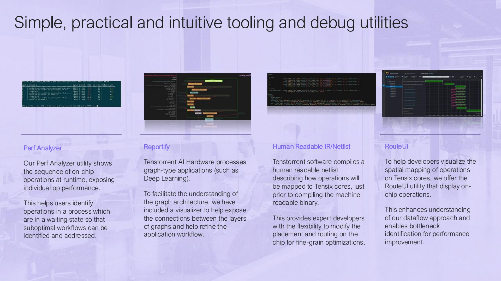

## Simple, practical and intuitive tooling and debug utilities

## Perf Analyzer

Our Perf Analyzer utility shows the sequence of on-chip operations at runtime, exposing individual op performance.

This helps users identify operations in a process which are in a waiting state so that suboptimal workflows can be identified and addressed.

## Reportify

Tenstorrent AI Hardware processes graph-type applications (such as Deep Learning).

To facilitate the understanding of the graph architecture, we have included a visualizer to help expose the connections between the layers of graphs and help refine the application workflow.

## Human Readable IR/Netlist

Tenstorrent software compiles a human readable netlist describing how operations will be mapped to Tensix cores, just prior to compiling the machine readable binary.

This provides expert developers with the flexibility to modify the placement and routing on the chip for fine-grain optimizations.

## RouteUI

To help developers visualize the spatial mapping of operations on Tensix cores, we offer the RouteUI utility that display onchip operations.

This enhances understanding of our dataflow approach and enables bottleneck identification for performance improvement.

<!-- p.14 -->

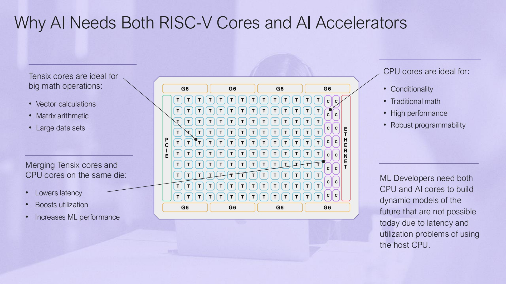

## Why AI Needs Both RISC-V Cores and AI Accelerators

<!-- p.15 -->

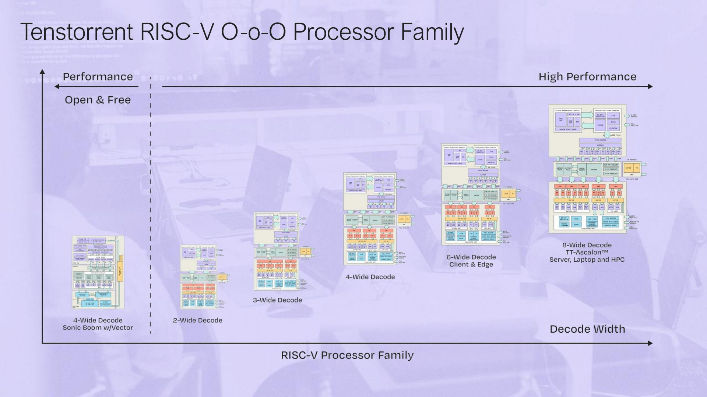

## Tenstorrent RISC-V O-o-O Processor Family

<!-- p.16 -->

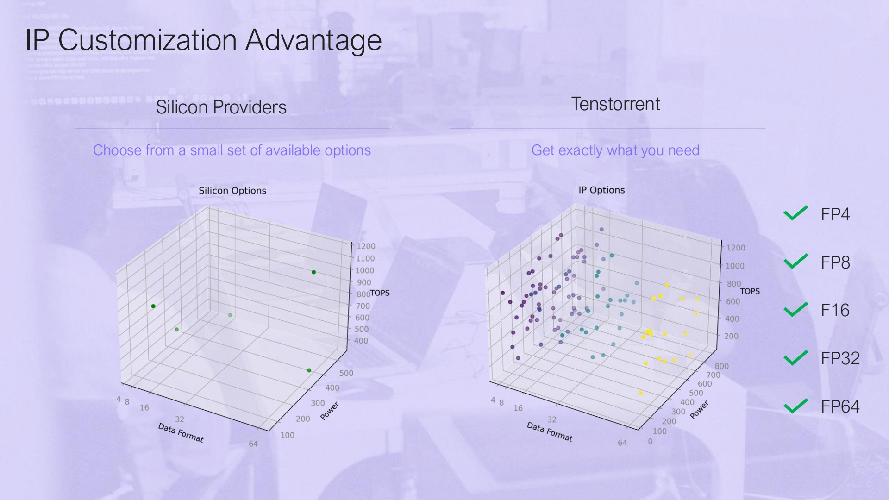

## IP Customization Advantage

<!-- p.17 -->

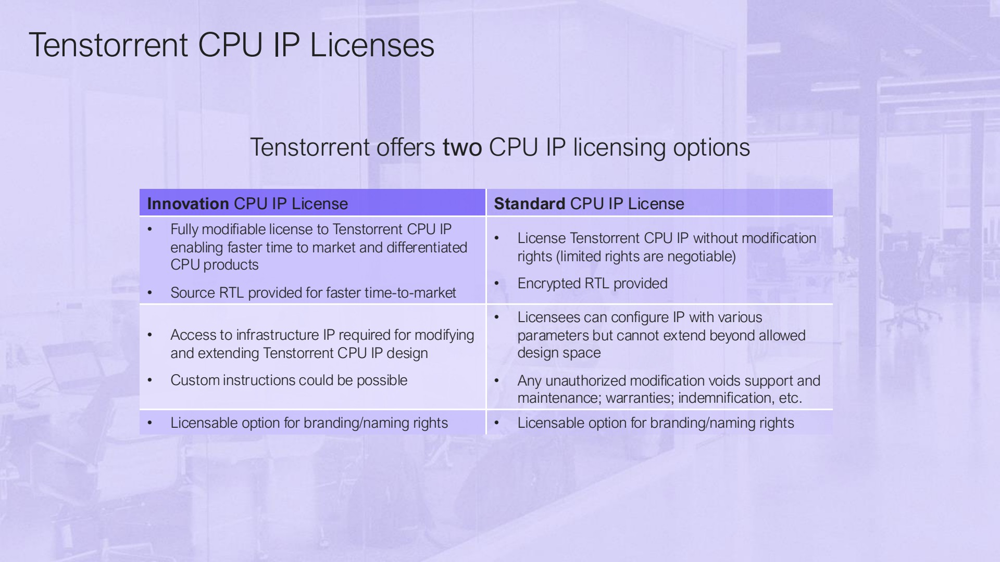

## Tenstorrent CPU IP Licenses

## Tenstorrent offers two CPU IP licensing options

| Innovation CPU IP License                                                                                                                                       | Standard CPU IP License                                                                                                                                                                             |
|-----------------------------------------------------------------------------------------------------------------------------------------------------------------|-----------------------------------------------------------------------------------------------------------------------------------------------------------------------------------------------------|
| • Fully modifiable license to Tenstorrent CPU IP enabling faster time to market and differentiated CPU products • Source RTL provided for faster time-to-market | • License Tenstorrent CPU IP without modification rights (limited rights are negotiable) • Encrypted RTL provided                                                                                   |
| • Access to infrastructure IP required for modifying and extending Tenstorrent CPU IP design • Custom instructions could be possible                            | • Licensees can configure IP with various parameters but cannot extend beyond allowed design space • Any unauthorized modification voids support and maintenance; warranties; indemnification, etc. |
| • Licensable option for branding/naming rights                                                                                                                  | • Licensable option for branding/naming rights                                                                                                                                                      |

<!-- p.18 -->

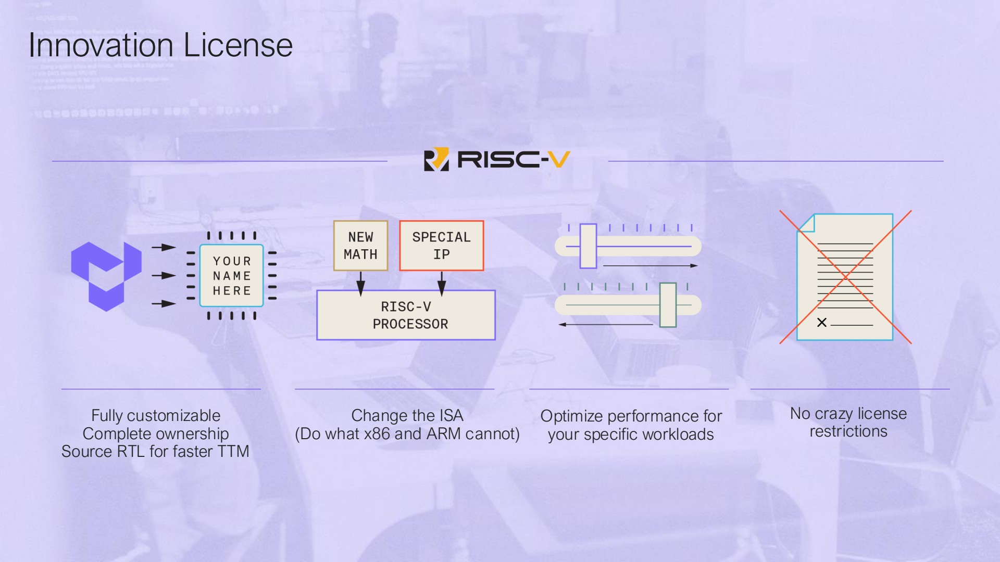

## Innovation License

<!-- p.19 -->

Thank You
